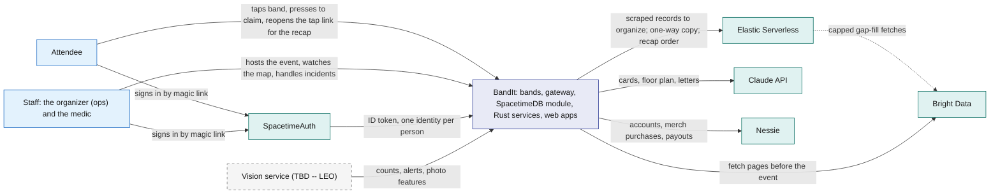
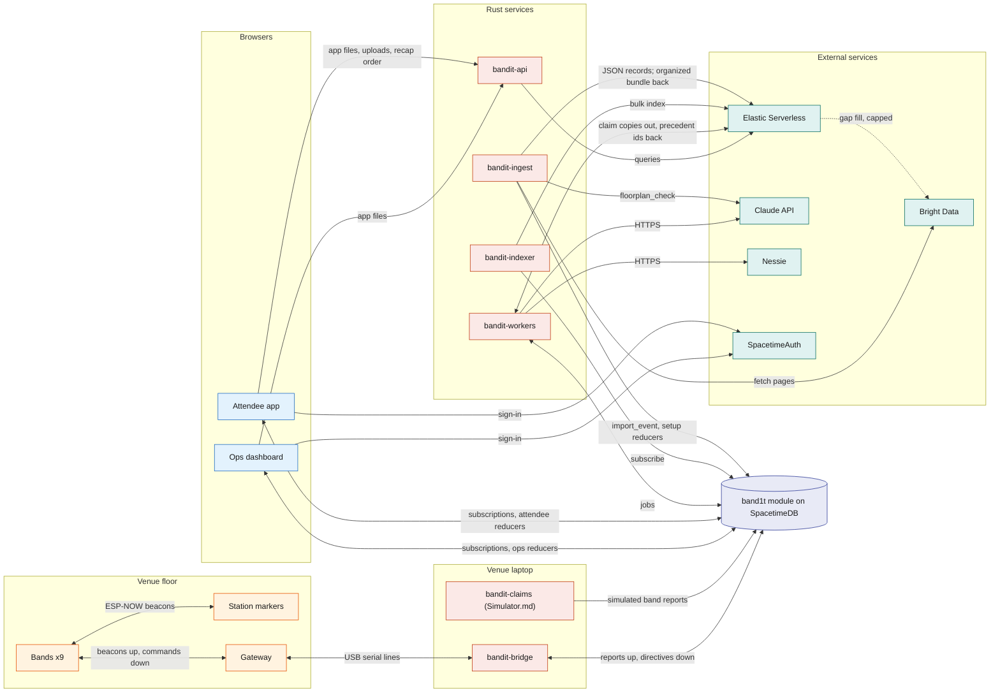
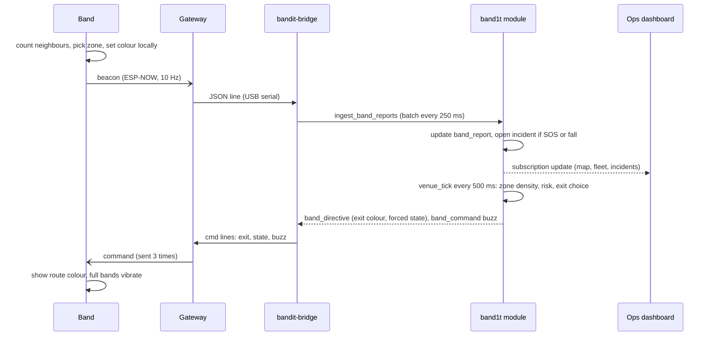
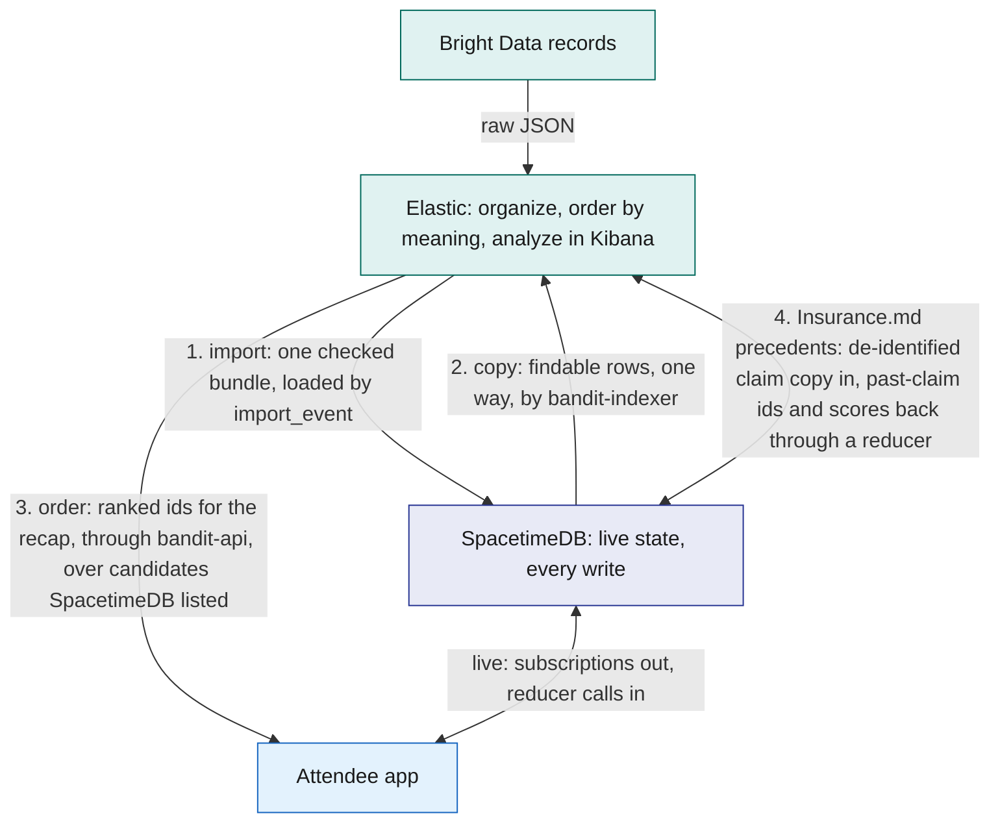
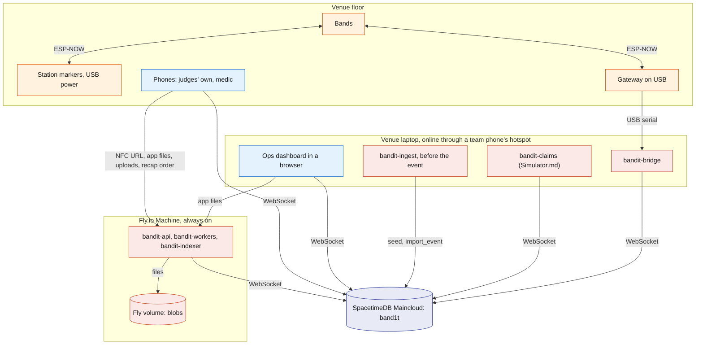

# Architecture

BandIt is a festival wristband plus a backend that turns a crowd of bands into a live, shared map of the event. The bands sense crowd density and emergencies on their own. One SpacetimeDB database holds every piece of live state and performs every action. Feature services (Elastic, AI, payments, insurance, merch) hang off that database and can be removed one by one. This file is the map: how the parts fit, where data lives, how the system is deployed, and what happens when a part fails.

## Role in the system

This file owns:

- the system context and the container view (every process and who it talks to);
- the data ownership rules (which store is the source of truth for what);
- the deployment;
- the cross-cutting failure table and the mapping from prize tracks to components.

It does not describe any component's internals. Those live in the component files listed in [README](../README.md).

## Interfaces

Every connection in the system. Names match the component docs.

| From | To | What flows | Transport |
|---|---|---|---|
| Band | Band, station marker, gateway | beacons (id, flags, neighbour count, zone, state, seq) | ESP-NOW broadcast, channel 1, 10 Hz |
| Station marker | Band, gateway | station beacons (id, exit colour) | ESP-NOW broadcast, 5 Hz |
| Gateway | Band, station marker | commands (`state`, `exit`, `clear`, `buzz`, `thresh`, `rssi`, `override`) | ESP-NOW broadcast, each sent 3 times |
| Gateway | `bandit-bridge` | one JSON line per packet heard; command lines back | USB serial, 115200 baud |
| `bandit-bridge` | `band1t` module | `ingest_band_reports` every 250 ms; subscriptions to `band_directive`, `band_command`, `fleet_config` | SpacetimeDB Rust client SDK (WebSocket) |
| Simulator.md: the `bandit-claims` command-line tool and `bandit-api`'s dev routes | `band1t` module | reports for the 10 simulated bands (90 to 99) through `report_sim_band`; the crowd of up to 80 bands runs inside the module | SpacetimeDB Rust client SDK |
| Ops dashboard, Attendee app | `band1t` module | reducer calls; subscriptions to their slice | SpacetimeDB TypeScript client SDK (WebSocket) |
| Ops dashboard, Attendee app | SpacetimeAuth | the magic-link email sign-in; an ID token that SpacetimeDB checks on connect | HTTPS, OpenID Connect |
| Ops dashboard, Attendee app | `bandit-api` | the app files, uploads and downloads, and the feature endpoints listed in [Rust-Backend](../3-services/Rust-Backend.md) | HTTPS, same origin |
| `bandit-workers` | `band1t` module | claim jobs, submit results | SpacetimeDB Rust client SDK |
| Anthropic-Agent.md, Payments-Nessie.md: `bandit-workers` | Claude API, Nessie | AI calls, bank calls | HTTPS |
| Elastic.md: `bandit-indexer` | `band1t` module, Elastic Serverless | subscription in, bulk index writes out | SDK in, HTTPS out |
| Elastic.md: `bandit-api` | Elastic Serverless | `GET /recap/order`: semantic queries that order the recap's people and booths, over candidates SpacetimeDB listed | HTTPS |
| `bandit-ingest` | `band1t` module | the seed through the setup reducers | SDK |
| BrightData.md: `bandit-ingest` | Bright Data Web MCP, Claude API, `band1t` module | page fetches and extraction; `floorplan_check`; `import_event` | HTTPS; SDK |
| Elastic.md: `bandit-ingest` | Elastic Serverless | parsed JSON records in; the organizer workflow's bundle back | HTTPS |
| Elastic.md, Insurance.md: `bandit-workers` | Elastic Serverless, `band1t` module | a de-identified copy of each claim into `bandit-claims` through the pipeline `bandit-claims-validate`; the ids and scores of similar past claims back, written through `submit_claim_checks` | HTTPS; SDK |
| Elastic.md: the organizer agent | Bright Data Web MCP | at most 10 gap-fill `extract` calls per run, through an Agent Builder MCP tool | HTTPS |
| Vision.md (TBD -- LEO): `bandit-vision` | `band1t` module, `bandit-api`, Claude API | zone counts, ground alerts, incident assessments, property events, photo features; frames stored as blobs; frames to Claude | reducer calls; HTTPS |

## Design

### Principles

1. **Safety never waits.** Density colours, SOS, fall detection and the light circle run on the bands themselves. The server adds coordination (exit colours, low visibility, escalation), but the bands stay useful if the laptop, the network or the cloud is gone.
2. **One source of truth.** The SpacetimeDB module `band1t` holds all live state. Every change is a reducer call, so it happens completely or not at all, and every screen sees the same committed state through subscriptions.
3. **Copies flow one way.** Any other store holds only files or a copy of committed rows. Results come back as SpacetimeDB ids, and acting on them is again a reducer call.
4. **Slow and external work goes through a queue.** AI and bank work are `job` rows claimed by `bandit-workers`. Code decides money, coverage, safety and access; the model only reads and writes words.
5. **Every feature can be deleted.** Core components are enough for the safety features. Each optional feature owns its tables, reducers and jobs, so removing its doc and code removes it cleanly.
6. **The backend is Rust.** The module, every service and every shared library are Rust. Only the two browser apps are TypeScript.

### System context

Who uses BandIt, and which outside services it relies on.

### Containers

Every running process and the main flows between them. The left half is the live safety path; the right half is the feature services.

Vision.md (TBD -- LEO): the Vision service is left out of this picture. Leo's default is a Rust process, `bandit-vision`, on the venue laptop. It pulls snapshots from one overhead phone camera over the pit, runs person and pose detection locally for head counts and person-down alerts, asks Claude to assess an event only after a band or the detector flags it, and writes the results through the reducers in [Vision](../4-devices/Vision.md). Identity always comes from the bands, never from faces.

### The live loop in one picture

What happens to one beacon, and how a server decision gets back to a band. Everything here is either on the band or a reducer call; nothing waits on AI or a queue. When the module guides people (crowd risk, low visibility), each band shows the colour of its exit and the full bands also vibrate through the `buzz` command, so wearers feel the cue to move ([Safety](../6-features/Safety.md)).

(TBD -- LEO) The medic approach and the dispersion route along `zone_link` paths use the same colour and vibration cue.

### Data ownership

Where each kind of data lives, and where copies go. "Source of truth" means the only place that data may be changed.

| Data | Source of truth | Written by | Copies |
|---|---|---|---|
| Venue layout: zones, exits, stations, booths, schedule | `band1t` module | the setup reducers from the seed (`bandit-ingest` seed mode), ops; BrightData.md: `import_event` | none; Elastic.md: `bandit-booths` |
| Bands, attendees, consent, staff roles | `band1t` module | attendee app, ops, the owner (role grants) | none |
| Live band reports, zone state, directives, commands | `band1t` module | `bandit-bridge`, `venue_tick`; Simulator.md: `report_sim_band` from the `bandit-claims` tool and `bandit-api` | none |
| Incidents, snapshots, witnesses, notes | `band1t` module | `ingest_band_reports`, ops, medics | none |
| (TBD -- LEO) Presence history | `band1t` module (`presence_sample`) | `memory_tick` | none; Social.md: derives `visit` from it and writes `social_encounter` by the encounter rule (TBD -- LEO); Elastic.md copies both, for findable attendees only, to `bandit-memories` |
| Zone history | `band1t` module (`zone_sample`) | `memory_tick` | none |
| Social.md: the people graph | `band1t` module (`people_link`) | the social step of `memory_tick`; `exhibits` links from the import | none; Elastic.md: `bandit-people` holds each findable attendee's interests, never the links |
| Medical-ID.md, Insurance.md: medical card (with the attendee's own health insurance), the venue's insurance policy | `band1t` module, private tables | attendee app, workers | never copied |
| Payments-Nessie.md, Insurance.md: wallets, claims, ledger | `band1t` module | reducers; workers record the Nessie ids | Nessie holds the bank records but never moves a balance, so the wallet balance is the module's own sum; Elastic.md: a de-identified copy of each claim in `bandit-claims` (codes, amounts, zones, times and a narrative built by code), used only to rank similar past claims |
| Files: photos, PDFs, letters | the blob store, a folder on the Fly volume | `bandit-api` and `bandit-workers`, each through `register_blob` | `blob_ref` row in the module (hash, size, owner, access class) |
| Raw radio log | `.jsonl` files on the laptop | `bandit-bridge` | stay on the laptop; used for calibration and replay |
| BrightData.md: raw fetch snapshots | versioned files kept with the project | `bandit-ingest` | loaded into the module through `import_event` |
| Anthropic-Agent.md: model calls | `model_call` rows plus response blobs | `bandit-workers`, `bandit-ingest`; Vision.md (TBD -- LEO): `bandit-vision` | used for audit |
| Elastic.md: raw scraped records and the organized bundle | Elastic raw indices and `bandit-bundles` | `bandit-ingest`, the organizer workflow | working data before the import; rebuilt from the snapshots at every run, never read at the event |

### What each database does best

SpacetimeDB and Elastic solve different problems, and BandIt shows each one doing what only it does. SpacetimeDB solves live shared state: many devices, services and screens changing and watching the same venue at once, where every screen must agree within one transaction.

What only SpacetimeDB does here:

| Strength | Where BandIt uses it | Why it matters here |
|---|---|---|
| Logic runs inside the database, as transactions | `ingest_band_reports` opens an SOS incident, freezes its snapshot with the bands in the light circle, and schedules the escalation in one reducer ([SpacetimeDB](../2-data/SpacetimeDB.md), [Safety](../6-features/Safety.md)) | every screen sees all of it or none of it; no app server sits between a band flag and the incident row |
| Push to every client on commit | the Ops map, the medic's incident desk, the attendee app and the bridge subscribe to queries and receive each change, with a local cache to render from | an SOS reaches the medic without polling, and the bridge reads its directives from the cache |
| Timers inside the database | scheduled reducers: `venue_tick` turns band reports into zone state and exit colours; `memory_tick` turns presence into history | the derived safety state is computed where the data lives, on a fixed cadence |
| Identity and access next to the data | claiming a band by pressing it binds the band to the signed-in identity, which SpacetimeDB derives from the SpacetimeAuth ID token; reducers check `staff_role`; views return only the caller's rows (`staff_incidents` for staff; the caller's own band and consent for attendees) | access is enforced once, in the database, for every client, so an app bug cannot widen it |
| (TBD -- LEO) The space-time mapping | `presence_sample`, written by `memory_tick`: which band was in which zone, and when | it is the filter other questions start from (Social.md: visits and encounters; Elastic.md: the recap candidates it orders) |
| One schema, typed clients, one hosted database | `spacetime generate` gives the Rust services and both TypeScript apps the same types; Maincloud hosts the module, so bands (through the bridge), phones, staff and services all reach the same database | six kinds of clients stay in step with one schema, and no server of ours sits on the live path |

Elastic.md: BandIt uses a second database because it has a second, different problem. Elastic solves meaning: messy scraped text before the import, and the order of an attendee's recap by what they were into, plus the analysis of it in Kibana. SpacetimeDB decides who and what is on the list (exact, private, live); Elastic decides the order by meaning (and organizes the scraped data, and finds claim precedents). Neither database does the other's job, and they meet in exactly three places, plus a fourth for Insurance.md's claim precedents, shown in the diagram after this table. Live state never lives in Elastic. What only Elastic does here:

| Strength | Where BandIt uses it | Why it matters here |
|---|---|---|
| Ordering by meaning | `semantic_text` fields on `.jina-embeddings-v5-text-small`: `GET /recap/order` puts the people an attendee met and the booths they visited in order of how close they are to what the attendee was into ([Elastic](../7-integrations/Elastic.md)) | two people who visited different booths can still care about the same things; SpacetimeDB filters by exact values and has no relevance ranking or vectors |
| An agent that resolves messy records | the Agent Builder agent `bandit-organizer` on the Elastic Managed LLM, run by the Workflow `bandit-organize` with a JSON schema per section, searching candidates and giving a reason per merge | one company spelled three ways becomes one organisation before anything reaches the live database |
| Bulk joins where raw data lands | ES\|QL `LOOKUP JOIN` steps match booth numbers, domains and stage names across thousands of raw records | the messy raw records never enter the live database; only the checked bundle does |
| Analysis you can see | Kibana, Elastic's web interface: the Workflows execution view, Agent Builder, and the dashboards "BandIt · Cal Hacks 13.0 · scrape pipeline" and "BandIt · Cal Hacks 13.0 · sponsors and prizes"; Insurance.md: the "BandIt claims evidence" dashboard | the team shows how the data was organized and what the scrape found about the event, without touching the live screens |

The diagram shows where the two meet and which way data flows at each meeting point.

The recap is the clearest example of the split:

- Social.md: SpacetimeDB holds the people graph and the lists. `memory_tick` writes `people_link` rows (`met`, `visited`, `works_at`, `exhibits`) in the same transaction as the encounter or visit they come from, so a new link reaches every screen by subscription at once. `my_graph` gives each caller only their own neighbourhood and `event_graph` gives the ops big screen an anonymous picture of the whole event; only `findable` attendees get links. The recap's people come from `my_encounters` and its booths from `my_visits`.
- Elastic.md: Elastic orders the lists. `bandit-people` holds each findable attendee's interests, built from their top booths, and `GET /recap/order` puts the people and booths closest to what the attendee was into first. It returns ids only, adds no one to the list and draws nothing on the graph.

### Which store answers which question

The line is drawn by the question: exact, live or transactional questions go to SpacetimeDB; questions of meaning go to Elastic.

| Question or data | Store | Why |
|---|---|---|
| Every write: claims, incidents, payments, consent, imports | SpacetimeDB reducers | one transactional write path, so every screen sees the same committed state |
| Live state: band reports, zone state, directives, incidents | SpacetimeDB tables and subscriptions | pushed to every client the instant a transaction commits; nothing polls |
| (TBD -- LEO) Who was in which zone, and when | SpacetimeDB (`presence_sample`) | derived by `memory_tick` from raw reports; the filter every other question starts from |
| Plain lists: my visits, the people I hung out with, my photos by zone and time, a booth by id or name | SpacetimeDB views | exact rows, already scoped to the caller by the view; no ranking needed |
| People and the links between them: who owns which band, who hung out with whom, whose socials a person may see | SpacetimeDB tables and views | exact rows that reducers write and views read by key under consent; Elastic only ever orders a findable copy |
| Consent and access: who may see a card, a tag, a memory | SpacetimeDB views and reducers | enforced by the database on every read; an app or index bug cannot widen it |
| Elastic.md: organizing scraped data before the import | Elastic (raw indices, fixed `LOOKUP JOIN` steps, the organizer agent, `bandit-bundles`) | exact joins and fuzzy entity resolution across messy sources are search work; the result is still loaded by a reducer |
| Elastic.md: "of the people I hung out with, who is most into the same things as me" | Elastic (`bandit-people`, `bandit-booths`) through `GET /recap/order` | ordering by meaning over candidates SpacetimeDB listed; there is no typed search |
| Elastic.md, Insurance.md: "which past claims look like this one" | Elastic (`bandit-claims`) | ranking by meaning over a de-identified copy against 30 seeded past claims; the ids and scores come back as checks through a reducer and never change an amount |
| Files: photos, PDFs, letters | the blob store on the Fly volume, with a `blob_ref` row | big bytes stay out of rows and subscriptions; the access class is still decided in the module |

### Deployment

Where each process runs, and how it reaches the database. There is one deployment. External services are left out of the picture: the Fly.io services and `bandit-ingest` call them over HTTPS.

- The `band1t` database runs on SpacetimeDB Maincloud only. There is no standalone copy and no second host, so there is never a second source of truth.
- `bandit-api`, `bandit-workers` and `bandit-indexer` run on one always-on Fly.io Machine. `bandit-api` serves both web apps as static files from its public HTTPS host, which is the host written into the NFC tags, so judges use their own phones. Blobs are files on a Fly volume attached to that Machine ([Rust-Backend](../3-services/Rust-Backend.md)).
- The venue laptop runs only what needs the room: `bandit-bridge` on the gateway's USB cable and the Ops dashboard in a browser. `bandit-ingest` runs on it once before the event.
- Simulator.md: the `bandit-claims` command-line tool runs on the venue laptop.
- Vision.md (TBD -- LEO): `bandit-vision` runs on the venue laptop.
- The laptop gets internet from a team phone's hotspot, so venue Wi-Fi is not on the critical path.

### Identifiers that cross component boundaries

| Identifier | Format | Assigned by | Used by |
|---|---|---|---|
| Band id | one byte, as on the radio: 1 to 9 for real bands; Simulator.md: 10 to 89 for the crowd bands, 90 to 99 for the simulated bands | firmware flag; Simulator.md: `start_crowd` and the simulated id range | radio, bridge, module, dashboard |
| Station id | 101 to 105; exit colour index defaults to id minus 100 | firmware flag | radio, zone selection, exit guidance |
| Gateway id | 200 | firmware | radio |
| NFC token | `BANDIT-01` to `BANDIT-09` in the URL `https://<host>/t/BANDIT-0n`, where `<host>` is `bandit-api`'s public host | written to each sticker | attendee app landing |
| Attendee id | SpacetimeDB identity derived from the SpacetimeAuth ID token (issuer and subject), the same on every device | SpacetimeDB | every per-person table and view |
| Service identity | one SpacetimeDB identity per Rust process, with a `staff_role` row | the owner at setup | role checks in reducers |
| Row ids | auto-increment ids assigned by the module | SpacetimeDB | every other table, Elastic document ids, job payloads |

### The event flow

The event runs as a fixed sequence of steps from joining to the recap, and [Flows](Flows.md) walks each step, names the doc that owns it and indexes the sequence diagrams in the other files.

### Access model in one paragraph

Every person signs in with the SpacetimeAuth magic link, and every privileged reducer checks the caller's `staff_role`. People roles are `owner` (the publishing identity, the only one that grants roles), `ops` (the organizer, also the event host) and `medic` (the paramedic during the event). Each Rust service has its own identity with a service role (`bridge`, `simulator`, `vision`, `ingest`, `indexer`, `worker`, `api`). Tables with personal data are private. Clients read them only through views keyed on who is asking, so rules such as "a medic sees a card only during an open incident" are enforced by the database, not by the app ([SpacetimeDB](../2-data/SpacetimeDB.md)).

Social.md: one more people role, `photographer`, uploads booth photos.

### Prize tracks and where they live

| Track | What BandIt shows | Main docs |
|---|---|---|
| SpacetimeDB | the whole live world in one module on Maincloud: reducers as transactions (an SOS incident, its snapshot, its light circle and its escalation in one commit), subscriptions pushing every change to six kinds of clients, scheduled reducers computing zone state and history, identity from the SpacetimeAuth sign-in and per-caller views enforcing access, typed bindings for Rust and TypeScript | [SpacetimeDB](../2-data/SpacetimeDB.md), [Safety](../6-features/Safety.md), [Gateway-Bridge](../3-services/Gateway-Bridge.md) |
| Elastic.md: best use of Elastic Agent Builder on Serverless | an Agent Builder agent (`bandit-organizer`) run by a Workflow with a schema per section, which resolves messy scraped records into one checked bundle before it loads into SpacetimeDB; each attendee's recap suggestions ordered by meaning; Insurance.md: similar past claims ranked for each claim; Kibana dashboards of every import run and of the event's sponsors and prizes. Where people spent time and what they were into shows in each attendee's recap, ordered by meaning | [Elastic](../7-integrations/Elastic.md) |
| Insurance.md: Hyphenate, autonomous systems for finance | a claims agent that learns from the organizer: a band's fall becomes a claim; Claude reads the urgent-care bill and code pays it against a fee schedule; Claude explains causation; the organizer approves the first claim after the event, which teaches a rule, and the next similar claim settles in seconds under it; fakes are refused by code with every check listed. Behind it: evidence packs, coverage in code, fail-closed approvals, a ledger, the notice of loss in ACORD 3 layout and a scorecard from planted claims | [Insurance](../6-features/Insurance.md) |
| Payments-Nessie.md: Capital One, best use of Nessie | a $200 Nessie sandbox wallet per attendee, merch bought from it with one tap after the event, and claim payouts into it | [Payments-Nessie](../7-integrations/Payments-Nessie.md) |
| Merch.md: Visa, reimagining shopping | merch made from your own photo at the booths you loved, bought from your recap after the event | [Merch](../6-features/Merch.md) |
| Social impact and real-world tracks | preventive crowd-crush guidance with exit colours and vibration, the SOS light circle, low visibility; Medical-ID.md: medic access to the card from the incident desk | [Safety](../6-features/Safety.md), [Hardware](../4-devices/Hardware.md); Medical-ID.md |
| (TBD -- LEO) Social impact, the medic approach | dispersion around a medic | [Safety](../6-features/Safety.md) |

## Failure modes and fallbacks

The failures that can happen during the event, and the one answer to each. The first three are on the live path.

| Failure | Effect | Design answer |
|---|---|---|
| The laptop, the bridge, the gateway or the laptop's hotspot fails | No new reports reach the database; the dashboard greys bands after 5 s | Bands keep density colours, SOS, fall detection and the light circle on their own; the bridge resyncs directives when it reconnects ([Gateway-Bridge](../3-services/Gateway-Bridge.md)). |
| Radio density readings flap in the taped square | Rings and the map disagree | Ops drives the colours from the dashboard with the override badge showing, and the presenter says so ([Safety](../6-features/Safety.md)). |
| A band reboots | It loses forced states and live calibration | The bridge sees its `seq` reset and re-sends directives and `fleet_config` ([Gateway-Bridge](../3-services/Gateway-Bridge.md)). |
| A sign-in email is slow | A judge waits on the sign-in screen | The screen offers "Send again"; a judge already signed in on their phone stays signed in ([Attendee-App](../5-apps/Attendee-App.md)). |
| Elastic.md: Elastic is unreachable during the event | The recap's suggestions are not ordered by meaning | The recap shows both lists by minutes together; Insurance.md: claims carry no precedent checks and decide the same way; nothing live reads Elastic ([Elastic](../7-integrations/Elastic.md)). |
| Anthropic-Agent.md: Claude is slow or refuses | A letter or card is late; Insurance.md: a bill is not read or a claim has no causation review | Each feature falls back without AI as its doc describes; Medical-ID.md: the card step shows "Check later" and setup goes on without a card; Insurance.md: staff type the bill lines and the claim goes to a person; nothing live waits on Claude ([Anthropic-Agent](../7-integrations/Anthropic-Agent.md)). |
| Payments-Nessie.md: Nessie is down | A wallet cannot open, and a merch order or a payout cannot settle | Each job retries without paying twice; a dead purchase fails the order and frees its money, so the attendee can buy again; a dead payout waits for `retry_claim_payout`; nothing else waits on Nessie ([Payments-Nessie](../7-integrations/Payments-Nessie.md)). |

## Dependencies

**Depends on:** every component doc, for the detail behind each box.

**Used by:** [README](../README.md) points here first; [Flows](Flows.md) and every component doc refer here for the big picture.

**If you delete a component:** remove its rows from the Interfaces, Data ownership, Which store answers which question, prize and failure tables above, its bullet in Deployment, its node from the diagrams, and its rows in [Flows](Flows.md). Core components (Hardware, Gateway-Bridge, SpacetimeDB, Safety, Ops-Dashboard, Attendee-App, Rust-Backend) are not meant to be deleted.

## Decisions

| Decision | Why |
|---|---|
| The `band1t` database runs on Maincloud only, and the venue laptop gets internet from a team phone's hotspot | one deployment means one source of truth, one set of identities and no switch-over during the event; venue Wi-Fi is off the critical path |
| BrightData.md: the import works for any event, from the start URLs in its seed; Cal Hacks 13.0 is the first event it runs at | the product must work at any venue, and the judges are at Cal Hacks 13.0, so the booths, schedule and organisations on screen are ones they can check against the room |
| Judges use their own phones; `bandit-api` serves both web apps from its public HTTPS host, which the NFC tags hold | one host in the tags, and the app files, uploads and API calls share one origin |
| `bandit-api`, `bandit-workers` and `bandit-indexer` run on one Fly.io Machine; the laptop runs only the bridge, the `bandit-claims` tool, `bandit-ingest` and the Ops dashboard | the laptop holds what needs the gateway's cable or the team's hands; the services keep running when the laptop sleeps |
| Social.md: people and the links between them live in SpacetimeDB tables; no graph database, separate Postgres or Kibana Graph | every link is an exact fact from a visit, an encounter row or the import, written in the same transaction as its visit or encounter, pushed live and filtered per caller by views; a graph of hundreds of nodes needs only one or two hops of indexed lookups; Kibana Graph is unavailable on Serverless and discovers implicit links, which the visit and encounter rows already record. Elastic.md: Elastic only orders the recap's suggestions |
| Payments-Nessie.md: nobody pays at the venue; Nessie settles only the merch bought in the app after the event and the claim payouts | the band press stays for claiming a band, and the money moments judges see at the event are the merch checkout and the insurance payout |
| Full bands vibrate through `buzz` alongside the route colour whenever the module guides people | the ring has no compass, so colour plus vibration is how a band points its wearer to its exit |
| One sign-in for every person: the SpacetimeAuth magic link, with no other providers | the identity comes from the ID token's issuer and subject, so a judge is the same attendee on every device, and BandIt keeps no password and sends no email |
| The failure table keeps only failures that can happen during the event | other infrastructure faults are handled in each component's own doc |
