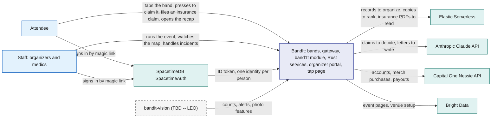
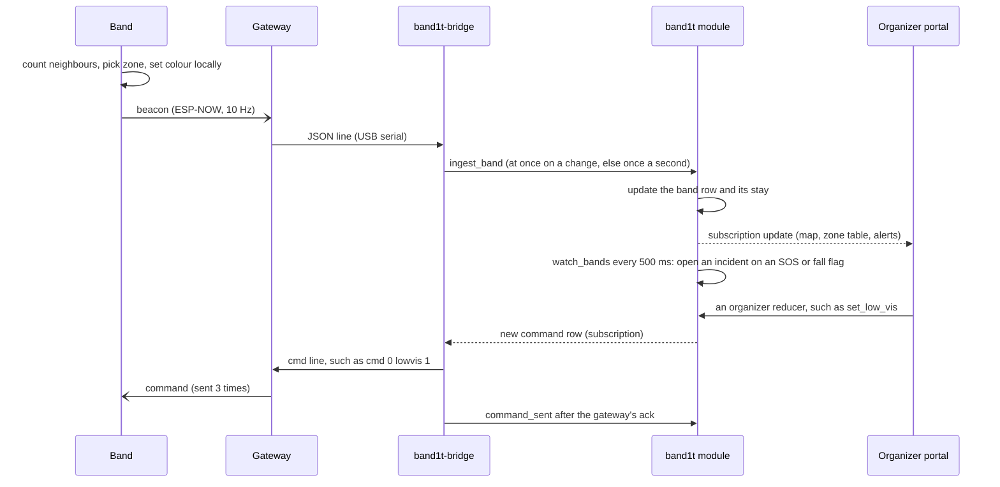
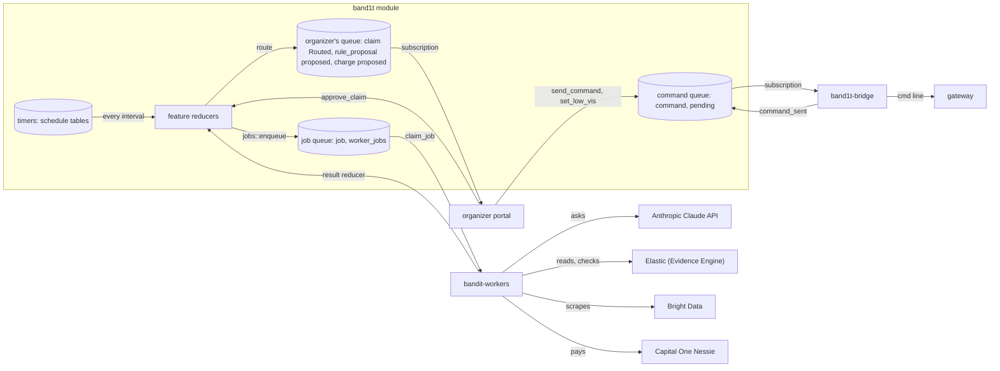
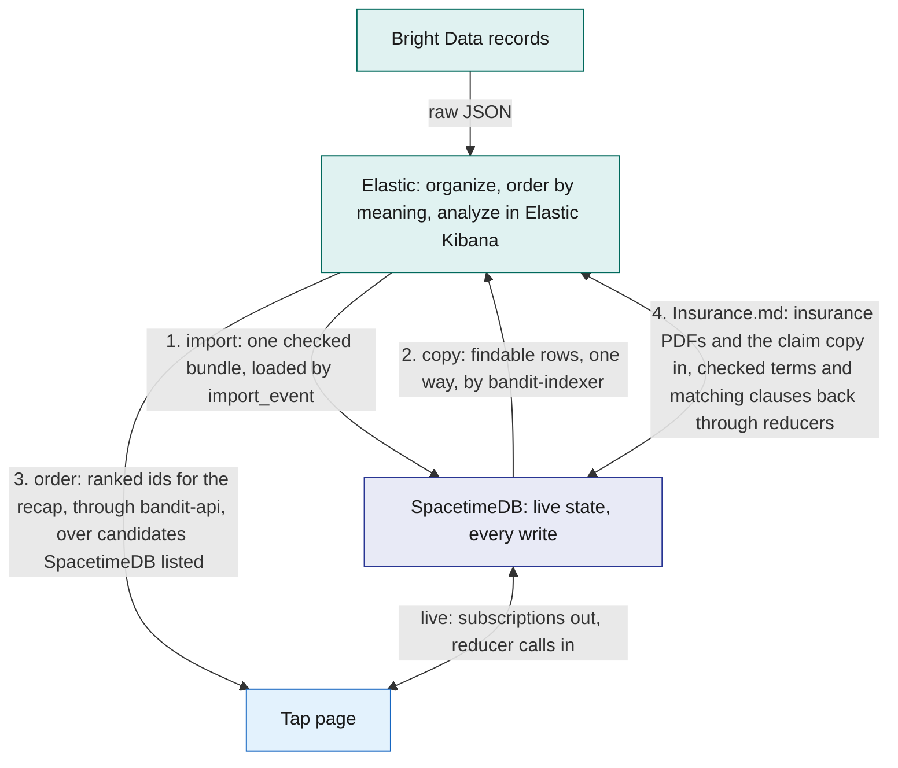
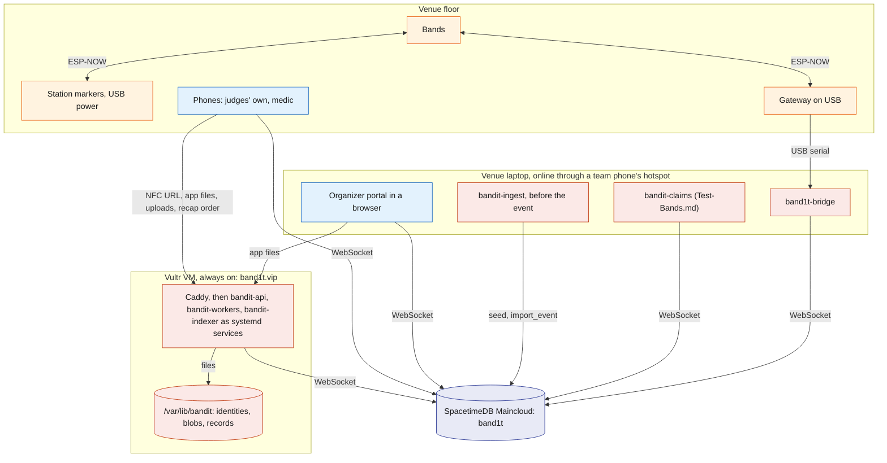

# Architecture

BandIt is a festival wristband plus a SpacetimeDB module and Rust services that turn a crowd of bands into a live, shared map of the event. The bands sense crowd density and emergencies on their own.

One SpacetimeDB module, `band1t`, holds every piece of live state and performs every action. Feature services (Elastic, AI, payments, insurance, merch) hang off the module and can be removed one by one.

This file is the map: how the parts fit, where data lives, how the system is deployed, and what happens when a part fails.

## Role in the system

This file owns:

- the system context and how the parts interact: every process, what flows between them and who decides what;
- the data ownership rules (which store is the source of truth for what);
- the deployment;
- the cross-cutting failure table. The mapping from each sponsor track to components is in [Sponsor-Tracks](Sponsor-Tracks.md).

It does not describe any component's internals. Those live in the component files listed in [README](../README.md).

## Interfaces

Every connection in the system. Names match the component docs.

| From | To | What flows | Transport |
|---|---|---|---|
| Band | Band, station marker, gateway | beacons (id, flags, neighbour count, zone, state, seq, the friend it is finding) at 10 Hz; a heard list (every peer heard in the last 2 s) once a second | ESP-NOW broadcast, channel 1 |
| Station marker | Band, gateway | station marker beacons (station id, exit colour) | ESP-NOW broadcast, 5 Hz |
| Gateway | Band, station marker | the 13 commands, such as `state`, `exit`, `clear` and `lowvis` | ESP-NOW broadcast, each sent 3 times |
| Gateway | `band1t-bridge` | one JSON line per packet heard; command lines back | USB serial, 115200 baud |
| `band1t-bridge` | `band1t` module | `gateway_up`; `ingest_band` when a band's line changes, else at most once a second; `ingest_station`; `ingest_heard`; `command_sent`; one subscription to the pending `command` rows | SpacetimeDB Rust client SDK (WebSocket) |
| The SpacetimeDB command line, run by the owner and organizers | `band1t` module | role grants, `import_event`, `start_safety_watch`, and the band commands that have no control on a page | SpacetimeDB CLI over HTTPS |
| Test-Bands.md: the `bandit-claims` command-line tool and `bandit-api`'s dev routes | `band1t` module | reports for the 10 test bands (90 to 99) through `report_test_band`; Social.md: the crowd, up to 2,000 bands from 100 (1,000 at the event), runs inside the module | SpacetimeDB Rust client SDK |
| Organizer portal (/organizer), tap page (/t/code) | `band1t` module | reducer calls; subscriptions to their slice | SpacetimeDB TypeScript client SDK (WebSocket) |
| Organizer portal, tap page | SpacetimeDB SpacetimeAuth | the magic-link email sign-in; an ID token that SpacetimeDB checks on connect | HTTPS, OpenID Connect |
| Organizer portal, tap page | `bandit-api` | the app files, uploads and downloads, and the feature endpoints listed in [Rust-Backend](../3-services/Rust-Backend.md) | HTTPS, same origin |
| `bandit-workers` | `band1t` module | claim jobs, submit results | SpacetimeDB Rust client SDK |
| Anthropic-Claude-API.md, Capital-One-Nessie.md: `bandit-workers` | Anthropic Claude API, Capital One Nessie API | AI calls, bank calls | HTTPS |
| Elastic.md: `bandit-indexer` | `band1t` module, Elastic Serverless | subscription in, bulk index writes out | SDK in, HTTPS out |
| Elastic.md: `bandit-api` | Elastic Serverless | `GET /api/recap`: semantic queries that order the recap's people and booths, over candidates SpacetimeDB listed | HTTPS |
| Bright-Data.md: `bandit-ingest` | Bright Data Web MCP, `band1t` module | page fetches (`scrape_as_markdown`) and company datasets (`run_scraper`); `import_event` | HTTPS; SpacetimeDB HTTP API |
| Bright-Data.md: `pipeline/venue_model.py`, run by hand before the event | Bright Data Browser API | the Cal Hacks venue map opened in a remote browser; its 3D scene back as the file `web/venue/venue.glb` | CDP over WebSocket, through Playwright |
| Bright-Data.md: `bandit-workers`, job `venue_setup` | Bright Data Web MCP, Bright Data Web Unlocker API, Anthropic Claude API, Bright Data Browser API | a venue set up from the event's name on the organizer portal: search, pages, the picks `venue_find` and `venue_map`, and the model exported by `pipeline/venue_model.py` | HTTPS; CDP over WebSocket, through Playwright |
| Elastic.md: `bandit-ingest` | Elastic Serverless | parsed JSON records in; the bundle back from `bandit-organize` in Elastic Workflows | HTTPS |
| Elastic.md, Insurance.md: `bandit-workers` | Elastic Serverless, `band1t` module | every insurance PDF, read into terms and clauses by `bandit-read-document` (next to build); a de-identified copy of each claim into `bandit-claims` through the pipeline `bandit-claims-validate`, with the clauses of both policies that bear on it back, written through `submit_claim_checks` | HTTPS; SDK |
| Vision.md (TBD -- LEO): `bandit-vision` | `band1t` module, `bandit-api`, Anthropic Claude API | zone counts, ground alerts, camera sightings, property events, photo features; frames stored as blobs; frames to the Anthropic Claude API | reducer calls; HTTPS |

## Design

### Principles

1. **Safety never waits.** Density colours, SOS, fall detection and the light circle run on the bands themselves. The module adds the incident record, the staff screens and the commands organizers send, but the bands stay useful if the venue laptop, the network or the cloud is gone.
2. **One source of truth.** The SpacetimeDB module `band1t` holds all live state. Every change is a reducer call, so it happens completely or not at all, and every screen sees the same committed state through subscriptions.
3. **Copies flow one way.** Any other store holds only files or a copy of committed rows. Results come back as SpacetimeDB ids, and acting on them is again a reducer call.
4. **Slow and outside work goes through a queue.** A feature's slow or outside work, such as reading a PDF, deciding a claim or paying, is a `job` row that `bandit-workers` leases. [Queues](#queues) names every queue and every job kind. Code decides money, coverage, safety and access; the Anthropic Claude API reads documents, makes judgments and writes words.
5. **Every feature can be deleted.** Core components are enough for the safety features. Each optional feature owns its tables, reducers and jobs, so removing its doc and code removes it cleanly.
6. **The module and services are Rust.** The module, every service and every shared library are Rust. Only the two browser apps are TypeScript.

### How the parts interact

Four rules decide which part does what:

- **SpacetimeDB owns live and exact state.** Every write is a reducer call in the module on SpacetimeDB Maincloud, and every screen and service reads the result by subscription.
- **The Evidence Engine (Elastic) reads, validates, organizes and ranks by meaning.** It gets copies, raw records and every insurance PDF, and gives back checks, ids, scores, and the policy terms and clauses a claim is held to (next to build). Acting on any of them is again a reducer call.
- **The Anthropic Claude API judges and writes; code computes every amount.** Inside the insurance Decision Engine it investigates each claim and decides pay, refuse or ask the organizer, and code's guard holds that decision to the policy terms and the checks. Code checks every answer before the module uses it.
- **Random outcomes come from a seeded RNG in code, never from the Anthropic Claude API.** Insurance.md: in the live run, who falls, where and when comes from a generator seeded with `live_run.seed`, so a run can be played again exactly.

The question this diagram answers: which part talks to which, and what flows along each arrow.

```mermaid
flowchart LR
  subgraph Venue["Venue"]
    subgraph Radio["ESP-NOW radio, channel 1"]
      Bands["Bands"]
      Markers["Station markers and exit markers"]
    end
    Gateway["Gateway"]
    Cameras["Security cameras (TBD -- LEO)"]
    subgraph Laptop["Venue laptop"]
      Bridge["band1t-bridge"]
      SecView["Security view (TBD -- LEO)"]
      Ingest["bandit-ingest, before the event"]
    end
  end
  subgraph Cloud["SpacetimeDB Maincloud"]
    STDB[("The module, band1t: live and exact state")]
  end
  subgraph Vultr["Vultr server, band1t.vip"]
    API["bandit-api"]
    Workers["bandit-workers"]
    Indexer["bandit-indexer"]
  end
  subgraph Browsers["Browsers"]
    Portal["Organizer portal /organizer"]
    Tap["Tap page /t/code"]
  end
  subgraph Outside["Outside services"]
    Auth["SpacetimeDB SpacetimeAuth"]
    Claude["Anthropic Claude API: reads and judges"]
    Elastic["Elastic, The Evidence Engine: validates, organizes, ranks"]
    Nessie["Capital One Nessie API"]
    Bright["Bright Data"]
  end

  Bands -->|"beacons, 10/s"| Bands
  Markers -->|"station id + exit colour, 5/s"| Bands
  Radio -->|"beacons + heard lists"| Gateway
  Gateway -->|"commands, sent 3 times"| Radio
  Gateway <-->|"JSON lines up, cmd lines down"| Bridge
  Bridge -->|"band reports, ingest_band"| STDB
  STDB -->|"pending commands, subscription"| Bridge
  Cameras -.->|"live video, 30 fps"| SecView
  SecView -.->|"camera assessment, submit_vision_assessment"| STDB
  Ingest -->|"page fetches, scrape_as_markdown"| Bright
  Ingest -->|"raw records, bundle back, bandit-organize"| Elastic
  Ingest -->|"event bundle, import_event"| STDB
  Portal -->|"magic-link sign-in"| Auth
  Tap -->|"magic-link sign-in"| Auth
  Auth -->|"ID token, checked on connect"| STDB
  STDB -->|"live rows, subscription"| Portal
  Portal -->|"staff actions, resolve_incident"| STDB
  STDB -->|"own rows, my_band"| Tap
  Tap -->|"attendee actions, update_profile"| STDB
  Portal -->|"policy + hospital report PDFs, POST /api/blobs"| API
  Tap -->|"uploads + recap, GET /api/recap"| API
  STDB -->|"recap rows, subscription"| API
  API -->|"semantic query, ids + scores back"| Elastic
  STDB -->|"job rows, worker_jobs"| Workers
  Workers -->|"lease + result, submit_claim_review"| STDB
  Workers -->|"claims to investigate, decisions back"| Claude
  Workers -->|"insurance PDFs + claim copy, terms + clauses back"| Elastic
  Workers -->|"wallet, purchase, deposit"| Nessie
  Workers -->|"venue search + pages, venue_setup"| Bright
  STDB -->|"venue + social rows, subscription"| Indexer
  Indexer -->|"bulk index, bandit-people"| Elastic

  classDef device fill:#FFF3E0,stroke:#E65100,color:#1A1A1A
  classDef rust fill:#FBE9E7,stroke:#BF360C,color:#1A1A1A
  classDef stdb fill:#E8EAF6,stroke:#283593,color:#1A1A1A
  classDef web fill:#E3F2FD,stroke:#1565C0,color:#1A1A1A
  classDef ext fill:#E0F2F1,stroke:#00695C,color:#1A1A1A
  classDef tbd fill:#F5F5F5,stroke:#757575,color:#1A1A1A,stroke-dasharray:5 5
  class Bands,Markers,Gateway device
  class Bridge,Ingest,API,Workers,Indexer rust
  class STDB stdb
  class Portal,Tap web
  class Auth,Claude,Elastic,Nessie,Bright ext
  class Cameras,SecView tbd
```

Dashed boxes and arrows are Leo's security view (TBD -- LEO). Arrows point from the caller; "back" marks what the call returns.

#### Every interaction

One row per arrow above, in the same order. Call names are spelled as the code spells them.

| From | To | What flows | Call | Transport | Why this way |
|---|---|---|---|---|---|
| Band | Band | beacons: id, flags, neighbour count, zone, state, seq | none | ESP-NOW broadcast, 10 Hz | density and the light circle need no laptop and no network |
| Station marker, exit marker | Band | station id and exit colour | none | ESP-NOW broadcast, 5 Hz | each band picks its zone itself, and homes in on the exit marker of its colour |
| Band, station marker | Gateway | every beacon; each band's heard list once a second | none | ESP-NOW broadcast | one radio hears the whole venue |
| Gateway | Band, station marker | the 13 commands, such as `state`, `exit`, `clear` and `lowvis` | none | ESP-NOW broadcast, each sent 3 times | a broadcast gets no ack, so repeats cover lost packets |
| Gateway | `band1t-bridge`, both ways | one JSON line per packet heard, and the gateway's acks; `cmd` lines back, such as `cmd 0 lowvis 1` | `cmd` | USB serial, 115200 baud | the gateway stays a plain radio; the logic stays in Rust |
| `band1t-bridge` | the module | a band's report at once on a change, else once a second; station and heard reports; acks | `ingest_band`, `ingest_station`, `ingest_heard`, `gateway_up`, `command_sent` | SpacetimeDB Rust client SDK (WebSocket) | each report is one transaction every screen sees |
| the module | `band1t-bridge` | new `command` rows | subscription `SELECT * FROM command WHERE pending = true` | the same WebSocket | a command reaches the radio the moment it commits |
| Vision.md (TBD -- LEO): security cameras | security view | live video at 30 fps | none | read directly by the venue laptop | the security view works without the internet |
| Vision.md (TBD -- LEO): security view | the module | a camera assessment of an incident; property events | `submit_vision_assessment`, `report_property_event` | SpacetimeDB client SDK, role `vision` | the module, not the camera, decides what happens next |
| Bright-Data.md: `bandit-ingest` | Bright Data Web MCP | the event's pages and company datasets | `scrape_as_markdown`, `run_scraper` | MCP over HTTPS | Bright Data does every step that touches the web |
| Elastic.md: `bandit-ingest` | Elastic | raw records into `bandit-raw-pages`, `bandit-raw-orgs` and `bandit-raw-plan`; the organized bundle back from `bandit-bundles` | the Elastic Workflows workflow `bandit-organize` | HTTPS | messy text is resolved before anything reaches the module |
| Bright-Data.md: `bandit-ingest` | the module | the checked event bundle | `import_event` | SpacetimeDB HTTP API | the whole event loads in one transaction or not at all |
| Organizer portal | SpacetimeDB SpacetimeAuth | the magic-link email sign-in | OpenID Connect at `auth.spacetimedb.com/oidc` | HTTPS | BandIt keeps no password and sends no email |
| Tap page | SpacetimeDB SpacetimeAuth | the magic-link email sign-in | OpenID Connect at `auth.spacetimedb.com/oidc` | HTTPS | a judge signs in on their own phone |
| SpacetimeDB SpacetimeAuth | the module | the ID token, which each page passes when it connects | none | OpenID Connect | one identity per person, the same on every device |
| the module | Organizer portal | live rows: bands, zones, incidents; Insurance.md: claims | subscriptions such as `band`, `open_incidents`, `board_notes`; Insurance.md: `claims_board` | SpacetimeDB TypeScript client SDK (WebSocket) | every change is pushed; nothing polls |
| Organizer portal | the module | staff actions | `resolve_incident`, `add_incident_note`, `set_low_vis`, `end_event`; Insurance.md: `file_claim_for_wearer`, `submit_medical_record`, `approve_claim`, `refuse_claim`, and at setup `submit_policy_document` and `confirm_policy_terms` (next to build) | the same WebSocket | each action is one transaction, checked against `staff_role` |
| the module | Tap page | the attendee's own rows | views such as `my_band` and `my_attendee` | SpacetimeDB TypeScript client SDK (WebSocket) | views scope every row to the caller |
| Tap page | the module | attendee actions | `claim_band`, `update_profile`; Insurance.md: `file_claim` | the same WebSocket | the module checks who may do what |
| Organizer portal | `bandit-api` | the app files; Insurance.md: the venue's policy PDF and a hospital report PDF | `POST /api/blobs` | HTTPS, same origin | big files stay out of rows; the module keeps the access class |
| Tap page | `bandit-api` | the app files, uploads, and the recap with its suggestions in order | `POST /api/blobs`, `GET /api/recap` | HTTPS, with the session token from `open_api_session` | only `bandit-api` holds the Elastic key |
| the module | `bandit-api` | session rows and the rows each recap is built from | subscription to `api_sessions`; Social.md: `social_visits`, `social_encounters` | SpacetimeDB Rust client SDK | SpacetimeDB decides who and what is on the list |
| Elastic.md: `bandit-api` | Elastic | a semantic query over the candidates; ids and scores back | `_search` on `bandit-people` and `bandit-booths` | HTTPS, 10 s timeout | Elastic only orders the ids it is given |
| the module | `bandit-workers` | queued and leased jobs | subscription to the view `worker_jobs` | SpacetimeDB Rust client SDK | slow and outside work never runs inside a transaction |
| `bandit-workers` | the module | leases, then one result per job | `claim_job`, `extend_job_lease`, `fail_job` and each kind's result reducer; Insurance.md: such as `submit_claim_checks` and `submit_claim_review` | the same WebSocket | the module checks the lease and applies the result in one transaction |
| Anthropic-Claude-API.md: `bandit-workers` | Anthropic Claude API | claims to investigate with tools, hospital reports to write for a drawn case, medical history PDFs, letters; JSON in a fixed schema back | jobs `claim_review`, `clinic_report`, `claim_record_extract`, `claim_draft`, `recovery_letter`, `medical_extract`, `venue_setup` | HTTPS through `claude-client` | the Anthropic Claude API judges and writes; code checks every answer and holds every claim decision to its limits |
| Elastic.md, Insurance.md: `bandit-workers` | Elastic | every insurance PDF, read into terms and clauses (next to build); a de-identified copy of each claim, and later its outcome; the validation and the matching policy clauses back | jobs `document_read` (`bandit-documents-extract`, `bandit-read-document`, next to build) and `claim_verify` (pipeline `bandit-claims-validate`, a semantic query on `bandit-policy-clauses`) | HTTPS through `claims-elastic` | the venue's own contract decides what a claim is covered for |
| Capital-One-Nessie.md: `bandit-workers` | Capital One Nessie API | wallets, merch purchases, claim payouts | jobs `wallet_open`, `merch_purchase`, `claim_payout` | HTTPS | the bank keeps the records; the module keeps the balance |
| Bright-Data.md: `bandit-workers` | Bright Data | a venue set up from the event's name: search, pages and the 3D map | job `venue_setup`: Bright Data Web MCP `search_engine`, Bright Data Web Unlocker API, Bright Data Browser API through `pipeline/venue_model.py` | HTTPS; CDP over WebSocket | any event's venue from its name alone |
| Elastic.md: the module | `bandit-indexer` | venue and social rows | subscription to `zone`, `organization`, `booth`, `schedule_slot`, `social_attendees`, `social_visits` | SpacetimeDB Rust client SDK | a one-way copy; nothing flows back |
| Elastic.md: `bandit-indexer` | Elastic | booth documents and each findable attendee's interests | `_bulk` into `bandit-booths` and `bandit-people`, at most once a second | HTTPS | live state never lives in Elastic |

### Who decides what

Each kind of decision has one maker, with a guardrail in code around it. The Anthropic Claude API judges what a document or a claim says, Elastic orders by meaning, and code computes every amount and every route.

| Decision | Made by | Input | Guardrail |
|---|---|---|---|
| Zone and density | code on the band | the signal of the station markers and bands it heard in the last few seconds | hysteresis stops a count at a threshold from flapping; an organizer can override it with `set_override` and `force_state` |
| The light circle | code on the band | an SOS or fall beacon heard at -58 dBm or stronger (`circle_rssi`) | it takes no command and ranks above a forced state; the module only records the witnesses |
| An incident opening | code in the module (`watch_bands`, every 500 ms); a person with `open_incident` | a band's SOS or fall flag; a staff report of damage, or of an injury no band flagged | one open incident per band, and a flag within 10 s of a resolve does not reopen it; the snapshot is frozen in the same transaction |
| Insurance.md: the venue's policy terms (next to build) | The Evidence Engine reads them from the policy PDF; the organizer confirms them (`confirm_policy_terms`) | the venue's uploaded policy PDF | every term quotes its clause and page; code checks each quote word for word and the limits against each other before the organizer sees them |
| Insurance.md: whether there is a claim | the attendee who wore the band (`file_claim`), or staff for them (`file_claim_for_wearer`); code opens a property claim when the incident resolves | the attendee's own words | one claim per incident, and the claimant must have worn the band at the time |
| Insurance.md: which hospital report comes back | code in the module: one roll of its seeded generator (`Scenario::pick`) | the incident and the attendee's own words | 3 in 6 match the incident; the Anthropic Claude API only writes the report for the drawn case (`clinic_report`) |
| Insurance.md: a claim's amount | code in the module (`cover_lines` and `compute_amounts` in `bandit-insurance`) | the bill lines read from the hospital report; the fee schedule and the cover's limits, from the venue's confirmed policy terms (next to build; seeded today) | `validate_record` drops a line whose page is not in the PDF; a decision that names a figure code did not compute is rejected; every ledger journal must balance |
| Insurance.md: pay, refuse or ask the organizer | the Anthropic Claude API, investigating with tools (`claim_review`) | the evidence sources it chooses to read, the checks, the amounts, the attendee's own words, and the clauses of the venue's and the attendee's policies (next to build) | `validate_decision` rejects a cited fact or clause that is not on the claim, a figure code did not compute, and a pay made without reading the evidence |
| Insurance.md: whether that decision goes through | code in the module: the guard (`decision::guard` in `bandit-insurance`) | Claude's decision, the cover, the corroboration, the failed checks and the learned `settlement_rule` rows | a pay goes through only under a rule an organizer taught, at or below its ceiling, with every check passed and corroborated evidence; a refusal only on a failed check; anything else, and every claim when 3 or more people are hurt in one zone within 5 minutes, goes to the organizer |
| Insurance.md: a claim sent to a person | the organizer, with `approve_claim` or `refuse_claim` | the evidence pack, Claude's decision and the clauses it cited, on the organizer portal | it fails closed when the amount or the pack's fingerprint on screen is stale; a refusal needs a reason |
| Elastic.md: the order of recap suggestions | Elastic (`bandit-people`, `bandit-booths`) | the people and booths SpacetimeDB listed for the attendee, and the attendee's interests | Elastic only orders the ids it is given; without it the lists go by minutes |
| Elastic.md, Insurance.md: which policy clauses bear on a claim (next to build) | Elastic (`bandit-policy-clauses`) | the de-identified copy's narrative, built by code, and Claude's own queries | only the venue's policy and this attendee's card are searched; a clause matters only when Claude cites it and code checks it |
| Insurance.md: who falls, where and when in the live run | code in the module: a generator seeded with `live_run.seed` (`live/script.rs`) | the script's beats: the incident kind, the zone kind, the medic's note and the hospital report that follows | never the Anthropic Claude API; a run can be played again exactly, and no zone gets three injuries within five minutes |
| Bright-Data.md, Elastic.md: the event setup bundle | Elastic: the Elastic Agent Builder agent `bandit-organizer`, run by `bandit-organize` in Elastic Workflows | the raw records Bright Data fetched | Elastic ES\|QL `LOOKUP JOIN` makes the exact joins first, and the agent gives a reason for each decision; `bandit-ingest` checks the bundle and `import_event` loads it in one transaction |
| Merch.md: a merch order | a person: the attendee, from the recap (`buy_merch`) | a template and a photo the attendee is tagged in | code checks that the event has ended and the wallet covers the price; a failed purchase frees the money |

Insurance.md: the insurance Decision Engine is the Anthropic Claude API plus the Rust code that decides each claim, and The Evidence Engine reads every document it needs. It runs in this order, and steps 0, 2, 3, 5 and 6 leave the module as jobs:

0. At setup, the organizer uploads the venue's policy PDF. The Evidence Engine reads it into terms that quote their clauses, code checks them, and the organizer confirms them. They set every limit and gate below (next to build).
1. The attendee files a claim in their own words (`file_claim`), or staff file it for them (`file_claim_for_wearer`).
2. Code draws which hospital report comes back from the module's seeded generator (`Scenario::pick`), and the Anthropic Claude API writes the report for that case (`clinic_report`).
3. The Evidence Engine reads the hospital report PDF and the attendee's insurance card (next to build; today the Anthropic Claude API reads the report), and code validates what it read.
4. Code prices each line against the fee schedule and the cover's limits, checks the band, the light-circle witnesses, the staff notes, the camera and the report against each other, and posts the reserve. It refuses a staff claimant, a claim with no cover and a $0 payout before Claude sees them.
5. The Evidence Engine validates the de-identified copy and finds the clauses of both policies that bear on it (`claim_verify`, then `submit_claim_checks`).
6. The Anthropic Claude API investigates with tools, one evidence source at a time, searches the policies' clauses, and decides: pay, refuse or ask the organizer (`claim_review`, then `submit_claim_review`). Code rejects an answer that cites a fact or clause not on the claim, or a figure code did not compute.
7. Code's guard lets a pay through only inside an approved rule's ceiling with every check passed, and a refusal only on a failed check. Everything else goes to the organizer.
8. The organizer approves or refuses what comes to them, and each decision is kept as a precedent. After three approved claims of one shape, the Evidence Engine's agent `bandit-rule-proposer` counts them in `bandit-claims` with Elastic ES|QL and proposes a payment rule from them; the organizer's approval writes a `settlement_rule`, so the next similar claim is paid with nobody involved.

Each step, what Claude reads and answers, and five worked claims are in [Insurance: How the insurance Decision Engine decides](../6-features/Insurance.md#how-the-insurance-decision-engine-decides).

### System context

The view from outside: the people and the outside services around BandIt. How the parts interact, above, opens the BandIt box.

The question this diagram answers: who uses BandIt, and which outside services it relies on.

### Containers

How the parts interact, above, is the container view. It leaves out the SpacetimeDB command line on the venue laptop, which the owner and organizers use for role grants, `start_safety_watch` and the band commands that have no control on a page.

Test-Bands.md: it also leaves out the `bandit-claims` tool on the venue laptop and `bandit-api`'s test routes, which both drive the test bands through `report_test_band`.

Vision.md (TBD -- LEO): the security cameras and the security view are the dashed grey boxes in How the parts interact. Leo's security view runs on the venue laptop beside `band1t-bridge`. It records the gateway, finds a calling band's 4 Hz red flash on the security camera, and shows in the security view where the attendee is, from local files and without the module.

Vision.md (TBD -- LEO): `bandit-vision`, which would send the module head counts, person-down alerts, camera sightings and photo features through the reducers in [Vision](../4-devices/Vision.md), is Leo's to build. Identity always comes from the bands, never from faces.

### The live loop in one picture

The order of events behind the radio, `band1t-bridge` and organizer portal arrows of How the parts interact. Everything here is either on the band or a reducer call; nothing waits on AI or a queue.

(TBD -- LEO) Exit routing and the medic approach send their colours and states through the same `command` table ([Safety](../6-features/Safety.md)).

The question this diagram answers: in what order one beacon reaches the screens, and a command from an organizer gets back to the bands.

### Queues

Band1t has four queues, and all four live in the `band1t` module. Every screen and service sees a queue change at the same moment, through its subscription. Taking a row off a queue is a reducer call, so it happens completely or not at all.

| Queue | Rows | Put on by | Taken off by | How a row leaves |
|---|---|---|---|---|
| The job queue | `job` rows, read through the view `worker_jobs` | feature reducers, through `jobs::enqueue`; never a client | `bandit-workers` | `claim_job` leases the job for 60 s, and the feature's result reducer finishes it |
| The command queue | `command` rows with `pending = true` | the Commands and Settings reducers, `claim_band`, `social_tick` when it completes a band claim, and `resolve_incident` | `band1t-bridge` | the bridge writes the command to the gateway, then calls `command_sent` |
| The organizer's queue | `claim` rows in `Routed`, `rule_proposal` rows in `proposed`, `charge` rows in `proposed` | the guard's `route`, `submit_rule_proposal`, `name_responsible_band` | the organizer, on the organizer portal | `approve_claim` or `refuse_claim`; `approve_rule_proposal` or `reject_rule_proposal`; `approve_charge` or `waive_charge` |
| The timers | one schedule table per timer | the reducer that starts each timer | the module itself | the timer calls its reducer at a fixed interval |

The question this diagram answers: which queue sits between which parts.

#### The job queue

A feature's slow or outside work is a `job` row: reading a PDF, deciding a claim, finding a venue, paying. Three services call outside services directly instead: `bandit-ingest` (Bright Data, Elastic), `bandit-indexer` (Elastic) and `bandit-api` (Elastic, for the recap). One process, `bandit-workers`, takes jobs off the queue. It subscribes to `worker_jobs`, which shows every `Queued` and `Leased` job to the `worker` role.

- **Lease.** `claim_job` gives a job to one worker for 60 s. The worker calls `extend_job_lease` every 30 s while the job runs.
- **Result.** The worker hands the result to the feature's result reducer. That reducer checks that the caller still holds the lease, applies the result and marks the job `Done` in one transaction.
- **Retry.** A failed attempt (`fail_job`) or an expired lease goes back to `Queued` after 5 s times the attempts so far. `job_reaper` finds expired leases every 10 s.
- **Dead.** After 3 attempts the job is `Dead`, and the feature's fallback runs.
- **Load.** One worker runs at most 4 jobs at once.

These are the 18 job kinds in the code (`KIND` constants in `spacetimedb/server/src` and `crates/bandit-insurance`, handlers in `crates/bandit-workers`):

| Job kind | Queued by | What the worker does | Outside service | Result reducer |
|---|---|---|---|---|
| `medical_extract` | `submit_medical_document`, when an attendee uploads a medical PDF | reads the PDF into the fields of their medical card | Anthropic Claude API | `apply_medical_extract` |
| `clinic_report` | `file_claim` and `file_claim_for_wearer`, when an injury claim is filed | writes the hospital's report for the case code drew | Anthropic Claude API | `file_clinic_report` |
| `document_read` | `submit_policy_document`, `finish_plan_lookup` and `finish_venue_policy_lookup` | reads the terms and clauses of a policy PDF with the Elastic Workflow `bandit-read-document` | Elastic | `apply_document_terms` |
| `claim_record_extract` | `submit_medical_record`, when staff file a hospital report PDF | reads the report into bill lines | Anthropic Claude API | `apply_medical_record` |
| `claim_verify` | the claim's evidence pack is built: when a claim opens with nothing to wait for, or when its hospital report is read (`apply_medical_record`, `file_clinic_report`) | validates the de-identified claim and finds the policy clauses that bear on it | Elastic | `submit_claim_checks` |
| `claim_review` | `submit_claim_checks` | investigates the claim with tools and decides pay, refuse or ask the organizer; each step goes to `report_claim_step` | Anthropic Claude API, with Elastic for the clauses | `submit_claim_review` |
| `claim_payout` | a pay that the guard lets through, `approve_claim`, `retry_claim_payout` | deposits the payout into the claimant's account | Capital One Nessie | `record_claim_payout` |
| `claim_draft` | `record_claim_payout`, once the payout is in; a property claim queues it when it is paid | drafts the claim's letters | Anthropic Claude API | `attach_claim_letters` |
| `recovery_letter` | `request_recovery_letter` (the organizer) | drafts the letter to the person responsible | Anthropic Claude API | `attach_recovery_letter` |
| `rule_proposal` | `approve_claim`, once 3 approved claims of one shape agree | counts those claims' copies in `bandit-claims` with the Elastic Workflow `bandit-propose-rule` and its agent `bandit-rule-proposer`, which proposes the payment rule they share | Elastic | `submit_rule_proposal` |
| `charge_payment` | `pay_charge`, when the charged attendee pays | pays the charge from their wallet to the venue | Capital One Nessie | `record_charge_payment` |
| `wallet_open` | `connect_wallet`, at the wallet step of setup | opens the attendee's wallet with $200 | Capital One Nessie | `record_wallet` |
| `merch_purchase` | `buy_merch` and `buy_merch_as` | records the order as a purchase from the wallet | Capital One Nessie | `settle_merch_order` |
| `merch_picks` | `leave_event` and `leave_early`, when an attendee leaves; the end of the event (`end_event`, or the live run's end); `rerun_shopping_agent` | picks the three products the attendee would most want | Anthropic Claude API | `submit_merch_picks` |
| `photo_features` | `register_photo` | counts the people in an event photo and writes a caption | Anthropic Claude API | `submit_photo_features` |
| `venue_setup` | `start_venue_setup` (the organizer) | finds the venue and its 3D map from the event's name; Claude picks with `venue_find` and `venue_map` | Bright Data, with the Anthropic Claude API | `report_venue_setup_step` for each step, then `finish_venue_setup` |
| `plan_lookup` | `look_up_plan` (the attendee) | finds the PDF of the insurance plan the attendee named; Claude picks with `plan_find`, and the Evidence Engine reads the PDF with `bandit-read-document`, whose insurer, plan and year code checks against what was typed | Bright Data, with the Anthropic Claude API and Elastic | `finish_plan_lookup` |
| `venue_policy_lookup` | `look_up_venue_policy` (the organizer) | finds the venue's two policy forms by their form numbers; Claude picks with `venue_policy_find`, and the Evidence Engine reads which coverage forms each PDF holds (`bandit-read-document`, kind `coverage_form`), whose form number code checks against what was typed | Bright Data, with the Anthropic Claude API and Elastic | `finish_venue_policy_lookup` |

#### The command queue

A `command` row is one command for the bands, such as `state`, `exit`, `clear` or `lowvis`. It waits with `pending = true` until `band1t-bridge` takes it.

- `band1t-bridge` subscribes to `SELECT * FROM command WHERE pending = true` and writes each new row to the gateway as one line.
- It waits up to 400 ms for the gateway's answer, then calls `command_sent`, which sets `pending = false`, `sent_at` and any error.
- A command older than 30 s when the bridge sees it is not sent. `command_sent` records it as expired.
- The gateway broadcasts each command 3 times. Bands send no answer, so `sent_at` means the gateway took the command.

#### The organizer's queue

This is the human in the loop. Code and Claude settle what they can, and everything else waits here for the organizer, on the organizer portal.

| Row | Gets here when | The organizer decides with |
|---|---|---|
| `claim` in `Routed` | the guard does not let Claude's decision through, or Claude asks the organizer | `approve_claim` or `refuse_claim` |
| `rule_proposal` in `proposed` | the Evidence Engine's agent has proposed a payment rule (`submit_rule_proposal`) | `approve_rule_proposal`, which writes a `settlement_rule`, or `reject_rule_proposal` |
| `charge` in `proposed` | staff named the band responsible for damage (`name_responsible_band`) | `approve_charge` or `waive_charge` |

#### The timers

SpacetimeDB runs each timer from its own schedule table. Each run is one transaction, and only the module itself can call a timer's reducer.

| Schedule table | Reducer | Every | Started by |
|---|---|---|---|
| `incident_watch_timer` | `watch_bands` | 500 ms | `start_safety_watch` |
| `sweep_timer` | `sweep` | 1 s | `init` |
| `social_tick_timer` | `social_tick` | 1 s | the first `claim_band`, or `start_crowd` |
| `live_run_timer` | `live_tick` | 1 s | `start_live_run` |
| `crowd_timer` | `crowd_tick` | 2 s | `start_crowd` |
| `job_reaper_timer` | `job_reaper` | 10 s | `start_job_reaper` |

### Data ownership

Where each kind of data lives, and where copies go. "Source of truth" means the only place that data may be changed.

| Data | Source of truth | Written by | Copies |
|---|---|---|---|
| Venue layout: zones (each with its station marker and exit colour), booths, schedule | `band1t` module | `import_event` from the event bundle; organizers with `set_zone_station` and `place_booth`; Bright-Data.md: `bandit-ingest` builds the bundle | none; Elastic.md: `bandit-booths` |
| Bands, attendees, consent, staff roles | `band1t` module | tap page, organizers, the owner (role grants) | none |
| Band rows, station markers, the gateway, heard lists, events, commands, settings | `band1t` module | `band1t-bridge` through the ingest reducers, `sweep`, the `ops` reducers; Test-Bands.md: `report_test_band` from the `bandit-claims` tool and `bandit-api`, and `crowd_tick` for the crowd | none |
| Incidents, snapshots, witnesses, notes | `band1t` module | `watch_bands`, organizers, medics | none |
| Stays and encounters | `band1t` module (`zone_visit`, `encounter`) | `ingest_band`, `ingest_heard`, `sweep`; Test-Bands.md: `report_test_band` and `crowd_tick` | none; Social.md: `social_tick` turns them into `visit` and `social_encounter`; Elastic.md: `bandit-indexer` turns findable attendees' visits into their interests in `bandit-people` |
| Social.md: the people graph | `band1t` module (`people_link`) | `social_tick`; `exhibits` links from the import | none; Elastic.md: `bandit-people` holds each findable attendee's interests, never the links |
| Medical-Card.md, Insurance.md: medical card (with the attendee's own health insurance), the venue's insurance policy | `band1t` module, private tables | tap page, workers | never copied; Elastic.md: the policy PDFs and an attendee's card and hospital report are read in Elastic under their SHA-256, and an attendee's are deleted once the claim is decided (next to build) |
| Capital-One-Nessie.md, Insurance.md: wallets, claims, ledger | `band1t` module | reducers; workers record the Capital One Nessie ids | Capital One Nessie holds the bank records but never moves a balance, so the wallet balance is the module's own sum; Elastic.md: a de-identified copy of each claim in `bandit-claims` (codes, amounts, zones, times and a narrative built by code), used to validate the claim and as the query for its policy clauses |
| Files: photos, PDFs, letters | the blob store, a folder in `/var/lib/bandit` on the Vultr VM | `bandit-api` and `bandit-workers`, each through `register_blob` | `blob_ref` row in the module (hash, size, owner, access class) |
| Bright-Data.md: raw fetch snapshots | versioned files kept with the project | `bandit-ingest` | loaded into the module through `import_event` |
| Anthropic-Claude-API.md: model calls | `model_call` rows, with each response | `bandit-workers`; Vision.md (TBD -- LEO): `bandit-vision` | used for audit |
| Elastic.md: raw scraped records and the organized bundle | Elastic raw indices and `bandit-bundles` | `bandit-ingest`, `bandit-organize` in Elastic Workflows | working data before the import; rebuilt from the snapshots at every run, never read at the event |

### What each database does best

SpacetimeDB and Elastic solve different problems, and BandIt shows each one doing what only it does. SpacetimeDB solves live shared state: many devices, services and screens changing and watching the same venue at once, where every screen must agree within one transaction.

What only SpacetimeDB does here:

| Strength | Where BandIt uses it | Why it matters here |
|---|---|---|
| Logic runs inside the database, as transactions | `watch_bands` opens an SOS incident, freezes its snapshot with the bands in the light circle and records its subject band in one transaction ([SpacetimeDB](../2-data/SpacetimeDB.md), [Safety](../6-features/Safety.md)) | every screen sees all of it or none of it; no app server sits between a band flag and the incident row |
| Push to every client on commit | the organizer portal's map, the medic's incident desk, the tap page and `band1t-bridge` subscribe to queries and receive each change, with a local cache to render from | an SOS reaches the medic without polling, and each new `command` row reaches `band1t-bridge` the moment it commits |
| Timers inside the database | scheduled reducers: `watch_bands` (500 ms) opens incidents from band flags and records witnesses; `sweep` (1 s) marks silent bands offline; `social_tick` (1 s) turns stays and encounters into memories | the derived state is computed where the data lives, on a fixed cadence |
| Identity and access next to the data | claiming a band by pressing it binds the band to the signed-in identity, which SpacetimeDB derives from the SpacetimeDB SpacetimeAuth ID token; reducers check `staff_role`; views return only the caller's rows (`open_incidents` for staff; the caller's own band for attendees) | access is enforced once, in the module, for every client, so an app bug cannot widen it |
| The space-time mapping | `zone_visit`, written by `ingest_band` as a band's zone changes: which band stayed in which zone, and when | it is the filter other questions start from (Social.md: visits and encounters; Elastic.md: the recap candidates it orders) |
| One schema, typed clients, one hosted module | `spacetime generate` gives the Rust services and both TypeScript apps the same types; SpacetimeDB Maincloud hosts the module, so bands (through `band1t-bridge`), phones, staff and services all reach the same module | six kinds of clients stay in step with one schema, and no server of ours sits on the live path |

Elastic.md: BandIt uses a second database because it has a second, different problem. Elastic solves meaning: messy scraped text before the import, and the order of an attendee's recap by what they were into, plus the analysis of it in Elastic Kibana.

Elastic.md: SpacetimeDB decides who and what is on the list (exact, private, live); Elastic decides the order by meaning (and organizes the scraped data, and reads the insurance documents). Neither database does the other's job, and they meet in exactly three places, plus a fourth for Insurance.md's claims and documents, shown in the diagram after this table.

Elastic.md: live state never lives in Elastic. What only Elastic does here:

| Strength | Where BandIt uses it | Why it matters here |
|---|---|---|
| Ordering by meaning | `semantic_text` fields on `.jina-embeddings-v5-text-small`: `GET /api/recap` puts the people an attendee met and the booths they visited in order of how close they are to what the attendee was into ([Elastic](../7-integrations/Elastic.md)) | two people who visited different booths can still care about the same things; SpacetimeDB filters by exact values and has no relevance ranking or vectors |
| An agent that resolves messy records | the Elastic Agent Builder agent `bandit-organizer` on the Elastic Managed LLM, run by `bandit-organize` in Elastic Workflows with a JSON schema per section, searching candidates and giving a reason per merge | one company spelled three ways becomes one organisation before anything reaches the module |
| Bulk joins where raw data lands | Elastic ES\|QL `LOOKUP JOIN` steps match booth numbers, domains and stage names across thousands of raw records | the messy raw records never enter the module; only the checked bundle does |
| Reading documents into searchable clauses (next to build) | the Elastic Workflow `bandit-read-document` and the agent `bandit-document-reader` read every insurance PDF into terms that quote their clauses; `bandit-policy-clauses` holds each clause of the venue's and the attendee's policy for search by meaning | a claim is decided by what the contract says, and every limit traces to a clause the organizer saw |
| Analysis you can see | Elastic Kibana, Elastic's web interface: the Elastic Workflows execution view, Elastic Agent Builder, and the dashboards "BandIt · Cal Hacks 13.0 · scrape pipeline" and "BandIt · Cal Hacks 13.0 · sponsors and prizes"; Insurance.md: the "BandIt claims evidence" dashboard | the team shows how the data was organized and what the scrape found about the event, without touching the live screens |

The diagram shows where the two meet and which way data flows at each meeting point.

The recap is the clearest example of the split:

- Social.md: SpacetimeDB holds the people graph and the lists. `social_tick` writes `people_link` rows (`met`, `visited`, `works_at`, `exhibits`) in the same transaction as the encounter or visit they come from, so a new link reaches every screen by subscription at once.
- Social.md: `my_graph` gives each caller only their own neighbourhood and `event_graph` gives the big screen the whole event with everyone's name, drawn in 3D with the event photos from the staff view `board_photos` among the people in them; only `findable` attendees get links. The recap's people come from `my_encounters` and its booths from `my_visits`.
- Elastic.md: Elastic orders the lists. `bandit-people` holds each findable attendee's interests, built from their top booths, and `GET /api/recap` puts the people and booths closest to what the attendee was into first. It returns ids only, adds no one to the list and draws nothing on the graph.

### Which store answers which question

The line is drawn by the question: exact, live or transactional questions go to SpacetimeDB; questions of meaning go to Elastic.

| Question or data | Store | Why |
|---|---|---|
| Every write: claims, incidents, payments, consent, imports | SpacetimeDB reducers | one transactional write path, so every screen sees the same committed state |
| Live state: band rows, station markers, commands, incidents | SpacetimeDB tables and subscriptions | pushed to every client the instant a transaction commits; nothing polls |
| Who was in which zone, and when | SpacetimeDB (`zone_visit`) | written by `ingest_band` as a band's zone changes; the filter every other question starts from |
| Plain lists: my visits, the people I hung out with, my photos by zone and time, a booth by id or name | SpacetimeDB views | exact rows, already scoped to the caller by the view; no ranking needed |
| People and the links between them: who owns which band, who hung out with whom, whose socials a person may see | SpacetimeDB tables and views | exact rows that reducers write and views read by key under consent; Elastic only ever orders a findable copy |
| Consent and access: who may see a card, a tag, a memory | SpacetimeDB views and reducers | enforced by the module on every read; an app or index bug cannot widen it |
| Elastic.md: organizing scraped data before the import | Elastic (raw indices, fixed `LOOKUP JOIN` steps, the Elastic Agent Builder agent, `bandit-bundles`) | exact joins and fuzzy entity resolution across messy sources are search work; the result is still loaded by a reducer |
| Elastic.md: "of the people I hung out with, who is most into the same things as me" | Elastic (`bandit-people`, `bandit-booths`) through `GET /api/recap` | ordering by meaning over candidates SpacetimeDB listed; there is no typed search |
| Elastic.md, Insurance.md: "what do the venue's and the attendee's policies say about this claim" | Elastic (`bandit-policy-clauses`, next to build) | search by meaning over the policies' own wording; the clauses come back through a reducer or to Claude's tools and never set an amount |
| Files: photos, PDFs, letters | the blob store in `/var/lib/bandit`, with a `blob_ref` row | big bytes stay out of rows and subscriptions; the access class is still decided in the module |

### Deployment

Where each process runs, and how it reaches the module. There is one deployment. External services are left out of the picture: the services on the VM and `bandit-ingest` call them over HTTPS.

- The `band1t` module runs on SpacetimeDB Maincloud only, as the database `bandit-calhacks13-sp82j`. There is no standalone copy and no second host, so there is never a second source of truth.
- `bandit-api`, `bandit-workers` and `bandit-indexer` run on one always-on Debian VM on Vultr, as systemd services that restart on failure. Caddy on the VM serves HTTPS for band1t.vip and passes each request to `bandit-api`.
- `bandit-api` serves both web apps as static files from band1t.vip, which is the host written into the NFC tags, so judges use their own phones. The three services share the data folder `/var/lib/bandit`: the service identities, the blob store and the rendered records ([Rust-Backend](../3-services/Rust-Backend.md)).
- The venue laptop runs only what needs the venue: `band1t-bridge` on the gateway's USB cable, the organizer portal in a browser, and the SpacetimeDB command line for the band commands that have no control on a page. `bandit-ingest` runs on it once before the event.
- Test-Bands.md: the `bandit-claims` command-line tool runs on the venue laptop.
- Vision.md (TBD -- LEO): `bandit-vision` runs on the venue laptop.
- The venue laptop gets internet from a team phone's hotspot, so venue Wi-Fi is not on the critical path.

### Identifiers that cross component boundaries

| Identifier | Format | Assigned by | Used by |
|---|---|---|---|
| Band id | 32 bits, never shown to people; ids 1 to 99 fit one byte, as on the radio: 1 to 9 for real bands; Test-Bands.md: 90 to 99 for the test bands, and the crowd's bands from 100, which only the module and the organizer portal see | firmware flag; Test-Bands.md: `start_crowd` and the test band id range | radio, bridge, module, organizer portal |
| Station id | 101 to 105; the station marker's colour defaults to the station id minus 100 | firmware flag | radio, the zone pick on the band, `zone.station_id` |
| Gateway id | 200 | firmware | radio |
| Band code | eight characters in two groups of four, such as `K3QX-9A7M`, computed from the band id with a check character ([Tap-Page](../5-apps/Tap-Page.md)); the NFC token is the URL `https://band1t.vip/t/<band code>`, on `bandit-api`'s public host | `band_code` in the module and the same function in the web pages; written to each sticker | the tap page, `claim_band`, every staff screen that names a band |
| Attendee id | SpacetimeDB identity derived from the SpacetimeDB SpacetimeAuth ID token (issuer and subject), the same on every device | SpacetimeDB | every per-person table and view |
| Service identity | one SpacetimeDB identity per Rust process, with a `staff_role` row; `band1t-bridge`'s identity is the one row of `bridge`, from `register_bridge`, not a role | the owner at setup; `band1t-bridge` registers itself | role checks in reducers |
| Row ids | auto-increment ids assigned by the module | SpacetimeDB | every other table, Elastic document ids, job payloads |

### The event flow

The event runs as a fixed sequence of steps from joining to the recap, and [Flows](Flows.md) walks each step, names the doc that owns it and indexes the sequence diagrams in the other files.

### Access model in brief

Every person signs in with the SpacetimeDB SpacetimeAuth magic link, and every privileged reducer checks the caller's `staff_role`. People roles are `owner` (the publishing identity, the only one that grants roles), `ops` (the organizer, who runs the event) and `medic` (the medic during the event).

Each Rust service has its own identity with a service role (`tester`, `vision`, `ingest`, `indexer`, `worker`, `api`). `band1t-bridge` holds no role: it is the one identity that registered with `register_bridge`.

Tables with personal data are private. Clients read them only through views keyed on who is asking, so rules such as "an attendee sees only their own band" are enforced by the module, not by the app ([SpacetimeDB](../2-data/SpacetimeDB.md)).

Social.md: one more people role, `photographer`, uploads booth photos.

### Sponsor tracks

Each sponsor track's own words, mapped to the parts that answer them and where to see each part running, are in [Sponsor-Tracks](Sponsor-Tracks.md).

## Failure modes and fallbacks

The failures that can happen during the event, and the one answer to each. The first three are on the live path.

| Failure | Effect | Design answer |
|---|---|---|
| The venue laptop, `band1t-bridge`, the gateway or the venue laptop's hotspot fails | No new reports reach the module; `sweep` marks the hardware bands offline after 5 s and the map drops them | Bands keep density colours, SOS, fall detection and the light circle on their own; `band1t-bridge` exits when it loses SpacetimeDB, and the team starts it again ([Gateway-Bridge](../3-services/Gateway-Bridge.md)). |
| Radio density readings flap in the taped square | Rings and the map disagree | An organizer turns on the override with `set_override` and drives the colours by hand with `force_state` from the SpacetimeDB command line, and the presenter says so ([Safety](../6-features/Safety.md)). |
| A band reboots | It keeps its saved thresholds, RSSI and low visibility, but forgets its exit colour (back to blue), the override and any forced state | An organizer sends the exit colour again with `set_exit` from the SpacetimeDB command line ([Safety](../6-features/Safety.md)). |
| A sign-in email is slow | A judge waits on the sign-in screen | The screen offers "Send again"; a judge already signed in on their phone stays signed in ([Tap-Page](../5-apps/Tap-Page.md)). |
| Elastic.md: Elastic is unreachable during the event | The recap's suggestions are not ordered by meaning | The recap shows both lists by minutes together; Insurance.md: claims carry no validation check or clauses, and a decision that would rest on a clause goes to the organizer; nothing live reads Elastic ([Elastic](../7-integrations/Elastic.md)). |
| Anthropic-Claude-API.md: the Anthropic Claude API is slow or refuses | A letter or card is late; Insurance.md: a claim is not investigated | Each feature falls back without AI as its doc describes; Medical-Card.md: the card step shows "Check later" and setup goes on without a card; Insurance.md: code decides the claim alone, so anything that needs judgment goes to a person; nothing live waits on the Anthropic Claude API ([Anthropic-Claude-API](../7-integrations/Anthropic-Claude-API.md)). |
| Capital-One-Nessie.md: the Capital One Nessie API is down | A wallet cannot open, and a merch order or a payout cannot settle | Each job retries without paying twice; a dead purchase fails the order and frees its money, so the attendee can buy again; a dead payout waits for `retry_claim_payout`; nothing else waits on the Capital One Nessie API ([Capital-One-Nessie](../7-integrations/Capital-One-Nessie.md)). |

## Dependencies

**Depends on:** every component doc, for the detail behind each box.

**Used by:** [README](../README.md) points here first; [Flows](Flows.md) and every component doc refer here for the big picture.

**If you delete a component:** remove its rows from the Interfaces, Data ownership, Which store answers which question and failure tables above, its row in [Sponsor-Tracks](Sponsor-Tracks.md), its bullet in Deployment, its node from the diagrams, and its rows in [Flows](Flows.md). Core components (Hardware, Gateway-Bridge, SpacetimeDB, Safety, Organizer-Portal, Tap-Page, Rust-Backend) are not meant to be deleted.

## Decisions

| Decision | Why |
|---|---|
| The `band1t` module runs on SpacetimeDB Maincloud only, and the venue laptop gets internet from a team phone's hotspot | one deployment means one source of truth, one set of identities and no switch-over during the event; venue Wi-Fi is off the critical path |
| Bright-Data.md: the import works for any event, from the start URLs in its seed; Cal Hacks 13.0 is the first event it runs at | the product must work at any venue, and the judges are at Cal Hacks 13.0, so the booths, schedule and organisations on screen are ones they can check against the venue |
| Judges use their own phones; `bandit-api` serves both web apps from its public HTTPS host, which the NFC tags hold | one host in the tags, and the app files, uploads and API calls share one origin |
| `bandit-api`, `bandit-workers` and `bandit-indexer` run on one Vultr VM; the venue laptop runs only `band1t-bridge`, the `bandit-claims` tool, `bandit-ingest` and the organizer portal | the venue laptop holds what needs the gateway's cable or the team's hands; the services keep running when the venue laptop sleeps |
| Social.md: people and the links between them live in SpacetimeDB tables; no graph database, separate Postgres or Elastic Kibana Graph | every link is an exact fact from a visit, an encounter row or the import, written in the same transaction as its visit or encounter, pushed live and filtered per caller by views; a graph of hundreds of nodes needs only one or two hops of indexed lookups; Elastic Kibana Graph is unavailable on Serverless and discovers implicit links, which the visit and encounter rows already record. Elastic.md: Elastic only orders the recap's suggestions |
| Capital-One-Nessie.md: nobody pays at the venue; the Capital One Nessie API settles only the merch bought in the app after the event and the claim payouts | the band press stays for claiming a band, and the money moments judges see at the event are the merch checkout and the insurance payout |
| A band in GUIDE chases its exit colour; under low visibility it chases faster as it nears the exit marker glowing that colour, and a full band pulses every 2 s | the ring has no compass, so colour, speed and vibration are how a band points its attendee to the door |
| One sign-in for every person: the SpacetimeDB SpacetimeAuth magic link, with no other providers | the identity comes from the ID token's issuer and subject, so a judge is the same attendee on every device, and BandIt keeps no password and sends no email |
| The failure table keeps only failures that can happen during the event | other infrastructure faults are handled in each component's own doc |
