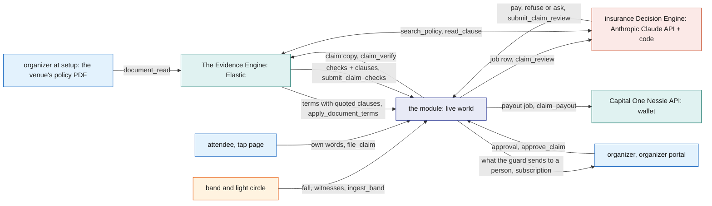

# Sponsor tracks

This file is for judges. For each track BandIt enters, it quotes what the track asks, word for word, and maps each ask to the part of BandIt that answers it, where to see it running and which doc explains it.

Quotes come from the Cal Hacks 13.0 Devpost prize list and the sponsors' channels in the Cal Hacks 13.0 Slack. Each section names its source and the date it was read.

## BandIt in one minute

One band per attendee senses the crowd, raises an SOS or a fall, and lights up the bands around someone who needs help. After the event, the same band turns the night into a recap, a people graph, merch and settled insurance claims.

Three engines do the work, and each one does what only it can do.

| Engine | Built on | Its job | Never does |
|---|---|---|---|
| The live world | the `band1t` module on SpacetimeDB Maincloud | every band, zone, incident, claim, wallet movement and memory, as transactions pushed live to every screen | rank by meaning, call outside services |
| The Evidence Engine | Elastic: Elastic Agent Builder, Elastic Workflows, Elastic ES\|QL, semantic search, Elastic Kibana | read every insurance PDF (the venue's policy, the attendee's insurance card, the hospital report) into checked terms and searchable clauses, and find the clauses that bear on each claim (next to build); validate each claim copy, organize the scraped event data before import, order each recap by meaning, show the team the data | hold live state, see names on claims, set an amount, sit in the safety path |
| The insurance Decision Engine | the Anthropic Claude API plus the Rust code in the module | investigate each claim with tools, one evidence source at a time, and decide pay, refuse or ask the organizer, citing the facts and the policy clauses it rests on; code holds the decision to the policy terms and the checks, and computes every amount | pay outside the ceiling of a rule an organizer taught, refuse without a failed check, use a model for a random outcome |

The question this diagram answers: how the three engines hand work to each other during one claim.

## Where to see it

| What | Where |
|---|---|
| The live venue, incidents and claims | the organizer portal, https://band1t.vip/organizer: Live, Claims, Event graph, Photos, Merch, Venue setup and Kibana tabs |
| An attendee's night | the tap page, https://band1t.vip/t/ and a band's code, which becomes the recap after the event |
| The Evidence Engine at work | the Elastic Kibana dashboards "Scrape pipeline", "Sponsors and prizes" and "Claims", linked from the organizer portal's Kibana tab |
| The links | [LINKS.md](../../LINKS.md) |

## Cal Hacks judging criteria

Source: the Cal Hacks 13.0 Devpost overview, "Judging Criteria", read 2026-10-24.

| Criterion, as written | Where BandIt answers it |
|---|---|
| Application: "Projects should have a feasible real-world use. Could someone realistically adopt this, and would it deliver a clear benefit?" | a venue hands out one band per ticket; falls are the leading cause of injury at public venues, and the same band settles the claim afterwards ([Requirements](Requirements.md)) |
| Intentionality: "Every design choice should feel purposeful, with a clear sense of who it's for and why it works the way it does." | the band reacts on its own in about 100 ms, with no round trip; the attendee's only app is the page their band's tag opens ([Safety](../6-features/Safety.md), [Tap-Page](../5-apps/Tap-Page.md)) |
| Functionality: "Projects should work as intended" | 9 real bands and 1,000 crowd bands run live on SpacetimeDB Maincloud at https://band1t.vip; the scripted claims run settles claims in front of the judges ([Test-Bands](../3-services/Test-Bands.md)) |
| Creativity: "Projects should show original thinking and a fresh perspective, with inventive problem framing and unexpected combinations of ideas or technologies." | the light circle that guides help to a fallen attendee is also the witness list on their insurance claim; the night's stays become the people graph and the merch |
| Technical Complexity: "Teams should show a command of the frameworks and infrastructure behind their project, with sound architectural choices and engineering depth that goes beyond basic implementation." | ESP-NOW firmware, one SpacetimeDB module with scheduled reducers and per-caller views, an Elastic Agent Builder agent run by Elastic Workflows, hashed evidence packs and a double-entry ledger ([Architecture](Architecture.md)) |

The quotes above are the first sentences of each criterion; the Devpost page has the full text.

## The tracks

Sources for this section: Hive, the organizers' live site (https://hive.hackberkeley.org/prizes, "Updated Oct 24, 3:13 PM"), where the organizers say each track's criteria live; the Devpost prize list; the sponsors' starter packs on Hive; and the sponsors' Slack channels. All were read on 2026-10-25 between 01:00 and 01:20 UTC.

### Hyphenate: The Hyphenated Enterprise: Autonomous Systems for Finance

Prize: $8,000, $5,000 and $3,000. Source: Hyphenate's track doc (its starter pack on Hive) and its Hive prize card.

> Pick a company and one corner of its finance team: a few seats that work closely together, like the accountant who applies customer payments and the person who chases the late ones. Then build the autonomous system you'd hire to fill them, and the company it works in: the software it uses, the people it answers to, and the mistakes hiding in its data.

> Every submission is judged on the same four questions:
>
> 1. Is it real enough? Realistic data, a messy problem, and proof that it works.
> 2. Would you hire it? For which seats, and would it earn them: limited access, a clean record of its work, and knowing when to ask?
> 3. Did we see something new? A company, problem or approach we haven't seen made autonomous before.
> 4. The moment. When it catches what others missed, recovers from something going wrong, or defends a decision when questioned.

**What BandIt resolves.** After every incident at a venue there is one finance question: who pays what, to whom, from which policy, and who pays it back. BandIt answers it and moves the money.

| Incident | Paid to | Paid by | Paid back to the venue by | On the books |
|---|---|---|---|---|
| Jordan's fall: urgent care billed $1,308 | Jordan, $895 into his wallet, the fee schedule's cap on each billed line | the venue, from its medical payments cover; when that cover is excess, Jordan's own health plan pays first and the venue pays only his copay (next to build) | the venue's insurer, $895, since the cover has no deductible | reserve (J1), what the insurer owes (J2), the payout (J3), the insurer's payment (J4) |
| The speaker knocked off its stand: a $2,400 repair | the repair vendor, $2,400 | the venue, from its property policy | the venue's insurer, $1,900; the $500 deductible stays with the venue | J1, J2, J3 at once, J4 |
| The same speaker, when security names who knocked it over (next to build) | the venue's insurer, $1,900, and the venue, its $500 deductible | the person named, from their wallet, once the organizer approves the charge | | the charge (J5) and its payment (J6) |
| A sponsor's display laptop taken from its booth (next to build) | the sponsor, the laptop's value | the venue, from its property policy | the venue's insurer, the value above the $500 deductible | J1, J2, J3 at once, J4; when security names who took it, the charge repays the insurer and the venue its deductible (J5) |
| Sam's claim, if the organizer refuses it | nobody | | | the reserve reverses (J1r) |

**The seats BandIt fills.** Hyphenate's own example is "the accountant who applies customer payments and the person who chases the late ones". At a venue after an incident those seats are:

- the payments resolver, who works out who owes what to whom and from which policy: the venue's medical or property cover, the attendee's own health plan, the venue's insurer, or the attendee who broke something;
- the accountant who applies each payment on a double-entry ledger: the reserve, the payout to the attendee's wallet or the repair vendor, what the insurer owes, and the insurer's payment when it lands;
- the person who chases what is owed: the venue's insurer, through the notice of loss and its recorded payment; whoever handled broken equipment, through the recovery letter; and the person responsible, through a charge shown on their tap page, which they pay from their wallet or dispute (next to build).

They answer to the organizer, the venue's risk manager. Checking each claim against the evidence (the band, the light circle, the cameras and the hospital report) is how the resolver earns the right to pay.

BandIt enters its payment resolution. The insurance Decision Engine decides who is paid and how much, and the ledger, the wallet payouts and the insurer reconciliation move the money ([Insurance](../6-features/Insurance.md)).

The organizer reads the same books as the event's controller on the Costs tab: the net cost, the costs so far by cost center, who pays what, the merch sold, what the event owes each sponsor booth, every cost line and the journal with its trial balance ([Organizer-Portal](../5-apps/Organizer-Portal.md#costs-tab-insurancemd)).

The booth settlement resolves who pays what for merch. An Elastic mug sold from the recap for $18 pays the print shop $5, keeps the event's 10% fee of $1.80 and owes the Elastic booth $11.20 ([Merch](../6-features/Merch.md#merch-on-the-costs-tab)).

| The track asks | BandIt answers with | See it |
|---|---|---|
| "Is it real enough? Realistic data, a messy problem, and proof that it works." | Four parties and their money: the attendee's wallet (a Capital One Nessie API account), the venue's books, the venue's insurer and the repair vendor, on a double-entry ledger that rejects any journal that does not balance. Real documents set the amounts: the venue's policy PDF, the attendee's insurance card and the hospital report PDFs, read by The Evidence Engine into terms that quote their clauses and pages (the insurance card next to build), a 21-code fee schedule, per-claim and aggregate limits, and a deductible. The proof is the accuracy run, `bandit-claims scorecard`: rounds of planted claims with an answer key, 2 genuine falls and 4 kinds of fake each, scored on what the automation paid | the organizer portal (/organizer, Claims); the scorecard printed by `bandit-claims` |
| "limited access" | The workers hold only the `worker` role and can change a claim only through reducers that reject a stale lease. The Anthropic Claude API never sets an amount, pays on its own only inside the ceiling of a rule an organizer taught, and refuses on its own only on a failed check. Only the organizer's `ops` role approves a claim sent to a person; the medic files the hospital report and cannot approve | [Insurance](../6-features/Insurance.md), Who decides what |
| "a clean record of its work" | Every fact is numbered and hashed into the evidence pack (SHA-256), every check is stored, every model call is a `model_call` row, every step of Claude's investigation a `decision` row, every human decision an `approval` row with the amount and fingerprint the person saw, and every dollar a balanced journal | the claim's page on the Claims tab: checks, evidence facts, decisions, ledger; the decision history on the Live tab |
| "knowing when to ask" | A complicated claim, one where the policies leave a gap or contradict each other (no cover for the incident, a bill over the limit, policies that disagree on who pays), always goes to the organizer, who decides it one by one. Claude can choose to ask the organizer, with one question. Code's guard also sends a claim there when Claude would pay with a failed check, uncorroborated evidence, no approved rule yet or a payout above the rule's ceiling, when Claude would refuse while every check passed, and for every claim of a mass occurrence | "Waiting for your decision" on the Claims tab |
| "Did we see something new?" | The money of a live event's incidents resolved end to end, from the band's fall, which is the first notice of loss, to the payout in the attendee's wallet and the insurer's payment on the venue's books. The bands that lit the light circle are the witnesses | [Safety](../6-features/Safety.md), [Insurance](../6-features/Insurance.md) |
| "The moment" | Sam's hospital report says he hurt his ankle playing basketball at home the evening before. Every code check passes, and Claude catches it reading the report and recommends a refusal; no check failed, so the guard sends it to the organizer with Claude's finding on top | the scripted claims run, step 3 |
| "The moment", again | Lee's band reports a fall at Main stage, but its light circle forms on Sponsor row. Claude refuses on the failed `witness_zone` check, and the guard lets the refusal through with every check listed, before any money moves | the scripted claims run, step 4 |
| "defends a decision when questioned" | Every decision cites the facts it rests on and, in the design, the clause of the venue's own policy with its page; every amount traces to a policy term the organizer confirmed (next to build) | the claim's page on the Claims tab |
| "recovers from something going wrong" | The organizer's first approval carries an amount from a screen a minute old, so `approve_claim` fails closed and nothing moves. When the insurer pays back less than it owes, the difference posts to `claims_expense` (J4), so the books still balance | the scripted claims run, step 1; the Ledger on the Claims tab |

The track doc's "What makes it hard" list maps to BandIt like this.

"Sources that disagree": the band, the light circle, the medic's note, the camera sighting and the hospital report are compared in code, and each comparison is a stored check. Claude then reads each source itself and names the one it trusts (`trusted_source`).

"Time": every organizer decision is kept as a precedent. After three approved claims of one shape, the Evidence Engine's agent counts them in `bandit-claims` and proposes a payment rule citing them, and once the organizer approves it on the Proposed rules tab it becomes a versioned `settlement_rule`, so what the organizer decided at 22:10 settles the next claim of that shape by itself. The identity that proposed a rule can never approve it. A complicated claim gets no proposal. The organizer's decision on it is kept as a precedent, and the next claim with the same gap shows it ("Precedent, not applied: Ops desk approved $150.00 for Jordan Alvarez") while the organizer still decides.

"Limits": the person who files a hospital report is not the person who approves the claim, every limit comes from the venue's confirmed policy terms (next to build), and no model can move money outside the authority a person gave it.

The doc also asks for "planted errors with an answer key". That is the accuracy run.

### SpacetimeDB: Best Use of Spacetime

Prize: $2,048, $1,024 and $512. Source: Hive prize card; Slack #0-general, Tyler Cloutier, 2026-10-23.

> We'd love to see projects where Spacetime is the core real-time backend, especially anything with live shared state, multiplayer interaction, or instant sync between users/agents/systems.

> Spacetime's docs position it around real-time subscriptions, transactional updates, and server-side logic running close to the data, which is why these kinds of apps fit well.

> The main thing we'd want is for Spacetime to be meaningfully used, not just added on the side.

> Build anything with Spacetime: a web app, a game, an agent. Something that's hard to build without Spacetime!

| The track asks | BandIt answers with | See it |
|---|---|---|
| "the core real-time backend" | One module, `band1t`, on SpacetimeDB Maincloud holds every band, zone, incident, claim, wallet movement and memory. Nothing else sits on the live path: `bandit-api` and the workers are clients, like the pages | [SpacetimeDB](../2-data/SpacetimeDB.md) |
| "live shared state, multiplayer interaction, or instant sync between users/agents/systems" | The real bands through `band1t-bridge`, 1,000 crowd bands moving inside the module, the organizer portal on the big screen and on medics' phones, every attendee's tap page, and the Anthropic Claude API and Elastic workers all read the same module by subscription. An SOS reaches the medic within about a second | the organizer portal (/organizer, Live) |
| "real-time subscriptions" | Every screen subscribes to tables and per-caller views, such as `open_incidents`, `my_band`, `claims_board` and `event_graph`; nothing polls | [Architecture](Architecture.md), How the parts interact |
| "transactional updates" | `watch_bands` opens an incident, freezes its snapshot and records its light circle in one transaction; a claim's evidence pack, its checks and its reserve journal commit together | [Safety](../6-features/Safety.md) |
| "server-side logic running close to the data" | Scheduled reducers: `watch_bands` every 500 ms, `sweep` and `social_tick` every 1 s, `crowd_tick` every 2 s. The insurance Decision Engine's route, `decide`, runs inside the module | [SpacetimeDB](../2-data/SpacetimeDB.md) |
| "AI systems coordinating in a persistent world state" | Work for the Anthropic Claude API and Elastic is a `job` row. A worker leases it, and the job's result reducer rejects a stale lease, so a slow agent can never apply an old answer | [Rust-Backend](../3-services/Rust-Backend.md) |
| "Something that's hard to build without Spacetime!" | Per-caller views enforce access inside the database: an attendee sees only their own band and claim, staff see the board, and a medic's tap opens a medical card | [Tap-Page](../5-apps/Tap-Page.md) |

### Anthropic: Claude for Public Benefit

Prize: "$5000 in Claude credits and 1 year of Claude Max 20x + Office Hours". Source: Hive prize card; Slack #cohost-anthropic, Arinze Obiezue, 2026-10-23.

> 1. A named community. ""Students"" is too broad. ""Transfer students at Berkeley trying to find housing"" is the right register.
>
> 2. A real problem. You have lived it, or you talked to someone who has.
>
> 3. It works. One thing done well and usable on Monday beats a broad demo.
>
> 4. Thoughtful use of Claude. Claude does something that matters to the solution, and you know where it could go wrong for the people using it.

The Slack post words points 3 and 4 differently:

> 3. *A working high-impact product:* We want a fully working product, not a concept of a plan. It should also be clear how you plan to measure its impact on your target community
> 4. *Thoughtful use of Claude:* Claude is used meaningfully in the product's development and functioning.

| The track asks | BandIt answers with |
|---|---|
| "A named community" | Attendees of crowded public events, starting with the hackers at Cal Hacks 13.0 in the Palace of Fine Arts, and the medics and organizers who look after them |
| "A real problem" | Falls are the leading cause of injury at public venues, and after a fall the biggest risk is a crowd crush. After the night, a hurt attendee waits on paperwork to be paid |
| "It works" | The bands, the organizer portal and the tap page run live at https://band1t.vip |
| "how you plan to measure its impact" | The accuracy run's scorecard: claims settled with no person, dollars wrongly paid (target $0), bill-review savings, and the time from incident to payout |
| "Claude does something that matters to the solution" | The Anthropic Claude API decides every insurance claim. It investigates with tools, one evidence source at a time, weighs sources that disagree, searches the venue's and the attendee's policies for the clauses that apply (next to build), and decides pay, refuse or ask the organizer. It also writes the hospital report for each drawn case, the notice of loss and the letters, reads each attendee's medical card from their PDFs, and sets up a venue from the event's name |
| "you know where it could go wrong for the people using it" | The table below |

Where the Anthropic Claude API could go wrong, and what code does about it:

| It could | Code's guardrail |
|---|---|
| write a hospital report that strays from its case | `check_report` rejects a report not made out to the claimant, without the visit date or not adding up to its printed total; The Evidence Engine then reads the PDF back, and `check_report_read` drops any fact whose quote is not word for word on its page, so the claim uses only what is printed |
| invent a fact | every fact id and policy clause the decision cites must exist on this claim, or code sends it back once, then sets it aside |
| invent a figure | every dollar figure in a decision or a letter must be one of the amounts code computed |
| pay without looking | a pay is rejected unless Claude read the band, the light circle and the hospital report itself |
| be talked round by text inside a document | the data blocks are escaped, and the prompt tells the model to report any text that addresses it as a concern |
| be wrong about why someone was hurt | it pays on its own only inside an approved rule's ceiling with every check passed, and refuses on its own only on a failed check; anything else goes to a person, and it never sets an amount |
| decide something that should be chance | random outcomes come from a seeded generator in the module, never from the model |

### Elastic: Best use of the Elastic Agent Builder on a Serverless Instance

Prize: Meta Quest 3S headsets (1st), Bose QuietComfort headphones (2nd). Source: Devpost for the name; Hive still says "Coming soon!", so the criteria are from Elastic's Cal Hacks workshop deck (https://github.com/jdarmada/calhacks-paper-scout, `slides/deck.html`).

> Find the Signal with Elasticsearch
> Build a project that turns complex, messy data into useful insights, answers, or actions.
> 01 Elasticsearch: Creative, meaningful use of search
> 02 Jina embeddings: Search by meaning, in any language
> 03 Agent Builder + Workflows: Agents that answer and act
> 04 Cloud Serverless: Zero ops, free for the weekend

> Hit all four and you've hit every judging criterion.

BandIt enters The Evidence Engine ([Elastic](../7-integrations/Elastic.md)).

| The track asks | BandIt answers with |
|---|---|
| "turns complex, messy data into useful insights, answers, or actions" | Thousands of raw records scraped from the event's pages become one checked event bundle; every insurance PDF becomes checked terms and searchable clauses, and each claim is matched to the clauses of its policies (next to build); each attendee's night becomes an ordered recap |
| "Elasticsearch: Creative, meaningful use of search" | The clauses of the venue's policy, and of the attendee's health insurance on an injury, that bear on each claim, searched by Claude in its own words (`bandit-policy-clauses`, next to build); the people and booths of each recap in order of what the attendee was into (`bandit-people`, `bandit-booths`); candidate matches while organizing the scrape |
| "Jina embeddings: Search by meaning" | `semantic_text` fields on the inference endpoint `.jina-embeddings-v5-text-small` |
| "Agent Builder + Workflows: Agents that answer and act" | The Elastic Agent Builder agent `bandit-organizer`, run by the Elastic Workflows workflow `bandit-organize`, resolves messy records into one bundle after Elastic ES\|QL `LOOKUP JOIN` steps make the exact matches; the ingest pipeline `bandit-claims-validate` checks every claim copy on the way in; the workflow `bandit-read-document` runs the agent `bandit-document-reader` over every insurance PDF, with a JSON schema per kind, and every term quotes its clause and page (next to build); the workflow `bandit-propose-rule` runs the agent `bandit-rule-proposer`, whose Elastic ES\|QL tool `bandit.claim_precedents` counts the organizer's approvals in `bandit-claims` by diagnosis and takes the highest payout as a proposed rule's ceiling |
| "Cloud Serverless: Zero ops" | One Elastic Cloud Serverless project, with Elastic Kibana dashboards linked from the organizer portal's Kibana tab |
| "Search → Reason → Act" | Data in from Bright Data, the module, the claims and every insurance PDF; Elastic finds by meaning; the agents and Claude reason; the module acts, through `import_event`, `submit_claim_checks`, `apply_document_terms` and `submit_rule_proposal` |

### Meta: Meta/Facebook: Bringing People Closer Together with AI

Prize: an invitation to Round 2 at Meta's Menlo Park campus, and a Meta swag bag. Source: Hive prize card.

> Projects will be judged on how meaningfully they strengthen human connection, how essential and well-integrated AI is, originality, and the strength of the working demo.

| The track asks | BandIt answers with |
|---|---|
| "how meaningfully they strengthen human connection" | After the event, the recap lists the people whose bands stayed close to yours and the people you shared a booth with, with their Instagram, Facebook and Threads handles when they turned the findable switch on. The photos you are in, tagged by the bands, are in your recap with a Share button. The big screen draws the whole event as a 3D people graph |
| "how essential and well-integrated AI is" | Elastic orders the people you met by what you were both into, with Jina embeddings. The Anthropic Claude API counts the people in each event photo and captions it, so tags go only to the people really in it. Its shopping agent picks merch with the people you met in the photo |
| "originality" | Nobody swaps handles: the bands measure who met whom, and the connection waits in the recap |
| "the strength of the working demo" | The people graph and the recap run live on the tap page and the organizer portal (Event graph and Photos tabs) |

Read next: [Social](../6-features/Social.md).

### Visa: Best use of Reimagining Shopping sponsored by Visa

Prize: $5,000. Source: Hive prize card and the "Visa x CAL Hacks 13.0 Hacker Starter Pack".

> Reimagine Shopping - Use Generative AI to craft smarter and more effortless commerce experiences.

> Innovation (25%) – How creative does the solution reimagine the shopping experience?
> User Experience (25%) – Does the experience feel intuitive, useful, and seamless?
> Technical Execution (20%) - How effectively has the team implemented AI and supporting technologies?
> Commerce Impact (15%) - Can the solution improve customer engagement, conversion, loyalty, or merchant outcomes?
> Trust & Responsibility (15%) - Does the solution address privacy, transparency, security, and responsible use of AI?

The starter pack weights User Experience and Commerce Impact at 20% each. It also says: "Adding a chatbot alone is not enough."

| The track asks | BandIt answers with |
|---|---|
| Innovation | Merch you could not buy at the booth: your own photo with the people you met, on a sponsor's template, picked from your night |
| User Experience | Nothing to carry during the event; one tap on the recap buys it from your BandIt wallet |
| Technical Execution: "implemented AI" | When the event ends, the shopping agent on the Anthropic Claude API (`merch_picks`) reads each attendee's night and picks three products, a photo for each and a line such as "with Jordan & Maya"; code checks every id it returns |
| Commerce Impact | Sponsors sell after the event to the people who spent time at their booth, and the booth crawl poster ticks off the sponsor booths you visited |
| Trust & Responsibility | Each pick shows its reason ("Picked for you"); the agent can only name a real product and a photo you are tagged in; only findable people appear; `buy_merch` refuses what the wallet cannot cover in the same transaction |
| "Adding a chatbot alone is not enough." | There is no chat: the agent works from what the bands measured |

Read next: [Merch](../6-features/Merch.md).

### Capital One: Best Use of Nessie

Prize: a $300 Giftogram per person on the winning team. Source: Hive prize card; Slack #spons-capital-one.

> Completeness, Creativity, Complexity

| The track asks | BandIt answers with |
|---|---|
| Completeness | Three money flows on the Capital One Nessie API: a $200 wallet for each attendee (`wallet_open`), merch purchases (`merch_purchase`) and insurance payouts as deposits (`claim_payout`) |
| Creativity | One wallet holds the whole night's money: the payout for a fall and the t-shirt from the recap show in one balance |
| Complexity | The sandbox records every purchase and deposit but never changes a balance, so the module keeps `wallet_entry` and the balance is its exact sum; claims post double-entry journals from reserve to reconciliation |

Read next: [Capital-One-Nessie](../7-integrations/Capital-One-Nessie.md).

### Bright Data: Best Agent/App Using Public Web Data sponsored by Bright Data

Prize: 1st $1,500 in Bright Data credits and a $500 Amazon card; 2nd $1,000 and $350; 3rd $500 and $250. Source: Hive prize card; Slack #spons-bright-data, Dani Kaye, 2026-10-23.

> Judges will look for products where Bright Data is essential to the core experience; if live public web data were removed, the product would no longer work.

> Extra credit goes to teams that choose the right Bright Data tools thoughtfully, combine them where it improves the solution, and tell a clear two-minute story using real results from real websites rather than mocked data.

| The track asks | BandIt answers with |
|---|---|
| "if live public web data were removed, the product would no longer work" | The venue map, its booths, organisations and schedule come from the event's public pages through the Bright Data Web MCP; without them there are no booths to visit, no recap and no merch. An organizer sets up any other event's venue from its name, live |
| "choose the right Bright Data tools thoughtfully, combine them" | The Bright Data Web MCP for the event's pages and search, the Bright Data Web Unlocker API for the pages a venue setup reads, and the Bright Data Browser API for the venue's 3D model |
| "turn raw data into clean, useful output" | Elastic organizes the raw records into one checked bundle, which `import_event` loads in one transaction |
| "collect non-public personal data" (a disqualifier) | BandIt never scrapes people; attendees type their own handles |

Read next: [Bright-Data](../7-integrations/Bright-Data.md).

### Cal Hacks tracks

Source: the Devpost prize list. These tracks have names and prizes only.

| Track | BandIt answers with |
|---|---|
| Best Hardware Hack | ESP32-C3 bands, a USB gateway and station markers on ESP-NOW; each band colours itself by the crowd it hears, with no network ([Hardware](../4-devices/Hardware.md)) |
| Best People-First Social Impact Hack | crowd density on every wrist, an exit marker at every exit, the light circle around a fallen attendee, low visibility, and medic access to the medical card ([Safety](../6-features/Safety.md), [Medical-Card](../6-features/Medical-Card.md)) |
| Most Technically Advanced Hack | firmware, one live database, two engines and a ledger, each doing what only it can do ([Architecture](Architecture.md)) |
