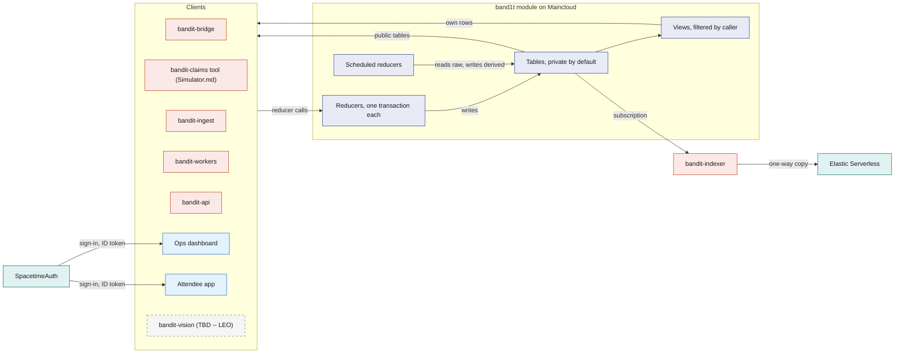
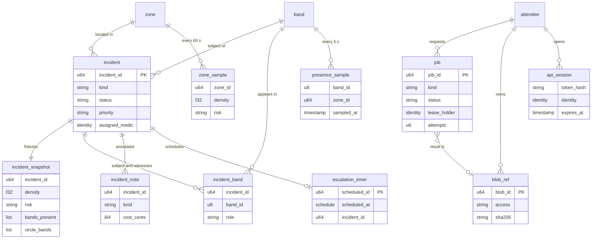
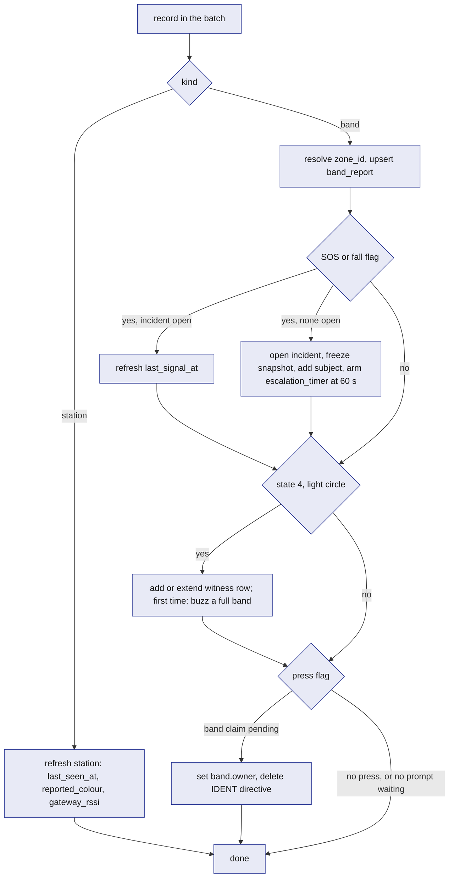

# SpacetimeDB: the `band1t` module

The `band1t` module is one SpacetimeDB database, written in Rust and compiled to WASM, on SpacetimeDB Maincloud. It holds every piece of BandIt's live state and performs every state change through reducers. Bands, the bridge, the simulator, both web apps, the workers and the indexer read it by subscription and change it only by calling reducers, so the venue has exactly one version of the truth at any moment. Crowd safety cannot tolerate two systems disagreeing about which zone is dangerous or whether an incident is open. Everything else in BandIt is a sensor feeding the module, a screen reading it, or a worker doing slow work it has queued.

## Role in the system

Responsibilities:

- Hold the venue layout, identities, live band and zone state, control intent for the bands, incidents, sampled history and the work queue, in the core tables below.
- Turn raw band reports into derived safety state (`zone_state`, exit assignments, incidents) in scheduled reducers, on a fixed cadence, in transactions.
- Enforce access inside the database: who may call which reducer and who may see which rows, by role and by caller identity.
- Give every client the same live view through subscriptions to public tables and per-caller views.
- Queue slow or external work as `job` rows and accept results only from the worker that still holds the lease.

Non-responsibilities:

- It does not talk to radios, serial ports, cameras or any external service. Rust processes do that and call reducers ([Gateway-Bridge](../3-services/Gateway-Bridge.md), [Rust-Backend](../3-services/Rust-Backend.md)).
- It does not decide a band's density colour, SOS strobe or light circle. The band does that locally ([Hardware](../4-devices/Hardware.md)). The module decides exit colours, forced states, one-shot prompts and calibration values ([Safety](../6-features/Safety.md)).
- It does not store photos, PDFs or letters. Blobs are files on the Fly volume behind `bandit-api`; the module keeps a `blob_ref` row.
- It runs no procedures and makes no outbound call.
- The safety policy (thresholds, hysteresis, exit cost, escalation) is in [Safety](../6-features/Safety.md). This file defines the tables and reducers that carry it.

## Interfaces

Every interface is a reducer call in or a subscription out, over the SpacetimeDB WebSocket protocol, through the Rust or TypeScript client SDK.

| Direction | Counterpart | What flows | Reducers or tables | Transport |
|---|---|---|---|---|
| In | `bandit-bridge` | latest report per real band and station every 250 ms; acks of one-shot commands (`sent` or `expired`); heartbeat | `ingest_band_reports`, `ack_band_command`, `heartbeat` | Rust SDK |
| Out | `bandit-bridge` | desired band states, exit colours, one-shot commands, live calibration | `band_directive`, `band_command`, `fleet_config` (through `staff_directives`, `staff_commands`) | subscription |
| In | Simulator.md: the `bandit-claims` command-line tool and `bandit-api`'s dev routes, both as the `simulator` identity; ops for the crowd | reports for the simulated bands (ids 90 to 99), one band per call, including replays of recorded logs onto those ids; starting and stopping the in-module crowd (ids 10 to 89) | `report_sim_band`, `start_crowd`, `stop_crowd`, `heartbeat` | Rust SDK |
| Out | Simulator.md: the `bandit-claims` command-line tool | venue graph, exits, zone state, directives, low visibility | `zone`, `zone_link`, `exit`, `station`, `zone_state`, `fleet_config`, `staff_directives`, `staff_commands` | subscription |
| In | `bandit-ingest` | venue layout, booths, schedule, bands, calibration from the seed | `upsert_venue`, `upsert_zone`, `upsert_zone_link`, `upsert_exit`, `upsert_station`, `upsert_booth`, `upsert_schedule_slot`, `register_band`, `set_calibration`; Merch.md: `load_merch_templates`, after the import; BrightData.md: `import_event` (one event bundle per transaction) | Rust SDK |
| In | SpacetimeAuth | the ID token of every person's sign-in (attendees and staff, magic-link email only); SpacetimeDB derives the identity from its issuer and subject | every connection of the two web apps | OpenID Connect, checked by SpacetimeDB |
| In | Ops dashboard | low visibility, exits, forced states, calibration, incident handling, role grants, the end of the event, API session token | the Ops and Incident reducers below, `end_event`, `reopen_event`, `open_api_session` | TypeScript SDK |
| Out | Ops dashboard | everything staff may see; the host portal for `ops` | public tables plus the `staff_*`, `host_attendees`, `my_roles` and `my_owner` views | subscription |
| In | Attendee app | band setup: claim, display name, consent, API session token | `claim_band`, `update_profile`, `set_consent`, `open_api_session`; BrightData.md: `claim_person` | TypeScript SDK |
| Out | Attendee app | in setup, the band being claimed and whether it is heard; the end of the event; after it, the recap with the zone and booth names | `my_*` views, `event_state`, `venue`, `zone`, `booth` | subscription |
| In | `bandit-workers` | lease and finish jobs, heartbeat | `claim_job`, `extend_job_lease`, `complete_job`, `fail_job`, `heartbeat` | Rust SDK |
| Out | `bandit-workers` | queued and leased jobs by kind | `worker_jobs` | subscription |
| In | `bandit-api` | blob registration, heartbeat, feature reducers named in feature docs | `register_blob`, `heartbeat` | Rust SDK |
| Out | `bandit-api` | API session tokens to authenticate its HTTP callers; blob refs; Social.md: share links; Elastic.md: the recap candidates | `api_sessions`, `staff_blobs`; Social.md: `share_link`; Elastic.md: Social.md's views `social_encounters`, `social_visits` | subscription |
| Out | Elastic.md: `bandit-indexer` | venue content and the views Elastic.md lists, one way | `venue`, `zone`, `station`, `booth`, `schedule_slot`; BrightData.md: `organization`, `hall`; Social.md: `social_attendees`, `social_visits`, `social_encounters` | subscription |
| In | Vision.md (TBD -- LEO): `bandit-vision` | a pit count every 3 s, person-down alerts, property events, Claude assessments a few seconds after an event | `report_zone_count`, `report_ground_alert`, `report_property_event`, `submit_vision_assessment` ([Vision](../4-devices/Vision.md)) | Rust SDK |
| Internal | scheduler | ticks and timers | `venue_tick`, `memory_tick`, `escalate_incident`, `job_reaper`; Simulator.md: `crowd_tick` | schedule tables |

## Design

### Why one module, and what SpacetimeDB gives it

The safety loop has several writers (bridge, simulator, ops, scheduled ticks) and many readers (dashboard, medics' screens, bridge, attendee apps). If any two of them kept their own copy of "which zone is high" or "is this incident open", different screens would show different colours at the worst moment. So all live state is in one module, and five SpacetimeDB features carry the design.

| SpacetimeDB feature | What it gives | Where BandIt uses it |
|---|---|---|
| Reducers are transactions | every write in a reducer commits together or not at all; a failed role check rolls the call back | `ingest_band_reports` opens an SOS incident, freezes its snapshot, adds the subject band and arms the escalation timer in one commit |
| Subscriptions | each client gets the current rows, then every change as it commits | an SOS flag reaches the dashboard and the medic's incident desk with no polling layer; the bridge receives directives the same way |
| Scheduled reducers | the module runs its own timers, as repeating intervals or one-shot times, each run a transaction | `venue_tick` every 500 ms, `memory_tick` every 5 s, `job_reaper` every 10 s, and one `escalation_timer` row per open incident |
| Views | read-only server functions that see the caller's identity and may read private tables | "a medic sees an incident only while it is open" and "an attendee sees only their own band" are enforced by the database, not by an app. Social.md: `event_graph` is an anonymous view, computed once and shared by every screen that shows it |
| Identity | every connection has a stable `Identity` | every person signs in with SpacetimeAuth, SpacetimeDB's own OpenID Connect provider (in beta), with the magic-link email sign-in only; SpacetimeDB derives the identity from the ID token's issuer and subject, so a person is the same identity on every device. Services keep a saved token. Staff and services are identities with rows in `staff_role` |

External services never hold truth. SpacetimeDB holds live state and decides; Elastic only orders a one-way copy ([Elastic](../7-integrations/Elastic.md)); workers return model and bank results through reducers. Elastic.md, Insurance.md: the one thing that comes back from Elastic is precedent checks on claims, as past-claim ids and scores that `bandit-workers` writes through `submit_claim_checks`; they never change an amount, and live state never lives in Elastic.

Social.md: the people graph is all here. The links the bands measured (`people_link`) are facts, so they reach screens live through `my_graph` and `event_graph`, and nothing about the graph comes from Elastic.

This diagram answers: who calls the module, what runs inside it, and how data gets back out.

### Design principles

| Principle | What it means here | Why |
|---|---|---|
| Raw in, derived out | Devices and their stand-ins write only raw tables such as `band_report`. Only `venue_tick` writes `zone_state` and the safety rows of `band_directive`; only `memory_tick` writes `presence_sample` and `zone_sample`. Simulator.md: `crowd_tick` also writes `presence_sample` for the crowd bands, which send no reports. | Two writers never fight over a derived row, and screens compute nothing. |
| Overwrite live rows, sample history | `band_report`, `zone_state`, `venue_mode`, `fleet_config` hold one row per band, zone or venue, overwritten in place. History lives only in `presence_sample` (5 s) and `zone_sample` (60 s). | Tables stay bounded by fleet size, and subscriptions carry changes, not logs. |
| Private by default, access through views | Every table is private unless listed as public. Clients reach private rows only through views that read the caller's identity. | An app bug cannot leak a row the view would not return. |
| Elastic gets a copy, never the original | Only tables and views marked "copied" reach Elastic, one way, through `bandit-indexer`. Identity, incident and medical tables never leave the module. | Elastic can be rebuilt from the module at any time. |
| Add tables rather than reshape them | A feature adds its own tables and reducers (the registry below). Core columns are frozen after the first publish. | SpacetimeDB publishes additive changes without clearing data. |
| Nothing in the safety path waits | No reducer calls out or waits on a job. | A band's SOS reaches the dashboard in one bridge batch plus one transaction. |
| Every privileged reducer checks the caller | Its first statement looks up `staff_role` by the caller's identity and rejects the call if the role is not allowed. | The module, not the app, is the security boundary. |

### Core tables

Conventions: "auto id" is an auto-increment primary key, used everywhere else as the id, including Elastic document ids. "identity" is a SpacetimeDB `Identity`. Timestamps come from the reducer context's clock. "Public" means any connected client can read the table; otherwise the named views give access. "Copied" means `bandit-indexer` reads the table into Elastic documents ([Elastic](../7-integrations/Elastic.md)).

#### Venue group (loaded at setup)

`venue`: one row per event. Written by `upsert_venue` (role `ingest` or `ops`). Public. Copied (names folded into documents).

| Field | Type | Meaning |
|---|---|---|
| `venue_id` | auto id | the venue; the event has one |
| `name` | text | display name |
| `starts_at`, `ends_at` | timestamp | the planned event window |
| `pit_zone_id` | zone id, optional | the pit zone, so the dashboard opens on it |
| `origin_lat`, `origin_lon`, `plan_rotation_deg` | numbers | where the floor plan's origin sits on the earth and how the plan is rotated from true north; recorded on site at setup and written in the seed. BrightData.md: `import_event` loads them from the seed with the event section. Elastic.md: the indexer's function that turns plan metres into latitude and longitude for the copy's documents reads them |
| BrightData.md: `venue_name`, `address`, `latitude`, `longitude`, `description`, `facts`, `source_url`, `fetched_at` | text, text, numbers, text, list of label and value, text, timestamp | the venue's place from its Google Maps record (`latitude` and `longitude` are the place's pin, not the plan origin), and the event's facts from the event pages plus the place's rating, phone number and opening hours; written by `import_event` |
| `notes` | text | free text for ops |

`event_state`: a single row, id 0, that says whether the event has ended. Written by `end_event` and `reopen_event` (role `ops`). Public. Not copied.

| Field | Type | Meaning |
|---|---|---|
| `id` | always 0, primary key | singleton |
| `ended` | bool | set by `end_event` when a staff member with `ops` presses "Event ended"; every open attendee page turns into the recap page, and the Ops dashboard stops offering `release_band` while it is set. `reopen_event` clears it |
| `ended_at` | timestamp, optional | when the event ended; empty while it is live |
| `ended_by` | identity | who last ended or reopened it |

`zone`: an area of the venue, anchored by at most one station. Written by `upsert_zone` (role `ingest`, `ops`); `set_zone_exit` and `set_zone_risk` write the two override columns. Public. Copied (name and centre folded into documents).

| Field | Type | Meaning |
|---|---|---|
| `zone_id` | auto id | the zone |
| `venue_id` | venue id | owner venue |
| `name` | text | for example "Main stage left" |
| `kind` | enum `floor`, `stage`, `corridor`, `exit`, `outside` | exits open from `exit` zones; `outside` is the safe side of an exit |
| `area_m2` | number | floor area people can stand in, paced out at the venue and written in the seed |
| `capacity` | number | people at which ops considers the zone full; planning only, not used by risk |
| `station_id` | station id, optional | the station whose beacon defines "in this zone"; simulated-only zones have none |
| `plan_x_m`, `plan_y_m` | numbers | zone centre on the floor plan, metres from the venue origin; for drawing the map, never a band position |
| `width_m`, `depth_m` | numbers | the zone's rectangle on the floor plan, in metres, centred on `plan_x_m`, `plan_y_m`; the Ops dashboard draws it and a dropped booth lands in it |
| `forced_exit_id` | exit id, optional | ops override of exit assignment (`set_zone_exit`); empty means automatic |
| `forced_risk` | enum, optional | ops override of the risk level (`set_zone_risk`); empty means automatic |

`zone_link`: an undirected walking connection between two zones. Written by `upsert_zone_link`. Public. Not copied.

| Field | Type | Meaning |
|---|---|---|
| `link_id` | auto id | the link |
| `zone_a`, `zone_b` | zone id | the two ends |
| `distance_m` | number | walking distance between zone centres, paced out at setup |
| `passable` | bool | ops can close a corridor without deleting the row |

`exit`: a door out of an exit zone, with a colour. Written by `upsert_exit`; `set_exit_status` writes `status`. Public. Not copied.

| Field | Type | Meaning |
|---|---|---|
| `exit_id` | auto id | the exit |
| `zone_id` | zone id | the zone the exit opens from |
| `name` | text | for example "North doors" |
| `colour_index` | 1 to 6 | 1 blue, 2 magenta, 3 cyan, 4 white, 5 orange, 6 violet; the colour bands show in GUIDE and the station glows |
| `station_id` | station id, optional | the station marker standing at this exit |
| `status` | enum `open`, `blocked` | blocked exits are skipped by assignment |
| `status_changed_at`, `status_changed_by` | timestamp, identity | audit |

`station`: a station marker, keyed by its radio id. Written by `upsert_station`; `ingest_band_reports` refreshes the three live columns from station beacons. Public. Copied (folded into documents).

| Field | Type | Meaning |
|---|---|---|
| `station_id` | 101 to 105, primary key | the radio id |
| `zone_id` | zone id | the zone this station anchors |
| `exit_id` | exit id, optional | the exit it marks, if it stands at one |
| `colour_index` | 1 to 6 | desired colour; defaults to `station_id` minus 100 |
| `label` | text | where it physically stands |
| `plan_x_m`, `plan_y_m` | numbers | where it stands on the floor plan |
| `last_seen_at` | timestamp | last station beacon the gateway heard |
| `reported_colour` | 0 to 6 | colour index in its last beacon |
| `gateway_rssi` | dBm | signal at the gateway, a health indicator only |

`booth`: a stand or stage. Written by `upsert_booth` (role `ingest`, `ops`; the hand-entry reducer) and by BrightData.md's `import_event`. Public. Copied to `bandit-booths`.

| Field | Type | Meaning |
|---|---|---|
| `booth_id` | auto id | the booth |
| `zone_id` | zone id | where it is, by nearest station |
| `booth_number` | text | the number printed on the event's plan |
| `name`, `description`, `tags`, `url` | text, text, list of text, text | content from the seed or ops edits. BrightData.md: `import_event` fills the description and tags |
| `plan_x_m`, `plan_y_m` | numbers | position on the floor plan |
| `placement_source` | enum `plan`, `manual`, `none` | where the position came from; a `manual` position survives a re-import |
| `source_url`, `fetched_at` | text, timestamp | provenance of scraped content; empty for a hand-entered booth |
| `updated_at` | timestamp | for the indexer's incremental copy |
| BrightData.md: `organization_id`, `hall_id` | ids, optional | the exhibitor organisation and the hall sheet |

`schedule_slot`: a timed item at a booth or zone. Written by `upsert_schedule_slot`. Public. Copied (folded into `bandit-booths`).

| Field | Type | Meaning |
|---|---|---|
| `slot_id` | auto id | the slot |
| `zone_id` | zone id | where |
| `booth_id` | booth id, optional | which booth, if any |
| `title`, `performer`, `description` | text | content |
| `starts_at`, `ends_at` | timestamp | when |

`calibration_point`: one measured point mapping the bands' neighbour count to people per square metre. Written by `set_calibration` (role `ops`). Public. Not copied.

| Field | Type | Meaning |
|---|---|---|
| `point_id` | auto id | the point |
| `venue_id` | venue id | where measured |
| `label` | text | for example "spread 2 m", "1.5 m square", "1.2 m square" |
| `neigh_mean` | number | mean `neigh` across bands during the measurement |
| `people_per_m2` | number | the known density (people divided by taped area) |
| `band_count` | number | bands that took part |
| `recorded_at`, `recorded_by` | timestamp, identity | audit |

#### Identity group

`attendee`: one person, keyed by the identity of their SpacetimeAuth sign-in. Written by `claim_band` (creates a blank row) and `update_profile`. Private; read through `my_attendee`. Not copied. Feature docs add their own tables for socials, medical and payment data; onboarding asks for no company. Simulator.md: each crowd band has a simulated attendee, an ordinary `attendee` row with a made-up name and `findable` on, written by `start_crowd` (Simulator.md defines it); it is marked only by its band's `simulated` flag.

| Field | Type | Meaning |
|---|---|---|
| `attendee_id` | identity, primary key | the person |
| `display_name` | text | shown to staff only inside an open incident, through `staff_incidents`, and to staff in the host portal's attendee list, through `host_attendees`. Social.md: also shown to their encounter counterparts (in `my_encounters` and `my_graph`) and their shared-visit counterparts (in `my_shared_visits`) while they are `findable` |
| BrightData.md: `person_id`, `organization_id`, `photo_url` | id, id, text; empty until a profile is claimed | the claimed profile, its organisation and its headshot, copied by `claim_person` |
| `created_at`, `updated_at` | timestamp | audit |

`consent`: one switch per attendee per feature. Written by `set_consent`. Private; read through `my_consent`; feature reducers read it directly. Not copied: Social.md's views apply `findable` before Elastic.md copies anything.

| Field | Type | Meaning |
|---|---|---|
| `consent_id` | auto id | the row; one per `(attendee_id, kind)` |
| `attendee_id` | identity | whose |
| `kind` | text: `findable` | the switch. [Attendee-App](../5-apps/Attendee-App.md) shows it; the doc that uses a switch defines what it unlocks (Social.md: `findable`). Text, so a feature adds a switch without a column change. Other docs write `consent.findable` for "the caller's `findable` row has `granted` true" |
| `granted` | bool | the switch |
| `updated_at` | timestamp | audit |

`band`: one real band, or one band no radio carries. Written by `register_band` (role `ingest`, `ops`), `claim_band`, `release_band` and `ingest_band_reports` (claim completion); Simulator.md: by `start_crowd` (crowd bands and their owners) and `report_sim_band` (simulated bands, claim completion). Private; read through `my_band` (owner) and `staff_bands` (staff, owner hidden). Not copied.

| Field | Type | Meaning |
|---|---|---|
| `band_id` | one byte, primary key | the radio id: 1 to 9 for the real bands. Simulator.md: 10 to 89 for the crowd bands, 90 to 99 for the simulated bands |
| `nfc_token` | text, unique | `BANDIT-01` to `BANDIT-09`. Simulator.md: `BANDIT-90` to `BANDIT-99` for the simulated bands, a tap link with no tag; empty for the crowd |
| `is_full` | bool | carries the IMU and motor |
| `simulated` | bool | set for a band no radio carries. Simulator.md: the crowd bands and the simulated bands |
| `label` | text | written on the case |
| `owner` | identity, optional | the attendee who claimed it; Simulator.md: for a crowd band and for bands 90 to 93, a simulated attendee |
| `claimed_at` | timestamp, optional | when the press completed the claim |
| `claim_candidate` | identity, optional | who started a claim that waits for the press |
| `claim_pending_until` | timestamp, optional | end of the 8 s claim window |

`staff_role`: one role grant to one identity. Written by `grant_role` and `revoke_role`, which only the module owner may call. The owner is not a grant: `init` records the publishing identity in `owner`, a private table, and `add_owner` (owner only) adds another identity to it. Private; read through `my_roles` (own rows) and `my_owner` (the caller's own `owner` row). Not copied.

| Field | Type | Meaning |
|---|---|---|
| `role_id` | auto id | the grant |
| `identity` | identity | who |
| `role` | enum of the roles below | what |
| `label` | text | person's or service's name, for the dashboard |
| `granted_by`, `granted_at` | identity, timestamp | audit |

#### Live group (overwritten in place)

`band_report`: the latest report per band, from one record of a batch. Written only by `ingest_band_reports` (role `bridge`); Simulator.md: and by `report_sim_band` (role `simulator`) for the simulated bands. Private; read through `my_band_report`, `staff_band_reports` (real bands) and `staff_sim_reports` (simulated bands). Not copied.

| Field | Type | Meaning |
|---|---|---|
| `band_id` | band id, primary key | which band |
| `source` | enum `bridge`, `simulator` | who reported |
| `heard_at` | timestamp | when the gateway last heard the band: the module's clock at the batch minus the record's `heard_age_ms`. Alive within 2 s, stale after 5 s |
| `gateway_id` | number | which gateway heard it (200 in v0.1) |
| `gateway_rssi` | dBm | signal at the gateway: distance to the gateway, not density |
| `loss_pct` | number | the bridge's packet-loss estimate for this band over the last 5 s |
| `flags` | 0 to 255 | the flag byte, OR-accumulated by the bridge since its previous batch so a 1 s press or a brief fall flag is never missed |
| `sos`, `fall`, `press`, `low_battery`, `full_band` | bool | the flag bits decoded, so views can filter on them |
| `neigh` | number | the band's smoothed neighbour count: the density number |
| `station_id` | 0 or 101 to 105 | station heard loudest, 0 if none |
| `zone_id` | zone id or 0 | from `station.zone_id`; 0 means unzoned |
| `bat` | 0 to 100 or 255 | battery percent, 255 unknown |
| `state` | 0 to 9 | the band state it is showing |
| `seq` | number | the band's packet counter; the bridge detects reboots from it |

`zone_state`: the latest derived state per zone. Written only by `venue_tick`. Public. Not copied (its history is `zone_sample`).

| Field | Type | Meaning |
|---|---|---|
| `zone_id` | zone id, primary key | which zone |
| `band_count` | number | live bands in this zone |
| `neigh_mean` | number | mean `neigh` of those bands |
| `density_band` | people per m² | band-based estimate ([Safety](../6-features/Safety.md)) |
| `density_camera` | people per m², optional | camera estimate when fresh (TBD -- LEO) |
| `density` | people per m² | the higher fresh estimate |
| `density_source` | enum `band`, `camera`, `manual`, `none` | which estimate won, or that ops forced the level; the dashboard shows it as a badge |
| `risk` | enum `normal`, `watch`, `high` | current level after hysteresis |
| `risk_since` | timestamp | when the current level began |
| `candidate_risk`, `candidate_ticks` | enum, number | the level the raw density points at and for how many consecutive ticks |
| `assigned_exit_id` | exit id, optional | the exit this zone's bands are guided to |
| `assigned_colour` | 0 to 6 | its colour; 0 when no exit is reachable |
| `exit_changed_at` | timestamp | when the assignment last changed |
| `sos_count`, `circle_count` | number | live bands in the zone with an SOS or fall flag, and bands showing state 4 |
| `updated_at` | timestamp | tick time |

`venue_mode`: one row per venue, the tick's heartbeat. Created by `upsert_venue`; `venue_tick` refreshes `tick_at`. Public. Not copied.

| Field | Type | Meaning |
|---|---|---|
| `venue_id` | venue id, primary key | which venue |
| `tick_at` | timestamp | heartbeat of `venue_tick`; clients use it as the server clock to judge stale rows and a dead tick |

`fleet_config`: one row of live band calibration and venue-wide band modes. Written by `set_fleet_config` and `set_low_vis` (role `ops`); `init` seeds defaults from `bandit-protocol`. Public. Not copied.

| Field | Type | Meaning |
|---|---|---|
| `config_id` | always 1, primary key | singleton |
| `yellow_at`, `red_at` | neighbour counts | `thresh` arguments; starting values 3 and 5, calibrate at the venue |
| `neigh_rssi_min`, `circle_rssi_min` | dBm | `rssi` arguments; starting values -62 and -58, calibrate at the venue |
| `density_override` | bool | sends `override 1` to every band: the density state machine is off and bands stay green unless forced (Plan B, [Safety](../6-features/Safety.md)) |
| `low_vis` | bool | low visibility, set by `set_low_vis`: sends `lowvis 1` to every band, and each band guides its wearer to the exit colour of its zone ([Safety](../6-features/Safety.md)) |
| `version` | number | incremented on every change, so the bridge resends only when it moves |
| `updated_by`, `updated_at` | identity, timestamp | audit |

#### Control group

`band_directive`: sticky desired state per target. Written by `venue_tick` (exit colours and the medic approach), `claim_band` (IDENT), `force_band_state` and `clear_all` (manual). Private; read through `staff_directives` (ops, bridge, simulator). Not copied. The bridge turns rows into `state`, `exit` and `override` commands ([Gateway-Bridge](../3-services/Gateway-Bridge.md)). Rules:

- One row per target. A band id means that band. A station id means the station marker, for which only `exit_colour` and a forced mode (0 breathe, 1 chase, 9 off) mean anything. Target 0 means all bands, and a band row overrides it field by field.
- `exit_colour` is never written on target 0, because an `exit` broadcast recolours every station marker. `venue_tick` writes exit colours per band, from each band's zone.
- Deleting a row or removing a forced state never sends `clear`; the bridge lets the forced state expire. Only a `band_command` of kind `clear` sends `clear`, and `clear` also releases SOS, fall and the light circle.

| Field | Type | Meaning |
|---|---|---|
| `target` | 0, band id or station id, primary key | 0 means every band |
| `forced_state` | 0 to 8 for a band; 0, 1 or 9 for a station; optional | state the band must hold, or the station's mode; empty means none. 9 is the firmware's "nothing forced" marker on bands, so it is never a band directive |
| `forced_until` | timestamp, optional | end of the hold; empty means until cleared. The bridge refreshes before each 25.5 s band-side limit |
| `exit_colour` | 1 to 6, optional | colour to show in GUIDE |
| `override` | bool | stop the band's density state machine for this target |
| `reason` | text: `exit_assignment`, `medic_approach`, `claim_ident`, `manual`, `plan_b` | why; the dashboard shows it. Text, so a feature can add a reason without a column change |
| (TBD -- LEO) `incident_id` | incident id, optional | the incident that caused it, for `medic_approach` |
| `version` | number | incremented on every write |
| `updated_at`, `updated_by` | timestamp, text | tick name or caller identity |

`band_command`: a one-shot event the bridge sends once. Written by `send_band_command` (role `ops`), `ingest_band_reports` (the light-circle buzz), `venue_tick` (the guidance buzz), `clear_all` and `resolve_incident`. Deleted by `ack_band_command`, or by `memory_tick` after 30 s unacked. Private; read through `staff_commands`. Not copied.

| Field | Type | Meaning |
|---|---|---|
| `command_id` | auto id | the command |
| `target` | 0 or band id | who |
| `name` | enum `buzz`, `clear` | the gateway command word; the firmware also accepts `pay` and `paid`, which BandIt does not use |
| `arg` | number | buzz pattern 1 to 3; unused otherwise |
| `created_at`, `created_by` | timestamp, text | audit |
| `source_table`, `source_id` | text, number | the row that caused it (for example an incident), so delivery can be traced |

#### Incident group

`incident`: one safety event. Written by `ingest_band_reports` (`sos`, `fall`), `venue_tick` (`crowd_risk`), `open_incident`, `ack_incident`, `assign_medic`, `resolve_incident`, `escalate_incident`, and the Vision reducers `report_ground_alert`, `report_property_event` and `submit_vision_assessment` (TBD -- LEO). Private; read through `staff_incidents` (staff). Not copied.

| Field | Type | Meaning |
|---|---|---|
| `incident_id` | auto id | the incident |
| `kind` | enum `sos`, `fall`, `crowd_risk`, `property` | what |
| `status` | enum `open`, `acknowledged`, `responding`, `resolved` | lifecycle ([Safety](../6-features/Safety.md)) |
| `priority` | enum `normal`, `high` | raised by `escalate_incident` |
| `zone_id` | zone id or 0 | where; 0 when the band was unzoned |
| `band_id` | band id, optional | the subject band for `sos` and `fall`; empty for the other kinds and for a Vision `fall` (TBD -- LEO) with no band flag |
| `subject` | identity, optional | the band's owner at open time |
| `opened_by` | enum `band`, `tick`, `ops`, `vision` | who opened it |
| `opened_at`, `last_signal_at` | timestamp | open time and the last report that still carried the flag |
| `acknowledged_at`, `acknowledged_by` | timestamp, identity | optional |
| `assigned_medic`, `assigned_at` | identity, timestamp | optional; the medic who took the incident with `assign_medic` |
| (TBD -- LEO) `medic_entry_zone_id` | zone id, optional | the zone the medic enters from, tapped by the medic who took the incident; drives the medic approach |
| `escalated_at`, `escalations` | timestamp, number | when and how many times the timer fired |
| `escalates_at` | timestamp, optional | when the next escalation fires: set with the `escalation_timer` row, moved when it re-arms, cleared when it is deleted. Screens read the countdown here |
| `resolved_at`, `resolved_by`, `resolution` | timestamp, identity, text | optional; `resolution` is `recovered` for automatic crowd-risk closure |
| Vision.md (TBD -- LEO): `camera_corroborated` | bool | set when a person-down alert lands in the incident zone within 3 s of the flag; a second source, never a gate |
| Vision.md (TBD -- LEO): `vision_status` | enum `none`, `pending`, `confirmed`, `not_confirmed` | result of the Claude assessment; raises or lowers confidence, never gates opening |

`incident_snapshot`: a frozen record taken in the transaction that opens the incident. Written once by the opener. Private; read through `staff_snapshots`. Not copied (Insurance.md: its evidence pack reads it inside the module).

| Field | Type | Meaning |
|---|---|---|
| `snapshot_id` | auto id | the snapshot |
| `incident_id` | incident id | which incident |
| `taken_at` | timestamp | equals `opened_at` |
| `zone_id`, `risk`, `density`, `density_band`, `density_camera`, `density_source` | copied from `zone_state` | the zone as it was |
| `band_count`, `bands_present` | number, list of band ids | live bands in the zone at that instant |
| `circle_bands` | list of band ids | bands showing state 4 at that instant |
| `low_vis`, `assigned_exit_id`, `exit_status` | bool, exit id, enum | guidance state at that instant |
| `fleet_config_version` | number | which calibration was live |
| Vision.md (TBD -- LEO): `camera_ids` | list of camera ids | cameras covering the zone |

`incident_band`: the bands attached to an incident. Written by `ingest_band_reports` (subject on open, witnesses while open). Private; read through `staff_incident_bands`. Not copied.

| Field | Type | Meaning |
|---|---|---|
| `row_id` | auto id | the row |
| `incident_id` | incident id | which incident |
| `band_id` | band id | which band |
| `role` | enum `subject`, `witness` | witnesses are light-circle bands (state 4) |
| `zone_id` | zone id | the band's zone when first seen |
| `first_seen_at`, `last_seen_at` | timestamp | window in which it reported state 4 |

`incident_note`: staff notes and costs. Written by `add_incident_note` (`ops`, `medic`) and `escalate_incident` (automatic note). Private; read through `staff_incident_notes`. Not copied.

| Field | Type | Meaning |
|---|---|---|
| `note_id` | auto id | the note |
| `incident_id` | incident id | which incident |
| `author` | identity | who |
| `kind` | enum `note`, `cost`, `escalation`, `status` | what sort |
| `text` | text | the note |
| `cost_cents` | integer, optional | USD cents on a `cost` note (Insurance.md reads it) |
| `created_at` | timestamp | when |

`escalation_timer`: a schedule table, one row per open incident. Written by the opener; deleted by `ack_incident`, `assign_medic` and `resolve_incident`; re-armed by `escalate_incident`. Each of these also writes `incident.escalates_at` in the same transaction. Private, no view: screens read `escalates_at` instead. Not copied.

| Field | Type | Meaning |
|---|---|---|
| `scheduled_id` | auto id | the row |
| `scheduled_at` | schedule time | an absolute time, `opened_at` plus 60 s (starting value, calibrate at the venue) |
| `incident_id` | incident id | which incident |
| `level` | number | how many times it has fired |

#### History group (sampled)

(TBD -- LEO) `presence_sample`: the space-time mapping, one row per live band every 5 s, with the zone the band was placed in. Written by `memory_tick`; Simulator.md: and by `crowd_tick` for the crowd bands. Private; no view returns it. Not copied. Social.md: its social step derives `visit` rows from it, writes a `social_encounter` row once two owners who are both `findable` have been in the same zone together for 3 minutes (starting value; the encounter rule is Leo's to replace (TBD -- LEO)), writes a `shared_visit` row when two `findable` attendees' visits to one zone overlap for 5 minutes, and writes `people_link` from the visits and encounters; Elastic.md copies the findable visits and encounters through Social.md's views, never the samples.

| Field | Type | Meaning |
|---|---|---|
| `sample_id` | auto id | the sample |
| `band_id` | band id | which band |
| `zone_id` | zone id or 0 | where |
| `sampled_at` | timestamp | when |
| `neigh`, `state` | number, 0 to 9 | how crowded it felt and what it showed |

`zone_sample`: one row per zone every 60 s. Written by `memory_tick`. Public. Not copied; history reaches screens by subscription.

| Field | Type | Meaning |
|---|---|---|
| `sample_id` | auto id | the sample |
| `zone_id` | zone id | which zone |
| `sampled_at` | timestamp | when |
| `band_count`, `neigh_mean`, `density_band`, `density_camera`, `density`, `density_source`, `risk`, `assigned_exit_id` | copied from `zone_state` | the zone at that minute |
| `open_incidents` | number | incidents in the zone not yet resolved |

#### Work and files group

`job`: one unit of slow or external work. Written by `enqueue_job` (internal, called by feature reducers), the job reducers (role `worker`) and `job_reaper`. Private; read through `worker_jobs` (workers), `staff_jobs` (the Ops job monitor, never the payload) and `my_jobs` (requester, status only). Not copied.

| Field | Type | Meaning |
|---|---|---|
| `job_id` | auto id | the job |
| `kind` | text | a job kind, defined by the feature doc that owns it |
| `status` | enum `queued`, `leased`, `done`, `failed`, `dead` | `failed` is retried, `dead` is not |
| `payload` | text | the job's input, as text the worker parses |
| `subject_table`, `subject_id` | text, number | the row the job is about |
| `requested_by` | identity, optional | who caused it |
| `lease_holder`, `lease_until` | identity, timestamp | who holds it and until when (60 s, starting value) |
| `attempts`, `max_attempts` | number | tries so far; 3 |
| `not_before` | timestamp, optional | back-off before the next try |
| `result_blob_id`, `result_text`, `error` | blob id, text, text | outcome |
| `created_at`, `updated_at` | timestamp | audit |

`blob_ref`: the module's record of a file on the Fly volume behind `bandit-api`. Written by `register_blob` (roles `api` and `worker`). Private; read through `my_blobs` (owner) and `staff_blobs` (staff; `staff` and `shared` only). Not copied.

| Field | Type | Meaning |
|---|---|---|
| `blob_id` | auto id | the blob; `bandit-api` stores the file under its `sha256` |
| `owner` | identity | who uploaded it or who it is about |
| `access` | enum `owner_only`, `staff`, `shared` | an attendee's own medical PDFs are `owner_only` (medics see the card read from them, never the PDF); incident photos `staff`; event photos `shared` |
| `purpose` | enum `photo`, `medical`, `frame`, `other`; Medical-ID.md adds `history` and `insurance` | what it is |
| `content_type`, `size_bytes`, `sha256` | text, number, text | integrity |
| `created_at` | timestamp | audit |

#### Service group

`api_session`: how `bandit-api` knows who calls it over HTTP without checking tokens itself. Written by `open_api_session` (any identity). Private; read through `api_sessions` (role `api`). Not copied. The app makes a random token, sends its hash here and the token to `bandit-api`; the API hashes what it receives and finds it in its subscription.

| Field | Type | Meaning |
|---|---|---|
| `session_id` | auto id | the session |
| `token_hash` | text, unique | SHA-256 of the client's random token |
| `identity` | identity | the caller who registered it |
| `created_at`, `expires_at` | timestamp | 12 h lifetime (starting value) |
| `label` | text | which app and route opened it |

`service_heartbeat`: one row per Rust service. Written by `heartbeat` (any service role) every 5 s. Public; it holds no personal data and feeds the dashboard's service health panel. Not copied.

| Field | Type | Meaning |
|---|---|---|
| `service` | enum `bridge`, `simulator`, `workers`, `api`, `indexer`, `ingest`, `vision`, primary key | which service; one instance each |
| `identity` | identity | the connection that last beat |
| `version` | text | build version |
| `started_at`, `last_at` | timestamp | uptime and liveness; a row older than 15 s shows red |
| `lines_per_second` | number | bridge: gateway lines read |
| `loss_percent` | number | bridge: fleet packet loss from `seq` gaps |
| `errors` | number | bridge: parse errors and rejected commands; workers: failed jobs |
| `backlog` | number | workers: jobs leased; indexer: rows pending |
| `note` | text | short free text, for example the serial port name |

#### Schedule tables

Each scheduled reducer has its own schedule table. A row's `scheduled_at` is an interval (repeats) or an absolute time (fires once, then the row is deleted). `init` inserts one interval row in each of `venue_tick_timer` (500 ms), `memory_tick_timer` (5 s) and `job_reaper_timer` (10 s). `escalation_timer` holds absolute times. All four are private, and scheduled reducers are private in SpacetimeDB 2.x, so only the scheduler and the database owner can invoke them.

### Entity diagrams

This diagram answers: how the venue, identity, live and control tables relate.

This diagram answers: how incidents, history and the work queue relate to bands and zones.

### Registry of optional feature tables

Each optional component owns its tables, reducers and job kinds and defines them in its own file. Deleting a feature deletes its rows here and nothing else in this section changes.

| Doc | Tables it adds | Core tables it reads |
|---|---|---|
| [Medical-ID](../6-features/Medical-ID.md) | `medical_document`, `medical_card`, `medical_access_log` | `band`, `attendee`, `incident`, `blob_ref`, `job` |
| [Payments-Nessie](../7-integrations/Payments-Nessie.md) | `wallet_entry` (the wallet ledger: the opening, Merch.md purchases, Insurance.md payouts); it writes Insurance.md's `claimant_account` | `attendee`, `job` |
| [Insurance](../6-features/Insurance.md) | `claimant_account` (one Nessie account per attendee, for claim payouts and, Payments-Nessie.md: the wallet), `insurance_policy`, `coverage_rule`, `fee_schedule`, `injured_party`, `medical_record`, `claim_line`, `claim`, `evidence_fact`, `evidence_pack`, `settlement_rule`, `approval`, `ledger_entry`; Elastic.md: `claim_precedent`; Simulator.md: `planted_incident` (defined in [Simulator](../3-services/Simulator.md)) | `incident`, `incident_snapshot`, `incident_band`, `incident_note`, `zone_sample`, `attendee`, `staff_role`, `blob_ref`, `job` |
| [Social](../6-features/Social.md) | `visit`, `social_encounter`, `shared_visit`, `people_link`, `social_handle`, `photo`, `photo_tag`, `share_link` | `presence_sample`, `band`, `attendee`, `consent`, `booth`, `blob_ref`, `job` |
| [Merch](../6-features/Merch.md) | `merch_template` (public), `merch_order`, `merch_shop` | `booth`, `blob_ref`, `job` |
| [Anthropic-Agent](../7-integrations/Anthropic-Agent.md) | `model_call` | `job` |
| [Vision](../4-devices/Vision.md) (TBD -- LEO) | `camera`, `camera_count`, `ground_alert`, `property_event`, `vision_assessment` | `zone`, `incident`, `blob_ref` |
| [BrightData](../7-integrations/BrightData.md) | `hall`, `organization`, `person`, `person_claim` | `venue`, `zone`, `booth`, `band`, `attendee` |

Feature reducers, views and timers are defined in their own doc and follow the same role-check pattern. This table only says where to find them.

| Doc | Reducers | Views and timers |
|---|---|---|
| [Medical-ID](../6-features/Medical-ID.md) | `submit_medical_document` (the attendee), `apply_medical_extract` (role `worker`), `confirm_medical_card` (the attendee), `request_medical_card` (role `medic`); the job kind `medical_extract` | views `my_medical_card`, `my_medical_documents`, `medic_medical_cards` (role `medic`), `board_medical_access` (the owner, `ops`, `medic`) |
| [Payments-Nessie](../7-integrations/Payments-Nessie.md) | `connect_wallet` (the attendee, at the wallet step of setup), `record_wallet` (role `worker`); the job kind `wallet_open` | views `my_wallet` (the spendable balance), `my_wallet_entries` |
| [Insurance](../6-features/Insurance.md) | `open_claim`, `add_injured_party` (roles `medic` and `ops`), `submit_medical_record` (roles `medic` and `ops`, from the incident card after the bill's `POST /api/blobs` upload), `apply_medical_record` (role `worker`), `enter_claim_lines`, `submit_claim_review` (role `worker`), `attach_claim_letters`, and the organizer's reducers (role `ops`): `approve_claim`, `refuse_claim`, `record_insurer_payment`, `retry_claim_payout`, `request_recovery_letter`, `retire_settlement_rule`, `upsert_insurance_policy`, `upsert_coverage_rule`, `upsert_fee_schedule`; the job kinds `claim_record_extract`, `claim_review`, `claim_draft`, `recovery_letter`; Payments-Nessie.md: `record_claim_payout` (role `worker`) and the job kind `claim_payout`; Elastic.md: `submit_claim_checks` (role `worker`) and the job kind `claim_verify`; Simulator.md: `plant_medic_visit` (role `simulator`, defined in [Simulator](../3-services/Simulator.md)) | defined there |
| [Social](../6-features/Social.md) | `set_social_handle`, `remove_social_handle`, `register_photo` (role `photographer`), `hide_photo`, `respond_photo_tag`, `create_share_link`, `revoke_share_link`; Simulator.md: `start_crowd` and `stop_crowd` (roles `ops` and `simulator`) and the timer `crowd_tick`, defined in [Simulator](../3-services/Simulator.md); plus the social step in `memory_tick`, which writes `visit`, `social_encounter` (both owners `findable` and 3 minutes together in one zone, starting value; the encounter rule is Leo's to replace (TBD -- LEO)), `shared_visit` (two `findable` attendees' visits to one zone overlapping for at least 300 s, `SHARED_VISIT_MIN_SECONDS`, starting value; not a link), and `people_link`, the only writer of `people_link` (kinds `met` with minutes, written with the encounter, `visited` with minutes, `works_at`, `exhibits`; only `findable` attendees get links) | views `my_visits`, `my_encounters`, `my_shared_visits` (per caller: zone, booths, start, overlap minutes, the other person's card), `my_photos`, `my_share_links`, `my_graph` (per caller: own neighbourhood), `event_graph` (anonymous: node ids only, no names, zones or times); `social_attendees`, `social_visits`, `social_encounters` (roles `indexer` and `api`: findable attendees only); `social_shared_visits` (roles `indexer`, `worker` and `api`) |
| [Merch](../6-features/Merch.md) | `load_merch_templates` (roles `ingest` and `ops`, after the import), `buy_merch` (one tap, paid from the wallet), `settle_merch_order` (role `worker`); the job kind `merch_purchase` | views `my_merch_suggestions` (per caller: the top 3 templates, each with the caller's best confirmed photo, ranked by minutes at the template's booths), `my_merch_orders` |
| [BrightData](../7-integrations/BrightData.md) | `import_event` (roles `ingest` and `ops`: one event bundle of halls, organisations, people, booths and schedule in one transaction; it refines existing station zones matched by name and never creates or deletes a zone, so core stays independent); `claim_person` (the signed-in attendee; refused unless the caller owns a band) | view `claimed_people` (anonymous: claimed person ids only) |
| [Vision](../4-devices/Vision.md) (TBD -- LEO) | `upsert_camera` (roles `vision` and `ops`), `report_zone_count`, `report_ground_alert`, `report_property_event`, `submit_vision_assessment`, `submit_photo_features`; the job kind `photo_features` | view `vision_incidents` (role `vision`) |
| [Anthropic-Agent](../7-integrations/Anthropic-Agent.md) | `record_model_call` (roles `worker`, `ingest`, `vision`) | defined there |
| [Elastic](../7-integrations/Elastic.md) | none; `bandit-indexer` only reads, and the organizer runs before `import_event` (BrightData.md); Insurance.md: claim precedents come back only through Insurance.md's `submit_claim_checks` | none; it reads Social.md's views `social_attendees`, `social_visits` and `social_encounters` |

### Core reducers

Every reducer runs as one transaction. "Caller" is the role the reducer requires; "any" means any connected identity.

#### Setup

| Reducer | Caller | What it does | Writes |
|---|---|---|---|
| `upsert_venue` | `ingest`, `ops` | creates or updates the venue row, and its `venue_mode` row if missing | `venue`, `venue_mode` |
| `upsert_zone` | same | creates or updates a zone by name, and its `zone_state` row with `risk` `normal`, so no zone is ever without state | `zone`, `zone_state` |
| `upsert_zone_link` | same | creates or updates the link between two zones | `zone_link` |
| `upsert_exit` | same | creates or updates an exit; rejects a colour index outside 1 to 6 | `exit` |
| `upsert_station` | same | creates or updates a station by radio id and points it at its zone and exit | `station` |
| `upsert_booth` | same | creates or updates one booth by hand; a position placed by a person is `manual` and a re-import never overrides it | `booth` |
| `upsert_schedule_slot` | same | creates or updates a timed item | `schedule_slot` |
| `register_band` | `ingest`, `ops` | creates or updates a band by radio id with its NFC token and flags; never clears an owner, so re-running the seed never unclaims a band | `band` |
| `set_calibration` | `ops` | inserts or replaces a calibration point by label | `calibration_point` |

#### Devices

| Reducer | Caller | What it does | Writes |
|---|---|---|---|
| `ingest_band_reports` | `bridge` | applies a batch of reports (below) | `band_report`, `station`, `band`, `incident`, `incident_snapshot`, `incident_band`, `escalation_timer`, `band_directive`, `band_command` |
| `ack_band_command` | `bridge`, `simulator` | takes the command id and an outcome, `sent` or `expired`, and deletes the row; acking a row that is gone does nothing. | `band_command` |
| `heartbeat` | any service role | upserts the caller's `service_heartbeat` row | `service_heartbeat` |
| Simulator.md: `report_sim_band` | `simulator` | one simulated band's report (band id, station, state, `neigh`, SOS, fall and press flags), applied like one band record of a batch, with the same incident, witness and press steps; refuses any id outside 90 to 99 | `band_report`, `band`, `incident`, `incident_snapshot`, `incident_band`, `escalation_timer`, `band_directive`, `band_command` |

Who may report which band: `bridge` reports real bands (1 to 9) and stations (101 to 105). Simulator.md: `simulator` reports only the simulated bands (90 to 99), through `report_sim_band`. A report for an unregistered band id is dropped with a line in the reducer log.

#### `ingest_band_reports`, step by step

The bridge calls this once per 250 ms batch with the records that changed, and with every band at least once a second so heard times keep moving. Each record is the `bandit-protocol` batch record: `band_id`, `kind` (band or station), `flags` (OR-accumulated since the previous batch), `neigh`, `zone`, `bat`, `state`, `seq`, `gateway_rssi`, `heard_age_ms`, `loss_pct` and `gateway_id`. The module sets `source` from the caller's role and `heard_at` from its own clock minus `heard_age_ms`. The whole batch is one transaction.

This diagram answers: what one record does inside that transaction.

Rules:

- An incident opens in the zone the band reports now, 0 if unzoned, so an SOS always opens an incident.
- `fall` wins over `sos` for `kind` when both flags are set.
- A flag still set within 10 s (starting value) after its incident was resolved does not reopen it. This gives the `clear` written by `resolve_incident` time to reach the band.
- A band showing state 4 is a witness of the open `sos` or `fall` incident in its own zone or a linked zone. `last_seen_at` is extended on every state 4 report, so the circle's duration is recorded. When a full band first becomes a witness of an incident, the reducer writes one `buzz` with pattern 2 (double) for it, so the bands around the person vibrate as well as pulse blue ([Safety](../6-features/Safety.md)).
- Press to confirm. The press flag stays in beacons for 1 s, so several batches may carry it. The band claim is the only consumer: it takes the press and clears its pending state, so later batches do nothing.
- Band claim: sets `band.owner` and `claimed_at`, clears `claim_candidate`, and deletes the IDENT directive. The bridge never sends `clear` for a directive change, so an SOS latch is never released by accident.
- A press that no prompt is waiting for does nothing.

#### Scheduled

| Reducer | Cadence | What it does | Writes |
|---|---|---|---|
| `venue_tick` | every 500 ms | per zone: counts live bands, computes band density and (TBD -- LEO) camera density, takes the higher fresh estimate or the ops override, applies risk hysteresis, assigns exits (TBD -- LEO), opens and closes `crowd_risk` incidents, writes exit colours and (TBD -- LEO) medic-approach directives, and a guidance `buzz` for full bands whose guidance starts or changes colour; then refreshes `venue_mode.tick_at`. Policy in [Safety](../6-features/Safety.md) | `zone_state`, `band_directive`, `band_command`, `incident`, `incident_snapshot`, `escalation_timer`, `venue_mode` |
| `memory_tick` | every 5 s | writes a `zone_sample` for each zone whose newest sample is 60 s old; deletes `band_directive` rows whose `forced_until` has passed and that carry no exit colour or override; deletes `band_command` rows older than 30 s; (TBD -- LEO) writes a `presence_sample` per band heard in the last 5 s, real or simulated, in the zone its station report puts it in. Social.md: ends with the social step, which derives `visit`, `social_encounter`, `shared_visit` and `people_link` rows from the new samples, in the same transaction | `presence_sample`, `zone_sample`, `band_directive`, `band_command` |
| `escalate_incident` | once per `escalation_timer` row | if the incident is still `open`: sets `priority` `high`, increments `escalations`, adds an `escalation` note and arms a new timer 60 s later, so it re-alerts until someone acknowledges | `incident`, `incident_note`, `escalation_timer` |
| `job_reaper` | every 10 s | returns expired leases to `queued`, or to `dead` once `attempts` reaches `max_attempts`; moves `failed` jobs past `not_before` back to `queued` | `job` |

Why these cadences: 500 ms is twice the bridge batch, so every tick sees fresh reports; 5 s keeps presence rows to a few per minute per band; 10 s is faster than any lease and costs nothing.

#### Attendee

| Reducer | Caller | What it does | Writes |
|---|---|---|---|
| `claim_band` | any | takes an NFC token and finds the band; rejects it if another identity owns it or another claim is pending; creates a blank `attendee` row for the caller if none; sets `claim_candidate` and `claim_pending_until` (now plus 8 s); upserts a `band_directive` with `forced_state` IDENT (8) for 8 s, reason `claim_ident`. The press completes the claim inside `ingest_band_reports` | `attendee`, `band`, `band_directive` |
| `update_profile` | any | creates or updates the caller's `attendee` row (the display name) | `attendee` |
| `set_consent` | any | sets one consent switch for the caller | `consent` |
| `open_api_session` | any | records a token hash bound to the caller with an expiry; rejects a hash already in use | `api_session` |

#### End of the event

A staff member with `ops` ends the event from the host portal ([Ops-Dashboard](../5-apps/Ops-Dashboard.md)). There is no email: the recap opens live on every open attendee page, and the tap link opens it again later for the band's signed-in owner ([Attendee-App](../5-apps/Attendee-App.md)).

| Reducer | Caller | What it does | Writes |
|---|---|---|---|
| `end_event` | `ops` | sets `event_state.ended`, `ended_at` to now and `ended_by` to the caller; calling it again only moves the time. Every open attendee page, subscribed to `event_state`, turns into the recap page; from then on the Ops dashboard hides "Take the band back", so every band keeps its owner for the recap | `event_state` |
| `reopen_event` | `ops` | clears `event_state.ended` and `ended_at`, back to the live event, to run the event flow again; open pages leave the recap | `event_state` |

#### Ops

| Reducer | Caller | What it does | Writes |
|---|---|---|---|
| `set_low_vis` | `ops` | sets `fleet_config.low_vis` on or off; the bridge sends `lowvis 1` or `0` to every band, and each band guides its wearer to the exit colour of its zone | `fleet_config` |
| `set_exit_status` | `ops` | marks an exit `open` or `blocked`; `venue_tick` reassigns on its next pass | `exit` |
| `set_zone_exit` | `ops` | pins or clears a zone's exit assignment | `zone` |
| `set_zone_risk` | `ops` | pins or clears a zone's risk level; `venue_tick` marks `density_source` `manual` | `zone` |
| `release_band` | `ops` | clears `band.owner`, `claimed_at` and any pending claim, so the band can be claimed again by press; works after a confirm tap on the dashboard, which offers it only until `event_state.ended` is set; the old `attendee` row stays | `band` |
| `force_band_state` | `ops` | upserts a `band_directive` for a target (0 for all) with a forced state and a hold, reason `manual` or `plan_b`; rejects state 9 for a band | `band_directive` |
| `send_band_command` | `ops` | writes a one-shot `buzz` or `clear` for a target | `band_command` |
| `clear_all` | `ops` | deletes every `band_directive`, clears `zone.forced_*`, sets `fleet_config.low_vis` off, and writes one `clear` for target 0. That `clear` also releases every SOS and fall latch and every light circle, so this is the full reset button, not a routine control | `band_directive`, `zone`, `fleet_config`, `band_command` |
| `set_fleet_config` | `ops` | updates calibration values and bumps `version` | `fleet_config` |
| `open_incident` | `ops`, `medic` | opens a `crowd_risk` or `property` incident by hand, with a snapshot and a timer. `sos` and `fall` come only from band reports and Vision.md's `report_ground_alert` (TBD -- LEO) | `incident`, `incident_snapshot`, `escalation_timer` |
| `grant_role` | `owner` only | grants a role to an identity with a label; refuses a role name that is not lowercase `snake_case`, and a grant the identity already holds changes nothing; the owner calls it from the SpacetimeDB command line with the short identity code shown on the staff member's screen | `staff_role` |
| `revoke_role` | `owner` only | removes a grant | `staff_role` |
| `add_owner` | `owner` only | adds another identity to `owner`, for example the owner's own browser sign-in on the Ops dashboard | `owner` |

#### Incidents

| Reducer | Caller | What it does | Writes |
|---|---|---|---|
| `ack_incident` | `ops`, `medic` | `open` to `acknowledged`; deletes the incident's timer | `incident`, `escalation_timer` |
| `assign_medic` | `medic` | the caller takes the incident: refuses a resolved incident, sets `assigned_medic` to the caller and `assigned_at`, status `responding`; deletes the timer. (TBD -- LEO) `venue_tick` then writes the medic-approach directives from `medic_entry_zone_id` | `incident`, `escalation_timer` |
| `add_incident_note` | `ops`, `medic` | appends a note or a cost | `incident_note` |
| `resolve_incident` | `ops`, `medic` | status `resolved` with a resolution text; deletes any timer and the `band_directive` rows with this `incident_id`; for `sos` and `fall` with a subject band, writes a `clear` for that band so its latch releases. Insurance.md: ends with the claims hook, which records the subject of an `sos` or `fall` as an injured party and runs the `open_claim` logic for every injured party with a first-aid cost or an urgent-care bill, or for a `property` incident with a cost note | `incident`, `escalation_timer`, `band_directive`, `band_command` |

#### Jobs

| Reducer | Caller | What it does | Writes |
|---|---|---|---|
| `enqueue_job` | internal, called from feature reducers, never by a client | inserts a `queued` job with kind, payload and subject | `job` |
| `claim_job` | `worker` | takes the oldest `queued` job of a kind whose `not_before` has passed; sets `leased`, `lease_holder`, `lease_until` (now plus 60 s); increments `attempts` | `job` |
| `extend_job_lease` | `worker` | pushes `lease_until` out by 60 s; rejected if the caller no longer holds the lease | `job` |
| `complete_job` | `worker` | sets `done` with result references; rejected unless the caller holds an unexpired lease, so a slow duplicate cannot overwrite a newer result. The feature's apply reducer follows the same pattern | `job` |
| `fail_job` | `worker` | sets `failed` with an error and a back-off in `not_before`, or `dead` when attempts are used up; same lease check | `job` |
| Vision.md (TBD -- LEO) | `vision` | the four job reducers above also accept `vision`, for job kind `photo_features` only (enqueued by Social.md's `register_photo`) | `job` |

#### Files

| Reducer | Caller | What it does | Writes |
|---|---|---|---|
| `register_blob` | `api`, `worker` | records a stored file with owner, access class, purpose, content type, size and hash; workers call it for the letters they produce | `blob_ref` |

#### Lifecycle

`init` runs once, when the module is first published: it records the publishing identity in the `owner` table, inserts the three interval timer rows, and inserts the `fleet_config` singleton with defaults from `bandit-protocol`. Liveness comes from `band_report.heard_at` and `service_heartbeat.last_at`, so client connect and disconnect hooks are not used.

### Roles and access control

Roles are rows in `staff_role`, except `owner`. People: `owner`, `ops`, `medic`; Social.md: `photographer`. The two event staff roles are the medic (`medic`), who works incidents during the event, and the organizer (`ops`), who runs the room. Services: `bridge`, `simulator`, `vision`, `ingest`, `indexer`, `worker`, `api`. One identity may hold several roles. `owner` is the identity that published the module, kept in the one-row `owner` table: it passes every role check, and it alone may call `grant_role`, `revoke_role` and `add_owner`. There is no separate host role: the event host is a staff member with `ops`, which also opens the host portal. Every person signs in with SpacetimeAuth, and the owner grants each staff role at setup with `grant_role` from the SpacetimeDB command line, using the short identity code shown on the staff member's screen ([Ops-Dashboard](../5-apps/Ops-Dashboard.md)).

| Role | May call | May read (beyond public tables) |
|---|---|---|
| `owner` | everything; it alone may call `grant_role`, `revoke_role` and `add_owner` | everything the staff views return |
| `ops` | setup, ops and incident reducers, `release_band`, `end_event`, `reopen_event`; BrightData.md: `import_event`; Simulator.md: `start_crowd`, `stop_crowd`; Insurance.md: the organizer's reducers, among them `approve_claim` and `refuse_claim` | all `staff_*` views and `host_attendees` |
| `medic` | `ack_incident`, `assign_medic`, `add_incident_note`, `open_incident`, `resolve_incident`; Medical-ID.md: `request_medical_card`; Insurance.md: `add_injured_party`, `submit_medical_record` | `staff_incidents`, `staff_incident_bands`, `staff_snapshots`, `staff_incident_notes`, `staff_band_reports`, `host_attendees`. Medical-ID.md: `medic_medical_cards` and `board_medical_access` |
| Social.md: `photographer` | feature reducers only | feature views only |
| `bridge`, `simulator` | `bridge`: `ingest_band_reports`, `ack_band_command`, `heartbeat`. Simulator.md: `simulator`: `report_sim_band`, `start_crowd`, `stop_crowd`, `ack_band_command`, `heartbeat`; Insurance.md: `plant_medic_visit` | `staff_directives`, `staff_commands`, `staff_bands`, `staff_band_reports`, `staff_sim_reports` |
| `worker` | job reducers, feature apply reducers, `register_blob`, `heartbeat` | `worker_jobs` and the feature tables each job kind needs |
| `api` | `register_blob`, `heartbeat`, feature reducers named in feature docs | `api_sessions`, `staff_blobs`; Social.md: `share_link`; Elastic.md: Social.md's `social_encounters`, `social_visits` |
| Elastic.md: `indexer` | `heartbeat` | public tables; BrightData.md: `organization`, `hall`; Social.md: `social_attendees`, `social_visits`, `social_encounters` |
| `ingest` | setup reducers, `heartbeat`; Merch.md: `load_merch_templates`; BrightData.md: `import_event` | public tables |
| Vision.md (TBD -- LEO): `vision` | the Vision reducers; the job reducers for `photo_features`; `heartbeat`, `record_model_call` | `zone`, `camera`, and `incident` through `vision_incidents`; `worker_jobs(photo_features)` |
| attendee (no role row) | attendee reducers and feature reducers for attendees | `my_*` views |

How the check works: the reducer reads the caller's identity from the reducer context and looks up `staff_role` through a b-tree index on `identity`. A missing or wrong role returns an error, which rolls back the transaction and reaches the caller's SDK as a failed call. Each Rust service prints its identity on first start, and the owner grants its service role.

### Views

SpacetimeDB 2.x views are server-side, read-only functions. They may read private tables, see the caller's identity, and return rows or a projected row type; clients subscribe to them like tables. A view is per caller (evaluated for each subscriber, with the caller's identity) or anonymous (evaluated once and shared by every subscriber, Social.md: `event_graph`). Views use indexed lookups, so per-caller views are cheap at event scale: a few staff screens, a few dozen phones and, Simulator.md: at most 80 crowd bands and 10 simulated bands.

| View | Who gets rows | Returns |
|---|---|---|
| `my_attendee` | any | the caller's `attendee` row |
| `my_consent` | any | the caller's `consent` rows |
| `my_band` | any | `band` rows the caller owns or is the claim candidate for (so the app can say "press your band now") |
| `my_band_report` | any | `band_report` rows for the bands the caller owns or is the claim candidate for, so the claim screen shows whether the band is heard |
| `my_jobs` | any | `job` rows the caller requested, without `payload` |
| `my_blobs` | any | `blob_ref` rows the caller owns |
| `my_roles` | any | the caller's `staff_role` rows, so the app knows whether to show the photographer route and the dashboard knows which tabs and buttons to show |
| `my_owner` | any | the caller's `owner` row, if any, so the dashboard treats the module owner as holding every role, as the module does |
| `host_attendees` | `ops`, `medic` | one row per attendee: `display_name`, the band they own, and that band's status from `band_report` (alive or stale), for the host portal's attendee list |
| `staff_bands` | people roles, `bridge`, `simulator` | `band` rows with `owner` and `claim_candidate` replaced by a `claimed` flag |
| `staff_band_reports` | people roles, `bridge`, `simulator` | `band_report` rows for real bands |
| `staff_sim_reports` | `ops`, `simulator` | `band_report` rows for simulated bands |
| `staff_incidents`, `staff_snapshots`, `staff_incident_bands`, `staff_incident_notes` | `ops`, `medic` | the incident tables; `staff_incidents` adds the subject's `display_name` while the incident is not resolved, so staff never need a view on `attendee` |
| `staff_directives`, `staff_commands` | `ops`, `bridge`, `simulator` | `band_directive` and `band_command` |
| `staff_blobs` | people roles, `api` | `blob_ref` rows with `access` `staff` or `shared` |
| `worker_jobs` | `worker` | `job` rows `queued` or `leased`, with `kind` as the view argument, so each worker subscribes to the kinds it runs |
| `staff_jobs` | `ops` | every `job` row as job id, kind, status, attempts, lease expiry (`lease_until`) and last error; never the payload, which can hold personal data. It feeds the Ops job monitor |
| `api_sessions` | `api` | all unexpired `api_session` rows |

Feature docs add their own views the same way: look up the caller's role or ownership by index, then return the rows.

### Subscriptions per client

| Client | Subscribes to | Why |
|---|---|---|
| `bandit-bridge` | `staff_directives`, `staff_commands`, `fleet_config`, `staff_bands`, `station` | directives, commands and fleet values (among them `low_vis`) to send; valid targets and colours |
| Simulator.md: the `bandit-claims` command-line tool | `zone`, `zone_link`, `exit`, `station`, `zone_state`, `fleet_config`, `staff_directives`, `staff_commands`, `staff_bands` | place the simulated bands in zones and obey GUIDE and low visibility like real bands |
| Ops dashboard | all public tables, `my_roles`, `my_owner`, `staff_bands`, `staff_band_reports`, `staff_sim_reports`, `staff_incidents`, `staff_snapshots`, `staff_incident_bands`, `staff_incident_notes`, `staff_directives`, `staff_commands`, `staff_blobs`, `staff_jobs`, and `host_attendees`; Social.md: `event_graph`; Medical-ID.md: `medic_medical_cards`, `board_medical_access` | map, incidents, fleet, job monitor, service health, controls, the host portal, the event graph on the big screen ([Ops-Dashboard](../5-apps/Ops-Dashboard.md)) |
| Attendee app | `event_state`, `venue`, `zone`, `booth`, `my_attendee`, `my_consent`, `my_band`, `my_band_report`; Social.md: its `my_*` views, among them `my_visits` and `my_encounters` for the space-time view and `my_graph`, and `my_roles` for the photographer route | band setup, the thank-you screen, the switch to the recap page, the recap ([Attendee-App](../5-apps/Attendee-App.md)) |
| `bandit-workers` | `worker_jobs` per kind, plus the feature tables each kind reads | claim and run jobs |
| `bandit-api` | `api_sessions`, `staff_blobs`; Social.md: `share_link`; Elastic.md: `social_encounters`, `social_visits`; Simulator.md: `event_state` | authenticate HTTP callers, serve blobs by access class; Social.md: the share page; Elastic.md: the recap candidates for `GET /recap/order`; Simulator.md: stop the simulated bands' heartbeat once the event ends |
| Elastic.md: `bandit-indexer` | `venue`, `zone`, `station`, `booth`, `schedule_slot`; BrightData.md: `organization`, `hall`; Social.md: `social_attendees`, `social_visits`, `social_encounters` | one-way copy |
| Vision.md (TBD -- LEO): `bandit-vision` | `zone`, `camera`, `vision_incidents` and `worker_jobs` for `photo_features` | know which zone a camera covers; react to new incidents; take photo jobs |

A new subscription first delivers every current row, then each change as it commits. SpacetimeDB 2.x delivers updates after the commit is durable, which adds a few milliseconds; the 250 ms batch and the 500 ms tick dominate latency anyway.

### Data lifecycle

| Group | Rows appear | Rows change | Rows leave | Size at event scale |
|---|---|---|---|---|
| Venue | seed load before doors open | rarely, by ops | never during the event | tens of rows |
| Identity | an attendee taps a band; the owner grants roles; Simulator.md: `start_crowd` adds the crowd | the setup steps, `release_band` by ops | never | tens of rows; Simulator.md: plus up to 80 simulated attendees |
| Live | first report, first tick, `init` | every batch and tick, in place | never; a lost band keeps its last report with an old `heard_at` | one row per band and zone; Simulator.md: about 100 band rows with the crowd bands and the simulated bands |
| Control | tick, ops, claim, features | in place; `version` increments | directives when cleared or expired; commands on ack or after 30 s | handfuls |
| Incidents | band flag, tick, ops | status changes | never; resolved incidents stay as evidence (Insurance.md reads them) | tens of rows |
| History | every 5 s and 60 s | never | never during the event | about 65 000 presence rows for 9 real bands over 10 hours; Simulator.md: plus about 65 000 for each hour the 80 crowd bands and 10 simulated bands run; a few thousand zone samples |
| Work and files | feature reducers, uploads | lease and status changes | never; `dead` jobs stay for audit | hundreds |
| Service | first heartbeat | every 5 s in place | never | one row per service |

### Deployment and seed data

The module is published once to SpacetimeDB Maincloud under the database name `band1t`. Every client reads the database address from one configuration value ([Rust-Backend](../3-services/Rust-Backend.md)). `bandit-api`, `bandit-workers` and `bandit-indexer` connect from the Fly.io VM; `bandit-bridge` and the Ops dashboard connect from the venue laptop over a team phone's hotspot (Simulator.md: so does the `bandit-claims` command-line tool); the attendee app connects from each phone, served by `bandit-api` on its public HTTPS host ([Architecture](../1-overview/Architecture.md)).

Seed loading: `bandit-ingest` has a seed mode that reads a folder of seed files (venue, zones, links, exits, stations, booths, schedule, bands, calibration points, role grants) and calls the setup reducers in that order. The seed's role grants go through `grant_role` called as the owner, the only identity that may grant. Feature docs add their own seed files (Merch.md: the templates in `assets/merch/templates.json` through `load_merch_templates`, after the import; Insurance.md: the event and accuracy-run policies, covers and fee schedule through its setup reducers; Elastic.md and Insurance.md: the 30 past claims, written to `bandit-claims` in Elastic rather than to the module). BrightData.md: the `import_event` bundle is one more input to the same process. Every setup reducer upserts by name or id, so the seed is idempotent: re-running it after a fresh publish restores the venue in one pass. `init` records the publisher as `owner`, so the owner never needs a grant, and the owner grants every role.

### Schema change rules

SpacetimeDB publishes additive changes without clearing data and refuses column changes. These rules keep the module publishable at any hour:

1. Core columns are frozen from the first publish. A missing field is appended at the end with a default, never inserted, renamed or retyped.
2. A feature adds its own tables, reducers and views (the registry above).
3. Indexes and reducers may change freely, except an index a live subscription relies on.
4. Schedule tables never change kind; a new scheduled reducer gets a new schedule table.
5. A breaking change before doors open means re-publishing with data deleted and reloading the seed. After doors open, no breaking change is made.
6. Client bindings are regenerated with `spacetime generate` after every publish, and both web apps and all Rust services are rebuilt against them before the next rehearsal.

## Failure modes and fallbacks

| Failure | Effect | Design answer |
|---|---|---|
| The laptop loses its hotspot link | the bridge cannot write; the dashboard freezes | bands keep every local safety behaviour ([Safety](../6-features/Safety.md)); the bridge reconnects with its saved token and resumes on its next batch |
| `venue_tick` stops | `zone_state` and directives freeze | `venue_mode.tick_at` stops moving and the dashboard shows "tick stale" after 2 s; bands keep their local colours and their last exit colour |
| Bridge offline | no `band_report` updates; directives wait | the dashboard greys bands after 5 s and the `bridge` heartbeat goes red after 15 s; `band_command` rows older than 30 s are deleted, so a stale buzz is never sent late |
| An escalation timer row is missing | an unacknowledged incident stays quiet | cannot happen: the timer is inserted in the same transaction that opens the incident, and `escalate_incident` re-arms itself until someone acknowledges |
| A schema change is needed after seeding | publish refused or data cleared | the schema change rules above: append a column with a default or add a table |

## Dependencies

**Depends on**

- [Hardware](../4-devices/Hardware.md) for the meaning of every `band_report` field, the band states, exit colours and flag bits (`bandit-protocol` mirrors them).
- [Gateway-Bridge](../3-services/Gateway-Bridge.md) for how `band_directive`, `band_command` and `fleet_config` become radio commands and how reports are batched.
- [Safety](../6-features/Safety.md) for the policy inside `venue_tick`, `ingest_band_reports` and `escalate_incident`.
- [Rust-Backend](../3-services/Rust-Backend.md) for configuration, service identities and tokens.

**Used by**

- Every other file: [Architecture](../1-overview/Architecture.md), [Ops-Dashboard](../5-apps/Ops-Dashboard.md), [Attendee-App](../5-apps/Attendee-App.md), [Simulator](../3-services/Simulator.md), [Elastic](../7-integrations/Elastic.md), [BrightData](../7-integrations/BrightData.md) and every optional feature doc reference the tables and reducers defined here and add their own.

**If you delete this file**

- The system has no single source of truth. This file is core and is not deletable.
- Deleting an optional feature removes its rows from the two registry tables and every line here that starts with its file name: the social step in `memory_tick` (Social.md), the Vision.md fields on `incident` and `incident_snapshot`, and its rows in the interfaces, roles and subscriptions tables. Nothing else here changes.

## Decisions

| Decision | Why |
|---|---|
| One deployment: `band1t` on Maincloud only, with no standalone server, so the identity carry-over between hosts does not arise | one set of identities and role grants; the laptop reaches Maincloud over a team phone's hotspot |
| The Ops dashboard subscribes to `staff_sim_reports` without throttling | Simulator.md: only the 10 simulated bands (90 to 99) send reports, which per-caller views handle |
| `zone_link` is undirected | the Cal Hacks 13.0 venue has no one-way corridors |
| Every client uses the SpacetimeDB SDK; no reducer is called over HTTP | one transport and one set of generated, typed bindings |
| Access to private rows goes through views, not row-level security | views are a stable SpacetimeDB 2.x feature and can see the caller's identity |
| The module runs no procedures | every external call (Claude, Nessie, Elastic, Bright Data) stays in a Rust service with its own secrets, away from the safety path |
| Simulator.md: the simulator reports only the simulated bands 90 to 99, through `report_sim_band`; a replay maps real bands 1 to 9 onto 91 to 99 | a replay never fights the bridge over a live band |
| Only a medic calls `assign_medic`, and it takes the incident for the caller | the medic knows whether they are free; ops does not dispatch ([Safety](../6-features/Safety.md)) |
| `release_band` is an ops action on the dashboard, after a confirm tap, until the event ends | ops fixes a band claimed by mistake, and the attendee page has no screen for it; the tap stops an accidental release; after `end_event` every band keeps its owner for the recap |
| `band_command` carries only `buzz` and `clear` | there is no paying at the venue, so the firmware's `pay` and `paid` are not used |
| A full band gets one double `buzz` (pattern 2) when it first joins an incident's light circle | the bands around a fallen person vibrate as well as pulse blue; pattern 2 keeps it distinct from the long guidance buzz |
| Simulator.md: `memory_tick` samples the simulated bands every 5 s exactly like real ones, and `crowd_tick` writes the crowd's samples itself | simulated attendees make visits, encounters and graph links through the same social step as real ones, so the big-screen graph shows a real-looking crowd |
| Social.md: the people graph's links are rows in `people_link`, written by the social step | links are exact, private, live facts, which subscriptions and views serve |
| A press that no prompt is waiting for does nothing | the press is consent, so it counts only when the app has just asked for it: a band claim |
| `venue_tick` sends one long `buzz` (pattern 3) to a full band when its guidance starts or its exit colour changes | the vibration tells the wearer to move now and look at the ring; the colour says which way ([Safety](../6-features/Safety.md)) |
| One sign-in for every person: the SpacetimeAuth magic link, with no other providers; the identity comes from the ID token's issuer and subject | the same person is the same identity on every device, so the recap opens anywhere, and BandIt keeps no password and no email address |
| `end_event` (role `ops`) sets `event_state.ended`; the recap opens live from that row, and the Ops dashboard stops offering `release_band` after it; `reopen_event` (same role) clears it to run the event flow again | one press by the host ends the night for everyone, with no email, and every band keeps its owner for the recap |
| There is no host role: the event host is a staff member with `ops`, and only `owner`, the publishing identity, grants and revokes roles | one role runs both the venue and the host portal, and every grant comes from one identity, so no staff screen can widen its own access |
| The people roles for event staff are `medic` and `ops` | the medic works incidents during the event and the organizer runs the room; one dashboard page with the same tabs serves both |
| Screens read the escalation countdown from `incident.escalates_at`; `escalation_timer` keeps no view | schedule tables stay private to the scheduler, and the countdown arrives with the incident row the screen already has |
| The Ops job monitor reads `staff_jobs`, which never returns a job's payload | payloads can hold personal data, and the monitor needs only kind, status, attempts, lease and error |
