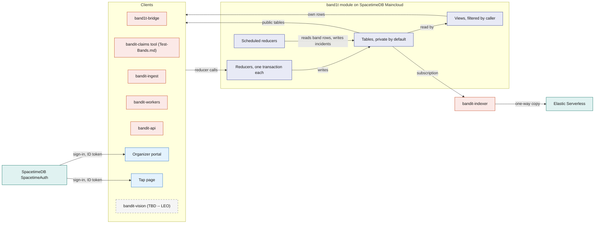
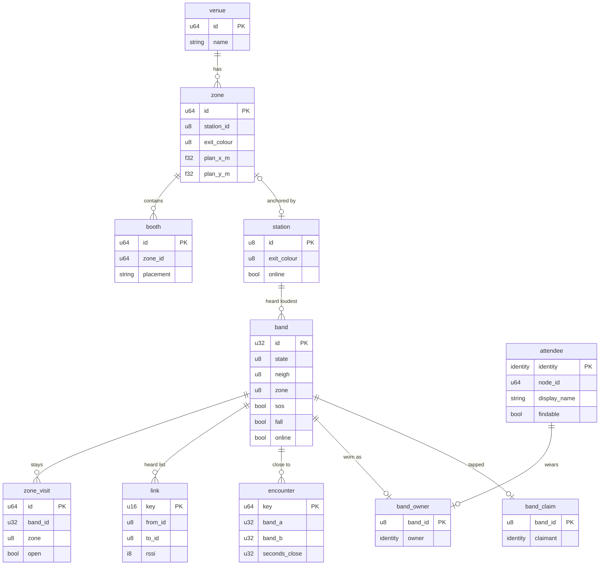
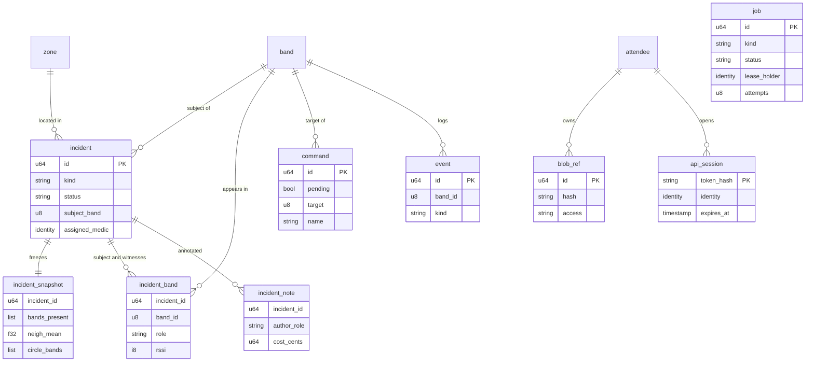
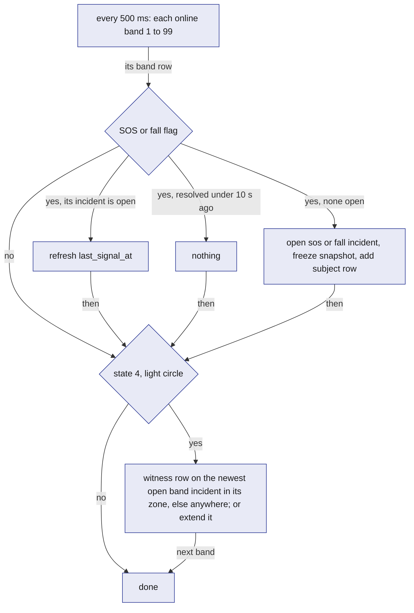

# SpacetimeDB: the `band1t` module

The `band1t` module is one SpacetimeDB database, written in Rust and compiled to WASM, on SpacetimeDB Maincloud. It holds every piece of BandIt's live state and performs every state change through reducers.

`band1t-bridge` (for the bands and station markers), the `bandit-claims` tool, both web apps, the workers and the indexer read it by subscription and change it only by calling reducers, so the venue has exactly one version of the truth at any moment. Crowd safety cannot tolerate two systems disagreeing about which band called for help or whether an incident is open.

Everything else in BandIt is a sensor feeding the module, a screen reading it, or a worker doing slow work it has queued.

## Role in the system

Responsibilities:

- Hold the venue layout, identities, the latest row per band and station marker, the one-shot commands for the radio, incidents, stays and encounters, and the work queue, in the core tables below.
- Open incidents from band flags and record light-circle witnesses in a scheduled reducer (`watch_bands`), and mark silent bands, station markers and the gateway offline (`sweep`), each run one transaction.
- Enforce access inside the module: who may call which reducer and who may see which rows, by role and by caller identity.
- Give every client the same live view through subscriptions to public tables and per-caller views.
- Queue slow or external work as `job` rows and accept results only from the worker that still holds the lease.

Non-responsibilities:

- It does not talk to radios, serial ports, cameras or any external service. Rust processes do that and call reducers ([Gateway-Bridge](../3-services/Gateway-Bridge.md), [Rust-Backend](../3-services/Rust-Backend.md)).
- It does not decide a band's density colour, SOS strobe or light circle. The band does that locally ([Hardware](../4-devices/Hardware.md)). The module turns staff actions into one-shot `command` rows ([Safety](../6-features/Safety.md)).
- It does not store photos, PDFs or letters. Blobs are files in `/var/lib/bandit` on the Vultr VM, behind `bandit-api`; the module keeps a `blob_ref` row.
- It runs no procedures and makes no outbound call.
- The safety behaviour (incidents, witnesses, low visibility, calibration, the exit markers) is in [Safety](../6-features/Safety.md). This file defines the tables and reducers that carry it.

## Interfaces

Every interface is a reducer call in or a subscription out, over the SpacetimeDB WebSocket protocol, through the Rust or TypeScript client SDK, or the SpacetimeDB command line for staff. Two callers need one reducer each and no subscription, so they use the SpacetimeDB HTTP API instead: `bandit-ingest` (`import_event`) and `bandit-api`'s test band routes (`report_test_band`).

| Direction | Counterpart | What flows | Reducers or tables | Transport |
|---|---|---|---|---|
| In | `band1t-bridge` | its registration; each band line that changed, and an unchanged one once a second; each station marker line on a colour change, and an unchanged one every 2 s; every heard list; the gateway's identity; the outcome of each command | `register_bridge`, `ingest_band`, `ingest_station`, `ingest_heard`, `gateway_up`, `command_sent` | Rust SDK |
| Out | `band1t-bridge` | the commands to send | `command` rows with `pending` true | subscription |
| In | Test-Bands.md: the `bandit-claims` command-line tool and `bandit-api`'s dev routes, both as the `tester` identity; organizers (`ops`) or the tool for the crowd | reports for the test bands (ids 90 to 99), one band per call; starting and stopping the in-module crowd (ids from 100) | `report_test_band`, `start_crowd`, `stop_crowd` | Rust SDK; `bandit-api`: SpacetimeDB HTTP API |
| Out | Test-Bands.md: the `bandit-claims` command-line tool | the bands, owners, venue and incidents it drives, read as the module owner | `band`, `band_owner`, `attendee`, `zone`, `incident`, `incident_band`, `incident_note`; Insurance.md: the claim tables | subscription |
| In | `bandit-ingest` | the event bundle: the venue, the zones from the team's station marker plan, the booths; Bright-Data.md: the organisations, people, booth content and schedule from the scraped pages | `import_event` (one bundle per transaction) | SpacetimeDB HTTP API: `POST /v1/database/<database>/call/import_event` with `bandit-ingest`'s own token |
| In | SpacetimeDB SpacetimeAuth | the ID token of every person's sign-in (attendees and staff, magic-link email only); SpacetimeDB derives the identity from its issuer and subject | every connection of the two web apps | OpenID Connect, checked by SpacetimeDB |
| In | Organizer portal (/organizer) | low visibility, incident handling, taking a band back, the end of the event, the owner's staff list | `set_low_vis`, `assign_medic`, `add_incident_note`, `resolve_incident`, `release_band`, `end_event`, `reopen_event`, `add_staff`, `remove_staff`; Medical-Card.md: `request_medical_card` | TypeScript SDK |
| In | Staff at the SpacetimeDB command line | commands to bands and station markers, thresholds, RSSI, the override, each zone's station marker and booth spots, starting the timers; after the import, Merch.md: the merch templates (`scripts/merch-setup`) and Bright-Data.md: the 3D venue's spots from `web/venue/spots.json`; the owner's service role grants and `band1t-bridge` reset | the Commands and Settings reducers below, `set_zone_station`, `place_booth`, `start_safety_watch`, `start_job_reaper`; Merch.md: `load_merch_templates`; Bright-Data.md: `load_venue_spots`; `grant_role`, `revoke_role`, `add_owner`, `reset_bridge` | SpacetimeDB command line |
| Out | Organizer portal | everything staff may see; the attendee list and "Event ended" for `ops` | public tables plus the `open_incidents`, `board_notes`, `board_attendees`, `board_staff`, `my_roles` and `my_owner` views; Merch.md: `board_merch_orders` | subscription |
| In | Tap page (/t/code) | band setup: claim, display name and findable switch, API session token | `claim_band`, `update_profile`, `open_api_session`; Bright-Data.md: `claim_person` | TypeScript SDK |
| Out | Tap page | in setup, the band being claimed and whether the press has landed; the end of the event; after it, the recap's own lists | `my_*` views, `event_state`, `venue`; Bright-Data.md: `person`, `organization`, `claimed_people` | subscription |
| In | `bandit-workers` | lease and finish jobs | `claim_job`, `extend_job_lease`, `complete_job`, `fail_job` | Rust SDK |
| Out | `bandit-workers` | queued and leased jobs | `worker_jobs` | subscription |
| In | `bandit-api` | blob registration, feature reducers named in feature docs | `register_blob` | Rust SDK |
| Out | `bandit-api` | API session tokens to authenticate its HTTP callers; the bands and the end of the event; Elastic.md: the rows it builds the recap from | `api_sessions`, `band`, `event_state`, `zone`, `booth`, `my_roles`; Social.md: `social_attendees`, `social_handles`, `social_visits`, `social_encounters`, `social_shared_visits`, `social_photos`, `social_photo_tags` | subscription |
| Out | Elastic.md: `bandit-indexer` | venue content and the views Elastic.md lists, one way | `zone`, `booth`, `schedule_slot`; Bright-Data.md: `organization`; Social.md: `social_attendees`, `social_visits` | subscription |
| In | Vision.md: the `vision` role | a security camera per zone; property events and a camera sighting per incident, judged with the Anthropic Claude API | `upsert_camera`, `report_property_event`, `submit_vision_assessment` ([Vision](../4-devices/Vision.md)) | Rust SDK |
| In | Vision.md (TBD -- LEO): `bandit-vision` | a people count per security camera's zone; person-down alerts | `report_zone_count`, `report_ground_alert` ([Vision](../4-devices/Vision.md)) | Rust SDK |
| Internal | scheduler | timers | `sweep`, `watch_bands`, `social_tick`, `job_reaper`; Test-Bands.md: `crowd_tick` | schedule tables |

## Design

### Why one module, and what SpacetimeDB gives it

The safety loop has several writers (`band1t-bridge`, test bands, organizers, scheduled reducers) and many readers (the Live tab, the medics' incident desk, `band1t-bridge`, tap pages). If any two of them kept their own copy of "which band is calling for help" or "is this incident open", different screens would show different things at the worst moment. So all live state is in one module, and five SpacetimeDB features carry the design.

| SpacetimeDB feature | What it gives | Where BandIt uses it |
|---|---|---|
| Reducers are transactions | every write in a reducer commits together or not at all; a failed role check rolls the call back | `watch_bands` opens an SOS incident, freezes its snapshot and adds the subject band in one commit |
| Subscriptions | each client gets the current rows, then every change as it commits | an SOS flag in a `band` row reaches the Live tab and the medic's incident desk with no polling layer; `band1t-bridge` receives `command` rows the same way |
| Scheduled reducers | the module runs its own timers, as repeating intervals, each run a transaction | `sweep` every 1 s, `watch_bands` every 500 ms, `social_tick` every 1 s, `job_reaper` every 10 s; Test-Bands.md: `crowd_tick` every 2 s |
| Views | read-only functions in the module that see the caller's identity and may read private tables | "only staff see open incidents" and "an attendee sees only their own band" are enforced by the module, not by an app. Social.md: `event_graph` does not depend on the caller, so it is computed once and shared by every screen that shows it |
| Identity | every connection has a stable `Identity` | every person signs in with SpacetimeDB SpacetimeAuth, SpacetimeDB's own OpenID Connect provider (in beta), with the magic-link email sign-in only; SpacetimeDB derives the identity from the ID token's issuer and subject, so a person is the same identity on every device. Services keep a saved token. Staff and services are identities with rows in `staff_role`; `band1t-bridge` is the one identity in `bridge` |

External services never hold truth. SpacetimeDB holds live state and decides; Elastic only orders a one-way copy ([Elastic](../7-integrations/Elastic.md)); workers return model and bank results through reducers. Elastic.md, Insurance.md: the one thing that comes back from Elastic is precedent checks on claims, as past-claim ids and scores that `bandit-workers` writes through `submit_claim_checks`; they never change an amount, and live state never lives in Elastic.

Social.md: the people graph is all here. The links the bands measured (`people_link`) are facts, so they reach screens live through `my_graph` and `event_graph`, and nothing about the graph comes from Elastic.

The question this diagram answers: who calls the module, what runs inside it, and how does data get back out?

### Design principles

| Principle | What it means here | Why |
|---|---|---|
| Bands and station markers write raw rows, one reducer opens incidents | `band1t-bridge` and its stand-ins write only `band`, `station`, `link`, `gateway`, `event`, `zone_visit` and `encounter`. Only `watch_bands` opens incidents from band flags and writes witness rows. Test-Bands.md: `crowd_tick` writes the crowd's `band` rows, stays and encounters itself, because no radio reports them, and the safety path never reads a band from 100. | Two writers never fight over an incident, and the beacon path stays a plain overwrite. |
| Overwrite live rows, append logs | `band`, `station`, `link`, `settings` and `gateway` hold one row per band, station marker, heard pair or singleton, overwritten in place. `event`, `command`, `zone_visit`, `encounter` and the incident tables grow; nothing deletes `event`, `command` or `incident` rows. Test-Bands.md: the crowd's ended stays are deleted after an hour. | Live tables stay bounded by fleet size, and the logs are the audit trail. |
| One-shot commands | Every command to the radio is one `command` row, sent once by `band1t-bridge` and marked by `command_sent`. Nothing is sticky, so nothing resends a command on its own. | One path for every command, and every delivery is traceable. |
| Private by default, access through views | Every table is private unless listed as public. Clients reach private rows only through views that read the caller's identity. | An app bug cannot leak a row the view would not return. |
| Elastic gets a copy, never the original | Only tables and views marked "copied" reach Elastic, one way, through `bandit-indexer`. Identity, incident and medical tables never leave the module. | Elastic can be rebuilt from the module at any time. |
| Add tables rather than reshape them | A feature adds its own tables and reducers (the registry below). Core columns are frozen after the first publish. | SpacetimeDB publishes additive changes without clearing data. |
| Nothing in the safety path waits | No reducer calls out or waits on a job. | A band's SOS reaches the Live tab in one bridge call plus one 500 ms pass of `watch_bands`. |
| Every privileged reducer checks the caller | Its first statement checks the caller: `require_role` looks up `staff_role` (the owner passes every role check), and `require_bridge` checks the one `bridge` row. | The module, not the app, is the security boundary. |

### Core tables

Conventions: "auto id" is an auto-increment primary key, used everywhere else as the id, including Elastic document ids. "identity" is a SpacetimeDB `Identity`. Timestamps come from the reducer context's clock.

"Public" means any connected client can read the table; otherwise the named views give access. "Copied" means `bandit-indexer` reads the table into Elastic documents ([Elastic](../7-integrations/Elastic.md)).

#### Venue group (loaded at setup)

`venue`: one row per event. Written by `import_event` (roles `ingest`, `ops`). Public, and copied (names folded into documents).

| Field | Type | Meaning |
|---|---|---|
| `id` | auto id | the venue; the event has one |
| `source_key` | text, unique | the bundle's key, so a re-import updates the row |
| `name` | text | the event's display name |
| `timezone`, `starts_at`, `ends_at` | text, timestamps | the planned event window |
| Bright-Data.md: `venue_name`, `address`, `latitude`, `longitude`, `website`, `description`, `facts`, `source_url`, `fetched_at` | text, text, numbers, text, text, list of label and value, text, timestamp | the venue's place from its Google Maps record, and the event's facts from the event pages plus the place's rating, phone number and opening hours; written by `import_event` |
| `updated_at` | timestamp | for the indexer's incremental copy |

`event_state`: a single row, id 0, that says whether the event has ended. Written by `end_event` and `reopen_event` (role `ops`). Public, and not copied.

| Field | Type | Meaning |
|---|---|---|
| `id` | always 0, primary key | singleton |
| `ended` | bool | set by `end_event` when an organizer (`ops`) presses "Event ended"; every open tap page turns into the recap, and the organizer portal stops offering `release_band` while it is set. `reopen_event` clears it |
| `ended_at` | timestamp, optional | when the event ended; empty while it is live |
| `ended_by` | identity | who last ended or reopened it |

`zone`: the part of the venue around one station marker, which stands at the zone's exit as its exit marker ([Safety](../6-features/Safety.md)). Written by `import_event` (roles `ingest`, `ops`) and `set_zone_station` (role `ops`, the station marker only).

Public. Copied (name and centre folded into documents).

| Field | Type | Meaning |
|---|---|---|
| `id` | auto id | the zone |
| `source_key` | text, unique | the bundle's key |
| `venue_id` | venue id | owner venue |
| `name` | text | for example "Main stage" |
| `kind` | text | `entrance`, `floor`, `sponsor`, `stage` or `food`; the crowd and `venue_plan` read it |
| `station_id` | 0 or 101 to 105, indexed | the station marker that anchors the zone; a band whose `zone` byte equals it is in this zone; 0 for none. A station marker anchors at most one zone |
| `plan_x_m`, `plan_y_m` | numbers | the zone's centre on the floor plan, in metres; a radio band's spot on the map |
| `area_sq_m` | number | floor area; `venue_plan` sizes the zone's rectangle from it |
| `capacity` | number | people at which organizers consider the zone full; shown on the Live tab, used by no rule |
| `exit_colour` | 0 to 6 | the colour of the zone's exit: 1 blue, 2 magenta, 3 cyan, 4 white, 5 orange, 6 violet, 0 none; written only by the import and shown in the Live tab's "Exit" column |
| `description`, `updated_at` | text, timestamp | content, and the indexer's incremental copy |

`booth`: a stand or stage. Written by `import_event` and `place_booth` (role `ops`). Public, and copied to `bandit-booths`.

| Field | Type | Meaning |
|---|---|---|
| `id` | auto id | the booth |
| `source_key` | text, unique | the bundle's key |
| `zone_id` | zone id | where it is: the zone whose centre is nearest |
| `booth_number` | text | the number printed on the event's plan; empty when the plan gives none |
| `name`, `kind`, `description`, `tags` | text, text, text, list of text | content from the bundle. Bright-Data.md: `import_event` fills the description and tags |
| `plan_x_m`, `plan_y_m` | numbers | position on the floor plan |
| `placement` | text: `plan`, `zone` or `manual` | where the position came from; `place_booth` sets `manual`, and a `manual` position survives a re-import |
| `source_url`, `fetched_at` | text, timestamp | provenance of scraped content |
| `updated_at` | timestamp | for the indexer's incremental copy |
| Bright-Data.md: `organization_id` | id, 0 for none | the sponsor organisation the booth was made for |

Bright-Data.md: `venue_spot`: one spot on the venue's 3D floor (a hacker table, a sponsor table, a stage, food, an entrance, an exit, a place or an area), with its position, facing and station id. Written by `load_venue_spots` (role `ops`) from `web/venue/spots.json`, which sets a sponsor table's `booth_id` to the booth whose name matches. Public, and not copied.

`schedule_slot`: a timed item at a booth or zone. Written by `import_event`. Public, and copied (folded into `bandit-booths`).

| Field | Type | Meaning |
|---|---|---|
| `id` | auto id | the slot |
| `zone_id` | zone id | where |
| `booth_id` | booth id, 0 for none | which booth, if any |
| `title`, `kind`, `description` | text | content |
| `starts_at`, `ends_at` | timestamp, the end optional | when |
| Bright-Data.md: `host_organization_id`, `speaker_person_ids` | id, list of ids | the organisation that runs the talk, and the speakers |

#### Identity group

`attendee`: one person, keyed by the identity of their SpacetimeDB SpacetimeAuth sign-in. Written by `claim_band` (creates a blank row), `update_profile` and, Bright-Data.md, `claim_person`. Private; read through `my_attendee`.

Not copied. Feature docs add their own tables for socials, medical and payment data; onboarding asks for no company.

Test-Bands.md: each crowd band is worn by a crowd attendee, an ordinary `attendee` row with a made-up name and `findable` on, written by `start_crowd` (Test-Bands.md defines it) and marked by the column below.

| Field | Type | Meaning |
|---|---|---|
| `identity` | identity, primary key | the person |
| `node_id` | auto id, unique | the person's node in the people graph, which never shows identities |
| `display_name` | text | shown to staff in the organizer portal's attendee list and beside a band's code on the Live tab and the incident desk, through `board_attendees`. Social.md: also shown to their encounter counterparts (in `my_encounters` and `my_graph`) and their shared-visit counterparts (in `my_shared_visits`) while they are `findable` |
| `findable` | bool | the one findable switch: off in a new row, set with the name by `update_profile`. Social.md: people you spent time with see your name, photo and socials, and you appear in the people graph and can be tagged in photos; Elastic.md: only findable attendees reach `bandit-people` |
| Bright-Data.md: `person_id`, `organization_id`, `photo_url` | id, id, text; empty until a profile is claimed | the claimed profile, its organisation and its headshot, copied by `claim_person` |
| Test-Bands.md: `crowd` | bool | set only for a crowd attendee, by `start_crowd`; the attendee list, `board_attendees`, returns it |
| `created_at`, `updated_at` | timestamp | audit |

`band_owner`: who wears which radio or test band. Written by `social_tick` when a claim's press lands; deleted by `release_band`. Private; read through `my_band` (the attendee who wears it) and `board_attendees` (staff).

Not copied. Test-Bands.md: a crowd band has no row here, because nobody taps or claims it; `crowd_member` names its crowd attendee.

| Field | Type | Meaning |
|---|---|---|
| `band_id` | 1 to 99, primary key | the band's radio id: 1 to 9 for the real bands. People never see it: they see the band's code, which `band_code` computes from it ([Tap-Page](../5-apps/Tap-Page.md)). Test-Bands.md: 90 to 99 for the test bands |
| `owner` | identity, unique | the attendee who wears it; one band per attendee. Test-Bands.md: bands 90 to 93 belong to test attendees |
| `claimed_at` | timestamp | when the press completed the claim |

`band_claim`: a tap that waits for the press. Written by `claim_band`; deleted by `social_tick` when the press lands or the window ends.

Private; read through `my_band`. Not copied.

| Field | Type | Meaning |
|---|---|---|
| `band_id` | 1 to 99, primary key | the band tapped |
| `claimant` | identity, indexed | who tapped it |
| `started_at`, `expires_at` | timestamp | the 8 s window for the press |

`staff_role`: one role grant to one identity. Written by `grant_role` and `revoke_role`, which only the module owner may call, and by the staff list below.

The owner is not a grant: `init` records the publishing identity in `owner`, a private table, and `add_owner` (owner only) adds another identity to it.

Private; read through `my_roles` (own rows) and `my_owner` (the caller's own `owner` row). Not copied.

| Field | Type | Meaning |
|---|---|---|
| `id` | auto id | the grant |
| `identity` | identity, indexed | who |
| `role` | text, one of the roles below | what |
| `label` | text | person's or service's name, for the organizer portal |
| `granted_by`, `granted_at` | identity, timestamp | audit |

`staff_member`: one person the owner added as staff by email, with the role (`ops`, `medic` or `photographer`) and a name. Written by `add_staff` and `remove_staff` (owner only). `account_email` keeps the email each signed-in account last connected with, from its sign-in token. An account with a listed email gets the role in `staff_role` at once when it signed in before, else when it next connects (`client_connected`). Private; the owner reads the list through `board_staff`. Not copied.

`bridge`: at most one row, the identity of the registered `band1t-bridge` and `since`, when it registered. Written by `register_bridge` and `reset_bridge`.

Private, no view. Not copied. `band1t-bridge` is this row, not a role.

#### Device group (overwritten in place)

`band`: the latest row per band, radio, test and crowd. Written by `ingest_band` (`band1t-bridge`) and `sweep`; Test-Bands.md: and by `report_test_band` (role `tester`) for the test bands, and by `crowd_tick`, `start_crowd` and `stop_crowd` for the crowd's bands.

Public. Not copied.

| Field | Type | Meaning |
|---|---|---|
| `id` | 32 bits, primary key | the band id: 1 to 99 radio and test bands, which fit the radio's one byte; Test-Bands.md: from 100 for the crowd |
| `state` | 0 to 11 | the light state the band shows ([Hardware](../4-devices/Hardware.md)) |
| `flags` | 0 to 255 | the raw flag byte |
| `sos`, `fall`, `pressed`, `low_battery`, `has_mpu`, `has_motor` | bool | the flag bits split out, so views and screens can filter on them; a full band has both sensor bits |
| `neigh` | number | the band's smoothed neighbour count: the density number |
| `zone` | 0 or 101 to 105 | the station id the band hears loudest, 0 for none. It is a station id, not a `zone.id`: a band is in the zone whose `station_id` equals it |
| `bat` | 0 to 100 or 255 | battery percent, 255 unknown |
| `find` | band id or 0 | the friend band this band is finding |
| `rssi` | dBm | the band's signal at the gateway: distance to the gateway, not density |
| `seq` | number | the band's beacon counter |
| `online` | bool | set on every report; `sweep` clears it after 5 s of silence |
| `last_seen` | timestamp | the module's time of the last report |
| `x_m`, `y_m` | metres | where the band stands on the venue plan, for the Live tab's map: a radio band at its zone's centre, because the radio gives only the zone. Test-Bands.md: a test band at a slot 1.5 m apart around that centre, and a crowd band at its own spot |
| `booth_id` | booth id, 0 for none | the booth the band stands at; 0 for every radio band. Test-Bands.md: set for a crowd band at a booth |

`station`: one station marker, keyed by its station id. Written by `ingest_station` (`band1t-bridge`) and `sweep`. Public, and not copied.

A row appears with the station marker's first beacon and has no link to a zone; a zone points at its station marker through `zone.station_id`.

| Field | Type | Meaning |
|---|---|---|
| `id` | 101 to 105, primary key | the station id |
| `exit_colour` | 1 to 6 | the colour index its beacon carries now, the colour it glows |
| `rssi` | dBm | its signal at the gateway |
| `online` | bool | set on every report; `sweep` clears it after 5 s |
| `last_seen` | timestamp | the module's time of the last report |

`link`: each band's latest heard list, one row per band and peer. Written only by `ingest_heard`, which replaces the reporter's rows each time; the rows of a band that goes silent stay.

Public. Not copied. Read by `watch_bands` for a witness's RSSI of the subject.

| Field | Type | Meaning |
|---|---|---|
| `key` | primary key | the reporter and the peer in one number |
| `from_id` | band id, indexed | the reporting band |
| `to_id` | band or station id | the peer it heard |
| `rssi` | dBm | the reporter's smoothed reading of the peer |
| `updated` | timestamp | when |

`gateway`: one row, id 0. Written by `init` (empty, offline), `gateway_up`, every `ingest_band`, `ingest_station` and `ingest_heard` (online, `last_line` now), `sweep` (offline after 5 s with no call) and `client_disconnected` (offline when `band1t-bridge` disconnects).

Public, and not copied. Fields `mac`, `fw`, `online`, `last_line`. The Live tab's status line reads it.

`settings`: one row, id 0, of band calibration and venue-wide band modes. Written by `init` (defaults) and `set_thresholds`, `set_rssi`, `set_low_vis` and `set_override` (role `ops`), each of which also sends the matching command to every band.

Public. Not copied.

| Field | Type | Meaning |
|---|---|---|
| `id` | always 0, primary key | singleton |
| `yellow`, `red` | neighbour counts | `thresh` arguments; defaults 3 and 5, calibrated at the venue ([Safety](../6-features/Safety.md)). `crowd_tick` and the Live tab read them |
| `neigh_rssi`, `circle_rssi` | dBm | `rssi` arguments; defaults -62 and -58, calibrated at the venue. `ingest_heard` reads `neigh_rssi` as the encounter threshold |
| `low_vis` | bool | low visibility, set by `set_low_vis`, which sends `lowvis 1` or `0` to every band; the Live tab shows it ([Safety](../6-features/Safety.md)) |
| `override_density` | bool | set by `set_override`, which sends `override 1` or `0`: bands show IDLE instead of their density state. Organizers run the override and forced states by hand ([Safety](../6-features/Safety.md)) |

#### Control and log group (appended)

`command`: one row per one-shot command for the radio. Written by the Commands and Settings reducers, `resolve_incident`, `claim_band` and the claim completion in `social_tick`. Marked by `command_sent`; rows are never deleted.

Public. Not copied. `band1t-bridge` sends each pending row once as the gateway line `cmd <target> <name> [arg] [arg2]` ([Gateway-Bridge](../3-services/Gateway-Bridge.md)).

| Field | Type | Meaning |
|---|---|---|
| `id` | auto id | the command |
| `pending` | bool, indexed | true until `band1t-bridge` reports it |
| `target` | 0 to 255 | 0 every band, 1 to 99 one band, 100 every station marker, 101 to 105 one station marker; the module checks no target, the firmware does |
| `name` | text | one of the firmware's 13 commands: `state`, `exit`, `clear`, `buzz`, `pay`, `paid`, `thresh`, `rssi`, `override`, `find`, `sleep`, `haptic`, `lowvis`. BandIt never sends `pay` or `paid` |
| `arg`, `arg2` | 0 to 255 | the arguments |
| `requested_by` | identity | the caller of the reducer that wrote it |
| `created` | timestamp | when written |
| `sent_at`, `error` | timestamp, text, both optional | set by `command_sent`; a row older than 30 s when `band1t-bridge` sees it is marked "expired before the bridge saw it" |

`event`: the band log, one row per change. Written by `ingest_band` (`Online`, `SosRaised`, `SosCleared`, `Fall`, `Press`, `FindStarted`, `FindEnded`, `FoundMe`, `Sleep`, each on the rising edge against the previous row), `sweep` (`Offline`), `gateway_up` (`GatewayUp`) and `command_sent` (`CommandFailed`); Test-Bands.md: `report_test_band` writes `SosRaised`, `Fall` and `Press` with the detail "test band".

Public. Not copied. Fields `id`, `at`, `band_id` (indexed; 0 for the gateway), `kind`, `detail`.

The only reader is `social_tick`, which reads `Press` events to complete band claims; incidents open from band rows, not from events.

`zone_visit`: a band's stay in one station marker's zone. Written by `ingest_band` and `sweep` (which closes the open stays of a band that goes offline); Test-Bands.md: and by `report_test_band`, `crowd_tick`, `stop_crowd` and the crowd's hourly prune.

Public. Not copied: Social.md's views carry the findable visits to Elastic.md. Read by `social_tick`; Insurance.md: and by the evidence pack, for the subject band's stays.

| Field | Type | Meaning |
|---|---|---|
| `id` | auto id | the stay |
| `band_id` | band id, indexed | which band |
| `zone` | station id | the station id of the stay |
| `entered`, `left` | timestamp, the end optional | the stay |
| `booth_id` | booth id, 0 for none | the booth, when known (Test-Bands.md: the crowd) |
| `open` | bool, indexed | true until `left` is set, so `social_tick` reads only the stays still running |

`encounter`: two bands close together. Written by `ingest_heard`, only from the lower id's heard list, for band ids 1 to 99 at or above `settings.neigh_rssi`, where gaps under 5 s add up to 2 s each; Test-Bands.md: and by `crowd_tick` for the crowd's pairs.

Public, and not copied. Read by `social_tick`; not used for safety. Fields `key` (the pair, lower id first), `band_a` and `band_b` (indexed), `first_seen`, `last_seen`, `seconds_close`, `best_rssi`.

#### Incident group

`incident`: one safety event. Written by `watch_bands` (`sos`, `fall`), `open_incident`, `assign_medic` and `resolve_incident`; Vision.md: and by `report_property_event` and `submit_vision_assessment`. Private, read through `open_incidents` (staff), and not copied.

| Field | Type | Meaning |
|---|---|---|
| `id` | auto id | the incident |
| `kind` | enum `Sos`, `Fall`, `Property` | what |
| `status` | enum `Open`, `Responding`, `Resolved` | lifecycle ([Safety](../6-features/Safety.md)) |
| `resolved` | bool, indexed | true once resolved, so `open_incidents` reads by index |
| `zone_id` | zone id or 0 | where; 0 when the band heard no station marker or its station marker anchors no zone |
| `station_id` | station id or 0 | the station id the band reported, or the zone's station id |
| `subject_band` | band id or 0, indexed | the band; 0 for a property incident or a staff incident with no band |
| `opened_by` | text: `band`, `ops` or `vision` | who opened it |
| `opened_at`, `last_signal_at` | timestamp | open time, and the last `watch_bands` pass that still saw the flag |
| `assigned_medic` | identity, optional | the medic who took the incident with `assign_medic` |
| `resolved_at`, `resolved_by`, `resolution` | timestamp, identity, text | set by `resolve_incident` |
| Vision.md: `vision_status` | text: `none`, `confirmed`, `not_confirmed` | starts `none`; `submit_vision_assessment` sets the camera sighting's result; never gates anything |

`incident_snapshot`: a frozen record taken in the transaction that opens the incident. Written once, by the opener. Private, with no view, and not copied (Insurance.md: its evidence pack reads it inside the module).

| Field | Type | Meaning |
|---|---|---|
| `id` | auto id | the snapshot |
| `incident_id` | incident id, unique | which incident |
| `taken_at` | timestamp | equals `opened_at` |
| `zone_id`, `station_id` | ids | where |
| `band_state`, `band_flags`, `band_neigh`, `band_battery`, `band_seen_at` | numbers, timestamp | the subject band's row at that instant; 0 when the subject is not online |
| `bands_present`, `neigh_mean` | list of band ids, number | the online bands 1 to 99 whose `zone` is the incident's station id, and their mean `neigh` |
| `circle_bands` | list of band ids | the online bands 1 to 99 showing state 4 anywhere at that instant |

`incident_band`: the bands attached to an incident. Written by `watch_bands` (witnesses) and the opener (the subject, when its band is online). Private, read through `incident_bands`, and not copied.

| Field | Type | Meaning |
|---|---|---|
| `id` | auto id | the row |
| `incident_id` | incident id, indexed | which incident |
| `band_id` | band id | which band |
| `role` | text: `subject` or `witness` | witnesses are light-circle bands (state 4) |
| `zone_id` | zone id | the zone of the band's station marker |
| `rssi` | dBm or 0 | the subject's signal as the witness heard it, from `link`; 0 when unknown and for the subject |
| `first_seen_at`, `last_seen_at` | timestamp | the window in which it showed state 4 |

`incident_note`: staff notes and costs. Written by `add_incident_note` and by `open_incident` when its note is not blank. Private, read through `board_notes`, and not copied.

| Field | Type | Meaning |
|---|---|---|
| `id` | auto id | the note |
| `incident_id` | incident id, indexed | which incident |
| `author`, `author_role` | identity, text | who, and their first role among `ops` and `medic`, else `owner` |
| `text` | text | the note |
| `cost_cents` | integer, optional | the treatment or repair cost in USD cents (Insurance.md reads it) |
| `created_at` | timestamp | when |

#### Work and files group

`job`: one unit of slow or external work. Queued by feature reducers through the module's internal enqueue function, never by a client; changed by the job reducers (role `worker`) and `job_reaper`.

Private; read through `worker_jobs` (workers). Not copied.

| Field | Type | Meaning |
|---|---|---|
| `id` | auto id | the job |
| `kind` | text, indexed | a job kind, defined by the feature doc that owns it |
| `status` | enum `Queued`, `Leased`, `Done`, `Dead` | a failed attempt goes back to `Queued`; `Dead` is not retried |
| `open` | bool, indexed | true while queued or leased, so workers subscribe by index |
| `payload` | text | the job's input, as JSON the worker parses |
| `subject_table`, `subject_id` | text, number | the row the job is about |
| `lease_holder`, `lease_until` | identity, timestamp, both optional | who holds it and until when (60 s, starting value) |
| `attempts`, `max_attempts` | number | tries so far; 3 |
| `not_before` | timestamp, optional | back-off before the next try |
| `result`, `error` | text | outcome |
| `created_at`, `updated_at` | timestamp | audit |

`blob_ref`: the module's record of a file in the blob store in `/var/lib/bandit`, behind `bandit-api`. Written by `register_blob` (roles `worker`, `api`, `vision`, `ops`, `medic`), which changes nothing when the hash is already registered.

Private, with no view: reducers read it to check that a file was registered before they accept its hash (Social.md: `register_photo`; Medical-Card.md: `submit_medical_document`; Insurance.md: the medical record). Not copied.

| Field | Type | Meaning |
|---|---|---|
| `id` | auto id | the row |
| `hash` | text, unique | the file's SHA-256, under which `bandit-api` stores it and serves it at `/blobs/<hash>` |
| `owner` | identity, optional | who it is about, empty for files of the event |
| `access` | text: `owner_only`, `staff`, `shared` | an attendee's own medical PDFs are `owner_only` (medics see the card read from them, never the PDF); clinic bills, letters and hospital reports `staff`; event photos `shared`; Bright-Data.md: a venue setup's model and layout `shared` |
| `purpose` | text | what it is: `medical`, `photo`, `frame`, `letter`, `hospital_report`; Medical-Card.md: `history` and `insurance`; Bright-Data.md: `venue_model`, `venue_layout` and `plan_wording` (a plan's public PDF that a plan lookup fetched, `owner_only` to the attendee who named the plan) |
| `content_type`, `size_bytes` | text, number | what the file is, and its size |
| `created_by`, `created_at` | identity, timestamp | audit |

#### Service group

`api_session`: how `bandit-api` knows who calls it over HTTP without checking tokens itself. Written by `open_api_session` (any identity). Private, read through `api_sessions` (role `api`), and not copied.

The app makes a random token, sends its hash here and the token to `bandit-api`; the API hashes what it receives and finds it in its subscription.

| Field | Type | Meaning |
|---|---|---|
| `token_hash` | text, primary key | SHA-256 of the client's random token |
| `identity` | identity, indexed | the caller who registered it |
| `created_at`, `expires_at` | timestamp | 12 h lifetime (starting value) |

#### Schedule tables

Each scheduled reducer has its own schedule table, each a repeating interval: `sweep_timer` (1 s, inserted by `init`), `incident_watch_timer` (500 ms, by `start_safety_watch`), `job_reaper_timer` (10 s, by `start_job_reaper`) and `social_tick_timer` (1 s, by the first `claim_band`). Test-Bands.md: `crowd_timer` (2 s, by `start_crowd`; `start_crowd` also starts `social_tick`, and `stop_crowd` deletes the crowd timer). All are private, and each scheduled reducer refuses any caller but the module itself.

### Entity diagrams

The question this diagram answers: how do the venue, identity and device tables relate?

The question this diagram answers: how do incidents, commands, the band log and the work queue relate to bands and zones?

### Registry of optional feature tables

Each optional component owns its tables, reducers and job kinds and defines them in its own file. Deleting a feature deletes its rows here and nothing else in this section changes.

| Doc | Tables it adds | Core tables it reads |
|---|---|---|
| [Medical-Card](../6-features/Medical-Card.md) | `medical_document`, `medical_card`, `medical_access_log` | `band_owner`, `attendee`, `incident`, `blob_ref`, `job` |
| [Capital-One-Nessie](../7-integrations/Capital-One-Nessie.md) | `wallet_entry` (the wallet ledger: the opening, Merch.md purchases, Insurance.md payouts); it writes Insurance.md's `claimant_account` | `attendee`, `job` |
| [Insurance](../6-features/Insurance.md) | `claimant_account` (one Capital One Nessie account per attendee, for claim payouts and, Capital-One-Nessie.md: the wallet), `insurance_policy`, `coverage_rule`, `authority_limit`, `insurance_settings`, `claim`, `clinic_report`, `medical_record`, `claim_line`, `evidence_fact`, `evidence_pack`, `claim_check`, `claim_review`, `settlement_rule`, `approval`, `ledger_entry`; Elastic.md: `claim_precedent` | `incident`, `incident_snapshot`, `incident_band`, `incident_note`, `zone`, `booth`, `zone_visit`, `band_owner`, `attendee`, `staff_role`, `blob_ref`, `job` |
| [Social](../6-features/Social.md) | `visit`, `social_encounter`, `shared_visit`, `people_link`, `social_handle`, `photo`, `photo_tag`; Test-Bands.md: `crowd_member`, `crowd_group`, `crowd_walk` and `venue_floor` (defined in [Test-Bands](../3-services/Test-Bands.md)) | `zone_visit`, `encounter`, `band`, `band_owner`, `attendee`, `zone`, `booth`, `blob_ref`, `job` |
| [Merch](../6-features/Merch.md) | `merch_template` (public), `merch_order`, `merch_pick`, `merch_shop` | `booth`, `blob_ref`, `job` |
| [Anthropic-Claude-API](../7-integrations/Anthropic-Claude-API.md) | `model_call` | `job` |
| [Vision](../4-devices/Vision.md) | `camera`, `vision_assessment`, `property_event`; (TBD -- LEO) `camera_count`, `ground_alert` | `zone`, `incident`, `blob_ref` |
| [Bright-Data](../7-integrations/Bright-Data.md) | `organization`, `person`, `person_claim`, `venue_spot` (public); for the venue setup, `venue_setup`, `venue_setup_step` and `chosen_venue` (all public); for the plan lookup, `plan_lookup` (private; the attendee's own through `my_plan_lookups`, next to build) | `venue`, `zone`, `booth`, `band_owner`, `attendee`, `blob_ref`, `job` |

Feature reducers, views and timers are defined in their own doc and follow the same role-check pattern. This table only says where to find them.

| Doc | Reducers | Views and timers |
|---|---|---|
| [Medical-Card](../6-features/Medical-Card.md) | `submit_medical_document` (the attendee), `apply_medical_extract` (role `worker`), `confirm_medical_card` (the attendee), `request_medical_card` (role `medic`); the job kind `medical_extract` | views `my_medical_card`, `my_medical_documents`, `medic_medical_cards` (role `medic`), `board_medical_access` (the owner, `ops`, `medic`) |
| [Capital-One-Nessie](../7-integrations/Capital-One-Nessie.md) | `connect_wallet` (the attendee, at the wallet step of setup), `record_wallet` (role `worker`); the job kind `wallet_open` | views `my_wallet` (the spendable balance), `my_wallet_entries` |
| [Insurance](../6-features/Insurance.md) | `file_claim` (the attendee, in their own words), `file_claim_for_wearer` (roles `ops` and `medic`), `open_claim`, `submit_medical_record` (roles `medic` and `ops`, from the "File the medical record" form on a claim, after the `POST /api/blobs` upload), `apply_medical_record`, `file_clinic_report`, `submit_claim_review`, `attach_claim_letters` and `attach_recovery_letter` (role `worker`), and the organizer's reducers (role `ops`): `approve_claim`, `refuse_claim`, `record_insurer_payment`, `retry_claim_payout`, `request_recovery_letter`, `upsert_insurance_policy`, `upsert_coverage_rule`, `set_insurance_settings`; the job kinds `claim_record_extract`, `clinic_report`, `claim_review`, `claim_draft`, `recovery_letter`; Capital-One-Nessie.md: `record_claim_payout` (role `worker`) and the job kind `claim_payout`; Elastic.md: `submit_claim_checks` (role `worker`) and the job kind `claim_verify` | defined there |
| [Social](../6-features/Social.md) | `set_social_handle`, `remove_social_handle`, `register_photo` (roles `photographer`, `ingest`, `ops`), which queues the job kind `photo_features`, and `submit_photo_features` (roles `worker`, `vision`), which keeps the people count and caption the Anthropic Claude API gave; Test-Bands.md: `start_crowd` and `stop_crowd` (roles `ops` and `tester`) and the timer `crowd_tick`, defined in [Test-Bands](../3-services/Test-Bands.md); plus the social part of `social_tick` (every 1 s), which reads the stays in `zone_visit` and the close time in `encounter` and writes `visit` (a stay of a worn band of at least 120 s, `VISIT_MIN_SECONDS`), `social_encounter` (from the pair's `encounter` once both attendees are `findable`; `met` once their time together since then reaches 180 s, `ENCOUNTER_MIN_SECONDS`), `shared_visit` (two `findable` attendees' visits to one zone overlapping for at least 300 s, `SHARED_VISIT_MIN_SECONDS`; not a link) and `people_link` (kinds `met` with minutes, written with the encounter, `visited` with minutes, `works_at`, `exhibits`; only `findable` attendees get links); all starting values | views `my_handles`, `my_visits`, `my_encounters`, `my_shared_visits` (per caller: zone, booths, start, overlap minutes, the other person's card), `my_photos`, `my_graph` (per caller: own neighbourhood), `event_graph` (computed once for every viewer: every link, with each person's display name), `board_photos` (staff: the owner, `ops`, `medic`; every event photo with its zone, time and caption and the graph node ids of the `findable` people tagged in it, for the organizer portal's Photos tab and the photos in its event graph); `social_attendees`, `social_visits`, `social_encounters`, `social_shared_visits` (roles `indexer`, `worker` and `api`: findable attendees only), `social_handles`, `social_photos`, `social_photo_tags` |
| [Merch](../6-features/Merch.md) | `load_merch_templates` (roles `ingest` and `ops`, after the import), `buy_merch` (one tap, paid from the wallet), `buy_merch_as` (role `ops`), `settle_merch_order` (role `worker`), `rerun_shopping_agent` (role `ops`), `submit_merch_picks` (role `worker`); the job kinds `merch_purchase` and `merch_picks` | views `my_merch_suggestions` (per caller: the top 3 templates, each with the caller's best photo, ranked by minutes at the template's booths), `my_merch_orders`, `board_merch_orders` (the owner and `ops`: every order with the attendee's display name, for the organizer portal's Merch tab), `board_merch_picks` |
| [Bright-Data](../7-integrations/Bright-Data.md) | `claim_person` (the signed-in attendee; refused unless the caller wears a band); the scraped sections of the bundle that core's `import_event` loads (organisations, people, booth content and the schedule); `load_venue_spots` (role `ops`, from `web/venue/spots.json`); for the venue setup, `start_venue_setup` and `choose_venue` (role `ops`), `report_venue_setup_step` and `finish_venue_setup` (role `worker`, holding the job's lease), and the job kind `venue_setup`, whose death marks the setup `failed`; for the plan lookup, `look_up_plan` (the signed-in attendee; refused unless the caller wears a band) and `finish_plan_lookup` (role `worker`, holding the job's lease), and the job kind `plan_lookup`, whose death marks the lookup `failed` (next to build) | view `claimed_people` (anonymous: claimed person ids only); view `my_plan_lookups` (the caller's own lookups) |
| [Vision](../4-devices/Vision.md) | `upsert_camera` (roles `vision` and `ops`), `report_property_event`, `submit_vision_assessment` (role `vision`); (TBD -- LEO) `report_zone_count`, `report_ground_alert`, `submit_photo_features` and the job kind `photo_features` | (TBD -- LEO) view `vision_incidents` (role `vision`) |
| [Anthropic-Claude-API](../7-integrations/Anthropic-Claude-API.md) | `record_model_call` (roles `worker`, `ingest`, `vision`) | defined there |
| [Elastic](../7-integrations/Elastic.md) | none; `bandit-indexer` only reads, and `bandit-organize` in Elastic Workflows runs before `import_event` (Bright-Data.md); Insurance.md: claim precedents come back only through Insurance.md's `submit_claim_checks` | none; `bandit-indexer` reads Social.md's views `social_attendees` and `social_visits`, and `bandit-api` reads the `social_*` views it builds the recap from |

### Core reducers

Every reducer runs as one transaction. "Caller" is the role the reducer requires; "any" means any connected identity; "`band1t-bridge`" means the identity in `bridge`.

#### Setup

| Reducer | Caller | What it does | Writes |
|---|---|---|---|
| `import_event` | `ingest`, `ops` | upserts one event bundle by `source_key` in one transaction: the venue, zones, booths and schedule (Bright-Data.md: and the organisations and people), plus one `import_run` row with the bundle hash and the counts per section. Zone station ids and exit colours come straight from the bundle. It refuses a bundle in which two zones share a station id, keeps every booth placed `manual`, and overwrites a station id set by `set_zone_station` | `venue`, `zone`, `booth`, `schedule_slot`, `import_run`; Bright-Data.md: `organization`, `person` |
| `set_zone_station` | `ops` | points a zone at a station marker, or clears it with 0; refuses a station marker that already anchors another zone | `zone` |
| `place_booth` | `ops` | moves a booth to a zone and a spot on the plan and marks it `manual` | `booth` |
| `register_bridge` | any | the first caller becomes the identity in `bridge`, and the same identity again is fine; any other is refused until the owner calls `reset_bridge` | `bridge` |
| `reset_bridge` | `owner` only | deletes `band1t-bridge` row | `bridge` |
| `start_safety_watch` | `ops` | inserts the 500 ms `incident_watch_timer` row if there is none | `incident_watch_timer` |
| `start_job_reaper` | `ops` | inserts the 10 s `job_reaper_timer` row if there is none | `job_reaper_timer` |

#### Devices

| Reducer | Caller | What it does | Writes |
|---|---|---|---|
| `ingest_band` | `band1t-bridge` | one band beacon (id, gateway RSSI, flags, `neigh`, `zone`, battery, state, `seq`, find target); rules below | `band`, `event`, `zone_visit`, `gateway` |
| `ingest_station` | `band1t-bridge` | one station marker beacon: upserts its `station` row online, with its colour and RSSI | `station`, `gateway` |
| `ingest_heard` | `band1t-bridge` | one band's heard list: replaces its `link` rows, and records an `encounter` for each band it heard with a higher id, 1 to 99, at or above `settings.neigh_rssi` | `link`, `encounter`, `gateway` |
| `gateway_up` | `band1t-bridge` | the gateway's MAC and firmware version: marks it online and logs `GatewayUp` | `gateway`, `event` |
| `command_sent` | `band1t-bridge` | marks a command sent, with its error if any; refuses an unknown id; logs `CommandFailed` on an error | `command`, `event` |
| Test-Bands.md: `report_test_band` | `tester` | one test band's report (band id, station id, state, `neigh`, SOS, fall and press flags), written like a radio band's row with both sensor bits set, at a slot around its zone's centre; logs `SosRaised`, `Fall` and `Press` on rising edges, and moves its stay when the station id changes or the band was offline; refuses any id outside 90 to 99 | `band`, `event`, `zone_visit` |

Who may report which band: `ingest_band` accepts ids 1 to 99, only from the registered bridge; the radio fleet is 1 to 9. Test-Bands.md: `tester` reports only the test bands (90 to 99), through `report_test_band`, and `crowd_tick` writes the crowd's bands, from 100, inside the module. A `band` row appears with a band's first report.

#### `ingest_band`, step by step

- It refuses id 0 or above 99, and marks the gateway online.
- It builds the row: the flag bits split out; `online` true; `last_seen` now; `x_m`, `y_m` the centre of the zone whose `station_id` equals `zone`, or 0, 0.
- A new band: it opens a stay in `zone_visit` when `zone` is not 0, inserts the row and logs `Online`.
- A known band: it logs each rising edge against the previous row (`Online` after being offline, `SosRaised`, `SosCleared`, `Fall`, `Press`, `FindStarted`, `FindEnded`, `FoundMe` when the state becomes 11, `Sleep` when it becomes 9), moves the stay when `zone` changed, and overwrites the row. A stay under 5 s is deleted when the band moves on, and re-entering a zone left under 5 s ago reopens that stay, so a band on the edge between two station markers leaves no trail of short stays.
- It opens no incident: `watch_bands` reads the row on its next pass.

#### `watch_bands`, step by step

The question this diagram answers: what does one 500 ms pass do for each band? The policy is in [Safety](../6-features/Safety.md).

Test-Bands.md: the test bands go through the same pass. The crowd's bands, from 100, never open an incident, join one or appear in a snapshot.

#### Commands

Role `ops`. Each writes one `command` row and nothing else, and none checks the target. Organizers call them from the SpacetimeDB command line; no page has a control for them ([Safety](../6-features/Safety.md)).

| Reducer | What it writes |
|---|---|
| `send_command(target, name, arg, arg2)` | any of the 13 command names, with unchecked arguments |
| `force_state(target, state, tenths)` | `state` with a state up to 11 and a hold in tenths of a second, 0 for no end |
| `clear(target)` | `clear` |
| `set_exit(target, colour)` | `exit` with a colour from 1 to 6 |
| `haptic(target, pattern)` | `haptic` with a pattern from 0 to 6 |
| `start_find(seeker, friend, colour)` | `find` to the seeker with the friend and a colour up to 5; both are band ids 1 to 99 and different |
| `stop_find(seeker)` | `find 0 0` to the seeker |
| `sleep_bands(target, minutes)` | `sleep` with the minutes, 0 for button wake only |

#### Settings

Role `ops`. Each stores its values in `settings` and writes one command to target 0, every band.

| Reducer | What it does |
|---|---|
| `set_thresholds(yellow, red)` | needs 1 at most `yellow` at most `red`; writes `thresh` |
| `set_rssi(neigh_rssi, circle_rssi)` | magnitudes 20 to 100; stores the negative values and writes `rssi` with the magnitudes |
| `set_low_vis(on)` | writes `lowvis 1` or `0`; the Live tab's button calls it |
| `set_override(on)` | stores `override_density` and writes `override 1` or `0` |

#### Scheduled

| Reducer | Cadence | What it does | Writes |
|---|---|---|---|
| `sweep` | every 1 s, from `init` | bands 1 to 99, station markers and the gateway silent for over 5 s go offline; logs `Offline` for a band not in state 9 and closes its open stays. Test-Bands.md: the crowd's bands are skipped | `band`, `station`, `gateway`, `event`, `zone_visit` |
| `watch_bands` | every 500 ms, from `start_safety_watch` | opens `sos` and `fall` incidents from band flags and records light-circle witnesses (above) | `incident`, `incident_snapshot`, `incident_band` |
| `social_tick` | every 1 s, from the first `claim_band`; never stopped | completes a band claim when a `Press` event of that band lands inside its 8 s window (and writes `state 0 1` for a radio band), and deletes expired claims. Social.md: then turns stays and encounters into visits, social encounters, shared visits and graph links | `band_owner`, `band_claim`, `command`; Social.md: `visit`, `social_encounter`, `shared_visit`, `people_link` |
| `job_reaper` | every 10 s, from `start_job_reaper` | returns expired leases to the queue after a back-off, or marks the job `Dead` once `attempts` reaches `max_attempts` | `job` |
| Test-Bands.md: `crowd_tick` | every 2 s, from `start_crowd` | moves the crowd, recounts each crowd band's neighbours within 1.5 m, sets its state 0 to 2 against `settings.yellow` and `red`, and writes the crowd's stays and encounters ([Test-Bands](../3-services/Test-Bands.md)) | `band`, `zone_visit`, `encounter` |

Why these cadences: 500 ms for `watch_bands` puts an incident on screen within half a second of the band's flag reaching the module; 1 s for `sweep`, with a 5 s silence rule, matches `band1t-bridge`'s once-a-second refresh of every band it hears; 10 s for the reaper is faster than any lease and costs nothing.

#### Attendee

| Reducer | Caller | What it does | Writes |
|---|---|---|---|
| `claim_band` | any | takes the token from the tap link, the band's code, and turns it into the band with `band_from_token`, which accepts only bands 1 to 99 ([Tap-Page](../5-apps/Tap-Page.md)); refuses a band someone else wears, a caller who already wears another band, and a band someone else tapped less than 8 s ago; creates a blank `attendee` row for the caller if none; opens an 8 s `band_claim`; for a radio band, writes `state 8 80` so the band blinks white for 8 s. The press completes the claim in `social_tick` | `attendee`, `band_claim`, `command` |
| `update_profile` | any | updates the caller's `attendee` row: the display name and the findable switch; a change of `findable` rebuilds the caller's graph links | `attendee`; Social.md: `people_link` |
| `open_api_session` | any | records a token hash bound to the caller with an expiry; refuses a hash already in use | `api_session` |

#### End of the event

An organizer (`ops`) ends the event from the organizer portal ([Organizer-Portal](../5-apps/Organizer-Portal.md)). There is no email: the recap opens live on every open tap page, and the tap link opens it again later for the band's signed-in owner ([Tap-Page](../5-apps/Tap-Page.md)).

| Reducer | Caller | What it does | Writes |
|---|---|---|---|
| `end_event` | `ops` | sets `event_state.ended`, `ended_at` to now and `ended_by` to the caller; calling it again only moves the time. Every open tap page, subscribed to `event_state`, turns into the recap; from then on the organizer portal hides "Take the band back", so every band keeps its owner for the recap | `event_state` |
| `reopen_event` | `ops` | clears `event_state.ended` and `ended_at`, back to the live event, to run the event flow again; open pages leave the recap | `event_state` |

#### Organizer actions and roles

| Reducer | Caller | What it does | Writes |
|---|---|---|---|
| `release_band` | `ops` | deletes the band's `band_owner` row, so the band can be claimed again by press; the organizer portal offers it as "Take the band back" after a confirm tap, only until `event_state.ended` is set; the old `attendee` row and its memories stay | `band_owner` |
| `grant_role` | `owner` only | grants a role to an identity with a label; refuses a role name that is not lowercase `snake_case`, and a grant the identity already holds changes nothing; the owner calls it from the SpacetimeDB command line for each service identity | `staff_role` |
| `add_staff` | `owner` only | adds a medic, organizer (`ops`) or photographer by email from the organizer portal's Staff tab; the account that signs in with that email gets the role | `staff_member`, `staff_role` |
| `remove_staff` | `owner` only | removes a staff member; their account loses the role | `staff_member`, `staff_role` |
| `revoke_role` | `owner` only | removes a grant | `staff_role` |
| `add_owner` | `owner` only | adds another identity to `owner`, for example the owner's own browser sign-in on the organizer portal | `owner` |

#### Incidents

| Reducer | Caller | What it does | Writes |
|---|---|---|---|
| `open_incident` | `ops`, `medic` | opens an `sos`, `fall` or `property` incident by hand in a zone, with an optional band and note, and the same snapshot; `opened_by` `ops`. No page calls it; Test-Bands.md: `bandit-claims property` does | `incident`, `incident_snapshot`, `incident_band`, `incident_note` |
| `assign_medic` | `medic` | the caller takes the incident: refuses a resolved incident, sets status `Responding` and `assigned_medic` to the caller | `incident` |
| `add_incident_note` | `ops`, `medic` | appends a note with the author's role and an optional cost in cents; refuses blank text | `incident_note` |
| `resolve_incident` | `ops`, `medic` | refuses an incident already resolved; sets status `Resolved` with the resolution text; writes one `clear` for the subject band unless it is 0 or a test band. Insurance.md: ends with the claim hook: an `sos` or `fall` incident with at least one note, or a `property` incident with a note whose cost is above 0, opens a claim | `incident`, `command` |

#### Jobs

Feature reducers queue a job through the module's internal enqueue function; no client can.

| Reducer | Caller | What it does | Writes |
|---|---|---|---|
| `claim_job` | `worker` | leases a `Queued` job whose `not_before` has passed; sets `Leased`, `lease_holder`, `lease_until` (now plus 60 s); increments `attempts` | `job` |
| `extend_job_lease` | `worker` | pushes `lease_until` out by 60 s; refused if the caller no longer holds the lease | `job` |
| `complete_job` | `worker` | sets `Done` with the result text; refused unless the caller holds an unexpired lease, so a slow duplicate cannot overwrite a newer result. The feature's apply reducer follows the same pattern | `job` |
| `fail_job` | `worker` | records the error (and the Anthropic Claude API call, when there was one), then queues the job again after a back-off, or marks it `Dead` when the attempts are used up; same lease check | `job` |
| Vision.md (TBD -- LEO) | `vision` | the four job reducers above also accept `vision`, for job kind `photo_features` only (enqueued by Social.md's `register_photo`) | `job` |

#### Files

| Reducer | Caller | What it does | Writes |
|---|---|---|---|
| `register_blob` | `worker`, `api`, `vision`, `ops`, `medic` | records a stored file with its hash, owner, access class, purpose, content type and size; workers call it for the letters, hospital reports and venue models they produce | `blob_ref` |

#### Lifecycle

`init` runs once, when the module is first published: it records the publishing identity in `owner`, inserts the `settings` row with its defaults (yellow 3, red 5, neighbour RSSI -62 dBm, circle RSSI -58 dBm, low visibility and override off), the offline `gateway` row and the 1 s `sweep_timer`. It starts no other timer.

`client_disconnected` marks the gateway offline when the registered bridge disconnects; `client_connected` remembers the caller's sign-in email in `account_email` and grants the staff roles added for that email. Liveness comes from `band.last_seen`, `station.last_seen` and `gateway.last_line`, which `sweep` reads.

### Roles and access control

Roles are rows in `staff_role`, except `owner`. People: `owner`, `ops`, `medic`; Social.md: `photographer`. The two event staff roles are the medic (`medic`), who works incidents during the event, and the organizer (`ops`), who runs the venue.

Services: `tester`, `vision`, `ingest`, `indexer`, `worker`, `api`. One identity may hold several roles.

`owner` is the identity that published the module, kept in the `owner` table: it passes every role check, and it alone may call `grant_role`, `revoke_role`, `add_owner` and `reset_bridge`. `band1t-bridge` holds no role: it is the one identity in `bridge`, set by `register_bridge`.

There is no separate role for running the event: an organizer is a staff member with `ops`, which also opens the attendee list and the "Event ended" button in the organizer portal. Every person signs in with SpacetimeDB SpacetimeAuth. The owner adds each staff member by email on the organizer portal's Staff tab (`add_staff`), and the account that signs in with that email gets the role ([Organizer-Portal](../5-apps/Organizer-Portal.md)). Services get their roles with `grant_role` from the SpacetimeDB command line.

| Role | May call | May read (beyond public tables) |
|---|---|---|
| `owner` | everything; it alone may call `grant_role`, `revoke_role`, `add_owner`, `add_staff`, `remove_staff` and `reset_bridge` | everything the staff views return, and `board_staff` |
| `ops` | `import_event`, `set_zone_station`, `place_booth`, `register_blob`, `start_safety_watch`, `start_job_reaper`, the Commands and Settings reducers, `open_incident`, `add_incident_note`, `resolve_incident`, `release_band`, `end_event`, `reopen_event`; Bright-Data.md: `load_venue_spots`; Merch.md: `load_merch_templates`; Test-Bands.md: `start_crowd`, `stop_crowd`; Insurance.md: the organizer's reducers, among them `approve_claim` and `refuse_claim` | `open_incidents`, `incident_bands`, `board_notes`, `board_attendees`; Medical-Card.md: `board_medical_access`; Merch.md: `board_merch_orders`; Social.md: `board_photos` |
| `medic` | `assign_medic`, `add_incident_note`, `open_incident`, `resolve_incident`, `register_blob`; Medical-Card.md: `request_medical_card`; Insurance.md: `file_claim_for_wearer`, `submit_medical_record` | `open_incidents`, `incident_bands`, `board_notes`, `board_attendees`; Medical-Card.md: `medic_medical_cards` and `board_medical_access`; Social.md: `board_photos` |
| Social.md: `photographer` | `register_photo` | feature views only |
| `band1t-bridge` (no role) | `ingest_band`, `ingest_station`, `ingest_heard`, `gateway_up`, `command_sent` | public tables |
| Test-Bands.md: `tester` | `report_test_band`, `start_crowd`, `stop_crowd` | public tables |
| `worker` | job reducers, feature apply reducers, `register_blob`, `record_model_call` | `worker_jobs`; Social.md: the `social_*` views; the feature views each job kind needs |
| `api` | `register_blob` | `api_sessions`; Social.md: the `social_*` views, which `bandit-api` builds the recap from |
| Elastic.md: `indexer` | none | public tables; Social.md: the `social_*` views, of which it reads `social_attendees` and `social_visits` |
| `ingest` | `import_event`, `record_model_call`; Merch.md: `load_merch_templates`; Social.md: `register_photo` | public tables |
| Vision.md: `vision` | the Vision reducers, `record_model_call`; (TBD -- LEO) the job reducers for `photo_features` | `zone`, `camera`; (TBD -- LEO) `incident` through `vision_incidents`, `worker_jobs(photo_features)` |
| attendee (no role row) | attendee reducers and feature reducers for attendees | `my_*` views |

How the check works: the reducer reads the caller's identity from the reducer context and looks up `staff_role` through a b-tree index on `identity`; the owner passes every check. A missing or wrong role returns an error, which rolls back the transaction and reaches the caller's SDK as a failed call. Each Rust service prints its identity on first start, and the owner grants its service role.

### Views

SpacetimeDB 2.x views are read-only functions inside the module. They may read private tables, see the caller's identity, and return rows or a projected row type; clients subscribe to them like tables. A view is per caller (evaluated for each subscriber, with the caller's identity) or anonymous (evaluated once and shared by every subscriber, Social.md: `event_graph`).

Views use indexed lookups, so per-caller views are cheap at event scale: a few staff screens, a few dozen phones and, Test-Bands.md: up to 2,000 crowd bands (1,000 at the event) and 10 test bands.

"Staff" below means the owner or a holder of `ops` or `medic`; anyone else gets no rows.

| View | Who gets rows | Returns |
|---|---|---|
| `my_attendee` | any | the caller's `attendee` row |
| `my_band` | any | the band the caller wears (`claimed`) or has just tapped (`waiting_for_press`, with the end of the 8 s window), so the tap page can say "press your band now" |
| `my_roles` | any | the caller's `staff_role` rows, so the photographer page and the tap page's medic view know the caller's role and the organizer portal knows which tabs and buttons to show |
| `my_owner` | any | the caller's `owner` row, if any, so the organizer portal treats the module owner as holding every role, as the module does |
| `venue_plan` | anyone; anonymous and public | the venue plan the Live tab's map draws: one row per zone with a station marker, a rectangle around its centre sized from `area_sq_m`, and one row per booth, with the spot its staff stand at and the spot in front of it where attendees stand (station id, booth id, name, two points) |
| `board_attendees` | staff | one row per attendee: display name, graph node id, the band they wear (0 for none), `findable`, organisation and socials. Test-Bands.md: also `crowd`, set for a crowd attendee, whose band comes from `crowd_member` |
| `open_incidents` | staff | every incident not yet resolved |
| `incident_bands(incident_id)` | staff | the subject and witness rows of one incident |
| `board_notes` | staff | every `incident_note` |
| `board_staff` | `owner` | every `staff_member` row, for the Staff tab |
| `worker_jobs` | `worker` | every `Queued` or `Leased` job |
| `api_sessions` | `api` | every `api_session` row |

No view exposes `incident_snapshot`, resolved incidents, `band_owner` or `band_claim` directly. Feature docs add their own views the same way: look up the caller's role or ownership by index, then return the rows.

### Subscriptions per client

| Client | Subscribes to | Why |
|---|---|---|
| `band1t-bridge` | `command` rows with `pending` true, its one query | the commands to send; it reads no settings, zones, station markers or bands |
| Test-Bands.md: the `bandit-claims` command-line tool | as the module owner: `band`, `band_owner`, `attendee`, `zone`, `booth`, `venue`, the incident tables; Insurance.md: the claim tables | drive the test bands and the claims flow, and wait for the rows each step produces |
| Organizer portal | `band`, `station`, `gateway`, `settings`, `zone`, `booth`, `venue`, `event_state`, `my_roles`, `my_owner`, `open_incidents`, `board_notes`, `board_attendees`, `board_staff`; Bright-Data.md: `organization`, `venue_setup`, `venue_setup_step`, `chosen_venue`; Social.md: `event_graph`, `board_photos`; Medical-Card.md: `medic_medical_cards`; Merch.md: `merch_template`, `board_merch_orders`, `board_merch_picks`; Capital-One-Nessie.md: `board_wallets`; Insurance.md: `claims_board`, `unclaimed_injuries` and the `board_*` claim views | the Live tab, the incident desk, the attendee list, the claims desk, the event graph with its photos on the big screen, the Photos tab, the Merch tab, the Venue setup tab, the Staff tab ([Organizer-Portal](../5-apps/Organizer-Portal.md)) |
| Live view (`/live`) | `band`, `event_state`, `my_roles`, `my_owner`; Bright-Data.md: `venue_spot`; Insurance.md: `claims_board`; the live run's `live_run`, `band_place`, `decision` and `incident_marker` | the bands on the venue's 3D floor |
| Tap page | `event_state`, `venue`, the tapped band's `band` row, `my_attendee`, `my_band`, `my_roles`; Social.md: `my_handles`, `my_visits`, `my_encounters`, `my_photos`; Bright-Data.md: `person`, `organization`, `claimed_people`; Medical-Card.md: `my_medical_documents`, `my_medical_card`, and `open_incidents` and `medic_medical_cards` for the medic's view of a tap; Capital-One-Nessie.md: `my_wallet`, `my_wallet_entries`; Merch.md: `merch_template`, `my_merch_suggestions`, `my_merch_orders`; Insurance.md: `my_incidents`, `my_claims` | band setup, the thank-you screen, the switch to the recap, the recap ([Tap-Page](../5-apps/Tap-Page.md)) |
| `bandit-workers` | `worker_jobs`, plus the feature tables each kind reads | claim and run jobs |
| `bandit-api` | `api_sessions`, `band`, `event_state`, `zone`, `booth`, `my_roles`; Social.md: `social_attendees`, `social_handles`, `social_visits`, `social_encounters`, `social_shared_visits`, `social_photos`, `social_photo_tags` | authenticate HTTP callers; Elastic.md: build the recap for `GET /api/recap`; Test-Bands.md: keep the test bands it moved alive and stop their 2 s reports once the event ends |
| Elastic.md: `bandit-indexer` | `zone`, `booth`, `schedule_slot`; Bright-Data.md: `organization`; Social.md: `social_attendees`, `social_visits` | one-way copy into `bandit-booths` and `bandit-people` |
| Vision.md (TBD -- LEO): `bandit-vision` | `zone`, `camera`, `vision_incidents` and `worker_jobs` for `photo_features` | know which zone a security camera covers; react to new incidents; take photo jobs |

A new subscription first delivers every current row, then each change as it commits. SpacetimeDB 2.x delivers updates after the commit is durable, which adds a few milliseconds; `band1t-bridge`'s once-a-second refresh and the 500 ms watch dominate latency anyway.

### Data lifecycle

| Group | Rows appear | Rows change | Rows leave | Size at event scale |
|---|---|---|---|---|
| Venue | `import_event` before doors open | `set_zone_station`, `place_booth` or a re-import | never during the event | tens of rows |
| Identity | an attendee taps a band; the owner grants roles; Test-Bands.md: `start_crowd` adds the crowd | the setup steps | a band claim after its 8 s; a `band_owner` row on `release_band` | tens of rows; Test-Bands.md: plus up to 2,000 crowd attendees, 1,000 at the event |
| Device | first report; `init` for `settings` and `gateway` | every report, in place | never; a silent band keeps its last row, marked offline by `sweep` | one row per band, station marker and heard pair; Test-Bands.md: plus 10 test band rows and up to 2,000 crowd band rows, 1,000 at the event |
| Control and log | every command; every rising edge; every stay and close pair | `command_sent` marks a command; the open stay and the pair's close time | never; a stay under 5 s is deleted; Test-Bands.md: the crowd's stays an hour after they end | thousands of rows over the event |
| Incidents | band flag, an organizer | status changes | never; resolved incidents stay as evidence (Insurance.md reads them) | tens of rows |
| Work and files | feature reducers, uploads | lease and status changes | never; `Dead` jobs stay for audit | hundreds |
| Service | an app page opens a session | never | never; expired rows stay | a few per phone |

### Deployment and seed data

The `band1t` module is published once to SpacetimeDB Maincloud as the database `bandit-calhacks13-sp82j`. Every client reads the module's address from one configuration value ([Rust-Backend](../3-services/Rust-Backend.md)). `bandit-api`, `bandit-workers` and `bandit-indexer` connect from the Vultr VM; `band1t-bridge` and the organizer portal connect from the venue laptop over a team phone's hotspot (Test-Bands.md: so does the `bandit-claims` command-line tool); the tap page connects from each phone, served by `bandit-api` on its public HTTPS host, band1t.vip ([Architecture](../1-overview/Architecture.md)).

Seed loading: `bandit-ingest` builds one event bundle from the event's folder: `zones.json`, the team's station marker plan with one zone per station marker, its centre, area, capacity and exit colour, edited at the venue; `booths.json`; and Bright-Data.md: the scraped pages. It loads the bundle with `import_event` through the SpacetimeDB HTTP API, which upserts every row by `source_key`, so re-running it restores the venue in one pass.

Feature docs add their own seed files (Merch.md: the templates in `assets/merch/templates.json` through `load_merch_templates`, after the import; Bright-Data.md: the 3D venue's spots in `web/venue/spots.json` through `load_venue_spots`; Insurance.md: the policy and its coverage rules through `upsert_insurance_policy` and `upsert_coverage_rule`; Elastic.md and Insurance.md: the 30 past claims, which `bandit-workers` writes to `bandit-claims` in Elastic rather than to the module).

The owner grants every service role with `grant_role` and adds staff by email with `add_staff`. Before doors open an organizer calls `start_safety_watch` and `start_job_reaper` once; both change nothing when called again.

Test-Bands.md: `bandit-claims setup`, run as the owner, grants its test identities their roles, imports a small seed venue when none exists and makes both calls. `scripts/e2e-setup` runs the import (with a local target or a named bundle), the merch templates, `bandit-claims setup`, `load_venue_spots` and the service role grants, then `start_safety_watch`, `start_job_reaper` and `start_crowd` with 1,000 bands.

`init` records the publisher as `owner`, so the owner never needs a grant.

### Schema change rules

SpacetimeDB publishes additive changes without clearing data and refuses column changes. These rules keep the module publishable at any hour:

1. Core columns are frozen from the first publish. A missing field is appended at the end with a default, never inserted, renamed or retyped.
2. A feature adds its own tables, reducers and views (the registry above).
3. Indexes and reducers may change freely, except an index a live subscription relies on.
4. Schedule tables never change kind; a new scheduled reducer gets a new schedule table.
5. A breaking change before doors open means re-publishing with data deleted and reloading the seed. After doors open, no breaking change is made.
6. Client bindings are regenerated with `spacetime generate` after every publish, and both web apps and all Rust services are rebuilt against them before the next rehearsal.

## Failure modes and fallbacks

| Failure | Effect | Design answer |
|---|---|---|
| The venue laptop loses its hotspot link | `band1t-bridge` exits on the disconnect; after 5 s `sweep` shows every radio band and the gateway offline | bands keep every local safety behaviour ([Safety](../6-features/Safety.md)); the team restarts `band1t-bridge`, which registers again with its saved identity |
| `watch_bands` was never started | flags reach the `band` rows but no incident opens | `start_safety_watch` is a setup step, and calling it again changes nothing |
| The gateway or `band1t-bridge` is down while organizers send commands | `command` rows stay pending | a row older than 30 s when `band1t-bridge` sees it is marked "expired before the bridge saw it", so a stale command is never sent late |
| A second bridge identity starts, for example on a new laptop | `register_bridge` refuses it | the owner calls `reset_bridge`, and the new bridge registers |
| A schema change is needed after seeding | publish refused or data cleared | the schema change rules above: append a column with a default or add a table |

## Dependencies

**Depends on**

- [Hardware](../4-devices/Hardware.md) for the meaning of every `band` field, the band states, exit colours, flag bits and command targets; the module keeps its own copy of the numbers.
- [Gateway-Bridge](../3-services/Gateway-Bridge.md) for how beacons become reducer calls and how `command` rows become radio commands.
- [Safety](../6-features/Safety.md) for the policy inside `watch_bands`, `resolve_incident` and the command reducers.
- [Rust-Backend](../3-services/Rust-Backend.md) for configuration, service identities and tokens.

**Used by**

- Every other file: [Architecture](../1-overview/Architecture.md), [Organizer-Portal](../5-apps/Organizer-Portal.md), [Tap-Page](../5-apps/Tap-Page.md), [Test-Bands](../3-services/Test-Bands.md), [Elastic](../7-integrations/Elastic.md), [Bright-Data](../7-integrations/Bright-Data.md) and every optional feature doc reference the tables and reducers defined here and add their own.

**If you delete this file**

- The system has no single source of truth. This file is core and is not deletable.
- Deleting an optional feature removes its rows from the two registry tables and every line here that starts with its file name: the social part of `social_tick` (Social.md), the Vision.md field on `incident`, and its rows in the interfaces, roles and subscriptions tables. Nothing else here changes.

## Decisions

| Decision | Why |
|---|---|
| One deployment: `band1t` on SpacetimeDB Maincloud only, with no standalone server, so the identity carry-over between hosts does not arise | one set of identities and role grants; the venue laptop reaches SpacetimeDB Maincloud over a team phone's hotspot |
| Incidents open in `watch_bands` every 500 ms from the latest `band` rows, not inside `ingest_band` | the beacon path stays a plain overwrite, and one reducer decides what opens, from radio and test bands alike |
| Every command to the radio is one `command` row, sent once by `band1t-bridge` and marked by `command_sent`, and rows are never deleted | one path and one audit trail for every command; nothing resends a command on its own |
| `band1t-bridge` is the one identity in `bridge`, set by the first `register_bridge`, not a role | `band1t-bridge` needs no grant before it starts; the owner resets it for a new laptop |
| `band.zone` holds the station id a band hears loudest, and `zone.station_id` turns it into a zone | the radio knows station markers, not zones, and each zone has exactly one station marker |
| Test-Bands.md: the Live tab subscribes to every `band` row, the crowd's included, and redraws every second | the crowd's 1,000 bands change many rows every 2 s, and one redraw takes them all |
| Every service and app uses the SpacetimeDB SDK, except `bandit-ingest` and `bandit-api`'s test band reports, which call one reducer each through the SpacetimeDB HTTP API; staff call the reducers that have no screen from the SpacetimeDB command line | one transport and one set of generated, typed bindings for every program that subscribes; a caller of one reducer with no subscription needs neither |
| Access to private rows goes through views, not row-level security | views are a stable SpacetimeDB 2.x feature and can see the caller's identity |
| The module runs no procedures | every external call (the Anthropic Claude API, the Capital One Nessie API, Elastic, Bright Data) stays in a Rust service with its own secrets, away from the safety path |
| Test-Bands.md: the `tester` role reports only the test bands 90 to 99, through `report_test_band` | the radio fleet is 1 to 9, so a test never touches a radio band's row |
| Only a medic calls `assign_medic`, and it takes the incident for the caller | the medic knows whether they are free; organizers do not dispatch ([Safety](../6-features/Safety.md)) |
| `release_band` is an organizer action in the organizer portal, after a confirm tap, until the event ends | an organizer fixes a band claimed by mistake, and the tap page has no screen for it; the tap stops an accidental release; after `end_event` every band keeps its owner for the recap |
| Nothing in BandIt sends `pay` or `paid` | there is no paying at the venue, so the firmware's payment commands are not used |
| Test-Bands.md: `report_test_band` opens and closes the test bands' stays like `ingest_band` does for radio bands, and `crowd_tick` writes the crowd's stays itself | test attendees and crowd attendees make visits, encounters and graph links through the same `social_tick` as real ones, so the big-screen graph shows a real-looking crowd |
| Social.md: the people graph's links are rows in `people_link`, written by the module | links are exact, private, live facts, which subscriptions and views serve |
| A press counts only inside a band claim's 8 s window; any other press only logs a `Press` event | the press is consent, so it counts only when the tap page has just asked for it: a band claim |
| One sign-in for every person: the SpacetimeDB SpacetimeAuth magic link, with no other providers; the identity comes from the ID token's issuer and subject | the same person is the same identity on every device, so the recap opens anywhere, and BandIt keeps no password and no email address |
| `end_event` (role `ops`) sets `event_state.ended`; the recap opens live from that row, and the organizer portal stops offering `release_band` after it; `reopen_event` (same role) clears it to run the event flow again | one press by an organizer ends the night for everyone, with no email, and every band keeps its owner for the recap |
| There is no separate role for running the event: an organizer is a staff member with `ops`, and only `owner`, the publishing identity, grants and revokes roles and adds staff | one role runs both the venue and the organizer portal's event controls, and every grant comes from one identity, so no staff screen can widen its own access |
| The people roles for event staff are `medic` and `ops` | the medic works incidents during the event and the organizer runs the venue; one organizer portal page with the same tabs serves both |
