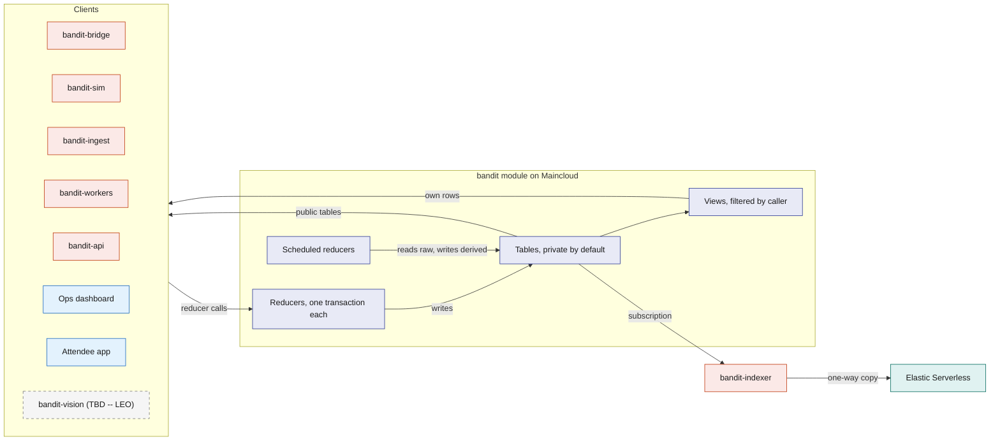
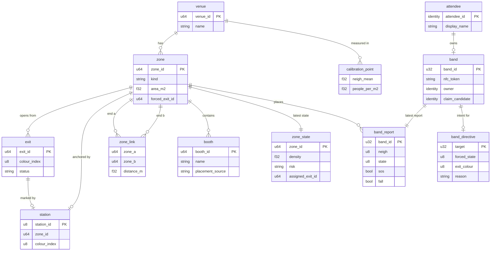
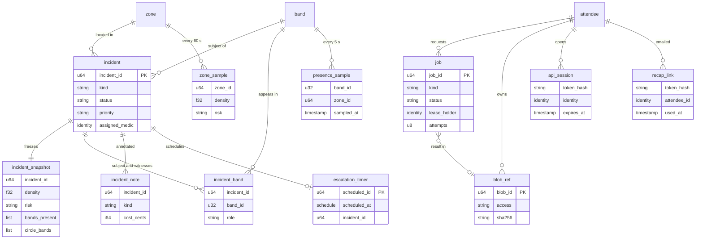
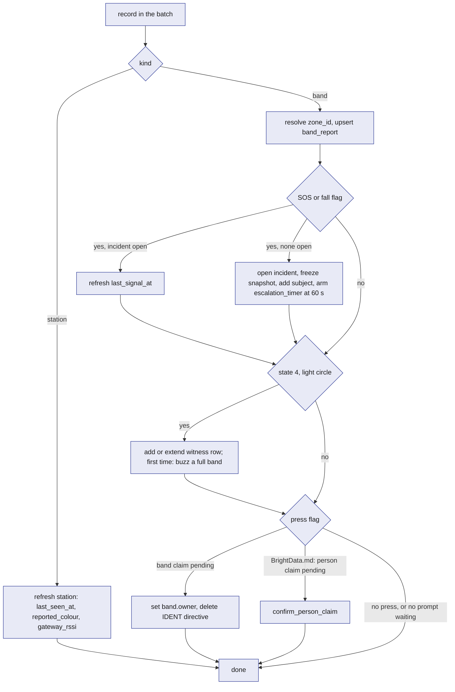

# SpacetimeDB: the `bandit` module

The `bandit` module is one SpacetimeDB database, written in Rust and compiled to WASM, on SpacetimeDB Maincloud. It holds every piece of BandIt's live state and performs every state change through reducers. Bands, the bridge, the simulator, both web apps, the workers and the indexer read it by subscription and change it only by calling reducers, so the venue has exactly one version of the truth at any moment. Crowd safety cannot tolerate two systems disagreeing about which zone is dangerous or whether an incident is open. Everything else in BandIt is a sensor feeding the module, a screen reading it, or a worker doing slow work it has queued.

## Role in the system

Responsibilities:

- Hold the venue layout, identities, live band and zone state, control intent for the bands, incidents, sampled history and the work queue, in the core tables below.
- Turn raw band reports into derived safety state (`zone_state`, exit assignments, incidents) in scheduled reducers, on a fixed cadence, in transactions.
- Enforce access inside the database: who may call which reducer and who may see which rows, by role and by caller identity.
- Give every client the same live view through subscriptions to public tables and per-caller views.
- Queue slow or external work as `job` rows and accept results only from the worker that still holds the lease.

Non-responsibilities:

- It does not talk to radios, serial ports, cameras or any external service. Rust processes do that and call reducers ([Gateway-Bridge](../3-services/Gateway-Bridge.md), [Rust-Backend](../3-services/Rust-Backend.md)).
- It does not decide a band's density colour, SOS strobe or light circle. The band does that locally ([Hardware](../4-devices/Hardware.md)). The module decides exit colours, forced states, one-shot prompts and calibration values ([Safety](../6-features/Safety.md)).
- It does not store photos, PDFs or letters. Blobs are files on the Fly volume behind `bandit-api`; the module keeps a `blob_ref` row.
- It runs no procedures and makes no outbound call.
- The safety policy (thresholds, hysteresis, exit cost, escalation) is in [Safety](../6-features/Safety.md). This file defines the tables and reducers that carry it.

## Interfaces

Every interface is a reducer call in or a subscription out, over the SpacetimeDB WebSocket protocol, through the Rust or TypeScript client SDK.

| Direction | Counterpart | What flows | Reducers or tables | Transport |
|---|---|---|---|---|
| In | `bandit-bridge` | latest report per real band and station every 250 ms; acks of one-shot commands (`sent` or `expired`); heartbeat | `ingest_band_reports`, `ack_band_command`, `heartbeat` | Rust SDK |
| Out | `bandit-bridge` | desired band states, exit colours, one-shot commands, live calibration | `band_directive`, `band_command`, `fleet_config` (through `staff_directives`, `staff_commands`) | subscription |
| In | Simulator.md: `bandit-sim` | reports for virtual bands (ids from 1000), including replays of recorded logs under those ids | `ingest_band_reports`, `heartbeat` | Rust SDK |
| Out | Simulator.md: `bandit-sim` | venue graph, exits, zone state, directives, venue mode | `zone`, `zone_link`, `exit`, `station`, `zone_state`, `venue_mode`, `fleet_config`, `staff_directives`, `staff_commands` | subscription |
| In | `bandit-ingest` | venue layout, booths, schedule, bands, calibration from the seed | `upsert_venue`, `upsert_zone`, `upsert_zone_link`, `upsert_exit`, `upsert_station`, `upsert_booth`, `upsert_schedule_slot`, `register_band`, `set_calibration`; Merch.md: `upsert_merch_template`; Payments-Nessie.md: `register_merchant`; BrightData.md: `import_event` (one event bundle per transaction) | Rust SDK |
| In | Ops dashboard | modes, exits, forced states, calibration, incident handling, role grants, recap emails, API session token | the Ops and Incident reducers below, `send_recap_emails`, `open_api_session` | TypeScript SDK |
| Out | Ops dashboard | everything staff may see | public tables plus the `staff_*` and `my_role` views | subscription |
| In | Attendee app | claim, release, profile with the email, consent, API session token | `claim_band_start`, `release_band`, `update_profile`, `set_consent`, `open_api_session` | TypeScript SDK |
| Out | Attendee app | own band, reports, presence and incidents; venue map; busy zones; evacuation banner with exit name and colour | `my_*` views, `zone`, `exit`, `booth`, `schedule_slot`, `zone_state`, `venue_mode` | subscription |
| In | `bandit-workers` | lease and finish jobs, recap links, heartbeat | `claim_job`, `extend_job_lease`, `complete_job`, `fail_job`, `issue_recap_link`, `heartbeat` | Rust SDK |
| Out | `bandit-workers` | queued and leased jobs by kind | `worker_jobs` | subscription |
| In | `bandit-api` | blob registration, recap link use, heartbeat, feature reducers named in feature docs | `register_blob`, `redeem_recap_link`, `heartbeat` | Rust SDK |
| Out | `bandit-api` | API session tokens to authenticate its HTTP callers; recap links; blob refs; Social.md: share links; Elastic.md: the search filter and who is in a caller's graph | `api_sessions`, `api_recap_links`, `staff_blobs`; Social.md: `share_link`; Elastic.md: `api_presence_windows`, `people_link`, `staff_roles` | subscription |
| Out | Elastic.md: `bandit-indexer` | venue content and the feature tables Elastic.md lists, one way | `venue`, `zone`, `station`, `booth`, `schedule_slot`, `consent` and feature tables | subscription |
| In | Vision.md (TBD -- LEO): `bandit-vision` | a pit count every 3 s, person-down alerts, property events, Claude assessments a few seconds after an event | `report_zone_count`, `report_ground_alert`, `report_property_event`, `submit_vision_assessment` ([Vision](../4-devices/Vision.md)) | Rust SDK |
| Internal | scheduler | ticks and timers | `venue_tick`, `memory_tick`, `escalate_incident`, `job_reaper` | schedule tables |

## Design

### Why one module, and what SpacetimeDB gives it

The safety loop has several writers (bridge, simulator, ops, scheduled ticks) and many readers (dashboard, medic phones, bridge, attendee apps). If any two of them kept their own copy of "which zone is high" or "is this incident open", different screens would show different colours at the worst moment. So all live state is in one module, and five SpacetimeDB features carry the design.

| SpacetimeDB feature | What it gives | Where BandIt uses it |
|---|---|---|
| Reducers are transactions | every write in a reducer commits together or not at all; a failed role check rolls the call back | `ingest_band_reports` opens an SOS incident, freezes its snapshot, adds the subject band and arms the escalation timer in one commit |
| Subscriptions | each client gets the current rows, then every change as it commits | an SOS flag reaches the dashboard and the medic's phone with no polling layer; the bridge receives directives the same way |
| Scheduled reducers | the module runs its own timers, as repeating intervals or one-shot times, each run a transaction | `venue_tick` every 500 ms, `memory_tick` every 5 s, `job_reaper` every 10 s, and one `escalation_timer` row per open incident |
| Views | read-only server functions that see the caller's identity and may read private tables | "a medic sees an incident only while it is open" and "an attendee sees only their own band" are enforced by the database, not by an app. Social.md: `event_graph` is an anonymous view, computed once and shared by every screen that shows it |
| Identity | every connection has a stable `Identity`, kept by the client's saved token | the attendee app's identity is the attendee id, with no login; after the event the recap link hands the same identity back to the attendee's browser; staff and services are identities with rows in `staff_role` |

External services never hold truth. SpacetimeDB holds live state and decides; Elastic only searches a one-way copy ([Elastic](../7-integrations/Elastic.md)); workers return model and bank results through reducers. Elastic.md, Hyphenate.md: the one thing that comes back from Elastic is precedent checks on claims, as past-claim ids and scores that `bandit-workers` writes through `attach_claim_precedents`; they never change an amount, and live state never lives in Elastic.

Social.md: the people graph follows the same split. The links the bands measured (`people_link`) are facts, so they live here and reach screens live through `my_graph` and `event_graph`. Ranking people by shared interests is meaning, so it lives in Elastic (`bandit-people`), and nothing about the graph flows back.

This diagram answers: who calls the module, what runs inside it, and how data gets back out.

### Design principles

| Principle | What it means here | Why |
|---|---|---|
| Raw in, derived out | Devices and their stand-ins write only raw tables such as `band_report`. Only `venue_tick` writes `zone_state` and the safety rows of `band_directive`; only `memory_tick` writes `presence_sample` and `zone_sample`. | Two writers never fight over a derived row, and screens compute nothing. |
| Overwrite live rows, sample history | `band_report`, `zone_state`, `venue_mode`, `fleet_config` hold one row per band, zone or venue, overwritten in place. History lives only in `presence_sample` (5 s) and `zone_sample` (60 s). | Tables stay bounded by fleet size, and subscriptions carry changes, not logs. |
| Private by default, access through views | Every table is private unless listed as public. Clients reach private rows only through views that read the caller's identity. | An app bug cannot leak a row the view would not return. |
| Search gets a copy, never the original | Only tables marked "copied" reach Elastic, one way, through `bandit-indexer`. Identity, incident and medical tables never leave the module. | Elastic can be rebuilt from the module at any time. |
| Add tables rather than reshape them | A feature adds its own tables and reducers (the registry below). Core columns are frozen after the first publish. | SpacetimeDB publishes additive changes without clearing data. |
| Nothing in the safety path waits | No reducer calls out or waits on a job. | A band's SOS reaches the dashboard in one bridge batch plus one transaction. |
| Every privileged reducer checks the caller | Its first statement looks up `staff_role` by the caller's identity and rejects the call if the role is not allowed. | The module, not the app, is the security boundary. |

### Core tables

Conventions: "auto id" is an auto-increment primary key, used everywhere else as the id, including Elastic document ids. "identity" is a SpacetimeDB `Identity`. Timestamps come from the reducer context's clock. "Public" means any connected client can read the table; otherwise the named views give access. "Copied" means `bandit-indexer` reads the table into Elastic documents ([Elastic](../7-integrations/Elastic.md)).

#### Venue group (loaded at setup)

`venue`: one row per event. Written by `upsert_venue` (role `ingest` or `ops`). Public. Copied (names folded into documents).

| Field | Type | Meaning |
|---|---|---|
| `venue_id` | auto id | the venue; the demo has one |
| `name` | text | display name |
| `starts_at`, `ends_at` | timestamp | event window; post-event features use the end |
| `pit_zone_id` | zone id, optional | the demo pit zone, so the dashboard opens on it |
| `origin_lat`, `origin_lon`, `plan_rotation_deg` | numbers | where the floor plan's origin sits on the earth and how the plan is rotated from true north; recorded on site at setup and written in the seed. BrightData.md: `import_event` loads them from the seed with the event section. Elastic.md: the shared function that turns plan metres into latitude and longitude reads them |
| `notes` | text | free text for ops |

`zone`: an area of the venue, anchored by at most one station. Written by `upsert_zone` (role `ingest`, `ops`); `set_zone_exit`, `set_zone_risk` and `set_venue_mode` write the three override columns. Public. Copied (name and centre folded into documents).

| Field | Type | Meaning |
|---|---|---|
| `zone_id` | auto id | the zone |
| `venue_id` | venue id | owner venue |
| `name` | text | for example "Main stage left" |
| `kind` | enum `floor`, `stage`, `corridor`, `exit`, `outside` | exits open from `exit` zones; `outside` is the safe side of an exit |
| `area_m2` | number | floor area people can stand in, paced out at the venue and written in the seed |
| `capacity` | number | people at which ops considers the zone full; planning only, not used by risk |
| `station_id` | station id, optional | the station whose beacon defines "in this zone"; simulated-only zones have none |
| `plan_x_m`, `plan_y_m` | numbers | zone centre on the floor plan, metres from the venue origin; for drawing the map, never a band position |
| `width_m`, `depth_m` | numbers | the zone's rectangle on the floor plan, in metres, centred on `plan_x_m`, `plan_y_m`; the Ops dashboard draws it and a dropped booth lands in it |
| `evacuating` | bool | set by `set_venue_mode` when evacuation is scoped to zones |
| `forced_exit_id` | exit id, optional | ops override of exit assignment (`set_zone_exit`); empty means automatic |
| `forced_risk` | enum, optional | ops override of the risk level (`set_zone_risk`); empty means automatic |

`zone_link`: an undirected walking connection between two zones. Written by `upsert_zone_link`. Public. Not copied.

| Field | Type | Meaning |
|---|---|---|
| `link_id` | auto id | the link |
| `zone_a`, `zone_b` | zone id | the two ends |
| `distance_m` | number | walking distance between zone centres, paced out at setup |
| `passable` | bool | ops can close a corridor without deleting the row |

`exit`: a door out of an exit zone, with a colour. Written by `upsert_exit`; `set_exit_status` writes `status`. Public. Not copied.

| Field | Type | Meaning |
|---|---|---|
| `exit_id` | auto id | the exit |
| `zone_id` | zone id | the zone the exit opens from |
| `name` | text | for example "North doors" |
| `colour_index` | 1 to 6 | 1 blue, 2 magenta, 3 cyan, 4 white, 5 orange, 6 violet; the colour bands show in GUIDE and the station glows |
| `station_id` | station id, optional | the station marker standing at this exit |
| `status` | enum `open`, `blocked` | blocked exits are skipped by assignment |
| `status_changed_at`, `status_changed_by` | timestamp, identity | audit |

`station`: a station marker, keyed by its radio id. Written by `upsert_station`; `ingest_band_reports` refreshes the three live columns from station beacons. Public. Copied (folded into documents).

| Field | Type | Meaning |
|---|---|---|
| `station_id` | 101 to 105, primary key | the radio id |
| `zone_id` | zone id | the zone this station anchors |
| `exit_id` | exit id, optional | the exit it marks, if it stands at one |
| `colour_index` | 1 to 6 | desired colour; defaults to `station_id` minus 100 |
| `label` | text | where it physically stands |
| `plan_x_m`, `plan_y_m` | numbers | where it stands on the floor plan |
| `last_seen_at` | timestamp | last station beacon the gateway heard |
| `reported_colour` | 0 to 6 | colour index in its last beacon |
| `gateway_rssi` | dBm | signal at the gateway, a health indicator only |

`booth`: a stand or stage. Written by `upsert_booth` (role `ingest`, `ops`; the hand-entry reducer) and by BrightData.md's `import_event`. Public. Copied to `bandit-booths`.

| Field | Type | Meaning |
|---|---|---|
| `booth_id` | auto id | the booth |
| `zone_id` | zone id | where it is, by nearest station |
| `booth_number` | text | the number printed on the event's plan |
| `name`, `description`, `tags`, `url` | text, text, list of text, text | content from the seed or ops edits. BrightData.md: `import_event` fills the description and tags |
| `plan_x_m`, `plan_y_m` | numbers | position on the floor plan |
| `placement_source` | enum `plan`, `manual`, `none` | where the position came from; a `manual` position survives a re-import |
| `source_url`, `fetched_at` | text, timestamp | provenance of scraped content; empty for a hand-entered booth |
| `updated_at` | timestamp | for the indexer's incremental copy |
| BrightData.md: `organization_id`, `hall_id` | ids, optional | the exhibitor organisation and the hall sheet |

`schedule_slot`: a timed item at a booth or zone. Written by `upsert_schedule_slot`. Public. Copied (folded into `bandit-booths`).

| Field | Type | Meaning |
|---|---|---|
| `slot_id` | auto id | the slot |
| `zone_id` | zone id | where |
| `booth_id` | booth id, optional | which booth, if any |
| `title`, `performer`, `description` | text | content |
| `starts_at`, `ends_at` | timestamp | when |

`calibration_point`: one measured point mapping the bands' neighbour count to people per square metre. Written by `set_calibration` (role `ops`). Public. Not copied.

| Field | Type | Meaning |
|---|---|---|
| `point_id` | auto id | the point |
| `venue_id` | venue id | where measured |
| `label` | text | for example "spread 2 m", "1.5 m square", "1.2 m square" |
| `neigh_mean` | number | mean `neigh` across bands during the measurement |
| `people_per_m2` | number | the known density (people divided by taped area) |
| `band_count` | number | bands that took part |
| `recorded_at`, `recorded_by` | timestamp, identity | audit |

#### Identity group

`attendee`: one person, keyed by the identity of their attendee app connection. Written by `claim_band_start` (creates a blank row) and `update_profile`. Private; read through `my_attendee`. Not copied. Feature docs add their own tables for socials, medical and payment data; there is no company column. Simulator.md: each simulated band has a simulated attendee, an ordinary `attendee` row with a made-up name and `findable` on, written by `register_sim_owner` (Simulator.md defines it); it is marked only by its band's `simulated` flag.

| Field | Type | Meaning |
|---|---|---|
| `attendee_id` | identity, primary key | the person |
| `display_name` | text | shown to staff only inside an open incident, through `staff_incidents`. Social.md: also shown to their encounter counterparts (in `my_encounters` and `my_graph`) while they are `findable` |
| `email` | text, optional | the address for the one recap email after the event, typed at onboarding with `update_profile`; private to the attendee (read through `my_attendee`), never in a staff view and never copied to Elastic |
| `created_at`, `updated_at` | timestamp | audit |

`consent`: one switch per attendee per feature. Written by `set_consent`. Private; read through `my_consent`; feature reducers read it directly. Copied (Elastic.md uses it to filter memories).

| Field | Type | Meaning |
|---|---|---|
| `consent_id` | auto id | the row; one per `(attendee_id, kind)` |
| `attendee_id` | identity | whose |
| `kind` | text: `findable`, `photo_tagging`, `merch` | the switch. [Attendee-App](../5-apps/Attendee-App.md) shows the three; the doc that uses a switch defines what it unlocks (Social.md: `findable`, `photo_tagging`; Merch.md: `merch`). Text, so a feature adds a switch without a column change. Other docs write `consent.findable` for "the caller's `findable` row has `granted` true" |
| `granted` | bool | the switch |
| `updated_at` | timestamp | audit |

`band`: one physical or simulated band. Written by `register_band` (role `ingest`, `ops`), `claim_band_start`, `release_band` and `ingest_band_reports` (claim completion). Private; read through `my_band` (owner) and `staff_bands` (staff, owner hidden). Not copied.

| Field | Type | Meaning |
|---|---|---|
| `band_id` | 1 to 9, or 1000 and up, primary key | the radio id; simulated bands start at 1000 |
| `nfc_token` | text, unique | `BANDIT-01` to `BANDIT-09`; empty for simulated bands |
| `is_full` | bool | carries the IMU and motor |
| `simulated` | bool | driven by `bandit-sim` |
| `label` | text | written on the case |
| `owner` | identity, optional | the attendee who claimed it; for a simulated band, its simulated attendee |
| `claimed_at` | timestamp, optional | when the press completed the claim |
| `claim_candidate` | identity, optional | who started a claim that waits for the press |
| `claim_pending_until` | timestamp, optional | end of the 8 s claim window |

`staff_role`: one role grant to one identity. Written by `grant_role` and `revoke_role` (role `owner`); `init` seeds the publisher as `owner`. Private; read through `my_role` (own rows) and `staff_roles` (owner and ops). Not copied.

| Field | Type | Meaning |
|---|---|---|
| `role_id` | auto id | the grant |
| `identity` | identity | who |
| `role` | enum of the roles below | what |
| `label` | text | person's or service's name, for the dashboard |
| `granted_by`, `granted_at` | identity, timestamp | audit |

#### Live group (overwritten in place)

`band_report`: the latest report per band, from one record of a batch. Written only by `ingest_band_reports` (role `bridge`, `simulator`). Private; read through `my_band_report`, `staff_band_reports` (real bands) and `staff_sim_reports` (simulated bands). Not copied.

| Field | Type | Meaning |
|---|---|---|
| `band_id` | band id, primary key | which band |
| `source` | enum `bridge`, `simulator` | who reported |
| `heard_at` | timestamp | when the gateway last heard the band: the module's clock at the batch minus the record's `heard_age_ms`. Alive within 2 s, stale after 5 s |
| `gateway_id` | number | which gateway heard it (200 in v0.1) |
| `gateway_rssi` | dBm | signal at the gateway: distance to the gateway, not density |
| `loss_pct` | number | the bridge's packet-loss estimate for this band over the last 5 s |
| `flags` | 0 to 255 | the flag byte, OR-accumulated by the bridge since its previous batch so a 1 s press or a brief fall flag is never missed |
| `sos`, `fall`, `press`, `low_battery`, `full_band` | bool | the flag bits decoded, so views can filter on them |
| `neigh` | number | the band's smoothed neighbour count: the density number |
| `station_id` | 0 or 101 to 105 | station heard loudest, 0 if none |
| `zone_id` | zone id or 0 | from `station.zone_id`; 0 means unzoned |
| `bat` | 0 to 100 or 255 | battery percent, 255 unknown |
| `state` | 0 to 9 | the band state it is showing |
| `seq` | number | the band's packet counter; the bridge detects reboots from it |

`zone_state`: the latest derived state per zone. Written only by `venue_tick`. Public. Not copied (its history is `zone_sample`).

| Field | Type | Meaning |
|---|---|---|
| `zone_id` | zone id, primary key | which zone |
| `band_count` | number | live bands in this zone |
| `neigh_mean` | number | mean `neigh` of those bands |
| `density_band` | people per m² | band-based estimate ([Safety](../6-features/Safety.md)) |
| `density_camera` | people per m², optional | camera estimate when fresh (TBD -- LEO) |
| `density` | people per m² | the higher fresh estimate |
| `density_source` | enum `band`, `camera`, `manual`, `none` | which estimate won, or that ops forced the level; the dashboard shows it as a badge |
| `risk` | enum `normal`, `watch`, `high` | current level after hysteresis |
| `risk_since` | timestamp | when the current level began |
| `candidate_risk`, `candidate_ticks` | enum, number | the level the raw density points at and for how many consecutive ticks |
| `assigned_exit_id` | exit id, optional | the exit this zone's bands are guided to |
| `assigned_colour` | 0 to 6 | its colour; 0 when no exit is reachable |
| `exit_changed_at` | timestamp | when the assignment last changed |
| `sos_count`, `circle_count` | number | live bands in the zone with an SOS or fall flag, and bands showing state 4 |
| `updated_at` | timestamp | tick time |

`venue_mode`: one row per venue. Written by `set_venue_mode` (role `ops`, `owner`); `venue_tick` refreshes `tick_at`. Public. Not copied.

| Field | Type | Meaning |
|---|---|---|
| `venue_id` | venue id, primary key | which venue |
| `mode` | enum `normal`, `evacuate` | venue-wide mode; zone-scoped evacuation sets `zone.evacuating` and leaves `mode` `normal` |
| `tick_at` | timestamp | heartbeat of `venue_tick`; clients use it as the server clock to judge stale rows and a dead tick |
| `set_by`, `set_at`, `note` | identity, timestamp, text | audit and the reason ops typed |

`fleet_config`: one row of live band calibration. Written by `set_fleet_config` (role `ops`, `owner`); `init` seeds defaults from `bandit-protocol`. Public. Not copied.

| Field | Type | Meaning |
|---|---|---|
| `config_id` | always 1, primary key | singleton |
| `yellow_at`, `red_at` | neighbour counts | `thresh` arguments; starting values 3 and 5, calibrate at the venue |
| `neigh_rssi_min`, `circle_rssi_min` | dBm | `rssi` arguments; starting values -62 and -58, calibrate at the venue |
| `density_override` | bool | sends `override 1` to every band: the density state machine is off and bands stay green unless forced (Plan B, [Safety](../6-features/Safety.md)) |
| `version` | number | incremented on every change, so the bridge resends only when it moves |
| `updated_by`, `updated_at` | identity, timestamp | audit |

#### Control group

`band_directive`: sticky desired state per target. Written by `venue_tick` (exit colours, evacuation, medic approach), `claim_band_start` (IDENT), `force_band_state` and `clear_all` (manual). Private; read through `staff_directives` (ops, owner, bridge, simulator). Not copied. The bridge turns rows into `state`, `exit` and `override` commands ([Gateway-Bridge](../3-services/Gateway-Bridge.md)). Rules:

- One row per target. A band id means that band. A station id means the station marker, for which only `exit_colour` and a forced mode (0 breathe, 1 chase, 9 off) mean anything. Target 0 means all bands, and a band row overrides it field by field.
- `exit_colour` is never written on target 0, because an `exit` broadcast recolours every station marker. `venue_tick` writes exit colours per band, from each band's zone.
- Deleting a row or removing a forced state never sends `clear`; the bridge lets the forced state expire. Only a `band_command` of kind `clear` sends `clear`, and `clear` also releases SOS, fall and the light circle.

| Field | Type | Meaning |
|---|---|---|
| `target` | 0, band id or station id, primary key | 0 means every band |
| `forced_state` | 0 to 8 for a band; 0, 1 or 9 for a station; optional | state the band must hold, or the station's mode; empty means none. 9 is the firmware's "nothing forced" marker on bands, so it is never a band directive |
| `forced_until` | timestamp, optional | end of the hold; empty means until cleared. The bridge refreshes before each 25.5 s band-side limit |
| `exit_colour` | 1 to 6, optional | colour to show in GUIDE |
| `override` | bool | stop the band's density state machine for this target |
| `reason` | text: `exit_assignment`, `evacuation`, `medic_approach`, `claim_ident`, `manual`, `plan_b`; BrightData.md: `person_claim` | why; the dashboard shows it. Text, so a feature can add a reason without a column change |
| `incident_id` | incident id, optional | the incident that caused it, for `medic_approach` |
| `version` | number | incremented on every write |
| `updated_at`, `updated_by` | timestamp, text | tick name or caller identity |

`band_command`: a one-shot event the bridge sends once. Written by `send_band_command` (role `ops`), `ingest_band_reports` (the light-circle buzz), `venue_tick` (the guidance buzz), `clear_all` and `resolve_incident`. Deleted by `ack_band_command`, or by `memory_tick` after 30 s unacked. Private; read through `staff_commands`. Not copied.

| Field | Type | Meaning |
|---|---|---|
| `command_id` | auto id | the command |
| `target` | 0 or band id | who |
| `name` | enum `buzz`, `clear` | the gateway command word; the firmware also accepts `pay` and `paid`, which BandIt does not use |
| `arg` | number | buzz pattern 1 to 3; unused otherwise |
| `created_at`, `created_by` | timestamp, text | audit |
| `source_table`, `source_id` | text, number | the row that caused it (for example an incident), so delivery can be traced |

#### Incident group

`incident`: one safety event. Written by `ingest_band_reports` (`sos`, `fall`), `venue_tick` (`crowd_risk`, `evacuation`), `open_incident`, `ack_incident`, `assign_medic`, `resolve_incident`, `escalate_incident`, Medical-ID.md's `medic_open_incident`, and the Vision reducers `report_ground_alert`, `report_property_event` and `submit_vision_assessment` (TBD -- LEO). Private; read through `staff_incidents` (staff) and `my_incident` (the subject). Not copied.

| Field | Type | Meaning |
|---|---|---|
| `incident_id` | auto id | the incident |
| `kind` | enum `sos`, `fall`, `crowd_risk`, `evacuation`, `property` | what |
| `status` | enum `open`, `acknowledged`, `responding`, `resolved` | lifecycle ([Safety](../6-features/Safety.md)) |
| `priority` | enum `normal`, `high` | raised by `escalate_incident` |
| `zone_id` | zone id or 0 | where; 0 when the band was unzoned |
| `band_id` | band id, optional | the subject band for `sos` and `fall`; empty for the other kinds and for a Vision `fall` (TBD -- LEO) with no band flag |
| `subject` | identity, optional | the band's owner at open time |
| `opened_by` | enum `band`, `tick`, `ops`, `medic`, `vision` | who opened it |
| `opened_at`, `last_signal_at` | timestamp | open time and the last report that still carried the flag |
| `acknowledged_at`, `acknowledged_by` | timestamp, identity | optional |
| `assigned_medic`, `assigned_at`, `medic_entry_zone_id` | identity, timestamp, zone id | optional; the entry zone, picked by ops, drives the medic approach |
| `escalated_at`, `escalations` | timestamp, number | when and how many times the timer fired |
| `escalates_at` | timestamp, optional | when the next escalation fires: set with the `escalation_timer` row, moved when it re-arms, cleared when it is deleted. Screens read the countdown here |
| `resolved_at`, `resolved_by`, `resolution` | timestamp, identity, text | optional; `resolution` is `recovered` for automatic crowd-risk closure |
| Vision.md (TBD -- LEO): `camera_corroborated` | bool | set when a person-down alert lands in the incident zone within 3 s of the flag; a second source, never a gate |
| Vision.md (TBD -- LEO): `vision_status` | enum `none`, `pending`, `confirmed`, `not_confirmed` | result of the Claude assessment; raises or lowers confidence, never gates opening |

`incident_snapshot`: a frozen record taken in the transaction that opens the incident. Written once by the opener. Private; read through `staff_snapshots` and `my_incident`. Not copied (Hyphenate.md: its evidence pack reads it inside the module).

| Field | Type | Meaning |
|---|---|---|
| `snapshot_id` | auto id | the snapshot |
| `incident_id` | incident id | which incident |
| `taken_at` | timestamp | equals `opened_at` |
| `zone_id`, `risk`, `density`, `density_band`, `density_camera`, `density_source` | copied from `zone_state` | the zone as it was |
| `band_count`, `bands_present` | number, list of band ids | live bands in the zone at that instant |
| `circle_bands` | list of band ids | bands showing state 4 at that instant |
| `venue_mode`, `assigned_exit_id`, `exit_status` | enum, exit id, enum | guidance state at that instant |
| `fleet_config_version` | number | which calibration was live |
| Vision.md (TBD -- LEO): `camera_ids` | list of camera ids | cameras covering the zone |

`incident_band`: the bands attached to an incident. Written by `ingest_band_reports` (subject on open, witnesses while open). Private; read through `staff_incident_bands`. Not copied.

| Field | Type | Meaning |
|---|---|---|
| `row_id` | auto id | the row |
| `incident_id` | incident id | which incident |
| `band_id` | band id | which band |
| `role` | enum `subject`, `witness` | witnesses are light-circle bands (state 4) |
| `zone_id` | zone id | the band's zone when first seen |
| `first_seen_at`, `last_seen_at` | timestamp | window in which it reported state 4 |

`incident_note`: staff notes and costs. Written by `add_incident_note` (staff roles) and `escalate_incident` (automatic note). Private; read through `staff_incident_notes`. Not copied.

| Field | Type | Meaning |
|---|---|---|
| `note_id` | auto id | the note |
| `incident_id` | incident id | which incident |
| `author` | identity | who |
| `kind` | enum `note`, `cost`, `escalation`, `status` | what sort |
| `text` | text | the note |
| `cost_cents` | integer, optional | USD cents on a `cost` note (Hyphenate.md reads it) |
| `created_at` | timestamp | when |

`escalation_timer`: a schedule table, one row per open incident. Written by the opener; deleted by `ack_incident`, `assign_medic` and `resolve_incident`; re-armed by `escalate_incident`. Each of these also writes `incident.escalates_at` in the same transaction. Private, no view: screens read `escalates_at` instead. Not copied.

| Field | Type | Meaning |
|---|---|---|
| `scheduled_id` | auto id | the row |
| `scheduled_at` | schedule time | an absolute time, `opened_at` plus 60 s (starting value, calibrate at the venue) |
| `incident_id` | incident id | which incident |
| `level` | number | how many times it has fired |

#### History group (sampled)

`presence_sample`: one row per live band every 5 s. Written by `memory_tick`. Private; read through `my_presence` (own band). Not copied. Social.md: its social step derives `visit` rows from it, writes an `encounter` row once two owners who are both `findable` have been in the same zone together for 3 minutes (starting value; the encounter rule is Leo's to replace (TBD -- LEO)), and writes `people_link` from both; Elastic.md copies the visits and encounters, never the samples.

| Field | Type | Meaning |
|---|---|---|
| `sample_id` | auto id | the sample |
| `band_id` | band id | which band |
| `zone_id` | zone id or 0 | where |
| `sampled_at` | timestamp | when |
| `neigh`, `state` | number, 0 to 9 | how crowded it felt and what it showed |

`zone_sample`: one row per zone every 60 s. Written by `memory_tick`. Public. Not copied; history reaches screens by subscription.

| Field | Type | Meaning |
|---|---|---|
| `sample_id` | auto id | the sample |
| `zone_id` | zone id | which zone |
| `sampled_at` | timestamp | when |
| `band_count`, `neigh_mean`, `density_band`, `density_camera`, `density`, `density_source`, `risk`, `assigned_exit_id` | copied from `zone_state` | the zone at that minute |
| `open_incidents` | number | incidents in the zone not yet resolved |

#### Work and files group

`job`: one unit of slow or external work. Written by `enqueue_job` (internal, called by feature reducers), the job reducers (role `worker`) and `job_reaper`. Private; read through `worker_jobs` (workers), `staff_jobs` (the Ops job monitor, never the payload) and `my_jobs` (requester, status only). Not copied.

| Field | Type | Meaning |
|---|---|---|
| `job_id` | auto id | the job |
| `kind` | text | a job kind, defined by the feature doc that owns it |
| `status` | enum `queued`, `leased`, `done`, `failed`, `dead` | `failed` is retried, `dead` is not |
| `payload` | text | the job's input, as text the worker parses |
| `subject_table`, `subject_id` | text, number | the row the job is about |
| `requested_by` | identity, optional | who caused it |
| `lease_holder`, `lease_until` | identity, timestamp | who holds it and until when (60 s, starting value) |
| `attempts`, `max_attempts` | number | tries so far; 3 |
| `not_before` | timestamp, optional | back-off before the next try |
| `result_blob_id`, `result_text`, `error` | blob id, text, text | outcome |
| `created_at`, `updated_at` | timestamp | audit |

`blob_ref`: the module's record of a file on the Fly volume behind `bandit-api`. Written by `register_blob` (roles `api` and `worker`). Private; read through `my_blobs` (owner) and `staff_blobs` (staff; `staff` and `shared` only). Not copied. Elastic.md: its photo documents carry the blob id, never the bytes.

| Field | Type | Meaning |
|---|---|---|
| `blob_id` | auto id | the blob; the key `bandit-api` stores it under |
| `owner` | identity | who uploaded it or who it is about |
| `access` | enum `owner_only`, `staff`, `shared` | medical PDFs are `owner_only` (medics see the extracted card, never the PDF); incident photos `staff`; event photos `shared` |
| `purpose` | enum `photo`, `medical`, `frame`, `other` | what it is |
| `content_type`, `size_bytes`, `sha256` | text, number, text | integrity |
| `created_at` | timestamp | audit |

#### Service group

`api_session`: how `bandit-api` knows who calls it over HTTP without checking tokens itself. Written by `open_api_session` (any identity). Private; read through `api_sessions` (role `api`). Not copied. The app makes a random token, sends its hash here and the token to `bandit-api`; the API hashes what it receives and finds it in its subscription.

| Field | Type | Meaning |
|---|---|---|
| `session_id` | auto id | the session |
| `token_hash` | text, unique | SHA-256 of the client's random token |
| `identity` | identity | the caller who registered it |
| `created_at`, `expires_at` | timestamp | 12 h lifetime (starting value) |
| `label` | text | which app and route opened it |

`recap_link`: the one-time link in an attendee's recap email ([Attendee-App](../5-apps/Attendee-App.md)). Written by `issue_recap_link` (role `worker`) and `redeem_recap_link` (role `api`). Private; read through `api_recap_links` (role `api`). Not copied. The worker makes a random token, stores only its hash here and puts the token in the email; `bandit-api` hashes the token in `GET /summary/{token}` and finds it in its subscription.

| Field | Type | Meaning |
|---|---|---|
| `link_id` | auto id | the link |
| `attendee_id` | identity | whose recap it opens |
| `token_hash` | text, unique | SHA-256 of the token in the email; the token itself is never stored |
| `job_id` | job id | the `recap_email` job that issued it |
| `created_at`, `expires_at` | timestamp | `expires_at` is `venue.ends_at` plus 30 days (starting value) |
| `used_at` | timestamp, optional | set when the link is used; a used link never works again |

`service_heartbeat`: one row per Rust service. Written by `heartbeat` (any service role) every 5 s. Public; it holds no personal data and feeds the dashboard's service health panel. Not copied.

| Field | Type | Meaning |
|---|---|---|
| `service` | enum `bridge`, `simulator`, `workers`, `api`, `indexer`, `ingest`, `vision`, primary key | which service; one instance each |
| `identity` | identity | the connection that last beat |
| `version` | text | build version |
| `started_at`, `last_at` | timestamp | uptime and liveness; a row older than 15 s shows red |
| `lines_per_second` | number | bridge: gateway lines read |
| `loss_percent` | number | bridge: fleet packet loss from `seq` gaps |
| `errors` | number | bridge: parse errors and rejected commands; workers: failed jobs |
| `backlog` | number | workers: jobs leased; indexer: rows pending |
| `note` | text | short free text, for example the serial port name |

#### Schedule tables

Each scheduled reducer has its own schedule table. A row's `scheduled_at` is an interval (repeats) or an absolute time (fires once, then the row is deleted). `init` inserts one interval row in each of `venue_tick_timer` (500 ms), `memory_tick_timer` (5 s) and `job_reaper_timer` (10 s). `escalation_timer` holds absolute times. All four are private, and scheduled reducers are private in SpacetimeDB 2.x, so only the scheduler and the database owner can invoke them.

### Entity diagrams

This diagram answers: how the venue, identity, live and control tables relate.

This diagram answers: how incidents, history and the work queue relate to bands and zones.

### Registry of optional feature tables

Each optional component owns its tables, reducers and job kinds and defines them in its own file. Deleting a feature deletes its rows here and nothing else in this section changes.

| Doc | Tables it adds | Core tables it reads |
|---|---|---|
| [Medical-ID](../6-features/Medical-ID.md) | `medical_document`, `medical_card`, `medical_access_log` | `band`, `incident`, `blob_ref` |
| [Payments-Nessie](../7-integrations/Payments-Nessie.md) | `merchant`, `bank_link`, `payment` (after-event merch payments confirmed in the app, and Hyphenate.md payouts) | `attendee`, `job` |
| [Hyphenate](../7-integrations/Hyphenate.md) | `insurance_policy`, `coverage_rule`, `fee_schedule`, `injured_party`, `claim_bill`, `bill_line`, `claim`, `evidence_fact`, `evidence_pack`, `settlement_rule`, `authority_limit`, `approval`, `ledger_entry`; Elastic.md: `claim_precedent`; Simulator.md: `planted_incident` (defined in [Simulator](../3-services/Simulator.md)) | `incident`, `incident_snapshot`, `incident_band`, `incident_note`, `zone_sample`, `attendee`, `staff_role`, `blob_ref`, `job` |
| [Social](../6-features/Social.md) | `visit`, `encounter`, `people_link`, `social_handle`, `photo`, `photo_tag`, `share_link` | `presence_sample`, `band`, `attendee`, `consent`, `booth`, `blob_ref`, `job` |
| [Merch](../6-features/Merch.md) | `merch_template` (public), `merch_order` | `booth`, `consent`, `blob_ref` |
| [Anthropic-Agent](../7-integrations/Anthropic-Agent.md) | `model_call` | `job` |
| [Vision](../4-devices/Vision.md) (TBD -- LEO) | `camera`, `camera_count`, `ground_alert`, `property_event`, `vision_assessment` | `zone`, `incident`, `blob_ref` |
| [BrightData](../7-integrations/BrightData.md) | `hall`, `organization`, `person` | `venue`, `zone`, `booth`, `band`, `attendee` |

Feature reducers, views and timers are defined in their own doc and follow the same role-check pattern. This table only says where to find them.

| Doc | Reducers | Views and timers |
|---|---|---|
| [Medical-ID](../6-features/Medical-ID.md) | `submit_medical_document` (role `api`), `apply_medical_extract` (role `worker`), `confirm_medical_card`, `save_medical_card`, `request_medical_card` (role `medic`), `medic_open_incident` (role `medic`) | views `my_medical_card`, `medic_medical_card` |
| [Payments-Nessie](../7-integrations/Payments-Nessie.md) | `register_merchant` (roles `ingest` and `ops`, from the seed), `link_bank`, `complete_bank_link`, `start_payment` (called by Merch.md's `place_merch_order`), `confirm_payment` (in the app), `cancel_payment`, `settle_payment`, `fail_payment`, `request_payout` (called by Hyphenate.md), `settle_payout`, `fail_payout` | defined there |
| [Hyphenate](../7-integrations/Hyphenate.md) | `open_claim`, `add_injured_party` (roles `medic` and `ops`), `submit_claim_bill` (role `api`, from `POST /api/claims/bill`), `attach_bill_lines` (role `worker`), `enter_bill_lines`, `attach_causation_review` (role `worker`), `approve_claim`, `refuse_claim`, `record_insurer_payment`, `mark_claim_paid_manually`, `request_recovery_letter`, `attach_claim_letter`, `retire_settlement_rule`, `load_fallback_rule` (role `owner`), `upsert_insurance_policy`, `upsert_coverage_rule`, `set_authority_limit`, `upsert_fee_schedule`; the job kinds `bill_extract`, `causation_review`, `claim_draft`, `recovery_letter`; Elastic.md: `attach_claim_precedents` (role `worker`) and the job kind `claim_precedent`; Simulator.md: `plant_medic_visit` (role `simulator`, defined in [Simulator](../3-services/Simulator.md)) | defined there |
| [Social](../6-features/Social.md) | `set_social_handle`, `remove_social_handle`, `register_photo` (role `photographer`), `hide_photo`, `respond_photo_tag`, `create_share_link`, `revoke_share_link`; Simulator.md: `register_sim_owner` (role `simulator`, defined in [Simulator](../3-services/Simulator.md)); plus the social step in `memory_tick`, which writes `visit`, `encounter` (both owners `findable` and 3 minutes together in one zone, starting value; the encounter rule is Leo's to replace (TBD -- LEO)), and `people_link`, the only writer of `people_link` (kinds `met` with minutes, written with the encounter, `visited` with minutes, `works_at`, `exhibits`; only `findable` attendees get links) | views `my_visits`, `my_encounters`, `my_photos`, `my_share_links`, `my_graph` (per caller: own neighbourhood), `event_graph` (anonymous: node ids only, no names, zones or times) |
| [Merch](../6-features/Merch.md) | `upsert_merch_template` (roles `ingest` and `ops`, from the merch seed file), `place_merch_order`, `cancel_merch_order`; the `confirm_merch_order` logic in Payments-Nessie.md's `settle_payment` hook | views `my_merch_suggestions` (per caller: the top 3 pairs of a confirmed photo and a template, ranked by minutes at the template's booth), `my_merch_orders` |
| [BrightData](../7-integrations/BrightData.md) | `import_event` (roles `ingest` and `ops`: one event bundle of halls, organisations, people, booths and schedule in one transaction; it refines existing station zones matched by name and never creates or deletes a zone, so core stays independent); `request_person_claim` (role `api`, from `POST /claim/person`); `confirm_person_claim` (run by the press step in `ingest_band_reports`) | defined there |
| [Vision](../4-devices/Vision.md) (TBD -- LEO) | `upsert_camera` (roles `vision` and `ops`), `report_zone_count`, `report_ground_alert`, `report_property_event`, `submit_vision_assessment`, `submit_photo_features`; the job kind `photo_features` | view `vision_incidents` (role `vision`) |
| [Anthropic-Agent](../7-integrations/Anthropic-Agent.md) | `record_model_call` (roles `worker`, `ingest`, `vision`) | defined there |
| [Elastic](../7-integrations/Elastic.md) | none; `bandit-indexer` only reads, and the organizer runs before `import_event` (BrightData.md); Hyphenate.md: claim precedents come back only through Hyphenate.md's `attach_claim_precedents` | `api_presence_windows` (role `api`): one row per stay per attendee, collapsed from `presence_sample` |

### Core reducers

Every reducer runs as one transaction. "Caller" is the role the reducer requires; "any" means any connected identity.

#### Setup

| Reducer | Caller | What it does | Writes |
|---|---|---|---|
| `upsert_venue` | `ingest`, `ops`, `owner` | creates or updates the venue row, and its `venue_mode` row if missing | `venue`, `venue_mode` |
| `upsert_zone` | same | creates or updates a zone by name, and its `zone_state` row with `risk` `normal`, so no zone is ever without state | `zone`, `zone_state` |
| `upsert_zone_link` | same | creates or updates the link between two zones | `zone_link` |
| `upsert_exit` | same | creates or updates an exit; rejects a colour index outside 1 to 6 | `exit` |
| `upsert_station` | same | creates or updates a station by radio id and points it at its zone and exit | `station` |
| `upsert_booth` | same | creates or updates one booth by hand; a position placed by a person is `manual` and a re-import never overrides it | `booth` |
| `upsert_schedule_slot` | same | creates or updates a timed item | `schedule_slot` |
| `register_band` | `ingest`, `ops`, `owner`; `simulator` for ids 1000 and up | creates or updates a band by radio id with its NFC token and flags; never clears an owner, so re-running the seed never unclaims a band | `band` |
| `set_calibration` | `ops`, `owner` | inserts or replaces a calibration point by label | `calibration_point` |

#### Devices

| Reducer | Caller | What it does | Writes |
|---|---|---|---|
| `ingest_band_reports` | `bridge`, `simulator` | applies a batch of reports (below) | `band_report`, `station`, `band`, `incident`, `incident_snapshot`, `incident_band`, `escalation_timer`, `band_directive`, `band_command` |
| `ack_band_command` | `bridge`, `simulator` | takes the command id and an outcome, `sent` or `expired`, and deletes the row; acking a row that is gone does nothing. | `band_command` |
| `heartbeat` | any service role | upserts the caller's `service_heartbeat` row | `service_heartbeat` |

Who may report which band: `bridge` reports real bands (1 to 9) and stations (101 to 105); `simulator` reports only simulated bands (1000 and up). A report for an unregistered band id is dropped with a line in the reducer log.

#### `ingest_band_reports`, step by step

The bridge calls this once per 250 ms batch with the records that changed, and with every band at least once a second so heard times keep moving. Each record is the `bandit-protocol` batch record: `band_id`, `kind` (band or station), `flags` (OR-accumulated since the previous batch), `neigh`, `zone`, `bat`, `state`, `seq`, `gateway_rssi`, `heard_age_ms`, `loss_pct` and `gateway_id`. The module sets `source` from the caller's role and `heard_at` from its own clock minus `heard_age_ms`. The whole batch is one transaction.

This diagram answers: what one record does inside that transaction.

Rules:

- An incident opens in the zone the band reports now, 0 if unzoned, so an SOS always opens an incident.
- `fall` wins over `sos` for `kind` when both flags are set.
- A flag still set within 10 s (starting value) after its incident was resolved does not reopen it. This gives the `clear` written by `resolve_incident` time to reach the band.
- A band showing state 4 is a witness of the open `sos` or `fall` incident in its own zone or a linked zone. `last_seen_at` is extended on every state 4 report, so the circle's duration is recorded. When a full band first becomes a witness of an incident, the reducer writes one `buzz` with pattern 2 (double) for it, so the bands around the person vibrate as well as pulse blue ([Safety](../6-features/Safety.md)).
- Press to confirm. The press flag stays in beacons for 1 s, so several batches may carry it. The first consumer that matches takes the press and clears its pending state, so later batches do nothing. Consumers in order: the band claim, then the feature hooks below.
- Band claim: sets `band.owner` and `claimed_at`, clears `claim_candidate`, and deletes the IDENT directive. The bridge never sends `clear` for a directive change, so an SOS latch is never released by accident.
- BrightData.md: a press while the band's owner has a pending person claim runs `confirm_person_claim`. Dropped with that feature.
- A press that no prompt is waiting for does nothing.

#### Scheduled

| Reducer | Cadence | What it does | Writes |
|---|---|---|---|
| `venue_tick` | every 500 ms | per zone: counts live bands, computes band density and (TBD -- LEO) camera density, takes the higher fresh estimate or the ops override, applies risk hysteresis, assigns exits, opens and closes `crowd_risk` incidents, writes exit colours and evacuation or medic-approach directives, and a guidance `buzz` for full bands whose guidance starts or changes colour; then refreshes `venue_mode.tick_at`. Policy in [Safety](../6-features/Safety.md) | `zone_state`, `band_directive`, `band_command`, `incident`, `incident_snapshot`, `escalation_timer`, `venue_mode` |
| `memory_tick` | every 5 s | writes a `presence_sample` per band heard in the last 5 s, real or simulated; writes a `zone_sample` for each zone whose newest sample is 60 s old; deletes `band_directive` rows whose `forced_until` has passed and that carry no exit colour or override; deletes `band_command` rows older than 30 s. Social.md: ends with the social step, which derives `visit`, `encounter` and `people_link` rows from the new samples, in the same transaction | `presence_sample`, `zone_sample`, `band_directive`, `band_command` |
| `escalate_incident` | once per `escalation_timer` row | if the incident is still `open`: sets `priority` `high`, increments `escalations`, adds an `escalation` note and arms a new timer 60 s later, so it re-alerts until someone acknowledges | `incident`, `incident_note`, `escalation_timer` |
| `job_reaper` | every 10 s | returns expired leases to `queued`, or to `dead` once `attempts` reaches `max_attempts`; moves `failed` jobs past `not_before` back to `queued` | `job` |

Why these cadences: 500 ms is twice the bridge batch, so every tick sees fresh reports; 5 s keeps presence rows to a few per minute per band; 10 s is faster than any lease and costs nothing.

#### Attendee

| Reducer | Caller | What it does | Writes |
|---|---|---|---|
| `claim_band_start` | any | takes an NFC token and finds the band; rejects it if another identity owns it or another claim is pending; creates a blank `attendee` row for the caller if none; sets `claim_candidate` and `claim_pending_until` (now plus 8 s); upserts a `band_directive` with `forced_state` IDENT (8) for 8 s, reason `claim_ident`. The press completes the claim inside `ingest_band_reports` | `attendee`, `band`, `band_directive` |
| `update_profile` | any | creates or updates the caller's `attendee` row, including `email` | `attendee` |
| `set_consent` | any | sets one consent switch for the caller | `consent` |
| `open_api_session` | any | records a token hash bound to the caller with an expiry; rejects a hash already in use | `api_session` |

#### Recap email

After the event every attendee who gave an email gets one email with a one-time link to their recap page ([Attendee-App](../5-apps/Attendee-App.md)).

| Reducer | Caller | What it does | Writes |
|---|---|---|---|
| `send_recap_emails` | `ops`, `owner` | enqueues one `recap_email` job per attendee with an `email`, skipping attendees whose `recap_email` job is already queued, leased or done; the payload holds the attendee id and the address | `job` |
| `issue_recap_link` | `worker` | takes the job id, the lease and a token hash; rejects a stale lease; writes the attendee's `recap_link` with `expires_at` 30 days after `venue.ends_at` (starting value) and deletes any unused older link of that attendee | `recap_link` |
| `redeem_recap_link` | `api` | takes a link id; rejects a link that is used or expired; sets `used_at`, so two clicks on one link never both succeed | `recap_link` |

#### Ops

| Reducer | Caller | What it does | Writes |
|---|---|---|---|
| `set_venue_mode` | `ops`, `owner` | sets `venue_mode.mode`; with a zone list, sets `zone.evacuating` on those zones and leaves `mode` `normal`. `venue_tick` turns it into directives and an `evacuation` incident | `venue_mode`, `zone` |
| `set_exit_status` | `ops`, `owner` | marks an exit `open` or `blocked`; `venue_tick` reassigns on its next pass | `exit` |
| `set_zone_exit` | `ops`, `owner` | pins or clears a zone's exit assignment | `zone` |
| `set_zone_risk` | `ops`, `owner` | pins or clears a zone's risk level; `venue_tick` marks `density_source` `manual` | `zone` |
| `release_band` | `ops`, `owner`, and the attendee who owns the band | clears `band.owner`, `claimed_at` and any pending claim, so the band can be claimed again by press; works at any time, after a confirm tap in the app or on the dashboard; the old `attendee` row stays | `band` |
| `force_band_state` | `ops`, `owner` | upserts a `band_directive` for a target (0 for all) with a forced state and a hold, reason `manual` or `plan_b`; rejects state 9 for a band | `band_directive` |
| `send_band_command` | `ops`, `owner` | writes a one-shot `buzz` or `clear` for a target | `band_command` |
| `clear_all` | `ops`, `owner` | deletes every `band_directive`, clears `zone.evacuating` and `zone.forced_*`, sets `venue_mode.mode` `normal`, and writes one `clear` for target 0. That `clear` also releases every SOS and fall latch and every light circle, so this is the demo's reset button, not a routine control | `band_directive`, `zone`, `venue_mode`, `band_command` |
| `set_fleet_config` | `ops`, `owner` | updates calibration values and bumps `version` | `fleet_config` |
| `open_incident` | `ops`, `owner` | opens a `crowd_risk`, `evacuation` or `property` incident by hand, with a snapshot and a timer. `sos` and `fall` come only from band reports, Medical-ID.md's `medic_open_incident` and Vision.md's `report_ground_alert` (TBD -- LEO) | `incident`, `incident_snapshot`, `escalation_timer` |
| `grant_role` | `owner` | grants a role to an identity with a label | `staff_role` |
| `revoke_role` | `owner` | removes a grant | `staff_role` |

#### Incidents

| Reducer | Caller | What it does | Writes |
|---|---|---|---|
| `ack_incident` | `ops`, `medic`, `floor_manager`, `owner` | `open` to `acknowledged`; deletes the incident's timer | `incident`, `escalation_timer` |
| `assign_medic` | `ops`, `owner` | sets `assigned_medic` and `medic_entry_zone_id` (both picked by ops), status `responding`; acknowledges if still `open`; deletes the timer. `venue_tick` then writes the medic-approach directives | `incident`, `escalation_timer` |
| `add_incident_note` | staff roles | appends a note or a cost | `incident_note` |
| `resolve_incident` | `ops`, `medic`, `owner` | status `resolved` with a resolution text; deletes any timer and the `band_directive` rows with this `incident_id`; for `sos` and `fall` with a subject band, writes a `clear` for that band so its latch releases. Hyphenate.md: ends with the claims hook, which records the subject of an `sos` or `fall` as an injured party and runs the `open_claim` logic for every injured party with a first-aid cost or an urgent-care bill, or for a `property` incident with a cost note | `incident`, `escalation_timer`, `band_directive`, `band_command` |

#### Jobs

| Reducer | Caller | What it does | Writes |
|---|---|---|---|
| `enqueue_job` | internal, called from feature reducers, never by a client | inserts a `queued` job with kind, payload and subject | `job` |
| `claim_job` | `worker` | takes the oldest `queued` job of a kind whose `not_before` has passed; sets `leased`, `lease_holder`, `lease_until` (now plus 60 s); increments `attempts` | `job` |
| `extend_job_lease` | `worker` | pushes `lease_until` out by 60 s; rejected if the caller no longer holds the lease | `job` |
| `complete_job` | `worker` | sets `done` with result references; rejected unless the caller holds an unexpired lease, so a slow duplicate cannot overwrite a newer result. The feature's apply reducer follows the same pattern | `job` |
| `fail_job` | `worker` | sets `failed` with an error and a back-off in `not_before`, or `dead` when attempts are used up; same lease check | `job` |
| Vision.md (TBD -- LEO) | `vision` | the four job reducers above also accept `vision`, for job kind `photo_features` only (enqueued by Social.md's `register_photo`) | `job` |

#### Files

| Reducer | Caller | What it does | Writes |
|---|---|---|---|
| `register_blob` | `api`, `worker` | records a stored file with owner, access class, purpose, content type, size and hash; workers call it for the letters they produce | `blob_ref` |

#### Lifecycle

`init` runs once, when the module is first published: it records the publishing identity as `owner` in `staff_role`, inserts the three interval timer rows, and inserts the `fleet_config` singleton with defaults from `bandit-protocol`. Liveness comes from `band_report.heard_at` and `service_heartbeat.last_at`, so client connect and disconnect hooks are not used.

### Roles and access control

Roles are rows in `staff_role`. People: `owner`, `ops`, `medic`, `photographer`, `floor_manager`, `risk_manager`, `adjuster`. Services: `bridge`, `simulator`, `vision`, `ingest`, `indexer`, `worker`, `api`. One identity may hold several roles. The owner is the identity that published the module; it can do everything `ops` can, plus grant and revoke roles.

| Role | May call | May read (beyond public tables) |
|---|---|---|
| `owner` | everything | everything the staff views return |
| `ops` | setup, ops and incident reducers, `send_recap_emails`; BrightData.md: `import_event` | all `staff_*` views |
| `medic` | `ack_incident`, `add_incident_note`, `resolve_incident` | `staff_incidents`, `staff_incident_bands`, `staff_snapshots`, `staff_incident_notes`, `staff_band_reports`. Medical-ID.md: the medical card view |
| `floor_manager`, `risk_manager` | `ack_incident`, `add_incident_note` | the same incident views and `staff_band_reports` |
| Hyphenate.md, Social.md: `adjuster`, `photographer` | feature reducers only | feature views only; incident views for `adjuster` as Hyphenate.md defines |
| `bridge`, `simulator` | `ingest_band_reports`, `ack_band_command`, `heartbeat`; `simulator` also `register_band` for ids 1000 and up and Simulator.md: `register_sim_owner`; Hyphenate.md: `plant_medic_visit` | `staff_directives`, `staff_commands`, `staff_bands`, `staff_band_reports`, `staff_sim_reports` |
| `worker` | job reducers, feature apply reducers, `issue_recap_link`, `register_blob`, `heartbeat` | `worker_jobs` and the feature tables each job kind needs |
| `api` | `register_blob`, `redeem_recap_link`, `heartbeat`, feature reducers named in feature docs | `api_sessions`, `api_recap_links`, `staff_blobs`; Social.md: `share_link`; Elastic.md: `api_presence_windows`, `people_link`, `staff_roles`; Hyphenate.md: `staff_roles`, to check who may attach a bill |
| Elastic.md: `indexer` | `heartbeat` | public tables, `consent` and the feature tables Elastic.md lists |
| `ingest` | setup reducers, `heartbeat`; Merch.md: `upsert_merch_template`; Payments-Nessie.md: `register_merchant`; BrightData.md: `import_event` | public tables |
| Vision.md (TBD -- LEO): `vision` | the Vision reducers; the job reducers for `photo_features`; `heartbeat`, `record_model_call` | `zone`, `camera`, and `incident` through `vision_incidents`; `worker_jobs(photo_features)` |
| attendee (no role row) | attendee reducers, `release_band` for their own band, and feature reducers for attendees | `my_*` views |

How the check works: the reducer reads the caller's identity from the reducer context and looks up `staff_role` through a b-tree index on `identity`. A missing or wrong role returns an error, which rolls back the transaction and reaches the caller's SDK as a failed call. Each Rust service prints its identity on first start, and the owner grants its service role.

### Views

SpacetimeDB 2.x views are server-side, read-only functions. They may read private tables, see the caller's identity, and return rows or a projected row type; clients subscribe to them like tables. A view is per caller (evaluated for each subscriber, with the caller's identity) or anonymous (evaluated once and shared by every subscriber, Social.md: `event_graph`). Views use indexed lookups, so per-caller views are cheap at demo scale: a few staff screens, a few dozen phones, at most 200 simulated bands.

| View | Who gets rows | Returns |
|---|---|---|
| `my_attendee` | any | the caller's `attendee` row |
| `my_consent` | any | the caller's `consent` rows |
| `my_band` | any | `band` rows the caller owns or is the claim candidate for (so the app can say "press your band now") |
| `my_band_report` | any | `band_report` rows for the caller's bands |
| `my_presence` | any | `presence_sample` rows for the caller's bands |
| `my_incident` | any | `incident` and `incident_snapshot` rows whose subject is the caller (the "your SOS was received" screen) |
| `my_jobs` | any | `job` rows the caller requested, without `payload` |
| `my_blobs` | any | `blob_ref` rows the caller owns |
| `my_role` | any | the caller's `staff_role` rows, so the app knows whether to show the medic or photographer routes |
| `staff_roles` | `owner`, `ops`; Elastic.md: `api` | all `staff_role` rows, for the roles panel; Elastic.md: `bandit-api` checks the `ops` role for `GET /graph/similar` |
| `staff_bands` | people roles, `bridge`, `simulator` | `band` rows with `owner` and `claim_candidate` replaced by a `claimed` flag |
| `staff_band_reports` | people roles, `bridge`, `simulator` | `band_report` rows for real bands |
| `staff_sim_reports` | `ops`, `owner`, `simulator` | `band_report` rows for simulated bands |
| `staff_incidents`, `staff_snapshots`, `staff_incident_bands`, `staff_incident_notes` | `owner`, `ops`, `medic`, `floor_manager`, `risk_manager`, `adjuster` | the incident tables; `staff_incidents` adds the subject's `display_name` while the incident is not resolved, so staff never need a view on `attendee` |
| `staff_directives`, `staff_commands` | `owner`, `ops`, `bridge`, `simulator` | `band_directive` and `band_command` |
| `staff_blobs` | people roles, `api` | `blob_ref` rows with `access` `staff` or `shared` |
| `worker_jobs` | `worker` | `job` rows `queued` or `leased`, with `kind` as the view argument, so each worker subscribes to the kinds it runs |
| `staff_jobs` | `owner`, `ops` | every `job` row as job id, kind, status, attempts, lease expiry (`lease_until`) and last error; never the payload, which can hold an email address. It feeds the Ops job monitor |
| `api_sessions` | `api` | all unexpired `api_session` rows |
| `api_recap_links` | `api` | `recap_link` rows not used and not expired, so `bandit-api` finds a link by its token hash |

Feature docs add their own views the same way: look up the caller's role or ownership by index, then return the rows.

### Subscriptions per client

| Client | Subscribes to | Why |
|---|---|---|
| `bandit-bridge` | `staff_directives`, `staff_commands`, `fleet_config`, `staff_bands`, `station`, `venue_mode` | directives and commands to send; valid targets and colours; mode for its status line |
| Simulator.md: `bandit-sim` | `zone`, `zone_link`, `exit`, `station`, `zone_state`, `venue_mode`, `fleet_config`, `staff_directives`, `staff_commands`, `staff_bands` | move virtual bands over the graph and obey GUIDE and evacuation like real bands |
| Ops dashboard | all public tables, `my_role`, `staff_roles`, `staff_bands`, `staff_band_reports`, `staff_sim_reports`, `staff_incidents`, `staff_snapshots`, `staff_incident_bands`, `staff_incident_notes`, `staff_directives`, `staff_commands`, `staff_blobs`, `staff_jobs`; Social.md: `event_graph` | map, incidents, fleet, job monitor, service health, controls, the event graph on the big screen ([Ops-Dashboard](../5-apps/Ops-Dashboard.md)) |
| Attendee app | `venue`, `zone`, `exit`, `booth`, `schedule_slot`, `zone_state`, `venue_mode`, `my_attendee`, `my_consent`, `my_band`, `my_band_report`, `my_presence`, `my_incident`, `my_jobs`, `my_role`; Social.md: its `my_*` views and `my_graph` | claim flow, profile, busy map, evacuation banner, own history; the medic route adds the incident views when `my_role` says `medic` ([Attendee-App](../5-apps/Attendee-App.md)) |
| `bandit-workers` | `worker_jobs` per kind, plus the feature tables each kind reads | claim and run jobs |
| `bandit-api` | `api_sessions`, `api_recap_links`, `staff_blobs`; Social.md: `share_link`; Elastic.md: `api_presence_windows`, `people_link`, `staff_roles` | authenticate HTTP callers, open recap links, serve blobs by access class; Social.md: the share page; Elastic.md: the search filter and `GET /graph/similar` |
| Elastic.md: `bandit-indexer` | `venue`, `zone`, `station`, `booth`, `schedule_slot`, `consent` and the feature tables Elastic.md lists | one-way copy |
| Vision.md (TBD -- LEO): `bandit-vision` | `zone`, `camera`, `vision_incidents` and `worker_jobs` for `photo_features` | know which zone a camera covers; react to new incidents; take photo jobs |

A new subscription first delivers every current row, then each change as it commits. SpacetimeDB 2.x delivers updates after the commit is durable, which adds a few milliseconds; the 250 ms batch and the 500 ms tick dominate latency anyway.

### Data lifecycle

| Group | Rows appear | Rows change | Rows leave | Size at demo scale |
|---|---|---|---|---|
| Venue | seed load before doors open | rarely, by ops | never during the event | tens of rows |
| Identity | an attendee taps a band; the simulator registers its bands; the owner grants roles | profile edits, consent toggles, `release_band` | never | tens of rows, plus up to 200 simulated attendees |
| Live | first report, first tick, `init` | every batch and tick, in place | never; a lost band keeps its last report with an old `heard_at` | one row per band and zone; about 210 band rows with the simulator |
| Control | tick, ops, claim, features | in place; `version` increments | directives when cleared or expired; commands on ack or after 30 s | handfuls |
| Incidents | band flag, tick, ops | status changes | never; resolved incidents stay as evidence (Hyphenate.md reads them) | tens of rows |
| History | every 5 s and 60 s | never | never during the event | about 65 000 presence rows for 9 real bands over 10 hours, plus about 144 000 for each hour the simulator runs 200 bands; a few thousand zone samples |
| Work and files | feature reducers, uploads | lease and status changes | never; `dead` jobs stay for audit | hundreds |
| Service | first heartbeat | every 5 s in place | never | one row per service |

### Deployment and seed data

The module is published once to SpacetimeDB Maincloud under the database name `bandit`. Every client reads the database address from one configuration value ([Rust-Backend](../3-services/Rust-Backend.md)). `bandit-api`, `bandit-workers` and `bandit-indexer` connect from the Fly.io VM; `bandit-bridge`, `bandit-sim` and the Ops dashboard connect from the demo laptop over a team phone's hotspot; the attendee app connects from each phone, served by `bandit-api` on its public HTTPS host ([Architecture](../1-overview/Architecture.md)).

Seed loading: `bandit-ingest` has a seed mode that reads a folder of seed files (venue, zones, links, exits, stations, booths, schedule, bands, calibration points, role grants) and calls the setup reducers in that order, then `grant_role` for each identity listed. Feature docs add their own seed files (Merch.md: the merch templates through `upsert_merch_template`; Payments-Nessie.md: the merch merchant through `register_merchant`; Hyphenate.md: the event and accuracy-run policies, covers, authority limits and fee schedule through its setup reducers, while its fallback rule file waits for `load_fallback_rule`; Elastic.md and Hyphenate.md: the 30 past claims, written to `bandit-claims` in Elastic rather than to the module). BrightData.md: the `import_event` bundle is one more input to the same process. Every setup reducer upserts by name or id, so the seed is idempotent: re-running it after a fresh publish restores the venue in one pass. `init` seeds the publisher as `owner`, so the owner never needs a grant.

### Schema change rules

SpacetimeDB publishes additive changes without clearing data and refuses column changes. These rules keep the module publishable at any hour:

1. Core columns are frozen from the first publish. A missing field is appended at the end with a default, never inserted, renamed or retyped.
2. A feature adds its own tables, reducers and views (the registry above).
3. Indexes and reducers may change freely, except an index a live subscription relies on.
4. Schedule tables never change kind; a new scheduled reducer gets a new schedule table.
5. A breaking change before doors open means re-publishing with data deleted and reloading the seed. After doors open, no breaking change is made.
6. Client bindings are regenerated with `spacetime generate` after every publish, and both web apps and all Rust services are rebuilt against them before the next rehearsal.

## Failure modes and fallbacks

| Failure | Effect | Design answer |
|---|---|---|
| The laptop loses its hotspot link | the bridge cannot write; the dashboard freezes | bands keep every local safety behaviour ([Safety](../6-features/Safety.md)); the bridge reconnects with its saved token and resumes on its next batch |
| `venue_tick` stops | `zone_state` and directives freeze | `venue_mode.tick_at` stops moving and the dashboard shows "tick stale" after 2 s; bands keep their local colours and their last exit colour |
| Bridge offline | no `band_report` updates; directives wait | the dashboard greys bands after 5 s and the `bridge` heartbeat goes red after 15 s; `band_command` rows older than 30 s are deleted, so a stale buzz is never sent late |
| An escalation timer row is missing | an unacknowledged incident stays quiet | cannot happen: the timer is inserted in the same transaction that opens the incident, and `escalate_incident` re-arms itself until someone acknowledges |
| A schema change is needed after seeding | publish refused or data cleared | the schema change rules above: append a column with a default or add a table |

## Dependencies

**Depends on**

- [Hardware](../4-devices/Hardware.md) for the meaning of every `band_report` field, the band states, exit colours and flag bits (`bandit-protocol` mirrors them).
- [Gateway-Bridge](../3-services/Gateway-Bridge.md) for how `band_directive`, `band_command` and `fleet_config` become radio commands and how reports are batched.
- [Safety](../6-features/Safety.md) for the policy inside `venue_tick`, `ingest_band_reports` and `escalate_incident`.
- [Rust-Backend](../3-services/Rust-Backend.md) for configuration, service identities and tokens.

**Used by**

- Every other file: [Architecture](../1-overview/Architecture.md), [Ops-Dashboard](../5-apps/Ops-Dashboard.md), [Attendee-App](../5-apps/Attendee-App.md), [Simulator](../3-services/Simulator.md), [Elastic](../7-integrations/Elastic.md), [BrightData](../7-integrations/BrightData.md) and every optional feature doc reference the tables and reducers defined here and add their own.

**If you delete this file**

- The system has no single source of truth. This file is core and is not deletable.
- Deleting an optional feature removes its rows from the two registry tables and every line here that starts with its file name: the person-claim press step in `ingest_band_reports` (BrightData.md), the social step in `memory_tick` (Social.md), the Vision.md fields on `incident` and `incident_snapshot`, and its rows in the interfaces, roles and subscriptions tables. Nothing else here changes.

## Decisions

| Decision | Why |
|---|---|
| One deployment: `bandit` on Maincloud only, with no standalone server, so the identity carry-over between hosts does not arise | one set of identities and role grants; the laptop reaches Maincloud over a team phone's hotspot |
| The Ops dashboard subscribes to `staff_sim_reports` without throttling | the simulator is capped at 200 virtual bands, which per-caller views handle |
| `zone_link` is undirected | the demo venue has no one-way corridors |
| Every client uses the SpacetimeDB SDK; no reducer is called over HTTP | one transport and one set of generated, typed bindings |
| Access to private rows goes through views, not row-level security | views are a stable SpacetimeDB 2.x feature and can see the caller's identity |
| The module runs no procedures | every external call (Claude, Nessie, Elastic, Bright Data) stays in a Rust service with its own secrets, away from the safety path |
| The simulator reports only ids 1000 and up; replays are offset into that range | a replay never fights the bridge over a live band |
| A band press confirms a person claim inside `ingest_band_reports` | the module is the only place that sees the press, the same way it completes a band claim |
| Only ops (and the owner) call `assign_medic` | ops picks the medic's entry zone with one tap ([Safety](../6-features/Safety.md)) |
| `release_band` works at any time, for the attendee who owns the band (in the app) and for ops (on the dashboard), after a confirm tap | the owner can hand the band on, and ops can recover a band whose owner's browser lost its identity; the tap stops an accidental release |
| `band_command` carries only `buzz` and `clear` | there is no paying at the venue, so the firmware's `pay` and `paid` are not used |
| A full band gets one double `buzz` (pattern 2) when it first joins an incident's light circle | the bands around a fallen person vibrate as well as pulse blue; pattern 2 keeps it distinct from the long guidance buzz |
| `memory_tick` samples simulated bands every 5 s, exactly like real ones | simulated attendees make visits, encounters and graph links through the same social step as real ones, so the big-screen graph shows a real-looking crowd |
| Social.md: the people graph's links are rows in `people_link`, written by the social step; meaning ranking stays in Elastic | links are exact, private, live facts, which subscriptions and views serve; shared interests need vector search, which only Elastic has |
| A press that no prompt is waiting for does nothing | the press is consent, so it counts only when the app has just asked for it: a band claim or a person claim |
| `venue_tick` sends one long `buzz` (pattern 3) to a full band when its guidance starts or its exit colour changes | the vibration tells the wearer to move now and look at the ring; the colour says which way ([Safety](../6-features/Safety.md)) |
| The attendee's email is one private column, `attendee.email`, read only through `my_attendee` and by the `recap_email` job | one field on the profile; no staff view and no copy to Elastic ever carries it |
| `recap_link` stores only a token hash; a link works once and expires 30 days after the event (starting value) | a leaked database row cannot open anyone's recap, and a forwarded email works at most once |
| Screens read the escalation countdown from `incident.escalates_at`; `escalation_timer` keeps no view | schedule tables stay private to the scheduler, and the countdown arrives with the incident row the screen already has |
| The Ops job monitor reads `staff_jobs`, which never returns a job's payload | a `recap_email` payload holds an email address, and the monitor needs only kind, status, attempts, lease and error |
