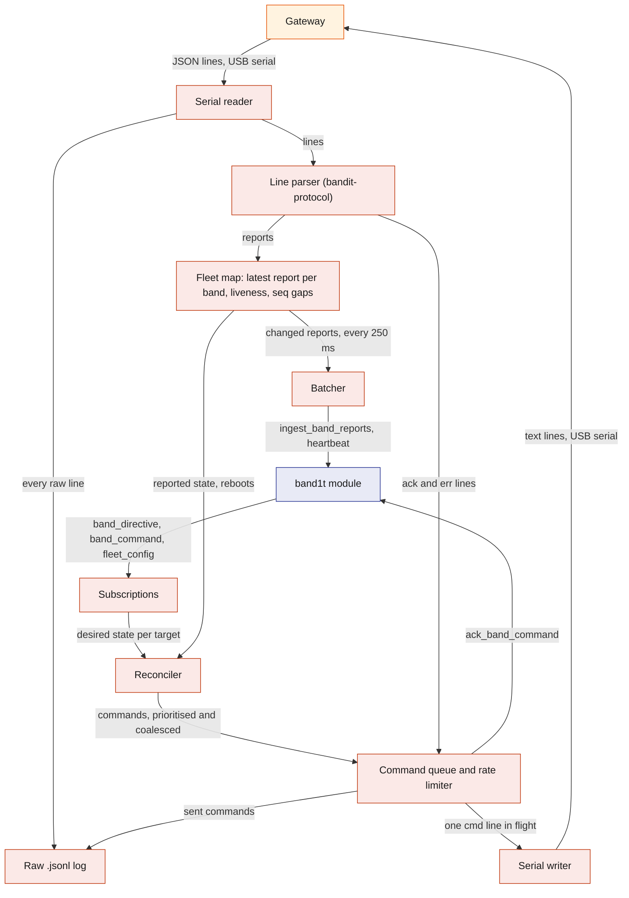
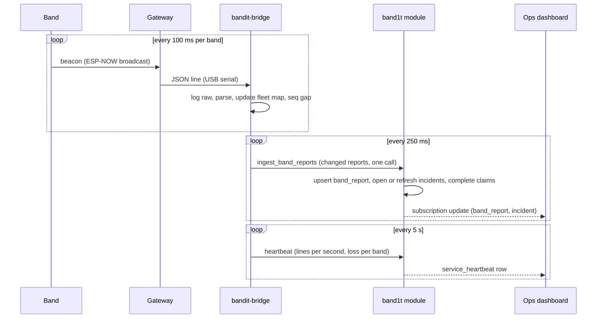
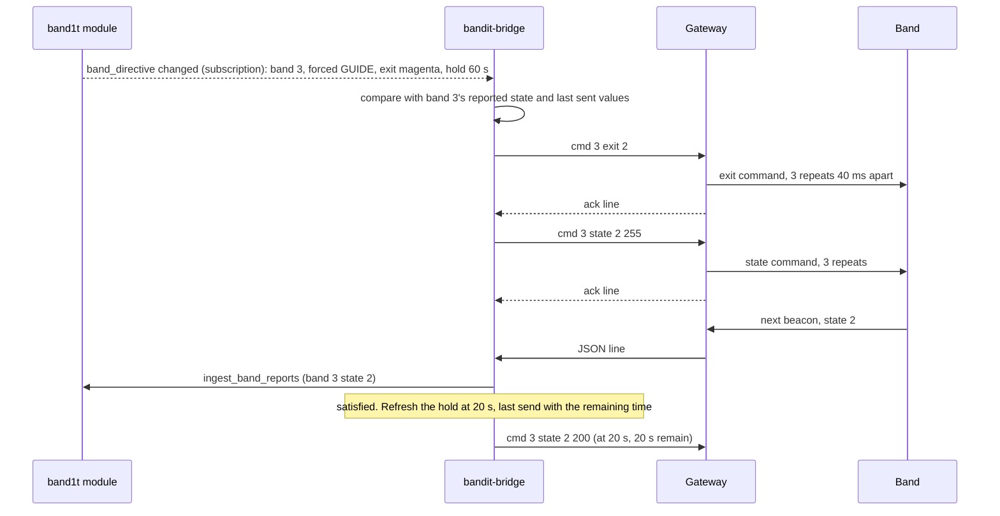
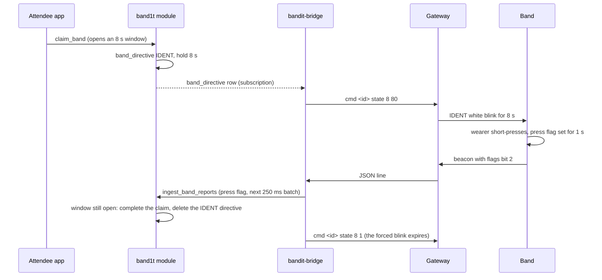

# Gateway-Bridge

`bandit-bridge` is the Rust process on the demo laptop that joins the radio fleet to SpacetimeDB. It reads the gateway's serial lines, keeps the latest report per band, and every 250 ms sends what changed to the `band1t` module in one `ingest_band_reports` call. In the other direction it subscribes to the server's intent (`band_directive`, `band_command`, `fleet_config`) and turns it into gateway text commands, re-sending until each band reports what the server wants. `bandit-protocol` is the shared Rust crate that mirrors the firmware's packet, flags, states and commands, so the bridge, the simulator and the module agree byte for byte. The bridge exists so that bands never need a database client and so that radio loss, reboots and reconnects are handled in exactly one place.

## Role in the system

Responsibilities:

- Own the serial port to the gateway: read every line, parse it, log it raw, and write command lines.
- Keep the latest report per band and per station, with liveness and a packet-loss estimate.
- Batch changed reports to the module every 250 ms as one reducer call, under the `bridge` role.
- Reconcile the server's sticky intent (`band_directive`, `fleet_config`) against what each band reports, and re-send after loss, reboot or expiry.
- Deliver one-shot commands (`band_command`: `buzz` and `clear`) once per command and acknowledge them.
- Validate and rate-limit everything that goes down the command line, so a dashboard bug cannot recolour the stations or flood the gateway.
- Report its own health through `heartbeat` every 5 s.
- Keep running through serial and server outages and resync when they end.

Explicit non-responsibilities:

- It decides nothing about safety: no incident logic, no exit assignment, no density. Those live in the module ([Safety](../6-features/Safety.md)). The bridge is a courier with a memory.
- It holds no truth. Everything it knows is in `band_report`, `service_heartbeat` or its raw log, and a restart loses nothing the system needs.
- It never speaks for simulated bands (ids 1000 and above); [Simulator](Simulator.md) reports those itself.
- It does not synchronise clocks. It timestamps lines with the laptop clock on receipt and sends ages, not timestamps.
- It runs no feature flow. It relays the claim blink down and the press flag up, and the module decides.

## Interfaces

| Interface | Direction | Counterpart | What flows | Transport |
|---|---|---|---|---|
| Gateway uplink | in | Gateway | one JSON object per heard packet (fields in [Hardware](../4-devices/Hardware.md)), plus boot, `ack` and `err` lines | USB serial, nominal 115200 baud |
| Gateway downlink | out | Gateway | text lines `cmd <target> <name> [arg] [arg2]` | USB serial |
| `ingest_band_reports` | out, reducer call | `band1t` module | a batch of changed reports (fields below) | SpacetimeDB Rust client SDK, caller role `bridge` |
| `ack_band_command` | out, reducer call | `band1t` module | command id and outcome (`sent` or `expired`) | SDK |
| `heartbeat` | out, reducer call every 5 s | `band1t` module | service `bridge`, version, counters: serial lines per second, parse errors, commands sent, rejected commands, per-band loss | SDK |
| `band_directive` | in, subscription through `staff_directives` | `band1t` module | desired sticky state per target: forced state and hold, exit colour, override flag | SDK |
| `band_command` | in, subscription through `staff_commands` | `band1t` module | one-shot commands not yet acknowledged: target, name (`buzz`, `clear`), argument, created time | SDK |
| `fleet_config` | in, subscription | `band1t` module | live calibration: yellow and red counts, neighbour and circle RSSI thresholds, `density_override` | SDK |
| Raw log | out | a JSON-lines file on the laptop; read by [Simulator](Simulator.md) replay and the calibration capture | one JSON object per line, every line in and out | `.jsonl` file, one per run, kept on the laptop |
| Configuration | in | environment ([Rust-Backend](Rust-Backend.md)) | serial port path, the Maincloud host, database name `band1t`, identity token path, log folder | local |

The report the bridge sends for each band inside `ingest_band_reports`:

| Report field | Meaning | Source |
|---|---|---|
| `band_id` | 1 to 9 for bands, 101 to 105 for stations | packet `id` |
| `kind` | band or station | packet `type` |
| `flags` | the flag bits, accumulated with OR over every packet since the last batch | packet `flags` |
| `neigh`, `zone`, `bat`, `state` | the band's latest values | latest packet |
| `seq` | latest packet counter | latest packet |
| `gateway_rssi` | signal at the gateway, a coverage diagnostic | latest packet |
| `heard_age_ms` | milliseconds since the gateway last heard this band, measured when the batch is sent | laptop clock |
| `loss_pct` | estimated packet loss over the last 5 s, from `seq` gaps | bridge |
| `gateway_id` | which gateway heard it: 200, the one gateway | configuration |

[SpacetimeDB](../2-data/SpacetimeDB.md) owns how these land in `band_report` and `station`. The module derives alive (heard within 2 s) and stale (5 s) from the heard time it stores, using its own clock, so no clock agreement with the laptop is needed.

## Design

### Internals

What runs inside the process and what flows between the parts. Each box is a task; arrows are channels.

The process is a small async runtime with one task per box. The serial reader is the only task that reads the port, and it runs alone on its thread, because the gateway drops lines whenever nobody is reading ([Hardware](../4-devices/Hardware.md)). The port is opened with `tokio-serial`. The SpacetimeDB client is the Rust SDK crate `spacetimedb-sdk`, which gives the bridge a persistent connection, subscriptions and reducer calls under one identity whose role is `bridge` ([Rust-Backend](Rust-Backend.md) describes how the owner grants that role).

### The `bandit-protocol` crate

The crate is the single Rust mirror of the firmware's shared header. It compiles for the laptop and for the module's WebAssembly target, so it carries no I/O and no heavy dependencies.

| Contents | Used by |
|---|---|
| The packet field list, the flag bits, the ten light states with their names and colours, the nine command numbers and names, the six exit colours and the id ranges (bands, stations, gateway, simulated) | bridge, simulator, module, and the dashboards through generated bindings |
| The constants fixed by firmware: beacon rates, neighbour window 2 s, zone window 3 s, press flag 1 s, longest forced hold 25.5 s | bridge, simulator, module |
| A parser for gateway lines that returns a report, a boot line, an `ack`, an `err` or an unparseable line, and never panics on garbage | bridge, simulator replay |
| A formatter and validator for command lines (ranges, target rules, the never-broadcast rules below) | bridge |
| The band's state-precedence function and its density state machine with hysteresis, written once from the firmware's order | simulator (to behave like a band), bridge (to judge whether a reported state is consistent with a directive) |

Why one crate: a one-byte disagreement between the firmware's enum and a Rust constant would silently miscolour the dashboard, so every Rust process reads the same table, and the header and the crate change together.

### Serial reader and line parser

The reader opens the serial port path from its configuration at the nominal 115200 baud and reads with a short timeout, so it notices silence. Bytes are split on newline; carriage returns are dropped; a partial line left when the port closes is discarded. Every complete line goes to the log unchanged and to the parser. The parser classifies: a report (object with `id` and `type`), a boot line (object with `gateway`), an `ack`, an `err`, or unparseable. Type 3 lines (a command echo from another gateway) do not occur with one gateway; the parser counts and drops them. Parse errors are counted for the heartbeat; a burst of them usually means the wrong baud, a half-flashed gateway or a cable fault.

The reader also measures lines per second, the first number to look at when the fleet looks wrong: about 10 per live band plus 5 per station is healthy, and a sudden fall with the stations still present means bands, not the gateway, are the problem.

### Per-band latest-report map

The fleet map is a table keyed by id. For every band and station it keeps the latest packet, the laptop time it arrived, the flags accumulated since the last batch, the last `seq`, a sliding loss window, what was last sent to the module and when, and what the bridge last commanded (forced state and hold, exit colour, override, thresholds) with the time of each. Only the latest packet matters for state; history lives in the raw log. Flags are accumulated rather than overwritten, so a press flag (carried for 1 s in beacons) or a brief fall flag is never lost between two batches even if the latest packet has it cleared.

### Liveness and packet loss

Liveness is derived, never stored: a band is alive if heard within 2 s and stale after 5 s. The bridge sends `heard_age_ms`, and the module computes the rest with its own clock. The module's heard time must keep moving for a band whose values do not change, so each band is re-sent at least once a second (the heartbeat report, starting value) even if nothing changed. Without that, a quiet band would look stale while beaconing perfectly.

Packet loss comes from `seq`: each new packet should be the last `seq` plus one, and the gap is the number of packets lost. Over a sliding 5 s window (50 expected packets at 10 Hz) the bridge computes lost over expected as `loss_pct`. A `seq` that goes backwards is a reboot, unless the last value was above 64000, which is a wrap (starting value). A reboot marks the band for resync (below). Per-band loss and the lines-per-second figure go into the `heartbeat` call, so the Ops dashboard shows radio health next to service health ([Ops-Dashboard](../5-apps/Ops-Dashboard.md)).

### The 250 ms batcher

Every 250 ms the batcher collects the reports that changed since the last batch and sends them in one `ingest_band_reports` call. Changed means: any of flags, `neigh`, `zone`, `state` or `bat` differs from what was last sent, any flag bit was seen since the last send, a reboot was detected, or the last send is older than 1 s (the heartbeat report). `gateway_rssi` and `seq` changes alone do not trigger a send, because they change on every packet and carry no decision value. An empty batch is skipped. One reducer call per batch keeps the module's work at four transactions a second from the bridge.

How a beacon becomes a dashboard update.

Latency from a button press to the module: up to 100 ms for the next beacon, serial transfer in the low milliseconds, up to 250 ms for the next batch, then the reducer. A press flag therefore reaches the module within about 400 ms, well inside the 1 s the band carries it and the 8 s claim window.

### Server intent: the three subscriptions

The bridge subscribes to `staff_directives` (every `band_directive` row), `staff_commands` (the `band_command` rows not yet acknowledged) and `fleet_config`. Each subscription update wakes the reconciler. The bridge acts on directives for targets 0, 1 to 9 and 101 to 105 and ignores targets at 1000 and above, which belong to the simulator. For stations the only meaningful directive fields are exit colour and a forced mode (0 breathe, 1 chase, 9 off).

A directive addressed to a band overrides the all-bands directive (target 0) field by field, so a venue-wide evacuation (target 0, forced GUIDE) and a per-band exit colour (target 3, exit 2) combine into "band 3 shows GUIDE in magenta". Who writes which directive, and when, is in [Safety](../6-features/Safety.md) (evacuation, medic approach, exit assignment) and [Attendee-App](../5-apps/Attendee-App.md) (IDENT for claiming).

### The reconciler

The reconciler runs on every subscription change and on every 250 ms tick. For each live band it computes the desired settings from the directives and compares them with what the band reports (`state`) and with what the bridge last sent (for the settings the band does not report back, which is everything except the state). It then queues the smallest set of commands that closes the gap.

How a directive becomes a light, and how the bridge knows it worked.

Rules the reconciler follows, each with its reason:

| Situation | What the bridge does | Why |
|---|---|---|
| Reported state differs from the desired forced state | re-send the `state` command, at most once per second per band (starting value) | commands are fire and forget; the report is the only confirmation, and the backoff avoids fighting a band that is legitimately elsewhere |
| Reported state outranks the forced state on the band (SOS 3, NEAR_SOS 4, IDENT 8 during a claim) | treat the directive as satisfied for now; re-check when the band leaves that state | the band's precedence ladder ([Hardware](../4-devices/Hardware.md)) is deliberate: SOS and the light circle must win |
| Desired forced state has a hold longer than 25.5 s | send with the longest hold and refresh at 20 s (starting value); the final send carries the remaining time | a band holds a forced state for at most 25.5 s per command; the last send lets the band release itself exactly when the directive ends |
| A forced state is removed from a directive before its hold ran out | re-send the same state with a 0.1 s hold | there is no "unforce" command, and `clear` would also release an SOS latch, so the bridge makes the forced state expire instead |
| Exit colour or override flag changed | send once; re-send to each band every 30 s (starting value), staggered | bands do not report these values, so the periodic re-send is the safety net against a lost triple |
| A band rebooted (`seq` reset) | re-send `thresh` and `rssi` from `fleet_config`, then exit colour, override and any forced state for that band | a band forgets everything on reset |
| `fleet_config` changed | broadcast `thresh`, `rssi` and `override` (from `density_override`) to target 0 once, then rely on per-band resync and the 30 s re-send | one broadcast reaches the whole fleet; calibration and Plan B are the settings where target 0 is right |
| A zone's exit assignment changed (the module updated the exit colour in the directives of the bands in that zone) | per-band `exit` commands, never target 0 | an `exit` broadcast would recolour every station marker ([Hardware](../4-devices/Hardware.md)) |
| A station directive changed | `cmd <station> exit <n>` or `cmd <station> state <mode>` by station id | stations accept only these two |

The reconciler is idempotent: running it twice queues nothing new, because the queue coalesces by target and command name and keeps the newest arguments.

### One-shot commands and acknowledgement

`band_command` rows are events, not state: `buzz` and `clear`. The bridge sends each once (the gateway's three repeats are the retry), then calls `ack_band_command` with the command id and the outcome. The outcome is `sent` when the gateway's `ack` line was seen or 250 ms passed after the write, and `expired` when the command was older than its useful life when the bridge got to it: 5 s for `buzz`, no limit for `clear` (starting values). Expiry matters after an outage: a buzz a minute late would tell someone to move for no reason.

`buzz` rows have three writers ([SpacetimeDB](../2-data/SpacetimeDB.md), [Safety](../6-features/Safety.md)): ops, through `send_band_command`, to buzz one band from the dashboard; `venue_tick`, with pattern 3 (long), for each band whose route colour it sets or changes during crowd-risk guidance, evacuation and a medic approach; and `ingest_band_reports`, with pattern 2 (double), the first time a full band becomes a light-circle witness of an `sos` or `fall` incident. The bridge treats all three the same way. A target-0 `buzz` is allowed, because stations ignore it and lite bands do nothing with it ([Hardware](../4-devices/Hardware.md)).

`clear` is the one command that touches a band's SOS or fall latch. The bridge sends it only when a `band_command` of name `clear` asks for it (the module writes one when an incident is resolved or ops clears a band, [Safety](../6-features/Safety.md)), never on its own initiative.

### Press to confirm

The button is the consent step for claiming a band and, BrightData.md: for claiming a scraped profile. The server opens an 8 s window and makes the band blink white (IDENT); a beacon from that band with the press flag inside the window confirms. The bridge's job is to deliver the blink and forward the press quickly; the decision is the module's.

The round trip, the same for both claims.

Two details make this robust. The press flag is accumulated with OR in the fleet map, so it cannot fall between two batches. And the module, not the bridge, decides whether the press was inside the window, so a late or duplicated report cannot confirm anything. If no press arrives, the blink ends on its own after 8 s and the bridge sends nothing. [Attendee-App](../5-apps/Attendee-App.md) owns the band claim; BrightData.md: the profile claim starts with `request_person_claim` instead of `claim_band` and ends in `confirm_person_claim`, over the same round trip.

### Rate limiting and safety rules on the command line

The gateway spends about 120 ms transmitting each command (three repeats, 40 ms apart) and reads its serial input only between commands. So the bridge keeps one command in flight: it writes a line, waits for the `ack` line or 250 ms (starting value), then writes the next. The sustained rate is about six commands a second.

The queue is a priority queue: one-shots first, then forced states, then exit colours and override, then calibration re-sends. One exception keeps guidance clear: a `buzz` waits until every pending `state` and `exit` command for its target (every band, for target 0) has gone out, so the wearer who feels it looks down at the new colour. Entries are coalesced by target and command name, keeping the newest arguments, so a burst of directive changes collapses to one command per band per setting. A fleet-wide per-band exit change (nine commands) takes about 1.5 s to go out.

Rules enforced by `bandit-protocol` before anything is written, so that no caller can break them:

- `exit` is never sent to target 0 (it would recolour every station).
- `state 9` is never sent to a band (the firmware ignores it) and is sent to a station only by its id (it means off).
- `clear` is sent only for an explicit `band_command` of name `clear`.
- `pay` and `paid` are never sent; BandIt does not use the firmware's PAY and PAID states.
- `thresh` requires yellow below red, both within 1 to 20; `rssi` magnitudes within 30 to 90; holds within 1 to 255 tenths; every argument fits one byte.
- Targets outside 0, 1 to 9 and 101 to 105 are rejected.

A rejected command is logged and counted in the heartbeat; it is never silently dropped.

### Raw log and calibration capture

The bridge writes every line it reads and every line it writes to a `.jsonl` file on the laptop: one JSON object per line, the gateway's object unchanged plus the laptop receive time in milliseconds since the epoch, the direction (in or out), and, for outgoing lines, the command text. Unparseable gateway lines are logged as raw text with the same timestamp. A new file starts with each run and whenever the serial port is reopened. The logs stay on the laptop; they are not uploaded.

The log serves three purposes: replay through [Simulator](Simulator.md), a post-mortem of a demo run (what each band reported, what was commanded, when), and calibration capture. For calibration, the bridge tags each logged report with the `fleet_config` version in force when it was received. The capture itself is driven from the Ops dashboard: ops marks the start and end of each formation and the known density, the module stores it as `calibration_point` rows via `set_calibration` ([Ops-Dashboard](../5-apps/Ops-Dashboard.md), [Safety](../6-features/Safety.md)), and the dashboard computes the mean `neigh` over the window from its `band_report` subscription. The log is the exact record if the numbers are later questioned.

### When the serial cable or the server goes away

| Outage | Detection | While it lasts | On recovery |
|---|---|---|---|
| Serial port lost (cable pulled, gateway reset) | a read error, or no line at all for 3 s while stations should be beaconing (starting value) | keep the SpacetimeDB connection; stop the batcher, so the module's heard times age and every band goes stale on the dashboard, which is the truth; keep the command queue, dropping one-shots as they expire; report the outage in the heartbeat | reopen the configured port every second; expect the gateway's boot line if it reset; send queued commands; the bands did not reboot, so nothing needs resync |
| SpacetimeDB connection lost (Maincloud unreachable, hotspot drop) | the SDK disconnect callback or a failed reducer call | keep reading and logging; keep only the latest state per band (no backlog); bands keep their local behaviour, and the directives already sent keep running until their holds expire | reconnect with the saved token and re-subscribe; mark every band changed so the first batch carries the whole fleet; run the reconciler against the fresh directives; send unacked one-shots that have not expired and acknowledge the rest as `expired` |

## Failure modes and fallbacks

| Failure | Effect | Design answer |
|---|---|---|
| The bridge process crashes | no reports and no commands; bands continue locally | restart it by hand; it holds no state that matters and resyncs the whole fleet in its first batch; the Ops dashboard shows the missing heartbeat |
| A command triple is lost on air | the band keeps its old state | the reconciler re-sends while the reported state disagrees, and re-sends unverifiable settings every 30 s |
| A band reboots mid-demo | it forgets thresholds and directives | the `seq` reset triggers a per-band resync |
| The dashboard or module writes a bad directive (for example exit on target 0) | could recolour every station and show wrong exits | `bandit-protocol` validation rejects it, and the heartbeat counts the rejection |
| A `buzz` arrives after an outage | a stale cue on someone's wrist | one-shots carry a useful life; late ones are acknowledged as `expired` and never sent |
| `clear` misuse ends someone's SOS | an SOS vanishes | `clear` is only ever sent for an explicit `band_command`; forced states are released by expiry |

## Dependencies

**Depends on**

- [Hardware](../4-devices/Hardware.md): the gateway wire protocol, the band's state precedence and the never-broadcast rules.
- [SpacetimeDB](../2-data/SpacetimeDB.md): `ingest_band_reports`, `ack_band_command`, `heartbeat`, the tables `band_directive`, `band_command`, `fleet_config`, `band_report`, `service_heartbeat`, the views `staff_directives` and `staff_commands`, and the `bridge` role.
- [Rust-Backend](Rust-Backend.md): the Cargo workspace, service identity and role grant, configuration.

**Used by**

- [Safety](../6-features/Safety.md): every directive and buzz cue (exit guidance, evacuation, medic approach, the light-circle alert, manual override) reaches a band through the reconciler and the command queue; every SOS, fall and press reaches the module through the batcher.
- [Attendee-App](../5-apps/Attendee-App.md) and [BrightData](../7-integrations/BrightData.md): the press-to-confirm round trip for the band claim and the profile claim.
- [Ops-Dashboard](../5-apps/Ops-Dashboard.md): fleet liveness, loss and service health from `band_report` and `service_heartbeat`.
- [Simulator](Simulator.md): replays the bridge's raw log and shares `bandit-protocol`.

**If you delete this file**

- Real bands can no longer report or receive directives; delete [Hardware](../4-devices/Hardware.md)'s software coupling too, and only [Simulator](Simulator.md) feeds `ingest_band_reports`.
- Move the `bandit-protocol` crate description to [Simulator](Simulator.md), which still needs it.
- Remove the `bridge` role and the bridge rows from the service tables in [Rust-Backend](Rust-Backend.md) and [Architecture](../1-overview/Architecture.md), and the `bandit-bridge` row from the service health panel in [Ops-Dashboard](../5-apps/Ops-Dashboard.md).
- In [Safety](../6-features/Safety.md), note that `band_directive` and `band_command` rows have no consumer for real bands.

## Decisions

| Decision | Why |
|---|---|
| No per-band "desired versus reported" field on `band_report` | the bridge's heartbeat counters are enough, and a band that has not obeyed shows its real colour on the dashboard map |
| Each band is re-sent at least once a second (the heartbeat report), with one gateway | it keeps the module's heard time moving at a cost of at most nine extra records a second |
| Raw logs stay on the laptop as JSON-lines files and are not uploaded | they serve replay, post-mortem and calibration; Hyphenate.md's evidence pack uses the incident snapshot rows instead |
| The serial port is a configured path, not auto-detected | a band charging on the same laptop has the same USB ids as the gateway |
| One reboot rule: a `seq` that goes backwards is a reboot unless the last value was above 64000 | one rule covers a quick reboot and a band that comes back after a long silence |
| A guidance `buzz` goes out after its target's pending `state` and `exit` commands | the wearer who feels it must see the new colour when they look down |
| There is one gateway, id 200, on one serial port | one gateway hears the whole demo room, so there is one fleet map and one command queue |
