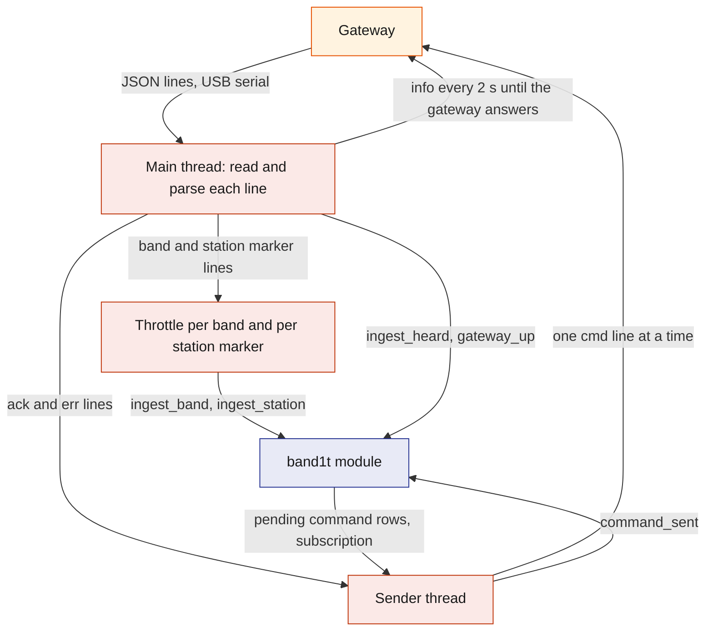
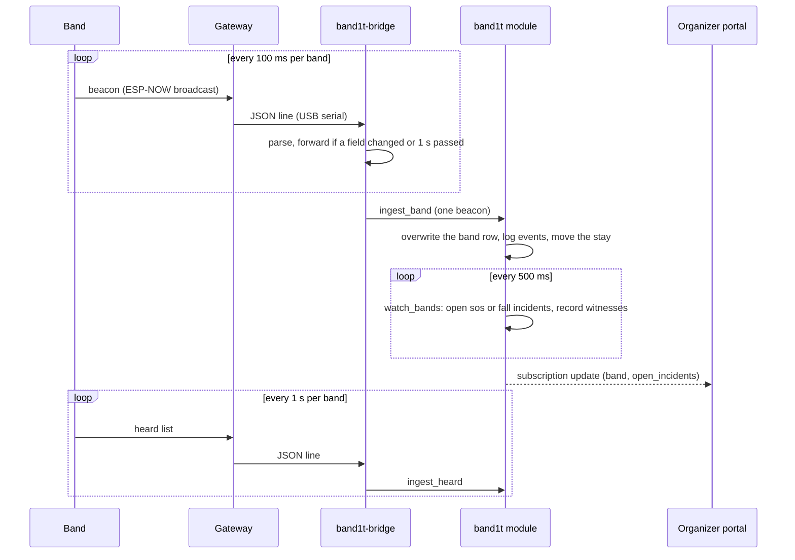
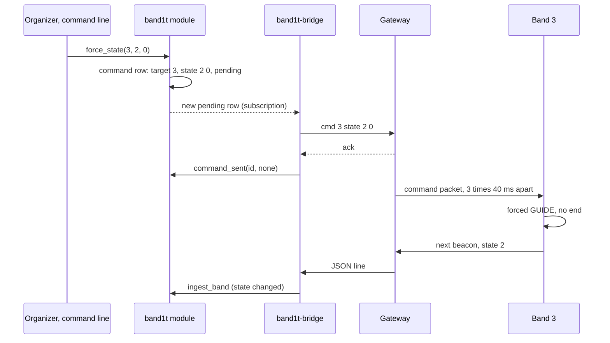
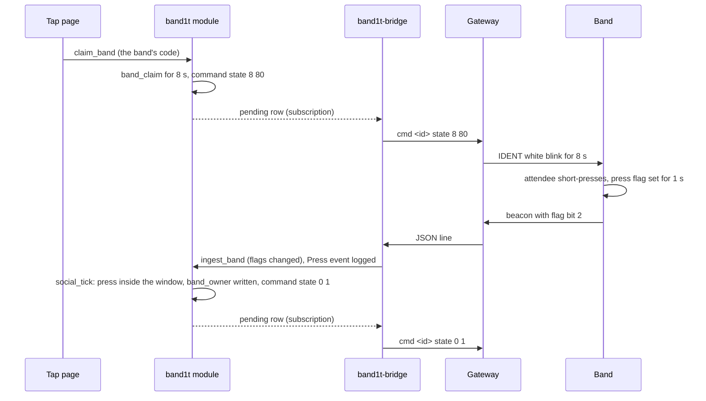

# Gateway-Bridge

`band1t-bridge` is the Rust program on the venue laptop that joins the radio fleet to SpacetimeDB. It reads the gateway's serial lines and forwards each band beacon, station marker beacon and heard list to the `band1t` module with one reducer call (`ingest_band`, `ingest_station`, `ingest_heard`), throttled per band and per station marker.

In the other direction it subscribes to the pending rows of the `command` table, writes each one to the gateway as one text line, and marks it done with `command_sent`. `band1t-bridge` exists so that bands never need a database client.

## Role in the system

Responsibilities:

- Own the serial port to the gateway: read every line, parse it, and write `info` and command lines.
- Hold `band1t-bridge`'s one identity, registered with `register_bridge` on every connect.
- Forward reports: `ingest_band` for band beacons, `ingest_station` for station marker beacons, `ingest_heard` for heard lists and `gateway_up` for the gateway's identity line, with the throttles below.
- Deliver commands: send each pending `command` row once, one at a time, and report the gateway's answer with `command_sent`.

Explicit non-responsibilities:

- It decides nothing: no incident logic, no density, no exit choice. Those live in the module and the firmware ([Safety](../6-features/Safety.md), [Hardware](../4-devices/Hardware.md)). `band1t-bridge` is a courier.
- It holds no truth. What it forwards lands in `band`, `station`, `link`, `encounter`, `event` and `gateway`, and every command lives in `command`, so a restart loses at most the one command in flight.
- It never speaks for bands no radio carries. Test-Bands.md: the test bands report through `report_test_band` and the crowd moves inside the module ([Test-Bands](Test-Bands.md)).
- It does not synchronise clocks: the module stamps every row with its own time.
- It does not check names, targets or ranges (the gateway checks each line), repeat a command (the gateway sends each one three times), batch, queue by priority, re-send a lost command, track packet loss, keep a log file or reconnect.

## Interfaces

| Interface | Direction | Counterpart | What flows | Transport |
|---|---|---|---|---|
| Gateway uplink | in | Gateway | one JSON object per packet heard, plus identity, `ack` and `err` lines (fields in [Hardware](../4-devices/Hardware.md)) | USB serial, 115200 baud |
| Gateway downlink | out | Gateway | `info` every 2 s until the gateway answers; one `cmd <target> <name> [arg] [arg2]` line per command | USB serial |
| `register_bridge` | out, on every connect | `band1t` module | nothing; the caller's identity goes into the `bridge` row if the row is empty | SpacetimeDB Rust client SDK |
| `ingest_band` | out | `band1t` module | one beacon: `id`, `rssi`, `flags`, `neigh`, `zone`, `bat`, `state`, `seq`, `find` | SDK, `band1t-bridge` only |
| `ingest_station` | out | `band1t` module | station id, its colour (the beacon's `state`) and RSSI | SDK, `band1t-bridge` only |
| `ingest_heard` | out | `band1t` module | the reporting band's id and its list of peer ids with their RSSI | SDK, `band1t-bridge` only |
| `gateway_up` | out | `band1t` module | the gateway's MAC and firmware version | SDK, `band1t-bridge` only |
| `command` | in, subscription | `band1t` module | every `command` row whose `pending` is true: id, target, name, `arg`, `arg2`, created time | SDK |
| `command_sent` | out | `band1t` module | the command id and an error text, empty on success | SDK, `band1t-bridge` only |
| Command line | in | the operator | `--port <serial port>`, `--server <url>` (default `http://localhost:3000`), `--db <name>` (default `band1t`); the event's database `bandit-calhacks13-sp82j` on SpacetimeDB Maincloud needs both `--server` and `--db` | process arguments |
| Identity token | in and out | the SDK's credentials file `band1t-bridge-<db>` on the laptop | `band1t-bridge`'s SpacetimeDB token, saved on the first connect | local file |

## Design

### Internals

What runs inside the process and what flows between the parts. The main thread reads the port and calls the reducers; a sender thread writes the commands; the SDK runs the connection on its own thread.

The port is opened at 115200 baud with a 200 ms read timeout, and a timeout simply reads again. A path that is not a serial port is opened as a plain file, so a pseudo-terminal works too. `firmware/tools/scenario_gateway.py --pty` opens one that speaks the gateway's protocol with a scripted 165 s scene on nine bands, which runs `band1t-bridge` with no hardware.

Vision.md: while Leo's recorder runs (`feed.py record --mirror`), that path is the recorder's mirror port, which carries the same lines and passes `band1t-bridge`'s commands back to the gateway ([Vision](../4-devices/Vision.md)).

### Identity and registration

`band1t-bridge`'s identity is a SpacetimeDB token in the SDK's credentials file `band1t-bridge-<db>`, created on the first connect and reused after that. On every connect `band1t-bridge` calls `register_bridge`.

The module keeps at most one row in its private `bridge` table: the first identity to call is kept, the same identity again is accepted, and any other is refused with "another bridge is registered; the module owner can call reset_bridge". Every ingest reducer and `command_sent` checks the caller against that row; `band1t-bridge` holds no role.

When the identity in the `bridge` row disconnects, the module sets `gateway.online` false at once.

### Reports: one line, one reducer call

| Gateway line | Reducer | How often |
|---|---|---|
| band beacon (type 1) | `ingest_band` | at once when any of `flags`, `neigh`, `zone`, `bat`, `state` or `find` differs from the last line forwarded for that band, else at most once per 1 s per band; RSSI and `seq` alone do not count |
| station marker beacon (type 2) | `ingest_station(id, state, rssi)` | at once when the colour changes, else at most once per 2 s per station marker |
| heard list (type 4) | `ingest_heard` | every line, about one a second per band |
| identity (`gateway` or `info` "gateway") | `gateway_up(mac, fw)` | each such line |
| `ack` | none | wakes the sender thread |
| `err` starting with `usage`, `unknown cmd`, `bad args` or `busy` | none | ends the waiting command with that error |
| any other `err`, a type 3 line, anything that is not JSON | none | printed or dropped |

What the module does with each call ([SpacetimeDB](../2-data/SpacetimeDB.md)): `ingest_band` refuses id 0 or above 99, overwrites the band's `band` row (flags split out, `online` true, `last_seen` the module's time, the spot at the centre of the zone whose `station_id` equals `zone`), logs the rising-edge events (`Online`, `SosRaised`, `SosCleared`, `Fall`, `Press`, `FindStarted`, `FindEnded`, `FoundMe`, `Sleep`) and moves the band's `zone_visit` when `zone` changes.

`ingest_station` upserts the `station` row online. `ingest_heard` replaces the reporter's `link` rows and adds close time to an `encounter` for each heard band above the reporter's id at or above `settings.neigh_rssi`. Every call marks `gateway` online with `last_line` now.

None of them opens an incident: `watch_bands` reads the `band` rows every 500 ms ([Safety](../6-features/Safety.md)).

How a beacon becomes an update in the organizer portal (/organizer).

Latency from a button press to the module: up to 130 ms for the next beacon, a few milliseconds on serial, then the reducer call, because the press flag changes `flags` and so goes through at once. A press therefore reaches the module well inside the 1 s the band carries the flag and the 8 s claim window. The module marks a band, a station marker or the gateway offline after 5 s without a call (`sweep`), so the 1 s and 2 s refreshes keep a quiet but healthy fleet online.

### Commands: one subscription, one line in flight

Every command is a one-shot row in the public `command` table. The `ops` reducers write them (`send_command`, `force_state`, `clear`, `set_exit`, `haptic`, `start_find`, `stop_find`, `sleep_bands`, `set_thresholds`, `set_rssi`, `set_low_vis`, `set_override`), and so do three internal paths: `resolve_incident` sends `clear` to the subject band, `claim_band` sends `state 8 80`, and a completed claim in `social_tick` sends `state 0 1` ([SpacetimeDB](../2-data/SpacetimeDB.md), [Safety](../6-features/Safety.md)). (TBD -- LEO) [Safety](../6-features/Safety.md)'s exit routing and medic approach write `command` rows the same way.

Each pending row that arrives on the subscription goes to the sender thread, in arrival order:

1. A row older than 30 s is reported with `command_sent(id, "expired before the bridge saw it")` and never written.
2. Otherwise `band1t-bridge` drops any old answers, writes `cmd <target> <name>` with as many arguments as the name takes (`clear`, `pay` and `paid` none; `exit`, `override`, `haptic`, `lowvis`, `sleep` and `buzz` one; `state`, `thresh`, `rssi` and `find` two), and waits up to 400 ms for the next `ack` or command error.
3. It calls `command_sent(id, none)` on an `ack`, or `command_sent(id, error)` with the gateway's error or "no ack from the gateway". The module sets `pending` false, `sent_at` and `error`, and logs `CommandFailed` for an error.

It remembers the last 512 ids it handled, so a row is sent once.

The gateway answers as soon as it has checked and queued a line, then broadcasts it three times 40 ms apart, and bands send no acknowledgement. So `sent_at` says the gateway took the command, not that a band obeyed it. `band1t-bridge` passes the target byte through unchanged: target 0 reaches every band and no station marker, and 100 every station marker ([Hardware](../4-devices/Hardware.md)).

How a command from the command line becomes a light.

### Press to confirm

The button is the consent step for claiming a band. The module opens an 8 s window and makes the band blink white (IDENT); a press that lands inside the window confirms. `band1t-bridge`'s job is to deliver the blink and forward the press quickly; the decision is the module's.

The round trip.

The module, not `band1t-bridge`, decides whether the press was inside the window, so a late or repeated line cannot confirm anything. A forced state does not end IDENT on the band, so the white blink runs its full 8 s ([Hardware](../4-devices/Hardware.md)). [Tap-Page](../5-apps/Tap-Page.md) owns the band claim.

### When the serial cable or SpacetimeDB Maincloud goes away

`band1t-bridge` does not recover on its own. It holds nothing, so a restart by hand is the whole recovery.

| Outage | What `band1t-bridge` does | What the rest of the system sees |
|---|---|---|
| SpacetimeDB connection lost (SpacetimeDB Maincloud unreachable, hotspot drop) | exits with code 1 | the gateway goes offline, and `sweep` marks the bands and station markers offline after 5 s; bands keep their local behaviour |
| Serial port closed or a read error (cable pulled, gateway reset) | exits with an error | the same |
| Restarted by hand | reconnects with the saved token, registers again and subscribes; the pending rows arrive again, and rows older than 30 s are reported expired | each band comes back online with its next forwarded line |

## Failure modes and fallbacks

| Failure | Effect | Design answer |
|---|---|---|
| `band1t-bridge` exits (SpacetimeDB Maincloud or cable lost) | no reports and no commands; bands continue locally; the Live tab shows the gateway offline | restart it by hand; it registers again with its saved token and picks up the pending rows |
| A command triple is lost on air | the band keeps its old state while the row shows it sent | an organizer sends it again from the command line |
| The gateway does not answer within 400 ms | `command_sent` records "no ack from the gateway" and the module logs `CommandFailed` | an organizer sends it again once the gateway answers |
| `band1t-bridge` was down for more than 30 s | the pending commands are stale | they are reported "expired before the bridge saw it" and never written, so a stale state never reaches a band |
| Another identity took the `bridge` row first | `register_bridge` refuses `band1t-bridge` and every ingest call fails | the module owner calls `reset_bridge`, then `band1t-bridge` is restarted |

## Dependencies

**Depends on**

- [Hardware](../4-devices/Hardware.md): the gateway line protocol, and the targets and commands each node takes.
- [SpacetimeDB](../2-data/SpacetimeDB.md): `register_bridge`, `reset_bridge`, `ingest_band`, `ingest_station`, `ingest_heard`, `gateway_up`, `command_sent`, the `command` table and the private `bridge` row.
- [Rust-Backend](Rust-Backend.md): the SpacetimeDB Rust client SDK and the event's database address.

**Used by**

- [Safety](../6-features/Safety.md): every SOS, fall, light circle and press reaches the module through `ingest_band`; every command (the `clear` on a resolve, forced states, low visibility, thresholds, RSSI, the override) reaches the radio through the command path.
- (TBD -- LEO) [Safety](../6-features/Safety.md): the exit routing and medic approach commands go out the same way.
- [Tap-Page](../5-apps/Tap-Page.md): the press-to-confirm round trip for the band claim.
- [Organizer-Portal](../5-apps/Organizer-Portal.md): the Live tab's gateway status line and its "Station" column, from `gateway` and `station`.
- Social.md: the heard lists become `link` rows and `encounter` close time ([Social](../6-features/Social.md)).

**If you delete this file**

- Real bands can no longer report or receive commands; delete [Hardware](../4-devices/Hardware.md)'s software coupling too, and only [Test-Bands](Test-Bands.md)'s test bands and the crowd remain, through `report_test_band` and `crowd_tick`.
- Remove the `band1t-bridge` rows from the service tables in [Rust-Backend](Rust-Backend.md) and [Architecture](../1-overview/Architecture.md), and the gateway status line from the Live tab in [Organizer-Portal](../5-apps/Organizer-Portal.md).
- In [SpacetimeDB](../2-data/SpacetimeDB.md), `register_bridge`, `reset_bridge`, `ingest_band`, `ingest_station`, `ingest_heard`, `gateway_up`, `command_sent` and the `bridge` row lose their only caller.
- In [Safety](../6-features/Safety.md), `command` rows have no consumer.

## Decisions

| Decision | Why |
|---|---|
| A band line is forwarded when any field but RSSI and `seq` changes, else at most once a second; a station marker line when its colour changes, else every 2 s | a press, an SOS or a zone change reaches the module at once, and `last_seen` keeps moving well inside `sweep`'s 5 s at about one call a second per band |
| Every heard list is forwarded | each band sends only one a second, and `ingest_heard` replaces that band's `link` rows |
| Every command is a one-shot row, sent once | the gateway sends each command three times, and the row's `sent_at` and `error` show the organizer what happened |
| One command in flight, with a 400 ms wait for the gateway's answer | the gateway answers each line at once with `ack` or an error, so the wait ties each answer to its row |
| A command older than 30 s is reported expired, not sent | after an outage, a stale forced state or buzz would surprise the attendee |
| `band1t-bridge` exits on a lost connection or serial port instead of reconnecting | it holds no state, so a restart by hand is the whole recovery |
| The first identity to call `register_bridge` stays in the `bridge` row until the owner calls `reset_bridge` | only one process may report the radio and take its commands |
| The serial port is a named path (`--port`), not auto-detected | a band charging on the same laptop has the same USB ids as the gateway |
| There is one gateway, id 200, on one serial port | one gateway hears the whole venue |
