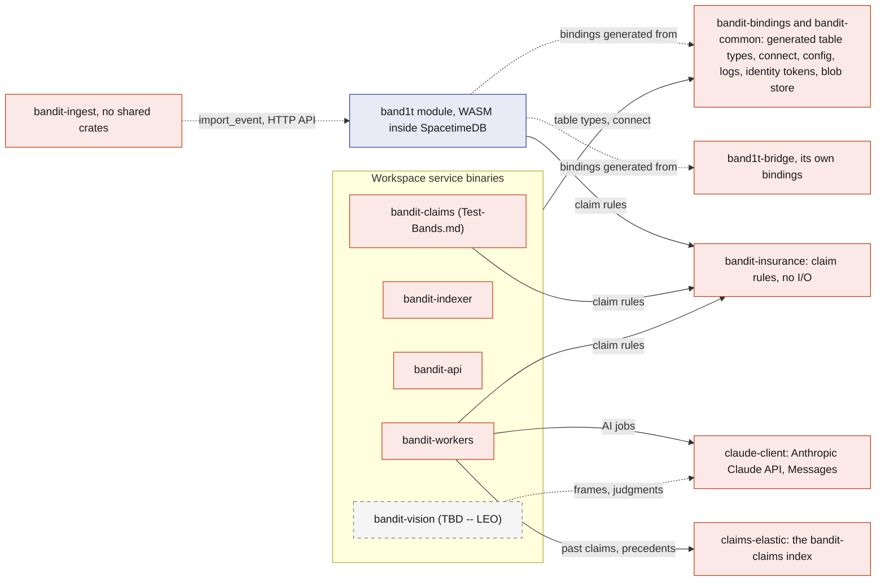
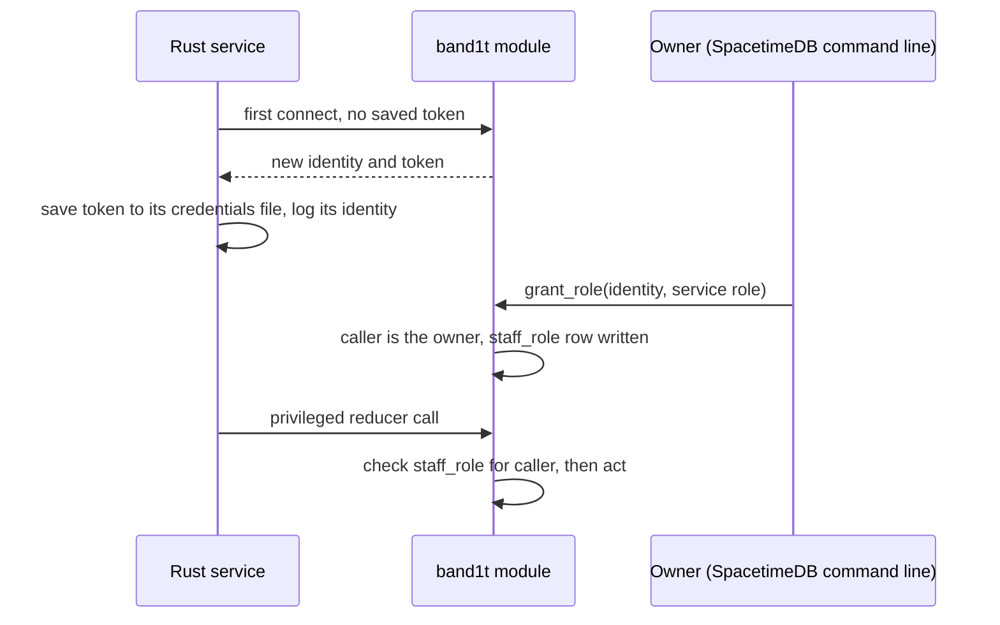
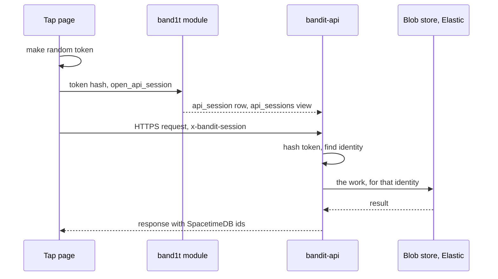
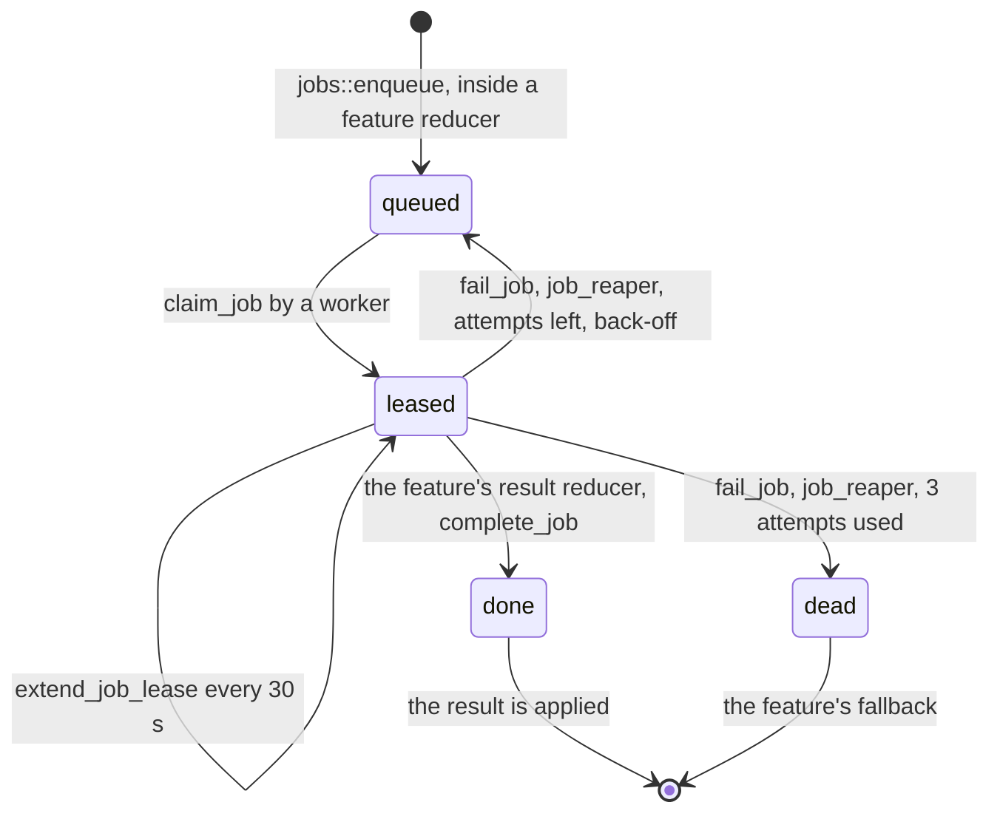

# Rust backend

Every piece of BandIt's backend is Rust: the SpacetimeDB module, `band1t-bridge`, the `bandit-claims` tool, the importer, the Elastic indexer, the HTTP edge and the job workers. The services live in one Cargo workspace (`crates/`), so they share one set of generated SpacetimeDB bindings, and a field rename cannot silently break another service. The module and `band1t-bridge` sit beside it, under `spacetimedb/`.

This file describes the workspace, where each process runs, how each one identifies itself to the module, and the two service shells (`bandit-api` and `bandit-workers`) that feature docs plug into.

## Role in the system

Responsibilities:

- the Cargo workspace layout and what each crate is for;
- the catalogue of running processes: where each runs, its SpacetimeDB role and its secrets;
- the Vultr VM that hosts `bandit-api`, `bandit-workers` and `bandit-indexer`, and its data folder `/var/lib/bandit`;
- service identity, configuration and secrets handling;
- the `bandit-api` shell: serving the two web apps, knowing who is calling, blob storage, and the endpoint registry that feature docs add rows to;
- the `bandit-workers` shell: the job loop, leases, concurrency, and the handler registry that feature docs add rows to;
- logging and run profiles.

Not here: what the module's tables and reducers are ([SpacetimeDB](../2-data/SpacetimeDB.md)), how `band1t-bridge` talks to the gateway ([Gateway-Bridge](Gateway-Bridge.md)), what any feature's endpoint or job does (the feature's own doc), and how the Anthropic Claude API is called ([Anthropic-Claude-API](../7-integrations/Anthropic-Claude-API.md)).

## Interfaces

Every process, where it runs, what it may do in the module, and what it talks to outside.

| Process | Crate | Runs on | SpacetimeDB role | Talks to | Secrets it holds |
|---|---|---|---|---|---|
| `band1t` module | `band1t` | SpacetimeDB Maincloud | runs inside SpacetimeDB | nothing outside SpacetimeDB | none |
| `band1t-bridge` | `band1t-bridge` | venue laptop | none: it is the one identity in the module's `bridge` row, set by `register_bridge` | the gateway over USB serial | its SpacetimeDB token |
| Test-Bands.md: the `bandit-claims` command-line tool | `bandit-claims` | venue laptop | `tester` (its `tester` identity, for the test bands); Insurance.md: the test identities it plays, among them the medic (`medic`) and the organizer (`ops`) | nothing outside; Insurance.md: `bandit-api` over HTTPS to upload the planted claims' bills | its SpacetimeDB tokens |
| `bandit-ingest` | `bandit-ingest` | venue laptop, before the event | `ingest` | the `band1t` module through the SpacetimeDB HTTP API (`import_event`); Bright-Data.md: the Bright Data Web MCP; Elastic.md: Elastic Serverless (the raw indices, the dashboards) and Elastic Kibana (the `bandit-organize` workflow) | its SpacetimeDB token in `crates/bandit-ingest/.secrets`; Bright-Data.md: `BRIGHTDATA_API_TOKEN`; Elastic.md: `ELASTICSEARCH_API_KEY`, `KIBANA_API_KEY` |
| Elastic.md: `bandit-indexer` | `bandit-indexer` | Vultr VM | `indexer` | Elastic Serverless: the one-way copy into `bandit-booths` and `bandit-people`, where each findable attendee's interests come from the booths, or the whole zones, where they spent the most minutes | SpacetimeDB token, Elastic key |
| `bandit-api` | `bandit-api` | Vultr VM | `api` | browsers over HTTPS through Caddy, the blob store in `/var/lib/bandit`; Elastic.md: Elastic Serverless (ranking over `bandit-people` and `bandit-booths`, the log in `bandit-recap-rankings`) | SpacetimeDB token; Elastic.md: Elastic key; Test-Bands.md: the `tester` token for the dev routes |
| `bandit-workers` | `bandit-workers` | Vultr VM | `worker` | the blob store in `/var/lib/bandit`; Anthropic-Claude-API.md: the Anthropic Claude API; Capital-One-Nessie.md: the Capital One Nessie API; Elastic.md, Insurance.md: Elastic Serverless (`bandit-claims`, which it seeds with the 30 past claims when it creates the index); Bright-Data.md: the Bright Data Web MCP, the Bright Data Web Unlocker API and, through `pipeline/venue_model.py`, the Bright Data Browser API | SpacetimeDB token; Anthropic-Claude-API.md: Anthropic key; Capital-One-Nessie.md: Capital One Nessie API base URL and key; Elastic.md, Insurance.md: Elastic claims key; Bright-Data.md: the Bright Data API token, the Web Unlocker zone and the Browser API zone |
| Vision.md (TBD -- LEO): `bandit-vision` | `bandit-vision` | venue laptop | `vision` | the pit's security camera, `bandit-api` for frame uploads; Anthropic-Claude-API.md: the Anthropic Claude API through `claude-client` | SpacetimeDB token, the workers' Anthropic key |

## Design

### Why Rust everywhere

The module must be Rust or another WASM language to run inside SpacetimeDB. Choosing Rust for the services too means the job payloads and the generated table bindings are one set of Rust types used on both sides of every connection. The module itself cannot reach the gateway, the security cameras or external APIs, and putting API keys in the module would expose them.

So every side effect outside SpacetimeDB happens in a separate Rust process that connects as an ordinary SpacetimeDB client.

### Workspace layout

Which crate depends on which. Every workspace service except `bandit-ingest` also uses `bandit-bindings` and `bandit-common`; `band1t-bridge` has its own bindings, generated from the same module. `bandit-ingest` shares no crate with the others: it reaches the module only through the SpacetimeDB HTTP API.

The question this diagram answers: which crates does each Rust binary build on?

| Crate | Kind | Purpose | Owner doc |
|---|---|---|---|
| `band1t` | WASM library, outside the workspace (`spacetimedb/server`) | the SpacetimeDB module `band1t` | [SpacetimeDB](../2-data/SpacetimeDB.md) |
| `band1t-bridge` | binary, outside the workspace (`spacetimedb/bridge`) | `band1t-bridge`, with its own client bindings generated from the module | [Gateway-Bridge](Gateway-Bridge.md) |
| `bandit-bindings` | library | client bindings generated from the module, plus one helper that connects with a saved token and reports the service's identity | this file |
| `bandit-common` | library | config loading, structured logging, the token store for service identities, and the blob store (a folder in `BANDIT_DATA_DIR`, `/var/lib/bandit` on the VM) | this file |
| `claude-client` | library | the only way any process calls the Anthropic Claude API; also records every call | [Anthropic-Claude-API](../7-integrations/Anthropic-Claude-API.md) |
| `bandit-insurance` | library | the claim rules: the evidence pack hash, the corroboration checks, the coverage arithmetic, the route and the ledger postings, with no I/O, no clock and no randomness; the module, `bandit-workers` and `bandit-claims` use it | [Insurance](../6-features/Insurance.md) |
| `claims-elastic` | library | the de-identified copy of each claim pack in the `bandit-claims` index, the `bandit-claims-validate` ingest pipeline, the 30 seeded past claims and the precedent ranking; `bandit-workers` uses it | [Elastic](../7-integrations/Elastic.md) |
| `bandit-claims`, `bandit-ingest`, `bandit-indexer`, `bandit-api`, `bandit-workers` | binaries | the processes in the Interfaces table | their docs |
| Vision.md (TBD -- LEO): `bandit-vision` | binary | the security view's connection to the module; it calls the Anthropic Claude API through `claude-client` like the workers do | [Vision](../4-devices/Vision.md) |

The two browser apps use TypeScript bindings generated from the same module, so the web and Rust sides cannot drift apart either.

Third-party crates, chosen because they are mature and async-friendly: `spacetimedb` (module) and `spacetimedb-sdk` (clients), `tokio`, `serde` and `serde_json`, `serialport` (bridge), `axum` (API and static files), `reqwest` (all HTTPS clients), `sha2` (evidence and blob hashes), `tracing` (logs), `image` (Vision.md frame resizing (TBD -- LEO)).

### Where the processes run

Each process reaches the module the same way, as a client of SpacetimeDB Maincloud, so where it runs is a deployment choice, not a design change. The deployment picture is in [Architecture](../1-overview/Architecture.md).

- `bandit-api`, `bandit-workers` and `bandit-indexer` run side by side on one Debian VM on Vultr, as the systemd services `bandit@api`, `bandit@workers` and `bandit@indexer`, which restart on failure, so they keep running when the laptop sleeps. Caddy on the VM serves HTTPS for band1t.vip and www.band1t.vip and passes each request to `bandit-api` on 127.0.0.1:8080.
- The three services share the data folder `/var/lib/bandit` (`BANDIT_DATA_DIR`): the service identities, the blob store and the rendered records. Both processes that write blobs, `bandit-api` and `bandit-workers`, run on that VM and share the folder directly.
- `scripts/deploy-vm` copies the keys and the service identities to the VM over SSH and runs `deploy/setup.sh`, which builds the pages and the services from the repo and restarts them. Running it again updates the VM.
- Bright-Data.md: `deploy/setup.sh` also makes a Python virtual environment in `var/venv` with Playwright, which `bandit-workers` uses to run `pipeline/venue_model.py` for a venue setup.
- The VM runs with test mode on (`BANDIT_TEST_MODE=1` in the service file), so the test tools that features add are live at the event.
- `bandit-api` serves the organizer portal (/organizer) and the tap page (/t/code) as static files from band1t.vip. The NFC tags hold that host, so judges open the tap page on their own phones, and the apps' uploads and API calls go to the same origin with no cross-origin setup.
- The venue laptop runs `band1t-bridge`, because it needs the gateway's USB cable, and runs `bandit-ingest` once before the event.
- Test-Bands.md: the `bandit-claims` command-line tool runs on the venue laptop. The VM builds it too, because `bandit-api`'s dev routes start its `fall`, `property` and `attach-record` commands, and test mode turns on those routes and the organizer portal's Bands tab.
- Test-Bands.md: the VM also runs `bandit-claims live` as the systemd service `bandit-live`: the floor staff for a live run (the medic, the clinic, the camera and the organizer's cost notes). It is idle until a live run starts.
- Vision.md (TBD -- LEO): `bandit-vision` runs on the venue laptop.

### Service identity and roles

Every process is a SpacetimeDB client with its own identity, so every reducer can check who is calling.

The question this diagram answers: how does a service get the role its reducer calls need?

- The module's init reducer records the publishing identity as `owner`. Only the owner can call `grant_role`, `revoke_role` and `add_owner`; the module refuses every other caller.
- People do not keep a saved token: they sign in with SpacetimeDB SpacetimeAuth, and the owner grants their roles the same way, with `grant_role` from the command line and the identity code on their screen ([SpacetimeDB](../2-data/SpacetimeDB.md)).
- Each service keeps its token in a credentials file, never in the repo. The three services on the VM keep theirs in `/var/lib/bandit/identities`, so a redeploy keeps their identities; the laptop processes keep theirs in a local file. A restart therefore keeps the identity, and the role survives it.
- Service roles are narrow: `band1t-bridge`, the one identity in the `bridge` row, can only report what the gateway hears and mark commands sent with `command_sent`, and cannot touch claims; workers can submit job results but cannot force band states.

### Configuration and secrets

- Each workspace service reads the nearest `.env` file plus the real environment variables, which win (`bandit-common`'s `Config`). It holds `SPACETIMEDB_URL` (SpacetimeDB Maincloud by default), `SPACETIMEDB_DATABASE` (`bandit-calhacks13-sp82j`), `BANDIT_DATA_DIR` and the feature keys.
- `bandit-ingest` reads the repo's `.env` itself, and `band1t-bridge` takes `--port`, `--server` and `--db` on its command line. The job kinds a worker runs are fixed in code (`jobs::handles`). Anthropic-Claude-API.md: every process that calls the Anthropic Claude API reads `ANTHROPIC_API_KEY` and `ANTHROPIC_MODEL` ([Anthropic-Claude-API](../7-integrations/Anthropic-Claude-API.md)).
- Secrets are the SpacetimeDB tokens plus the feature keys in the Interfaces table. On the VM they sit in its `.env` file, which `scripts/deploy-vm` copies over SSH and the services read at start; on the laptop they sit in a local environment file outside the repo. They are never written to SpacetimeDB rows, never sent to browsers and never committed.

### `bandit-api`: the HTTP edge

`bandit-api` exists for the few things browsers cannot do directly against SpacetimeDB: serving the two web apps, calls that need a secret, large files, and public pages that features add.

**App files.** `bandit-api` serves the built organizer portal and tap page as static files. Every tap page route, including the tap link `/t/<band code>`, returns the tap page, which reads the band's code from the path ([Tap-Page](../5-apps/Tap-Page.md)). After loading, both apps talk to SpacetimeDB directly over WebSocket; `bandit-api` is not on the live path.

Bright-Data.md: `/venue` serves the `web/venue` folder, the default venue model and its preview page.

**Who is calling.** The tap page makes a random session token the first time it needs `bandit-api`, and registers the token's SHA-256 with the `open_api_session` reducer, bound to the caller's SpacetimeDB identity for 12 hours. It then sends the token in the `x-bandit-session` header. `bandit-api` subscribes to the `api_sessions` view with its `api` role, hashes the presented token and looks up the identity.

This needs no JWT verification and no sign-in of its own: the browser's SpacetimeDB identity comes from its SpacetimeDB SpacetimeAuth sign-in. Revoking a session is a row delete.

The question this diagram answers: how does `bandit-api` know which attendee is calling?

**Blob storage.** An upload, `POST /api/blobs` with a purpose, is stored in the blob store folder in `/var/lib/bandit` under its SHA-256. It is registered with `register_blob`, which writes a `blob_ref` row with its hash, owner, access class (`owner_only`, `staff`, `shared`), purpose, content type and size.

The `worker`, `api`, `vision`, `ops` and `medic` roles may call `register_blob`, since workers also produce files such as letters. `bandit-workers` reads and writes the folder directly because it runs on the same VM. `bandit-api` answers with the hash, the size, the page count of a PDF and the URL `/blobs/<sha256>`.

Downloads go through `GET /blobs/{hash}` on `bandit-api`, which serves the file to anyone who has the URL: the SHA-256 in it is the secret. Large files never go into SpacetimeDB rows, because big rows slow commits and subscriptions.

**Endpoint registry.** Core endpoints are below; each optional feature adds its own rows and owns their behaviour.

| Endpoint | Purpose | Owner |
|---|---|---|
| `GET /health` | liveness for `scripts/run`, with the roles this service holds, so the owner can see that `grant_role` landed | this file |
| app files | the pages and their bundles: the organizer portal (`/organizer`), the tap page (`/t/<band code>` and the sign-in return `/callback`), the live view (`/live`) and the photographer page (`/photo`) | this file |
| `POST /api/blobs` | take a file in, store it under its SHA-256 and call `register_blob` with the purpose's access class (Social.md: purpose `photo` as `shared`; Insurance.md: purpose `medical` as `staff`; Medical-Card.md: purposes `history` and `insurance` as `owner_only`, owned by the attendee whose API session sent the file); returns the hash, the page count of a PDF and the URL `/blobs/<sha256>` | this file |
| `GET /blobs/{hash}` | serve a stored file by its hash, with its content type read from the file's first bytes | this file |
| `GET /config.json` | where the pages connect: the SpacetimeDB WebSocket address, the database, the Elastic Kibana address for the Kibana tab, the SpacetimeDB SpacetimeAuth client and whether test mode is on | this file |
| Elastic.md: `GET /api/recap` | handler `recap`, called with the `x-bandit-session` header: `ranked_summary` builds the caller's whole recap from the `social_*` views in `bandit-api`'s subscription cache, has Elastic order the suggested people and booths by meaning, and logs that order to `bandit-recap-rankings`; when Elastic cannot rank, the suggestions keep their minutes order | [Elastic](../7-integrations/Elastic.md), [Social](../6-features/Social.md) |
| Medical-Card.md: document upload, `/test-records` | the tap page sends each medical PDF to `POST /api/blobs` with purpose `history` or `insurance` and the attendee's API session, then calls `submit_medical_document` itself as the attendee, which enqueues `medical_extract`; `/test-records` serves the synthetic `medical-history.pdf` and `insurance-card.pdf` for the "Use a test record" button, which the page shows in test mode only | [Medical-Card](../6-features/Medical-Card.md) |
| Insurance.md: bill upload | the organizer portal's incident card uploads an urgent-care bill PDF (at most 10 MB) through `POST /api/blobs` with purpose `medical`, then calls `submit_medical_record` as the signed-in staff member, which enqueues `claim_record_extract` | [Insurance](../6-features/Insurance.md) |
| Social.md: photographer photo upload | the `/photo` page sends each photo to `POST /api/blobs` with purpose `photo`, then calls `register_photo` as the photographer | [Social](../6-features/Social.md) |
| Test-Bands.md: `POST /api/dev/press/{band}`, `POST /api/dev/move/{band}/{station}` | test mode only (`BANDIT_TEST_MODE=1`): press a test band 94 to 99 (`TAP_TEST_BANDS`), or move any test band 90 to 99 to the zone of a station id, through `report_test_band` as the `tester` identity; the pressed and moved bands keep reporting every 2 s until `event_state.ended` is set | [Test-Bands](Test-Bands.md) |
| Test-Bands.md: `GET /api/actors` | test mode only: the people `bandit-claims setup` created, each with its name, label and SpacetimeDB token, for the tap page's "Test as" and the photographer route's "Play as" | [Test-Bands](Test-Bands.md), [Tap-Page](../5-apps/Tap-Page.md) |
| Test-Bands.md: `POST /api/dev/fall/{band}` | test mode only, the Bands tab's "Fall here": runs `bandit-claims fall` for a test band 90 to 99, with two of the claims story's bands (the first two of 90, 92, 93 and 91 that are not the band) as the light circle; the band's own 2 s reports pause meanwhile | [Test-Bands](Test-Bands.md) |
| Test-Bands.md, Insurance.md: `POST /api/dev/record/{claim}/{template}` | test mode only: renders one of the clinic records `first-aid-wrist`, `urgent-care-wrist` and `urgent-care-ankle-home` for the claim's incident date and files it as the medic through `bandit-claims attach-record` | [Test-Bands](Test-Bands.md), [Insurance](../6-features/Insurance.md) |
| Test-Bands.md: `POST /api/dev/property/{station}` | test mode only, the Bands tab's "Speaker breaks in <zone>": runs `bandit-claims property --camera` for the zone of that station id, with the note "a speaker was knocked off its stand and cracked" and a repair cost of $2,400 | [Test-Bands](Test-Bands.md), [Insurance](../6-features/Insurance.md) |

### `bandit-workers`: the job runner

All slow or external work is a `job` row ([SpacetimeDB](../2-data/SpacetimeDB.md)). `bandit-workers` is one process that runs a handler per job kind, so adding a feature means adding a handler, not a new service.

The question this diagram answers: how does one job move through a worker?

- **Claiming.** The worker subscribes to the `worker_jobs` view, keeps the kinds it handles (`jobs::handles`) and calls `claim_job`. The reducer gives the job to exactly one caller and counts the attempt, so two workers never run the same job.
- **Leases.** A lease lasts 60 s (`LEASE_MICROS`), and the worker calls `extend_job_lease` every 30 s while a handler runs. If a worker dies, `job_reaper`, which runs every 10 s, finds the expired lease and counts it as a failed attempt.
- **Retries.** A failed attempt, from `fail_job` or an expired lease, goes back to `queued` with a back-off of 5 s times the attempts so far.
- **Results.** The handler submits its result through the feature's reducer, which checks that the caller still holds the lease. A slow duplicate whose lease was handed on is rejected, so it cannot overwrite a newer result.
- **External side effects.** A handler that changes something outside, such as a bank purchase or a payout, is safe to repeat. It keeps the ids it created in its data folder until the module stores them, and it reuses a purchase or deposit whose description equals the job's memo, so a retry after a crash never pays twice.
- **Concurrency.** A worker runs at most 4 jobs at once (`MAX_RUNNING`), across all kinds, each on its own task. Nothing in the safety path ever waits on a job.
- **Dead jobs.** After 3 attempts (`MAX_ATTEMPTS`) the job is `dead`, its row keeps the last error, and the feature's fallback applies.

**Handler registry.** Each optional feature owns its rows. [Architecture: Queues](../1-overview/Architecture.md#queues) lists the reducer that queues each kind and the reducer that takes its result.

| Job kind | Handler does | Owner |
|---|---|---|
| Medical-Card.md: `medical_extract` | read one medical PDF from the blob store with the Anthropic Claude API (effort low), check the answer in code, then `apply_medical_extract` | [Medical-Card](../6-features/Medical-Card.md) |
| Capital-One-Nessie.md: `wallet_open` | open the attendee's Capital One Nessie customer and $200 checking account when they tap "Connect your Capital One wallet", then `record_wallet` | [Capital-One-Nessie](../7-integrations/Capital-One-Nessie.md) |
| Merch.md, Capital-One-Nessie.md: `merch_purchase` | record a merch order as a Capital One Nessie purchase at the "BandIt merch" merchant, creating the merchant on the first purchase, then `settle_merch_order` | [Merch](../6-features/Merch.md), [Capital-One-Nessie](../7-integrations/Capital-One-Nessie.md) |
| Insurance.md, Capital-One-Nessie.md: `claim_payout` | deposit an approved claim's payout into the claimant's wallet, opening a wallet if they have none, then `record_claim_payout` | [Insurance](../6-features/Insurance.md), [Capital-One-Nessie](../7-integrations/Capital-One-Nessie.md) |
| Insurance.md, Capital-One-Nessie.md: `charge_payment` | pay an approved charge from the charged attendee's wallet as a Capital One Nessie purchase at a merchant named after the venue, and return the claimant's deductible when there is one, then `record_charge_payment` | [Insurance](../6-features/Insurance.md), [Capital-One-Nessie](../7-integrations/Capital-One-Nessie.md) |
| Insurance.md: `clinic_report` | the hospital's report for the case the module drew, written with the Anthropic Claude API, checked against the case in code and stored for staff, then `file_clinic_report` | [Insurance](../6-features/Insurance.md) |
| Elastic.md, Insurance.md: `document_read` | read an insurance PDF with the Elastic Workflow `bandit-read-document` (the Anthropic Claude API writes out a scanned page word for word first), check every quote against its page in code, then `apply_document_terms` | [Insurance](../6-features/Insurance.md), [Elastic](../7-integrations/Elastic.md) |
| Elastic.md, Insurance.md: `claim_verify` | build the de-identified claim copy in code, validate it in `bandit-claims` through `bandit-claims-validate`, find the clauses of the claim's two policies that bear on it, then `submit_claim_checks` | [Insurance](../6-features/Insurance.md), [Elastic](../7-integrations/Elastic.md) |
| Insurance.md: `claim_record_extract` | read the hospital report PDF into validated bill lines with the Anthropic Claude API, priced later by the module, then `apply_medical_record` | [Insurance](../6-features/Insurance.md) |
| Insurance.md: `claim_review` | the Anthropic Claude API investigates the claim with tools, one evidence source at a time, and decides pay, refuse or ask the organizer; each tool call goes to `report_claim_step` as it happens, code checks the decision, then `submit_claim_review` | [Insurance](../6-features/Insurance.md) |
| Insurance.md: `claim_draft`, `recovery_letter` | the Anthropic Claude API drafts the claim's letters, or the recovery letter to the person responsible; code checks every figure, fact id and heading, and a template stands in after a failed retry; then `attach_claim_letters` or `attach_recovery_letter` | [Insurance](../6-features/Insurance.md) |
| Insurance.md: `rule_proposal` | the Anthropic Claude API reads the approved precedents of one shape of claim and proposes the payment rule they share; code checks that it cites at least three and stays inside the policy's limit, then `submit_rule_proposal` | [Insurance](../6-features/Insurance.md) |
| Merch.md: `merch_picks` | the shopping agent: when an attendee leaves or the event ends, the Anthropic Claude API picks the three products they would most want, code checks every id and length, then `submit_merch_picks` | [Merch](../6-features/Merch.md) |
| Social.md: `photo_features` | the Anthropic Claude API counts the people in an event photo and writes a one-line caption, then `submit_photo_features`; who is in the photo always comes from the bands | [Social](../6-features/Social.md) |
| Bright-Data.md: `plan_lookup` | find the public wording of a plan an attendee named: search through the Bright Data Web MCP, let the Anthropic Claude API (`plan_find`) pick the plan's own document, fetch its PDF through the Bright Data Web Unlocker API, check what it prints (`plan_check`), store it as an `owner_only` blob of the attendee with purpose `plan_wording`, then `finish_plan_lookup`, which writes the attendee's policy and files the PDF for `document_read` | [Bright-Data](../7-integrations/Bright-Data.md) |
| Bright-Data.md: `venue_policy_lookup` | find the venue's two policy forms the organizer named: for each form, search through the Bright Data Web MCP, let the Anthropic Claude API (`venue_policy_find`) pick the form's document, fetch its PDF through the Bright Data Web Unlocker API and check the form number it prints (`venue_policy_check`); join both forms into one PDF, store it as a `staff` blob with purpose `policy`, then `finish_venue_policy_lookup`, which files it for `document_read` | [Bright-Data](../7-integrations/Bright-Data.md) |
| Bright-Data.md: `venue_setup` | find an event's venue and its public 3D map from the event's name through the Bright Data Web MCP, the Bright Data Web Unlocker API and the Anthropic Claude API (`venue_find`, `venue_map`); export the model with `pipeline/venue_model.py`; store the model and its layout as `shared` blobs; report each step with `report_venue_setup_step`, then `finish_venue_setup` | [Bright-Data](../7-integrations/Bright-Data.md) |

### Health and logs

- The `gateway` row (`online`, `last_line`) shows that `band1t-bridge` is feeding the module: every call from `band1t-bridge` refreshes it, `sweep` marks it offline after 5 s of silence, and the Live tab shows it ([Gateway-Bridge](Gateway-Bridge.md)).
- Every process writes structured logs with `tracing` to the console and a local file, tagged with the SpacetimeDB row ids it touched, so a log line can be matched to an incident or a job.

### Run profiles

Both profiles use the one SpacetimeDB Maincloud database.

| Profile | Bands | Use |
|---|---|---|
| Live event | real bands through `band1t-bridge` | the event in front of the judges |
| Test-Bands.md: Rehearsal | test bands only, on the test band ids 90 to 99 | practising the safety choreography without attendees |

Test-Bands.md: in the live event, the crowd (1,000 crowd bands inside the module) and the 10 test bands run alongside the real ones.

## Failure modes and fallbacks

| Failure | Effect | Design answer |
|---|---|---|
| The VM restarts or is redeployed | The three cloud services drop for a few seconds | systemd starts them again with the identities saved in `/var/lib/bandit`, and they reconnect; leased jobs return through `job_reaper`. |
| A service gets a new identity because its credentials file is lost | Its reducer calls are refused | The owner grants the role to the new identity from the command line; the refusal is logged loudly. A new identity for `band1t-bridge` is refused by `register_bridge` until the owner calls `reset_bridge`. |
| `bandit-workers` crashes mid-job | Jobs stay leased | `job_reaper` returns them after the lease; an external call checks its recorded request id before it runs again. |
| `bandit-api` is down | New phones cannot load the tap page; no uploads and no recap people and booths | Phones that already loaded the tap page keep the thank-you screen and the recap's own lists, and the organizer portal keeps its incident desk, because they talk to SpacetimeDB directly. |
| A secret is missing for one feature | That feature's handlers fail | Only those job kinds go `dead`; other features run, and the dead `job` rows name the kind and its error. |
| Bindings out of date after a schema change | A service fails to start or misreads rows | The Rust and TypeScript bindings are regenerated on every publish and every client is rebuilt before the next rehearsal ([SpacetimeDB](../2-data/SpacetimeDB.md)). |

## Dependencies

**Depends on:** [SpacetimeDB](../2-data/SpacetimeDB.md) (tables, reducers, roles, the job queue), [Architecture](../1-overview/Architecture.md) (deployment).

**Used by:** every Rust component doc ([Gateway-Bridge](Gateway-Bridge.md), [Test-Bands](Test-Bands.md), [Bright-Data](../7-integrations/Bright-Data.md), [Elastic](../7-integrations/Elastic.md), [Anthropic-Claude-API](../7-integrations/Anthropic-Claude-API.md), [Capital-One-Nessie](../7-integrations/Capital-One-Nessie.md), [Medical-Card](../6-features/Medical-Card.md), [Insurance](../6-features/Insurance.md), [Social](../6-features/Social.md), [Merch](../6-features/Merch.md), [Vision](../4-devices/Vision.md)), and the web apps, which `bandit-api` serves.

**If you delete this file:** not intended; it is core. When you delete an optional feature, remove its rows from the endpoint registry and the handler registry above, its crate if it has one (`claude-client` with Anthropic-Claude-API.md), its module in `bandit-workers` if it has one (`nessie` with Capital-One-Nessie.md), its third-party crate (`image` with Vision.md), its process row and its secrets in the Interfaces table, and its bullet in "Where the processes run" and its run profile row and line (Test-Bands.md, Vision.md).

## Decisions

| Decision | Why |
|---|---|
| `bandit-api`, `bandit-workers` and `bandit-indexer` run on one always-on Vultr VM as systemd services, behind Caddy on band1t.vip | they keep running when the laptop sleeps, `bandit-api` gets a public HTTPS host for judges' phones, and one VM is one thing to watch |
| Blobs are files in `/var/lib/bandit` on that VM | the two processes that write blobs share the VM, so there is no bucket or storage key to manage |
| A blob's URL is its SHA-256, and `GET /blobs/{hash}` checks nothing else | the hash cannot be guessed, so a file is reached only through a row that names it |
| The cloud services' identities live in `/var/lib/bandit/identities` | a redeploy keeps each service's identity, so its role grant survives |
| `bandit-workers` reads and writes blobs directly in `/var/lib/bandit` | it runs on the same VM as `bandit-api`; only browsers and laptop processes go through the HTTPS blob endpoints |
| `bandit-api` serves both web apps from its own host | one origin for the app files, uploads and API calls, so no cross-origin setup, and the NFC tags need only one host |
| `bandit-api` has no sign-in of its own | a caller is the SpacetimeDB identity behind its `api_session`, and that identity comes from the browser's SpacetimeDB SpacetimeAuth sign-in |
| Elastic.md: the recap's people and booths come from one route, `GET /api/recap` (handler `recap`), called with `api_session` | `bandit-api` builds them from the `social_*` views it already subscribes to, and only the order needs the Elastic key; the rest of the recap is the tap page's own SpacetimeDB views |
| Every run profile uses the one SpacetimeDB Maincloud database | there is one deployment, so there is no offline profile to keep in step |
