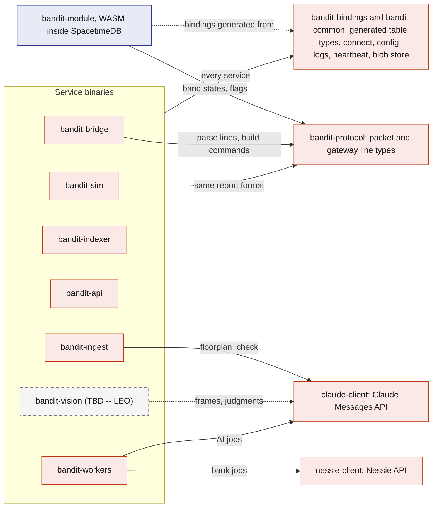
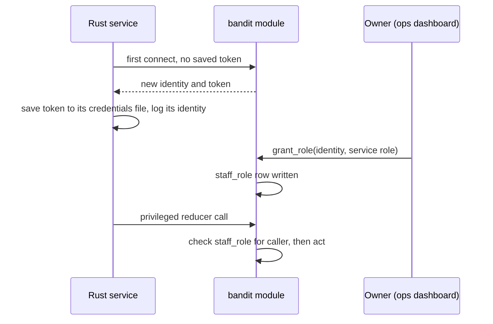
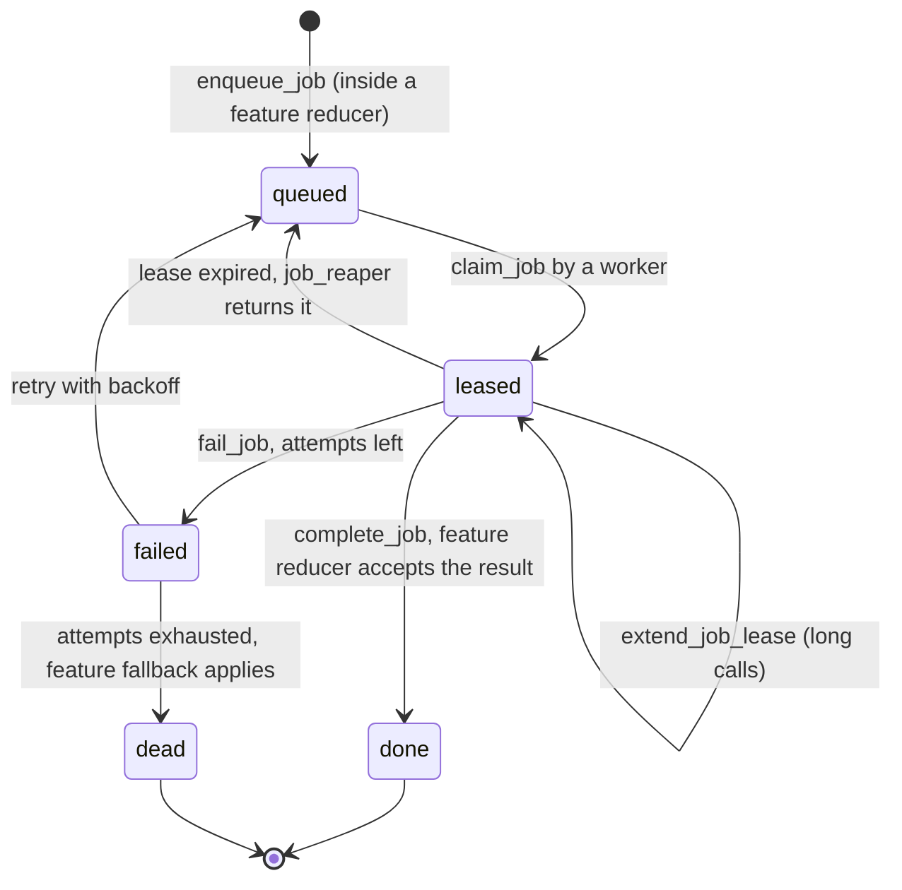

# Rust backend

Every piece of BandIt's backend is Rust: the SpacetimeDB module, the device bridge, the simulator, the importer, the search indexer, the HTTP edge and the job workers. They live in one Cargo workspace, so they share one set of protocol types and one set of generated SpacetimeDB bindings, and a field rename cannot silently break another process. This file describes the workspace, where each process runs, how each one identifies itself to the database, and the two service shells (`bandit-api` and `bandit-workers`) that feature docs plug into.

## Role in the system

Responsibilities:

- the Cargo workspace layout and what each crate is for;
- the catalogue of running processes: where each runs, its SpacetimeDB role and its secrets;
- the Fly.io Machine that hosts `bandit-api`, `bandit-workers` and `bandit-indexer`, and its volume;
- service identity, configuration and secrets handling;
- the `bandit-api` shell: serving the two web apps, knowing who is calling, blob storage, and the endpoint registry that feature docs add rows to;
- the `bandit-workers` shell: the job loop, leases, concurrency, and the handler registry that feature docs add rows to;
- logging, health reporting and run profiles.

Not here: what the module's tables and reducers are ([SpacetimeDB](../2-data/SpacetimeDB.md)), how the bridge talks to the gateway ([Gateway-Bridge](Gateway-Bridge.md)), what any feature's endpoint or job does (the feature's own doc), and how Claude is called ([Anthropic-Agent](../7-integrations/Anthropic-Agent.md)).

## Interfaces

Every process, where it runs, what it may do in the database, and what it talks to outside.

| Process | Crate | Runs on | SpacetimeDB role | Talks to | Secrets it holds |
|---|---|---|---|---|---|
| `bandit` module | `bandit-module` | SpacetimeDB Maincloud | runs inside the database | nothing outside the database | none |
| `bandit-bridge` | `bandit-bridge` | demo laptop | `bridge` | the gateway over USB serial | its SpacetimeDB token |
| Simulator.md: `bandit-sim` | `bandit-sim` | demo laptop | `simulator` | nothing outside; Hyphenate.md: `bandit-api` over HTTPS to upload the planted claims' bills | its SpacetimeDB token |
| `bandit-ingest` | `bandit-ingest` | demo laptop, before the event | `ingest` | the `bandit` module (seed mode); BrightData.md: the Bright Data Web MCP, the Claude API for `floorplan_check`; Elastic.md: Elastic Serverless (raw indices, the organizer workflow; Hyphenate.md: the 30 past claims into `bandit-claims`) | SpacetimeDB token; BrightData.md: Bright Data key, Anthropic key; Elastic.md: Elastic ingest key |
| Elastic.md: `bandit-indexer` | `bandit-indexer` | Fly.io Machine | `indexer` | Elastic Serverless: the search copy, including the `bandit-people` sync of each findable attendee's interests | SpacetimeDB token, Elastic key |
| `bandit-api` | `bandit-api` | Fly.io Machine | `api` | browsers over HTTPS, the blob store and the kept attendee tokens on the Fly volume; Elastic.md: Elastic Serverless | SpacetimeDB token; Elastic.md: Elastic key |
| `bandit-workers` | `bandit-workers` | Fly.io Machine | `worker` | the blob store on the Fly volume, the Resend mail API for the recap email; Anthropic-Agent.md: Claude API; Payments-Nessie.md: Nessie; Elastic.md, Hyphenate.md: Elastic Serverless (`bandit-claims`) | SpacetimeDB token, `RESEND_API_KEY`; Anthropic-Agent.md: Anthropic key; Payments-Nessie.md: Nessie key; Elastic.md, Hyphenate.md: Elastic claims key |
| Vision.md (TBD -- LEO): `bandit-vision` | `bandit-vision` | demo laptop | `vision` | the overhead phone camera, `bandit-api` for frame uploads; Anthropic-Agent.md: Claude API through `claude-client` | SpacetimeDB token, the workers' Anthropic key |

## Design

### Why Rust everywhere

The module must be Rust or another WASM language to run inside SpacetimeDB. Choosing Rust for the services too means the radio packet types, the job payloads and the generated table bindings are one set of Rust types used on both sides of every connection. The module itself cannot reach the gateway, the cameras or external APIs, and putting API keys in the module would expose them. So every side effect outside the database happens in a separate Rust process that connects as an ordinary SpacetimeDB client.

### Workspace layout

Which crate depends on which. Every service binary also uses `bandit-bindings` and `bandit-common`; the arrows show only the dependencies that differ between binaries.

| Crate | Kind | Purpose | Owner doc |
|---|---|---|---|
| `bandit-protocol` | library | mirrors the firmware's shared header: packet fields, flag bits, band states, command names, exit colour indices, and the gateway's JSON line and command line formats | [Gateway-Bridge](Gateway-Bridge.md) |
| `bandit-module` | WASM library | the SpacetimeDB module `bandit` | [SpacetimeDB](../2-data/SpacetimeDB.md) |
| `bandit-bindings` | library | client bindings generated from the module, plus one helper that connects with a saved token and reports the service's identity | this file |
| `bandit-common` | library | config loading, structured logging, the 5 s heartbeat, and the blob store (a folder on the Fly volume); Elastic.md: the shared function that turns plan metres into latitude and longitude, used by `bandit-indexer` and `bandit-api` | this file |
| `claude-client` | library | the only way any process calls Claude; also records every call | [Anthropic-Agent](../7-integrations/Anthropic-Agent.md) |
| `nessie-client` | library | typed calls to Nessie | [Payments-Nessie](../7-integrations/Payments-Nessie.md) |
| `bandit-bridge`, `bandit-sim`, `bandit-ingest`, `bandit-indexer`, `bandit-api`, `bandit-workers` | binaries | the processes in the Interfaces table | their docs |
| Vision.md (TBD -- LEO): `bandit-vision` | binary | the vision service; it calls Claude through `claude-client` like the workers do | [Vision](../4-devices/Vision.md) |

The two browser apps use TypeScript bindings generated from the same module, so the web and Rust sides cannot drift apart either.

Third-party crates, chosen because they are mature and async-friendly: `spacetimedb` (module) and `spacetimedb-sdk` (clients), `tokio`, `serde` and `serde_json`, `tokio-serial` (bridge), `axum` (API and static files), `reqwest` (all HTTPS clients), `sha2` (evidence and blob hashes), `tracing` (logs), `image` (Vision.md frame resizing (TBD -- LEO)).

### Where the processes run

Each process reaches the database the same way, as a SpacetimeDB client of Maincloud, so where it runs is a deployment choice, not a design change. The deployment picture is in [Architecture](../1-overview/Architecture.md).

- `bandit-api`, `bandit-workers` and `bandit-indexer` run side by side on one small Fly.io Machine with auto-stop turned off, so they keep running when the laptop sleeps. Fly's proxy serves the Machine's public HTTPS host.
- A Fly volume attached to that Machine holds the blob store folder, the three services' credentials files and the attendee tokens `bandit-api` keeps for recap links. Both processes that write blobs, `bandit-api` and `bandit-workers`, run on that Machine and share the folder directly. Elastic.md: `bandit-indexer` reads photo thumbnails from the same folder.
- `bandit-api` serves the Ops dashboard and the attendee app as static files from that host. The NFC tags hold that host, so judges open the app on their own phones, and the apps' uploads and searches go to the same origin with no cross-origin setup.
- The demo laptop runs `bandit-bridge`, because it needs the gateway's USB cable, and runs `bandit-ingest` once before the event.
- Simulator.md: `bandit-sim` runs on the demo laptop.
- Vision.md (TBD -- LEO): `bandit-vision` runs on the demo laptop.

### Service identity and roles

Every process is a SpacetimeDB client with its own identity, so every reducer can check who is calling.

- The module's init reducer seeds the database owner as `owner`. Only `owner` can call `grant_role` and `revoke_role`.
- Each service keeps its token in a credentials file, never in the repo. The three services on the Fly Machine keep theirs on the Fly volume, so a redeploy keeps their identities; the laptop processes keep theirs in a local file. A restart therefore keeps the identity, and the role survives it.
- Service roles are narrow: the bridge can report bands and acknowledge commands but cannot touch claims; workers can submit job results but cannot force band states.

### Configuration and secrets

- Each process reads one config file plus environment variables for secrets. The config holds the Maincloud address, the database name `bandit`, and process-specific settings such as the serial port or the job kinds a worker handles. Anthropic-Agent.md: every process that calls Claude reads `claude_mode`, which is `replay_then_live` in the demo ([Anthropic-Agent](../7-integrations/Anthropic-Agent.md)).
- Secrets are the SpacetimeDB tokens plus the feature keys in the Interfaces table. On the Fly Machine they are Fly secrets, which reach the processes as environment variables; on the laptop they sit in a local environment file outside the repo. They are never written to SpacetimeDB rows, never sent to browsers and never committed.

### `bandit-api`: the HTTP edge

`bandit-api` exists for the few things browsers cannot do directly against SpacetimeDB: serving the two web apps, calls that need a secret, large files, and public pages that features add.

**App files.** `bandit-api` serves the built Ops dashboard and attendee app as static files. Every attendee app route, including the NFC path `/t/BANDIT-0n`, returns the app, which reads the token from the path. After loading, both apps talk to SpacetimeDB directly over WebSocket; `bandit-api` is not on the live path.

**Who is calling.** Each browser app, the attendee app and the Ops dashboard, generates a random session token on page load, registers its hash with the `open_api_session` reducer (bound to the caller's SpacetimeDB identity, with an expiry), then sends the token with each HTTPS request. `bandit-api` subscribes to the `api_sessions` view with its `api` role, hashes the presented token and looks up the identity. This needs no JWT verification and no login, and revoking a session is a row delete.

**Recap link.** When an attendee saves an email at onboarding, the app also sends its SpacetimeDB token once to `POST /api/summary-key`. `bandit-api` keeps it, keyed by the attendee id from `api_sessions`, in a file on the Fly volume until the attendee's recap link expires; it never goes into a SpacetimeDB row. After the event, `GET /summary/{token}` hashes the token from the email, finds the unused, unexpired link in its `api_recap_links` subscription and calls `redeem_recap_link`. It then answers with the attendee app and the kept SpacetimeDB token, so the browser connects as the attendee's own identity and keeps that session. The full flow is in [Attendee-App](../5-apps/Attendee-App.md).

**Blob storage.** An upload is streamed into the blob store folder on the Fly volume, hashed with SHA-256, and registered with `register_blob`, which writes a `blob_ref` row with content type, size, hash, owner and an access class (`owner_only`, `staff`, `shared`). The `api` and `worker` roles may call `register_blob`, since workers also produce files such as letters; `bandit-workers` reads and writes the folder directly because it runs on the same Machine. Downloads go through `bandit-api`, which checks the caller against the access class. Large files never go into SpacetimeDB rows, because big rows slow commits and subscriptions.

**Endpoint registry.** Core endpoints are below; each optional feature adds its own rows and owns their behaviour.

| Endpoint | Purpose | Owner |
|---|---|---|
| health | liveness for the dashboard and scripts | this file |
| app files | the Ops dashboard and attendee app bundles, and every app route including `/t/BANDIT-0n` | this file |
| blob upload | stream a file in, hash it, call `register_blob` | this file |
| blob download | serve a file if the caller passes its access class | this file |
| `POST /api/summary-key` | keep the caller's SpacetimeDB token for their recap link, once they have given an email | [Attendee-App](../5-apps/Attendee-App.md) |
| `GET /summary/{token}` | the recap link in the email: use the one-time link and open the recap page as the attendee's own identity | [Attendee-App](../5-apps/Attendee-App.md) |
| Elastic.md: `GET /search/booths`, `GET /search/memories`, `GET /search/photos`, `GET /graph/similar` | meaning-ranked search proxies holding the Elastic key; each builds the caller's filter from `api_sessions` and the `api_presence_windows` view before Elastic ranks; `/graph/similar` returns attendee ids ranked by shared interests | [Elastic](../7-integrations/Elastic.md) |
| BrightData.md: `POST /claim/person` | start a claim on an unclaimed exhibitor, speaker, sponsor or artist profile; the attendee confirms it by pressing their band | [BrightData](../7-integrations/BrightData.md) |
| Medical-ID.md: `POST /api/medical/document` | upload the medical PDF as `owner_only`, call `submit_medical_document`, which enqueues `medical_extract` | [Medical-ID](../6-features/Medical-ID.md) |
| Hyphenate.md: `POST /api/claims/bill` | upload an urgent-care bill PDF (at most 10 MB) as `staff` from the Ops dashboard's incident card, for callers holding `medic` or `ops`; call `submit_claim_bill`, which enqueues `bill_extract` | [Hyphenate](../7-integrations/Hyphenate.md) |
| Social.md: photographer photo upload, share-link page | photos in; the public page for a share token | [Social](../6-features/Social.md) |

### `bandit-workers`: the job runner

All slow or external work is a `job` row ([SpacetimeDB](../2-data/SpacetimeDB.md)). `bandit-workers` is one process that runs a handler per job kind, so adding a feature means adding a handler, not a new service.

How one job moves through a worker:

- **Claiming.** The worker subscribes to queued jobs of the kinds it handles and calls `claim_job`. The reducer gives the job to exactly one caller, so two workers never run the same job.
- **Leases.** A lease lasts 60 s (starting value, calibrate at the venue). Handlers with long model outputs call `extend_job_lease`. If a worker dies, `job_reaper` puts the job back in the queue after the lease runs out.
- **Results.** The handler submits its result through the feature's reducer, which checks that the caller still holds the lease. A slow duplicate whose lease was handed on is rejected, so it cannot overwrite a newer result.
- **External side effects.** A handler that changes something outside, such as a bank purchase or a payout, first records the external request id on the job and checks for it before calling again, so a retry after a crash never pays twice.
- **Concurrency.** Each kind has its own concurrency limit, so a burst of recap emails cannot starve a payment. Nothing in the safety path ever waits on a job.
- **Dead jobs.** After 3 attempts (starting value, calibrate at the venue) the job is `dead` and the feature's fallback applies; the Ops dashboard's job monitor shows it.

**Handler registry.** Each optional feature owns its rows.

| Job kind | Handler does | Owner |
|---|---|---|
| `recap_email` | make a random token, call `issue_recap_link` with its hash, then send the attendee one email with the link `https://<host>/summary/<token>` through the Resend API | [Attendee-App](../5-apps/Attendee-App.md) |
| Medical-ID.md: `medical_extract` | PDF to a validated medical card through Claude | [Medical-ID](../6-features/Medical-ID.md) |
| Payments-Nessie.md: `nessie_onboard`, `nessie_purchase`, `nessie_payout` | create the bank customer and account at sign-up; settle a merch purchase confirmed in the app after the event; pay out a settled claim | [Payments-Nessie](../7-integrations/Payments-Nessie.md) |
| Hyphenate.md: `bill_extract`, `causation_review`, `claim_draft`, `recovery_letter` | bill PDF to validated service lines through Claude, priced later by the module; a causation verdict from the pack's facts, with no amounts; the first notice of loss in ACORD 3 layout and the claim summaries; the recovery query letter | [Hyphenate](../7-integrations/Hyphenate.md) |
| Elastic.md, Hyphenate.md: `claim_precedent` | build the de-identified claim copy in code, index it into `bandit-claims` through `bandit-claims-validate`, rank it against the seeded past claims, and submit the ids and scores with `attach_claim_precedents` | [Hyphenate](../7-integrations/Hyphenate.md), [Elastic](../7-integrations/Elastic.md) |
| Vision.md (TBD -- LEO): `photo_features` | not a `bandit-workers` handler; `bandit-vision` claims it with the `vision` role | [Vision](../4-devices/Vision.md) |

### Health and logs

- Every process calls `heartbeat` every 5 s with its name, version and a few counters (the bridge adds gateway lines per second and per-band loss; workers add queue depth per kind). The Ops dashboard turns `service_heartbeat` rows into a service health strip and greys a service out after 15 s of silence.
- Every process writes structured logs with `tracing` to the console and a local file, tagged with the SpacetimeDB row ids it touched, so a log line can be matched to an incident or a job.

### Run profiles

Both profiles use the one Maincloud database.

| Profile | Bands | Use |
|---|---|---|
| Live demo | real bands through the bridge | the judged demo |
| Simulator.md: Rehearsal | virtual bands and replayed bridge logs only, under virtual ids | practising the choreography without wearers |

Simulator.md: in the live demo, up to 200 virtual bands run alongside the real ones.

## Failure modes and fallbacks

| Failure | Effect | Design answer |
|---|---|---|
| The Fly Machine restarts or is redeployed | The three cloud services drop for a few seconds | They restart with the identities saved on the volume and reconnect; leased jobs return through `job_reaper`. |
| A service gets a new identity because its credentials file is lost | Its reducer calls are refused | The owner grants the role to the new identity from the dashboard; the refusal is logged loudly. |
| `bandit-workers` crashes mid-job | Jobs stay leased | `job_reaper` returns them after the lease; an external call checks its recorded request id before it runs again. |
| `bandit-api` is down | New phones cannot load the app; no uploads or search | Phones that already loaded the app keep live safety and the summary views, which talk to SpacetimeDB directly. |
| A secret is missing for one feature | That feature's handlers fail | Only those job kinds go `dead`; other features run, and the job monitor shows which kind is failing. |
| Bindings out of date after a schema change | A service fails to start or misreads rows | The Rust and TypeScript bindings are regenerated on every publish and every client is rebuilt before the next rehearsal ([SpacetimeDB](../2-data/SpacetimeDB.md)). |

## Dependencies

**Depends on:** [SpacetimeDB](../2-data/SpacetimeDB.md) (tables, reducers, roles, the job queue), [Architecture](../1-overview/Architecture.md) (deployment).

**Used by:** every Rust component doc ([Gateway-Bridge](Gateway-Bridge.md), [Simulator](Simulator.md), [BrightData](../7-integrations/BrightData.md), [Elastic](../7-integrations/Elastic.md), [Anthropic-Agent](../7-integrations/Anthropic-Agent.md), [Payments-Nessie](../7-integrations/Payments-Nessie.md), [Medical-ID](../6-features/Medical-ID.md), [Hyphenate](../7-integrations/Hyphenate.md), [Social](../6-features/Social.md), [Merch](../6-features/Merch.md), [Vision](../4-devices/Vision.md)), and the web apps, which `bandit-api` serves.

**If you delete this file:** not intended; it is core. When you delete an optional feature, remove its rows from the endpoint registry and the handler registry above, its crate if it has one (`claude-client` with Anthropic-Agent.md, `nessie-client` with Payments-Nessie.md), its third-party crate (`image` with Vision.md), its process row and its secrets in the Interfaces table, and its bullet in "Where the processes run" and its run profile row and line (Simulator.md, Vision.md).

## Decisions

| Decision | Why |
|---|---|
| `bandit-api`, `bandit-workers` and `bandit-indexer` run on one always-on Fly.io Machine | they keep running when the laptop sleeps, `bandit-api` gets a public HTTPS host for judges' phones, and one Machine is one thing to watch |
| Blobs are files on a Fly volume attached to that Machine | the two processes that write blobs, and Elastic.md's `bandit-indexer`, which reads thumbnails, share the Machine, so there is no bucket or storage key to manage; `bandit-api` still checks every download against `blob_ref` |
| The cloud services' credentials files live on the Fly volume | a redeploy keeps each service's identity, so its role grant survives |
| `bandit-workers` reads and writes blobs directly on the volume, and Elastic.md: `bandit-indexer` reads them there | both run on the same Machine as `bandit-api`; only browsers and laptop processes go through the HTTPS blob endpoints |
| `bandit-api` serves both web apps from its own host | one origin for the app files, uploads and search, so no cross-origin setup, and the NFC tags need only one host |
| `bandit-api` has no login and no OAuth | a caller is the SpacetimeDB identity behind its `api_session`; after the event the recap link hands the attendee's own identity back |
| The recap email goes through one mail API, Resend, from a `recap_email` job in `bandit-workers`, with the `RESEND_API_KEY` secret | one email per attendee, retried and watched in the job monitor like any other job |
| `bandit-api` keeps an attendee's SpacetimeDB token, sent once with `POST /api/summary-key`, in a file on the Fly volume until their recap link expires | a link opened in another browser can only act as the attendee if their own token is handed back; the recap views and `confirm_payment` need that identity |
| Every run profile uses the one Maincloud database | there is one deployment, so there is no offline profile to keep in step |
