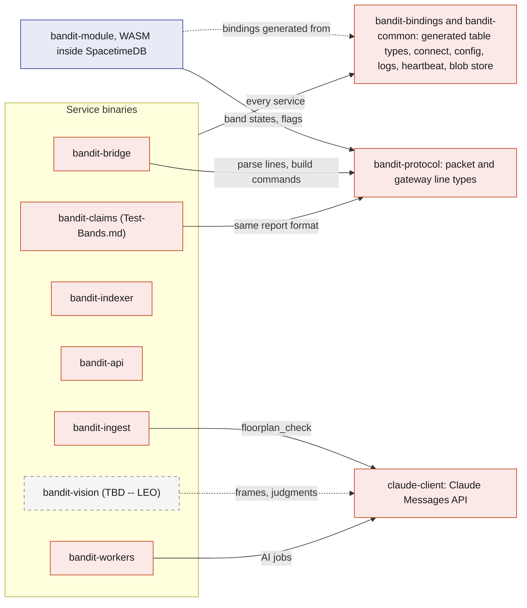
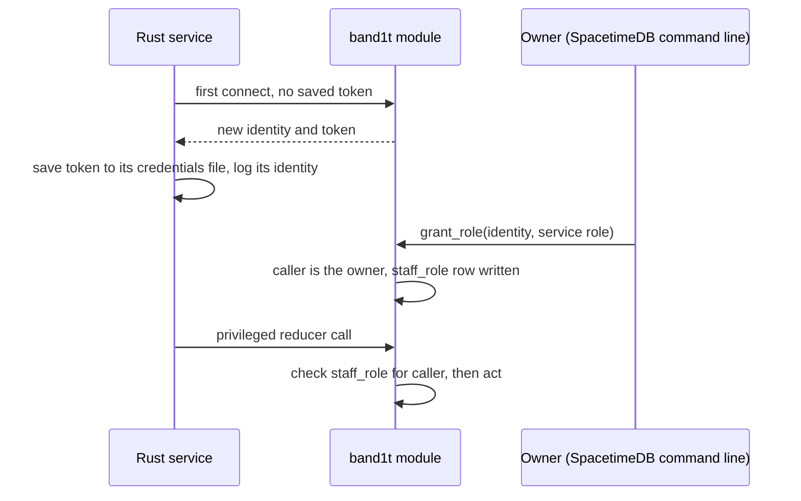
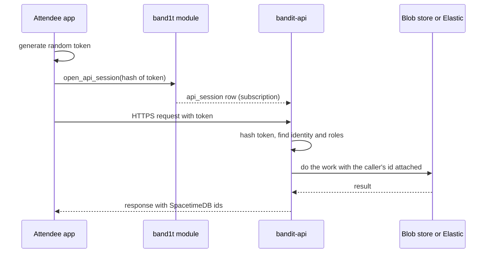
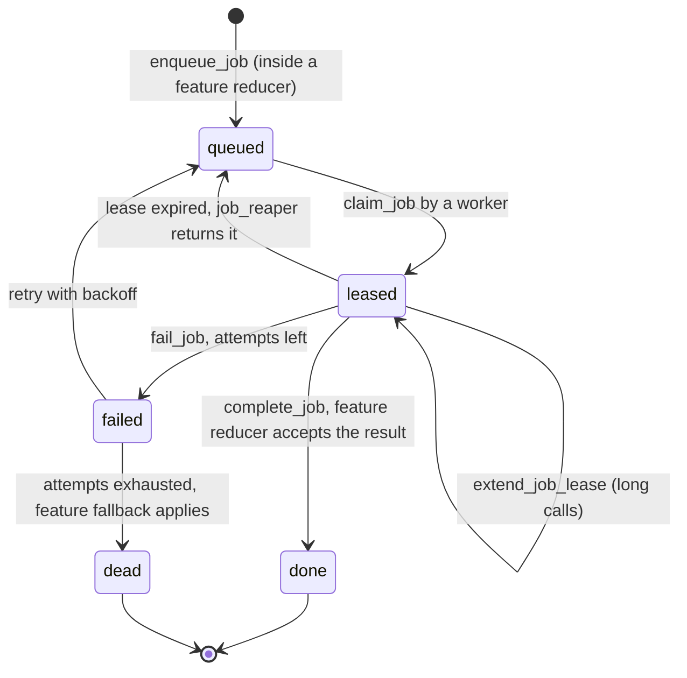

# Rust backend

Every piece of BandIt's backend is Rust: the SpacetimeDB module, the device bridge, the `bandit-claims` tool, the importer, the Elastic indexer, the HTTP edge and the job workers. They live in one Cargo workspace, so they share one set of protocol types and one set of generated SpacetimeDB bindings, and a field rename cannot silently break another process. This file describes the workspace, where each process runs, how each one identifies itself to the database, and the two service shells (`bandit-api` and `bandit-workers`) that feature docs plug into.

## Role in the system

Responsibilities:

- the Cargo workspace layout and what each crate is for;
- the catalogue of running processes: where each runs, its SpacetimeDB role and its secrets;
- the Vultr VM that hosts `bandit-api`, `bandit-workers` and `bandit-indexer`, and its data folder `/var/lib/bandit`;
- service identity, configuration and secrets handling;
- the `bandit-api` shell: serving the two web apps, knowing who is calling, blob storage, and the endpoint registry that feature docs add rows to;
- the `bandit-workers` shell: the job loop, leases, concurrency, and the handler registry that feature docs add rows to;
- logging, health reporting and run profiles.

Not here: what the module's tables and reducers are ([SpacetimeDB](../2-data/SpacetimeDB.md)), how the bridge talks to the gateway ([Gateway-Bridge](Gateway-Bridge.md)), what any feature's endpoint or job does (the feature's own doc), and how Claude is called ([Anthropic-Agent](../7-integrations/Anthropic-Agent.md)).

## Interfaces

Every process, where it runs, what it may do in the database, and what it talks to outside.

| Process | Crate | Runs on | SpacetimeDB role | Talks to | Secrets it holds |
|---|---|---|---|---|---|
| `band1t` module | `bandit-module` | SpacetimeDB Maincloud | runs inside the database | nothing outside the database | none |
| `bandit-bridge` | `bandit-bridge` | venue laptop | `bridge` | the gateway over USB serial | its SpacetimeDB token |
| Test-Bands.md: the `bandit-claims` command-line tool | `bandit-claims` | venue laptop | `simulator` (its `sim` identity, for the test bands); Insurance.md: the test identities it plays, among them the medic (`medic`) and the organizer (`ops`) | nothing outside; Insurance.md: `bandit-api` over HTTPS to upload the planted claims' bills | its SpacetimeDB tokens |
| `bandit-ingest` | `bandit-ingest` | venue laptop, before the event | `ingest` | the `band1t` module (seed mode); BrightData.md: the Bright Data Web MCP, the Claude API for `floorplan_check`; Elastic.md: Elastic Serverless (raw indices, the organizer workflow; Insurance.md: the 30 past claims into `bandit-claims`) | SpacetimeDB token; BrightData.md: Bright Data key, Anthropic key; Elastic.md: Elastic ingest key |
| Elastic.md: `bandit-indexer` | `bandit-indexer` | Vultr VM | `indexer` | Elastic Serverless: the one-way copy, including the `bandit-people` sync of each findable attendee's interests | SpacetimeDB token, Elastic key |
| `bandit-api` | `bandit-api` | Vultr VM | `api` | browsers over HTTPS through Caddy, the blob store in `/var/lib/bandit`; Elastic.md: Elastic Serverless | SpacetimeDB token; Elastic.md: Elastic key; Test-Bands.md: the `simulator` token for the dev routes |
| `bandit-workers` | `bandit-workers` | Vultr VM | `worker` | the blob store in `/var/lib/bandit`; Anthropic-Agent.md: Claude API; Payments-Nessie.md: Nessie; Elastic.md, Insurance.md: Elastic Serverless (`bandit-claims`) | SpacetimeDB token; Anthropic-Agent.md: Anthropic key; Payments-Nessie.md: Nessie base URL and key; Elastic.md, Insurance.md: Elastic claims key |
| Vision.md (TBD -- LEO): `bandit-vision` | `bandit-vision` | venue laptop | `vision` | the pit camera, `bandit-api` for frame uploads; Anthropic-Agent.md: Claude API through `claude-client` | SpacetimeDB token, the workers' Anthropic key |

## Design

### Why Rust everywhere

The module must be Rust or another WASM language to run inside SpacetimeDB. Choosing Rust for the services too means the radio packet types, the job payloads and the generated table bindings are one set of Rust types used on both sides of every connection. The module itself cannot reach the gateway, the cameras or external APIs, and putting API keys in the module would expose them. So every side effect outside the database happens in a separate Rust process that connects as an ordinary SpacetimeDB client.

### Workspace layout

Which crate depends on which. Every service binary also uses `bandit-bindings` and `bandit-common`; the arrows show only the dependencies that differ between binaries.

| Crate | Kind | Purpose | Owner doc |
|---|---|---|---|
| `bandit-protocol` | library | mirrors the firmware's shared header: packet fields, flag bits, band states, command names, exit colour indices, and the gateway's JSON line and command line formats | [Gateway-Bridge](Gateway-Bridge.md) |
| `bandit-module` | WASM library | the SpacetimeDB module `band1t` | [SpacetimeDB](../2-data/SpacetimeDB.md) |
| `bandit-bindings` | library | client bindings generated from the module, plus one helper that connects with a saved token and reports the service's identity | this file |
| `bandit-common` | library | config loading, structured logging, the 5 s heartbeat, and the blob store (a folder in `BANDIT_DATA_DIR`, `/var/lib/bandit` on the VM) | this file |
| `claude-client` | library | the only way any process calls Claude; also records every call | [Anthropic-Agent](../7-integrations/Anthropic-Agent.md) |
| `bandit-bridge`, `bandit-claims`, `bandit-ingest`, `bandit-indexer`, `bandit-api`, `bandit-workers` | binaries | the processes in the Interfaces table | their docs |
| Vision.md (TBD -- LEO): `bandit-vision` | binary | the vision service; it calls Claude through `claude-client` like the workers do | [Vision](../4-devices/Vision.md) |

The two browser apps use TypeScript bindings generated from the same module, so the web and Rust sides cannot drift apart either.

Third-party crates, chosen because they are mature and async-friendly: `spacetimedb` (module) and `spacetimedb-sdk` (clients), `tokio`, `serde` and `serde_json`, `tokio-serial` (bridge), `axum` (API and static files), `reqwest` (all HTTPS clients), `sha2` (evidence and blob hashes), `tracing` (logs), `image` (Vision.md frame resizing (TBD -- LEO)).

### Where the processes run

Each process reaches the database the same way, as a SpacetimeDB client of Maincloud, so where it runs is a deployment choice, not a design change. The deployment picture is in [Architecture](../1-overview/Architecture.md).

- `bandit-api`, `bandit-workers` and `bandit-indexer` run side by side on one Debian VM on Vultr, as the systemd services `bandit@api`, `bandit@workers` and `bandit@indexer`, which restart on failure, so they keep running when the laptop sleeps. Caddy on the VM serves HTTPS for band1t.vip and www.band1t.vip and passes each request to `bandit-api` on 127.0.0.1:8080.
- The three services share the data folder `/var/lib/bandit` (`BANDIT_DATA_DIR`): the service identities, the blob store and the rendered records. Both processes that write blobs, `bandit-api` and `bandit-workers`, run on that VM and share the folder directly.
- `scripts/deploy-vm` copies the keys and the service identities to the VM over SSH and runs `deploy/setup.sh`, which builds the pages and the services from the repo and restarts them. Running it again updates the VM.
- The VM runs with test mode on (`BANDIT_SIMULATE=1` in the service file), so the test tools that features add are live at the event.
- `bandit-api` serves the Ops dashboard and the attendee app as static files from band1t.vip. The NFC tags hold that host, so judges open the app on their own phones, and the apps' uploads and API calls go to the same origin with no cross-origin setup.
- The venue laptop runs `bandit-bridge`, because it needs the gateway's USB cable, and runs `bandit-ingest` once before the event.
- Test-Bands.md: the `bandit-claims` command-line tool runs on the venue laptop. The VM builds it too, because `bandit-api`'s dev routes start its `fall` and `property` commands, and test mode turns on those routes and the Ops dashboard's test bands tab.
- Vision.md (TBD -- LEO): `bandit-vision` runs on the venue laptop.

### Service identity and roles

Every process is a SpacetimeDB client with its own identity, so every reducer can check who is calling.

- The module's init reducer records the publishing identity as `owner`. Only the owner can call `grant_role`, `revoke_role` and `add_owner`; the module refuses every other caller.
- People do not keep a saved token: they sign in with SpacetimeAuth, and the owner grants their roles the same way, with `grant_role` from the command line and the short identity code on their screen ([SpacetimeDB](../2-data/SpacetimeDB.md)).
- Each service keeps its token in a credentials file, never in the repo. The three services on the VM keep theirs in `/var/lib/bandit/identities`, so a redeploy keeps their identities; the laptop processes keep theirs in a local file. A restart therefore keeps the identity, and the role survives it.
- Service roles are narrow: the bridge can report bands and acknowledge commands but cannot touch claims; workers can submit job results but cannot force band states.

### Configuration and secrets

- Each process reads one config file plus environment variables for secrets. The config holds the Maincloud address, the database name `bandit-calhacks13-sp82j`, and process-specific settings such as the serial port or the job kinds a worker handles. Anthropic-Agent.md: every process that calls Claude reads `claude_mode`, which is `replay_then_live` at the event ([Anthropic-Agent](../7-integrations/Anthropic-Agent.md)).
- Secrets are the SpacetimeDB tokens plus the feature keys in the Interfaces table. On the VM they sit in its `.env` file, which `scripts/deploy-vm` copies over SSH and the services read at start; on the laptop they sit in a local environment file outside the repo. They are never written to SpacetimeDB rows, never sent to browsers and never committed.

### `bandit-api`: the HTTP edge

`bandit-api` exists for the few things browsers cannot do directly against SpacetimeDB: serving the two web apps, calls that need a secret, large files, and public pages that features add.

**App files.** `bandit-api` serves the built Ops dashboard and attendee app as static files. Every attendee app route, including the NFC path `/t/BANDIT-0n`, returns the app, which reads the token from the path. After loading, both apps talk to SpacetimeDB directly over WebSocket; `bandit-api` is not on the live path.

**Who is calling.** Each browser app, the attendee app and the Ops dashboard, generates a random session token on page load, registers its hash with the `open_api_session` reducer (bound to the caller's SpacetimeDB identity, with an expiry), then sends the token with each HTTPS request. `bandit-api` subscribes to the `api_sessions` view with its `api` role, hashes the presented token and looks up the identity. This needs no JWT verification and no sign-in of its own: the browser's SpacetimeDB identity comes from its SpacetimeAuth sign-in, and revoking a session is a row delete.

**Blob storage.** An upload, `POST /api/blobs` with a purpose, is streamed into the blob store folder in `/var/lib/bandit`, stored under its SHA-256, and registered with `register_blob`, which writes a `blob_ref` row with content type, size, hash, owner and an access class (`owner_only`, `staff`, `shared`). The `api` and `worker` roles may call `register_blob`, since workers also produce files such as letters; `bandit-workers` reads and writes the folder directly because it runs on the same VM. `bandit-api` answers with the hash, the page count of a PDF and the URL `/blobs/<sha256>`. Downloads go through `GET /blobs/{hash}` on `bandit-api`, which checks the caller against the access class. Large files never go into SpacetimeDB rows, because big rows slow commits and subscriptions.

**Endpoint registry.** Core endpoints are below; each optional feature adds its own rows and owns their behaviour.

| Endpoint | Purpose | Owner |
|---|---|---|
| health | liveness for the dashboard and scripts | this file |
| app files | the Ops dashboard and attendee app bundles, and every app route including `/t/BANDIT-0n` | this file |
| `POST /api/blobs` | stream a file in, store it under its SHA-256 and call `register_blob` with the purpose's access class (Social.md: purpose `photo` as `shared`; Insurance.md: purpose `medical` as `staff`; Medical-ID.md: purposes `history` and `insurance` as `owner_only`, owned by the attendee whose API session sent the file); returns the hash, the page count of a PDF and the URL `/blobs/<sha256>` | this file |
| `GET /blobs/{hash}` | serve a stored file by its hash if the caller passes its access class | this file |
| Elastic.md: `GET /recap/order` | handler `rank_recap`: orders the caller's recap people and booths by meaning, holding the Elastic key; the candidates come from Social.md's views `social_encounters` and `social_visits`, never from Elastic | [Elastic](../7-integrations/Elastic.md) |
| Medical-ID.md: document upload, `/samples` | the attendee page sends each medical PDF to `POST /api/blobs` with purpose `history` or `insurance` and the attendee's API session, then calls `submit_medical_document` itself as the attendee, which enqueues `medical_extract`; `/samples` serves the synthetic `medical-history.pdf` and `insurance-card.pdf` for the "Use a test record" button, which the page shows in test mode only | [Medical-ID](../6-features/Medical-ID.md) |
| Insurance.md: bill upload | the Ops dashboard's incident card uploads an urgent-care bill PDF (at most 10 MB) through `POST /api/blobs` with purpose `medical`, then calls `submit_medical_record` as the signed-in staff member, which enqueues `claim_record_extract` | [Insurance](../6-features/Insurance.md) |
| Social.md: photographer photo upload, share-link page | photos in through `POST /api/blobs` with purpose `photo`; the public page for a share token | [Social](../6-features/Social.md) |
| Test-Bands.md: `POST /api/dev/press/{band}`, `POST /api/dev/move/{band}/{station}` | test mode only (`BANDIT_SIMULATE=1`): press a test band 94 to 99, or move any test band 90 to 99 to a station, through `report_sim_band` as the `simulator` identity; the pressed and moved bands keep reporting every 2 s until `event_state.ended` is set | [Test-Bands](Test-Bands.md) |
| Test-Bands.md: `POST /api/dev/fall/{band}` | test mode only, the test bands tab's "Fall here": runs `bandit-claims fall` for a test band 90 to 99, with two of the claims story's bands (the first two of 90, 92, 93 and 91 that are not the band) as the light circle; the band's own 2 s reports pause meanwhile | [Test-Bands](Test-Bands.md) |
| Test-Bands.md: `POST /api/dev/property/{station}` | test mode only, the test bands tab's "Speaker breaks in <zone>": runs `bandit-claims property --camera` for the zone of that station, with the note "a speaker was knocked off its stand and cracked" and a repair cost of $2,400 | [Test-Bands](Test-Bands.md), [Insurance](../6-features/Insurance.md) |

### `bandit-workers`: the job runner

All slow or external work is a `job` row ([SpacetimeDB](../2-data/SpacetimeDB.md)). `bandit-workers` is one process that runs a handler per job kind, so adding a feature means adding a handler, not a new service.

How one job moves through a worker:

- **Claiming.** The worker subscribes to queued jobs of the kinds it handles and calls `claim_job`. The reducer gives the job to exactly one caller, so two workers never run the same job.
- **Leases.** A lease lasts 60 s (starting value, calibrate at the venue). Handlers with long model outputs call `extend_job_lease`. If a worker dies, `job_reaper` puts the job back in the queue after the lease runs out.
- **Results.** The handler submits its result through the feature's reducer, which checks that the caller still holds the lease. A slow duplicate whose lease was handed on is rejected, so it cannot overwrite a newer result.
- **External side effects.** A handler that changes something outside, such as a bank purchase or a payout, is safe to repeat. It keeps the ids it created in its data folder until the module stores them, and it reuses a purchase or deposit whose description equals the job's memo, so a retry after a crash never pays twice.
- **Concurrency.** Each kind has its own concurrency limit, so a burst of one kind cannot starve a payment. Nothing in the safety path ever waits on a job.
- **Dead jobs.** After 3 attempts (starting value, calibrate at the venue) the job is `dead` and the feature's fallback applies; the Ops dashboard's job monitor shows it.

**Handler registry.** Each optional feature owns its rows.

| Job kind | Handler does | Owner |
|---|---|---|
| Medical-ID.md: `medical_extract` | read one medical PDF from the blob store with Claude (effort low), check the answer in code, then `apply_medical_extract` | [Medical-ID](../6-features/Medical-ID.md) |
| Payments-Nessie.md: `wallet_open` | open the attendee's Nessie customer and $200 checking account when they tap "Connect your Capital One wallet", then `record_wallet` | [Payments-Nessie](../7-integrations/Payments-Nessie.md) |
| Merch.md, Payments-Nessie.md: `merch_purchase` | record a merch order as a Nessie purchase at the "BandIt merch" merchant, creating the merchant on the first purchase, then `settle_merch_order` | [Merch](../6-features/Merch.md), [Payments-Nessie](../7-integrations/Payments-Nessie.md) |
| Insurance.md, Payments-Nessie.md: `claim_payout` | deposit an approved claim's payout into the claimant's Nessie wallet, opening an account if they have none, then `record_claim_payout` | [Insurance](../6-features/Insurance.md), [Payments-Nessie](../7-integrations/Payments-Nessie.md) |
| Insurance.md: `claim_record_extract`, `claim_review`, `claim_draft`, `recovery_letter` | bill PDF to validated service lines through Claude, priced later by the module; a causation verdict from the pack's facts, with no amounts; the first notice of loss in ACORD 3 layout and the claim summaries; the recovery query letter | [Insurance](../6-features/Insurance.md) |
| Elastic.md, Insurance.md: `claim_verify` | build the de-identified claim copy in code, index it into `bandit-claims` through `bandit-claims-validate`, rank it against the seeded past claims, and submit the ids and scores with `submit_claim_checks` | [Insurance](../6-features/Insurance.md), [Elastic](../7-integrations/Elastic.md) |
| Vision.md (TBD -- LEO): `photo_features` | not a `bandit-workers` handler; `bandit-vision` claims it with the `vision` role | [Vision](../4-devices/Vision.md) |

### Health and logs

- Every process calls `heartbeat` every 5 s with its name, version and a few counters (the bridge adds gateway lines per second and per-band loss; workers add queue depth per kind). The Ops dashboard turns `service_heartbeat` rows into a service health strip and greys a service out after 15 s of silence.
- Every process writes structured logs with `tracing` to the console and a local file, tagged with the SpacetimeDB row ids it touched, so a log line can be matched to an incident or a job.

### Run profiles

Both profiles use the one Maincloud database.

| Profile | Bands | Use |
|---|---|---|
| Live event | real bands through the bridge | the event in front of the judges |
| Test-Bands.md: Rehearsal | test bands and replayed bridge logs only, on the test band ids 90 to 99 | practising the safety choreography without wearers |

Test-Bands.md: in the live event, the crowd (up to 80 crowd bands inside the module) and the 10 test bands run alongside the real ones.

## Failure modes and fallbacks

| Failure | Effect | Design answer |
|---|---|---|
| The VM restarts or is redeployed | The three cloud services drop for a few seconds | systemd starts them again with the identities saved in `/var/lib/bandit`, and they reconnect; leased jobs return through `job_reaper`. |
| A service gets a new identity because its credentials file is lost | Its reducer calls are refused | The owner grants the role to the new identity from the dashboard; the refusal is logged loudly. |
| `bandit-workers` crashes mid-job | Jobs stay leased | `job_reaper` returns them after the lease; an external call checks its recorded request id before it runs again. |
| `bandit-api` is down | New phones cannot load the app; no uploads and no recap order | Phones that already loaded the app keep the thank-you screen and the recap, and the Ops dashboard keeps its incident desk, because they talk to SpacetimeDB directly. |
| A secret is missing for one feature | That feature's handlers fail | Only those job kinds go `dead`; other features run, and the job monitor shows which kind is failing. |
| Bindings out of date after a schema change | A service fails to start or misreads rows | The Rust and TypeScript bindings are regenerated on every publish and every client is rebuilt before the next rehearsal ([SpacetimeDB](../2-data/SpacetimeDB.md)). |

## Dependencies

**Depends on:** [SpacetimeDB](../2-data/SpacetimeDB.md) (tables, reducers, roles, the job queue), [Architecture](../1-overview/Architecture.md) (deployment).

**Used by:** every Rust component doc ([Gateway-Bridge](Gateway-Bridge.md), [Test-Bands](Test-Bands.md), [BrightData](../7-integrations/BrightData.md), [Elastic](../7-integrations/Elastic.md), [Anthropic-Agent](../7-integrations/Anthropic-Agent.md), [Payments-Nessie](../7-integrations/Payments-Nessie.md), [Medical-ID](../6-features/Medical-ID.md), [Insurance](../6-features/Insurance.md), [Social](../6-features/Social.md), [Merch](../6-features/Merch.md), [Vision](../4-devices/Vision.md)), and the web apps, which `bandit-api` serves.

**If you delete this file:** not intended; it is core. When you delete an optional feature, remove its rows from the endpoint registry and the handler registry above, its crate if it has one (`claude-client` with Anthropic-Agent.md), its module in `bandit-workers` if it has one (`nessie` with Payments-Nessie.md), its third-party crate (`image` with Vision.md), its process row and its secrets in the Interfaces table, and its bullet in "Where the processes run" and its run profile row and line (Test-Bands.md, Vision.md).

## Decisions

| Decision | Why |
|---|---|
| `bandit-api`, `bandit-workers` and `bandit-indexer` run on one always-on Vultr VM as systemd services, behind Caddy on band1t.vip | they keep running when the laptop sleeps, `bandit-api` gets a public HTTPS host for judges' phones, and one VM is one thing to watch |
| Blobs are files in `/var/lib/bandit` on that VM | the two processes that write blobs share the VM, so there is no bucket or storage key to manage; `bandit-api` still checks every download against `blob_ref` |
| The cloud services' identities live in `/var/lib/bandit/identities` | a redeploy keeps each service's identity, so its role grant survives |
| `bandit-workers` reads and writes blobs directly in `/var/lib/bandit` | it runs on the same VM as `bandit-api`; only browsers and laptop processes go through the HTTPS blob endpoints |
| `bandit-api` serves both web apps from its own host | one origin for the app files, uploads and API calls, so no cross-origin setup, and the NFC tags need only one host |
| `bandit-api` has no sign-in and no summary route of its own | a caller is the SpacetimeDB identity behind its `api_session`, and that identity comes from the browser's SpacetimeAuth sign-in; the recap is SpacetimeDB views, not an HTTP page |
| Elastic.md: the recap order is one route, `GET /recap/order` (handler `rank_recap`), called with `api_session` | the lists come from SpacetimeDB views; only the order needs the Elastic key |
| Every run profile uses the one Maincloud database | there is one deployment, so there is no offline profile to keep in step |
