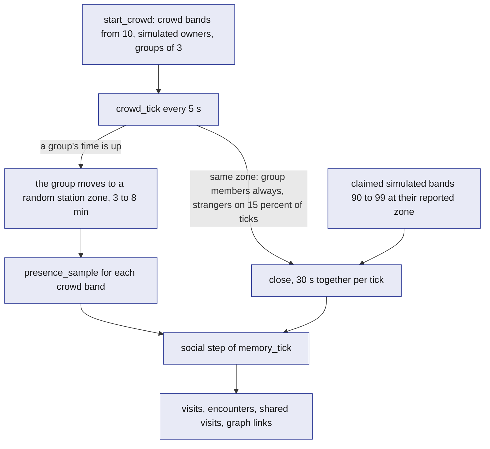
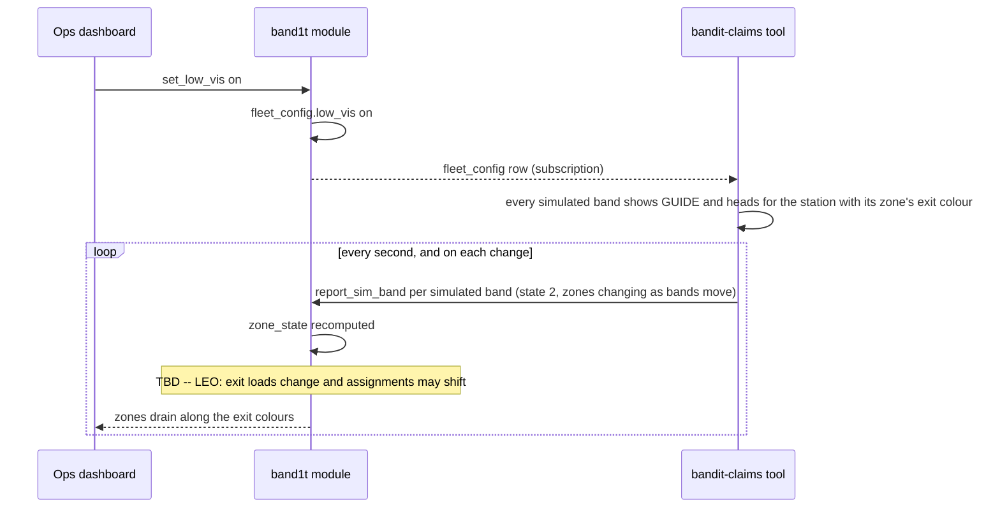

# Simulator

Nine real bands cannot show how an event behaves, so BandIt adds bands that no radio carries, in two places, and neither touches the radio. The crowd lives inside the `band1t` module: `start_crowd` adds up to 80 crowd bands (ids 10 to 89) with simulated owners, and `crowd_tick` moves them between zones, so the people graph and the recaps look like a real event. The simulated bands (ids 90 to 99) report through `report_sim_band`, which only the `simulator` role may call. The `bandit-claims` command-line tool drives them for the safety scenarios, the planted claims and log replay, and `bandit-api`'s dev routes let a tester press, walk or drop one from a browser, among them from the Ops dashboard's Simulate tab. The real bands move among them on the same dashboard.

## Role in the system

Responsibilities:

- Social.md: add up to 80 crowd bands (ids 10 to 89) with `start_crowd`, each with a simulated owner, and move them in groups every 5 s with `crowd_tick`, so the big-screen people graph shows a real-looking crowd. `stop_crowd` freezes it.
- Report the simulated bands (ids 90 to 99) through `report_sim_band`, under the `simulator` role: from the `bandit-claims` command-line tool, and from `bandit-api`'s dev routes, which press and move bands 94 to 99 and start the tool's `fall` and `property` commands.
- Obey `band_directive` and `band_command` rows for the simulated bands and for target 0, and acknowledge the one-shots addressed to their ids.
- Run scenarios on the simulated bands: crush build-up, SOS, fall.
- (TBD -- LEO) Run the two-exit low-visibility and the medic-approach scenarios.
- Hyphenate.md: plant insurance claims with the `bandit-claims` tool, each with a medic visit and a synthetic bill: three accuracy rounds of genuine claims and decoys, the stress-test run of the edge cases, and the two planted claims of the scripted claims run.
- Replay a bridge `.jsonl` log through `report_sim_band` at recorded or accelerated speed, with real bands 1 to 9 mapped onto simulated ids 91 to 99.
- Report the tool's health through `heartbeat` every 5 s.

Explicit non-responsibilities:

- It never opens the serial port and never sends radio commands; real bands are [Gateway-Bridge](Gateway-Bridge.md)'s alone.
- It never writes `band_directive` or any ops table; it is a device, not an operator. Hyphenate.md: the one exception is the medic visit of a planted incident on a simulated band, which the `bandit-claims` tool plays through `plant_medic_visit`.
- It never reports ids 1 to 9 (a replay maps them onto 91 to 99, see below).
- It does not validate the radio: it reports what a band would report, which cannot tell whether the venue's RSSI thresholds are right. That is calibration ([Hardware](../4-devices/Hardware.md)).
- It holds no truth. Stopping the `bandit-claims` tool makes the simulated bands go stale; the crowd stops only with `stop_crowd`.

## Interfaces

| Interface | Direction | Counterpart | What flows | Transport |
|---|---|---|---|---|
| Social.md: `start_crowd` | in to the module, once after the venue import | the team as `ops`, or the `bandit-claims` tool as `simulator` | the crowd size, at most 80; refused until the venue has zones with stations | SpacetimeDB reducer call |
| Social.md: `stop_crowd` | in to the module | the same callers | none; the crowd stops where it is | SpacetimeDB reducer call |
| Social.md: `crowd_tick` | internal, every 5 s | the `band1t` scheduler | moves the groups, writes the crowd bands' `presence_sample` rows and which crowd bands were close | schedule table `crowd_timer`; only the scheduler may call it |
| `report_sim_band` | out, once a second per simulated band and at once on a change | `band1t` module | band id 90 to 99, station, state, `neigh`, and the SOS, fall and press flags | SpacetimeDB Rust client SDK, caller role `simulator` |
| `bandit-claims` command line | in | the operator | `setup` (the test identities and their role grants), then a scenario file, `fall`, `property`, `scorecard` (the accuracy run), `story` (the scripted claims run) or a replay log | local process arguments |
| `bandit-api` dev routes | in | a tester's browser, only while test mode (`BANDIT_SIMULATE=1`) is on | `POST /api/dev/press/{band}` presses one of the bands 94 to 99; `POST /api/dev/move/{band}/{station}` moves it to that station's zone; `POST /api/dev/fall/{band}` runs `bandit-claims fall` for a simulated band 90 to 99; `POST /api/dev/property/{station}` runs `bandit-claims property --camera` for that station's zone. The Ops dashboard's Simulate tab calls all four | HTTPS to `bandit-api` ([Rust-Backend](Rust-Backend.md)), which calls `report_sim_band` as the `simulator` identity |
| Hyphenate.md: `plant_medic_visit` | out | `band1t` module | the medic visit of a planted incident: note text, first-aid cost, planted type, run and round | SDK, role `simulator` |
| Hyphenate.md: bill upload | out | `bandit-api`, then `band1t` module | a synthetic bill PDF from the tool's seed folder through `POST /api/blobs` with purpose `medical`, then `submit_medical_record` as the tool's `medic` test identity ([Hyphenate](../7-integrations/Hyphenate.md)) | HTTPS, then SDK |
| `ack_band_command` | out | `band1t` module | command id and outcome for one-shots addressed to the simulated bands | SDK |
| `heartbeat` | out, every 5 s | `band1t` module | service `simulator`, version, counters: simulated bands reporting, reports per second, active scenario and its clock, replay position | SDK |
| `zone`, `zone_link`, `exit`, `station`, `zone_state` | in, subscription | `band1t` module | the venue graph (areas, walking distances, exits, the station colour at each) and zone state | SDK |
| `fleet_config` | in, subscription | `band1t` module | the thresholds real bands use, so a simulated band's colour matches the `neigh` it reports, and `low_vis` | SDK |
| `band_directive`, `band_command` | in, subscription through `staff_directives` and `staff_commands` | `band1t` module | rows for target 0 and the simulated bands 90 to 99 | SDK |
| Scenario file | in | the operator | a list of timed steps (below) | local text file named on the command line |
| Replay log | in | a bridge run | the bridge's raw `.jsonl` | local file named on the command line |

A target-0 one-shot is applied by the `bandit-claims` tool and acknowledged by the bridge, so `ack_band_command` must be idempotent ([SpacetimeDB](../2-data/SpacetimeDB.md)).

## Design

### Band ids

Band ids are one byte, the same as on the radio. The ranges never overlap, so nothing downstream needs a rule about who may report which id.

| Ids | Bands | How they reach the module |
|---|---|---|
| 1 to 9 | the real bands | `bandit-bridge`, through `ingest_band_reports` |
| 10 to 89 | the crowd | no reports: `crowd_tick` writes their presence inside the module |
| 90 to 93 | the simulated bands of the four simulated attendees in the scripted claims run, Lee among them | the `bandit-claims` tool, through `report_sim_band` |
| 94 to 99 | simulated bands a tester claims from the tap link | `bandit-api`'s dev routes or the `bandit-claims` tool, through `report_sim_band` |

`report_sim_band` refuses any id outside 90 to 99, and only the `simulator` role may call it.

### Social.md: the crowd

The crowd is part of the module, so it needs no process and no connection. The team starts it once after the venue import with `start_crowd` (roles `ops` and `simulator`), giving the crowd size.

- **Simulated owners.** For each crowd band from 10 up, at most 80, `start_crowd` creates a simulated attendee and makes it the band's owner. The attendee has a made-up display name from fixed lists of first and last names, `findable` on, and one Instagram handle in `social_handle`, taken from a fixed list of well-known public accounts. It is keyed by a placeholder identity derived from the band id, which no client can sign in as. A band that already has an owner is skipped, so a second call adds nobody twice. The band's `simulated` flag marks a simulated attendee everywhere.
- **Groups.** The crowd bands are put in groups of 3, and each group starts in one station zone.
- **Movement.** `crowd_tick` runs every 5 s inside the module. When a group's time is up, the whole group moves to a random station zone and stays there for 3 to 8 minutes (starting values). Every tick, `crowd_tick` writes each crowd band's zone as its `presence_sample`, the row `memory_tick` writes for a band it hears.
- **Who is close.** Members of a group in the same zone are close on every tick. Two strangers in the same zone are close on 15 percent of ticks (starting value). Each close tick counts as 30 s together, so the 3 minutes of the encounter rule pass within a minute and the graph grows while people watch.
- **Simulated bands mix in.** A claimed simulated band (90 to 99) that is live counts as close to every crowd band in the zone it reports, so a tester's recap shows people without any hardware.
- **Stop.** `stop_crowd` stops the timer and closes the crowd's open zone stays. The visits, encounters and graph links it made stay.

The social step of `memory_tick` then turns the crowd into visits, encounters, shared visits and graph links by the same rules as real attendees ([Social](../6-features/Social.md)). The crowd sends no band reports, so it has no `band_report` row: it is not on the band map, never counts in zone density, receives no directives and opens no incidents.

What one crowd tick does.

### The simulated bands

`report_sim_band` takes one simulated band's station, state, `neigh` and its SOS, fall and press flags, and applies it like one band record of a bridge batch ([SpacetimeDB](../2-data/SpacetimeDB.md)). It writes the band's `band_report` with source `simulator`. An SOS or fall flag opens an incident, state 4 adds a witness, and a press completes a pending band claim, exactly as for a real band. So the simulated bands go through the same incident, claim and memory paths as real bands, one reducer call per band. Every simulated band reports as a full band.

Two drivers report them, both as the `simulator` identity:

- **The `bandit-claims` command-line tool**, on the venue laptop. Its `setup` command connects as the module owner, the only identity that may grant, and creates the test identities and their role grants; its `sim` identity holds `simulator`. While it runs, it reports every simulated band once a second, so none goes stale (5 s), and at once when a band changes station, state or flags. A simulated band's `neigh` is the number of other simulated bands at its station, unless a scenario sets it. A press is the press flag held for 400 ms, as a person presses a real band after the tap.
- **`bandit-api`'s dev routes**, only while test mode is on. `POST /api/dev/press/{band}` presses one of the bands 94 to 99, so a tester claims it from the tap link with no hardware. `POST /api/dev/move/{band}/{station}` moves it to another station's zone. `bandit-api` keeps reporting each band pressed this way every 2 s, so it stays live, keeps its zone and mixes with the crowd. Once `event_state.ended` is set, those reports stop. `POST /api/dev/fall/{band}` runs the tool's `fall` command for any simulated band 90 to 99, with two of the claims story's bands around it as the light circle, and `POST /api/dev/property/{station}` runs the tool's `property --camera` command for that station's zone: a venue camera sees a speaker knocked off its stand, and Hyphenate.md's property claim follows. The Ops dashboard's Simulate tab calls all four routes ([Ops-Dashboard](../5-apps/Ops-Dashboard.md)). Bands 90 to 93 belong to the scripted claims run: the dev routes never press or move them, and only the tool drives them.

### Simulated bands obey the server

While a scenario runs, the `bandit-claims` tool applies the directives for target 0 and for the simulated bands as a band would apply the matching commands: a forced state with its hold, an exit colour, the override flag, and the low-visibility flag, under which every simulated band shows GUIDE with its zone's exit colour. Because the tool reads the directive itself rather than a radio command, it follows the directive's own end time and needs no 25.5 s refresh. The behavioural part is what makes guidance visible: a simulated band whose shown state is GUIDE (from density or forced) moves toward the exit whose station glows its exit colour, found through `station` and `exit`, one zone per step along the shortest `zone_link` path, and on arrival stays at the exit zone with a low neighbour count. Simulated bands in IDLE or YELLOW keep the scenario's plan. This is how low visibility drains zones along the exit colours ([Safety](../6-features/Safety.md)).

(TBD -- LEO) The same rule is how a medic approach opens space around an incident.

One-shots: `buzz`, either the light-circle alert or the guidance buzz that comes with a new route colour, changes nothing, because the band already moves by its GUIDE colour; `clear` releases the latches. Each one addressed to a simulated band is acknowledged with `ack_band_command` once applied.

How low visibility moves the simulated bands.

### Scenarios

A scenario is a small text file of timed steps that the `bandit-claims` tool plays on the simulated bands: at a given second, move bands to a zone, set the `neigh` the bands in a zone report, latch SOS or fall on a chosen band, or wait for a condition in the database (for example `fleet_config.low_vis` turning on, or a medic taking an incident) before continuing. The tool makes no ops calls in a scenario; where a scenario needs an operator action, the step waits for it, which keeps every operator action real. The operator starts a scenario by naming its file on the command line and stops it by stopping the tool.

| Scenario | What the script does | What the system should show |
|---|---|---|
| Crush build-up | moves the simulated bands into one zone and ramps the `neigh` they report from the calibrated value for about one person per square metre to the value for six over 90 s, holds for 60 s, then releases | the zone turns `watch` then `high` in `zone_state`; the simulated bands go YELLOW then GUIDE; a `crowd_risk` incident opens; exit assignment moves bands away from the hot zone |
| SOS | one simulated band latches SOS; the simulated bands in the same zone report NEAR_SOS (state 4) while it lasts | an `sos` incident with its snapshot; the circle members appear in `incident_band`; escalation fires if nobody acknowledges within 60 s |
| Fall on a full band | a simulated band sets the fall flag after a short "impact" | a `fall` incident, otherwise identical to SOS |
| (TBD -- LEO) Two-exit low visibility | waits for ops to turn low visibility on with `set_low_vis`, lets the simulated bands follow their exit colours toward two exits, then waits for ops to block one exit with `set_exit_status` | zones drain along the assigned colours and exit loads balance; after the block, every zone that used that exit changes colour at once and the blocked exit draws nobody |
| (TBD -- LEO) Medic approach | runs the SOS scenario, then waits for a medic to take it with `assign_medic`; simulated bands outside the circle follow the GUIDE directive out of the zone, and the circle stays | space opens around the person while the blue ring remains |
| Hyphenate.md: Accuracy run | the tool's `scorecard` command: three rounds, each planting 12 genuine claims (8 falls, 4 SOS) and 6 decoys (2 sitting down, 2 dropped phone, 2 fake witnesses), starting values; between rounds it waits until the run's claims queue is empty | the scorecard on the Ops dashboard's Claims queue: straight-through rate rising each round, $0 wrongly paid, human touches falling ([Hyphenate](../7-integrations/Hyphenate.md)) |
| Hyphenate.md: Stress test | plants the edge cases not shown live: an injury the urgent-care record places at home, a bill re-filed as a new scan, a staff injury, and one more fake with witnesses in another zone | each claim next to its expected outcome: a doubt sent to a person, `zero_payout` for the duplicate bill, `claimant_not_staff`, `witness_zone` |
| Hyphenate.md: Scripted claims run | the tool's `story` command, during the event: a second fall similar to the judge's approved claim, then a fake claim for Lee, a simulated attendee on band 93, whose witness bands sit in another zone | the second fall settles in seconds under rule v1; Lee's claim is refused by code as `witness_zone`, with every check listed |

(TBD -- LEO) The two-exit low-visibility run is on the rehearsal checklist, because it is the run that tests the exit choice's crowding penalty and switch margin ([Safety](../6-features/Safety.md)).

Scenarios can be stacked: a crush with an SOS inside it is the event's full safety story.

### Hyphenate.md: planted claims

A planted claim goes through the same path as a real one: a simulated band latches a fall or SOS, simulated witness bands report state 4 in a chosen zone, and then the `bandit-claims` tool plays the medic. It uploads the claim's synthetic bill PDF through `POST /api/blobs` with purpose `medical` and files it with `submit_medical_record` as its `medic` test identity, then calls `plant_medic_visit`. That reducer (role `simulator`) accepts only an open incident whose subject band is a simulated band. It runs the same logic as `assign_medic` (the simulator as the medic), `add_incident_note` and `resolve_incident`, so the claim sees exactly what a real medic visit leaves. It also writes one `planted_incident` row. Hyphenate's decision code never reads that row; only the scorecard does.

| `planted_incident` field | Meaning |
|---|---|
| `incident_id` | the planted incident |
| `run` | `accuracy`, `stress` or `story` (the scripted claims run) |
| `round` | 1, 2 or 3 in the accuracy run; empty otherwise |
| `planted_type` | `genuine`, `sit_down`, `dropped_phone`, `fake_witness`, `at_home`, `duplicate_bill`, `staff` |
| `expected` | `paid`, `person` or `refused` |
| `planted_at` | when it was planted |

| Planted type | What the tool plants |
|---|---|
| `genuine` | a fall or SOS, at least 2 witnesses in the same zone, a medic note within the window, a bill dated that night with codes on the fee schedule |
| `sit_down` | a fall flag and witnesses, a medic note "no injury found", and a bill for a visit anyway |
| `dropped_phone` | a fall flag and witnesses, a medic note "phone screen broken, no injury", and a phone repair invoice as the bill |
| `fake_witness` | a fall flag whose witness bands report another zone |
| `at_home` | a genuine-looking fall whose bill gives the visit reason "twisted wrist at home this morning" |
| `duplicate_bill` | a new fall whose bill is a re-scan of an earlier planted bill: the same provider and invoice number in a new file |
| `staff` | a genuine-looking fall on the simulated band whose owner holds a staff role |

The tool's seed folder holds one synthetic bill PDF per planted claim, each with its own invoice number, so only the `duplicate_bill` case repeats one. For the stress test the tool grants `ops` to the test identity that wears band 92 (starting value), so the stress test can plant a staff injury without borrowing a person's identity. The accuracy run and the stress test run before doors open, inside the period of Hyphenate.md's accuracy-run policy, so the rules they teach expire before the event starts. Each test attendee the tool sets up claims its band with a press, then saves its name with `update_profile`. Payments-Nessie.md: right after that it calls `connect_wallet`, so its Hyphenate.md payout lands in a $200 wallet, like a judge's ([Payments-Nessie](../7-integrations/Payments-Nessie.md)).

### Replay mode

Replay reads a bridge `.jsonl` log and feeds its band reports through `report_sim_band` at their recorded receive times, at normal or accelerated speed. Replays use simulated ids only: real bands 1 to 9 are mapped onto 91 to 99 (band 1 becomes 91), so a replay never collides with live bands. A replay is its own run of the `bandit-claims` tool, never beside a scenario and never during the scripted claims run, because the mapped ids include that run's bands. Station lines, command lines, `ack`, `err` and boot lines in the log are shown in the tool's output but never re-issued. `neigh` values in a replay reflect the thresholds in force when it was recorded, which the bridge tags on each logged line. Uses: rehearsing the dashboard without hardware, and a backup if the radio misbehaves in front of the judges.

### Real and simulated bands on the same dashboard

Real bands arrive through `ingest_band_reports` and simulated bands through `report_sim_band`; both live in `band_report` keyed by band id, so nothing downstream has two code paths. `band.simulated` is the only distinction: the Ops dashboard draws simulated bands lighter and shows per-zone counts as real plus simulated ([Ops-Dashboard](../5-apps/Ops-Dashboard.md)); incidents raised by simulated bands are labelled through that flag; the venue tick treats both kinds the same when it computes density and guidance ([Safety](../6-features/Safety.md)). The crowd has no `band_report`, so it is not on the band map; it shows on the people graph and in the recaps. There is no radio between the populations, so a real band standing among simulated bands stays green unless real people surround it, and a simulated band never counts a real one. The safety choreography therefore puts the real people in the taped square and the simulated bands in the surrounding zones, so each population shows the behaviour it can.

## Failure modes and fallbacks

| Failure | Effect | Design answer |
|---|---|---|
| The `bandit-claims` tool crashes | the simulated bands go stale after 5 s and leave the density after that | restart it; its bands and owners already exist, and the scenario starts again from the beginning |
| SpacetimeDB connection lost (hotspot drop) | no simulated band reports | the tool pauses the scenario clock, keeps the latest state, and reports every simulated band at once after reconnect; the crowd keeps moving, because `crowd_tick` runs inside the module |
| A scripted SOS runs while a real SOS is open | two incidents on the dashboard | the simulated incident is labelled through `band.simulated`, so staff go to the real one first |

## Dependencies

**Depends on**

- [SpacetimeDB](../2-data/SpacetimeDB.md): `report_sim_band`, `ack_band_command`, `heartbeat`, `presence_sample`, `event_state`, the venue tables, `fleet_config`, the views `staff_directives` and `staff_commands`, and the `simulator` role.
- [Gateway-Bridge](Gateway-Bridge.md): the `bandit-protocol` crate and the raw log format for replay.
- [Hardware](../4-devices/Hardware.md): the behaviour being imitated (states, flags, windows).
- [Safety](../6-features/Safety.md): what the directives mean, so simulated bands react the way the venue tick expects.
- [Rust-Backend](Rust-Backend.md): `bandit-api`, which hosts the dev routes and the blob upload.
- Social.md: `attendee`, the `findable` consent, `social_handle` and the social step of `memory_tick` for the crowd and its simulated owners ([Social](../6-features/Social.md)).
- Hyphenate.md: `POST /api/blobs` with purpose `medical`, `submit_medical_record`, the accuracy-run policy, and the claims queue the tool waits on between rounds ([Hyphenate](../7-integrations/Hyphenate.md)).

**Used by**

- [Ops-Dashboard](../5-apps/Ops-Dashboard.md): the simulated legend, the real-plus-simulated counts, the Simulate tab and, through Social.md, the crowd on the event graph.
- [Flows](../1-overview/Flows.md): the crowd that runs through the whole event flow.
- [Safety](../6-features/Safety.md): scenario runs as the test bed for density, guidance and escalation.
- (TBD -- LEO) [Safety](../6-features/Safety.md): the medic-approach scenario, and the two-exit run on the rehearsal checklist.
- [Hyphenate](../7-integrations/Hyphenate.md): planted claims for the accuracy run, the stress test and steps 6 and 7 of the live-learning run.

**If you delete this file**

- Remove the simulator rows, the legend and the Simulate tab from [Ops-Dashboard](../5-apps/Ops-Dashboard.md), the Simulator.md rows (the `bandit-claims` tool's band reports and `bandit-api`'s dev routes) from [Architecture](../1-overview/Architecture.md), [Rust-Backend](Rust-Backend.md) and the README, row F16 and the simulated-bands scale row from [Requirements](../1-overview/Requirements.md), and the Simulator.md sentence in [Flows](../1-overview/Flows.md).
- In [SpacetimeDB](../2-data/SpacetimeDB.md), the `simulator` role, `report_sim_band`, `start_crowd`, `stop_crowd`, `crowd_tick`, the crowd and simulated id ranges and the `band.simulated` flag become unused and can be dropped; `ingest_band_reports` already takes only the `bridge` role. Remove the Simulator.md rows and notes from its interfaces, registry, roles, subscriptions and lifecycle tables.
- Remove the Simulator.md lines in [Social](../6-features/Social.md) and [Attendee-App](../5-apps/Attendee-App.md), the two-exit run from the rehearsal checklist in [Safety](../6-features/Safety.md), and the Simulator.md parts of [Hyphenate](../7-integrations/Hyphenate.md): `plant_medic_visit`, `planted_incident`, the accuracy run and its scorecard, the stress test and the simulated-claimant payout. Steps 6 and 7 of the live-learning run then need a second real fall and a staged fake on real bands.
- Replay disappears; the bridge's raw log remains a post-mortem and calibration record only ([Gateway-Bridge](Gateway-Bridge.md)).
- The dashboard shows the nine real bands only, and the event graph shows only real attendees.

## Decisions

| Decision | Why |
|---|---|
| Social.md: the crowd runs inside the module, at most 80 bands (10 to 89), started once with `start_crowd` and moved by `crowd_tick` every 5 s | it needs no process and no connection, and it keeps moving when the laptop drops off the hotspot |
| The crowd sends no band reports; `crowd_tick` writes its `presence_sample` rows itself | the crowd is there for the people graph and the recaps, so it never touches the safety path |
| Social.md: the crowd moves in groups of 3 that change zone every 3 to 8 minutes, and strangers in one zone are close on 15 percent of ticks (starting values) | friends meet each other and strangers only sometimes, so the graph looks like an event and not one big cluster |
| The simulated bands are 90 to 99 and report through one reducer, `report_sim_band`, that only the `simulator` role may call | one byte of id like the radio, and the module needs no rule about when a simulator may report a real id |
| `bandit-api`'s dev routes press and move only bands 94 to 99, and only in test mode; the fall and property routes start the tool | a tester can try the band claim without hardware, and the scripted claims run's bands 90 to 93 stay under the tool |
| Replays map real bands 1 to 9 onto 91 to 99 | a replay never fights the bridge over a live band |
| Scenarios and replays start from the `bandit-claims` command line; the Ops dashboard's Simulate tab starts only a walk, a fall or a broken speaker, through the dev routes | the dashboard needs no scenario controls, and a single fall or property claim is one tap for a tester |
| A replay is a separate run from a scenario and never runs during the scripted claims run | the mapped replay ids include that run's bands |
| Every simulated band reports as a full band | the fall scenario and the light-circle buzz work on any of them |
| The bridge acknowledges target-0 one-shots; the tool acknowledges only one-shots addressed to the simulated bands | one acknowledger per command; with no bridge running, `memory_tick` deletes the unacknowledged row after 30 s |
| Social.md: each crowd band gets a simulated owner with `findable` on, a made-up name and the Instagram handle of a well-known public account | the big-screen people graph shows a real-looking crowd instead of at most nine people |
| A simulated owner is keyed by a placeholder identity derived from its band id | it needs no app connection, and no client can sign in as it |
| Hyphenate.md: the `bandit-claims` tool plays the medic only for planted incidents on simulated bands, through `plant_medic_visit` | an accuracy run of 54 claims cannot wait for a person at every bedside, and the claim must see what a real medic visit leaves |
| Hyphenate.md: planted ground truth lives in `planted_incident`, which only the scorecard reads | the claim decisions stay blind to which claims are planted, so the scorecard measures the real rules |
| Hyphenate.md: the stress test's staff injury uses a test identity that the tool grants `ops` | the staff check reads real `staff_role` rows, and no person's identity has to be borrowed |
