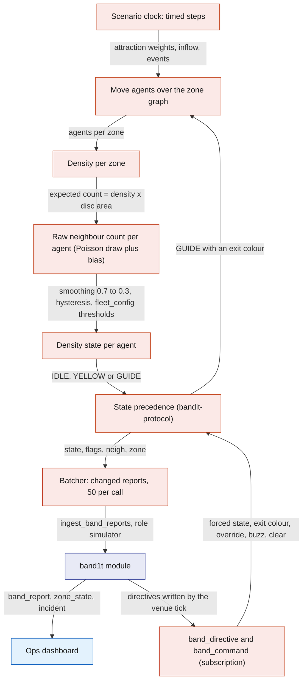
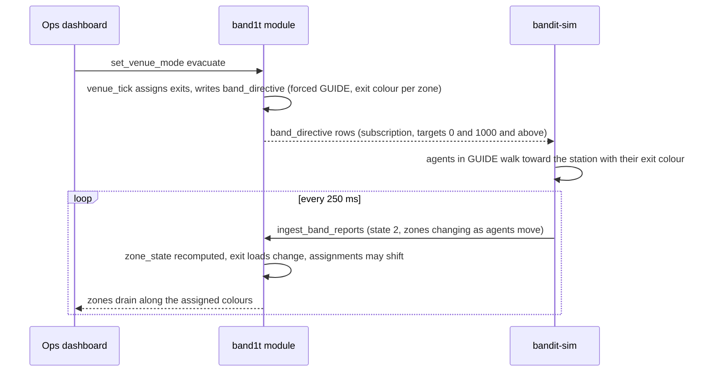

# Simulator

`bandit-sim` is an optional Rust process on the demo laptop that drives up to 200 virtual bands through the same `ingest_band_reports` reducer the bridge uses, under the `simulator` role. Nine real bands cannot show how a crowd behaves, so the simulator adds one that moves over the zone graph, reports neighbour counts the way a band's firmware would, and obeys the server's directives, while the real bands move inside it on the same dashboard. It also replays a recorded bridge log through the same path. It never touches the radio.

## Role in the system

Responsibilities:

- Create and run up to 200 virtual bands with ids from 1000, registered with `band.simulated` set.
- Social.md: give each virtual band a simulated owner, so the big-screen people graph shows a real-looking crowd.
- Run a crowd model over `zone`, `zone_link`, `exit` and `station` that yields per-band `neigh`, `zone` and `state` values consistent with what the firmware produces at a given density.
- Obey `band_directive` and `band_command` rows for its own ids and for target 0, and acknowledge the one-shots addressed to its ids.
- Run scripted scenarios: crush build-up, SOS, fall, two-exit evacuation, medic approach.
- Hyphenate.md: plant insurance claims, each with a medic visit and a synthetic bill: three accuracy rounds of genuine claims and decoys, the stress-test run of the edge cases, and the two planted claims of the live demo.
- Replay a bridge `.jsonl` log at recorded or accelerated speed.
- Report its health through `heartbeat` every 5 s.

Explicit non-responsibilities:

- It never opens the serial port and never sends radio commands; real bands are [Gateway-Bridge](Gateway-Bridge.md)'s alone.
- It never writes `band_directive` or any ops table; it is a device, not an operator. Hyphenate.md: the one exception is the medic visit of a planted incident on its own simulated band, which it plays through `plant_medic_visit`.
- It never reports ids 1 to 9 (a replay offsets them, see below).
- It does not validate the radio: it models what a band would report at a density, which cannot tell whether the venue's RSSI thresholds are right. That is calibration ([Hardware](../4-devices/Hardware.md)).
- It holds no truth; stopping it makes its bands go stale.

## Interfaces

| Interface | Direction | Counterpart | What flows | Transport |
|---|---|---|---|---|
| Command line | in | the operator | crowd size (at most 200), then a scenario file or a replay log | local process arguments |
| `register_band` | out, at start | `band1t` module | one row per virtual band: id from 1000, `simulated` true, the full-band flag on one band in three | SpacetimeDB Rust client SDK, caller role `simulator` |
| Social.md: `register_sim_owner` | out, at start | `band1t` module | one simulated owner per virtual band: a made-up display name and Meta handles (Instagram, Facebook, Threads) from the simulator's seed file | SDK, role `simulator` |
| Hyphenate.md: `plant_medic_visit` | out | `band1t` module | the medic visit of a planted incident: note text, first-aid cost, planted type, run and round | SDK, role `simulator` |
| Hyphenate.md: `POST /api/claims/bill` | out | `bandit-api` | a synthetic bill PDF from the simulator's seed folder for a planted incident, with the simulator's own `api_session` token from `open_api_session` | HTTPS ([Hyphenate](../7-integrations/Hyphenate.md)) |
| `ingest_band_reports` | out, every 250 ms | `band1t` module | batches of at most 50 changed reports with the same fields the bridge sends ([Gateway-Bridge](Gateway-Bridge.md)); `heard_age_ms` 0, no `gateway_rssi` and no `loss_pct` | SDK, one connection |
| `ack_band_command` | out | `band1t` module | command id and outcome for one-shots addressed to ids 1000 and above | SDK |
| `heartbeat` | out, every 5 s | `band1t` module | service `simulator`, version, counters: virtual bands, reports per second, active scenario and its clock, replay position | SDK |
| `zone`, `zone_link`, `exit`, `station`, `zone_state`, `venue_mode` | in, subscription | `band1t` module | the venue graph (areas, walking distances, exits, the station colour at each), zone state and venue mode | SDK |
| `fleet_config` | in, subscription | `band1t` module | the thresholds real bands use, so virtual colours match real ones | SDK |
| `band_directive`, `band_command` | in, subscription through `staff_directives` and `staff_commands` | `band1t` module | rows for targets 0 and 1000 and above | SDK |
| Scenario file | in | the operator | a list of timed steps (below) | local text file named on the command line |
| Replay log | in | a bridge run | the bridge's raw `.jsonl` | local file named on the command line |

A target-0 one-shot is applied by the simulator and acknowledged by the bridge, so `ack_band_command` must be idempotent ([SpacetimeDB](../2-data/SpacetimeDB.md)).

## Design

### A virtual band is the firmware in Rust

Each virtual band keeps the variables a real band keeps: a raw neighbour count, its smoothed value, the density state with hysteresis, the zone, the exit colour, a forced state with its hold, the override flag, and the SOS and fall latches. The smoothing (0.7 to 0.3 per 250 ms step), the hysteresis and the state precedence come from `bandit-protocol`, the same code the bridge uses to judge real bands, so a virtual band in a given situation reports the same `state` a real one would. Reports leave through the bridge's change-or-heartbeat rule (send when a field changed, or once a second), in batches of at most 50 reports per reducer call (starting value). A full crowd of 200 is therefore at most four calls per 250 ms, all on one connection.

### Social.md: simulated owners

After registering its bands, the simulator gives each one a simulated owner with `register_sim_owner`, which accepts only bands whose `simulated` flag is set. One call per band creates an `attendee` row with a made-up display name, grants its `findable` consent, writes its Instagram, Facebook and Threads handles as `social_handle` rows, and sets it as the band's owner. Names and handles come from the simulator's seed file; this doc fixes none. A simulated attendee has no app connection: the module keys it by a placeholder identity derived from the band id, which no client can connect as. Its visits and encounters come from the same social step of `memory_tick` as a real attendee's ([Social](../6-features/Social.md)), so the event graph grows with the crowd. The band's `simulated` flag marks a simulated attendee everywhere.

### The crowd model

One agent per virtual band. The model is deliberately simple; it has to make the dashboard's density, guidance and incident logic visible, not predict a real crowd.

- Zones and movement. Agents sit in a zone and walk between zones along `zone_link` edges at a speed that falls with the density of the zone they are in (free walking speed about 1.3 m per second, falling toward zero above five people per square metre; model values). Each agent has a dwell time in its current zone, a few minutes in a booth zone (starting value), and an attraction weight per zone that the scenario sets, so a scenario can pull people toward a stage zone or spread them evenly.
- Density per zone is the number of agents in the zone divided by `zone.area_m2`. Real bands are not counted here; the module mixes real and simulated bands when it computes zone density ([Safety](../6-features/Safety.md)).
- From density to a neighbour count. A real band counts the bands it hears above the RSSI threshold, which corresponds to a sensing radius r around the wearer. The expected count is density times the disc area, with r of 1.2 m (starting value, replace with the venue calibration) and every virtual person wearing a band. Each 250 ms step draws the raw count from a Poisson distribution around that expectation, adds a slowly varying per-agent bias to imitate antenna and body differences, caps it at 31 (a band's table holds 32 entries), then applies the firmware's smoothing and hysteresis with the thresholds in `fleet_config`. The result is a `neigh` series that wobbles the way real ones do and crosses the colour thresholds at the densities calibration says it should.
- Zone report. An agent reports the station id of its zone, or 0 if the zone has no station. Near a zone boundary it reports the neighbouring zone's station with a small probability (5 percent, starting value), which imitates the confusion real bands show at boundaries.

What happens in one simulator tick.

### Virtual bands obey the server

Directives for target 0 or an id at 1000 and above are applied as a band would apply the matching commands: a forced state with its hold, an exit colour, the override flag. Because the simulator reads the directive itself rather than a radio command, it follows the directive's own end time and needs no 25.5 s refresh. The behavioural part is what makes guidance visible: an agent whose shown state is GUIDE (from density or forced) walks toward the exit whose station glows its exit colour, found through `station` and `exit`, along the shortest `zone_link` path, and on arrival stays at the exit zone with a low neighbour count. Agents in IDLE or YELLOW keep their own plans. This is how an evacuation drains zones along the assigned colours and how a medic approach opens space around an incident ([Safety](../6-features/Safety.md)).

One-shots: `buzz`, either the light-circle alert or the guidance buzz that comes with a new route colour, changes nothing, because the agent already walks by its GUIDE colour; `clear` releases the latches. Each one addressed to a virtual id is acknowledged with `ack_band_command` once applied.

How a directive moves the simulated crowd.

### Scenarios

A scenario is a small text file of timed steps: at a given second, set a zone's inflow or attraction, latch SOS or fall on a chosen virtual band, or wait for a condition in the database (for example `venue_mode` becoming `evacuate`, or an incident being assigned a medic) before continuing. The simulator makes no ops calls itself; where a scenario needs an operator action, the step waits for it, which keeps the demo honest. The operator starts a scenario by naming its file on the command line and stops it by stopping the process.

| Scenario | What the script does | What the system should show |
|---|---|---|
| Crush build-up | ramps inflow into one zone from about one to six people per square metre over 90 s, holds for 60 s, then releases | the zone turns `watch` then `high` in `zone_state`; virtual bands go YELLOW then GUIDE; a `crowd_risk` incident opens; exit assignment moves bands away from the hot zone |
| SOS | one virtual band latches SOS; agents within the light-circle radius (0.9 m, starting value) report NEAR_SOS while it lasts | an `sos` incident with its snapshot; the circle members appear in `incident_band`; escalation fires if nobody acknowledges within 60 s |
| Fall on a full band | a virtual band with the full-band flag sets the fall flag after a short "impact" | a `fall` incident, otherwise identical to SOS |
| Two-exit evacuation | waits for ops to set `venue_mode` to `evacuate`, lets the agents follow their directives toward two exits, then waits for ops to block one exit with `set_exit_status` | zones drain along the assigned colours and exit loads balance; after the block, every zone that used that exit changes colour at once and the blocked exit draws nobody |
| Medic approach | runs the SOS scenario, then waits for `assign_medic`; agents outside the circle follow the GUIDE directive out of the zone, and the circle stays | space opens around the person while the blue ring remains |
| Hyphenate.md: Accuracy run | three rounds, each planting 12 genuine claims (8 falls, 4 SOS) and 6 decoys (2 sitting down, 2 dropped phone, 2 fake witnesses), starting values; between rounds it waits until the run's claims queue is empty | the scorecard on the Ops dashboard's Claims queue: straight-through rate rising each round, $0 wrongly paid, human touches falling ([Hyphenate](../7-integrations/Hyphenate.md)) |
| Hyphenate.md: Stress test | plants the edge cases not shown live: an injury the urgent-care record places at home, a bill re-filed as a new scan, a staff injury, and one more fake with witnesses in another zone | each claim next to its expected outcome: a doubt sent to a person, `duplicate_bill`, `staff_injury`, `disputed` |
| Hyphenate.md: Demo claims | during the live demo: a second fall similar to the judge's approved claim, then a fake whose witness bands sit in another zone | the second fall settles in seconds under rule v1; the fake is refused with every check listed |

The two-exit evacuation is on the rehearsal checklist, because it is the run that tests the exit choice's crowding penalty and switch margin ([Safety](../6-features/Safety.md)). Scenarios can be stacked: a crush with an SOS inside it is the full demo story.

### Hyphenate.md: planted claims

A planted claim goes through the same path as a real one: a virtual band latches a fall or SOS, virtual witnesses report state 4 in a chosen zone, and then the simulator plays the medic. It uploads the claim's synthetic bill PDF through `POST /api/claims/bill`, then calls `plant_medic_visit`. That reducer (role `simulator`) accepts only an open incident whose subject band is simulated. It runs the same logic as `assign_medic` (the simulator as the medic), `add_incident_note` and `resolve_incident`, so the claim sees exactly what a real medic visit leaves. It also writes one `planted_incident` row. Hyphenate's decision code never reads that row; only the scorecard does.

| `planted_incident` field | Meaning |
|---|---|
| `incident_id` | the planted incident |
| `run` | `accuracy`, `stress` or `demo` |
| `round` | 1, 2 or 3 in the accuracy run; empty otherwise |
| `planted_type` | `genuine`, `sit_down`, `dropped_phone`, `fake_witness`, `at_home`, `duplicate_bill`, `staff` |
| `expected` | `paid`, `person` or `refused` |
| `planted_at` | when it was planted |

| Planted type | What the simulator plants |
|---|---|
| `genuine` | a fall or SOS, at least 2 witnesses in the same zone, a medic note within the window, a bill dated that night with codes on the fee schedule |
| `sit_down` | a fall flag and witnesses, a medic note "no injury found", and a bill for a visit anyway |
| `dropped_phone` | a fall flag and witnesses, a medic note "phone screen broken, no injury", and a phone repair invoice as the bill |
| `fake_witness` | a fall flag whose witness bands report another zone |
| `at_home` | a genuine-looking fall whose bill gives the visit reason "twisted wrist at home this morning" |
| `duplicate_bill` | a new fall whose bill is a re-scan of an earlier planted bill: the same provider and invoice number in a new file |
| `staff` | a genuine-looking fall on the simulated band whose owner holds a staff role |

The simulator's seed folder holds one synthetic bill PDF per planted claim, each with its own invoice number, so only the `duplicate_bill` case repeats one. The seed's role grants give `ops` to the placeholder identity of one simulated band (band 1199, starting value) so the stress test can plant a staff injury; no client can connect as that identity. The accuracy run and the stress test run before the demo, inside the period of Hyphenate.md's accuracy-run policy, so the rules they teach expire before the demo starts. A simulated claimant has no wallet, so its Hyphenate.md payout opens a Nessie account at payout time ([Payments-Nessie](../7-integrations/Payments-Nessie.md)).

### Replay mode

Replay reads a bridge `.jsonl` log and feeds its band reports through the same batcher at their recorded receive times, at normal or accelerated speed. Replays use virtual ids only: ids 1 to 9 are offset by 1000 (band 1 becomes 1001) and registered as simulated, so a replay never collides with live bands. A replay is its own run of the process, never beside a scenario, so the offset ids never meet the crowd's ids. Station lines, command lines, `ack`, `err` and boot lines in the log are shown in the simulator's output but never re-issued. `neigh` values in a replay reflect the thresholds in force when it was recorded, which the bridge tags on each logged line. Uses: rehearsing the dashboard without hardware, and a backup if the radio misbehaves in front of the judges.

### Real and simulated bands on the same dashboard

Both kinds arrive through `ingest_band_reports` and live in `band_report` keyed by band id, so nothing downstream has two code paths. `band.simulated` is the only distinction: the Ops dashboard draws simulated bands lighter and shows per-zone counts as real plus simulated ([Ops-Dashboard](../5-apps/Ops-Dashboard.md)); incidents raised by simulated bands are labelled through that flag; the venue tick treats both kinds the same when it computes density and guidance ([Safety](../6-features/Safety.md)). There is no radio between the two populations, so a real band standing in a simulated crowd stays green unless real people surround it, and a simulated band never counts a real one. The demo choreography therefore puts the real people in the taped square and the simulated crowd in the surrounding zones, so each population shows the behaviour it can.

## Failure modes and fallbacks

| Failure | Effect | Design answer |
|---|---|---|
| The simulator crashes | its bands go stale after 5 s and leave the density after that | restart it; its bands and owners already exist, and the scenario starts again from the beginning |
| SpacetimeDB connection lost (hotspot drop) | no reports | pause the scenario clock, keep the latest state, and send the whole crowd in the first batches after reconnect |
| A scripted SOS runs while a real SOS is open | two incidents on the dashboard | the simulated incident is labelled through `band.simulated`, so staff go to the real one first |

## Dependencies

**Depends on**

- [SpacetimeDB](../2-data/SpacetimeDB.md): `ingest_band_reports`, `ack_band_command`, `register_band`, `heartbeat`, the venue tables, `fleet_config`, the views `staff_directives` and `staff_commands`, and the `simulator` role.
- [Gateway-Bridge](Gateway-Bridge.md): the `bandit-protocol` crate and the raw log format for replay.
- [Hardware](../4-devices/Hardware.md): the behaviour being imitated (smoothing, hysteresis, precedence, windows).
- [Safety](../6-features/Safety.md): what the directives mean, so agents react the way the venue tick expects.
- Social.md: `attendee`, the `findable` consent, `social_handle` and the social step of `memory_tick` for the simulated owners ([Social](../6-features/Social.md)).
- Hyphenate.md: `POST /api/claims/bill`, the accuracy-run policy, and the claims queue it waits on between rounds ([Hyphenate](../7-integrations/Hyphenate.md)).

**Used by**

- [Ops-Dashboard](../5-apps/Ops-Dashboard.md): the simulated legend, the real-plus-simulated counts and, through Social.md, the crowd on the event graph.
- [Flows](../1-overview/Flows.md): the demo flow that shows a crowd.
- [Safety](../6-features/Safety.md): scenario runs as the test bed for density, guidance, escalation and medic approach, and the two-exit run on the rehearsal checklist.
- [Hyphenate](../7-integrations/Hyphenate.md): planted claims for the accuracy run, the stress test and steps 6 and 7 of the live demo.

**If you delete this file**

- Remove the simulator rows and legend from [Ops-Dashboard](../5-apps/Ops-Dashboard.md), the `bandit-sim` rows from [Architecture](../1-overview/Architecture.md), [Rust-Backend](Rust-Backend.md) and the README, row F16 and the simulated-bands scale row from [Requirements](../1-overview/Requirements.md), and the Simulator.md sentence in [Flows](../1-overview/Flows.md).
- In [SpacetimeDB](../2-data/SpacetimeDB.md), the `simulator` role, the simulated id range on `register_band`, `register_sim_owner` and the `band.simulated` flag become unused and can be dropped; `ingest_band_reports` keeps only the `bridge` role. Remove the Simulator.md rows from its interfaces and subscriptions tables.
- Remove the Simulator.md bullet in [Attendee-App](../5-apps/Attendee-App.md), the two-exit run from the rehearsal checklist in [Safety](../6-features/Safety.md), and the Simulator.md parts of [Hyphenate](../7-integrations/Hyphenate.md): `plant_medic_visit`, `planted_incident`, the accuracy run and its scorecard, the stress test and the simulated-claimant payout. Steps 6 and 7 of the insurance demo then need a second real fall and a staged fake on real bands.
- Replay disappears; the bridge's raw log remains a post-mortem and calibration record only ([Gateway-Bridge](Gateway-Bridge.md)).
- The demo shows the nine real bands only, and the event graph shows only real attendees.

## Decisions

| Decision | Why |
|---|---|
| At most 200 virtual bands, on one connection, in batches of 50 reports per `ingest_band_reports` call (starting value) | at most four calls per 250 ms, a load the module and the dashboard handle without throttling |
| Replays use virtual ids only (1 to 9 become 1001 to 1009) | a replay never fights the bridge over a live band, and the module needs no rule about when a simulator may report a real id |
| Scenarios and replays start from the command line | the dashboard needs no simulator control rows; stopping the process stops the run |
| A replay is a separate run from a scenario | the offset replay ids never meet the crowd's ids |
| Every virtual person wears a band, and one virtual band in three is a full band | the crowd is fully instrumented, and the share of full bands matches the real fleet (3 of 9) |
| The bridge acknowledges target-0 one-shots; the simulator acknowledges only one-shots addressed to its own ids | one acknowledger per command; with no bridge running, `memory_tick` deletes the unacknowledged row after 30 s |
| Social.md: each virtual band gets a simulated owner with `findable` on, a made-up name and Meta handles from the simulator's seed | the big-screen people graph shows a real-looking crowd instead of at most nine people |
| A simulated owner is keyed by a placeholder identity derived from its band id | it needs no app connection, and no client can sign in as it |
| Hyphenate.md: the simulator plays the medic only for planted incidents on its own bands, through `plant_medic_visit` | an accuracy run of 54 claims cannot wait for a person at every bedside, and the claim must see what a real medic visit leaves |
| Hyphenate.md: planted ground truth lives in `planted_incident`, which only the scorecard reads | the claim decisions stay blind to which claims are planted, so the scorecard measures the real rules |
| Hyphenate.md: the stress test's staff injury uses a simulated band whose placeholder identity gets `ops` from the seed | the staff check reads real `staff_role` rows, and no person's identity has to be borrowed |
