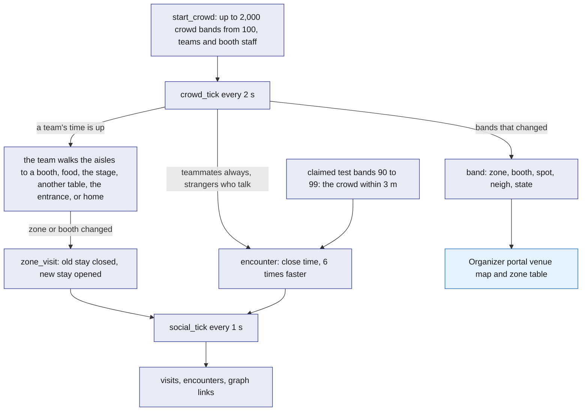
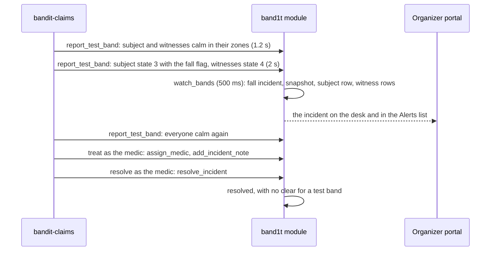

# Test bands

Nine real bands cannot show how an event behaves, so BandIt adds bands that no radio carries, in two places, and neither touches the radio. The crowd lives inside the `band1t` module: `start_crowd` adds up to 2,000 crowd bands, numbered from 100, each worn by a generated attendee, and `crowd_tick` moves them between the venue's zones and sponsor booths, so the venue map, the people graph and the recaps look like a real event. The event runs a crowd of 1,000.

The test bands (ids 90 to 99) report through `report_test_band`, which only the `tester` role may call. The `bandit-claims` command-line tool drives them for falls with their light circle, a property incident and the insurance claims runs, and `bandit-api`'s dev routes let a tester press, walk or drop one from a browser, among them from the Bands tab of the organizer portal (/organizer). The real bands move among them in the same organizer portal.

## Role in the system

Responsibilities:

- Social.md: add up to 2,000 crowd bands, numbered from 100, with `start_crowd`, each worn by a generated attendee; the event runs 1,000. `crowd_tick` moves them every 2 s: hackers in teams between their table, the sponsor booths, food, the stage and the entrance, and booth staff at their booth. The crowd fills the venue map, the big-screen people graph and the recaps, and `stop_crowd` freezes it.
- Report the test bands (ids 90 to 99) through `report_test_band`, under the `tester` role: from the `bandit-claims` command-line tool, and from `bandit-api`'s dev routes, which press bands 94 to 99, move any test band 90 to 99, and start the tool's `fall` and `property` commands.
- Play the incident path on the test bands: a fall with its light circle (`fall`), the medic taking it and writing a note (`treat`), the resolve (`resolve`), and a property incident (`property`).
- Insurance.md: plant insurance claims with the `bandit-claims` tool, each with a medic visit and a synthetic bill: three accuracy rounds of genuine claims and decoys, the stress-test run of the edge cases, and the six claims of the scripted claims run, in which the tool also plays the medic and the organizer.

Explicit non-responsibilities:

- The crowd and the test bands never open the serial port and never send radio commands; real bands are [Gateway-Bridge](Gateway-Bridge.md)'s alone.
- Test bands do not obey commands. A `command` row addressed to 90 to 99 may be written (by `force_state` and the like), but nothing acts on it, and `resolve_incident` and `claim_band` skip the test bands. A test band shows only what its driver reports.
- They never report ids below 90; `report_test_band` refuses them.
- Social.md: the crowd is not part of the incident path. It counts in the Live tab's zone table, but `watch_bands` and the incident snapshot read only bands under 100, so a crowd band opens no incident and is never a witness, and no command reaches it.
- They do not validate the radio: a test band reports what a band would report, which cannot tell whether the venue's RSSI thresholds are right. That is calibration ([Hardware](../4-devices/Hardware.md)).
- They hold no truth. A test band goes offline 5 s after its driver stops reporting (`sweep`); the crowd stops only with `stop_crowd`.

## Interfaces

| Interface | Direction | Counterpart | What flows | Transport |
|---|---|---|---|---|
| Social.md: `start_crowd` | in to the module, once after the venue import | the team as `ops`, or the `bandit-claims` tool as `tester` | the crowd size, at most 2,000 (1,000 at the event); a call replaces the whole crowd, and 0 removes it; refused until the venue import has made its zones | SpacetimeDB reducer call |
| Social.md: `stop_crowd` | in to the module | the same callers | none; the crowd's bands go offline where they stand | SpacetimeDB reducer call |
| Social.md: `crowd_tick` | internal, every 2 s | the `band1t` scheduler | moves the teams that are due, recounts every crowd band's neighbours, writes the `band` rows and the stays of the crowd bands that changed, and the close time of the pairs that are together | schedule table `crowd_timer`; only the scheduler may call it |
| `report_test_band` | out: from the tool once a second per test band and at once on a change, from `bandit-api` every 2 s | `band1t` module | band id 90 to 99, station id, state, `neigh`, and the SOS, fall and press flags | SpacetimeDB Rust client SDK from the tool, an HTTP reducer call from `bandit-api`; caller role `tester` |
| `bandit-claims` command line | in | the operator | `setup` and `status`; `fall`, `treat`, `resolve` and `property`; Insurance.md: `story` (the scripted claims run), `scorecard` (the accuracy run), `attach-record` and the claim commands | local process arguments |
| `bandit-api` dev routes | in | a tester's browser, only while test mode (`BANDIT_TEST_MODE=1`) is on | `POST /api/dev/press/{band}` presses one of the bands 94 to 99; `POST /api/dev/move/{band}/{station}` moves any test band 90 to 99 to the zone of that station id; `POST /api/dev/fall/{band}` runs `bandit-claims fall` for a test band 90 to 99; `POST /api/dev/property/{station}` runs `bandit-claims property --camera` for the zone of that station id; Insurance.md: `POST /api/dev/record/{claim}/{template}` runs `bandit-claims attach-record` | HTTPS to `bandit-api` ([Rust-Backend](Rust-Backend.md)), which calls `report_test_band` as the `tester` identity |
| The tool's reads | in, subscription as the module owner | `band1t` module | each zone's station id by name, the test bands' last station ids, and the incident and witness rows a fall waits for | SDK |
| Insurance.md: `plant_medic_visit` | out | `band1t` module | the medic visit of a planted incident: note text, first-aid cost, planted type, run and round | SDK, role `tester` |
| Insurance.md: bill upload | out | `bandit-api`, then `band1t` module | a synthetic bill PDF from the tool's seed folder through `POST /api/blobs` with purpose `medical`, then `submit_medical_record` as the tool's `medic` test identity ([Insurance](../6-features/Insurance.md)) | HTTPS, then SDK |

## Design

### Band ids

Band ids are 32 bits. Ids 1 to 99 fit in one byte, the same as on the radio: the real bands and the test bands, the only bands the incident path reads. The crowd's bands start at 100.

The ranges never overlap, so nothing downstream needs a rule about who may report which id. People see every band, test and crowd bands too, by its code, never its id ([Tap-Page](../5-apps/Tap-Page.md)).

| Ids | Bands | How they reach the module |
|---|---|---|
| 1 to 9 | the real bands | `band1t-bridge`, through `ingest_band` |
| 90 to 93 | the test bands of the four test attendees of the scripted claims run: Jordan Alvarez, Maya Chen, Sam Patel and Lee Park | the `bandit-claims` tool, through `report_test_band` |
| 94 to 99 | test bands a tester claims from the tap link | `bandit-api`'s dev routes or the `bandit-claims` tool, through `report_test_band` |
| Social.md: from 100 (100 to 1,099 for the event's crowd of 1,000) | the crowd | no reports: `crowd_tick` writes their rows inside the module |

`report_test_band` refuses any id outside 90 to 99 (`TEST_BANDS` in the module), and only the `tester` role may call it.

Social.md: a crowd band never goes on air and no command reaches it, so a command target from 101 to 105 always means a station marker.

### Social.md: the crowd

The crowd is part of the module, so it needs no process and no connection. The team starts it once after the venue import with `start_crowd` (roles `ops` and `tester`), giving the crowd size, at most 2,000; the event runs 1,000.

A call replaces the whole crowd: it first deletes every crowd attendee with their bands' rows, stays, handles, visits, encounters, shared visits, photo tags and graph links, so size 0 removes the crowd. Until the venue has zones with station markers, it refuses with "import the venue first".

- **Generated attendees.** Each crowd band, from 100 up, is worn by a crowd attendee that `start_crowd` creates. The attendee is keyed by a placeholder identity derived from the band id, which no client can sign in as.

  It has a made-up display name from fixed lists of first and last names, a placeholder photo as `photo_url`, `findable` on, and an Instagram handle in `social_handle` made from the name; three in ten have the same handle on Threads too. Its `attendee` row has `crowd` set, which the attendee list shows. A `crowd_member` row ties the band to the attendee: its team, the attendee's small offset from the team's spot, 2 or 3 interests drawn from the booths' tags, and who they are talking to.
- **Booth staff and teams.** One crowd attendee in ten staffs a sponsor booth, at most 2 per booth. Bright-Data.md: the biggest sponsors are staffed first, and a staff member's `organization_id` is the booth's organisation, so the graph links them to it with `works_at`.

  Everyone else hacks in a team of 1 to 4 with a home table on the hacking floor. Each team, and each booth's staff member, is a `crowd_group` row: its home spot, where it stands now (zone, booth and spot in metres) and when it moves next.
- **Movement.** `crowd_tick` runs every 2 s inside the module. When a team's time is up, the whole team moves on.

  From its table it goes to a sponsor booth 45 percent of the time, for 2 to 5 minutes; booths that match its members' interests draw more (Bright-Data.md: and so do bigger sponsors). It goes to food 20 percent of the time (4 to 9 minutes), to the stage 15 percent (5 to 12 minutes), to another team's table 10 percent (3 to 6 minutes) and to the entrance 5 percent (1 to 3 minutes); otherwise it stays.

  From a booth it tries another booth 35 percent of the time and otherwise goes back to its table, where it stays 6 to 15 minutes. Booth staff stay at their booth 15 to 40 minutes at a time, with a 4 to 8 minute food break 30 percent of the time.

  At the start a third of the teams are away from their table, and the first moves are spread over the first 10 minutes, so the venue is busy at once. All of these are starting values.

  Where a team goes and how long it stays come from a random generator seeded with the live run's seed and the tick, so the same seed sends the crowd the same way.
- **Walking.** A team walks to its next spot; nobody jumps. The way follows the venue floor's walkable grid, `venue_floor`: the 3D model seen from above in 25 cm cells, loaded from `web/venue/floor.json` with `load_venue_floor` (role `ops`). Walls, tables, the stage and the food line close a cell; chairs do not, so people walk the gaps between the rows of hacker tables to their table. `pipeline/venue_floor.py` makes the grid from `web/venue/venue.glb`.

  The module finds the shortest way on the grid and keeps only its corners, so people walk straight down an aisle and turn at its end, around the hall's curve instead of through its walls. The members set off one behind the other, 0.6 s apart, each from where they stand to their own place at the new spot, at the team's steady speed of 1.1 to 1.5 m/s. A live run at a faster pace plays the walks at most 1.5 times faster, so they stay brisk walks and never runs.

  Each member's walk is a `crowd_walk` row: its corners, when it starts, when it arrives and its speed. On every tick `crowd_tick` puts the band at its place along the walk, and the organizer portal's 3D view follows the same walk smoothly between ticks. The team's stay at the new spot counts from when its last member arrives.
- **In and out of the doors.** When a live run opens the doors, every team comes in through a door over the first 25 s, seven in ten by the door nearest their first spot, and walks there; a band is off until its wearer walks in. When the doors close every team walks to its nearest door, and each band goes off as its wearer walks out. The event ends once nobody is still walking, 10 s to 2 minutes after the doors close, and the medic is done.
- **Someone down.** A team stays with a member who fell or pressed SOS. Once the medic resolves it, that member walks from where they fell back to the team, and the team moves on. While a live run is paused nobody walks, and every walk and next move carry on by the time it was paused.
- **Spots and neighbours.** A team stands at a spot in metres on the venue plan, the same plan the organizer portal's venue map draws from `venue_plan` ([SpacetimeDB](../2-data/SpacetimeDB.md)): a booth's spot for the attendees who visit it, its staff spot for the booth's staff, or a random spot in a zone. Each member stands at the team's spot plus their own offset, at the nearest point where someone can stand, so beside a table and never on it. A member on their way counts in the zone and booth they left until they are halfway, then in the ones they walk to.

  Every tick, `crowd_tick` counts each crowd band's neighbours, the bands within 1.5 m, real and test bands included. It turns that count into the band's state, IDLE, YELLOW or GUIDE (calm, busy or very busy on the map), against `settings.yellow` and `settings.red`, with the firmware's one-step hysteresis. It writes the `band` row (zone, booth, spot, `neigh`, state, online) only for the bands that changed, all in one transaction.
- **Stays.** When a crowd band's zone or booth changes, `crowd_tick` closes its open stay in `zone_visit` and opens a new one with the new zone and booth. The crowd needs no space-time mapping, because the module places each crowd band itself.
- **Who is close.** Teammates are always close. A stranger at the same zone and booth, within 3 m, sometimes starts talking: a chance of 0.4 percent per tick, 5 percent for booth staff. Each attendee talks to only a few strangers over the event: 2 to 10, four times as many for booth staff.

  Two people talking stay close until either one moves on. The crowd's time together runs 6 times faster than the clock, so the 3 minutes of the encounter rule pass within 30 s and the graph grows while people watch.

  `crowd_tick` keeps each pair's close time in `encounter`, crediting one fifteenth of the crowd per tick so each pair is written every 30 s, and `social_tick`'s encounter rule turns it into the `social_encounter` row and its `met` link.
- **Test bands mix in.** A claimed test band (90 to 99) that is live is close to every crowd band within 3 m of its spot, in real time, and to the other claimed test bands in its zone, so a tester's recap shows people without any hardware.
- **Pruning.** Every 60 s, `crowd_tick` deletes the crowd's stays that ended more than an hour ago, with their visits, so the tables stay small at 1,000 bands. The graph links they made stay.
- **Stop.** `stop_crowd` stops the timer, sets the crowd's bands offline and closes their stays. The visits, encounters and graph links they made stay.

`social_tick` turns the crowd's stays into visits and its close time into encounters and graph links, by the same rules as real attendees. Crowd attendees get no shared visits, because the crowd meets people only up close ([Social](../6-features/Social.md)).

The crowd's `band` rows put it on the organizer portal's venue map and in each zone's row of the Live tab's zone table, its people, its average and its level ([Organizer-Portal](../5-apps/Organizer-Portal.md)). It stays out of the incident path: `watch_bands` and the incident snapshot read only bands under 100, so the crowd opens no incidents and is never a witness.

What one crowd tick does.

### The test bands

`report_test_band(band_id, station_id, state, neigh, sos, fall, press)` builds the test band's `band` row the way `ingest_band` builds a radio band's ([SpacetimeDB](../2-data/SpacetimeDB.md)): the flags from the three booleans plus the IMU and motor bits, so every test band reports as a full band; `zone` the station id; `bat` 90; `rssi` -55; `seq` one more than before; online; and a spot a step apart from the other test bands around its zone's centre, five to a row, 1.5 m apart, so each one shows on the venue map.

It logs `SosRaised`, `Fall` and `Press` on rising edges with the detail "test band". When the station id changed or the band was offline, it closes the band's open stays and opens one in the new zone. From there the test bands go through the same paths as real bands: `watch_bands` opens an incident from an SOS or fall flag and adds a witness for each band in state 4, and `social_tick` completes a pending band claim from a `Press` event ([Safety](../6-features/Safety.md)).

Test bands do not obey commands, so a forced state, an exit colour, low visibility or the override never shows on one. A test band also gets no `clear` when its incident is resolved: if it still reports the flag 10 s after the resolve, a new incident opens. The tool's `fall` calms its bands as soon as the witness rows land, so this does not happen in its runs.

Two drivers report them, both as the `tester` identity:

- **The `bandit-claims` command-line tool**, on the venue laptop.
  - `setup` connects as the module owner, the only identity that may grant, and grants `worker`, `tester`, `vision`, `ops` and `medic` to its actors ("bandit-workers", "bandit-claims", "bandit-vision", "Ops desk" and the medic "Ari Ramos"). It imports the seed venue if none exists (five zones on station ids 101 to 105), calls `start_safety_watch` and `start_job_reaper`, and reports every test band online, each in its last zone and new ones at Main stage.

    Insurance.md: it also seeds the policy and its covers. Vision.md: it adds the camera "overhead pit" on Main stage.

    It claims 90 to 93 for Jordan Alvarez, Maya Chen, Sam Patel and Lee Park, each with `claim_band` and a press. It is safe to run again. `status` shows the identities, their roles and the timers.
  - While a command runs, it reports every test band in that command once a second, so none goes offline (5 s), and at once when a band changes station id, state or flags. A test band's `neigh` is the number of the command's other test bands with its station id.

    A press is the press flag held for 400 ms, as a person presses a real band after the tap. When the command ends, its bands stop reporting and go offline 5 s later.
  - `fall --band B --witnesses W1,W2` reports the bands calm in their zones for 1.2 s, then the subject in state 3 with the fall flag and the witnesses in state 4 for 2 s, so the 500 ms `watch_bands` sees both. It waits for the incident and the witness rows, calms the bands, and prints the incident, its snapshot and its witnesses. `--zone` picks the fall's zone (Main stage by default) and `--witness-zone` the zone where the circle forms, which may differ.
  - `treat --incident N --note "..."` takes the incident as the medic (`assign_medic`) and adds the note (`add_incident_note`).
  - `resolve --incident N` resolves it as the medic (`resolve_incident`, "treated on site"); Insurance.md: it prints the claim that opened, if any.
  - `property --zone Z --note "..." --cost C` opens a `property` incident in that zone as `ops` (`open_incident`), adds a note with the cost and resolves it as `ops`. Vision.md: with `--camera` it first plays the camera's part: a synthetic frame in the blob store, `report_property_event` and a confirmed camera sighting through `submit_vision_assessment` ([Vision](../4-devices/Vision.md)).
- **`bandit-api`'s dev routes**, only while test mode is on, with no sign-in check.
  - `POST /api/dev/press/{band}`, for bands 94 to 99 only, reports no press, a press and no press, 300 ms apart, from the band's station id (104 if it has none), so a tester claims it from the tap link with no hardware.
  - `POST /api/dev/move/{band}/{station}` reports any test band 90 to 99 at that station id.
  - `bandit-api` then keeps reporting each band pressed or moved this way every 2 s, in state 0 with `neigh` 0, so it stays online, keeps its zone and mixes with the crowd. Once `event_state.ended` is set, those reports stop.
  - `POST /api/dev/fall/{band}` runs the tool's `fall` for any test band 90 to 99 at its station id, with two of the bands 90, 92, 93 and 91 (never the band itself) as the light circle. The 2 s reports of those bands pause meanwhile, and the witnesses stay in that zone afterwards.
  - `POST /api/dev/property/{station}` runs the tool's `property --camera` for the zone of that station id with a cost of $2,400.00: a security camera sees a speaker knocked off its stand, and Insurance.md's property claim follows.
  - Insurance.md: `POST /api/dev/record/{claim}/{template}` runs the tool's `attach-record`, which files one of the three synthetic hospital reports for that claim; the Claims tab calls it.
  - The organizer portal's Bands tab calls the press, move, fall and property routes ([Organizer-Portal](../5-apps/Organizer-Portal.md)). Bands 90 to 93 belong to the scripted claims run: the dev routes never press them, and while the run plays, only the tool drives them.

How a test fall becomes an incident on the desk.

### Insurance.md: the claims runs

Three runs of the tool exercise Insurance.md's claims ([Insurance](../6-features/Insurance.md)).

| Run | What the tool does | What the system should show |
|---|---|---|
| Accuracy run | the tool's `scorecard` command: three rounds (starting value), each planting 2 genuine falls and 4 fakes, one of each kind: a light circle in another zone, an injury at home, the same bill twice and an injured staff member. After each round's flow the tool plays the organizer: it approves every genuine claim that waits for a person, with learn on, and refuses every fake that reached one. It plants each fall in a zone where no three injuries land within 5 minutes | the scorecard on the organizer portal's Claims queue: straight-through rate rising each round, $0 wrongly paid, human touches falling |
| Stress test | plants the edge cases not shown live: an injury the hospital report places at home, a bill re-filed as a new scan, a staff injury, and one more fake with witnesses in another zone | each claim next to its expected outcome: a doubt sent to the organizer, `zero_payout` for the duplicate bill, `claimant_not_staff`, `witness_zone` |
| Scripted claims run | the tool's `story` command, after the event and before the organizer decides the real claims: six claims on bands 90 to 93, with bands 94 to 99 as the light circles. The tool plays the medic (Ari Ramos) and the organizer (the `ops` identity labelled "Ops desk") | Jordan's claim waits for the organizer, a stale approval fails closed and the real approval creates rule v1; Maya's similar fall settles in seconds under v1; the injury at home waits for the organizer; Lee's claim is refused by code as `witness_zone`, with every check listed; the speaker is approved with a recovery letter; the insurer's payment reconciles claim 1 |

### Insurance.md: planted claims

A planted claim goes through the same path as a real one: a test band latches a fall or SOS, other test bands report state 4 as witnesses in a chosen zone, and then the `bandit-claims` tool plays the medic. It uploads the claim's synthetic bill PDF through `POST /api/blobs` with purpose `medical` and files it with `submit_medical_record` as its `medic` test identity, then calls `plant_medic_visit`.

That reducer (role `tester`) accepts only an open incident whose subject band is a test band. It runs the same logic as `assign_medic` (the `bandit-claims` tool as the medic), `add_incident_note` and `resolve_incident`, so the claim sees exactly what a real medic visit leaves. It also writes one `planted_incident` row; Insurance's decision code never reads that row; only the scorecard does.

| `planted_incident` field | Meaning |
|---|---|
| `incident_id` | the planted incident |
| `run` | `accuracy`, `stress` or `story` (the scripted claims run) |
| `round` | 1, 2 or 3 in the accuracy run; empty otherwise |
| `planted_type` | `genuine`, `fake_witness`, `at_home`, `duplicate_bill`, `staff` |
| `expected` | `paid`, `person` or `refused` |
| `planted_at` | when it was planted |

| Planted type | What the tool plants |
|---|---|
| `genuine` | a fall, 2 or 3 witnesses in the same zone, a medic note within the window, a bill dated that night with codes on the fee schedule |
| `fake_witness` | a fall flag whose witness bands report another zone |
| `at_home` | a genuine-looking fall whose bill gives the visit reason "twisted wrist at home this morning" |
| `duplicate_bill` | a new fall whose bill is a re-scan of an earlier planted bill: the same provider and invoice number in a new file |
| `staff` | a genuine-looking fall on a test band whose owner the tool has just granted the role `crew`, labelled as stage crew |

The tool's seed folder holds one synthetic bill PDF per planted claim, each with its own invoice number, so only the `duplicate_bill` case repeats one.

For a staff injury the tool grants the role `crew` to the test identity that wears the band, plants the fall, and revokes the grant after the round, so no person's identity is borrowed and no staff screen opens for it. The accuracy run and the stress test run before doors open, inside the period of Insurance.md's accuracy-run policy, so the rules they teach expire before the event starts.

Each test attendee the tool sets up claims its band with a press, then saves its name with `update_profile`. Capital-One-Nessie.md: right after that it calls `connect_wallet`, so its Insurance.md payout lands in a $200 wallet, like a judge's ([Capital-One-Nessie](../7-integrations/Capital-One-Nessie.md)).

### Real bands and test bands in the same organizer portal

Real bands arrive through `ingest_band` and test bands through `report_test_band`; both live in `band` keyed by band id, so nothing downstream has two code paths. The band id is the only distinction.

On the organizer portal's venue map both are blue dots with their codes: a real band stands at its zone's centre, because the radio gives only the zone, and the test bands stand a step apart around it ([Organizer-Portal](../5-apps/Organizer-Portal.md)). Incidents raised by test bands name the band by its code, like any band, and `watch_bands` treats both kinds the same ([Safety](../6-features/Safety.md)).

Social.md: the crowd's rows sit in `band` too, written by `crowd_tick`, so the crowd is on the map as small dots in the colour of their state; `watch_bands` and the incident snapshot skip every band from 100.

There is no radio between the populations, so a real band standing among test bands stays green unless real people surround it, and a test band never counts a real one. The safety choreography therefore puts the real people in the taped square and the test bands in the surrounding zones, so each population shows the behaviour it can.

## Failure modes and fallbacks

| Failure | Effect | Design answer |
|---|---|---|
| The `bandit-claims` tool stops or crashes | its test bands go offline 5 s later | run the command again; `setup` is safe to repeat, and the bands and owners already exist |
| SpacetimeDB connection lost (hotspot drop) | the running command fails with the module's error, or after 30 s without an answer | run it again once the hotspot is back; Social.md: the crowd keeps moving, because `crowd_tick` runs inside the module |
| A test fall runs while a real incident is open | two incidents on the desk | the test incident names a test band, whose code the Bands tab lists, so staff go to the real one first |

## Dependencies

**Depends on**

- [SpacetimeDB](../2-data/SpacetimeDB.md): `report_test_band`, `band`, `event_state`, the venue tables, `venue_plan`, `incident`, `incident_band`, `start_safety_watch` and the `tester` role.
- [Hardware](../4-devices/Hardware.md): the behaviour being imitated (states and flags).
- [Safety](../6-features/Safety.md): the incident path the test falls go through: `watch_bands`, `assign_medic`, `add_incident_note` and `resolve_incident`.
- [Rust-Backend](Rust-Backend.md): `bandit-api`, which hosts the dev routes and the blob upload.
- Social.md: `attendee`, the findable switch (`findable`), `social_handle`, `zone_visit`, `encounter` and `social_tick` for the crowd and its generated attendees ([Social](../6-features/Social.md)).
- Bright-Data.md: the imported booths' organisations and sponsor tiers, which choose the booths the crowd staffs and draw crowd attendees to them. Without it the crowd visits hand-entered booths, each with the same pull ([Bright-Data](../7-integrations/Bright-Data.md)).
- Insurance.md: `POST /api/blobs` with purpose `medical`, `submit_medical_record`, the accuracy-run policy, and the claims queue the tool waits on between rounds ([Insurance](../6-features/Insurance.md)).

**Used by**

- [Organizer-Portal](../5-apps/Organizer-Portal.md): the test bands on the venue map, the Bands tab and, through Social.md, the crowd on the venue map, in the zone table, in the attendee list and on the event graph.
- [Flows](../1-overview/Flows.md): the crowd that runs through the whole event flow, and the scripted claims run after the event.
- [Safety](../6-features/Safety.md): test falls for the incident desk and the safety choreography.
- [Insurance](../6-features/Insurance.md): planted claims for the accuracy run and the stress test, and the scripted claims run.

**If you delete this file**

- Remove the Test-Bands.md rows and lines, the crowd's dots and the Bands tab from [Organizer-Portal](../5-apps/Organizer-Portal.md), the Test-Bands.md rows and lines (the `bandit-claims` tool's band reports, `bandit-api`'s dev routes and what test mode turns on) from [Architecture](../1-overview/Architecture.md), [Rust-Backend](Rust-Backend.md) and the README, row F16 and the test bands scale row from [Requirements](../1-overview/Requirements.md), and the Test-Bands.md sentence and failure row, step 0c's planted claims and step 9a, the scripted claims run, in [Flows](../1-overview/Flows.md).
- In [SpacetimeDB](../2-data/SpacetimeDB.md), the `tester` role, `report_test_band`, `start_crowd`, `stop_crowd`, `crowd_tick`, `crowd_member`, `crowd_group`, the crowd and test band id ranges (`TEST_BANDS`) and the `attendee` column that marks a crowd attendee become unused and can be dropped; `ingest_band` already takes only `band1t-bridge`. Remove the Test-Bands.md rows and notes from its interfaces, registry, roles, views, subscriptions and lifecycle tables.
- Remove the Test-Bands.md lines in [Social](../6-features/Social.md), [Tap-Page](../5-apps/Tap-Page.md) and [Safety](../6-features/Safety.md), and the Test-Bands.md parts of [Insurance](../6-features/Insurance.md): `plant_medic_visit`, `planted_incident`, the accuracy run and its scorecard, the stress test, the scripted claims run and the test claimants' payout. Claims then come only from real incidents, worked by the medic and decided by the organizer after the event.
- The organizer portal shows the nine real bands only, and the venue map, the attendee list and the event graph show only real attendees.

## Decisions

| Decision | Why |
|---|---|
| Social.md: the crowd runs inside the module, at most 2,000 bands from 100 (1,000 at the event), started once with `start_crowd` and moved by `crowd_tick` every 2 s | it needs no process and no connection, and it keeps moving when the laptop drops off the hotspot |
| Social.md: band ids are 32 bits; ids 1 to 99 are the one-byte radio and test bands, and the crowd starts at 100 | a crowd of 1,000 needs more ids than the radio's byte, and the incident path reads only bands below 100 |
| Social.md: `crowd_tick` writes the crowd's `band` rows and stays itself, only for the bands that changed, and the incident path skips every band from 100 | the crowd fills the venue map, the zone table, the graph and the recaps, and it never opens an incident |
| Social.md: the crowd moves in teams of 1 to 4 between their table, sponsor booths, food, the stage and the entrance, booth staff stay at their booth, and strangers talk only now and then (starting values) | friends meet each other and strangers only sometimes, so the graph looks like an event and not one big cluster |
| Social.md: the crowd's time together runs 6 times faster than the clock | links appear within half a minute, so the graph grows while people watch |
| Social.md: the crowd's stays that ended more than an hour ago are deleted, with their visits; the links stay | the tables stay small with 1,000 bands moving all night |
| The test bands are 90 to 99 and report through one reducer, `report_test_band`, that only the `tester` role may call | one byte of id like the radio, and the module needs no rule about when a test driver may report a real id |
| Test bands do not obey commands | they have no radio, so a test band shows only what its driver reports |
| `bandit-api`'s dev routes press only bands 94 to 99 and move any test band 90 to 99, only in test mode; the fall and property routes start the tool | a tester can try the band claim without hardware and walk any test band, and the scripted claims run's bands 90 to 93 are never claimed by a tester |
| Test runs start from the `bandit-claims` command line; the organizer portal's Bands tab starts only a press, a walk, a fall or a broken speaker, through the dev routes | the organizer portal needs no run controls, and a single fall or property claim is one tap for a tester |
| Every test band reports as a full band | a fall works on any of them |
| Social.md: each crowd band is worn by a generated attendee with `findable` on, a made-up name and an Instagram handle made from that name | the big-screen people graph shows a real-looking crowd instead of at most nine people, and no real person's account is named |
| Social.md: a generated attendee is keyed by a placeholder identity derived from its band id | it needs no app connection, and no client can sign in as it |
| Insurance.md: the `bandit-claims` tool plays the medic only for planted incidents on test bands, through `plant_medic_visit` | an accuracy run of 18 claims cannot wait for a person at every bedside, and the claim must see what a real medic visit leaves |
| Insurance.md: planted ground truth lives in `planted_incident`, which only the scorecard reads | the claim decisions stay blind to which claims are planted, so the scorecard measures the real rules |
| Insurance.md: a planted staff injury uses a test identity that the tool grants `crew` for the round | the staff check reads real `staff_role` rows, no person's identity has to be borrowed, and `crew` opens no staff screen |
