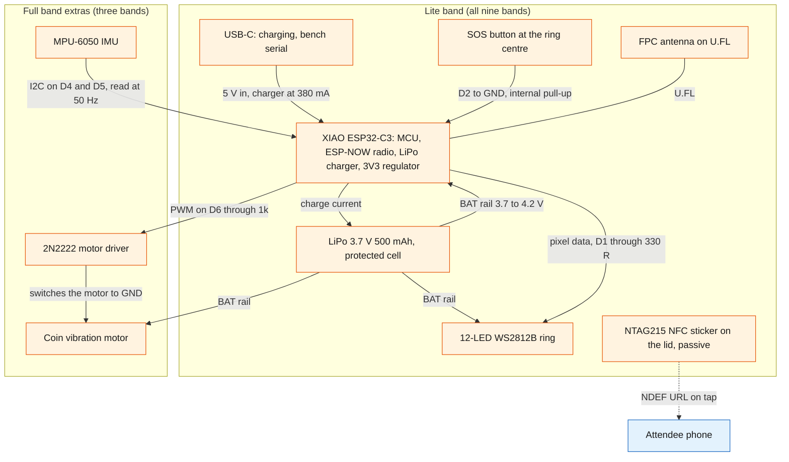
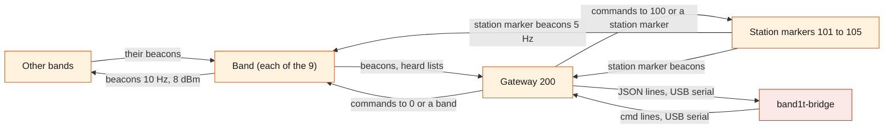
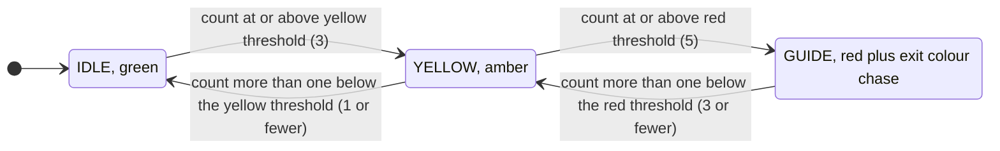
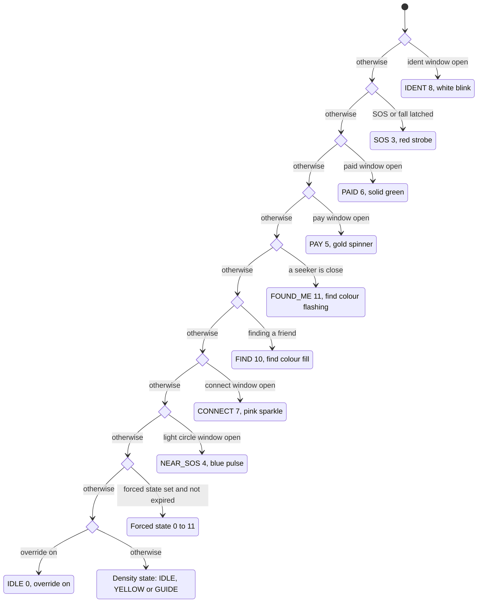
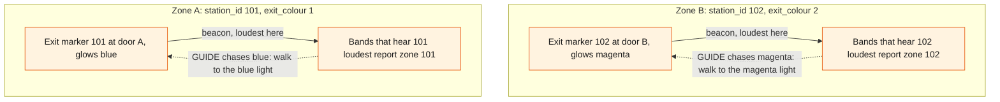

# Hardware

BandIt's physical layer is a small fleet of ESP32-C3 devices: nine bands, one USB gateway and two to five station markers, one at each exit. Each band counts the other bands it hears over ESP-NOW radio, turns that count into a colour on a 12-LED ring, and carries an SOS button and an NFC sticker. Three "full" bands add an IMU for fall detection and a vibration motor.

The gateway turns every radio packet into one line of text for the venue laptop and broadcasts the laptop's commands. This file describes the firmware on the three kinds of device, the radio and the gateway's line protocol at system level.

## Role in the system

Responsibilities of the physical layer:

- Sense crowd density locally. A band counts the bands it hears strongly and drives IDLE, YELLOW and GUIDE on its own, with no round trip to the module, so the density colours keep working if the laptop dies.
- Raise and show emergencies locally: SOS (3 s button hold), fall (full bands) and the blue light circle around a band in SOS or fall.
- Report. Every band beacons its id, flags, neighbour count, zone, battery, light state, a packet counter and the friend it is finding ten times a second, and sends the list of peers it heard once a second. The gateway relays every packet it hears to the laptop.
- (TBD -- LEO) Know its zone: the station marker heard loudest.
- Obey the radio commands: forced light states, exit colour, `clear`, buzz and haptic patterns, thresholds, RSSI thresholds, the override switch, find, sleep and low visibility.
- Point people to the door: a band in GUIDE chases its exit colour, and the exit marker at that door glows the same colour.
- Find a friend: a band can lead the attendee wearing it to another band by signal strength, with the ring and the motor.
- Carry the NFC token on the lid: a link with the band's code, which opens the tap page (/t/code).

Explicit non-responsibilities:

- No positions. A band knows its zone and the RSSI of the peers it hears, never x/y. See [Safety](../6-features/Safety.md) for how zone-level data becomes density.
- No incident logic. A band sets its SOS and fall flags; the `band1t` module opens incidents from them ([Safety](../6-features/Safety.md)).
- No routing. A band chases whatever exit colour it was last sent; nothing on the band picks an exit.
- No network, no encryption and no over-the-air update.
- The gateway does not buffer, retry or interpret. It is a transparent radio-to-serial relay.

## Interfaces

| Interface | Direction | Counterpart | What flows | Transport |
|---|---|---|---|---|
| Band beacon | band to every node in range | other bands, gateway | packet type 1: id, flags, `neigh`, `zone`, `bat`, `state`, `seq`, the friend it is finding and the find colour | ESP-NOW broadcast, Wi-Fi channel 1, every 100 ms plus 0 to 30 ms jitter, 8 dBm |
| Heard list | band to every node in range | gateway | packet type 4: up to 16 peers heard in the last 2 s, each with its RSSI, strongest first | ESP-NOW broadcast, every 1 s plus 0 to 50 ms jitter |
| Station marker beacon | station marker to bands and gateway | bands, gateway | packet type 2: station id, colour index in `state` | ESP-NOW broadcast, every 200 ms, 21 dBm |
| Gateway command | gateway to bands and station markers | bands, station markers | packet type 3: target, command, two arguments | ESP-NOW broadcast, each command sent 3 times 40 ms apart, 21 dBm |
| Gateway uplink | gateway to laptop | `band1t-bridge` | one JSON object per packet heard, plus identity, `ack` and `err` lines | USB serial, nominal 115200 baud |
| Gateway downlink | laptop to gateway | `band1t-bridge` | text lines `info` and `cmd <target> <name> [arg] [arg2]` | USB serial |
| NFC token | band to phone | the tap page ([Tap-Page](../5-apps/Tap-Page.md)) | URL `https://band1t.vip/t/<band code>` | NFC NDEF on an NTAG215 sticker, 1 to 2 cm |
| Button | attendee to band | the band itself | short press (confirm), 3 s hold (SOS, or cancel), 10 s hold (sleep) | GPIO with pull-up |
| Bench serial | band or station marker to and from laptop | hardware owner only, never `band1t-bridge` or the module | a band's status line once a second with its heard list and RSSIs; bench commands that set the id, the motor, the fall numbers, the battery divider and a station marker's colour and brightness | USB-C serial |
| Vision.md: security camera (TBD -- LEO) | security camera to the venue laptop | [Vision](Vision.md) | live video at 30 fps, read by Leo's security view | the laptop's camera input |

## Design

### The fleet

| Unit | Count | Board | Carries | Does |
|---|---|---|---|---|
| Lite band | 6 | Seeed XIAO ESP32-C3 | 12-LED WS2812B ring, 500 mAh LiPo, SOS tactile switch under the ring centre, NTAG215 NFC sticker, printed case, ribbon strap | beacons, counts neighbours, shows colours, SOS, light circle, press to confirm, find |
| Full band | 3 | XIAO ESP32-C3 | everything above plus a GY-521 MPU-6050 IMU and a 10 mm coin vibration motor with a transistor driver | plus fall detection and buzz patterns; sets flag bit 4 when the IMU answers at boot and bit 5 when the motor is configured |
| Gateway | 1 | XIAO ESP32-C3 on USB to the laptop, id 200 | nothing else | hears every packet, prints one JSON line per packet, broadcasts commands |
| Station marker | one at each exit, 2 to 5 in all, numbered 101 to 105 | ESP32-C3 SuperMini on USB power | a 12-LED ring | beacons its id and colour so bands can pick a zone; glows its exit's colour (breathe, chase, strobe or off) |

All nine bands run the same firmware. A band's id and whether it has a motor are set once over bench serial and saved on the band; the IMU is detected at boot. A full band whose IMU or motor fails behaves as a lite band.

Band ids are 1 to 99 on the radio and the fleet uses 1 to 9; the id is `band.id` in the module ([SpacetimeDB](../2-data/SpacetimeDB.md)), and people see each band's code instead ([Tap-Page](../5-apps/Tap-Page.md)). A band with no id blinks dim white and never beacons.

Who wears which band: the three full bands go to the three people in the fall and SOS script, so fall detection is always on the wrist that falls. The six lite bands go to everyone else.

### Band block diagram

What is inside one band and how power and signals flow between the parts.

Points that matter to the rest of the system:

- Power path. One protected 500 mAh cell is wired directly to the XIAO's battery pads, with no connector, and the XIAO charges it over USB-C and runs from it otherwise. The ring and the motor run from the battery rail, not from the XIAO's regulator, because the 5 V pin is live only on USB. There is no power switch: a band is on while its battery is connected, unless it is in deep sleep.
- The button is a plain tactile switch on a GPIO with the internal pull-up. The firmware debounces it (a change shorter than 25 ms is ignored) and tells a short press from a 3 s hold and a 10 s hold.
- The NFC sticker is passive and has no electrical connection to the board. A phone reads it; the band never knows it was tapped. This is why a tap always needs the button as the consent step for claiming a band ([Tap-Page](../5-apps/Tap-Page.md)).
- The IMU is read over I2C every 20 ms with the accelerometer at plus or minus 8 g. The motor is driven by PWM at 20 kHz and 70 percent duty, so a full 4.2 V cell does not overdrive a 3 V motor.
- A resistor divider on A0 can give a battery percentage, but it is off by default (the bench `vbat` setting). Most bands therefore report `bat` 255 (unknown) and never set the low-battery flag, which a band with the divider sets below 15 percent.

### Radio topology

Who hears whom. Every node is an ESP-NOW broadcaster on Wi-Fi channel 1. Nobody joins a network and there are no unicast links, so signal strength alone decides who hears whom.

- Bands transmit at 8 dBm; the gateway and the station markers transmit at 21 dBm. Band power is kept moderate so the RSSI threshold, not raw range, decides nearness, while the gateway still hears every band across the venue.
- Bands listen to everything but heard lists: other bands (density, the light circle and find), station markers (zone and low visibility) and the gateway (commands). Station markers listen only for commands. The gateway listens to everything and transmits only commands.
- A packet is 14 bytes, a heard list at most 36, in a frame type whose payload limit is 250 bytes. Air time at event scale (about 125 packets a second across the fleet) is a few percent of the channel.

### Packets

Every packet starts with the magic byte `0xB1`; anything else on the channel is dropped. Band beacons, station marker beacons and commands share one 14-byte layout. Fields are one byte unless stated.

| Field | Meaning | Band beacon (type 1) | Station marker beacon (type 2) | Command (type 3) |
|---|---|---|---|---|
| `magic` | `0xB1` | set | set | set |
| `type` | 1 band, 2 station marker, 3 command, 4 heard list | 1 | 2 | 3 |
| `id` | sender: bands 1 to 99, station markers 101 to 105, gateway 200 | band id | station id | 200 |
| `flags` | bit 0 SOS, bit 1 fall, bit 2 button pressed in the last second, bit 3 low battery, bit 4 IMU present, bit 5 motor present | set | 0 | 0 |
| `neigh` | smoothed neighbour count, the density number | set | 0 | 0 |
| `zone` | station id of the station marker heard loudest in the last 3 s, 0 if none | set | 0 | 0 |
| `bat` | battery percent, 255 unknown | set (255 on most bands) | 0 | 0 |
| `state` | light state 0 to 11 (table below) | set | colour index 1 to 6 | 0 |
| `seq` (two bytes) | per-sender packet counter, wraps at 65535 | set | set | set (gateway counter) |
| `target` | who a command is for | the friend it is finding, 0 for none | 0 | set (targets below) |
| `cmd` | command number 1 to 13 | 0 | 0 | set |
| `arg`, `arg2` | command arguments | `arg` is the find colour | 0 | set |

The heard list (type 4) is a separate, shorter packet: `magic`, `type`, the sender's `id`, a count, then up to 16 pairs of peer id and RSSI. It lists every band and station marker the sender heard in the last 2 s, strongest first, with its fast-smoothed RSSI. It is the only place the system sees who is near whom.

Targets: 0 means every band, 1 to 99 one band, 100 every station marker and 101 to 105 one station marker. A band takes 0 or its own id; a station marker takes 100 or its own id. Target 0 therefore reaches every band but no station marker, and target 100 reaches every station marker but no band.

### Light states

The ring shows one of twelve states, numbered as in the firmware and in the module.

| State | Name | Ring | Set by |
|---|---|---|---|
| 0 | IDLE | green, breathing over 2 s | density logic, or the override |
| 1 | YELLOW | solid amber | density logic |
| 2 | GUIDE | four LEDs chasing in the exit colour with a fading tail, the rest dim red; 80 ms per LED | density logic, or a forced state |
| 3 | SOS | red strobe, 125 ms on and off | the 3 s hold or a fall; a forced 3 shows the same lights but sets no flag |
| 4 | NEAR_SOS | the light circle: blue pulse, 1 s period | hearing an SOS or fall beacon close by |
| 5 | PAY | gold spinner | `pay`, 8 s; BandIt does not use it |
| 6 | PAID | solid green | `paid`, 1.5 s; BandIt does not use it |
| 7 | CONNECT | random pink sparkle | `state 7`, 2 s by default; BandIt does not use it |
| 8 | IDENT | white blink, 200 ms | 1.5 s at boot, or `state 8` (3 s by default; the band claim asks for 8 s) |
| 9 | OFF | dark | a forced state, which keeps the band beaconing; sleep stops the beacons too |
| 10 | FIND | the find colour, LEDs lit by the friend's signal (1 at -85 dBm to 12 at -50 dBm), one dim LED when the friend is lost | `find` |
| 11 | FOUND_ME | the find colour flashing, 100 ms | a seeker close by for 1 s |

Exit colours, used by GUIDE on bands and as the glow of exit markers: 1 blue, 2 magenta, 3 cyan, 4 white, 5 orange, 6 violet. Find colours 0 to 5: pink, chartreuse, amber, aqua green, purple, red orange.

### On-band logic

Everything below runs on the band, with no round trip to the module. The firmware loop is non-blocking and services the radio, the peer table, the button, the IMU, the motor and the ring in turn.

**Peers and smoothing.** The band keeps one table of up to 24 peers, bands and station markers together. For each it keeps a fast (500 ms time constant) and a slow (2 s) RSSI average, reset when the peer was silent for over 2 s. The fast average drives density, the zone, the light circle and found me; the slow one drives the find feedback.

**Density counting.** Every 250 ms the band counts the bands (ids 1 to 99) heard in the last 2 s with fast RSSI at or above the neighbour threshold (-62 dBm, starting value, calibrate at the venue). A running average is updated as 0.7 times its previous value plus 0.3 times this count, a time constant of about one second, and the rounded average is the `neigh` field in every beacon. Smoothing stops the ring flickering when one packet is lost or one neighbour's RSSI wobbles across the threshold.

**Hysteresis and the density state.** The smoothed count drives a three-state machine with one count of hysteresis on the way down, so a count hovering at a threshold does not flap between colours.

Both thresholds are set with the `thresh` command. The checks run in order, so a band that jumps from empty to a crowd passes through YELLOW and reaches GUIDE in the same 250 ms step.

(TBD -- LEO) **Zone pick.** Every 250 ms the band's zone becomes the station id (101 or more) of the station marker with the strongest fast RSSI among those heard in the last 3 s, or 0 if none. The zone is only reported; the band does nothing with it locally. The module turns it into a venue zone through `zone.station_id` ([Safety](../6-features/Safety.md)).

**Button.** A press released before 3 s is a short press: the band sets the press flag in its beacons for 1 s and gives a short buzz. The module treats a press that lands while a claim window is open as consent ([Tap-Page](../5-apps/Tap-Page.md)).

A 3 s hold fires once per press: if the band is finding a friend, it stops the find; else if the SOS or fall latch is on, it clears it, so the attendee can cancel; else it raises SOS. A 10 s hold turns the ring and the motor off, and on release the band goes to sleep with button wake only.

**SOS and fall latches.** SOS is a latched boolean, not a timed state. While latched, the band's beacons carry flag bit 0 and its state is 3 regardless of density.

A fall sets a second latch (flag bit 1) that behaves like SOS. Both latches end only on a 3 s hold, a `clear` command, sleep or a reboot.

**Fall detection (full bands).** The IMU is read every 20 ms. A total acceleration above 2.8 g marks an impact. If, within 3.5 s of the impact, the magnitude stays within 0.2 g of 1 g for 1.5 s (the person is still), the fall latch is set and the SOS buzz pattern plays.

These numbers are starting values, set over bench serial and saved; calibrate at the venue. A convincing stage fall is a hard arm stop followed by lying still; jumping should not trigger it.

**Light circle.** When a band hears another band's beacon with the SOS or fall flag at a fast RSSI at or above the circle threshold (-58 dBm, starting value, calibrate at the venue), it shows NEAR_SOS until 1.5 s after the last such beacon. Distant bands do not react, so the circle has an edge.

A NEAR_SOS band does not set the SOS flag itself, so the circle does not spread from band to band.

The circle threshold is stricter than the neighbour threshold on purpose: the circle is the people within arm's reach, not the whole zone. No command and no buzz is involved; the module only sees state 4 in the beacons ([Safety](../6-features/Safety.md)).

**Find and found me.**

- The seeker. `find f c` (from `start_find`) puts the band in FIND for 5 minutes, with the friend's id in its beacon's `target` and the find colour `c` in `arg`. While the friend is heard (last 3 s), the ring fills with the friend's slow RSSI and, on a band with a motor, tick buzzes speed up from every 1.5 s at -85 dBm to every 150 ms at -50 dBm, then turn steady at -48 dBm or stronger. The find ends after 5 minutes, on a 3 s hold, on `find 0` or on sleep.
- The friend. A band that hears a beacon whose `target` is its own id plays the raise pattern every 5 s. It shows FOUND_ME once the seeker's fast RSSI has stayed at -55 dBm or stronger for 1 s, leaves it below -60 dBm, and forgets the seeker 2 s after its last beacon.
- A press on either band flashes the other band's ring in the find colour for 250 ms, over any state but IDENT, SOS, PAY and PAID, and gives it a short buzz.
- The module sees FIND and FOUND_ME in `state` and the friend in the beacon's `target` ([SpacetimeDB](../2-data/SpacetimeDB.md)). The find colour stays on the radio, because the gateway does not print `arg`.

**Sleep.** The `sleep` command or a 10 s hold clears SOS and fall, stops any find, turns off the ring and the motor, sends three state 9 beacons 40 ms apart, then puts the band in deep sleep. It wakes on the button, or after `m` minutes when `sleep m` gave a value other than 0.

**Low visibility.** `lowvis` changes nothing unless the band is in GUIDE. In GUIDE with low visibility on, the chase speed follows the fast RSSI of the loudest exit marker heard in the last 3 s whose beacon colour equals the band's exit colour: 160 ms per LED at -85 dBm or weaker, 40 ms at -45 dBm or stronger, and 80 ms when no such exit marker is heard. A band with a motor also plays the guide pulse every 2 s.

Low visibility does not force GUIDE, so a band that is not crowded stays green, although the Live tab's button reads "Low visibility: guide everyone to the exits" ([Organizer-Portal](../5-apps/Organizer-Portal.md)). (TBD -- LEO) [Safety](../6-features/Safety.md)'s exit routing forces GUIDE on every band when low visibility turns on.

**Haptic patterns.** Steps alternate on and off, in milliseconds. Only bands with a motor buzz; a lite band accepts every buzz command and does nothing.

| Pattern | Name | Steps | Priority | Played by |
|---|---|---|---|---|
| 0 | stop | none | none | `haptic 0` |
| 1 | short | 120 | 2 | a short press, `paid`, a partner's press, `buzz` by default |
| 2 | double | 100, 100, 100 | 2 | `pay` |
| 3 | long | 600 | 2 | a 3 s hold that cancels SOS, fall or a find |
| 4 | SOS | 150, 150, 150, 150, 150, 400, 500, 200, 500, 200, 500 | 3 | raising SOS, a fall |
| 5 | raise | 300, 200, 300, 200, 300 | 2 | a band being sought, every 5 s |
| 6 | guide | 200 | 1 | GUIDE under low visibility, every 2 s |
| 7 | tick | 35 | 1 | the seeker's find ticks; not reachable by radio |

A pattern cannot interrupt one of higher priority, so a guide pulse never cuts off the SOS pattern. Patterns 0 to 6 can be sent with `haptic`, and 1 to 3 with `buzz`.

**Commands.** Every command packet whose target the node takes (see Targets above) is applied at once. A repeat from the same sender with the same `seq` within 1 s is dropped, so the gateway's three copies act once. Bands and station markers send no acknowledgement.

`hold` is `arg2` in tenths of a second, at most 25.5 s.

| No. | Name | Arguments | Effect on a band | Effect on a station marker |
|---|---|---|---|---|
| 1 | `state` | state, optional hold | 7 sets CONNECT and 8 sets IDENT for the hold (2 s and 3 s by default); any other state from 0 to 11 is forced for the hold, or with no end when the hold is 0 | 0, 1, 2 or 9 sets breathe, chase, strobe or off, with no end; other values are ignored |
| 2 | `exit` | colour 1 to 6 | sets the exit colour GUIDE chases; not saved | sets its glow colour and saves it |
| 3 | `clear` | none | SOS and fall latches off, forced state off, light circle off | back to breathe |
| 4 | `buzz` | pattern 1 to 3, default 1 | plays it; any other value plays the short one | ignored |
| 5 | `pay` | none | PAY for 8 s with a double buzz; BandIt never sends it | ignored |
| 6 | `paid` | none | PAID for 1.5 s with a short buzz; BandIt never sends it | ignored |
| 7 | `thresh` | yellow count, red count | needs yellow at least 1 and red at least yellow; saved | ignored |
| 8 | `rssi` | neighbour and circle magnitudes, 20 to 100 | neighbour threshold -n dBm and circle threshold -c dBm; saved | ignored |
| 9 | `override` | 0 or 1 | 1 shows IDLE in place of the density state; not saved | ignored |
| 10 | `find` | friend, optional colour 0 to 5 | starts finding that band for 5 minutes; 0 stops | ignored |
| 11 | `sleep` | optional minutes | deep sleep, as above | ignored |
| 12 | `haptic` | pattern 0 to 6 | plays it; 0 stops | ignored |
| 13 | `lowvis` | 0 or 1 | low visibility off or on; saved | ignored |

A forced state does not end IDENT, so the `state 0 1` the module sends after a band claim leaves the 8 s white blink running to its end.

**What a band saves.** A band saves its id, motor, yellow and red counts, neighbour and circle RSSI, fall numbers, motor duty, low visibility and battery divider. `thresh`, `rssi` and `lowvis` from the radio save at once; bench settings save on the bench `save` command. Not saved: the exit colour (a band boots at 1, blue), the override, a forced state and the latches.

### Band state precedence

A band can be in several conditions at once (a latched SOS, a forced state, a find, a dense crowd). The ring shows exactly one state, chosen by a fixed precedence that the firmware evaluates top to bottom every frame. The diagram shows the order of the checks; the first that holds wins.

Consequences the rest of the system relies on:

- SOS beats everything except IDENT, so a forced GUIDE never hides a person calling for help. IDENT sits above SOS only because it is a short, deliberate "find this band" blink used at boot and for claiming.
- The light circle beats a forced state, so the bands around a person stay blue.
- (TBD -- LEO) During a medic approach the subject keeps SOS and the bands around the person stay blue while the rest of the zone is forced to GUIDE ([Safety](../6-features/Safety.md)).
- A forced state beats the override and the density state, so a state forced from the command line shows whether the override is on or off.
- A band that is finding a friend, or being found, shows FIND or FOUND_ME rather than the light circle.
- PAY and PAID rank above the light circle and forced states, but BandIt never sends `pay` or `paid`, so they never show and the ladder needs no firmware change.
- The state a band reports in `state` is the result of this ladder, not the density state.

### Gateway line protocol

The gateway is a transparent relay. It joins no network, holds no state beyond its own packet counter, its command slots and the last radio seen for each id, and never interprets what it relays. `band1t-bridge` depends on this protocol, so it is specified here and consumed in [Gateway-Bridge](../3-services/Gateway-Bridge.md).

**Radio to laptop.** One JSON object per line for every packet of types 1 to 4. The XIAO's serial port is native USB, so the 115200 baud figure is nominal and the real throughput is far above the fleet's roughly 125 lines a second.

| Line | Fields | Notes for the consumer |
|---|---|---|
| Band beacon | `t`, `type` 1, `id`, `rssi`, `flags`, `neigh`, `zone`, `bat`, `state`, `seq`, `find` | `find` is the beacon's `target`, the friend being found; the find colour is not printed |
| Station marker beacon | `t`, `type` 2, `id`, `rssi`, `flags`, `neigh`, `zone`, `bat`, `state`, `seq` | `state` is the station marker's colour index; `flags`, `neigh`, `zone` and `bat` are 0 |
| Heard list | `t`, `type` 4, `id`, `rssi`, `heard` (a list of peer id and RSSI pairs) | the RSSIs are the band's own; `rssi` is the gateway's |
| Command from another gateway | `t`, `type` 3, then the same fields as a station marker line | does not occur with one gateway |
| Identity | `gateway` "up", `mac`, `channel`, `fw` at boot; `info` "gateway" with the same fields in answer to `info` | `band1t-bridge` reports it with `gateway_up` |
| Answer to a command | `ack` "cmd" with the numeric `target`, `cmd`, `arg`, `arg2`; or `err` "usage: cmd <target> <name> [arg] [arg2]", "unknown cmd", "bad args" or "busy" | printed when the line is checked and queued, before it goes on air |
| Warnings | `err` "dup id" (two radios used one id within 5 s, at most once per 10 s per id), "send failed", "rx queue full" with the number dropped | for the person at the laptop |

In every packet line `t` is the gateway's uptime in milliseconds, which resets when it reboots, and `rssi` is the signal at the gateway, a coverage check rather than density. The gateway keeps no backlog: if the laptop is not reading, lines are dropped, not queued.

The module marks a band, a station marker or the gateway offline after 5 s without a line (`sweep`, [SpacetimeDB](../2-data/SpacetimeDB.md)).

**Laptop to radio.** One command per line, `cmd <target> <name> [arg] [arg2]`, with the names and arguments of the command table above; `info` asks for the identity line.

The gateway checks the name, the number of arguments (`state` 1 or 2, `exit` 1, `clear` 0, `buzz` 0 or 1, `pay` 0, `paid` 0, `thresh` 2, `rssi` 2, `override` 1, `find` 1 or 2, `sleep` 0 or 1, `haptic` 1, `lowvis` 1) and that every number fits 0 to 255 (`rssi` arguments may be negative). It does not check what a target takes or whether a value means anything to a band.

It queues the command in one of 16 slots, prints the `ack`, and broadcasts the command three times 40 ms apart.

### Exit markers

A station marker is the device on a stand that beacons its station id, above 100, so each band picks its zone: the zone of the station marker it hears loudest. "Station marker" is the word for the hardware, the radio beacon, zones and the station marker's modes. Every station marker stands at an exit of the venue.

An exit marker is a station marker in its job at the door: it glows that exit's colour and leads bands to the nearest exit. "Exit marker" is the word whenever a sentence is about that job: the exit colour, the chase toward the door, the nearest exit. Both words are in the terms table in [README](../README.md).

Each zone has exactly one station marker (`zone.station_id`) and one exit colour (`zone.exit_colour`, 1 to 6), and the zone's exit marker glows that colour. A band's zone is that of the station marker it hears loudest (the zone pick above), so it is the zone around the door nearest to the band, and its zone's exit is the band's nearest exit. "Follow your colour" therefore leads to the nearest door.

How a band finds its nearest door, for two of the doors.

What a station marker does:

- It is a SuperMini with a 12-LED ring on USB power. It beacons its id with its colour in `state` every 200 ms at 21 dBm, in every mode including off, so bands can always rank it and the gateway can show it alive.
- Modes: 0 breathe (the default; the colour breathing over 3 s), 1 chase (four LEDs, 70 ms per LED, over the dim colour), 2 strobe (100 ms on and off) and 9 off (dark). No mode is timed, and the mode is not saved, so a station marker boots in breathe.
- Colour: its id minus 100 by default (101 blue, 102 magenta, 103 cyan, 104 white, 105 orange). It saves its id, colour and brightness; a radio `exit` saves the colour at once.
- It takes commands addressed to 100 or its own id: `exit`, `state` as a mode, and `clear`, which sets breathe. It ignores every other command and target 0. It never listens to bands and never changes its own colour or mode.

What is built around the exit markers today: `station.exit_colour` is the colour an exit marker's beacon reports (`ingest_station`); `zone.exit_colour` comes from the venue import and fills the Live tab's "Exit" column ([Organizer-Portal](../5-apps/Organizer-Portal.md)); an organizer (`ops`) can set a band's or an exit marker's colour with `set_exit` from the command line ([Safety](../6-features/Safety.md)). Nothing sends a zone's exit colour to its bands or its exit marker automatically, so an exit marker glows its default colour until it is set, and a band chases blue after every boot until it is set.

(TBD -- LEO) [Safety](../6-features/Safety.md)'s exit routing sends each exit marker and each band its zone's colour.

This is how the firmware already homes a person in on the door: in GUIDE a band chases its exit colour, and under low visibility its chase speeds up as it hears the exit marker glowing that colour louder (40 ms per LED at -45 dBm, 160 ms at -85 dBm), while a band with a motor pulses every 2 s.

### The NFC token

Each band carries an NTAG215 sticker (504 bytes, NDEF) with an anti-metal backing, placed on the lid over the electronics bay so it reads through the case. It holds one URL record, `https://band1t.vip/t/<band code>`, on the one public HTTPS host of `bandit-api`, which serves the tap page ([Rust-Backend](../3-services/Rust-Backend.md)). The token is the band's code, which the tap page and `claim_band` turn back into the band id; the first stickers hold the older link, which still works ([Tap-Page](../5-apps/Tap-Page.md)).

A phone reads it at 1 to 2 cm, including through a hand; recent iPhones read it in the background with the screen on. The tags are written with that host and locked read-only. The tag is static and can be cloned, which is accepted for v0.1: the token only opens a page, and every action that needs the attendee's consent (claiming the band) requires a button press on the band within a window the module times.

Bright-Data.md: claiming a profile is open only to a band owner, so it rests on that press. Tap to join and claiming live in [Tap-Page](../5-apps/Tap-Page.md).

Medical-Card.md: a medic's phone that taps the same tag opens the medic view of that band ([Medical-Card](../6-features/Medical-Card.md)).

### Power budget and runtime

Design values from the hardware handoff.

| Load | Current | When |
|---|---|---|
| ESP32-C3 with the radio receiving continuously | about 80 to 110 mA | whenever the band is awake (the radio's power save is off) |
| 12-LED ring at the firmware's brightness cap (64 of 255), one colour | about 40 mA | always, more for white and strobes |
| Coin motor | about 80 mA | only while buzzing (full bands) |
| IMU | a few mA | always (full bands) |

Call it about 150 mA average: a 500 mAh cell gives roughly 3 hours per charge, and charges at 380 mA from empty in about 1.5 to 2 hours. A band drains at this rate whenever it is awake; deep sleep (a 10 s hold or the `sleep` command) stops the radio, the ring and the motor. The cell's protection circuit cuts power at about 2.5 V.

Because most bands have no battery divider, the organizer portal (/organizer) shows battery as unknown and runtime is managed by charging before doors open. Station markers and the gateway run from USB. The ring at full white would draw about 0.7 A, which is why brightness is capped in firmware.

### Physical form

The band is a 64 by 42 mm printed "pill", 13.6 mm tall on the wrist, in two printed parts: a black base and a white lid thinned over the ring so the LEDs glow through it. The battery lies under the ring in the round head; the SOS switch stands on the battery at the exact centre of the ring and is pressed through a 6.5 mm hole in the lid ("hold the light for three seconds").

The electronics bay in the tail holds the XIAO upside down with its USB-C port in a window in the end wall, the IMU and motor under it on full bands, and the FPC antenna on the inside wall. A 16 mm woven ribbon threads through a channel under the floor and closes with a one-way slide lock. The NFC sticker sits on the lid over the tail.

### Guidance: the colour shows the door

No band carries a magnetometer (the MPU-6050 has an accelerometer and a gyroscope only), so a band cannot know which way the attendee faces and the ring cannot point an arrow in a world direction. A rotating chase has no fixed heading.

Guidance is therefore colour matching: a band in GUIDE shows its exit colour, and the exit marker at that door glows the same colour, so the instruction is "walk toward the light that matches your wrist". Under low visibility the faster chase near the matching exit marker and the guide pulse on full bands confirm the attendee is getting closer. The buzz carries no direction; the colour does.

### Radio and sensing limits

| Limit | Why it exists | Consequence for the design |
|---|---|---|
| RSSI is noisy | multipath, antenna orientation, wrist position; swings of several dB between packets are normal | the band smooths over about a second and uses one count of hysteresis; thresholds are calibrated on wrists at the venue ([Safety](../6-features/Safety.md)) |
| Bodies absorb 2.4 GHz | expect about 10 dB less between two people standing back to back | nearness is a threshold on RSSI, not a distance |
| Channel 1 is shared with venue Wi-Fi | ESP-NOW frames compete with every access point and phone on the channel | expect some packet loss; the 2 s neighbour window tolerates it |
| No acknowledgement from bands | commands are fire and forget, sent three times | a `command` row marked sent means the gateway took the line, not that a band obeyed ([Gateway-Bridge](../3-services/Gateway-Bridge.md)) |
| The gateway does not buffer | it has no storage and prints as it hears | `band1t-bridge` reads continuously; a paused reader loses lines |
| Zone, not position | a band knows only its loudest station marker and the RSSIs it hears | everything downstream is zone-level |
| Fleet size | one-byte ids, a table of 24 peers per band, heard lists of 16, 10 Hz beacons on one channel | ample for 9 bands and 5 station markers; Test-Bands.md: the test band ids 90 to 99 and the crowd's ids from 100 never go on air ([Test-Bands](../3-services/Test-Bands.md)) |
| No encryption or authentication | ESP-NOW broadcast frames cannot be encrypted, and the packet has no signature | anyone on channel 1 with the packet layout can inject beacons or commands; accepted for the event |

### Calibration

Calibration turns the venue's radio environment into the thresholds the bands use. What is measured, in the pit with bands on wrists:

1. Spread out, about 2 m apart: the typical RSSI between neighbours ("far") and the resulting `neigh`, which should be 0 to 1.
2. In the 1.5 m taped square, about 4 people per square metre: `neigh` should put bands in YELLOW.
3. In the 1.2 m taped square, about 6 people per square metre: `neigh` should reach 5 or more on most bands, putting them in GUIDE.

Each formation is logged with `firmware/tools/gateway_monitor.py`, which reads the gateway in place of `band1t-bridge`, and `firmware/tools/calibrate.py` reads those logs (the heard lists and each band's `neigh`) and suggests the neighbour RSSI threshold and the yellow and red counts that separate the three formations. An organizer (`ops`) then sets the values with `set_rssi` and `set_thresholds` from the command line, which store them in `settings` and send `rssi` and `thresh` to every band; each band saves them ([Safety](../6-features/Safety.md)).

### Security cameras (TBD -- LEO)

Vision.md: the security camera hangs above head height, tilted down at the floor, and the venue laptop reads it directly at 30 fps. The security view needs nothing new from the bands: it finds the SOS red strobe at 4 Hz, and its calibration uses the IDENT white blink at 2.5 Hz ([Vision](Vision.md)). A security camera over the pit for head counts and person-down alerts is Leo's to choose; the taped squares would define what it covers, and its count shows on the Live tab next to the bands' own average for that zone ([Vision](Vision.md)).

## Failure modes and fallbacks

| Failure | Effect | Design answer |
|---|---|---|
| A band's battery is flat | the band goes silent; `sweep` marks it offline after 5 s and the Live tab stops counting it | bands are charged before doors open |
| A command is lost on air | the band keeps its old state | each command goes out three times; an organizer sends it again from the command line |
| A band reboots | it blinks white for 1.5 s and forgets its exit colour (back to blue), the override, any forced state and its latches | it keeps its id, thresholds, RSSI and low visibility, which it saves; (TBD -- LEO) exit routing sends its zone's colour again when it comes back online ([Safety](../6-features/Safety.md)) |
| A station marker loses power | its door's light goes out | `sweep` marks the station marker offline after 5 s, the Live tab's "Station" column shows it offline, and its bands hear the next-loudest station marker, so they report the next-nearest door's zone |
| The gateway is unplugged | no lines on serial and `band1t-bridge` exits; every band goes offline in the organizer portal | bands never depend on the gateway for density colours, SOS or the light circle; plug it back in and restart `band1t-bridge` ([Gateway-Bridge](../3-services/Gateway-Bridge.md)) |
| A fall fires on a jump | a false fall latch | raise the 2.8 g impact threshold (a starting value) over bench serial |
| Neighbour counting proves unstable at the venue | density colours cannot be trusted | an organizer turns them off with `set_override` and drives the bands with `force_state` from the command line ([Safety](../6-features/Safety.md)) |

## Dependencies

**Depends on**

- Nothing in software. The devices run with no laptop; thresholds, RSSI and low visibility arrive by command and are saved on each band.
- The firmware's numbers for states, flags, ids and commands are copied in the module, `band1t-bridge`'s line parser and the web pages, so a change to the packet, the states, the flags or the commands lands in each.

**Used by**

- [Gateway-Bridge](../3-services/Gateway-Bridge.md): the gateway line protocol.
- [Safety](../6-features/Safety.md): local density, SOS, fall and light-circle behaviour, zone reports, the commands, low visibility, the exit markers and the precedence ladder.
- [Tap-Page](../5-apps/Tap-Page.md): the NFC token, the IDENT blink and the press for claiming.
- [Test-Bands](../3-services/Test-Bands.md): imitates the band's states and flags for the test bands.
- (TBD -- LEO) [Social](../6-features/Social.md): zone-level presence from the zone pick.
- [Organizer-Portal](../5-apps/Organizer-Portal.md): the state colours on the venue map, the zone table's band average, and the station marker and gateway status.

**If you delete this file**

- There is no physical layer. [Gateway-Bridge](../3-services/Gateway-Bridge.md) has nothing to read and goes too; [Test-Bands](../3-services/Test-Bands.md)'s test bands and the crowd become the only bands, through `report_test_band` and `crowd_tick`.
- Remove the Band, Station marker and Gateway rows from the component table in [Architecture](../1-overview/Architecture.md) and the device nodes from its diagrams.
- Remove the NFC tap entry point from [Tap-Page](../5-apps/Tap-Page.md), and the press-to-confirm step from the band claim.
- In [Safety](../6-features/Safety.md), remove the band-based density, SOS, fall, the light circle and the exit markers; Vision.md's camera count (TBD -- LEO) would stand alone.

## Decisions

| Decision | Why |
|---|---|
| The firmware's state ladder stays as it is, with PAY and PAID above the light circle and forced states | there is no paying at the venue, so BandIt never sends `pay` or `paid` and those states never compete with an emergency; no firmware change is needed |
| One gateway on channel 1, with the firmware's 2 s neighbour window | one gateway hears the whole venue, and the 2 s window absorbs the packet loss from venue Wi-Fi on channel 1 |
| The three full bands go to the three people in the fall and SOS script; the six lite bands go to everyone else | fall detection must be on the wrist that falls in the script |
| Battery is managed by charging, not telemetry | most bands have no divider and report `bat` 255 |
| The NFC tags hold the one public host of `bandit-api` and are locked read-only | judges use their own phones on one host; a static tag is enough because every consent needs a band press |
| The docs describe the firmware as it is, with no proposed extensions | the team is not changing the hardware for the event |
| Every station marker stands at an exit and glows that exit's colour; each zone has exactly one station marker and one exit colour | a band's loudest station marker then stands at its nearest door, so its zone's colour on the wrist always matches the exit marker at the nearest door |
