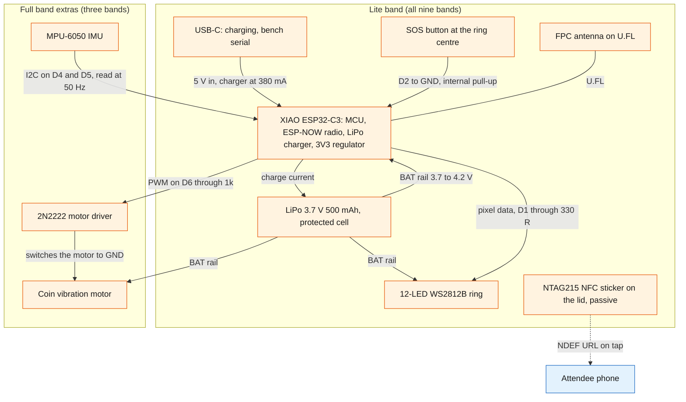
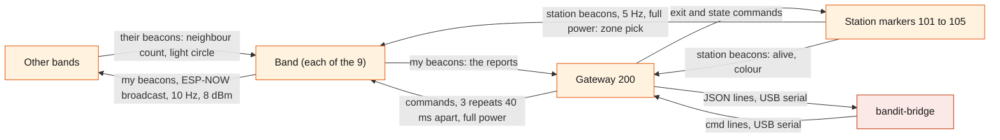
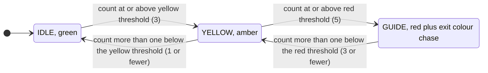
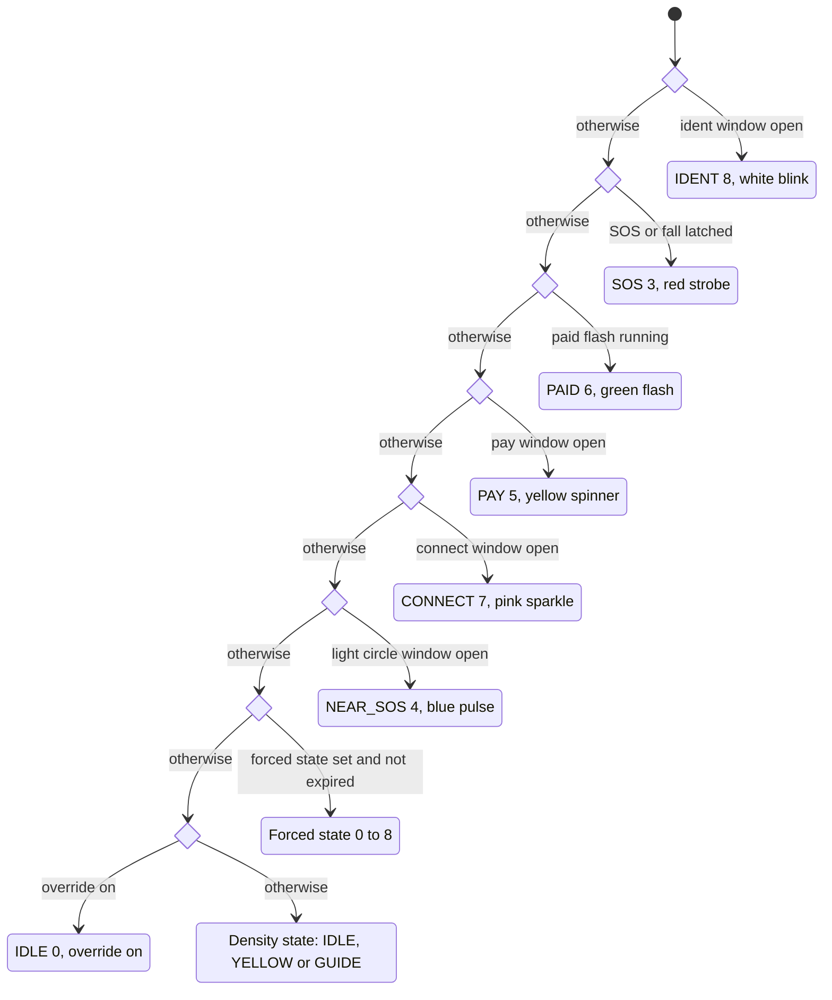

# Hardware

BandIt's physical layer is a small fleet of ESP32-C3 devices: nine wristbands, one USB gateway and two to five station markers. Each band counts the other bands it hears over ESP-NOW radio, turns that count into a colour on a 12-LED ring, and carries an SOS button and an NFC sticker. Three "full" bands add an IMU for fall detection and a vibration motor. The gateway turns every radio packet into one line of text for the laptop and broadcasts the laptop's commands back to the bands. This file describes the devices, the radio, the on-band logic and the gateway wire protocol at system level.

## Role in the system

Responsibilities of the physical layer:

- Sense crowd density locally. A band counts the bands it hears strongly and drives IDLE, YELLOW and GUIDE on its own, with no server round trip, so the safety colours keep working if the laptop dies.
- Raise and show emergencies locally: SOS (button hold), fall (full bands) and the blue light circle around a band in SOS.
- Report. Every band beacons its id, flags, neighbour count, zone, battery, light state and a packet counter ten times a second. The gateway relays each beacon it hears to the laptop.
- (TBD -- LEO) Know its zone: the station marker heard loudest.
- Obey the server: forced light states, exit colour, one-shot commands (`buzz`, `clear`), live calibration, the override switch and low visibility, all delivered as gateway commands.
- Guide people out: the exit colour shows the route, and a buzz on full bands tells the wearer to move along it. Full bands in a light circle also buzz when they join the incident.
- Carry the attendee's NFC token on the lid, which opens the attendee app.
- Station markers anchor zones and glow their exit colour, so "follow the colour" means something in the room.

Explicit non-responsibilities:

- No positions. A band knows its zone, never x/y. See [Safety](../6-features/Safety.md) for how zone-level data becomes density and guidance.
- No pairwise record. A band counts neighbours but does not report who they are.
- No decisions about exits, incidents or low visibility. Those are made in the `band1t` module ([SpacetimeDB](../2-data/SpacetimeDB.md), [Safety](../6-features/Safety.md)).
- No storage. Calibration pushed by command is lost when a band resets; the bridge re-sends it ([Gateway-Bridge](../3-services/Gateway-Bridge.md)).
- No network, no encryption, no deep sleep, no over-the-air update in v0.1.
- The gateway does not buffer, retry or interpret. It is a transparent radio-to-serial bridge.

## Interfaces

| Interface | Direction | Counterpart | What flows | Transport |
|---|---|---|---|---|
| Band beacon | band to every node in range | other bands, gateway | packet type 1: id, flags, `neigh`, `zone`, `bat`, `state`, `seq` | ESP-NOW broadcast, Wi-Fi channel 1, 10 Hz plus 0 to 30 ms jitter, 8 dBm |
| Station beacon | station to bands and gateway | bands, gateway | packet type 2: station id, colour index in `state` | ESP-NOW broadcast, 5 Hz, full power |
| Gateway command | gateway to bands and stations | bands, stations | packet type 3: target, command, two arguments | ESP-NOW broadcast, each command repeated 3 times 40 ms apart, full power |
| Gateway uplink | gateway to laptop | `bandit-bridge` | one JSON object per heard packet, plus boot, ack and error lines | USB serial, nominal 115200 baud |
| Gateway downlink | laptop to gateway | `bandit-bridge` | text lines `cmd <target> <name> [arg] [arg2]` | USB serial |
| NFC token | band to phone | Attendee app ([Attendee-App](../5-apps/Attendee-App.md)) | URL `https://<host>/t/BANDIT-0n` | NFC NDEF on an NTAG215 sticker, 1 to 2 cm |
| Button | wearer to band | the band itself | short press (confirm), 3 s hold (SOS) | GPIO with pull-up |
| Bench serial | band to and from laptop | hardware owner only, never the backend | status line once a second with the heard list and RSSIs; bench commands | USB-C serial |
| Vision.md: overhead camera (TBD -- LEO) | phone to `bandit-vision` | [Vision](Vision.md) | JPEG snapshots | HTTP over the team phone's hotspot |

## Design

### The fleet

| Unit | Count | Board | Carries | Does |
|---|---|---|---|---|
| Lite band | 6 | Seeed XIAO ESP32-C3 | 12-LED WS2812B ring, 500 mAh LiPo, SOS tactile switch under the ring centre, NTAG215 NFC sticker, printed case, ribbon strap | beacons, counts neighbours, shows colours, SOS, light circle, press to confirm |
| Full band | 3 | XIAO ESP32-C3 | everything above plus a GY-521 MPU-6050 IMU and a 10 mm coin vibration motor with a transistor driver | plus fall detection and buzz patterns; sets flag bit 4 so the server knows which bands can buzz |
| Gateway | 1 | XIAO ESP32-C3 on USB to the laptop, id 200 | nothing else | hears every beacon, prints one JSON line per packet, broadcasts commands at full power |
| Station marker | 2 to 5, ids 101 to 105 | ESP32-C3 SuperMini on USB power | a spare 12-LED ring | beacons its id so bands can pick a zone, glows its exit colour (breathe, chase or off) |

All nine bands run the same firmware; the only per-band differences are the compile-time band id and the full-band flag. A full band whose IMU or motor fails behaves as a lite band. Band ids 1 to 9 map to `band.band_id` and NFC tokens `BANDIT-01` to `BANDIT-09` ([SpacetimeDB](../2-data/SpacetimeDB.md)).

Who wears which band: the three full bands go to the three people in the fall and SOS script, so fall detection is always on the wrist that falls. The six lite bands go to everyone else.

### Band block diagram

What is inside one band and how power and signals flow between the parts.

Points that matter to the rest of the system:

- Power path. One protected 500 mAh cell is wired directly to the XIAO's battery pads, with no connector. The XIAO charges it over USB-C and runs from it otherwise. The ring and the motor run from the battery rail, not from the XIAO's regulator, because the 5 V pin is live only on USB. There is no power switch: a band is on while its battery is connected.
- The button is a plain tactile switch on a GPIO with the internal pull-up. The firmware debounces it (a press shorter than 30 ms is ignored) and tells a short press from a 3 s hold.
- The NFC sticker is passive and has no electrical connection to the board. A phone reads it; the band never knows it was tapped. This is why a tap always needs the button as the consent step for claiming a band ([Attendee-App](../5-apps/Attendee-App.md)).
- The IMU is read over I2C at 50 Hz with the accelerometer at plus or minus 8 g. The motor is driven by PWM at about 70 percent duty, so a full 4.2 V cell does not overdrive a 3 V motor.
- A resistor divider on A0 can give a battery percentage, but it is not fitted by default (`HAS_VBAT_DIV 0`). Most bands therefore report `bat` 255 (unknown) and never set the low-battery flag.

### Radio topology

Who hears whom. Every node is an ESP-NOW broadcaster on Wi-Fi channel 1. Nobody joins a network and there are no unicast links, so signal strength alone decides who hears whom.

- Bands transmit at 8 dBm (a quarter of full power); the gateway and stations transmit at full power. Band power is kept moderate so the RSSI threshold, not raw range, decides nearness, while the gateway still hears every band across the room. The firmware comments warn against lowering band power further.
- Bands listen to everything: other bands (density and the light circle), stations (zone) and the gateway (commands). Stations listen only for commands. The gateway listens to everything and transmits only commands.
- A packet is 14 bytes in a frame type whose payload limit is 250 bytes. Air time at event scale (about 115 packets a second across the fleet) is a few percent of the channel.

### Packet fields

One packed packet type carries band beacons, station beacons and commands. Fields are one byte unless stated.

| Field | Meaning | Band beacon (type 1) | Station beacon (type 2) | Command (type 3) |
|---|---|---|---|---|
| `magic` | constant that marks a BandIt packet; anything else on the channel is dropped | set | set | set |
| `type` | 1 band, 2 station, 3 command | 1 | 2 | 3 |
| `id` | sender: bands 1 to 9, stations 101 to 105, gateway 200 | band id | station id | 200 |
| `flags` | bit 0 SOS, bit 1 fall, bit 2 button pressed in the last second, bit 3 low battery, bit 4 full band | set | 0 | 0 |
| `neigh` | smoothed neighbour count, the density number | set | 0 | 0 |
| `zone` | id of the station heard loudest in the last 3 s, 0 if none | set | 0 | 0 |
| `bat` | battery percent, 255 unknown | set (255 on most bands) | 0 | 0 |
| `state` | light state 0 to 9 (table below) | set | exit colour index 1 to 6 | 0 |
| `seq` (two bytes) | per-sender packet counter, wraps at 65535 | set | set | set (gateway counter) |
| `target` | 0 every band, else a band or station id | unused | unused | set |
| `cmd` | command number 1 to 9 | unused | unused | set |
| `arg`, `arg2` | command arguments | unused | unused | set |

Light states, shared by the firmware, `bandit-protocol` and every dashboard legend:

| State | Name | Ring | Set by |
|---|---|---|---|
| 0 | IDLE | dim green breathing | density logic |
| 1 | YELLOW | solid amber | density logic |
| 2 | GUIDE | red background with a chase in the exit colour | density logic or a forced state |
| 3 | SOS | red strobe at 4 Hz, SOS buzz pattern on full bands | button hold, fall, or forced |
| 4 | NEAR_SOS | blue pulse (light circle) | hearing an SOS or fall beacon nearby |
| 5 | PAY | yellow spinner | `pay` command, 8 s; BandIt does not use it |
| 6 | PAID | solid green flash, 1.5 s | `paid` command; BandIt does not use it |
| 7 | CONNECT | pink sparkle | reserved in the firmware; nothing sets it in v0.1 and BandIt does not use it |
| 8 | IDENT | white blink at 2.5 Hz | 1.5 s at boot, or forced (used for claiming a band) |
| 9 | OFF | ring off | stations only in v0.1 (see the sentinel note under commands) |

Exit colours, used by GUIDE on bands and as the glow of stations: 1 blue, 2 magenta, 3 cyan, 4 white, 5 orange, 6 violet. A station's colour index defaults to its id minus 100.

### On-band logic

Everything below runs on the band with no server involved. The firmware loop is non-blocking and services the radio, the neighbour table, the button, the IMU, the motor and the ring in turn.

**Density counting and smoothing.** The band keeps a table of up to 32 band ids it has heard, each with the last RSSI and the time last heard. Every 250 ms it counts the entries heard in the last 2 s with RSSI at or above the neighbour threshold (-62 dBm, starting value, calibrate at the venue). The raw count feeds an exponential moving average with a 0.7 to 0.3 weight per 250 ms step, a time constant of about one second, and the rounded average is the `neigh` field in every beacon. Smoothing stops the ring flickering when one packet is lost or one neighbour's RSSI wobbles across the threshold.

**Hysteresis and the density state.** The smoothed count drives a three-state machine with one count of hysteresis on the way down, so a count hovering at a threshold does not flap between colours.

Both thresholds are live-tunable with the `thresh` command. The checks run in order, so a band that jumps from empty to a crowd passes through YELLOW and reaches GUIDE in the same 250 ms step.

(TBD -- LEO) **Zone pick.** The band also keeps a table of up to 8 stations heard. Its zone is the station with the strongest RSSI among those heard in the last 3 s, or 0 if none. The zone is only reported; the band does nothing with it locally. [Safety](../6-features/Safety.md) turns zone reports into per-zone density.

**Button.** A press released before 3 s is a short press: the band sets the press flag in its beacons for 1 s and gives a short buzz. The server treats a press flag that arrives while a claim window is open as consent (press to confirm, [Gateway-Bridge](../3-services/Gateway-Bridge.md)). Holding for 3 s toggles the SOS latch and plays the SOS buzz pattern; the hold fires once per press.

**SOS latch.** SOS is a latched boolean, not a timed state. While latched, the band's beacons carry flag bit 0 and its state is 3 regardless of density. The latch releases on another 3 s hold or on a `clear` command. A fall sets a second latch (flag bit 1) that behaves like SOS; `clear` releases both.

**Fall detection (full bands).** The IMU is sampled every 20 ms. A total acceleration above 2.8 g marks an impact. If, within 3.5 s of the impact, the magnitude stays within 0.2 g of 1 g for 1.5 s (the person is still), the fall latch is set and the SOS buzz pattern plays. Both numbers are starting values, calibrate at the venue. A convincing stage fall is a hard arm stop followed by lying still; jumping should not trigger it.

**Light circle.** When a band hears another band's beacon with the SOS or fall flag at RSSI at or above the circle threshold (-58 dBm, starting value, calibrate at the venue), it opens a 1.5 s NEAR_SOS window that every further such beacon refreshes. Distant bands do not react, so the circle has an edge. A NEAR_SOS band does not set the SOS flag itself, so the circle does not spread from band to band. The circle threshold is stricter than the neighbour threshold on purpose: the circle is the people within arm's reach, not the whole zone. The server also buzzes each full band the first time it is recorded in the circle (see Guidance and vibration below).

**Command handling.** Every command packet whose target is 0 or the band's own id is applied at once. The band sends no acknowledgement, which is why the gateway repeats each command three times and why the bridge reconciles against what the band reports ([Gateway-Bridge](../3-services/Gateway-Bridge.md)).

| Command | What it changes on the band |
|---|---|
| `state` | sets the forced state and its hold time: `arg2` is tenths of a second, 0 means until released. The longest hold is 25.5 s. Forcing 9 (OFF) has no effect in v0.1 because the firmware uses 9 as the "nothing forced" marker. |
| `exit` | sets the exit colour index (1 to 6) used by GUIDE; out-of-range values are ignored |
| `clear` | releases the SOS and fall latches, the forced state and the light-circle window |
| `buzz` | plays pattern 1 short, 2 double or 3 long; lite bands accept it and do nothing |
| `pay` | opens an 8 s PAY window and plays a double buzz; BandIt never sends it |
| `paid` | closes the PAY window and shows PAID for 1.5 s with a short buzz; BandIt never sends it |
| `thresh` | replaces the yellow and red neighbour counts |
| `rssi` | replaces the neighbour and circle RSSI thresholds (sent as positive magnitudes) |
| `override` | 1 stops the density state machine (the band shows IDLE unless forced or in an emergency), 0 restores it |
| `lowvis` | 1 turns low visibility on: the band shows GUIDE in its exit colour, so it guides its wearer to its zone's exit, ranked like a forced state; 0 turns it off |

### Band state precedence

A band can be in several conditions at once (latched SOS, a forced state, a pay window, a dense crowd). The ring shows exactly one state, chosen by a fixed precedence that the firmware evaluates top to bottom every frame. The diagram shows the order of the checks; the first that holds wins.

Consequences the backend relies on:

- SOS beats everything except IDENT, so a forced GUIDE or low visibility never hides a person calling for help. IDENT sits above SOS only because it is a short, deliberate "find this band" blink used at boot and for claiming.
- The light circle beats a forced state and low visibility, so the bands around a person stay blue.
- (TBD -- LEO) During a medic approach the bands around the person stay blue while the rest of the zone is forced to GUIDE ([Safety](../6-features/Safety.md)).
- A forced state beats the override flag and the density state, so manual override on the dashboard works whether the density logic is on or off.
- PAY and PAID rank above the light circle and forced states, but BandIt never sends `pay` or `paid`, so they never show and the ladder needs no firmware change.
- The state a band reports in `state` is the result of this ladder, not the density state. The bridge therefore judges a directive against the reported state only after allowing for the states that legitimately outrank it ([Gateway-Bridge](../3-services/Gateway-Bridge.md)).

### Gateway wire protocol

The gateway is a transparent bridge. It joins no network, holds no state beyond its own packet counter, and never interprets what it relays. The backend depends on this protocol, so it is specified here and consumed in [Gateway-Bridge](../3-services/Gateway-Bridge.md).

**Radio to laptop.** One JSON object per heard packet, one per line. The XIAO's serial port is native USB, so the 115200 baud figure is nominal and the real throughput is far above the fleet's roughly 115 lines a second of about 105 bytes each.

| Field | Meaning | Notes for the consumer |
|---|---|---|
| `t` | gateway uptime in milliseconds | resets when the gateway reboots; use the laptop clock for real time |
| `type` | 1 band beacon, 2 station beacon, 3 command echo from another gateway | type 3 lines carry only the sender id and `seq`; the command fields are not printed |
| `id` | sender id | band 1 to 9, station 101 to 105, gateway 200 |
| `rssi` | signal strength at the gateway, dBm | distance to the gateway, not density; a coverage check only |
| `flags` | bit 0 SOS, bit 1 fall, bit 2 press in the last second, bit 3 low battery, bit 4 full band | the press bit is the consent signal; bit 3 appears only on bands with the divider |
| `neigh` | the band's smoothed neighbour count | the density number |
| `zone` | station heard loudest, 0 if none | zone-level position |
| `bat` | battery percent | 255 means unknown, which is most bands |
| `state` | light state 0 to 9 | for stations, the colour index 1 to 6 |
| `seq` | per-sender packet counter | gaps estimate loss; a reset means the sender rebooted |

Other lines: a boot line with the gateway's MAC and channel when the gateway starts (the bridge treats it as "gateway rebooted"), an `ack` line after each command with the numeric target, command, `arg` and `arg2` it broadcast, and an `err` line for a malformed or unknown command. The gateway does not buffer: if the laptop is not reading, lines are dropped, not queued.

Liveness rule for every consumer: a band is alive if heard within 2 s and is shown grey (stale) after 5 s.

**Laptop to radio.** One command per line, `cmd <target> <name> [arg] [arg2]`. The gateway broadcasts each command three times 40 ms apart, then prints the `ack` line. Arguments are one byte each.

| Name | Arguments | Valid targets | Effect on a band | Effect on a station |
|---|---|---|---|---|
| `state` | state 0 to 9, optional hold in tenths of a second (1 to 255; 0 or absent means until released) | band, station or 0 | forced state for the hold time; 9 is ignored (sentinel) | mode: 0 breathe, 1 chase, 9 off; any other value breathes; the hold is ignored |
| `exit` | colour 1 to 6 | band, station or 0 | GUIDE chase colour | glow colour |
| `clear` | none | band or 0 | releases SOS and fall latches, forced state and light circle | ignored |
| `buzz` | pattern 1 to 3, default 1 | band or 0 | buzz on full bands | ignored |
| `pay` | none | band | 8 s PAY prompt; BandIt never sends it | ignored |
| `paid` | none | band | PAID for 1.5 s; BandIt never sends it | ignored |
| `thresh` | yellow count, red count | band or 0 | live density thresholds | ignored |
| `rssi` | neighbour magnitude, circle magnitude (positive dBm values) | band or 0 | live RSSI thresholds | ignored |
| `override` | 0 or 1 | band or 0 | density state machine off or on | ignored |
| `lowvis` | 0 or 1 | band or 0 | low visibility on or off: GUIDE in the band's exit colour while on | ignored |

Two hazards follow from target 0 meaning every node, bands and stations alike:

- `exit` to target 0 recolours every station marker as well as every band. Exit colours are sent per band and per station, never broadcast.
- `state 9` to target 0 turns every station off and does nothing to bands. OFF for a station is a valid "exit blocked" signal, but only by station id.

`clear` releases a band's SOS latch, so it is never used merely to end a forced state on a band that reports SOS or fall. [Gateway-Bridge](../3-services/Gateway-Bridge.md) owns these rules.

### Station marker behaviour

A station is a SuperMini with a ring on USB power, placed at an exit or a zone centre. It beacons its id at 5 Hz at full power with its colour index in `state`, so bands can rank stations by RSSI and pick a zone, and the gateway can show the station as alive. It glows its exit colour in one of three modes: breathe (open exit, the default), chase (come this way) and off (closed exit). It accepts only `exit` and `state`, addressed to its id or to 0, and ignores everything else. A station never listens to bands and never changes its own colour; when a zone's exit assignment changes, the server changes the colour through a directive for that station ([Safety](../6-features/Safety.md), [Gateway-Bridge](../3-services/Gateway-Bridge.md)). A station that loses power disappears from every band's zone pick after 3 s, and bands in that zone report zone 0 or the next-loudest station.

### The NFC token

Each band carries an NTAG215 sticker (504 bytes, NDEF) with an anti-metal backing, placed on the lid over the electronics bay so it reads through the case. It holds one URL record, `https://<host>/t/BANDIT-0n`, where `<host>` is the one public HTTPS host of `bandit-api`, which serves the attendee app ([Rust-Backend](../3-services/Rust-Backend.md)), and the token matches `band.nfc_token`. A phone reads it at 1 to 2 cm, including through a hand; recent iPhones read it in the background with the screen on. The tags are written with that host and locked read-only. The tag is static and can be cloned, which is accepted for v0.1: the token only opens a page, and every action that needs the wearer's consent (claiming the band) requires a button press on the band within a server-timed window. BrightData.md: claiming a profile is open only to a band owner, so it rests on that press. Tap to join and claiming live in [Attendee-App](../5-apps/Attendee-App.md).

### Power budget and runtime

Design values from the hardware handoff.

| Load | Current | When |
|---|---|---|
| ESP32-C3 with the radio receiving continuously | about 80 to 110 mA | always (no power save in v0.1) |
| 12-LED ring at the firmware's brightness cap (64 of 255), one colour | about 40 mA | always, more for white and strobes |
| Coin motor | about 80 mA | only while buzzing (full bands) |
| IMU | a few mA | always (full bands) |

Call it about 150 mA average: a 500 mAh cell gives roughly 3 hours per charge, and charges at 380 mA from empty in about 1.5 to 2 hours. A band on the bench drains at the same rate, because there is no sleep. The cell's protection circuit cuts power at about 2.5 V. Because most bands have no battery divider, the dashboard shows battery as unknown and runtime is managed by charging before doors open. Stations and the gateway run from USB. The ring at full white would draw about 0.7 A, which is why brightness is capped in firmware.

### Physical form

The band is a 64 by 42 mm printed "pill", 13.6 mm tall on the wrist, in two printed parts: a black base and a white lid thinned over the ring so the LEDs glow through it. The battery lies under the ring in the round head; the SOS switch stands on the battery at the exact centre of the ring and is pressed through a 6.5 mm hole in the lid ("hold the light for three seconds"). The electronics bay in the tail holds the XIAO upside down with its USB-C port in a window in the end wall, the IMU and motor under it on full bands, and the FPC antenna on the inside wall. A 16 mm woven ribbon threads through a channel under the floor and closes with a one-way slide lock. The NFC sticker sits on the lid over the tail.

### Guidance and vibration: the colour shows the route, the buzz says move

No band carries a magnetometer (the MPU-6050 has an accelerometer and a gyroscope only), so a band cannot know which way the wearer faces and the ring cannot point an arrow in a world direction. A rotating chase has no fixed heading. Guidance is therefore colour matching: a band in GUIDE shows its exit colour, and the station marker at that exit glows the same colour, so the instruction is "walk toward the light that matches your wrist".

The vibration motor adds two cues, both sent with the existing `buzz` command. A full band vibrates; a lite band accepts the command and does nothing, so its wearer relies on the ring alone. The server decides when to send each cue ([Safety](../6-features/Safety.md)).

| Cue | When the server sends it | Pattern | What the wearer sees on the ring |
|---|---|---|---|
| Someone next to you needs help | once to each full band, the first time it is recorded in the light circle of an `sos` or `fall` incident | 2, double | the blue NEAR_SOS pulse, which the band shows on its own |
| Move along your route | to each band whose route colour the server has just set or changed, during crowd-risk guidance and low visibility | 3, long | GUIDE in the colour of the exit to walk to |
| (TBD -- LEO) Move aside for the medic | to each full band that a medic approach forces to GUIDE | 3, long | GUIDE in the colour of a side exit |

The buzz carries no direction; the colour does. The two patterns differ from the short buzz the band gives on its own for a press, so each cue feels different on the wrist.

### Radio and sensing limits

| Limit | Why it exists | Consequence for the design |
|---|---|---|
| RSSI is noisy | multipath, antenna orientation, wrist position; swings of several dB between packets are normal | the band smooths over about a second and uses one count of hysteresis; the server treats `neigh` as an estimate and maps it through venue calibration ([Safety](../6-features/Safety.md)) |
| Bodies absorb 2.4 GHz | expect about 10 dB less between two people standing back to back | nearness is a threshold on RSSI, not a distance; thresholds are calibrated on wrists at the venue, not on a bench |
| Channel 1 is shared with venue Wi-Fi | ESP-NOW frames compete with every access point and phone on the channel | expect some packet loss; the firmware's 2 s neighbour window tolerates it, and the bridge estimates loss from `seq` gaps |
| No acknowledgement from bands | commands are fire and forget, repeated three times | the bridge reconciles against the state the band reports rather than trusting delivery |
| The gateway does not buffer | it has no storage and prints as it hears | the bridge reads continuously; a paused reader loses packets |
| Zone, not position | a band knows only its loudest station | everything downstream is zone-level |
| Fleet size | one-byte ids, tables of 32 bands and 8 stations, 10 Hz beacons on one channel | ample for 9 bands and 5 stations; Simulator.md: the crowd and simulated ids 10 to 99 never go on air ([Simulator](../3-services/Simulator.md)) |
| No encryption or authentication | ESP-NOW broadcast frames cannot be encrypted, and the packet has no signature | anyone on channel 1 with the packet layout can inject beacons or commands; accepted for the event |

### Calibration as a system process

Calibration turns the venue's radio environment into thresholds the bands use and a mapping the server uses. It is a process over the whole system, not a firmware setting.

What is measured, in the pit with bands on wrists:

1. Spread out, about 2 m apart: the typical RSSI between neighbours ("far") and the resulting `neigh`, which should be 0 to 1.
2. In the 1.5 m taped square, about 4 people per square metre: `neigh` should put bands in YELLOW.
3. In the 1.2 m taped square, about 6 people per square metre: `neigh` should reach 5 or more on most bands, putting them in GUIDE.

The live values: the `rssi` command sets the neighbour and circle RSSI thresholds and the `thresh` command sets the yellow and red counts. In the system these are the `fleet_config` row, changed from the Ops dashboard with `set_fleet_config` ([Ops-Dashboard](../5-apps/Ops-Dashboard.md)). The bridge delivers them and re-sends them to any band that reboots, because a band forgets them on reset ([Gateway-Bridge](../3-services/Gateway-Bridge.md)). The observed mean `neigh` at each known density is recorded as `calibration_point` rows with `set_calibration`; the venue tick uses that table to map `neigh` to people per square metre ([Safety](../6-features/Safety.md)). The bridge's raw log is the record of each capture.

Inter-band RSSI, the number that best guides the `rssi` thresholds, is visible in v0.1 only on a band's bench serial status line, because beacons carry a count and not the individual RSSIs.

### Overhead camera (TBD -- LEO)

Vision.md: the hardware side of the camera is one phone on a light stand looking straight down on the pit. It serves JPEG snapshots over the team phone's hotspot to `bandit-vision` on the laptop, which counts people, spots a person on the ground and judges incidents ([Vision](Vision.md)). The taped squares define the camera's region of interest. If neighbour counting proves unstable, the camera count is the density source in Plan B ([Safety](../6-features/Safety.md)).

## Failure modes and fallbacks

| Failure | Effect | Design answer |
|---|---|---|
| A band's battery is flat | the band is silent; the server sees it stale after 5 s | bands are charged before doors open; a flat band shows grey and is left out of density |
| A command is lost on air | the band keeps its old state | three repeats per command; the bridge re-sends while the reported state disagrees |
| A band reboots | it forgets calibration, exit colour, override and any forced state, and blinks white for 1.5 s | the bridge sees the `seq` reset and re-sends `fleet_config` and the band's directives |
| The gateway is unplugged | no lines on serial; every band goes stale on the dashboard | bands never depend on the gateway for safety colours, SOS or the light circle; the bridge reopens the port and resyncs ([Gateway-Bridge](../3-services/Gateway-Bridge.md)) |
| A fall fires on a jump | a false fall latch | raise the 2.8 g impact threshold (a starting value) during calibration |
| Neighbour counting proves unstable at the venue | density colours cannot be trusted | Plan B in [Safety](../6-features/Safety.md): `density_override` stops the bands' density colours and ops drives colours with forced states |

## Dependencies

**Depends on**

- Nothing in software. The devices run with no laptop. Live thresholds come from `fleet_config` through the bridge.
- The firmware constants file is mirrored by the `bandit-protocol` crate ([Gateway-Bridge](../3-services/Gateway-Bridge.md)); a change to packet layout, states, flags or commands lands in both.

**Used by**

- [Gateway-Bridge](../3-services/Gateway-Bridge.md): the wire protocol and the state precedence.
- [Safety](../6-features/Safety.md): local density, SOS, fall and light-circle behaviour, zone reports, forced states, exit colours and the two buzz cues.
- [Attendee-App](../5-apps/Attendee-App.md): the NFC token and the IDENT blink for claiming.
- [Simulator](../3-services/Simulator.md): imitates the band's states and flags for the simulated bands.
- (TBD -- LEO) [Social](../6-features/Social.md): zone-level presence from the zone pick.
- [Ops-Dashboard](../5-apps/Ops-Dashboard.md): the fleet panel, state legend, calibration controls and manual override.

**If you delete this file**

- There is no physical layer. [Gateway-Bridge](../3-services/Gateway-Bridge.md) has nothing to read and goes too; [Simulator](../3-services/Simulator.md)'s simulated bands become the only band reports, through `report_sim_band`.
- Remove the Band, Station marker and Gateway rows from the component table in [Architecture](../1-overview/Architecture.md) and the device nodes from its diagrams.
- Remove the NFC tap entry point from [Attendee-App](../5-apps/Attendee-App.md), and the press-to-confirm step from the band claim.
- In [Safety](../6-features/Safety.md), remove the band-based density estimate, the light circle and both buzz cues; the camera estimate (TBD -- LEO) would stand alone.

## Decisions

| Decision | Why |
|---|---|
| The firmware's state ladder stays as it is, with PAY and PAID above the light circle and forced states | there is no paying at the venue, so BandIt never sends `pay` or `paid` and those states never compete with an emergency; no firmware change is needed |
| Forcing OFF is not used; the OFF sentinel stays as the firmware has it | bands on the bench are handled by hand, so no firmware change is needed |
| One gateway on channel 1, with the firmware's 2 s neighbour window | one gateway hears the whole room, and the 2 s window absorbs the packet loss from venue Wi-Fi on channel 1 |
| The three full bands go to the three people in the fall and SOS script; the six lite bands go to everyone else | fall detection must be on the wrist that falls in the script, and those wearers also feel the guidance buzz |
| Two buzz cues: pattern 2 (double) for full bands joining an incident's light circle, pattern 3 (long) with each new route colour | the short buzz already means "press registered", and the double buzz is free because BandIt sends no `pay`; each cue then feels different on the wrist |
| Battery is managed by charging, not telemetry | most bands have no divider and report `bat` 255 |
| The NFC tags hold the one public host of `bandit-api` and are locked read-only | judges use their own phones on one host; a static tag is enough because every consent needs a band press |
| The docs describe the firmware as it is, with no proposed extensions | the team is not changing the hardware for the event |
