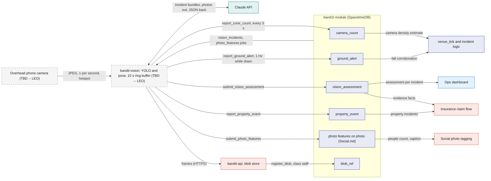
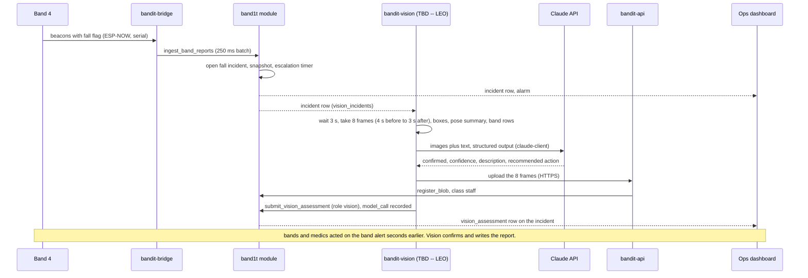

# Vision

> (TBD -- LEO) Leo owns vision: the cameras, the models, where they run and how Claude is used. This file fixes what the rest of the system sends in and gets back, and records Leo's defaults below, which Leo may change.

Vision is the camera side of BandIt. The rest of the system needs five things from it: a head count for the pit, as ground truth and as the Plan B density source; person-down alerts that corroborate falls; a Claude judgment on each incident in the pit, with a staff report and an insurance-ready description; property events on property incidents, such as a fallen speaker; and features of photographer photos. Everything flows into the `band1t` module through reducers under the role `vision`, and the module, not vision, decides what happens next. Vision is never in the safety path: bands alert locally within a second, and vision confirms, counts and writes the report seconds later.

## Role in the system

Responsibilities (the interface):

- Write a fresh people count for the pit into `camera_count` through `report_zone_count`.
- Raise and refresh a person-down alert through `report_ground_alert`.
- On each new `sos`, `fall` or `property` incident in the pit, have Claude judge the frames and write the result through `submit_vision_assessment`.
- Report property events through `report_property_event`, attached to a `property` incident; [Insurance](../6-features/Insurance.md) reads them as evidence.
- Supply photo features through `submit_photo_features` for [Social](../6-features/Social.md)'s photo tagging.
- Store frames as blobs through `bandit-api` and pass `blob_ref` ids as evidence.
- Send a `heartbeat` every 5 s like every other Rust service.

Not responsible for:

- Writing `zone_state`, opening or closing `sos` incidents, or commanding bands. `venue_tick`, `ingest_band_reports` and the directives do that ([Safety](../6-features/Safety.md)).
- Identifying people. Identity comes from bands (zone and time). Claude never identifies faces, and no face recognition runs anywhere.
- Being a source of truth. Everything vision knows is a row in SpacetimeDB.
- Gating anything live. If vision is slow or absent, nothing waits.

## Interfaces

| Interface | Direction | Between | What flows | Transport |
|---|---|---|---|---|
| Frames | in | phone camera to `bandit-vision` | one JPEG snapshot per second at 1280x720 | HTTP pull over the team phone's hotspot (TBD -- LEO) |
| `upsert_camera` | out | vision to module | the one `camera` row: name, the pit zone, region map, live flag | SDK reducer, role `vision`, at start |
| `report_zone_count` | out | vision to module | camera id, zone id (the pit), count, counts per cell of the 3 by 3 grid, light circle visible yes or no, confidence; overwrites `camera_count` in place | SDK reducer, role `vision`, every 3 s |
| `report_ground_alert` | out | vision to module | camera id, zone id, cell hint, confidence, frame `blob_ref`; refreshed every second while the person stays down; sets `incident.camera_corroborated` when it lands in the zone of an open `sos` or `fall` incident within 3 s of the flag (starting value) | SDK reducer, role `vision` |
| `submit_vision_assessment` | out | vision to module | incident id, confirmed yes or no, confidence, description, recommended action, incident description, camera id, frame `blob_ref` ids with capture times, `model_call` id; sets `incident.vision_status` | SDK reducer, role `vision` |
| `report_property_event` | out | vision to module | camera id, zone id, kind, description, confidence, frame `blob_ref` ids, incident id when one is open; with an incident id it attaches to that `property` incident, without one the module opens a `property` incident with `opened_by` `vision` | SDK reducer, role `vision` |
| `submit_photo_features` | out | vision to module | photo id, people count, caption, `model_call` id; checks the job lease | SDK reducer, role `vision` |
| `heartbeat` | out | vision to module | service `vision`, version, `backlog` (frames waiting for the detector) and a `note` with the camera name, detector frame rate and the time of the last Claude call | SDK reducer, every 5 s |
| Subscriptions | in | module to vision | `zone`, `camera`, the view `vision_incidents`, and `worker_jobs` for job kind `photo_features` | SDK subscription |
| Frame upload | out | vision to `bandit-api` | JPEG frames; `bandit-api` stores them on its volume and calls `register_blob` with access class `staff`; returns the `blob_ref` id | HTTPS to the public host ([Rust-Backend](../3-services/Rust-Backend.md)) |
| Photo fetch | in | `bandit-api` to vision | the photographer photo named by a `photo_features` job | HTTPS |
| Claude API | out | vision to Claude | incident bundles (frames plus text) and, after the event, photographer photos; structured JSON output; every call recorded in `model_call` | HTTPS through `claude-client` ([Anthropic-Agent](../7-integrations/Anthropic-Agent.md)) |

## Design

### Leo's defaults (TBD -- LEO): `bandit-vision`

One Rust process, `bandit-vision`, on the venue laptop. All of this is Leo's to change.

- Camera. One phone on a light stand looking straight down on the pit. It serves JPEG snapshots over the team phone's hotspot. The camera covers one zone, the pit.
- Frames. `bandit-vision` pulls one frame per second at 1280x720 into a 10 s ring buffer, so an event can be looked at from 4 s before to 3 s after the moment.
- Detector. YOLO person and pose models run through ONNX Runtime inside `bandit-vision`, with no sidecar process. They yield boxes and pose keypoints for each frame.
- Pit check, on every third frame (every 3 s). From the boxes, the people count inside the taped square and the count per cell of a 3 by 3 grid over it; from the frame's colours, whether a ring of blue lights (the light circle) is visible. It goes out through `report_zone_count`. Every 10 s one frame is also uploaded for the Ops dashboard's camera tile.
- Person down, on every frame. From the pose: a torso near horizontal and low in two consecutive frames (starting value) raises a `ground_alert` through `report_ground_alert`, refreshed every second while the person stays down.
- Claude, live, on incidents only. When `vision_incidents` delivers a new `sos`, `fall` or `property` incident in the pit, `bandit-vision` waits until 3 s after the incident's first signal, then builds a bundle: the 8 frames from 4 s before to 3 s after, labelled with their time offset; the detector's boxes and a pose summary as text; and the snapshot's band rows as text (band ids in the zone, states, flags, light-circle members). It calls `claude-opus-5-5` at medium effort with structured JSON output, through `claude-client` with the workers' Anthropic key, and caches the system prompt and an empty-pit reference frame. The judgment (confirmed yes or no, confidence, a description for staff, a recommended action) and the insurance-ready incident description go out through `submit_vision_assessment`, which also sets `incident.vision_status`. For a `property` incident the result also goes out through `report_property_event` with the incident id, so [Insurance](../6-features/Insurance.md) has the event row and its frames. There is no periodic Claude loop.
- Photo features, after the event. For each `photo_features` job (Social.md's `register_photo` enqueues one per photographer photo), `bandit-vision` fetches the photo from `bandit-api` and asks Claude (`claude-opus-5-5`, medium effort, through Message Batches) for how many people are in it and a one-line caption. It writes them through `submit_photo_features`. Social combines the count with band zone and time to suggest who is in the photo. Identity always comes from bands, never faces.
- Every Claude call goes through `claude-client` and is recorded in `model_call` ([Anthropic-Agent](../7-integrations/Anthropic-Agent.md)). Claude reads and writes words; code decides safety, money, coverage and access.

An unmatched person-down alert becomes an incident on its own: when an alert with no band flag in its zone persists for 5 s (starting value), `report_ground_alert` opens a `fall` incident with `opened_by` `vision` and no band, because people without a band fall too ([Safety](../6-features/Safety.md)). That incident then reaches `vision_incidents` like any other, so it gets the same Claude judgment.

The flowchart shows the interface: what vision sends in, what the module stores, and who reads it. Vision nodes are dashed because their internals are Leo's.

### Tables and the view

All five tables and the view are owned by this file. The module defines them only while Vision exists.

`camera`: one row per camera; the event has one.

| Field | Meaning |
|---|---|
| id | assigned by SpacetimeDB |
| name | "overhead pit" |
| zone id | the zone it covers: the pit |
| region map | the taped square's four corners in image pixels, which define the 3 by 3 grid |
| live | whether frames are arriving |
| last frame at | server time of the last report from this camera |

`camera_count`: the latest count per (camera, zone), overwritten in place so the table stays small.

| Field | Meaning |
|---|---|
| camera id, zone id | the pair; one row each |
| count | people the detector sees in the taped square |
| cell counts | counts per cell of the 3 by 3 grid |
| light circle visible | yes or no |
| confidence | 0 to 1 |
| observed at | server time at ingest; the tick treats a row older than 6 s (starting value) as stale |
| frame blob ref | the latest of the frames uploaded every 10 s, for the camera tile |

`ground_alert`: a person who looks down.

| Field | Meaning |
|---|---|
| id | assigned by SpacetimeDB |
| camera id, zone id | where |
| region hint | grid cell |
| confidence | 0 to 1 |
| first seen at, last seen at | the alert expires 10 s after the last refresh (starting value) |
| status | `open`, `matched`, `expired`, `dismissed` |
| incident id | the incident it corroborated or opened, when any |
| frame blob ref | the frame at first detection |

`property_event`: something other than a person that needs a record.

| Field | Meaning |
|---|---|
| id | assigned by SpacetimeDB |
| camera id, zone id | where |
| kind | `fallen_object`, `spill`, `damage`, `other` |
| description | one paragraph, from the assessment |
| confidence | 0 to 1 |
| observed at | server time |
| frame blob refs | evidence frames |
| incident id | the `property` incident this event opened or attached to |

`vision_assessment`: one per incident check.

| Field | Meaning |
|---|---|
| id | assigned by SpacetimeDB |
| incident id | the incident judged |
| trigger | `band_sos`, `band_fall`, `ground_alert`, `staff_button`: what opened the incident |
| confirmed | yes or no |
| confidence | 0 to 1 |
| description | what the frames show, for staff |
| recommended action | one line |
| incident description | the insurance-ready paragraph Insurance copies into the evidence pack |
| camera id | which camera, so Insurance can check the camera's zone against the band's zone |
| frame blob refs | the frames sent to Claude, each with its capture time |
| model call id | the `model_call` row, for audit and replay |
| created at | server time |

`vision_incidents`: a view for role `vision`. It returns the open `sos`, `fall` and `property` incidents in the camera's zone, each with its `incident_snapshot`, and no display name. Vision needs the zone and the band facts, never who the person is.

### Role `vision`

`bandit-vision` connects as its own identity; it prints the identity on first start and the owner grants `vision` with `grant_role` ([SpacetimeDB](../2-data/SpacetimeDB.md)). The vision reducers and `upsert_camera` accept this role, and `heartbeat` accepts any service role. The job reducers `claim_job`, `extend_job_lease`, `complete_job` and `fail_job` accept `vision` for jobs of kind `photo_features` only, so the vision service takes those jobs without holding the broader `worker` role. Nothing else in the module accepts `vision`, so a compromised camera process cannot command bands, and it reaches incidents only through its two columns, the incidents it opens and its own rows.

### Rates and freshness

| Signal | Rate | Fresh for | Then |
|---|---|---|---|
| `report_zone_count` | every 3 s, one call for the pit | 6 s (starting value) | `venue_tick` drops the camera estimate and uses the band estimate alone |
| `report_ground_alert` | on detection, refreshed every 1 s while down; matched to a band flag in the same zone within 3 s (starting value) | 10 s after the last refresh | status `expired`; an incident it corroborated or opened stays open on its own |
| `submit_vision_assessment` | once per incident, about 3 s after its first signal plus the Claude call | not time-bound | stays on the incident |
| `report_property_event` | once per event, with a 60 s dedupe window per camera and kind | not time-bound | stays |
| `submit_photo_features` | once per `photo_features` job, in batches after the event | not time-bound | the job's lease is 60 s; batch waits use `extend_job_lease` |
| frames as blobs | one every 10 s for the camera tile, 8 per assessment | event lifetime | kept for the evidence pack |
| `heartbeat` | every 5 s | 15 s | the service-health card goes red |

### What each consumer does, with and without vision

| Consumer | With vision | Without vision (file deleted or service down) |
|---|---|---|
| `venue_tick` density ([Safety](../6-features/Safety.md)) | the pit's density is the higher of the fresh band estimate and the camera estimate (count divided by the taped square's area); both stored in `zone_state` | band estimate only; the camera field stays empty |
| Plan B ([Safety](../6-features/Safety.md)) | ops sets `fleet_config.density_override` through `set_fleet_config`: bands stop their own density colours, the camera count is the only fresh estimate, and ops drives band colours from the zone's risk; SOS, fall and the light circle keep working on the bands | no camera half of Plan B; `set_zone_risk` and forced states remain |
| Incident corroboration ([Safety](../6-features/Safety.md)) | a `ground_alert` in the same zone within 3 s (starting value) of a band fall or SOS sets `incident.camera_corroborated`, is linked in `incident_snapshot` and marked `matched`; a second source, never a gate. An unmatched alert that persists 5 s opens a `fall` incident with `opened_by` `vision` | falls rely on the band's IMU alone |
| Incident assessment | `incident.vision_status` goes `pending` when the bundle is sent and `confirmed` or `not_confirmed` when the `vision_assessment` lands, seconds later, with confidence, description, recommended action and frames | `vision_status` stays `none`; ops reads band facts and witnesses only |
| [Insurance](../6-features/Insurance.md) | `property` incidents from the staff button and from `report_property_event`; `vision_assessment`, `property_event` rows and frames become evidence facts in the pack, and the camera's zone is checked against the band's zone | no property incidents from cameras; claims proceed on band facts and staff notes |
| [Social](../6-features/Social.md) photo tagging | `submit_photo_features` fills the people count and caption on the `photo`; tag suggestions are capped by the people count | `register_photo` stands alone; tagging by zone and time co-presence with the default cap |
| [Ops-Dashboard](../5-apps/Ops-Dashboard.md) | the camera tile, the detector count beside the bands' own count for the pit, person-down alerts, assessments on incidents | the Vision rows are removed |

Anthropic-Agent.md: without it, `bandit-vision` sends nothing to Claude, so there are no assessments and no photo features; counts and alerts keep working, and `vision_status` stays `none`.

The sequence shows an assessment from the band's alert to the result on the incident.

## Failure modes and fallbacks

| Failure | Effect | Design answer |
|---|---|---|
| Frames stop (the phone sleeps or leaves the hotspot) | `camera_count` goes stale and `camera.live` turns false | the tick uses the band estimate after 6 s; the camera tile and the service-health card show stale; nothing waits |
| Claude is slow or refuses | no assessment yet | the incident is already open and handled; `vision_status` stays `pending` and the `model_call` row records why |
| The detector counts bystanders without bands | the camera count exceeds the band count | expected and wanted: the camera is ground truth, and the density takes the higher estimate |
| A false person-down from someone sitting or kneeling | a `ground_alert` with no band fall | an unmatched alert opens an incident only after it persists 5 s, and the alert alone never changes band lights |

## Dependencies

**Depends on**

- [SpacetimeDB](../2-data/SpacetimeDB.md): `incident` (its two Vision columns `camera_corroborated` and `vision_status`, and the `opened_by` value `vision`), `incident_snapshot`, `zone`, `job`, `blob_ref`, `model_call` (Anthropic-Agent.md), `service_heartbeat`; reducers `claim_job`, `extend_job_lease`, `complete_job`, `fail_job`, `heartbeat`, `grant_role`; the view `worker_jobs`.
- [Rust-Backend](../3-services/Rust-Backend.md): the blob upload and photo fetch through `bandit-api`, `register_blob`, the service identity pattern.
- [Anthropic-Agent](../7-integrations/Anthropic-Agent.md): `claude-client`, structured outputs, prompt caching, Message Batches, `model_call` recording.
- [Ops-Dashboard](../5-apps/Ops-Dashboard.md): staff open the `property` incidents that `report_property_event` attaches to with `open_incident` (Insurance.md: the Report property damage button).
- [Hardware](Hardware.md): the overhead camera stand.

**Used by**

- [Safety](../6-features/Safety.md): the camera density estimate, the Plan B density source, fall corroboration.
- [Ops-Dashboard](../5-apps/Ops-Dashboard.md): the camera tile and the assessment on incidents.
- [Insurance](../6-features/Insurance.md): `property` incidents, `vision_assessment`, frames as evidence.
- [Social](../6-features/Social.md): photo features for tagging.

**If you delete this file**

- Drop the five tables, the view `vision_incidents`, the vision reducers (`report_zone_count`, `report_ground_alert`, `submit_vision_assessment`, `report_property_event`, `submit_photo_features`), `upsert_camera`, the job kind `photo_features` and the role `vision`.
- SpacetimeDB.md and Safety.md: remove the two Vision columns on `incident`, the `opened_by` value `vision`, the camera estimate from the density rule and the camera half of Plan B.
- Ops-Dashboard.md: remove the "Vision.md" rows (camera tile, corroboration and assessment on incidents) and the `vision` service card.
- Insurance.md: remove the camera-sourced property incidents and the vision evidence facts.
- Social.md: remove the photo-features fields and the cap by people count; `register_photo` runs without features and enqueues no job.
- Architecture.md, Requirements.md (F15), Decisions.md and README.md: remove the Vision rows. Hardware.md: remove the overhead camera row and subsection.
- Rust-Backend.md: remove the `bandit-vision` row from the process table, the Vision node from the workspace diagram, the Vision row from the crate table and the `photo_features` row in the handler registry.
- Anthropic-Agent.md: remove the two Vision rows (event judgment and `photo_features`) from the use-case table and the Vision bullet from its deletion list.

## Decisions

| Decision | Why |
|---|---|
| (TBD -- LEO) One overhead phone camera on a light stand over the pit | the pit is where the crowd density step, the fall and the SOS happen |
| (TBD -- LEO) The phone serves JPEG snapshots over the hotspot; `bandit-vision` pulls 1 frame per second at 1280x720 into a 10 s ring buffer; the pit check uses every third frame | 1280x720 is the size Claude reads well; one frame a second fills the 8-frame bundle around an event, and a pit reading every 3 s is enough for a tick that already smooths over seconds |
| (TBD -- LEO) YOLO person and pose models through ONNX Runtime inside `bandit-vision`, no sidecar | one Rust process to run and restart on the laptop |
| (TBD -- LEO) Live, Claude is used only for event assessment (fall or SOS confirmation, property damage), with the same Anthropic key and account as the workers | Claude makes the judgment; counting and person-down run locally; one key to manage |
| (TBD -- LEO) The camera maps to one zone, the pit | the `camera` row's region map is just the taped square's corners |
| (TBD -- LEO) After the event, Claude also reads each photographer photo for its people count and a one-line caption, through Message Batches | Social.md takes both from `submit_photo_features`; a caption needs a model that reads the image, and batches suit work nobody waits for |
| (TBD -- LEO) Live, Claude has one trigger: a new `sos`, `fall` or `property` incident in the pit | an unmatched person-down alert opens its own `fall` incident, so it needs no separate trigger |
| (TBD -- LEO) The bundle is the 8 frames from 4 s before to 3 s after the incident's first signal | at one frame a second that is the whole moment, and it waits only 3 s |
| (TBD -- LEO) A person is down after two consecutive frames with the torso near horizontal and low (starting value) | at one frame a second this matches the band's 1.5 s stillness window |
| `camera_count` is fresh for 6 s (starting value) | the pit check arrives every 3 s, so two missed readings mark it stale |
| Vision reads incidents through its own view `vision_incidents`, with no display name | it needs the zone and the band facts, never who the person is |
| A failed or refused Claude call writes no assessment; `vision_status` stays `pending` | the incident is already handled by bands and staff; the `model_call` row records the reason |
