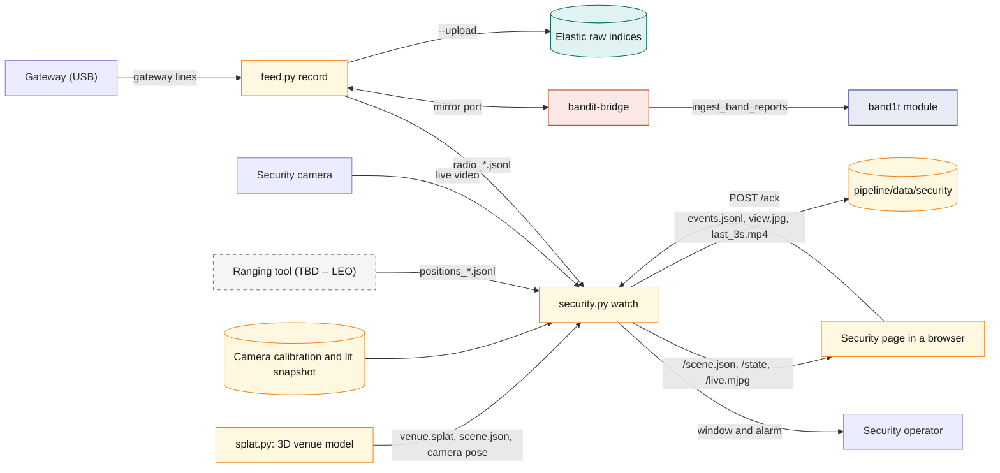
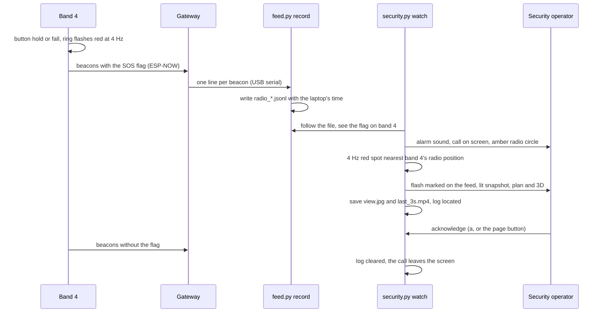
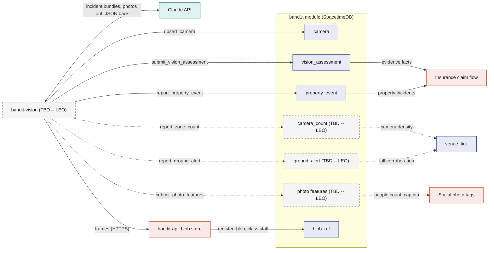

# Vision

> (TBD -- LEO) Leo owns vision: the cameras, the models, where they run and how Claude is used. Two parts are built. Leo's security view in `pipeline/` finds a band that calls for help on a camera and shows the operator where the person is. The module's camera tables take a Claude assessment and property events per incident; today the scripted claims run plays the vision side of them. The rest of the module interface (the pit head count, person-down alerts and photo features) is not built. This file fixes what it sends in and gets back, with Leo's defaults, which Leo may change.

Vision is the camera side of BandIt. In the security room a camera watches the floor. When a band calls for help, its whole ring flashes red four times a second. Leo's security view finds that flash in the picture, ties it to the band the radio says is calling, and shows the operator where the person is: on the live feed, on a snapshot of the same view with the lights on, on the venue plan and in a 3D model of the venue. An alarm sounds until someone acknowledges it. The view reads the gateway's radio through Leo's recorder on the venue laptop, not through the module, so it keeps working when the internet drops. Toward the `band1t` module, vision gives a Claude judgment and property events for each incident, and is planned to give a head count for the pit, person-down alerts and features of photographer photos. Everything that reaches the module goes through reducers under the role `vision`, and the module, not vision, decides what happens next. Vision is never in the safety path: bands alert locally within a second, and vision locates, confirms and writes the report after that.

## Role in the system

Responsibilities, built (Leo's Python code in `pipeline/`, on the venue laptop):

- Record every gateway line with the laptop's clock (`feed.py record`), and hand the same lines to `bandit-bridge` through a mirror port, so the recorder and the bridge share the one gateway.
- Find the 4 Hz red flash of a band in SOS or fall on the security camera, tie it to the band whose beacons carry the flag, and place it on the venue plan (`security.py watch`).
- Sound an alarm in the security room until it is acknowledged, and keep a record of every SOS it located.
- Serve the security page: the venue in 3D with the stations, the bands, each SOS and the camera, beside the marked live feed.
- Build the 3D model of the venue from a phone walk-through and place the security camera in it (`splat.py`).
- Load the radio log and the event photos, with exact times and places, into Elastic for matching against the band data (`feed.py upload`, `photos.py`).

Responsibilities toward the module:

- On an `sos`, `fall` or `property` incident in a camera's zone, write Claude's judgment of the frames through `submit_vision_assessment`. Built in the module; Test-Bands.md: the `bandit-claims` tool plays this side in the scripted claims run ([Test-Bands](../3-services/Test-Bands.md)).
- Report property events through `report_property_event`, attached to a `property` incident or opening one; [Insurance](../6-features/Insurance.md) reads them as evidence. Built in the module, played the same way.
- (TBD -- LEO) Write a fresh people count for the pit through `report_zone_count`.
- (TBD -- LEO) Raise and refresh a person-down alert through `report_ground_alert`.
- (TBD -- LEO) Supply photo features through `submit_photo_features` for [Social](../6-features/Social.md)'s photo tags.
- Store frames as blobs through `bandit-api` and pass their hashes as evidence.

Not responsible for:

- Opening or closing incidents from the flash. The module opens an `sos` or `fall` incident from the same beacons ([Safety](../6-features/Safety.md)); the security view only shows where to look.
- Writing `zone_state` or commanding bands. `venue_tick`, `ingest_band_reports` and the directives do that ([Safety](../6-features/Safety.md)). The one command vision sends is the identify blink during calibration, before doors open.
- Identifying people. Identity comes from bands (zone and time). Claude never identifies faces, and no face recognition runs anywhere.
- Gating anything live. If vision is slow or absent, nothing waits.

## Interfaces

### The security view and the recorders (built)

| Interface | Direction | Between | What flows | Transport |
|---|---|---|---|---|
| Gateway serial | in | gateway to `feed.py record` | every gateway line ([Hardware](Hardware.md)) | USB serial, 115200 baud |
| Radio log | out | `feed.py` to `security.py` | `pipeline/data/radio_<session>_<time>.jsonl`: per gateway line, the laptop's time of reading it, the time the gateway heard it (its uptime anchored to the laptop clock), the session and the raw line | a file that `security.py` follows as it grows |
| Mirror port | both | `feed.py --mirror` and `bandit-bridge` | the same gateway lines out; the bridge's commands back to the gateway ([Gateway-Bridge](../3-services/Gateway-Bridge.md)) | a pseudo-terminal on the laptop, whose path the bridge opens instead of the USB port |
| Identify blink | out | `security.py calibrate` to one band | `cmd <band> state 8 60`: the band blinks white (IDENT) for 60 s, sent again every 5 s while a spot is pending | the gateway port, or the mirror port while the recorder runs |
| Camera feed | in | security camera to `security.py` | live video at the camera's rate (30 fps); below 12 fps a 4 Hz flash cannot be seen, and the status line says so | a camera the laptop reads directly, or a video file |
| Radio positions | in | Leo's ranging tool (TBD -- LEO) to `security.py` | `pipeline/data/positions_<name>.jsonl`: per band, its position on the plan and the radius it is good to (about half a metre to a metre) | a file that `security.py` follows |
| Station anchors | in | `security.py anchors` | stations 101 to 105 and the gateway placed on the plan, and the plan's metres per pixel, for the ranging tool and the 3D page | `pipeline/data/security/anchors.json` |
| Venue plan | in | the repo | `pipeline/venues/palace-of-fine-arts.json`: the ground-floor plan image of the Palace of Fine Arts, its sections (halls, breakout rooms, entrances) and notes on orientation | file |
| Security window | out | `security.py watch` to the operator | the live feed, the lit snapshot, the plan and a zoomed plan, all marked; the alarm; `a` acknowledges, `q` quits | a window on the laptop |
| Security page | out | `security.py watch --serve 8770` to a browser | `/scene.json` (venue, plan, anchors, model, camera pose), `/state` (bands, open SOS calls, flashes, status lines), `/live.mjpg` (the marked feed), `POST /ack` | HTTP on the laptop; on the room's network with `--host 0.0.0.0` |
| SOS record | out | `security.py watch` | one `events.jsonl` line per event (`sos`, `radio_position`, `located`, `flash_without_sos`, `acknowledged`, `cleared`, `dropped`), and per located SOS a folder with `view.jpg` and `last_3s.mp4` | files under `pipeline/data/security/` |
| 3D venue model | out | `splat.py` to the security page | `venue.splat` and `scene.json` (model to venue transform) under `pipeline/data/venue/splat/`; the camera's pose and lens in `pipeline/data/security/cameras/<name>.json` | files |
| Elastic.md: raw radio and photos | out | `feed.py --upload`, `feed.py upload`, `photos.py --upload` | the indices `bandit-raw-radio`, `bandit-raw-heard`, `bandit-raw-gateway` and `bandit-raw-photos` ([Elastic](../7-integrations/Elastic.md)) | Elastic Bulk API |

### The module interface

| Interface | Direction | Between | What flows | Transport |
|---|---|---|---|---|
| `upsert_camera` | out | vision to module | one `camera` row per camera: name, the zone it covers, mount (`overhead` or `side`); marks it live | SDK reducer, roles `vision` and `ops` |
| `submit_vision_assessment` | out | vision to module | incident id, trigger, confirmed yes or no, confidence, description for staff, recommended action, insurance-ready incident description, camera id, frame hashes with their capture times, `model_call` id; sets `incident.vision_status` | SDK reducer, role `vision` |
| `report_property_event` | out | vision to module | incident id, camera id, kind, description, confidence, frame hashes; with incident id 0 the module opens a `property` incident in the camera's zone with `opened_by` `vision`, otherwise the event attaches to that `property` incident | SDK reducer, role `vision` |
| Frame upload | out | vision to `bandit-api` | JPEG frames; `bandit-api` stores them and calls `register_blob` with access class `staff` and purpose `frame` | HTTPS to the public host ([Rust-Backend](../3-services/Rust-Backend.md)) |
| (TBD -- LEO) `report_zone_count` | out | vision to module | camera id, zone id (the pit), count, counts per cell of the 3 by 3 grid, light circle visible yes or no, confidence; overwrites `camera_count` in place | SDK reducer, role `vision`, every 3 s |
| (TBD -- LEO) `report_ground_alert` | out | vision to module | camera id, zone id, cell hint, confidence, frame hash; refreshed every second while the person stays down | SDK reducer, role `vision` |
| (TBD -- LEO) `submit_photo_features` | out | vision to module | photo id, people count, caption, `model_call` id; checks the job lease | SDK reducer, role `vision` |
| (TBD -- LEO) `heartbeat` | out | vision to module | service `vision`, version, frames waiting, camera name, detector frame rate, time of the last Claude call | SDK reducer, every 5 s |
| (TBD -- LEO) Subscriptions | in | module to vision | `zone`, `camera`, the view `vision_incidents`, and `worker_jobs` for job kind `photo_features` | SDK subscription |
| Claude API | out | vision to Claude | incident bundles (frames plus text) and, after the event, photographer photos; structured JSON output; every call recorded in `model_call` | HTTPS through `claude-client` ([Anthropic-Agent](../7-integrations/Anthropic-Agent.md)) |

## Design

### The security view

The question this diagram answers: what feeds the security view, and what it gives back.

**The camera.** One camera in the security room, read directly by the venue laptop (an iPhone used as the Mac's camera works, with Center Stage off so the picture does not pan). It hangs above head height and tilts down at the area, and it stays still after calibration. It runs at 30 fps; the flash finder needs at least 12.

**Calibration, once, with the lights on.** `security.py calibrate` takes the first second of video as the lit snapshot. A helper wearing a band stands on a spot, and the operator clicks that spot on the plan. The view puts that band into identify through the gateway, so it blinks white at 2.5 Hz, and finds the blink in the picture. Once the blink holds still for a second, the pair of points (picture and plan) is recorded. Four spots or more, spread over the area and not in a line, give the mapping from the picture to the plan at wrist height (0.9 m), which is saved with the lit snapshot under `pipeline/data/security/cameras/`. `splat.py camera` gives the same mapping another way: it registers one frame from the camera against the 3D model, which fixes the camera's exact position, direction and lens.

**Finding the flash.** A band whose beacons carry the SOS or fall flag flashes its whole ring red at 4 Hz ([Hardware](Hardware.md)). The view keeps the last 1.5 s of a reduced picture (640 px wide) and, every third frame, measures for each point how strongly its red level swings at 4 Hz. A point counts when the swing is large enough and at least twice the swing at 2.5 Hz and at 5.5 Hz. Neighbouring points join into a spot, and a spot is kept only if its swing is mostly red. Steady red such as exit signs, other colours and other rates fall away. A spot seen twice in a row becomes a flash; one unseen for 1.5 s is dropped.

**Tying a flash to a band.** The view follows the radio log. A fresh beacon (heard in the last 6 s) with the SOS or fall flag opens an SOS call in the view, logs it and sounds the alarm. With a radio position for that band and a calibrated camera, the call takes the flash nearest to that position on the plan, if it is within 3 m or twice the position's radius. With several calls at once, each flash goes to the band whose radio position is nearest. Without a radio position, the call takes the strongest free flash. A red 4 Hz flash with no call on the radio gets only a quiet yellow marker.

**What the operator sees.** The located call is marked on the live feed, on the lit snapshot (useful when the room is dark), on the plan and in 3D. Before the flash is found, or while it is hidden, the band's radio position shows as an amber circle, so the operator knows where to look. The alarm repeats every 5 s until someone presses `a` in the window or Acknowledge on the page. The call stays on screen until a fresh beacon from the band no longer carries the flag. If the radio loses the band, the call turns stale and is dropped 60 s after the last beacon once it has been acknowledged. When a call is first located, the view saves the marked view and the last 3 s of video in a folder for that call, and logs how long locating took and how far the camera and the radio positions disagreed.

The sequence answers: what happens in the security room when a band calls for help.

### The 3D venue model and the security page

`splat.py` builds the venue in 3D from one phone walk-through video: the sharpest 300 frames (`frames`), where the phone was for each (`poses`, COLMAP on the laptop's CPU), a Gaussian splat trained on the Mac's GPU (`train`, Brush, colour only), and the alignment to the plan (`align`). The alignment finds the floor, shows the model from above beside the plan, and takes two or more pairs of matching points, such as wall corners, pillars and doors. The plan's scale comes from the anchors file, which `security.py anchors` writes after two points a known distance apart are clicked. The result is `scene.json` (model to venue, in metres on the plan) and `venue.splat`, the model moved into that frame and trimmed to the venue.

`security.py watch --serve 8770` serves the security page. It shows the venue in 3D (the splat, or the plan as the floor when there is no splat) with the stations, every placed band, each SOS as a red column with its radio circle, and the camera with what it covers and the line from it to the flash it found. Beside it is the live feed with the same marks. Keys 1, 2 and 3 show the 3D view, the feed, or both. The page loads three.js and Spark from jsDelivr once and keeps them in `pipeline/data/web-vendor`, so it works offline afterwards.

### The recorders

`feed.py record` reads the gateway at 115200 baud and writes one line per gateway line with two times: when the laptop read it, and when the gateway heard it (the gateway's uptime, anchored to the laptop clock and re-anchored when the gateway restarts). With `--mirror` it opens a pseudo-terminal that carries the same lines and passes commands back, so `bandit-bridge` reads the gateway through it while the recorder runs. With `--upload` it also sends the lines to Elastic every 2 s; `feed.py upload` sends recorded files afterwards. Each document's id comes from its time and text, so uploading a file again never makes duplicates.

`photos.py` imports photos with exact times and places for matching against the band data. iPhone photos dropped in one folder keep their own clock and location; a camera's SD card is corrected from a photo of a phone showing a clock with seconds (one such photo fixes the offset, two also the drift). Records go to `pipeline/data/photos_<session>_<time>.jsonl` and, with `--upload`, to Elastic.

Elastic.md: the four raw indices hold, per session, band beacons and station beacons (`bandit-raw-radio`: flags, zone, battery, state, sequence), the RSSI each band hears from its neighbours and the five stations (`bandit-raw-heard`, with the station RSSIs as a 5-number vector), the gateway's own lines (`bandit-raw-gateway`) and the photos with time, camera and location (`bandit-raw-photos`) ([Elastic](../7-integrations/Elastic.md)).

### The module side

The module defines three tables for vision: `camera`, `vision_assessment` and `property_event`, with the reducers `upsert_camera`, `submit_vision_assessment` and `report_property_event`. Test-Bands.md: `bandit-claims setup` registers the camera "overhead pit" on the main stage zone, and `bandit-claims property --camera` plays the vision side for the property incident in the scripted claims run: a frame in the blob store, a `fallen_object` event and a confirmed assessment ([Test-Bands](../3-services/Test-Bands.md)). Nothing in `pipeline/` calls these reducers yet; the service that will is `bandit-vision` (TBD -- LEO), under the identity of that name.

`camera`: one row per camera.

| Field | Meaning |
|---|---|
| `id` | assigned by SpacetimeDB |
| `name` | unique, such as "overhead pit" |
| `zone_id` | the zone it covers |
| `mount` | `overhead` or `side` |
| `live` | set when `upsert_camera` runs |
| `last_frame_at` | the time of the last assessment from this camera |

`vision_assessment`: one per incident check.

| Field | Meaning |
|---|---|
| `id` | assigned by SpacetimeDB |
| `incident_id` | the incident judged |
| `trigger` | `band_sos`, `band_fall`, `ground_alert` or `staff_button`: what opened the incident |
| `confirmed` | yes or no; sets `incident.vision_status` to `confirmed` or `not_confirmed` (it starts as `none`) |
| `confidence` | 0 to 1; anything else is refused |
| `description` | what the frames show, for staff |
| `recommended_action` | one line |
| `incident_description` | the insurance-ready paragraph Insurance copies into the evidence pack |
| `camera_id` | which camera, so Insurance can check the camera's zone against the band's zone |
| `frame_hashes`, `frame_times` | each frame's SHA-256 in the blob store with its capture time; the two lists must be the same length |
| `model_call_id` | the `model_call` row, for audit and replay |
| `created_at` | server time |

`property_event`: something other than a person that needs a record, such as a fallen speaker.

| Field | Meaning |
|---|---|
| `id` | assigned by SpacetimeDB |
| `camera_id`, `zone_id` | where; the zone is the camera's |
| `kind` | `fallen_object`, `spill`, `damage` or `other` |
| `description`, `confidence` | from the assessment |
| `observed_at` | server time |
| `frame_hashes` | evidence frames |
| `incident_id` | the `property` incident this event opened or attached to; attaching to an incident of another kind is refused |

### Leo's defaults for the rest (TBD -- LEO)

None of this is built. It is what the rest of the system expects, and Leo may change any of it.

- The pit check. A camera over the pit counts people inside the taped square and per cell of a 3 by 3 grid over it, and sees whether the ring of blue lights (the light circle) is visible, every 3 s, through `report_zone_count` into `camera_count`. `camera_count` is overwritten in place per camera and zone and is fresh for 6 s (starting value).
- Person down. From the pose, a torso near horizontal and low in two consecutive frames (starting value) raises a `ground_alert` through `report_ground_alert`, refreshed every second while the person stays down and expired 10 s after the last refresh. An alert in the zone of an open `sos` or `fall` incident within 3 s of the flag (starting value) would set a new `incident.camera_corroborated` column. An alert with no band flag in its zone that persists for 5 s opens a `fall` incident with `opened_by` `vision` and no band, because people without a band fall too ([Safety](../6-features/Safety.md)).
- Claude on incidents. When the view `vision_incidents` (role `vision`: the open `sos`, `fall` and `property` incidents in the camera's zone with their `incident_snapshot`, and no display name) delivers a new incident, vision waits 3 s, sends `claude-opus-5-5` at medium effort the 8 frames from 4 s before to 3 s after, the detector's boxes and the band rows as text, and writes the answer through `submit_vision_assessment`; for a `property` incident it also writes `report_property_event`. While the call runs, `incident.vision_status` would read `pending`. There is no periodic Claude loop.
- Photo features, after the event. Social.md's `register_photo` would enqueue a `photo_features` job per photographer photo. Vision takes it with the `vision` role, asks Claude through Message Batches for the people count and a one-line caption, and writes them through `submit_photo_features`. Social caps a photo's tags at that count. Identity always comes from bands, never faces.
- Every Claude call goes through `claude-client` and is recorded in `model_call` ([Anthropic-Agent](../7-integrations/Anthropic-Agent.md)). Claude reads and writes words; code decides safety, money, coverage and access.

The flowchart shows the module interface: what vision sends in, what the module stores, and who reads it. Dashed nodes are not built.

### Role `vision`

`bandit-vision` connects as its own identity, and the owner grants it `vision` with `grant_role` ([SpacetimeDB](../2-data/SpacetimeDB.md)). `submit_vision_assessment` and `report_property_event` accept only this role; `upsert_camera` also accepts `ops`. The job reducers accept `vision` too, so the service can take `photo_features` jobs without the broader `worker` role. Nothing else in the module accepts `vision`, so a compromised camera process cannot command bands, and it reaches incidents only through its own rows, `vision_status` and the `property` incidents it opens.

### What each consumer does, with and without vision

| Consumer | With vision | Without vision (file deleted or service down) |
|---|---|---|
| The security room | the operator sees where each calling band is on camera, on the plan and in 3D, with an alarm until acknowledged | the operator has the Ops dashboard's incidents and zones only ([Ops-Dashboard](../5-apps/Ops-Dashboard.md)) |
| [Insurance](../6-features/Insurance.md) | `property` incidents from `report_property_event`; `vision_assessment` and `property_event` rows and their frames become evidence facts in the pack, and the camera's zone is checked against the band's zone | no camera evidence; claims proceed on band facts, staff notes and the staff button's `property` incidents |
| (TBD -- LEO) `venue_tick` density ([Safety](../6-features/Safety.md)) | the pit's density is the higher of the fresh band estimate and the camera estimate; Plan B can run on the camera count alone | band estimate only |
| (TBD -- LEO) Incident corroboration ([Safety](../6-features/Safety.md)) | a person-down alert marks the incident corroborated, a second source and never a gate | falls rely on the band's IMU alone |
| (TBD -- LEO) [Social](../6-features/Social.md) photo tags | the people count caps the tags and fills the caption | tags by zone and time with the default cap |

Anthropic-Agent.md: without it, vision sends nothing to Claude, so there are no assessments and no photo features; the security view, counts and alerts keep working, and `vision_status` stays `none`.

## Failure modes and fallbacks

| Failure | Effect | Design answer |
|---|---|---|
| The internet drops at the venue | the module and the dashboard on Maincloud are out of reach | the recorder, the security view and the page run on the laptop from local files and need no network |
| The flash is hidden (a body, a pillar) or the camera does not cover that spot | no flash for the call | the call is on screen with the alarm from the radio alone, and the band's radio position shows as an amber circle |
| Two bands call at once | two calls and two flashes | each flash goes to the band whose radio position is nearest |
| Something else flashes red at 4 Hz | a flash with no call | it gets only a quiet yellow marker and an `events.jsonl` line, never an alarm |
| The camera runs below 12 fps | a 4 Hz flash cannot be seen | the status line turns amber and says so |
| The radio loses a calling band | the call can neither clear nor refresh | it is marked stale and, once acknowledged, dropped 60 s after the last beacon |
| The camera is moved after calibration | the marks land in the wrong place | the camera stays still after calibrating; calibrating again takes a few spots |

## Dependencies

**Depends on**

- [Hardware](Hardware.md): the SOS red strobe at 4 Hz and the IDENT white blink at 2.5 Hz, the gateway's serial lines and `cmd` lines, the stations 101 to 105.
- [Gateway-Bridge](../3-services/Gateway-Bridge.md): the bridge opens the recorder's mirror port while the recorder runs.
- [SpacetimeDB](../2-data/SpacetimeDB.md): `incident` (its column `vision_status` and the `opened_by` value `vision`), `zone`, `blob_ref`, `model_call` (Anthropic-Agent.md); `grant_role`; for the planned parts, `incident_snapshot`, `job`, `service_heartbeat` and the view `worker_jobs`.
- [Rust-Backend](../3-services/Rust-Backend.md): the blob upload through `bandit-api` and `register_blob`.
- [Anthropic-Agent](../7-integrations/Anthropic-Agent.md): `claude-client`, structured outputs, Message Batches, `model_call` recording.
- [Elastic](../7-integrations/Elastic.md): the raw indices for the radio log and the photos.

**Used by**

- [Insurance](../6-features/Insurance.md): `property` incidents, `vision_assessment`, frames as evidence.
- (TBD -- LEO) [Safety](../6-features/Safety.md): the camera density estimate, the Plan B density source, fall corroboration.
- (TBD -- LEO) [Ops-Dashboard](../5-apps/Ops-Dashboard.md): the camera tile and the assessment on incidents.
- (TBD -- LEO) [Social](../6-features/Social.md): photo features for tagging.

**If you delete this file**

- Drop `pipeline/` (the recorder, the security view, the 3D model, the photo importer and the venue file); `bandit-bridge` then opens the gateway's USB port directly.
- Drop the tables `camera`, `vision_assessment` and `property_event`, the reducers `upsert_camera`, `submit_vision_assessment` and `report_property_event`, and the role `vision`; for the planned parts, `camera_count`, `ground_alert`, the view `vision_incidents`, `report_zone_count`, `report_ground_alert`, `submit_photo_features` and the job kind `photo_features`.
- SpacetimeDB.md and Safety.md: remove `incident.vision_status`, the `opened_by` value `vision`, the camera estimate from the density rule and the camera half of Plan B.
- Ops-Dashboard.md: remove the "Vision.md" rows and the `vision` service card.
- Insurance.md: remove the camera-sourced property incidents and the vision evidence facts. Test-Bands.md: remove the camera from `bandit-claims setup` and the `--camera` option of `property`.
- Social.md: remove the photo-features fields and the cap by people count.
- Elastic.md: remove the raw radio and photo indices.
- Architecture.md, Requirements.md (F15), Decisions.md and README.md: remove the Vision rows. Hardware.md: remove the camera rows and subsection.
- Rust-Backend.md: remove the `bandit-vision` rows and the `photo_features` row in the handler registry.
- Anthropic-Agent.md: remove the two Vision rows from the use-case table and the Vision bullet from its deletion list.

## Decisions

| Decision | Why |
|---|---|
| (TBD -- LEO) The security view finds a calling band by its 4 Hz red flash on a camera, and ties it to the band through the radio | the band already flashes when it calls for help, so the camera needs no model and no face; the radio says which band, the camera says exactly where |
| (TBD -- LEO) Only red that swings at exactly 4 Hz counts, checked against 2.5 Hz and 5.5 Hz | exit signs and stage lights are red too; the rate is what only a calling band has |
| (TBD -- LEO) The view reads the gateway through the recorder's file and mirror port, not through the module | the security room keeps working without the internet, and the recorder and the bridge share one gateway |
| (TBD -- LEO) Calibration blinks a worn band in identify at wrist height on four or more spots | the same flash finder finds the blink, so the mapping is measured at the height the SOS flash will be |
| (TBD -- LEO) A radio position picks between flashes, within 3 m or twice its radius | radio positions are off by half a metre to a metre; the camera's flash is exact |
| (TBD -- LEO) The lit snapshot is taken at calibration and shown beside the live feed | the room may be dark during the event; the operator still sees the spot in a lit picture |
| (TBD -- LEO) The alarm repeats every 5 s until acknowledged, and the call stays until the radio clears it | a call is never silently lost; acknowledging stops the sound, not the call |
| (TBD -- LEO) The venue in 3D is a Gaussian splat from one phone walk-through, aligned to the plan | one walk gives a model the operator recognises, and the plan keeps it in the same metres as the stations |
| (TBD -- LEO) Every located SOS saves the marked view and the last 3 s of video | a record of what the camera saw, kept on the laptop |
| The module's camera tables take one assessment per incident and property events, under the role `vision` | Insurance reads them as evidence; the module, not vision, decides what happens next |
| A failed or refused Claude call writes no assessment; `vision_status` stays as it was | the incident is already handled by bands and staff; the `model_call` row records the reason |
| (TBD -- LEO) Live, Claude is used only to judge an incident, with the same Anthropic key as the workers; counting and person-down would run locally | Claude makes the judgment; one key to manage |
