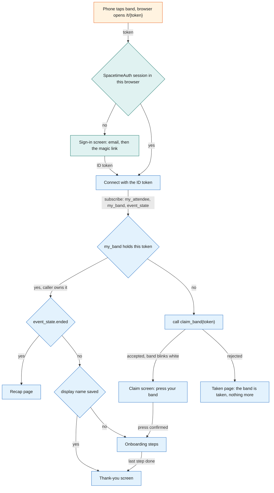
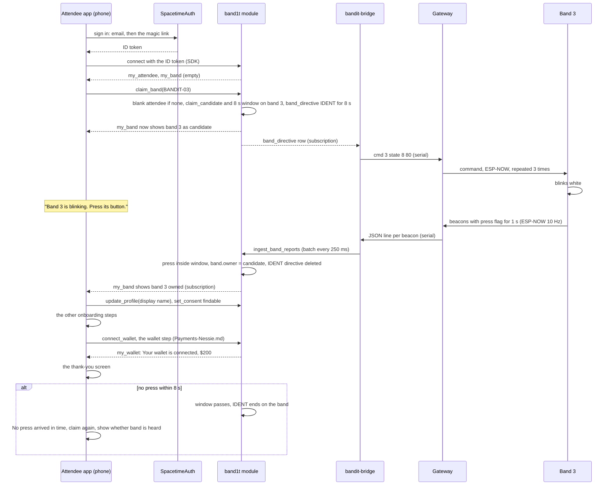
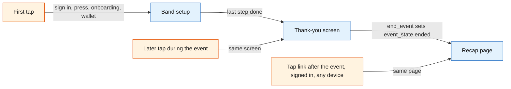
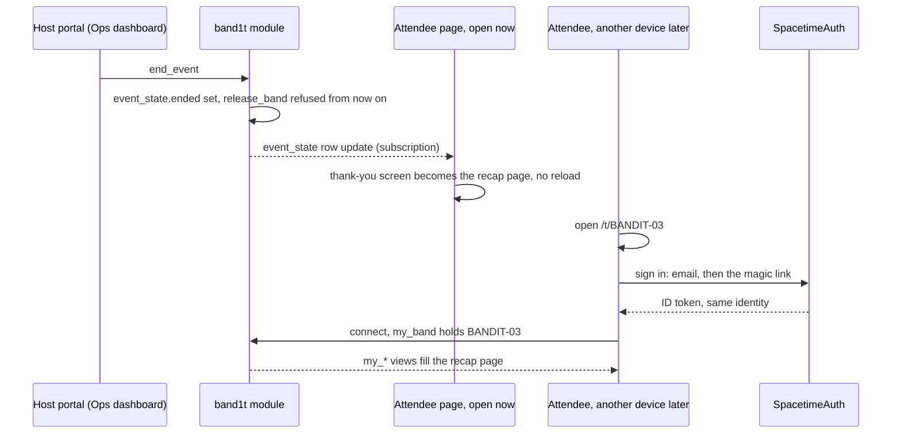

# Attendee app

The attendee app is the web app that opens when a phone taps a band's NFC sticker. During the event it does one thing for the attendee: band setup at the first tap (sign in, claim the band by pressing its button, a short onboarding), then a thank-you screen. After the event the same page is the attendee's recap. The tag URL has no staff views: staff work in the [Ops dashboard](Ops-Dashboard.md). It runs in the phone browser, signs the attendee in with SpacetimeAuth, reads everything from the `band1t` module through SpacetimeDB's TypeScript client SDK, and calls `bandit-api` only for file uploads and the order of the recap's suggestions.

## Role in the system

Responsibilities:

- Resolve the tapped token to a band and decide which screen to show (the landing route).
- Sign the attendee in. At the first tap the attendee signs in with the SpacetimeAuth magic link; the SpacetimeDB identity that comes with the sign-in is the attendee id.
- Claim the band by press, then run the onboarding steps, then show the thank-you screen.
- Hold the display name and the `findable` consent switch, both set during setup.
- Show the same thank-you screen at every later tap during the event, and nothing else.
- Turn every open page into the recap page, live, when a staff member with `ops` ends the event, and open it again later for the signed-in owner of the tapped band, on any device.

Not responsible for:

- Safety. The band decides its own colours and the module decides directives ([Safety](../6-features/Safety.md)). The ring's colour and, on full bands, the vibration are the only guidance the attendee gets; the attendee page shows no band state, zone, exit or alert.
- Holding truth. Every screen is a subscription and every change is a reducer call. If the phone dies, nothing is lost.
- Talking to the gateway or to any external service. Those go through `bandit-bridge`, `bandit-api` and `bandit-workers`.
- Positions. There are none; the recap shows zones ([SpacetimeDB](../2-data/SpacetimeDB.md)).

## Interfaces

| Interface | Direction | Between | What flows | Transport |
|---|---|---|---|---|
| NFC tag URL | in | phone OS to app | `https://<host>/t/BANDIT-0n`, where `<host>` is the one public HTTPS host of `bandit-api` ([Rust-Backend](../3-services/Rust-Backend.md)); the token is the path | NDEF URL read by the OS, opened in the browser |
| Static bundle | in | `bandit-api` to browser | the app itself, served from the same origin as the upload and recap order endpoints, so no cross-origin setup is needed | HTTPS |
| SpacetimeAuth sign-in | both | app and SpacetimeAuth | the magic-link email sign-in; an OpenID Connect ID token back | HTTPS, OpenID Connect |
| SpacetimeDB connection | both | app and `band1t` module | the ID token, subscriptions, reducer calls | TypeScript client SDK over WebSocket |
| Own-row views | in | module to app | `my_attendee`, `my_consent`, `my_band` (bands the caller owns or is the claim candidate for), `my_band_report` (whether the band being claimed is heard) | SDK subscription |
| Public rows | in | module to app | `event_state` (its `ended` flag turns the page into the recap); `venue`, `zone` and `booth` for the names on the recap | SDK subscription |
| Reducers | out | app to module | `claim_band`, `update_profile` (display name), `set_consent`, `open_api_session` (once per page load, see Identity) | SDK reducer call |
| Blob upload | out | app to `bandit-api` | files for features that need them through `POST /api/blobs`, with the API session token; `bandit-api` stores the file under its SHA-256, calls `register_blob` and returns the hash and the URL `/blobs/<sha256>` | HTTPS, endpoint in [Rust-Backend](../3-services/Rust-Backend.md) |
| Medical-ID.md | both | app, module and `bandit-api` | the two document steps of setup, "Your medical history" and "Your health insurance": each PDF goes to `POST /api/blobs?purpose=history` or `purpose=insurance` with the API session token, then the app calls `submit_medical_document` with the kind, the hash and the page count; in test mode "Use the sample PDF" loads the synthetic PDF from `/samples`; the card step after "Are you one of these?", from `my_medical_documents` and `my_medical_card`, with "Looks right" calling `confirm_medical_card` | HTTPS and SDK |
| Payments-Nessie.md | both | app and module | the wallet step after the card step, "Connect your Capital One wallet" with "Connect" and "Skip": "Connect" calls `connect_wallet`, the step shows "Connecting your Capital One wallet" until `my_wallet` has a row, then "Your wallet is connected" with the balance ($200 to start) and "Continue"; the wallet section of the recap page, "Your BandIt wallet": the balance from `my_wallet` and the entries from `my_wallet_entries`, among them each claim payout, or "Opening your wallet" while there is no account | SDK |
| Social.md | both | app and module | the setup socials step: the attendee types their Instagram, Facebook and Threads handles, saved with `set_social_handle` into `social_handle`; the recap's space-time view from `my_visits` and `my_encounters`; the social part of the recap page through `my_visits`, `my_encounters`, `my_shared_visits`, `my_photos` (with `respond_photo_tag`), `my_share_links` and the recap's graph from `my_graph`; the photographer route (role `photographer`, read from `my_roles`) that uploads a photo through `POST /api/blobs` and calls `register_photo` with its URL | SDK and HTTPS |
| BrightData.md | both | app and module | the profile claim step in setup, "Are you one of these?", shown only when the name matches: the app lists the `person` rows (exhibitor, speaker or artist scraped from event pages) whose name matches the typed display name and that `claimed_people` does not list; the attendee taps "This is me" and the app calls `claim_person`, which works only for an attendee who already owns a band; "None of these" goes on | SDK |
| Elastic.md | out | app to `bandit-api` | `GET /recap/order` when the recap page opens: the order of the recap's people and booths. The lists themselves come from the app's own subscriptions. Without Elastic.md, the app orders both lists by minutes together | HTTPS |
| Merch.md | both | app and module | the merch section at the bottom of the recap page: suggestions from `my_merch_suggestions`, the preview that places the photo in the template's photo area, the one-tap "Buy" that calls `buy_merch` as the signed-in attendee, and `my_merch_orders` | SDK |

## Design

### Routes

| Route | Who sees it | Purpose |
|---|---|---|
| `/t/{token}` | anyone | The only URL written on the tags, and the attendee's only route. Decides the screen from the sign-in, the band and the caller: band setup, then the thank-you screen during the event; the recap page for the band's signed-in owner after the event, on any device. |
| Social.md: `/photo` | role `photographer` | Upload a photo and call `register_photo`. Content in [Social](../6-features/Social.md). |

`/t/{token}` shows the same thing to everyone who taps: setup, the thank-you screen or the recap, for the caller's own band. Staff tools live in the [Ops dashboard](Ops-Dashboard.md). Every tag holds the same host, the public `bandit-api` host, so judges use their own phones on any network.

### Landing route decision

The landing route works out who tapped which band. Band rows are private, and `my_band` returns only bands the caller owns or is the claim candidate for, so the route learns a band's status by trying to claim it: `claim_band` accepts, which starts the press window, or rejects. Nothing is lost by trying, because a claim completes only with a press on that band.

1. Sign in. With no SpacetimeAuth session in this browser, the app shows the sign-in screen: the attendee types an email and opens the magic link (see Identity). The tap token stays in the URL, so the route continues after the sign-in.
2. Connect to SpacetimeDB with the ID token and subscribe to `my_attendee`, `my_band` and `event_state`.
3. `my_band` already holds a band with this token: the caller owns it. Once `event_state.ended` is set, the page is the recap. Before that, the page is the thank-you screen when `my_attendee` has a display name, and the onboarding steps when it has none. So a later visit by someone who finished setup lands on the thank-you screen.
4. Otherwise call `claim_band` with the token:
   - accepted: the band blinks white; show the claim screen ("Press the button on your band").
   - rejected: the "taken" page, which says only that the band is taken. Anyone can read the tag, so this page reveals nothing about the owner. After the event every band keeps its owner, so a stranger who taps a claimed band always gets this page.

The flowchart below answers one question: which screen does a tap open, in the order the checks run.

### Identity

One sign-in, for attendees and staff alike: the SpacetimeAuth magic link. SpacetimeAuth is SpacetimeDB's own OpenID Connect provider, in beta. BandIt turns on its magic-link email sign-in only, with no other providers. The attendee types an email, opens the link SpacetimeAuth sends, and comes back to the app with an ID token. The SDK presents that token to SpacetimeDB, which derives the identity from the token's issuer and subject. So the same person is the same attendee on every device and in every browser: signing in again with the same email gives the same identity. The `attendee` row is keyed by this identity: `claim_band` creates it blank and `update_profile` fills it. BandIt keeps no password and no email address, and sends no email: the address belongs to the SpacetimeAuth sign-in only. The band press proves who holds the band at claim time; the sign-in proves who the attendee is at every later visit.

Talking to `bandit-api` as that same attendee. `bandit-api` is not a SpacetimeDB client of the phone's connection, so it cannot see who is calling by itself. On every page load the app generates a random token, calls `open_api_session` with the token's hash (the module binds the hash to the caller's identity in an `api_session` row with an expiry), and then sends the plain token in a header on every `bandit-api` request (uploads, recap order). `bandit-api` hashes it and looks the hash up in its `api_sessions` subscription, which gives it the attendee id without any JWT verification ([SpacetimeDB](../2-data/SpacetimeDB.md), [Rust-Backend](../3-services/Rust-Backend.md)). The token lives in memory, not in storage.

A lost session (private browsing, cleared site data, a new phone, an iOS home-screen web app with its own storage) does not lose the attendee: they sign in again with the same email, get the same identity, and their band is still theirs. A band claimed by mistake is one ops action: `release_band` on the [Ops dashboard](Ops-Dashboard.md) unclaims the band, and the wearer claims it again by press. The old `attendee` row stays; only the band link moves.

### Claim by press, then onboarding

The tap alone proves nothing, because anyone can read the tag. The press proves that the person signing up is holding the band. The flow is one press, then one field, then a few skippable steps, then the thank-you screen.

1. The landing route calls `claim_band` with the token. The module creates a blank `attendee` row for the caller if none exists, sets `band.claim_candidate` to the caller and `band.claim_pending_until` to now plus 8 s, and upserts a `band_directive` for the band with forced state IDENT (8), `forced_until` now plus 8 s, reason `claim_ident`. `my_band` now returns the band to this caller as its candidate, so the screen can say "Band 3 is blinking white. Press its button to make it yours."
2. `bandit-bridge` sees the directive and sends the state command; the gateway repeats it 3 times, 40 ms apart ([Gateway-Bridge](../3-services/Gateway-Bridge.md)). The band blinks white.
3. The wearer presses once. The band's beacons carry the press flag (bit 2) for 1 s. The bridge batches the changed report into `ingest_band_reports` within 250 ms.
4. Inside `ingest_band_reports`, in the same transaction as the report, the module sees a press from a band whose `claim_candidate` is set and whose window has not passed. It sets `band.owner` to the candidate, clears the candidate, and deletes the IDENT directive; the bridge then lets the forced blink expire and never sends `clear` for it ([Gateway-Bridge](../3-services/Gateway-Bridge.md)). The band returns to density-driven colours. Later batches in the same second see no candidate and do nothing.
5. The app's `my_band` subscription updates with the owner set; the screen says "It's yours" and continues with onboarding.
6. Onboarding, in order, each step skippable except the first:
   - Name ("It's yours"): the display name with `update_profile`, and on the same screen the `findable` switch with `set_consent` (see Consent). There is no company field.
   - Social.md: "Your socials". The attendee types their Instagram, Facebook and Threads handles, and the app saves each with `set_social_handle`. No other networks are asked for, and nobody's profile is looked up or scraped ([Social](../6-features/Social.md)).
   - Medical-ID.md: "Your medical history", then "Your health insurance", one PDF each, with "Upload" and "Skip". Each upload goes through `POST /api/blobs` and then `submit_medical_document`, and Claude reads it into the one `medical_card` (`medical_extract`) while setup goes on ([Medical-ID](../6-features/Medical-ID.md)).
   - BrightData.md: "Are you one of these?", shown only when the display name matches unclaimed `person` rows. The app lists the `person` rows whose name matches the typed display name and that `claimed_people` does not list, each with a "This is me" button. The attendee taps theirs, and the app calls `claim_person`; "None of these" goes on. There is no second press: the band claim made the attendee a band owner, and `claim_person` refuses anyone who owns no band with "claim your band first". It writes a `person_claim` row and copies the profile's organisation and headshot onto the attendee ([BrightData](../7-integrations/BrightData.md)).
   - Medical-ID.md: the card check, skipped when nothing was uploaded. While a document is being read it shows "Claude is reading your documents" with "Check later". Then it shows the card with the page of each item, and "Looks right" calls `confirm_medical_card`. It is the only time the attendee sees the card ([Medical-ID](../6-features/Medical-ID.md)).
   - Payments-Nessie.md: "Connect your Capital One wallet", with "Connect" and "Skip". "Connect" calls `connect_wallet`, which queues the opening of a $200 Nessie sandbox wallet for merch and claim payouts. The step shows "Connecting your Capital One wallet" until `my_wallet` has a row, then "Your wallet is connected" with the balance and "Continue". "Skip" finishes setup without a wallet ([Payments-Nessie](../7-integrations/Payments-Nessie.md)).
7. Done: the thank-you screen. A skipped step is not offered again during the event.

If no press arrives within 8 s, the pending claim expires, the IDENT directive ends on its own, and the screen says "No press arrived in time." with a button that calls `claim_band` once more. The screen also shows whether the band is being heard at all (alive or stale from `my_band_report`, which already returns the candidate's band), so an attendee whose band is out of range knows to walk toward the gateway rather than press again.

The sequence below answers one question: which process does what, from the tap to the thank-you screen.

### Consent

Setup asks for little: a display name, one consent switch and whatever the optional features add. Consent is stored in `consent` through `set_consent`, one row per switch, off until the attendee turns it on in setup. There is one switch, `findable`. It exists in the core even if Social.md is deleted; then it has no effect.

| Switch (`consent` kind) | What it allows | Who enforces it |
|---|---|---|
| `findable` | People you hung out with see you and your Meta handles in their recap, you appear in the people graph, and you can be suggested as a tag in photographer photos | [Social](../6-features/Social.md) |

### The thank-you screen

When the last setup step is done, the page shows the thank-you screen: "You're all set", "Thanks, <name>. Enjoy <venue>." and "Keep your band on. After the event, tap it again for your recap: where you went, who you spent time with, and your photos." It shows nothing else: no band status, no zones and how busy they are, no exit colours or alerts, no wallet, no profile, no graph, no schedule and no photos. Every later tap on the band during the event opens the same screen, on any signed-in device. The screen's one live input is `event_state`: when the event ends, it turns into the recap page.

Safety guidance reaches the attendee only through the band: the ring's colour and, on full bands, the vibration along the route ([Safety](../6-features/Safety.md)). The phone repeats none of it.

The flowchart below answers one question: which state the attendee's page is in, from the first tap to after the event.

### After the event

There is no separate post-event app and no email. The page the attendee already has becomes the recap page. The switch belongs to the host, a staff member with `ops`: when they press "Event ended" in the host portal ([Ops-Dashboard](Ops-Dashboard.md)), `end_event` sets `event_state.ended`. Every open attendee page subscribes to `event_state`, so the thank-you screen turns into the recap live, with no reload. `reopen_event` clears it and the pages show the thank-you screen again, to run the event flow again.

Later, the attendee reopens their tap link `/t/BANDIT-0n` on any device, signed in with SpacetimeAuth, and the recap opens as them. The link is plain and lasting: it is the URL on the band, not a secret, and it shows the recap only to the band's signed-in owner. Anyone else who opens it gets the taken page. Once the event has ended, `release_band` is refused, so every band keeps its owner for the recap.

The sequence below answers one question: how the "Event ended" press by a staff member with `ops` turns every open page into the recap, and how the attendee opens it again later.

The recap page, top to bottom. How it looks is front end and not designed here.

1. Social.md: the space-time view, "Where you were", drawn on the phone from `my_visits` (one bar per stay, zones down the side, time along the bottom) and `my_encounters` (a dot per person met).
2. Social.md: the social part: the people you hung out with and the Meta handles of those who are `findable` (`my_encounters`), the booths you spent time at with their descriptions (`my_visits`), both by minutes together; the people you were in the same place with for a while, with the zone, its booths and the minutes, in time order (`my_shared_visits`); photos you are tagged in, with the people in each, a Share button that opens the phone's share sheet and the tag answer `respond_photo_tag` (`my_photos`); share links (`my_share_links`); and your graph (see The recap's graph below).
3. Merch.md: the merch suggestions and checkout: up to three templates from `my_merch_suggestions`, each with one of your own photos placed in its photo area, bought with one tap on "Buy" (`buy_merch`, paid from the wallet) and shown in `my_merch_orders`.

Every call on the recap page runs as the signed-in attendee. Other sections, each separable:

- Elastic.md: the order of the recap's people and booths. When the page opens it calls `GET /recap/order`, and the people and booths closest to what the attendee was into come first. Without Elastic.md, both lists go by minutes together.
- Payments-Nessie.md: the wallet, "Your BandIt wallet": the balance (`my_wallet`) and every opening, purchase and claim payout (`my_wallet_entries`), or "Opening your wallet" while the attendee has no account. This is where the attendee spends and receives money. The recap has no button that connects the wallet.

### The recap's graph (Social.md)

The graph is a tab on the recap page that draws the attendee's own people graph. It is drawn with Sigma.js and graphology. The ForceAtlas2 layout and the Louvain clusters run in a web worker, so the page stays smooth.

- Links are facts. The app subscribes to `my_graph`: the caller's own neighbourhood of `people_link` rows (`met` with minutes, `visited` with minutes, `works_at`, `exhibits`), with booths and companies as shared nodes. Other people appear as "someone" unless Social.md's naming rules allow their name. The social step of `memory_tick` wrote each link during the event, once a visit reached 2 min or two people had been together for 3 min (starting values). There are no links between people who never met.
- A toggle sets the clusters: by memories (Louvain over `met` and `visited`) or by company (`works_at`). Each cluster is labelled with its members' top booth tags.

### Platform notes

- iPhone XS and newer read an NDEF URL in the background whenever the screen is on and show a banner; tapping it opens Safari at the URL. Each tap may open a new tab; the sign-in is per origin, so every tab is the same signed-in attendee.
- Android opens an NDEF URL in the default browser from the system tag dispatch when the phone is unlocked.
- The band claim starts from the OS opening the tag URL, so it works the same on both platforms with no in-page NFC reading.
- The tag is an NTAG215 holding one NDEF URL on the `bandit-api` host, locked read-only once written ([Hardware](../4-devices/Hardware.md)).
- Simulator.md: crowd bands have no tag and an empty `nfc_token`, and `start_crowd` gives each a simulated owner inside the module. The simulated bands 94 to 99 have a tap link (`/t/BANDIT-94` to `/t/BANDIT-99`) but no tag: a tester opens it and claims the band with a press from `bandit-api`'s dev routes instead of a real press ([Simulator](../3-services/Simulator.md)).

## Failure modes and fallbacks

| Failure | Effect | Design answer |
|---|---|---|
| No press reaches the module within 8 s (band out of range, bridge down) | Claim times out | The screen says "No press arrived in time.", offers to claim again, and shows whether the band is being heard; the IDENT directive ends on the band by itself. |
| Sign-in session lost (private browsing, cleared data, new phone, iOS home-screen app) | The app shows the sign-in screen | The attendee signs in again with the same email and gets the same identity; the band is still theirs, and the page is the thank-you screen again. |
| The sign-in email is slow | The attendee waits on the sign-in screen | The screen offers "Send again"; the tap token stays in the URL, so the claim continues after the sign-in. |
| Stranger taps a claimed band | Could leak the owner | The taken page says only that the band is taken. |
| SpacetimeDB connection drops (phone loses signal) | Setup pauses | The SDK reconnects and replays subscriptions; setup buttons are disabled meanwhile. A thank-you screen that missed `end_event` turns into the recap when it reconnects. Safety never depends on the phone: the band decides its own colours. |
| After the event the judge opens the recap on a device that is not signed in | No recap yet | They open `/t/BANDIT-0n`, sign in with the email they used, and the recap opens as them. |

## Dependencies

**Depends on**

- [SpacetimeDB](../2-data/SpacetimeDB.md): views `my_attendee`, `my_consent`, `my_band`, `my_band_report`; public `venue`, `event_state`, `zone`, `booth`; reducers `claim_band`, `update_profile`, `set_consent`, `open_api_session`; the band fields `owner`, `claim_candidate`, `claim_pending_until`; SpacetimeAuth as the one sign-in.
- [Gateway-Bridge](../3-services/Gateway-Bridge.md) and [Hardware](../4-devices/Hardware.md): the IDENT state, the press flag and the forced-state command that make claim by press work.
- [Rust-Backend](../3-services/Rust-Backend.md): `bandit-api` serves the bundle on the public host, the blob upload endpoint and the `api_sessions` lookup.
- [Ops-Dashboard](Ops-Dashboard.md): `release_band` by ops for band recovery; `grant_role` for staff; the host portal's "Event ended" button, which runs `end_event`.

**Used by**

- [Medical-ID](../6-features/Medical-ID.md): the two document steps and the card step in setup.
- [Payments-Nessie](../7-integrations/Payments-Nessie.md): the wallet step at the end of setup, and the recap's wallet section.
- [Social](../6-features/Social.md): the socials step, the photographer route, the recap's space-time view and its social part with its graph and share links.
- [BrightData](../7-integrations/BrightData.md): the profile claim step, "Are you one of these?".
- [Merch](../6-features/Merch.md): the merch section at the bottom of the recap page.
- [Elastic](../7-integrations/Elastic.md): the order of the recap's people and booths.
- [Flows](../1-overview/Flows.md): the join and claim step and the recap step of the event.

**If you delete this file**

- The event loses tap to join; bands would be registered to people by ops only (`register_band`) and `claim_band` would have no caller.
- Medical-ID.md needs another host for its document and card steps; Social.md needs another host for the photographer route.
- Remove the Attendee app row from the component table in Architecture.md and the attendee row from SpacetimeDB.md's "subscriptions per client".
- Remove the "attendee app" bullets in Social.md, BrightData.md, Elastic.md, Merch.md, Hyphenate.md, Payments-Nessie.md and Medical-ID.md.

## Decisions

| Decision | Why |
|---|---|
| During the event the attendee page is band setup, then a thank-you screen, and nothing else; the recap replaces it when the event ends | the band carries every safety cue on the wrist, and the night comes back in the recap, so the page has nothing to show in between |
| A later tap during the event opens the same thank-you screen; a skipped setup step is not offered again | one screen with one meaning: you are set up |
| Safety guidance reaches the attendee only through the band: the ring's colour and, on full bands, vibration; the phone shows none of it | the ring has no compass, so colour and vibration are the guidance, and they work with the phone in a pocket |
| Every tag holds the one public `bandit-api` host; there is no second entry such as a QR code | there is one deployment, so one host always works, on judges' own phones |
| Every rejection of `claim_band` shows the same taken page, which says only that the band is taken | a stranger learns nothing about the owner, and a band someone else is claiming right now is taken for this caller too |
| Only ops releases a band, with `release_band` on the dashboard after a confirm tap, until the event ends | the attendee page has no screen for it; ops fixes a band claimed by mistake, and after the event every band keeps its owner for the recap |
| One sign-in for attendees and staff: the SpacetimeAuth magic link, and no other providers | the identity comes from the token's issuer and subject, so it is the same on every device; BandIt keeps no password and no email address |
| There is no recap email; `end_event` turns every open page into the recap live, and the tap link `/t/{token}` opens it again later for the band's signed-in owner | the band's own URL is the way back, and the sign-in proves who is opening it |
| The recap page runs top to bottom: the space-time view, the social part, then the merch suggestions and checkout | the night first, the people second, shopping last |
| Socials are typed by the attendee at onboarding | no verification flow to build, and nobody's profile is scraped |
| BrightData.md: the profile claim is one tap, open only to an attendee who already owns a band | the band claim's press already proved who holds the band, so there is no second press and no email round trip |
| Payments-Nessie.md: the wallet is the last setup step, "Connect your Capital One wallet" with "Connect" and "Skip"; setup finishes without it when it is skipped, and the recap has no connect button | the attendee chooses to connect it, every judge who taps has a funded wallet with nothing to type, and the wallet is asked for in one place |
| The attendee page has no staff views; staff work in the Ops dashboard | the tag URL means the same for everyone who taps it, and the medic's tools sit next to the incident |
| Medical-ID.md: the card check comes just before the wallet, not right after the uploads | Claude reads the PDFs while the attendee answers the steps in between, so the card is usually ready when the check comes |
| The app has no merchant route; BandIt takes no payments at the venue | the band press is kept for claiming a band; merch is paid in the app after the event |
| Socials are Instagram, Facebook and Threads handles only, and onboarding has no company field | Meta is the sponsor track; `works_at` links come only from the import and a claimed profile |
| The recap's graph draws its links from the `my_graph` subscription only | SpacetimeDB holds the measured, private facts; there are no links between people who never met |
| Elastic.md: the recap's lists come from `my_encounters`, `my_visits` and `my_shared_visits`; `GET /recap/order` only orders the people and booths | nobody appears who was not measured with the attendee; meaning changes only the order |
