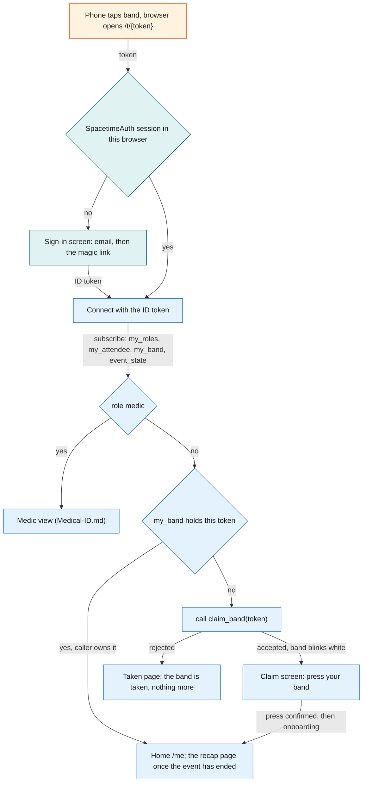
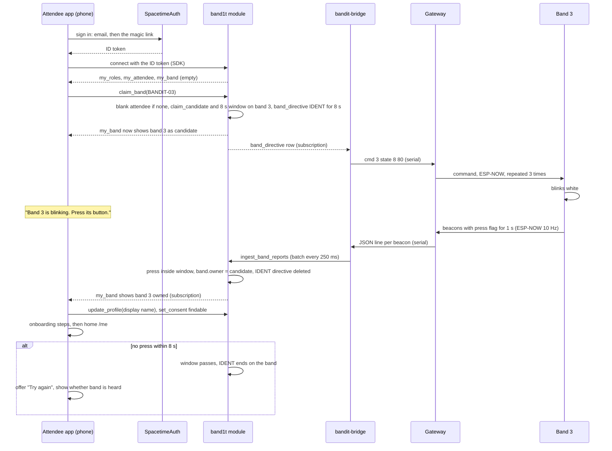
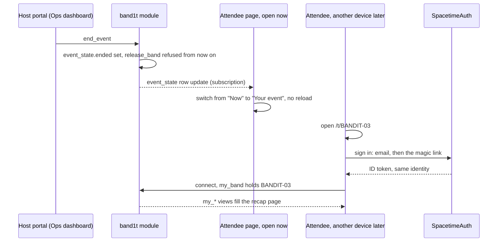

# Attendee app

The attendee app is the web app that opens when a phone taps a band's NFC sticker. It is the attendee's whole relationship with BandIt: claiming the band by pressing its button, a short onboarding, the `findable` consent switch, a live mirror of the band and of how busy the venue is, and the recap page after the event. It also renders the medic view, because every band carries exactly one URL and the caller's role, not the URL, decides what that URL shows. It runs in the phone browser, signs the attendee in with SpacetimeAuth, reads everything from the `band1t` module through SpacetimeDB's TypeScript client SDK, and calls `bandit-api` only for file uploads and the order of the recap's suggestions.

## Role in the system

Responsibilities:

- Resolve the tapped token to a band and decide which screen to show (the landing route).
- Sign the attendee in. At the first tap the attendee signs in with the SpacetimeAuth magic link; the SpacetimeDB identity that comes with the sign-in is the attendee id.
- Claim the band by press, then run the onboarding steps.
- Hold the profile and the `findable` consent switch.
- Mirror the band's state, the zone's busy level and evacuation alerts on screen during the event.
- Turn every open page into the recap page, live, when the organizer ends the event, and open it again later for the signed-in owner of the tapped band, on any device.
- Host staff views at the tag URL for callers with staff roles.
- Medical-ID.md: the medic view, whose content that file owns.

Not responsible for:

- Safety decisions. The band decides its own colours and the module decides directives ([Safety](../6-features/Safety.md)). The app only displays.
- Holding truth. Every screen is a subscription and every change is a reducer call. If the phone dies, nothing is lost.
- Talking to the gateway or to any external service. Those go through `bandit-bridge`, `bandit-api` and `bandit-workers`.
- Positions. There are none; the app shows zones ([SpacetimeDB](../2-data/SpacetimeDB.md)).

## Interfaces

| Interface | Direction | Between | What flows | Transport |
|---|---|---|---|---|
| NFC tag URL | in | phone OS to app | `https://<host>/t/BANDIT-0n`, where `<host>` is the one public HTTPS host of `bandit-api` ([Rust-Backend](../3-services/Rust-Backend.md)); the token is the path | NDEF URL read by the OS, opened in the browser |
| Static bundle | in | `bandit-api` to browser | the app itself, served from the same origin as the upload and recap order endpoints, so no cross-origin setup is needed | HTTPS |
| SpacetimeAuth sign-in | both | app and SpacetimeAuth | the magic-link email sign-in; an OpenID Connect ID token back | HTTPS, OpenID Connect |
| SpacetimeDB connection | both | app and `band1t` module | the ID token, subscriptions, reducer calls | TypeScript client SDK over WebSocket |
| Own-row views | in | module to app | `my_roles`, `my_attendee`, `my_consent`, `my_band` (bands the caller owns or is the claim candidate for), `my_band_report`, `my_incident` (status and snapshot of the caller's own incidents), `my_presence` (the space-time view), `my_jobs` | SDK subscription |
| Public venue rows | in | module to app | `venue`, `event_state` (its `ended` flag turns the page into the recap), `zone`, `booth`, `schedule_slot`, `exit` (name and colour for the banner), `zone_state`, `venue_mode` | SDK subscription |
| Reducers | out | app to module | `claim_band`, `update_profile` (display name), `set_consent`, `release_band` (the owner gives the band up, until the event ends), `open_api_session` (once per page load, see Identity) | SDK reducer call |
| Blob upload | out | app to `bandit-api` | files for features that need them through `POST /api/blobs`, with the API session token; `bandit-api` stores the file under its SHA-256, calls `register_blob` and returns the hash and the URL `/blobs/<sha256>` | HTTPS, endpoint in [Rust-Backend](../3-services/Rust-Backend.md) |
| Medical-ID.md | both | app, module and `bandit-api` | the PDF through `POST /api/medical/document` with the API session token, then the confirm-card screen for the extracted `medical_card`; the medic view opened from `/t/BANDIT-0n` for role `medic`, which calls `request_medical_card` with the token and reads the `medic_medical_card` view | HTTPS and SDK |
| Payments-Nessie.md | in | module to app | the wallet view on `/me` and on the recap page: the balance from `my_wallet` and the movements from `my_wallet_entries`. The wallet opens by itself when `update_profile` saves the display name | SDK |
| Social.md | both | app and module | the onboarding socials step: the attendee types their Instagram, Facebook and Threads handles, saved with `set_social_handle` into `social_handle`; the social part of the recap page through `my_visits`, `my_encounters`, `my_shared_visits`, `my_photos` (with `respond_photo_tag`) and `my_share_links`; the "My graph" screen drawn from the `my_graph` view; the photographer route (role `photographer`) that uploads a photo through `POST /api/blobs` and calls `register_photo` with its URL | SDK and HTTPS |
| BrightData.md | both | app and module | the profile claim step: the app lists the `person` rows (exhibitor, speaker or artist scraped from event pages) whose name matches the typed display name and that `claimed_people` does not list; the attendee picks one and the app calls `claim_person`, which works only for an attendee who already owns a band | SDK |
| Hyphenate.md | in | module to app | the venue's `insurance_policy` details on the profile | SDK |
| Elastic.md | out | app to `bandit-api` | `GET /recap/order` when the recap page opens: the order of the recap's people and booths. The lists themselves come from the app's own subscriptions. Without Elastic.md, the app orders both lists by minutes together | HTTPS |
| Merch.md | both | app and module | the merch section at the bottom of the recap page: suggestions from `my_merch_suggestions`, the preview that places the photo in the template's photo area, the one-tap "Buy" that calls `buy_merch` as the signed-in attendee, and `my_merch_orders` | SDK |

## Design

### Routes

| Route | Who sees it | Purpose |
|---|---|---|
| `/t/{token}` | anyone | Landing. Decides the screen from the sign-in, the band and the caller. The only URL written on the tags. After the event it opens the recap page for the band's signed-in owner, on any device. |
| `/me` | a signed-in attendee | Home: band card, venue, alerts, profile and consent; the recap page after the event. |
| Social.md: `/photo` | role `photographer` | Upload a photo and call `register_photo`. Content in [Social](../6-features/Social.md). |

The medic view renders at `/t/{token}` rather than at a separate path because the tag holds one URL and the medic view needs "this band" as its input; the tap supplies it. Every tag holds the same host, the public `bandit-api` host, so judges use their own phones on any network.

### Landing route decision

The landing route works out who tapped which band. Band rows are private, and `my_band` returns only bands the caller owns or is the claim candidate for, so the route learns a band's status by trying to claim it: `claim_band` accepts, which starts the press window, or rejects. Nothing is lost by trying, because a claim completes only with a press on that band.

1. Sign in. With no SpacetimeAuth session in this browser, the app shows the sign-in screen: the attendee types an email and opens the magic link (see Identity). The tap token stays in the URL, so the route continues after the sign-in.
2. Connect to SpacetimeDB with the ID token and subscribe to `my_roles`, `my_attendee`, `my_band` and `event_state`.
3. Staff roles are checked first. Medical-ID.md: role `medic` gets the medic view for this band's wearer. Roles are granted at setup by the organizer with `grant_role` from the [Ops dashboard](Ops-Dashboard.md).
4. `my_band` already holds a band with this token: the caller owns it. Home at `/me`, which is the recap page once `event_state.ended` is set.
5. Otherwise call `claim_band` with the token:
   - accepted: the band blinks white; show the claim screen ("Press the button on your band").
   - rejected: the "taken" page, which says only that the band is taken. Anyone can read the tag, so this page reveals nothing about the owner. After the event every band keeps its owner, so a stranger who taps a claimed band always gets this page.

The flowchart below answers one question: which screen does a tap open, in the order the checks run.

### Identity

One sign-in, for attendees and staff alike: the SpacetimeAuth magic link. SpacetimeAuth is SpacetimeDB's own OpenID Connect provider, in beta. BandIt turns on its magic-link email sign-in only, with no other providers. The attendee types an email, opens the link SpacetimeAuth sends, and comes back to the app with an ID token. The SDK presents that token to SpacetimeDB, which derives the identity from the token's issuer and subject. So the same person is the same attendee on every device and in every browser: signing in again with the same email gives the same identity. The `attendee` row is keyed by this identity: `claim_band` creates it blank and `update_profile` fills it. BandIt keeps no password and no email address, and sends no email: the address belongs to the SpacetimeAuth sign-in only. The band press proves who holds the band at claim time; the sign-in proves who the attendee is at every later visit.

Talking to `bandit-api` as that same attendee. `bandit-api` is not a SpacetimeDB client of the phone's connection, so it cannot see who is calling by itself. On every page load the app generates a random token, calls `open_api_session` with the token's hash (the module binds the hash to the caller's identity in an `api_session` row with an expiry), and then sends the plain token in a header on every `bandit-api` request (uploads, recap order). `bandit-api` hashes it and looks the hash up in its `api_sessions` subscription, which gives it the attendee id without any JWT verification ([SpacetimeDB](../2-data/SpacetimeDB.md), [Rust-Backend](../3-services/Rust-Backend.md)). The token lives in memory, not in storage.

A lost session (private browsing, cleared site data, a new phone, an iOS home-screen web app with its own storage) does not lose the attendee: they sign in again with the same email, get the same identity, and their band is still theirs. A band claimed by mistake is one ops action: `release_band` on the [Ops dashboard](Ops-Dashboard.md) unclaims the band, and the wearer claims it again by press. The old `attendee` row stays; only the band link moves.

### Claim by press, then onboarding

The tap alone proves nothing, because anyone can read the tag. The press proves that the person signing up is holding the band. The flow is one press, then one field, then a few skippable steps.

1. The landing route calls `claim_band` with the token. The module creates a blank `attendee` row for the caller if none exists, sets `band.claim_candidate` to the caller and `band.claim_pending_until` to now plus 8 s, and upserts a `band_directive` for the band with forced state IDENT (8), `forced_until` now plus 8 s, reason `claim_ident`. `my_band` now returns the band to this caller as its candidate, so the screen can say "Band 3 is blinking white. Press its button to make it yours."
2. `bandit-bridge` sees the directive and sends the state command; the gateway repeats it 3 times, 40 ms apart ([Gateway-Bridge](../3-services/Gateway-Bridge.md)). The band blinks white.
3. The wearer presses once. The band's beacons carry the press flag (bit 2) for 1 s. The bridge batches the changed report into `ingest_band_reports` within 250 ms.
4. Inside `ingest_band_reports`, in the same transaction as the report, the module sees a press from a band whose `claim_candidate` is set and whose window has not passed. It sets `band.owner` to the candidate, clears the candidate, and deletes the IDENT directive; the bridge then lets the forced blink expire and never sends `clear` for it ([Gateway-Bridge](../3-services/Gateway-Bridge.md)). The band returns to density-driven colours. Later batches in the same second see no candidate and do nothing.
5. The app's `my_band` subscription updates with the owner set; the screen says "It's yours" and continues with onboarding.
6. Onboarding, in order, each step skippable except the first:
   - Display name: `update_profile`. There is no company field. Payments-Nessie.md: saving the name also opens the attendee's $200 demo wallet, with no extra screen, for merch and claim payouts.
   - BrightData.md: the profile claim. The app lists the `person` rows whose name matches the typed display name and that `claimed_people` does not list, each with a "This is me" button. The attendee taps theirs, and the app calls `claim_person`. There is no second press: the band claim one step earlier made the attendee a band owner, and `claim_person` refuses anyone who owns no band with "claim your band first". It writes a `person_claim` row and copies the profile's organisation and headshot onto the attendee ([BrightData](../7-integrations/BrightData.md)).
   - The `findable` switch, off by default: `set_consent` (see Profile and consent).
   - Social.md: add your socials. The attendee types their Instagram, Facebook and Threads handles, and the app saves each with `set_social_handle`. No other networks are asked for, and nobody's profile is looked up or scraped ([Social](../6-features/Social.md)).
   - Medical-ID.md: upload a medical PDF through `POST /api/medical/document`, then the confirm-card screen once `medical_extract` has produced the `medical_card`.
7. Done: home at `/me`. Every skipped step is reachable again from the profile.

If no press arrives within 8 s, the pending claim expires, the IDENT directive ends on its own, and the screen offers "Try again", which calls `claim_band` once more. The screen also shows whether the band is being heard at all (alive or stale from `my_band_report`, which already returns the candidate's band), so an attendee whose band is out of range knows to walk toward the gateway rather than press again.

The sequence below answers one question: which process does what, from the tap to home.

### Profile and consent

The profile is deliberately small: a display name and whatever the optional features add. Consent is stored in `consent` through `set_consent`, one row per switch, off until the attendee turns it on. There is one switch, `findable`. It exists in the core even if Social.md is deleted; then it has no effect.

| Switch (`consent` kind) | What it allows | Who enforces it |
|---|---|---|
| `findable` | People you hung out with see you and your Meta handles in their recap, you appear in the people graph, and you can be suggested as a tag in photographer photos | [Social](../6-features/Social.md) |

The profile also has a "Release this band" button. After a confirm tap it calls `release_band`, which unclaims the band so someone else can claim it by press; the attendee's own data stays. Once the event has ended the button is gone, because every band keeps its owner for the recap.

Optional profile sections, each a separable block on `/me`:

- Social.md: your social handles (`social_handle`, the onboarding step reachable again here).
- BrightData.md: the profile claim step, for anyone who skipped it.
- Medical-ID.md: the medical PDF upload and the confirm-card screen; the status of the extracted `medical_card`.
- Hyphenate.md: the venue's insurance details (`insurance_policy`).
- Payments-Nessie.md: the wallet view: the balance (`my_wallet`) and every opening, purchase and payout (`my_wallet_entries`).

### Live view during the event

The home screen during the event has three parts, each fed by a subscription and nothing else.

Band card. The card mirrors the band's own row from `my_band_report`: the state chip uses the same colour the ring shows, the zone name comes from `zone` through the report's `zone`, and the card turns grey when the report is older than 5 s (the same alive and stale rule the [Ops dashboard](Ops-Dashboard.md) uses). Battery shows only when `bat` is not 255, because most bands have no divider fitted. The chip text tells the wearer what the colour means:

| Band state | Chip | What the app says |
|---|---|---|
| 0 IDLE | green | "All calm" |
| 1 YELLOW | yellow | "Getting busy around you" |
| 2 GUIDE | red with the exit colour swatch | "Move out: follow the <colour> lights." On a full band: "Your band vibrates to point you along the route." |
| 3 SOS | red | "Staff alerted", then "Staff have seen it" when the incident is acknowledged and "A medic is coming" when it is responding |
| 4 NEAR_SOS | blue | "Someone next to you needs help. Keep your ring visible so the medic can find them." |
| 8 IDENT | white | "Press to claim" |
| 9 OFF | grey | "Ring off" |

The incident lines on the SOS row come from `my_incident`, which returns the attendee's own incidents and snapshots; the attendee sees the status, never staff notes.

Venue. A list of zones with each zone's risk from `zone_state` in attendee words (`normal` "calm", `watch` "busy", `high` "very busy"), plus the colour of the exit assigned to that zone. Zone-level only: the app never shows where any person is.

Alerts. When `venue_mode` is `evacuate` for the venue, or the wearer's zone has `evacuating` set, the app shows a full-screen banner with the assigned exit's colour swatch and name: "Evacuate. Follow the <colour> lights to <exit>. Full bands vibrate to point you along the route." The ring has no compass ([Hardware](../4-devices/Hardware.md)), so the colour, the vibration on full bands and the exit name on the phone are the guidance together. The banner stays until the mode returns to normal. When an exit is blocked and the zone's assignment changes, the banner updates on the next subscription event, with no reload.

The flowchart below answers one question: which rows feed which part of the home screen.

### My graph (Social.md)

"My graph" is a tab on `/me` that draws the attendee's own people graph. It is drawn with Sigma.js and graphology. The ForceAtlas2 layout and the Louvain clusters run in a web worker, so the page stays smooth.

- Links are facts, live. The app subscribes to `my_graph`: the caller's own neighbourhood of `people_link` rows (`met` with minutes, `visited` with minutes, `works_at`, `exhibits`), with booths and companies as shared nodes. Other people appear as "someone" unless Social.md's naming rules allow their name. A link appears the moment the social step of `memory_tick` writes it (once a visit reaches 2 min or two people have been together for 3 min, starting values), with no reload. There are no links between people who never met.
- A toggle sets the clusters: by memories (Louvain over `met` and `visited`) or by company (`works_at`). Each cluster is labelled with its members' top booth tags.

### After the event

There is no separate post-event app and no email. `/me` has a "Now" view and a "Your event" view, which is the recap page. The switch belongs to the organizer: when the organizer presses "Event ended" in the host portal ([Ops-Dashboard](Ops-Dashboard.md)), `end_event` sets `event_state.ended`. Every open attendee page subscribes to `event_state`, so it switches from "Now" to "Your event" live, with no reload. `reopen_event` clears it and switches the pages back, for running the demo again.

Later, the attendee reopens their tap link `/t/BANDIT-0n` (or `/me`) on any device, signed in with SpacetimeAuth, and the recap opens as them. The link is plain and lasting: it is the URL on the band, not a secret, and it shows the recap only to the band's signed-in owner. Anyone else who opens it gets the taken page. Once the event has ended, `release_band` is refused, so every band keeps its owner for the recap.

The sequence below answers one question: how the organizer's press turns every open page into the recap, and how the attendee opens it again later.

The recap page, top to bottom. How it looks is front end and not designed here.

1. The space-time view: the attendee's own zone timeline, rendered on the phone from `my_presence` (one `presence_sample` per 5 s while the band was alive): "20:10 to 20:40 near Stage B".
2. Social.md: the social part: the people you hung out with and the Meta handles of those who are `findable` (`my_encounters`), the booths you spent time at with their descriptions (`my_visits`), both by minutes together; the people you were in the same place with for a while, with the zone, its booths and the minutes, in time order (`my_shared_visits`); photos you are tagged in, with the people in each, a Share button that opens the phone's share sheet and the tag answer `respond_photo_tag` (`my_photos`); share links (`my_share_links`); and the "My graph" tab (see My graph above).
3. Merch.md: the merch suggestions and checkout: up to three templates from `my_merch_suggestions`, each with one of your own photos placed in its photo area, bought with one tap on "Buy" (`buy_merch`, paid from the wallet) and shown in `my_merch_orders`.

Every call on the recap page runs as the signed-in attendee. Other sections, each separable:

- Elastic.md: the order of the recap's people and booths. When the page opens it calls `GET /recap/order`, and the people and booths closest to what the attendee was into come first. Without Elastic.md, both lists go by minutes together.
- Payments-Nessie.md: the wallet balance and its movements.

### Platform notes

- iPhone XS and newer read an NDEF URL in the background whenever the screen is on and show a banner; tapping it opens Safari at the URL. Each tap may open a new tab; the sign-in is per origin, so every tab is the same signed-in attendee.
- Android opens an NDEF URL in the default browser from the system tag dispatch when the phone is unlocked.
- Every view whose input is a band (the band claim and the medic view) starts from the OS opening the tag URL, so it works the same on both platforms with no in-page NFC reading.
- The tag is an NTAG215 holding one NDEF URL on the `bandit-api` host, locked read-only once written ([Hardware](../4-devices/Hardware.md)).
- Simulator.md: crowd bands have no tag and an empty `nfc_token`, and `start_crowd` gives each a simulated owner inside the module. The demo bands 94 to 99 have a tap link (`/t/BANDIT-94` to `/t/BANDIT-99`) but no tag: a tester opens it and claims the band with `bandit-api`'s demo press instead of a real press ([Simulator](../3-services/Simulator.md)).

## Failure modes and fallbacks

| Failure | Effect | Design answer |
|---|---|---|
| No press reaches the module within 8 s (band out of range, bridge down) | Claim times out | The screen offers "Try again" and shows whether the band is being heard; the IDENT directive ends on the band by itself. |
| Sign-in session lost (private browsing, cleared data, new phone, iOS home-screen app) | The app shows the sign-in screen | The attendee signs in again with the same email and gets the same identity; the band is still theirs. |
| The sign-in email is slow | The attendee waits on the sign-in screen | The screen offers "Send again"; the tap token stays in the URL, so the claim continues after the sign-in. |
| Stranger taps a claimed band | Could leak the owner | The taken page says only that the band is taken. |
| SpacetimeDB connection drops (phone loses signal) | Screens freeze | The SDK reconnects and replays subscriptions; the app greys stale cards and disables reducer buttons meanwhile. A page that missed `end_event` switches to the recap when it reconnects. Safety does not depend on the phone: the band decides its own colours. |
| After the event the judge opens the recap on a device that is not signed in | No recap yet | They open `/t/BANDIT-0n`, sign in with the email they used, and the recap opens as them. |

## Dependencies

**Depends on**

- [SpacetimeDB](../2-data/SpacetimeDB.md): views `my_roles`, `my_attendee`, `my_consent`, `my_band`, `my_band_report`, `my_incident`, `my_presence`, `my_jobs`; public `venue`, `event_state`, `zone`, `booth`, `schedule_slot`, `exit`, `zone_state`, `venue_mode`; reducers `claim_band`, `update_profile`, `set_consent`, `release_band`, `open_api_session`; the band fields `owner`, `claim_candidate`, `claim_pending_until`; SpacetimeAuth as the one sign-in.
- [Gateway-Bridge](../3-services/Gateway-Bridge.md) and [Hardware](../4-devices/Hardware.md): the IDENT state, the press flag and the forced-state command that make claim by press work.
- [Safety](../6-features/Safety.md): the meaning of band states, risk levels, evacuation, exit colours and the vibration on full bands.
- [Rust-Backend](../3-services/Rust-Backend.md): `bandit-api` serves the bundle on the public host, the blob upload endpoint and the `api_sessions` lookup.
- [Ops-Dashboard](Ops-Dashboard.md): `release_band` by ops for band recovery; `grant_role` for staff; the host portal's "Event ended" button, which runs `end_event`.

**Used by**

- [Medical-ID](../6-features/Medical-ID.md): the medic view at `/t/{token}`, the upload and confirm-card screens.
- [Payments-Nessie](../7-integrations/Payments-Nessie.md): the name step that opens the wallet, and the wallet view.
- [Social](../6-features/Social.md): the socials step, the photographer route, the social part of the recap page and its share links, the "My graph" tab.
- [BrightData](../7-integrations/BrightData.md): the profile claim step.
- [Merch](../6-features/Merch.md): the merch section at the bottom of the recap page.
- [Hyphenate](../7-integrations/Hyphenate.md), [Elastic](../7-integrations/Elastic.md): the insurance details on the profile; the order of the recap's people and booths.
- [Flows](../1-overview/Flows.md): the join and claim step and the recap step of the demo.

**If you delete this file**

- The demo loses tap to join; bands would be registered to people by ops only (`register_band`) and `claim_band` would have no caller.
- Medical-ID.md needs another host for the medic view; Social.md needs another host for the photographer route.
- Remove the Attendee app row from the component table in Architecture.md and the attendee row from SpacetimeDB.md's "subscriptions per client".
- Remove the "attendee app" bullets in Social.md, BrightData.md, Elastic.md, Merch.md, Hyphenate.md, Payments-Nessie.md and Medical-ID.md.

## Decisions

| Decision | Why |
|---|---|
| Every tag holds the one public `bandit-api` host; there is no second entry such as a QR code | there is one deployment, so one host always works, on judges' own phones |
| Every rejection of `claim_band` shows the same taken page, which says only that the band is taken | a stranger learns nothing about the owner, and a band someone else is claiming right now is taken for this caller too |
| `release_band` works after a confirm tap until the event ends, for the band's owner in the app and for ops on the dashboard | the owner can give a band up, ops can fix a band claimed by mistake, and the confirm tap stops an accidental release; after the event every band keeps its owner for the recap |
| One sign-in for attendees and staff: the SpacetimeAuth magic link, and no other providers | the identity comes from the token's issuer and subject, so it is the same on every device; BandIt keeps no password and no email address |
| There is no recap email; `end_event` turns every open page into the recap live, and the tap link `/t/{token}` opens it again later for the band's signed-in owner | the band's own URL is the way back, and the sign-in proves who is opening it |
| The recap page runs top to bottom: the space-time view, the social part, then the merch suggestions and checkout | the night first, the people second, shopping last |
| Socials are typed by the attendee at onboarding | no verification flow to build, and nobody's profile is scraped |
| BrightData.md: the profile claim is one tap, open only to an attendee who already owns a band | the band claim's press already proved who holds the band, so there is no second press and no email round trip |
| Payments-Nessie.md: the wallet opens when the display name is saved, with no screen of its own | every judge has a funded wallet for merch and claim payouts, with nothing to type |
| The medic view renders at `/t/{token}` and starts from the OS opening the tag | one URL per band, and the same flow on iPhone and Android |
| The app has no merchant route; BandIt takes no payments at the venue | the band press is kept for claiming a band; merch is paid in the app after the event |
| Guidance on the phone repeats the band: the exit colour, the exit name, and a note that full bands vibrate along the route | the ring has no compass, so colour and vibration are the band's guidance and the phone backs them up |
| Socials are Instagram, Facebook and Threads handles only, and onboarding has no company field | Meta is the sponsor track; `works_at` links come only from the import and a claimed profile |
| "My graph" draws its links from the `my_graph` subscription only | SpacetimeDB holds the measured, private facts and pushes them live; there are no links between people who never met |
| Elastic.md: the recap's lists come from `my_encounters`, `my_visits` and `my_shared_visits`; `GET /recap/order` only orders the people and booths | nobody appears who was not measured with the attendee; meaning changes only the order |
