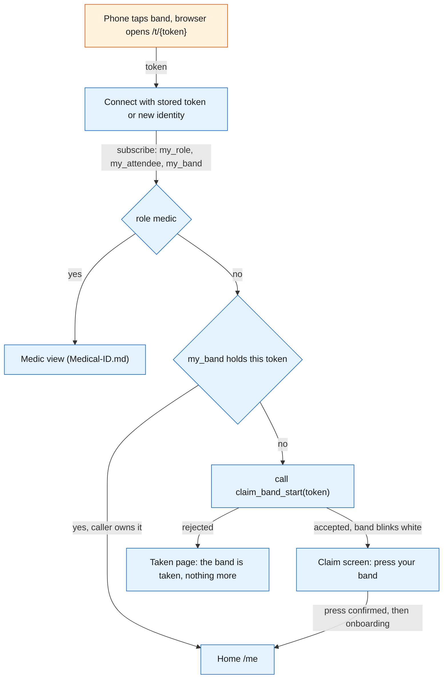
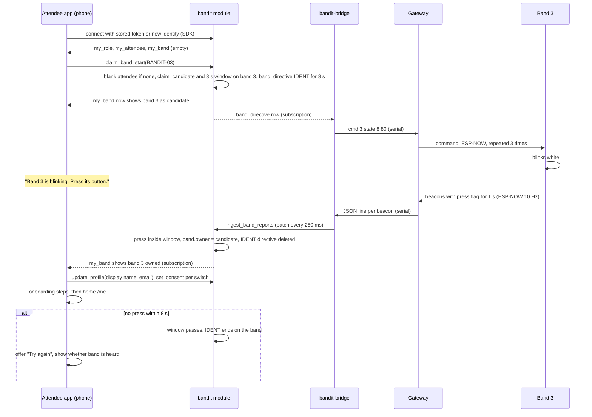
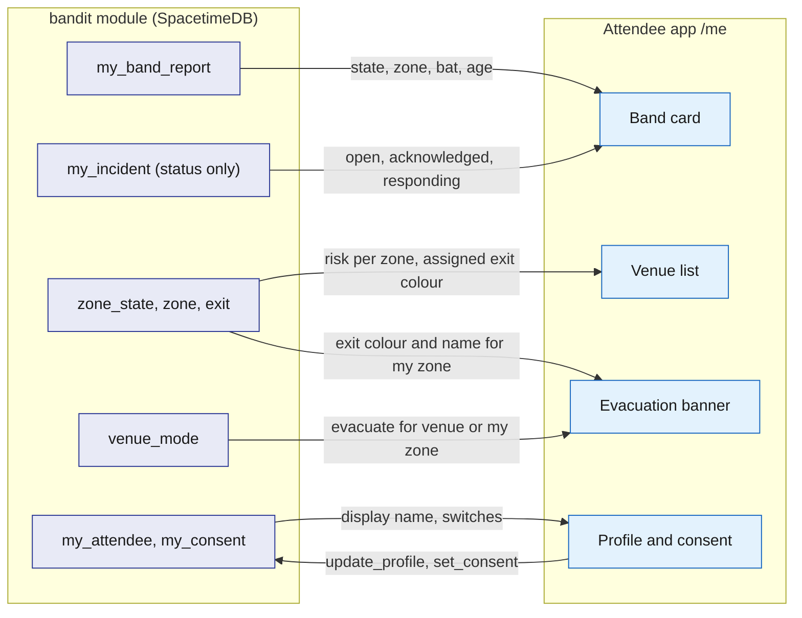
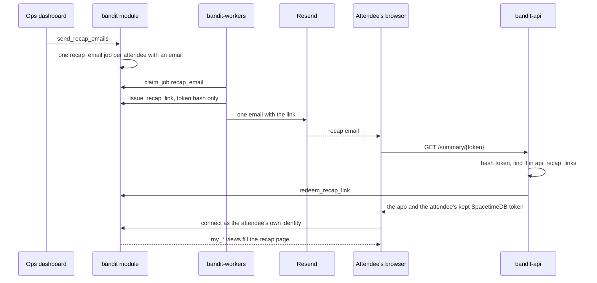

# Attendee app

The attendee app is the web app that opens when a phone taps a band's NFC sticker. It is the attendee's whole relationship with BandIt: claiming the band by pressing its button, a short onboarding, the consent switches, a live mirror of the band and of how busy the venue is, and the recap page after the event, reached from one recap email. It also renders the medic view, because every band carries exactly one URL and the caller's role, not the URL, decides what that URL shows. It runs in the phone browser, reads everything from the `bandit` module through SpacetimeDB's TypeScript client SDK, and calls `bandit-api` only for search, file uploads, the profile claim and the recap link.

## Role in the system

Responsibilities:

- Resolve the tapped token to a band and decide which screen to show (the landing route).
- Give each phone an identity. The SpacetimeDB connection identity is the attendee id.
- Claim the band by press, then run the onboarding steps.
- Hold the profile and the three consent switches.
- Mirror the band's state, the zone's busy level and evacuation alerts on screen during the event.
- Bring the attendee back after the event: one recap email whose one-time link opens their recap page as their own identity.
- Host staff views at the tag URL for callers with staff roles.
- Medical-ID.md: the medic view, whose content that file owns.

Not responsible for:

- Safety decisions. The band decides its own colours and the module decides directives ([Safety](../6-features/Safety.md)). The app only displays.
- Holding truth. Every screen is a subscription and every change is a reducer call. If the phone dies, nothing is lost.
- Talking to the gateway or to any external service. Those go through `bandit-bridge`, `bandit-api` and `bandit-workers`.
- Positions. There are none; the app shows zones ([SpacetimeDB](../2-data/SpacetimeDB.md)).

## Interfaces

| Interface | Direction | Between | What flows | Transport |
|---|---|---|---|---|
| NFC tag URL | in | phone OS to app | `https://<host>/t/BANDIT-0n`, where `<host>` is the one public HTTPS host of `bandit-api` ([Rust-Backend](../3-services/Rust-Backend.md)); the token is the path | NDEF URL read by the OS, opened in the browser |
| Static bundle | in | `bandit-api` to browser | the app itself, served from the same origin as the upload, search and claim endpoints, so no cross-origin setup is needed | HTTPS |
| SpacetimeDB connection | both | app and `bandit` module | identity token, subscriptions, reducer calls | TypeScript client SDK over WebSocket |
| Own-row views | in | module to app | `my_role`, `my_attendee`, `my_consent`, `my_band` (bands the caller owns or is the claim candidate for), `my_band_report`, `my_incident` (status and snapshot of the caller's own incidents), `my_presence` (post-event timeline), `my_jobs` | SDK subscription |
| Public venue rows | in | module to app | `venue`, `zone`, `booth`, `schedule_slot`, `exit` (name and colour for the banner), `zone_state`, `venue_mode` | SDK subscription |
| Reducers | out | app to module | `claim_band_start`, `update_profile` (display name and email), `set_consent`, `release_band` (the owner gives the band up), `open_api_session` (once per page load, see Identity) | SDK reducer call |
| Recap link | both | app, `bandit-api` and the attendee's email | at onboarding, the app's SpacetimeDB token once to `POST /api/summary-key`; after the event, the one-time link `https://<host>/summary/<token>` from the recap email, which `bandit-api` answers with the app and that token (see After the event) | HTTPS |
| Blob upload | out | app to `bandit-api` | files for features that need them, with the API session token; `bandit-api` stores the file, calls `register_blob` and returns the `blob_ref` id | HTTPS, endpoint in [Rust-Backend](../3-services/Rust-Backend.md) |
| Medical-ID.md | both | app, module and `bandit-api` | the PDF through `POST /api/medical/document` with the API session token, then the confirm-card screen for the extracted `medical_card`; the medic view opened from `/t/BANDIT-0n` for role `medic`, which calls `request_medical_card` with the token and reads the `medic_medical_card` view | HTTPS and SDK |
| Payments-Nessie.md | both | app and module | `link_bank`, called right after the display name is saved; the wallet view (`bank_link`, `payment` history) on `/me`; the "Pay" screen that calls `confirm_payment` for a merch order | SDK |
| Social.md | both | app and module | the onboarding socials step: the attendee types their Instagram, Facebook and Threads handles, saved with `set_social_handle` into `social_handle`; the summary and share-link views through `my_visits`, `my_encounters`, `my_photos` and `my_share_links`; the "My graph" screen drawn from the `my_graph` view; the photographer route (role `photographer`) that uploads a photo and calls `register_photo` | SDK and HTTPS |
| BrightData.md | both | app, module and `bandit-api` | the profile claim step: the app lists unclaimed `person` rows (exhibitor, speaker or artist scraped from event pages) whose name matches the typed display name; the attendee picks one, the app calls `POST /claim/person`, `bandit-api` calls `request_person_claim`, and the attendee confirms by pressing their band, which completes `confirm_person_claim` | HTTPS and SDK |
| Hyphenate.md | in | module to app | the venue's `insurance_policy` details on the profile | SDK |
| Elastic.md | out | app to `bandit-api` | the search box: `GET /search/booths`, `GET /search/memories` and `GET /search/photos`, meaning-ranked only; `bandit-api` identifies the caller by `api_session` and narrows to the caller's zones and times first. Plain lists (timeline, tagged photos, booths by name) come from the app's own subscriptions, never from search. On "My graph": `GET /graph/similar` every 30 s for the dashed links, and the phrase lens through `GET /search/booths` | HTTPS |
| Merch.md | both | app and module | the merch section at the bottom of the recap page: suggestions from `my_merch_suggestions` and the public `merch_template`, the preview that places the photo in the template's photo area, `place_merch_order` and `my_merch_orders`; paid in the app with `confirm_payment` (Payments-Nessie.md) after the event | SDK |

## Design

### Routes

| Route | Who sees it | Purpose |
|---|---|---|
| `/t/{token}` | anyone | Landing. Decides the screen from the band and the caller. The only URL written on the tags. |
| `/me` | a signed-up attendee | Home: band card, venue, alerts, profile and consent, and the recap page after the event. |
| `/summary/{token}` | anyone with the link | The recap link from the email. `bandit-api` uses it once and opens `/me` on the recap page as the attendee's own identity. |
| Social.md: `/photo` | role `photographer` | Upload a photo and call `register_photo`. Content in [Social](../6-features/Social.md). |

The medic view renders at `/t/{token}` rather than at a separate path because the tag holds one URL and the medic view needs "this band" as its input; the tap supplies it. Every tag holds the same host, the public `bandit-api` host, so judges use their own phones on any network.

### Landing route decision

The landing route works out who tapped which band. Band rows are private, and `my_band` returns only bands the caller owns or is the claim candidate for, so the route learns a band's status by trying to claim it: `claim_band_start` accepts, which starts the press window, or rejects. Nothing is lost by trying, because a claim completes only with a press on that band.

1. Connect to SpacetimeDB with the token in browser storage; with no token the SDK issues a new identity and the app stores its token.
2. Subscribe to `my_role`, `my_attendee` and `my_band`.
3. Staff roles are checked first. Medical-ID.md: role `medic` gets the medic view for this band's wearer. Roles are granted at setup by the owner with `grant_role` from the [Ops dashboard](Ops-Dashboard.md).
4. `my_band` already holds a band with this token: the caller owns it. Home at `/me`.
5. Otherwise call `claim_band_start` with the token:
   - accepted: the band blinks white; show the claim screen ("Press the button on your band").
   - rejected: the "taken" page, which says only that the band is taken. Anyone can read the tag, so this page reveals nothing about the owner.

The flowchart below answers one question: which screen does a tap open, in the order the checks run.

### Identity

The SpacetimeDB connection identity is the attendee id. On the first connection the SDK issues an identity and a token; the app keeps the token in browser storage (localStorage, scoped to the app's origin) and presents it on every later connection, so the same phone is the same attendee across taps, tabs and reloads. The `attendee` row is keyed by this identity: `claim_band_start` creates it blank and `update_profile` fills it. There are no passwords and no third-party sign-in: the band press is the credential at claim time, the stored token is the credential afterwards, and after the event the recap link hands the same token back (see After the event).

Talking to `bandit-api` as that same attendee. `bandit-api` is not a SpacetimeDB client of the phone's connection, so it cannot see who is calling by itself. On every page load the app generates a random token, calls `open_api_session` with the token's hash (the module binds the hash to the caller's identity in an `api_session` row with an expiry), and then sends the plain token in a header on every `bandit-api` request (search, uploads, profile claim). `bandit-api` hashes it and looks the hash up in its `api_sessions` subscription, which gives it the attendee id without any JWT verification ([SpacetimeDB](../2-data/SpacetimeDB.md), [Rust-Backend](../3-services/Rust-Backend.md)). The token lives in memory, not in storage.

What breaks the identity: private browsing, cleared site data, a different phone, or opening the app as an iOS home-screen web app, which has its own storage separate from Safari. The app therefore never prompts to "add to home screen". Recovery is one ops action: `release_band` on the [Ops dashboard](Ops-Dashboard.md) unclaims the band, and the wearer claims it again by press. The old `attendee` row stays; only the band link moves.

### Claim by press, then onboarding

The tap alone proves nothing, because anyone can read the tag. The press proves that the person signing up is holding the band. The flow is one press, then one field, then a few skippable steps.

1. The landing route calls `claim_band_start` with the token. The module creates a blank `attendee` row for the caller if none exists, sets `band.claim_candidate` to the caller and `band.claim_pending_until` to now plus 8 s, and upserts a `band_directive` for the band with forced state IDENT (8), `forced_until` now plus 8 s, reason `claim_ident`. `my_band` now returns the band to this caller as its candidate, so the screen can say "Band 3 is blinking white. Press its button to make it yours."
2. `bandit-bridge` sees the directive and sends the state command; the gateway repeats it 3 times, 40 ms apart ([Gateway-Bridge](../3-services/Gateway-Bridge.md)). The band blinks white.
3. The wearer presses once. The band's beacons carry the press flag (bit 2) for 1 s. The bridge batches the changed report into `ingest_band_reports` within 250 ms.
4. Inside `ingest_band_reports`, in the same transaction as the report, the module sees a press from a band whose `claim_candidate` is set and whose window has not passed. It sets `band.owner` to the candidate, clears the candidate, and deletes the IDENT directive; the bridge then lets the forced blink expire and never sends `clear` for it ([Gateway-Bridge](../3-services/Gateway-Bridge.md)). The band returns to density-driven colours. Later batches in the same second see no candidate and do nothing.
5. The app's `my_band` subscription updates with the owner set; the screen says "It's yours" and continues with onboarding.
6. Onboarding, in order, each step skippable except the first:
   - Display name: `update_profile`. There is no company field. Payments-Nessie.md: the app then calls `link_bank` with no extra screen, so every attendee has a funded demo wallet for merch and claim payouts.
   - Email: one field, "Where should we send your recap?", saved with `update_profile` into `attendee.email`. It is private to the attendee and used only for the one recap email after the event. The app then sends its SpacetimeDB token once to `POST /api/summary-key`, so the recap link can hand this identity back ([Rust-Backend](../3-services/Rust-Backend.md)).
   - BrightData.md: the profile claim. The app lists unclaimed `person` rows whose name matches the typed display name, each with a "This is me" button. The attendee taps theirs; the app calls `POST /claim/person`, `bandit-api` calls `request_person_claim`, the band blinks white again, and the attendee presses it. The press completes `confirm_person_claim`, which writes the attendee identity onto the `person` row ([BrightData](../7-integrations/BrightData.md)).
   - Consent switches, all off by default: `set_consent` per switch (see Profile and consent).
   - Social.md: add your socials. The attendee types their Instagram, Facebook and Threads handles, and the app saves each with `set_social_handle`. No other networks are asked for, and nobody's profile is looked up or scraped ([Social](../6-features/Social.md)).
   - Medical-ID.md: upload a medical PDF through `POST /api/medical/document`, then the confirm-card screen once `medical_extract` has produced the `medical_card`.
7. Done: home at `/me`. Every skipped step is reachable again from the profile.

If no press arrives within 8 s, the pending claim expires, the IDENT directive ends on its own, and the screen offers "Try again", which calls `claim_band_start` once more. The screen also shows whether the band is being heard at all (alive or stale from `my_band_report`, which already returns the candidate's band), so an attendee whose band is out of range knows to walk toward the gateway rather than press again.

The sequence below answers one question: which process does what, from the tap to home.

### Profile and consent

The profile is deliberately small: a display name, the email for the recap, and whatever the optional features add. Consent is per feature, stored in `consent` through `set_consent`, one row per switch, all off until the attendee turns them on. The switches exist in the core even if the feature that uses one is deleted; an unused switch has no effect.

| Switch (`consent` kind) | What it allows | Who enforces it |
|---|---|---|
| `findable` | People you hung out with see you and your Meta handles in their post-event summary, and you appear in the people graph | [Social](../6-features/Social.md) |
| `photo_tagging` | You can be suggested as a tag in photographer photos | [Social](../6-features/Social.md) |
| `merch` | Photos you are confirmed in can be put on merch, by you or by anyone else confirmed in them; a photo is offered only when everyone confirmed in it has this on | [Merch](../6-features/Merch.md) |

The profile also has a "Release this band" button. After a confirm tap it calls `release_band`, which unclaims the band so someone else can claim it by press; the attendee's own data stays.

Optional profile sections, each a separable block on `/me`:

- Social.md: your social handles (`social_handle`, the onboarding step reachable again here).
- BrightData.md: the profile claim step, for anyone who skipped it.
- Medical-ID.md: the medical PDF upload and the confirm-card screen; the status of the extracted `medical_card`.
- Hyphenate.md: the venue's insurance details (`insurance_policy`).
- Payments-Nessie.md: the wallet view: `bank_link` status and `payment` history.

### Live view during the event

The home screen during the event has three parts, each fed by a subscription and nothing else.

Band card. The card mirrors the band's own row from `my_band_report`: the state chip uses the same colour the ring shows, the zone name comes from `zone` through the report's `zone`, and the card turns grey when the report is older than 5 s (the same alive and stale rule the [Ops dashboard](Ops-Dashboard.md) uses). Battery shows only when `bat` is not 255, because most bands have no divider fitted. The chip text tells the wearer what the colour means:

| Band state | Chip | What the app says |
|---|---|---|
| 0 IDLE | green | "All calm" |
| 1 YELLOW | yellow | "Getting busy around you" |
| 2 GUIDE | red with the exit colour swatch | "Move out: follow the <colour> lights." On a full band: "Your band vibrates to point you along the route." |
| 3 SOS | red | "Staff alerted", then "Staff have seen it" when the incident is acknowledged and "A medic is coming" when it is responding |
| 4 NEAR_SOS | blue | "Someone next to you needs help. Keep your ring visible so the medic can find them." |
| 8 IDENT | white | "Press to claim" |
| 9 OFF | grey | "Ring off" |

The incident lines on the SOS row come from `my_incident`, which returns the attendee's own incidents and snapshots; the attendee sees the status, never staff notes.

Venue. A list of zones with each zone's risk from `zone_state` in attendee words (`normal` "calm", `watch` "busy", `high` "very busy"), plus the colour of the exit assigned to that zone. Zone-level only: the app never shows where any person is.

Alerts. When `venue_mode` is `evacuate` for the venue, or the wearer's zone has `evacuating` set, the app shows a full-screen banner with the assigned exit's colour swatch and name: "Evacuate. Follow the <colour> lights to <exit>. Full bands vibrate to point you along the route." The ring has no compass ([Hardware](../4-devices/Hardware.md)), so the colour, the vibration on full bands and the exit name on the phone are the guidance together. The banner stays until the mode returns to normal. When an exit is blocked and the zone's assignment changes, the banner updates on the next subscription event, with no reload.

The flowchart below answers one question: which rows feed which part of the home screen.

### My graph (Social.md)

"My graph" is a tab on `/me` that draws the attendee's own people graph. It is drawn with Sigma.js and graphology. The ForceAtlas2 layout and the Louvain clusters run in a web worker, so the page stays smooth.

- Solid links are facts, live. The app subscribes to `my_graph`: the caller's own neighbourhood of `people_link` rows (`met` with minutes, `visited` with minutes, `works_at`, `exhibits`), with booths and companies as shared nodes. Other people appear as "someone" unless Social.md's naming rules allow their name. A link appears the moment the social step of `memory_tick` writes it (once a visit reaches 2 min or two people have been together for 3 min, starting values), with no reload.
- Elastic.md: dashed links are meaning. Every 30 s the app calls `GET /graph/similar` and draws a dashed "into the same things" link between people who are already in the attendee's own graph. Strangers are never added.
- A toggle sets the clusters: by memories (Louvain over `met` and `visited`), by company (`works_at`), or, Elastic.md, by interest (Louvain over the dashed links). Each cluster is labelled with its members' top booth tags.
- Elastic.md: the phrase lens. A phrase typed above the graph ("wearable robotics") goes to `GET /search/booths`; the graph highlights the booths that come back and everyone linked to them.

### After the event

There is no separate post-event app. `/me` has a "Now" tab and a "Your event" tab, which is the recap page. While the band is alive the app opens on "Now", and once the band has been stale for longer than the zone window it opens on "Your event".

The way back after the event is one recap email. The bands are handed back at the end, and an attendee may read the email in another browser, so the email carries a one-time link that brings back the attendee's own identity:

1. After the event, ops runs `send_recap_emails` from the [Ops dashboard](Ops-Dashboard.md). It enqueues one `recap_email` job for each attendee who gave an email.
2. `bandit-workers` makes a random token, stores only its hash with `issue_recap_link`, and sends one email through the Resend API with the link `https://<host>/summary/<token>` ([Rust-Backend](../3-services/Rust-Backend.md)).
3. The attendee opens the link. `GET /summary/{token}` on `bandit-api` hashes the token, finds the unused, unexpired link in `api_recap_links` and marks it used with `redeem_recap_link`.
4. `bandit-api` answers with the app and the SpacetimeDB token it kept since onboarding. The app stores the token like a first visit, connects as the attendee's own identity and opens "Your event". The session stays in that browser, so `confirm_payment` and every `my_*` view run as the attendee.

The link works once and expires 30 days after the event (starting value) ([SpacetimeDB](../2-data/SpacetimeDB.md)).

The sequence below answers one question: how one email brings an attendee back to their recap as themselves.

The recap page, top to bottom. How it looks is front end and not designed here.

1. The space-time view: the attendee's own zone timeline, rendered on the phone from `my_presence` (one `presence_sample` per 5 s while the band was alive): "20:10 to 20:40 near Stage B".
2. Social.md: the social part: the people you hung out with and the Meta handles of those who are `findable` (`my_encounters`), visits and booth descriptions (`my_visits`), photos you are tagged in with the people in each and a Share button that opens the phone's share sheet (`my_photos`), share links (`my_share_links`), and the "My graph" tab (see My graph above).
3. Merch.md: the merch suggestions and checkout: up to three of your own photos, each placed in the photo area of a template from `my_merch_suggestions`, ordered with `place_merch_order` into `my_merch_orders` and paid on the "Pay" screen with `confirm_payment` (Payments-Nessie.md).

Other sections, each separable:

- Elastic.md: the search box ("robotics booths", "the photo of me with the robot") over `GET /search/booths`, `GET /search/memories` and `GET /search/photos` through `bandit-api`; the exact timeline and tagged photos stay subscription views.
- Payments-Nessie.md: the wallet view with payment history.

### Platform notes

- iPhone XS and newer read an NDEF URL in the background whenever the screen is on and show a banner; tapping it opens Safari at the URL. Each tap may open a new tab; storage is per origin, so every tab is the same attendee.
- Android opens an NDEF URL in the default browser from the system tag dispatch when the phone is unlocked.
- Every view whose input is a band (the band claim and the medic view) starts from the OS opening the tag URL, so it works the same on both platforms with no in-page NFC reading.
- The tag is an NTAG215 holding one NDEF URL on the `bandit-api` host, locked read-only once written ([Hardware](../4-devices/Hardware.md)).
- Simulator.md: simulated bands have no tag and an empty `nfc_token`; the simulator registers each one with a simulated owner through its own path ([Simulator](../3-services/Simulator.md)).

## Failure modes and fallbacks

| Failure | Effect | Design answer |
|---|---|---|
| No press reaches the module within 8 s (band out of range, bridge down) | Claim times out | The screen offers "Try again" and shows whether the band is being heard; the IDENT directive ends on the band by itself. |
| Browser storage lost (private browsing, cleared data, new phone, iOS home-screen app) | New identity; the band looks taken | Ops unclaims the band with `release_band`; the wearer claims it again by press. |
| Stranger taps a claimed band | Could leak the owner | The taken page says only that the band is taken. |
| SpacetimeDB connection drops (phone loses signal) | Screens freeze | The SDK reconnects and replays subscriptions; the app greys stale cards and disables reducer buttons meanwhile. Safety does not depend on the phone: the band decides its own colours. |
| The recap link is opened a second time, for example in a mail app's browser and then in Safari | The second open is refused | The page says the link was already used and that the recap stays open in the browser that used it. |
| The recap email is slow or lands in spam during the demo | The judge cannot open their recap from the email | The phone the judge joined with still holds its session, so `/me` opens the same recap page. |

## Dependencies

**Depends on**

- [SpacetimeDB](../2-data/SpacetimeDB.md): views `my_role`, `my_attendee`, `my_consent`, `my_band`, `my_band_report`, `my_incident`, `my_presence`, `my_jobs`; public `venue`, `zone`, `booth`, `schedule_slot`, `exit`, `zone_state`, `venue_mode`; reducers `claim_band_start`, `update_profile`, `set_consent`, `release_band`, `open_api_session`; the band fields `owner`, `claim_candidate`, `claim_pending_until`.
- [Gateway-Bridge](../3-services/Gateway-Bridge.md) and [Hardware](../4-devices/Hardware.md): the IDENT state, the press flag and the forced-state command that make claim by press work.
- [Safety](../6-features/Safety.md): the meaning of band states, risk levels, evacuation, exit colours and the vibration on full bands.
- [Rust-Backend](../3-services/Rust-Backend.md): `bandit-api` serves the bundle on the public host, the blob upload endpoint and the `api_sessions` lookup.
- [Rust-Backend](../3-services/Rust-Backend.md): `POST /api/summary-key`, `GET /summary/{token}` and the `recap_email` handler with the Resend key; [SpacetimeDB](../2-data/SpacetimeDB.md): `attendee.email`, `recap_link`, `send_recap_emails`, `issue_recap_link`, `redeem_recap_link`, `api_recap_links`.
- [Ops-Dashboard](Ops-Dashboard.md): `release_band` by ops for identity recovery; `grant_role` for staff phones; `send_recap_emails` after the event.

**Used by**

- [Medical-ID](../6-features/Medical-ID.md): the medic view at `/t/{token}`, the upload and confirm-card screens.
- [Payments-Nessie](../7-integrations/Payments-Nessie.md): the `link_bank` call at onboarding, the wallet view, the "Pay" screen with `confirm_payment`.
- [Social](../6-features/Social.md): the socials step, the photographer route, the summary and share-link views, the "My graph" tab.
- [BrightData](../7-integrations/BrightData.md): the profile claim step.
- [Merch](../6-features/Merch.md): the merch section at the bottom of the recap page.
- [Hyphenate](../7-integrations/Hyphenate.md), [Elastic](../7-integrations/Elastic.md): profile and post-event sections; Elastic also the dashed links and the phrase lens on "My graph".
- [Flows](../1-overview/Flows.md): the join and claim step of the demo.

**If you delete this file**

- The demo loses tap to join; bands would be registered to people by ops only (`register_band`) and `claim_band_start` would have no caller.
- Medical-ID.md needs another host for the medic view; Social.md needs another host for the photographer route.
- Remove the Attendee app row from the component table in Architecture.md and the attendee row from SpacetimeDB.md's "subscriptions per client".
- Remove the "attendee app" bullets in Social.md, BrightData.md, Elastic.md, Merch.md, Hyphenate.md, Payments-Nessie.md and Medical-ID.md.

## Decisions

| Decision | Why |
|---|---|
| Every tag holds the one public `bandit-api` host; there is no second entry such as a QR code | there is one deployment, so one host always works, on judges' own phones |
| Every rejection of `claim_band_start` shows the same taken page, which says only that the band is taken | a stranger learns nothing about the owner, and a band someone else is claiming right now is taken for this caller too |
| `release_band` works at any time after a confirm tap, for the band's owner in the app and for ops on the dashboard | the owner can give a band up, ops can recover a band whose owner lost their browser identity mid-event, and the confirm tap stops an accidental release |
| No OAuth and no third-party sign-in; after the event one recap email carries a one-time link that opens the recap page as the attendee's own identity | the bands are handed back at the end and the email may be read in another browser; one link brings every attendee back to their night, and the session that confirms a merch payment comes with it |
| Onboarding asks for an email in one skippable field, private to the attendee | without it there is simply no recap email; nothing else reads it |
| The recap page runs top to bottom: the space-time view, the social part, then the merch suggestions and checkout | the night first, the people second, shopping last |
| The app hands its SpacetimeDB token to `POST /api/summary-key` once, when the email is saved | a link opened in another browser can only act as the attendee if `bandit-api` can hand that token back ([Rust-Backend](../3-services/Rust-Backend.md)) |
| Socials are typed by the attendee at onboarding | no verification flow to build, and nobody's profile is scraped |
| The profile claim is confirmed by pressing the band | the same gesture as the band claim, with no email round trip |
| `link_bank` runs right after the display name, with no screen of its own | every judge has a funded wallet for merch and claim payouts, with nothing to type |
| The medic view renders at `/t/{token}` and starts from the OS opening the tag | one URL per band, and the same flow on iPhone and Android |
| The app has no merchant route; BandIt takes no payments at the venue | the band press is kept for claiming a band and a profile; merch is paid in the app after the event |
| Guidance on the phone repeats the band: the exit colour, the exit name, and a note that full bands vibrate along the route | the ring has no compass, so colour and vibration are the band's guidance and the phone backs them up |
| Socials are Instagram, Facebook and Threads handles only, and onboarding has no company field | Meta is the sponsor track; `works_at` links come only from the import and a claimed profile |
| "My graph" draws solid links from the `my_graph` subscription and dashed links from `GET /graph/similar` | SpacetimeDB holds the measured, private facts and pushes them live; Elastic adds meaning, and only between people the attendee already has in their graph |
