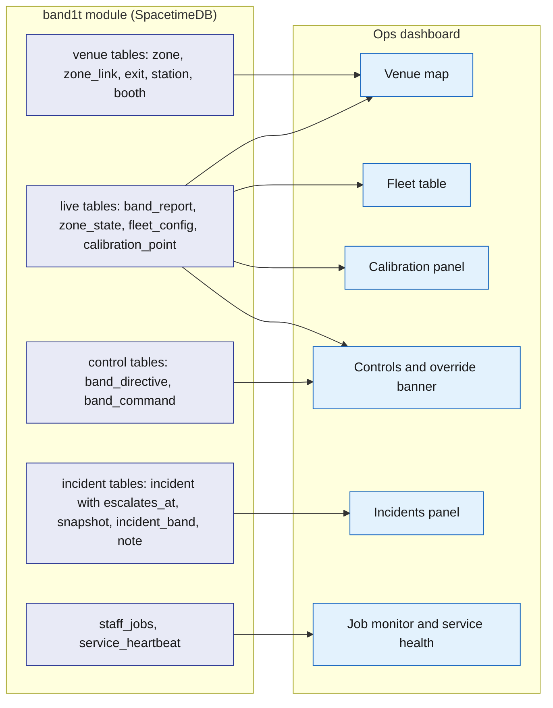
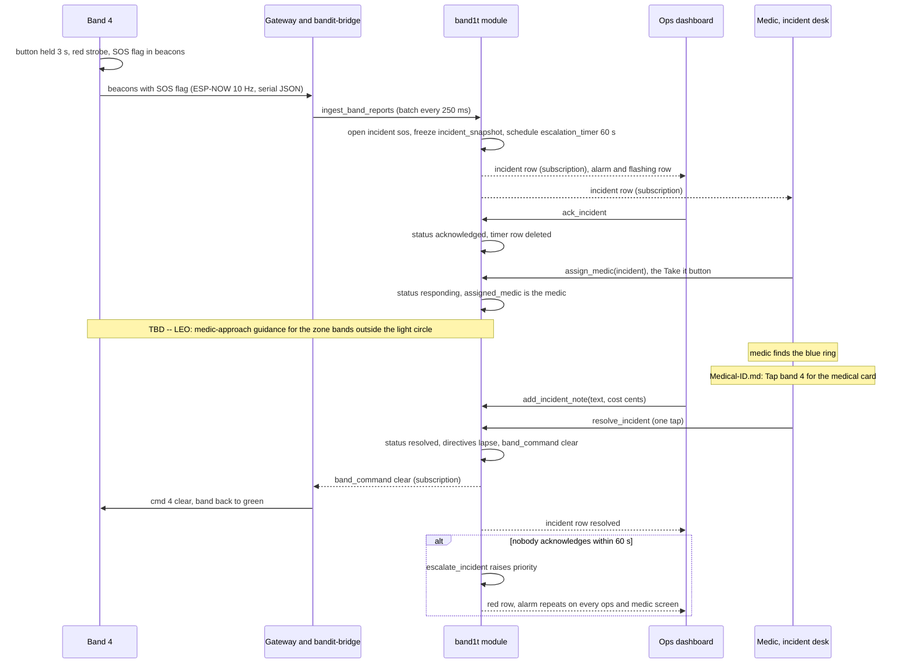
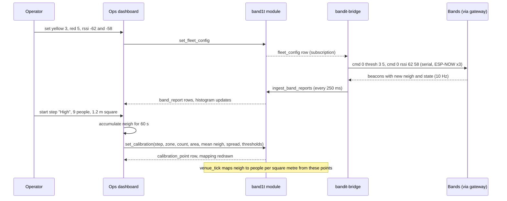
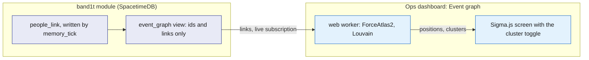

# Ops dashboard

The ops dashboard is the staff web app. On the venue laptop it is the screen the judges watch: the venue map, the fleet, the incidents and the controls. It is one page for every staff member: the medic and the organizer see the same tabs on a phone or the laptop, and a button a person's role cannot use is hidden. It reads everything by subscription from the `band1t` module through SpacetimeDB's TypeScript client SDK and changes the world only by calling reducers, so it can never disagree with the bands, the bridge or the attendee app. It computes nothing about safety; the module does, and the dashboard shows the result.

## Role in the system

Responsibilities:

- Show the live state of the venue: zones coloured by risk, every band, every incident, whether low visibility is on, service health.
- Give ops the controls: forced states, clear, exit colours, low visibility, blocked exits, manual override, with a banner the whole room can see when override is on.
- Run incidents in the incident desk: acknowledge, a medic takes it ("Take it"), add notes with a cost, resolve.
- Host the calibration UI: live `thresh` and `rssi` through `fleet_config`, and the three calibration steps recorded into `calibration_point`.
- Show where each booth stands and let ops fix it.
- Monitor the work queue (`job`, through `staff_jobs`) and the Rust services (`service_heartbeat`).
- Give ops the host portal: the attendee list with band status and "Take the band back" (`release_band`), live zones and alerts, and the "Event ended" button (`end_event`), which becomes "Reopen the event" (`reopen_event`) once the event has ended.
- Insurance.md: give the organizer "Waiting for your decision", the claims no learned rule settled, to decide after the event.
- Show a signed-in person with no staff role their identity code, so the module owner can grant them a role from the command line.

Not responsible for:

- Density, risk, exit assignment, escalation or incident creation. `venue_tick`, `ingest_band_reports` and `escalate_incident` do that ([Safety](../6-features/Safety.md), [SpacetimeDB](../2-data/SpacetimeDB.md)).
- Talking to the gateway. Every control becomes a `band_directive`, `band_command` or `fleet_config` row and `bandit-bridge` sends it ([Gateway-Bridge](../3-services/Gateway-Bridge.md)).
- Holding state. A closed laptop loses nothing.
- Calling any external service. It reads `staff_jobs` and `service_heartbeat` instead.
- Medical-ID.md: who may see a medical card. The dashboard shows only what `medic_medical_cards` returns ([Medical-ID](../6-features/Medical-ID.md)).

## Interfaces

| Interface | Direction | Between | What flows | Transport |
|---|---|---|---|---|
| Static bundle | in | `bandit-api` to browser | the app, from the same public HTTPS host as the attendee app | HTTPS |
| SpacetimeAuth sign-in | both | dashboard and SpacetimeAuth | the magic-link email sign-in for every staff member; an ID token back | HTTPS, OpenID Connect |
| SpacetimeDB connection | both | dashboard and `band1t` module | the ID token, subscriptions, reducer calls; the caller's roles, from `my_roles` and `my_owner`, decide which buttons render, and the module checks the role again on every reducer call | TypeScript client SDK over WebSocket |
| Subscriptions | in | module to dashboard | venue tables, live tables, control tables, incident tables, `calibration_point`, `staff_jobs`, `service_heartbeat`, `my_roles`, `my_owner`, `band` and `host_attendees`; see Subscriptions below | SDK subscription |
| Control reducers | out | dashboard to module | `force_band_state`, `send_band_command`, `clear_all`, `set_zone_exit`, `set_zone_risk`, `set_low_vis`, `set_exit_status`, `set_fleet_config` (calibration values and `density_override`), `set_calibration` | SDK reducer call |
| Incident reducers | out | dashboard to module | `ack_incident`, `assign_medic`, `add_incident_note`, `resolve_incident`, `open_incident` | SDK reducer call |
| Fleet and booth reducers | out | dashboard to module | `register_band` (add, rename), `release_band` ("Take the band back"), `upsert_booth` (place or add a booth); `end_event` and `reopen_event` (the host portal's "Event ended" and "Reopen the event" buttons) | SDK reducer call |
| API session | out | dashboard to module, then to `bandit-api` | on page load the dashboard makes a random token, registers its hash with `open_api_session` and sends the token with each `bandit-api` request: BrightData.md: the floor-plan image; Vision.md (TBD -- LEO): the latest frame; Insurance.md: the bill upload through `POST /api/blobs` and the letter downloads | SDK reducer call, then HTTPS ([Rust-Backend](../3-services/Rust-Backend.md)) |
| Insurance.md | both | dashboard, module and `bandit-api` | claims queue: `claim`, `injured_party`, `medical_record`, `claim_line`, `evidence_pack`, `approval`, `settlement_rule`, `ledger_entry`, plus `planted_incident` (Simulator.md) for the scorecard and `claim_precedent` (Elastic.md); "Waiting for your decision" with `approve_claim` and `refuse_claim` for `ops`; on the incident card, Attach bill (`POST /api/blobs` with purpose `medical`) and Add injured person (`add_injured_party`); the Report property damage button, which calls `open_incident` with kind `property` and the zone | SDK and HTTPS |
| Medical-ID.md | both | dashboard and module | in the incident desk, "Tap band N for the medical card" calls `request_medical_card` with the incident's band, and the granted card comes from `medic_medical_cards`; the medical access log from `board_medical_access` (which medic asked for which band's card, when, for which incident, granted or not) | SDK |
| Vision.md (TBD -- LEO) | both | module and dashboard | camera tile: `camera`, `camera_count`, `ground_alert`, `vision_assessment`; latest frame `blob_ref`; the `vision` heartbeat | SDK and HTTPS |
| Social.md | in | module to dashboard | the event graph: the anonymous `event_graph` view (node ids and links only) | SDK |
| Elastic.md | in | module to dashboard | the `indexer` heartbeat in service health. Zone history is read from `zone_sample` here, never from Elastic | SDK |
| Simulator.md | both | module and `bandit-api` to dashboard | `band.simulated` for the legend and the counts; the `simulator` heartbeat; the Simulate tab's buttons call the dev routes `POST /api/dev/move/{band}/{station}`, `POST /api/dev/press/{band}`, `POST /api/dev/fall/{band}` and `POST /api/dev/property/{station}` | SDK and HTTPS ([Rust-Backend](../3-services/Rust-Backend.md)) |
| BrightData.md | in | `bandit-api` and module to dashboard | each `hall` floor-plan image as a `blob_ref` with access class `staff`, booth `organization` names, the `ingest` heartbeat | HTTPS blob endpoint ([Rust-Backend](../3-services/Rust-Backend.md)) and SDK |

## Design

### One page for all staff

One app, one bundle, one page. There are two staff roles: the medic (`medic`) works incidents during the event, and the organizer (`ops`) runs the room. Anyone with either role, and the module owner, sees every tab. A button the caller's role cannot use is hidden, and the module checks the role again on every reducer, so hiding a button is convenience, not security. The header shows "Identity" with the caller's short identity code and roles, each with its label; for `ops` it also holds the "Event ended" button.

| Role | Who, on which device | What they do on the page |
|---|---|---|
| `medic` | the paramedic, on a phone | takes an incident with "Take it" (`assign_medic`), adds notes with a cost, and resolves it; reads the venue map and the fleet |
| `ops` | the organizer, on the venue laptop or a phone | the host portal (below), venue map, fleet, incidents, controls, calibration, jobs and service health |
| owner | the team member signed in with the identity that published the module | passes every role check, on the page as in the module; grants roles from the command line |

- Medical-ID.md: the medic also opens the medical card with "Tap band N for the medical card" (`request_medical_card`), and the granted card shows inside the incident from `medic_medical_cards`, labelled "not yet confirmed by the wearer" until the wearer confirms it.
- Insurance.md: after the event the organizer decides every claim no learned rule settled, in "Waiting for your decision" on the Claims tab.
- Social.md: the event graph on the big screen is for `ops`; the `photographer` role has no screen here and uses the `/photo` route in the attendee app.

The no-role screen. A signed-in person with no staff role sees no tabs. The page reads "This page is for event staff", then "Show this code to the module owner, who grants your role:", their short identity code in large type, and their full identity below it.

The tabs are the same on every device: Live (the zones, the alerts and the low-visibility button), Attendees (the host portal's attendee list) and Claims (the incident desk, "Open incidents", on top). Optional tabs:

- Insurance.md: "Waiting for your decision" and the claims queue sit in the Claims tab, under the incident desk.
- Simulator.md: the Simulate tab, shown in test mode only (see Simulate tab below).

Staff onboarding happens at setup, before doors open. Every staff member signs in with the SpacetimeAuth magic link, the same sign-in attendees use, and sees the no-role screen with their identity code; a Rust service prints its identity on first start. The owner grants each role with `grant_role` from the SpacetimeDB command line, with a label such as the person's name, and the tabs appear as soon as the grant lands. Only the owner may call `grant_role`, `revoke_role` and `add_owner`; the page has no grant button. Nobody types codes in front of judges.

### Host portal

The host portal is the part of the page that runs the event as its host. Its controls are for `ops`.

| Part | Shows | Reads | Controls (reducer) |
|---|---|---|---|
| Attendee list | every attendee by display name, with their band and its status (alive or stale) | `host_attendees` | per attendee with a band, while the event has not ended: "Take the band back" (`release_band`), after the confirm "Take band N back from <name>? They keep their profile and memories; the next person can claim the band." |
| Live zones | the Venue map | the Venue map's tables | the Venue map's controls |
| Alerts | open incidents and whether low visibility is on | `staff_incidents`, `fleet_config` | the Incidents panel's actions |
| Insurance.md: Waiting for your decision | for `ops`, the claims routed to the organizer, oldest first, each with its claimant, incident kind, zone, payout and status note | the Claims queue's tables | `approve_claim`, `refuse_claim` |
| Event ended | one button, with a confirm tap; afterwards the time the event ended and a "Reopen the event" button | `event_state` | `end_event`, `reopen_event` |

When a staff member with `ops` presses "Event ended", `end_event` sets `event_state.ended`. Every open attendee page turns into the recap page live, and from then on bands cannot be released ([Attendee-App](Attendee-App.md)). "Reopen the event" runs `reopen_event`, which clears it, to run the event flow again.

### Panels

| Panel | Shows | Reads | Controls (reducer) |
|---|---|---|---|
| Venue map | zone rectangles coloured by risk, stations with their exit colour, exits (blocked struck through), the assigned exit per zone, band count, density and its source badge per zone, booths as labelled dots | `venue`, `zone`, `zone_link`, `exit`, `station`, `booth`, `zone_state`, `fleet_config`, `band_report` | per zone: `set_zone_exit`, `set_zone_risk`; per exit: `set_exit_status`; per booth: `upsert_booth` |
| Fleet table | one row per band: alive or grey, battery, state, zone, flags, simulated, last seq, claimed yes or no | `band`, `band_report`, `band_directive` | per band: `force_band_state`, `send_band_command` (buzz, clear), identify; `register_band` (add, rename), `release_band` (unclaim) |
| Incidents (the incident desk, "Open incidents") | open and recent incidents with zone, wearer, witnesses, countdown, status, snapshot, notes | `incident` (with `escalates_at` for the countdown), `incident_snapshot`, `incident_band`, `incident_note`; the wearer's display name comes with `staff_incidents` | `ack_incident`, `assign_medic` ("Take it"), `add_incident_note`, `resolve_incident`, `open_incident` |
| Controls | fleet-wide actions, the low-visibility button and the override banner | `band_directive`, `fleet_config`, `zone_state` | `force_band_state`, `send_band_command`, `clear_all`, `set_zone_exit`, `set_zone_risk`, `set_low_vis`, `set_exit_status`, `set_fleet_config` (`density_override`) |
| Calibration | live thresholds, live `neigh` histogram, the three calibration steps and the resulting mapping | `fleet_config`, `band_report`, `calibration_point` | `set_fleet_config`, `set_calibration` |
| Job monitor | queue depth per kind, each job's status, attempts, lease expiry and last error | `staff_jobs` | none |
| Service health | one card per Rust service: last heartbeat, version, counters | `service_heartbeat` | none |
| Insurance.md: Claims queue | claims by status and amount; per claim the bill lines with billed and paid side by side, the evidence pack and its checks (Elastic.md: with the similar past claims), Claude's causation explanation, the decision form for `ops` ("Learn a rule from this approval, so similar claims settle on their own", ticked by default; "Rule ceiling in dollars (optional)"; "Approve $X"; Refuse with a reason), and the stamp "Settled under rule vN, approved by <name>"; the learned rules; the ledger by account and policy; the accuracy-run scorecard (Simulator.md), computed in the browser from the rows it reads | `claim`, `injured_party`, `medical_record`, `claim_line`, `evidence_fact`, `evidence_pack`, `approval`, `settlement_rule`, `ledger_entry`, `staff_incidents`; Simulator.md: `planted_incident`; Elastic.md: `claim_precedent` | `approve_claim`, `refuse_claim`, `open_claim` (Rebuild pack), `enter_claim_lines`, `record_insurer_payment`, `request_recovery_letter`, `retire_settlement_rule` (ops) |
| Insurance.md: Incident card controls | Attach bill and Add injured person on an incident row, for `medic` and `ops` | `injured_party`, `medical_record`, `incident_snapshot` (bands present) | the bill upload `POST /api/blobs` with purpose `medical`, then `submit_medical_record`; `add_injured_party` |
| Insurance.md: Report property damage button | one button on the Incidents panel; ops picks the zone | `zone` | `open_incident` with kind `property` and the zone |
| Medical-ID.md: Medical card | inside an incident in the incident desk: "Medical card: <name>, band N", with " (not yet confirmed by the wearer)" until confirmed; blood type, allergies, conditions, medications, emergency contact, insurance and notes, each item with its page | `medic_medical_cards` | "Tap band N for the medical card" (`request_medical_card`) |
| Medical-ID.md: Medical access log | every request: medic, band, incident, time, granted or refused, reason | `board_medical_access` | none |
| Social.md: Event graph | the whole event as a live people graph for the big screen: anonymous people, booths and companies, links from `people_link`, clusters | `event_graph` | the cluster toggle |
| Vision.md (TBD -- LEO): Camera tile | the pit camera's latest frame, the detector's head count beside the bands' own count, person-down alerts, and the Claude assessment on each incident | `camera`, `camera_count`, `ground_alert`, `vision_assessment`, `blob_ref` | none |

The flowchart below answers one question: which tables feed which core panel. Table groups are drawn as one node each; the Panels table above lists the reducers each panel calls.

### Venue map

The map is drawn in plan metres. Each zone is a rectangle centred on its `plan_x_m`, `plan_y_m`, sized by its `width_m` and `depth_m` ([SpacetimeDB](../2-data/SpacetimeDB.md)); `zone_link` rows are thin edges labelled with their walking distance. Each zone is filled by its `zone_state` risk: `normal` green, `watch` yellow, `high` red, the same thresholds the bands use for yellow and red, so what judges see on the wrists and on the screen agrees. Inside the zone: the band count, the density in people per square metre, the `density_source` badge (`band`, `camera`, `manual` or `none`, so everyone can see what drove the colour), and a swatch of the zone's exit colour. Station markers are dots in their colour; exits are door icons, struck through when blocked. When `fleet_config.low_vis` is on, the map's frame turns red.

(TBD -- LEO) The dispersion arrow: an arrow along the `zone_link` graph from each zone to its assigned exit. That arrow is the dispersion route: bands in guidance show its colour, and full bands also vibrate to point their wearers along it. When low visibility is on, the assigned exits are highlighted ([Safety](../6-features/Safety.md)).

Clicking a zone opens its controls: pin an exit or return it to automatic (`set_zone_exit`), force its risk level or release it (`set_zone_risk`). (TBD -- LEO) Clicking an exit toggles blocked, and the zones that used it are rerouted.

Booths are labelled dots at `booth.plan_x_m`, `booth.plan_y_m`. Ops drags a misplaced booth to its real place before doors open. The drop calls `upsert_booth` with the new position, the zone whose rectangle it landed in, and `placement_source` `manual`, which a re-import never overwrites. The same panel has an "add booth" form that calls `upsert_booth`.

- BrightData.md: the hall's floor-plan image sits under the zones, scaled to plan metres by the hall's real width from the seed; booth dots carry their organisation's name; booths the import could not place are listed beside the map so ops drags each one in.
- Elastic.md: without it, ops types every booth and its organisation into the "add booth" form.
- Vision.md (TBD -- LEO): the pit zone shows two density numbers, the band estimate and the camera estimate, with the higher one driving the colour ([Safety](../6-features/Safety.md)).
- Simulator.md: simulated bands are drawn lighter and each zone's count reads as real plus simulated.

### Fleet table

| Column | Source | Rule |
|---|---|---|
| Band id | `band` | real bands 1 to 9; Simulator.md: simulated bands 90 to 99 (the crowd has no reports, so no row) |
| Alive | `band_report` age | green dot when heard in the last 2 s, grey row after 5 s |
| State | `band_report.state` | chip in the ring's colour with the state name; a forced state shows a pin icon from `band_directive` |
| Zone | `band_report.zone` | station id mapped to the zone name; blank when 0 |
| Battery | `band_report.bat` | percent; "n/a" when 255 |
| Flags | `band_report.flags` | SOS, fall, press, low battery, full band |
| Neighbours | `band_report.neigh` | the band's own smoothed count |
| Last seq | `band_report.seq` | a reset to a low number means a reboot |
| Simulated | `band.simulated` | real bands are listed first; simulated bands are hidden by default so the nine real bands stay easy to find |
| Claimed | `band.owner` empty or not | no names here; names appear only on an incident and in the host portal |

Row actions:

- Force a state with a hold time (`force_band_state`).
- Identify: `force_band_state` with state 8 for 8 s, which blinks the band white so a staff member can find it on a wrist.
- Buzz a full band or clear this band: `send_band_command` with `buzz` and a pattern 1 to 3, or with `clear`.
- Unclaim the band: `release_band`, after a confirm tap, the same reducer as "Take the band back" in the attendee list. It works until the event ends and is how ops fixes a band claimed by mistake ([Attendee app](Attendee-App.md)).
- `register_band` adds or renames a band and sets its `nfc_token` and full or lite flag.

### Incidents panel

New incidents arrive by subscription within the bridge's 250 ms batch of the band's beacon, because `ingest_band_reports` opens them in the same transaction as the report. The panel plays a sound and flashes the row until someone acknowledges. Rows are ordered by priority, then age.

Each row shows: kind (`sos`, `fall`, `crowd_risk`, `property`), zone, the band id and, only here, the wearer's display name, which `staff_incidents` carries while the incident is open. It also shows the light-circle witnesses from `incident_band` (bands that reported state 4 while the incident was open), the status, and a countdown to the incident's own `escalates_at`, which the module sets and moves together with the escalation timer. When the timer fires, `escalate_incident` raises the priority, the row turns red and the alarm repeats on every ops and medic screen. Opening a row shows the frozen `incident_snapshot` (zone state, bands present, light circle; Vision.md: camera coverage) and the notes.

| Action | Reducer | Effect |
|---|---|---|
| Acknowledge | `ack_incident` | status `acknowledged`; the escalation timer row is deleted, so a handled incident never escalates |
| Take it | `assign_medic` | role `medic`; shown while the incident is open; the medic who taps it takes the incident: status `responding`, `assigned_medic` is the caller ([Safety](../6-features/Safety.md)) |
| (TBD -- LEO) Medic approach | none yet | the medic who took the incident taps the zone they enter from on the map (`medic_entry_zone_id`); the module issues the medic-approach guidance, an exit colour and a vibration that point the crowd out of the medic's way ([Safety](../6-features/Safety.md)) |
| Add note | `add_incident_note` | free text and a cost in cents when there is one (first aid supplies, damage); Insurance.md reads the cost |
| Resolve | `resolve_incident` | one tap by the medic or ops; status `resolved`; directives for the incident lapse and the band is cleared |
| Open incident | `open_incident` | ops opens an incident by hand on a zone (kind `crowd_risk` or `property`) when they see something the sensors did not |

Vision.md (TBD -- LEO): an incident row also shows `camera_corroborated` (a person-down alert landed in the zone within 3 s of the flag), `vision_status` (`pending`, `confirmed`, `not_confirmed`) and, when it arrives, the `vision_assessment`: confidence, description, recommended action and the frames.

The sequence below answers one question: what does the operator see and do for one SOS, from the wrist to resolved.

### Controls and the override banner

Every control writes a row; `bandit-bridge` turns the row into gateway text and keeps re-sending sticky directives until the bands agree ([Gateway-Bridge](../3-services/Gateway-Bridge.md)). Destructive controls (low visibility, clear all, override, unclaim) ask for a second tap.

| Control | Reducer | What the module writes | What the bridge sends |
|---|---|---|---|
| Force a state on all bands or one, with a hold in tenths of a second | `force_band_state(target, state, hold)` | `band_directive` with reason `manual` (`plan_b` during Plan B) for target 0 or a band id | `cmd <target> state <n> [tenths]`, re-sent before the 25.5 s per-command limit while the directive stands |
| Buzz or clear one band | `send_band_command(target, buzz or clear, arg)` | a one-shot `band_command`; the bridge sends it once and calls `ack_band_command` | `cmd <id> buzz <pattern>` or `cmd <id> clear` |
| Clear all (the full reset button) | `clear_all` | deletes every `band_directive`, clears the forced exit and risk columns, sets `fleet_config.low_vis` off, writes one `clear` command for target 0 | `cmd 0 clear`, `cmd 0 lowvis 0` |
| Exit colour per zone | `set_zone_exit(zone, exit or none)` | `zone.forced_exit_id`; `venue_tick` honours it, also under low visibility; none returns the zone to automatic | `cmd <band> exit <n>` for the zone's bands and `cmd <station> exit <n>` for its station |
| Force a zone's risk level | `set_zone_risk(zone, level or none)` | `zone.forced_risk`; the tick writes that level with `density_source` `manual` so the map and the lights agree with what staff see | exit and state commands that follow from the level |
| Low visibility, the button "Low visibility: guide everyone to the exits" on the Live tab, after the confirm "Fire or smoke? Every band starts guiding its wearer to the exit." | `set_low_vis(on)`, role `ops` | `fleet_config.low_vis`; every band guides its wearer to the exit colour of its zone. While it is on, the Live tab reads "Low visibility is on: every band guides its wearer to the exit colour of its zone." with "Turn it off" | `cmd 0 lowvis 1` or `cmd 0 lowvis 0` |
| (TBD -- LEO) Block an exit | `set_exit_status(exit, blocked)` | `exit` blocked; the tick reassigns the zones that used it | exit colour commands for the affected zones |
| Override on or off (Plan B) | `set_fleet_config` with `density_override` true or false | bands stop their density state machine and stay green unless forced ([Safety](../6-features/Safety.md)); Vision.md (TBD -- LEO): density then comes from the camera | `cmd 0 override 1` or `0` |

(TBD -- LEO) Which exit each zone uses under low visibility, and the route to it, come from the dispersion routing in [Safety](../6-features/Safety.md).

The banner. Whenever any `band_directive` carries reason `manual` or `plan_b`, any zone's `density_source` is `manual`, or `fleet_config.density_override` is true, a full-width banner reads "MANUAL OVERRIDE since hh:mm by <staff>. Tell the judges." It shows on every ops and medic screen and cannot be dismissed while the condition stands, because the team's rule is to say so when override is used in front of judges. A forced state on a single band also shows a pin on that fleet row.

### Calibration panel

Calibration sets two things: `fleet_config`, which the bands use live, and `calibration_point` rows, which `venue_tick` uses to map a band's `neigh` to people per square metre ([Safety](../6-features/Safety.md)).

Live thresholds: four controls bound to `fleet_config`: yellow neighbour count, red neighbour count, neighbour RSSI threshold, light-circle RSSI threshold (starting values 3, 5, -62 dBm, -58 dBm, calibrate at the venue). Apply calls `set_fleet_config`; the bridge sends `cmd 0 thresh y r` and `cmd 0 rssi a b` and re-sends them to any band whose `seq` resets, so a rebooted band gets the values back without a reflash. Beside the controls, a live histogram of `neigh` across live real bands, built on the client from `band_report` updates, shows the effect of a change at once.

Recording the three steps. Each step is a button that counts a 60 s window and then writes one `calibration_point` with `set_calibration`: the step label, the zone, the typed head count, the taped area, the computed people per square metre, the window's mean and spread of `neigh`, and the thresholds in force. Steps, from the hardware test plan:

| Step | Setup | Expected density | Expected `neigh` |
|---|---|---|---|
| Spread | bands on wrists, people 2 m apart | well under 1 per square metre | 0 to 1 |
| Watch | everyone inside the 1.5 m taped square | about 4 per square metre with 9 people | the yellow count |
| High | everyone inside the 1.2 m taped square | about 6 per square metre with 9 people | 5 or more for most bands |

The panel then shows the mapping the tick will use and flags a step whose `neigh` overlaps its neighbour's, so the operator widens the thresholds before the rehearsal. The bridge's raw JSON-lines log on the laptop holds every packet from the window for later study ([Gateway-Bridge](../3-services/Gateway-Bridge.md)).

The sequence below answers one question: how does one threshold change reach the bands, and how is one step recorded.

### Event graph (Social.md)

The event graph is a big-screen view for the event: the whole event as one live people graph, so judges watch it grow as people meet and visit booths. It reads the anonymous `event_graph` view, which holds node ids and links only, with no names, zones or times, and is computed once for every viewer ([Social](../6-features/Social.md)). Booths and companies are shared nodes, so two people who visited the same booth are pulled together without any link stored between them. A new link appears in the same transaction that records it, once a visit reaches 2 min or two people have been together for 3 min (starting values). Simulator.md: simulated bands have simulated owners with `findable` on, so the screen shows a crowd of up to 80 simulated attendees rather than nine people.

The view is drawn with Sigma.js and graphology. The ForceAtlas2 layout and the Louvain clusters run in a web worker, so the laptop stays responsive.

- Links come live from the `event_graph` subscription: `met`, `visited`, `works_at` and `exhibits`. There are no links between people who never met.
- A toggle sets the clusters: by memories (Louvain over `met` and `visited`) or by company (`works_at`). Each cluster is labelled with its members' top booth tags.

The flowchart below answers one question: where does each part of the event graph come from.

### Job monitor

A read-only table of jobs from the `staff_jobs` view: id, kind, status (`queued`, `leased`, `done`, `failed`, `dead`), attempts of 3, lease expiry and the last error. The view never returns a job's payload. Counters per kind sit at the top. A job leased past its expiry is marked "awaiting reaper" because `job_reaper` returns it to the queue within 10 s; a `dead` job is highlighted. Nothing here touches the safety path, which never waits on a job.

### Service health

Every Rust service calls `heartbeat` every 5 s, writing one `service_heartbeat` row per service keyed by its `service` name ([SpacetimeDB](../2-data/SpacetimeDB.md)). The panel shows one card per row: version, uptime from `started_at`, age of `last_at`, and the counters that apply (`lines_per_second` and `loss_percent` for the bridge, `backlog` for workers, and the free-text `note`, for example the serial port name). A card turns amber when `last_at` is older than 10 s and red after 15 s (starting values). The strip also shows the dashboard's own connection state. A red bridge card during the event is the cue to reach for manual override.

Cards in the core: `bridge`, `workers`, `api`. Optional cards, each one line to remove:

- Elastic.md: the `indexer` card (`backlog` is rows pending).
- BrightData.md: the `ingest` card, present only while a load runs.
- Simulator.md: the `simulator` card. Scenarios start from the `bandit-claims` command line or from the Simulate tab.
- Vision.md (TBD -- LEO): the `vision` card (`backlog` is frames waiting for the detector).

### Simulate tab (Simulator.md)

Simulator.md: the Simulate tab is shown in test mode only. Under "Simulated bands" it lists every simulated band 90 to 99: the band with alive or stale, its wearer or "not claimed", and its zone. The line above the table reads "Bands 90 to 93 are the claims story's attendees; 94 to 99 are the ones testers claim from a tap link: open /t/BANDIT-94, then press band 94 here."

- "Walk to": every band gets one button per zone, and the button for the zone it is in is greyed. A press calls `POST /api/dev/move/{band}/{station}`, and the band reports from that zone's station.
- "Press", on bands 94 to 99: `POST /api/dev/press/{band}` presses the band's button, so a tester who opened its tap link claims it.
- "Fall here", on every claimed band: `POST /api/dev/fall/{band}` runs `bandit-claims fall` for that band, with two of bands 90 to 93 around it as the light circle. They stay in that zone afterwards. The fall incident opens in the incident desk.
- "Speaker breaks in <zone>", one button per zone under "Property damage": `POST /api/dev/property/{station}` runs `bandit-claims property --camera` for that zone. Insurance.md: the property incident and its claim follow.

After "Fall here" or a property button the dashboard switches to the Claims tab, where the new incident waits ([Simulator](../3-services/Simulator.md), [Rust-Backend](../3-services/Rust-Backend.md)).

### Subscriptions

Private tables arrive through the staff views that [SpacetimeDB](../2-data/SpacetimeDB.md) defines.

| Table | Why | Laptop | Staff phone |
|---|---|---|---|
| `venue`, `zone`, `zone_link`, `exit`, `station`, `booth` | map geometry and labels | yes | yes |
| `zone_state` | risk colours, assigned exits | yes | yes |
| `band`, `band_report` | fleet table and map counts | all | real bands |
| `band_directive`, `band_command` | override banner, pins, pending one-shots | yes | banner only |
| `fleet_config`, `calibration_point` | calibration panel; `density_override` for the banner; `low_vis` for the low-visibility button and the map frame | yes | `fleet_config` only |
| `incident` (with `escalates_at`), `incident_snapshot`, `incident_band`, `incident_note` | incidents panel and countdown | yes | yes |
| `display_name` carried on `staff_incidents` | the wearer's name on an open incident | yes | medics |
| `my_roles`, `my_owner` | the caller's own roles and whether they are the owner, for the header, the tabs and the hidden buttons | yes | yes |
| `host_attendees` | the host portal's attendee list | yes | yes |
| `event_state` | the host portal's Event ended part | yes | no |
| `staff_jobs` | job monitor | yes | no |
| `service_heartbeat` | service health | yes | yes |
| Insurance.md: `claim`, `injured_party`, `medical_record`, `claim_line`, `evidence_fact`, `evidence_pack`, `approval`, `settlement_rule`, `ledger_entry`; Simulator.md: `planted_incident`; Elastic.md: `claim_precedent` | Waiting for your decision, claims queue, ledger, rules, scorecard, incident card controls | yes | yes |
| Medical-ID.md: `medic_medical_cards`, `board_medical_access` | the medical card in the incident desk, the medical access log | yes | medics |
| Vision.md (TBD -- LEO): `camera`, `camera_count`, `ground_alert`, `vision_assessment` | camera tile | yes | no |
| Social.md: `event_graph` | event graph | yes | no |
| BrightData.md: `hall`, `organization` | floor-plan image and booth labels | yes | no |

Simulator.md: only the 10 simulated bands send reports ([Simulator](../3-services/Simulator.md)), so the laptop subscribes to every `band_report` and paints every update.

## Failure modes and fallbacks

| Failure | Effect | Design answer |
|---|---|---|
| Bridge or gateway down | every real band goes grey within 5 s; the `bridge` heartbeat card goes red | the operator forces zone levels with `set_zone_risk` so the map still tells the story, and the team tells the judges |
| Density unstable in the room | zones flicker between colours | Plan B ([Safety](../6-features/Safety.md)): `density_override` on, and ops drives the band colours from the zone's risk with `force_band_state`; SOS, fall and the light circle keep working on the bands |
| SpacetimeDB connection drops (phone hotspot) | panels freeze | the SDK reconnects and replays subscriptions; controls are disabled while disconnected and rows show their age |
| Operator forgets override is on | bands stay green during the crowd density step | the banner cannot be dismissed while the override stands |

## Dependencies

**Depends on**

- [SpacetimeDB](../2-data/SpacetimeDB.md): every table listed under Subscriptions; the ops reducers (`force_band_state`, `send_band_command`, `clear_all`, `set_zone_exit`, `set_zone_risk`, `set_low_vis`, `set_exit_status`, `set_fleet_config`, `set_calibration`, `open_incident`), the incident reducers, `upsert_booth`, `register_band` and `release_band`; `service_heartbeat` and `heartbeat`; `my_roles` and `my_owner`; `staff_jobs`; `end_event` and `host_attendees` for the host portal; the zone rectangle in plan metres.
- [Safety](../6-features/Safety.md): the meaning of risk levels, escalation, a medic taking an incident, low visibility, manual override and Plan B.
- (TBD -- LEO) [Safety](../6-features/Safety.md): exit assignment along `zone_link` paths and the medic-approach guidance.
- [Gateway-Bridge](../3-services/Gateway-Bridge.md): directive reconciliation and command delivery that make the controls take effect; the raw log for calibration.
- [Hardware](../4-devices/Hardware.md): band states, flags, exit colours, the 25.5 s forced-state limit, the alive and stale rule.
- [Rust-Backend](../3-services/Rust-Backend.md): `bandit-api` serves the bundle and the floor-plan blob.

**Used by**

- [Attendee app](Attendee-App.md): unclaiming a band through `release_band`; the "Event ended" button that turns every attendee page into the recap.
- [Medical-ID](../6-features/Medical-ID.md): the incident desk, where the medic asks for the card and sees it.
- [Insurance](../6-features/Insurance.md), [Medical-ID](../6-features/Medical-ID.md), [Social](../6-features/Social.md), [Vision](../4-devices/Vision.md), [Elastic](../7-integrations/Elastic.md), [Simulator](../3-services/Simulator.md), [BrightData](../7-integrations/BrightData.md): host their optional panels, map layers, the event graph and service cards.
- [Flows](../1-overview/Flows.md): the SOS, manual-override and Event ended steps.

**If you delete this file**

- Ops loses every control; forced states, low visibility and calibration would need another client calling the same reducers, and the manual-override fallback disappears from the event flow.
- Remove the Ops dashboard row from the component table in Architecture.md and the ops subscriptions from SpacetimeDB.md's "subscriptions per client".
- Remove the "ops dashboard" bullets in Insurance.md (claims queue with its scorecard, "Waiting for your decision", incident card controls, property-damage button), Medical-ID.md (the medical card in the incident desk, medical access log), Social.md (event graph), Vision.md (camera tile), Elastic.md (indexer card, booths by hand), Simulator.md (legend and counts, the Simulate tab) and BrightData.md (floor plan and booth fixes).

## Decisions

| Decision | Why |
|---|---|
| `set_zone_exit` pins survive low visibility | ops pinned that exit for a reason they can see in the room; low visibility must not undo it |
| Low visibility is one venue-wide button, `set_low_vis`, with a confirm tap | in fire or smoke there is no time to pick zones; every band already knows its zone's exit colour |
| A medic's `resolve_incident` is one tap, with no ops confirmation | the medic is the person standing there; a second approval adds nothing |
| Zones are rectangles in plan metres | the event's zones are taped squares and booth areas; a rectangle draws them, and a dropped booth lands in exactly one zone |
| Booths are fixed by dragging them on the venue map, through `upsert_booth` | one place to see and fix the booth layout, and a hand fix survives a re-import |
| `release_band` ("Take the band back") is for `ops` only, after a confirm tap, until the event ends; the wearer keeps their profile and memories | ops can fix a band claimed by mistake mid-event; the confirm tap stops an accidental release |
| Staff roles are granted by the owner with `grant_role` from the command line at setup, before doors open; the page has no grant button | nobody types identity codes in front of judges, and no staff screen can widen its own access |
| One page for all staff: every tab for anyone with `ops` or `medic`, with the buttons a role cannot use hidden | two roles need no separate layouts; the module checks every role again, so the page cannot grant more than the role |
| A signed-in person with no staff role sees their identity code and nothing else | the owner reads the code off their screen to grant the role, and no venue data shows to a stranger |
| Insurance.md: "Waiting for your decision" is for `ops`, oldest first; the organizer decides after the event | the medic works the room during the event, and one person decides every claim no learned rule settled |
| Insurance.md: the scorecard is computed in the browser from the claim rows; nothing is stored | it is a view of the accuracy run, not a decision, and anyone can recompute it from the same rows |
| Insurance.md: bills are attached and injured people added from the incident card | medics already work incidents on the dashboard on their phones, and the card knows the incident and its bands present |
| A medic takes an incident with "Take it" (`assign_medic`); ops does not assign medics; medics wear no bands | the medic knows whether they are free, and the desk shows who took it |
| Medical-ID.md: the medic asks for the medical card from the incident desk | the medic already works the incident there, and the card shows inside it |
| The laptop paints every `band_report` update without throttling | Simulator.md: only the 10 simulated bands report, next to the 9 real ones |
| Simulator.md: the Simulate tab is shown in test mode only and calls the dev routes; scenarios also start from the `bandit-claims` command line | a tester runs a fall or a property claim from the laptop with one tap, and outside test mode the tab does not exist |
| Social.md: the event graph is anonymous on the big screen, and its links come only from `event_graph` | a public screen shows no names; SpacetimeDB pushes the measured links live |
| The dashboard has no payments panel | BandIt takes no payments at the venue; merch payments and claim payouts are seen in the wallet on the attendee's recap and in the claims queue |
| The job monitor reads the `staff_jobs` view, and the incident countdown reads `incident.escalates_at`; the dashboard subscribes to neither `job` nor `escalation_timer` | both are private, the job payload can hold personal data, and the countdown arrives with the incident row the panel already has |
| The host portal's controls are for `ops`, and its "Event ended" button runs `end_event` ("Reopen the event" runs `reopen_event`) | the host chooses the moment the night ends, with one press, and every attendee page turns into the recap at once |
| Staff sign in with the same SpacetimeAuth magic link as attendees | one sign-in to build, and the identity code the owner grants is the same on every device |
