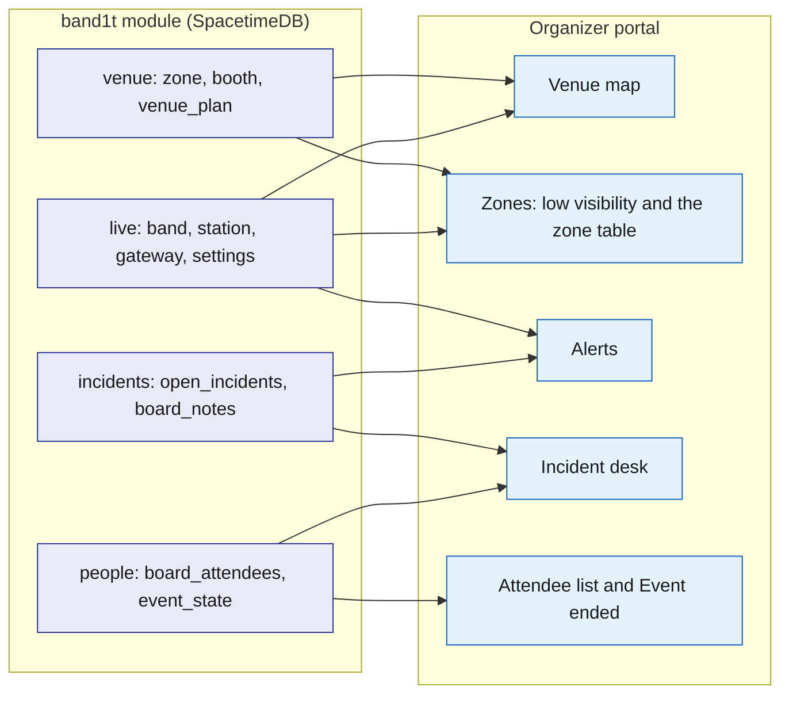
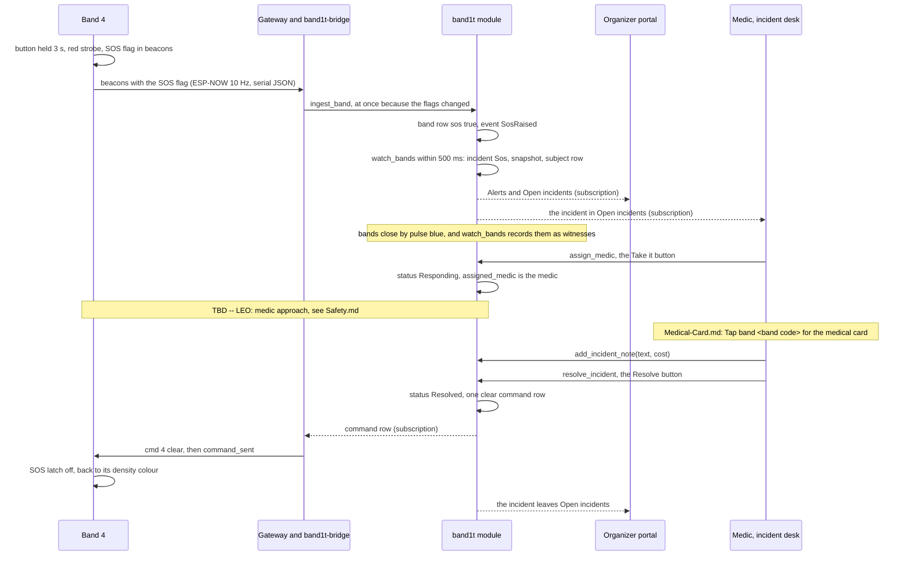
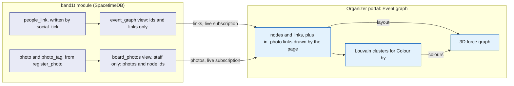

# Organizer portal

The organizer portal (/organizer) is the organizer's web app. The code serves it from `web/organizer.html` and `web/src/pages/organizer.ts`. On the venue laptop it is the screen the judges watch: the venue map, each zone's level, the incidents and the low-visibility button.

It is one page for every staff member. The medic and the organizer see the same tabs on a phone or the laptop, and a button a person's role cannot use is hidden.

It reads everything by subscription from the `band1t` module through SpacetimeDB's TypeScript client SDK, and it changes the world only by calling reducers. So it can never disagree with the bands, `band1t-bridge` or the tap page (/t/code). The one thing it works out itself is each zone's level, from the band rows it already has.

## Role in the system

Responsibilities:

- Show the live state of the venue on the Live tab: the "Alerts" list, the venue map with every band where the module places it, and the zone table with each zone's people, level, exit colour and station marker, the gateway's state and whether low visibility is on.
- Hold the one band control on the page: the low-visibility button (`set_low_vis`).
- Run incidents in the incident desk: a medic takes one ("Take it"), staff add notes with a cost, and staff resolve it.
- Show where each booth stands.
- Let staff find anyone in the Live tab's "People" list and act as them: file a claim, buy merch, take the band back and open their medical card; the owner also opens their pages.
- Give the organizer (`ops`) the attendee list with band status and "Take the band back" (`release_band`), and the "Event ended" button (`end_event`). Once the event has ended, the button becomes "Reopen the event" (`reopen_event`).
- Insurance.md: give the organizer "Waiting for your decision", the claims no payment rule settled, to decide after the event.
- Insurance.md: give the organizer the rules Claude proposes from their precedents, to approve or reject, on the Proposed rules tab, with every payment rule and every precedent beside them.
- Show a signed-in person with no staff role their identity code, so the module owner can grant them a role from the command line.
- Merch.md: show the loaded merch templates and, for `ops`, every attendee's order, on the Merch tab.
- Bright-Data.md: set up a venue from the event's name, and choose the venue the portal shows, on the Venue setup tab; Insurance.md: upload the venue's insurance policy there, or name its forms and have them found online, and confirm its terms.
- Elastic.md: explain Elastic's jobs and link to their Elastic Kibana views from the Kibana tab.
- Social.md: draw the event graph in 3D for the big screen, with the event photos among the people in them, and list every event photo on the Photos tab.

Not responsible for:

- Opening incidents or computing density. `watch_bands` opens incidents from the band rows, and each band computes its own density ([Safety](../6-features/Safety.md), [SpacetimeDB](../2-data/SpacetimeDB.md)).
- Talking to the gateway. Every reducer that commands a band writes one `command` row, and `band1t-bridge` sends it ([Gateway-Bridge](../3-services/Gateway-Bridge.md)).
- Holding state. A closed laptop loses nothing.
- Calling any external service.
- Medical-Card.md: who may see a medical card. The organizer portal shows only what `medic_medical_cards` returns ([Medical-Card](../6-features/Medical-Card.md)).

## Interfaces

| Interface | Direction | Between | What flows | Transport |
|---|---|---|---|---|
| Static bundle | in | `bandit-api` to browser | the app, from the same public HTTPS host as the tap page | HTTPS |
| SpacetimeDB SpacetimeAuth sign-in | both | organizer portal and SpacetimeDB SpacetimeAuth | the magic-link email sign-in for every staff member; an ID token back | HTTPS, OpenID Connect |
| SpacetimeDB connection | both | organizer portal and `band1t` module | the ID token, subscriptions, reducer calls; the caller's roles, from `my_roles` and `my_owner`, decide which buttons render, and the module checks the role again on every reducer call | TypeScript client SDK over WebSocket |
| Subscriptions | in | module to organizer portal | the venue tables and `venue_plan`, the live tables `band`, `station`, `gateway` and `settings`, the views `open_incidents`, `board_notes` and `board_attendees`, `event_state`, `my_roles`, `my_owner`; see Subscriptions below | SDK subscription |
| Live tab reducer | out | organizer portal to module | `set_low_vis`, the low-visibility button | SDK reducer call |
| Incident reducers | out | organizer portal to module | `assign_medic` ("Take it"), `add_incident_note` ("Add note"), `resolve_incident` ("Resolve") | SDK reducer call |
| Attendee list and "Event ended" reducers | out | organizer portal to module | `release_band` ("Take the band back"); `end_event` and `reopen_event` ("Event ended" and "Reopen the event") | SDK reducer call |
| API session | out | organizer portal to module, then to `bandit-api` | on page load the organizer portal makes a random token, registers its hash with `open_api_session` and sends the token with each `bandit-api` request: Vision.md (TBD -- LEO): the latest frame; Insurance.md: the hospital report upload through `POST /api/blobs` and the letter downloads | SDK reducer call, then HTTPS ([Rust-Backend](../3-services/Rust-Backend.md)) |
| Insurance.md | both | organizer portal, module and `bandit-api` | claims queue: `claim`, `injured_party`, `medical_record`, `claim_line`, `evidence_pack`, `approval`, `settlement_rule`, `ledger_entry`, plus `planted_incident` (Test-Bands.md) for the scorecard and `claim_precedent` (Elastic.md); "Waiting for your decision" with `approve_claim` and `refuse_claim` for `ops`; the Proposed rules tab from the staff views `board_rule_proposals`, `board_organizer_precedents` and `board_rules`, with `approve_rule_proposal` and `reject_rule_proposal` for `ops`; on a claim waiting for its hospital report, "File the medical record" (`POST /api/blobs` with purpose `medical`, then `submit_medical_record`) | SDK and HTTPS |
| Medical-Card.md | both | organizer portal and module | in the incident desk, "Tap band <band code> for the medical card" calls `request_medical_card` with the incident's band, and the card comes from `medic_medical_cards`; the medical access log from `board_medical_access` (which medic read which band's card, when, for which incident) | SDK |
| Vision.md (TBD -- LEO) | both | module and organizer portal | camera tile: `camera`, `camera_count`, `ground_alert`, `vision_assessment`; latest frame `blob_ref`; the security camera's count in the zone table | SDK and HTTPS |
| Social.md | in | module to organizer portal | the Event graph and Photos tabs: the `event_graph` view (every link, with people by display name) and the staff view `board_photos` (every event photo with its zone, time, caption and the node ids of the `findable` people in it); the Photos tab names those people by display name from `board_attendees` | SDK |
| Elastic.md | in | `bandit-api` to organizer portal | the Elastic Kibana URL for the Kibana tab's links | HTTPS |
| Merch.md | in | module to organizer portal | the Merch tab: the public `merch_template` table and, for `ops`, the view `board_merch_orders` | SDK |
| Test-Bands.md | both | module and `bandit-api` to organizer portal | the band id (test bands are 90 to 99, the crowd's bands from 100) for the map and the counts; the crowd attendees in `board_attendees`; the Bands tab's buttons call the dev routes `POST /api/dev/move/{band}/{station}`, `POST /api/dev/press/{band}`, `POST /api/dev/fall/{band}` and `POST /api/dev/property/{station}` | SDK and HTTPS ([Rust-Backend](../3-services/Rust-Backend.md)) |
| Bright-Data.md | in | module to organizer portal | the booths and organisations the import loaded: the booths on the venue map, the organisations in the attendee list's Company column | SDK |
| Bright-Data.md | both | organizer portal, module and `bandit-api` | the Venue setup tab: `venue_setup`, `venue_setup_step` and `chosen_venue` in; `start_venue_setup` and `choose_venue` out, for `ops`; the model from `/venue/venue.glb` or the setup's blob; for the insurance policy, `board_venue_policy_lookups`, `board_policy_documents` and `board_policy_terms` in, `look_up_venue_policy`, `submit_policy_document` and `confirm_policy_terms` out | SDK and HTTPS |

## Design

### One page for all staff

One app, one bundle, one page. There are two staff roles: the medic (`medic`) works incidents during the event, and the organizer (`ops`) runs the venue. Anyone with either role, and the module owner, sees every tab.

A button the caller's role cannot use is hidden, and the module checks the role again on every reducer. So hiding a button is convenience, not security.

The header reads "<venue> organizer portal", then "Signed in as <email>" with "Sign out", then "Staff role:" with the caller's roles, each with its label, and "owner" first for the module owner. For `ops` it also holds the "Event ended" button. Once the event has ended, it reads "The event ended at <time>. Every tap link now shows the recap." with "Reopen the event".

| Role | Who, on which device | What they do on the page |
|---|---|---|
| `medic` | a medic, on a phone | takes an incident with "Take it" (`assign_medic`), adds notes with a cost, and resolves it; reads the venue map and the zone table |
| `ops` | the organizer, on the venue laptop or a phone | the attendee list and its "Event ended" button (see Attendee list and Event ended below), the venue map, the zone table and the low-visibility button, the incident desk |
| owner | the team member signed in with the identity that published the module | passes every role check, on the page as in the module; grants roles from the command line |

- Medical-Card.md: the medic also opens the medical card with "Tap band <band code> for the medical card" (`request_medical_card`), or by tapping the band with their phone. The phone's medic view links back here with "Notes, cost and resolve on the incident desk". The granted card shows inside the incident from `medic_medical_cards`, labelled "not yet confirmed by the wearer" until the attendee confirms it.
- Insurance.md: after the event the organizer decides every claim no payment rule settled, in "Waiting for your decision" on the Claims tab. They approve or reject each rule Claude proposes on the Proposed rules tab.
- Social.md: the Event graph and Photos tabs are for every staff member, like the other tabs. The `photographer` role has no screen here and uses the photographer route `/photo`, served with the tap page.

The no-role screen. A signed-in person with no staff role sees no tabs. The page reads "This account has no staff role", then "The organizer portal is for the event's organizer and medics. To get access, send this code to the organizer:", and their full identity code.

The tabs are the same on every device, in this order: Live ("Alerts", "Venue" with the venue map, "Zones" with the low-visibility button and the zone table, and "People", the list of everyone), Attendees (the attendee list) and Claims (the incident desk, "Open incidents", on top). Optional tabs, in their place in that order:

- Insurance.md: "Waiting for your decision" and the claims queue sit in the Claims tab, under the incident desk.
- Insurance.md: the Proposed rules tab (hash `#rules`), right after Claims (see Proposed rules tab below).
- Insurance.md: the Costs tab, right after Proposed rules (see Costs tab below).
- Social.md: the Event graph tab, then the Photos tab, after Costs (see Event graph and Photos tab below).
- Merch.md: the Merch tab, after Photos (see Merch tab below).
- Bright-Data.md: the Venue setup tab, after Merch (see Venue setup tab below).
- Elastic.md: the Kibana tab, after Merch and Venue setup (see Kibana tab below).
- Test-Bands.md: the Bands tab, last, shown in test mode only (see Bands tab below).

Staff onboarding happens at setup, before doors open. Every staff member signs in with the SpacetimeDB SpacetimeAuth magic link, the same sign-in attendees use, and sees the no-role screen with their identity code. A Rust service prints its identity on first start.

The owner grants each role with `grant_role` from the SpacetimeDB command line, with a label such as the person's name, and the tabs appear as soon as the grant lands. Only the owner may call `grant_role`, `revoke_role` and `add_owner`; the page has no grant button. Nobody types codes in front of judges.

### Attendee list and Event ended

The organizer (`ops`) runs the event from the organizer portal's attendee list, on the Attendees tab, and its "Event ended" button in the header. The table also lists the other parts the organizer watches while the event runs.

| Part | Shows | Reads | Controls (reducer) |
|---|---|---|---|
| Attendee list | "<n> attendees", then a line that counts them: "<h> wearing hardware bands", with ", <m> without a band" when someone has none; every attendee by display name, with their band's code, which opens its tap link, its status ("online", "offline" or "not seen yet"), company, `findable` and socials | `board_attendees`, `band` | per attendee with a band, while the event has not ended: "Take the band back" (`release_band`), after the confirm "Take band <band code> back from <name>? They keep their profile and memories; the next person can claim the band." |
| Live zones | the venue map and the zone table | the Live tab's tables | the low-visibility button |
| Alerts | "Alerts", shown while a band on the map has a fall or SOS flag or an incident is open: "Fall on band <band code> (<name>) in <zone>: the bands around it show the light circle." ("SOS on band" for an SOS), and every open incident as "Incident <id>: <Kind> in <zone>, band <band code> (<name>), <Status>, opened <time>" with "open in Claims" | `band`, `open_incidents`, `board_attendees` | none |
| Insurance.md: Waiting for your decision | for `ops`, the claims routed to the organizer, oldest first, each with its claimant, incident kind, zone, payout and status note | the Claims queue's tables | `approve_claim`, `refuse_claim` |
| Event ended | one button, with a confirm tap; afterwards the time the event ended and a "Reopen the event" button | `event_state` | `end_event`, `reopen_event` |

Test-Bands.md: the line under the heading counts the crowd and the test bands too: "<c> in the crowd, <t> wearing test bands, <h> wearing hardware bands, <m> without a band." A second line counts the roles: "<n> hackers, <n> booth staff, <n> organizers, <n> photographers, <n> speakers, <n> attendees who tapped a band." Every row shows the person's role in a Role column: hacker, booth staff, organizer, photographer or speaker for the crowd, attendee for someone who tapped a band, and organizer or photographer for staff who tapped one. A crowd attendee's row is also marked "crowd", and "Take the band back" never shows for one. The list shows everyone who tapped a band and the first 200 of the crowd by name, with the note "Showing the first 200 crowd attendees, by name."

### Names in the 3D venue

The Live tab's 3D view names the floor from the `venue_spot` rows: the areas, the exit doors, every sponsor over its tables and the named places. A name that would cover another hides until the camera comes closer, and close up a sponsor's name climbs a line or two so neighbouring tables all show theirs.

Each exit door shows its exit marker ([Hardware](../4-devices/Hardware.md)): a post and a ring on the floor glowing its exit colour, and under the door's name "exit marker <station id>, <colour>". The colour is the one the station marker reports in `station`, else its zone's `exit_colour`, else blue.

Resting the pointer on a person in the 3D view shows their name, role, band code, company and their band's light.

Each of our bands on the floor carries a blue tag with the name typed when it was placed (`band_place`) over its band code. The tags climb above each other and are never hidden.

### Decision history on the Live tab (Insurance.md)

Insurance.md: the Live tab's "Decision history" lists every `decision` row, newest first, with its time, who acted and what they decided ([Insurance](../6-features/Insurance.md#every-decision-is-a-row-the-decision-history)). The newest row of each claim waiting for the organizer carries "Approve", which calls `approve_claim` with the payout and pack SHA-256 shown.

A proposed rule waiting for the organizer shows above the decision history with "Approve" (`approve_rule_proposal`, with the ceiling shown) and "Reject" with a reason (`reject_rule_proposal`). Both buttons are for `ops`.

### People on the Live tab

At the bottom of the Live tab, "People (<n>)" lists everyone: every attendee from `board_attendees` and, for the owner, the staff from `view_as_people`. Those who tapped a band come first, then the staff, then the crowd, each by name.

Everyone wears a band except the medics. The search box above the list matches every word typed against the name, the role (hacker, booth staff, organizer, photographer, speaker, attendee or medic), the kind of band (crowd band, test band or hardware band), the band code, the company and the socials. Each row shows the role, the band code, the zone the band is in now, the band's status, the company, the number of claims, and "Open".

"Open" shows the person above the list, with their band code, role, kind of band, status, zone, company, socials and join time, and "walking to <door>" or "left at <time> by <door>" once they leave early. Staff act as them from there.

Under the zone table, "Left early (<n>)" lists everyone with a `departure` row while the event runs: the name, the door, when they set off, when they walked out (or "walking") and who sent them, with "Open" for the person.

Every other place that picks a person uses the same search bar: the View as tab, the Merch tab's "Buy as an attendee" (over the attendees with a wallet, each with its balance) and the Settlements tab's "File a claim as someone" (over the attendees with a band). The bar lists its first 12 matches under it, each with what the person is and their band code. A click, or Enter for the first match, picks one.

| Action | For | Calls |
|---|---|---|
| "Their pages": "Their band page now", "Medical card" and "Recap and merch" for an attendee with a band, the portal for an organizer or medic, the photo page for a photographer; the page shows in the View as frame under the person, read-only, until "Hide their page" | the owner | `view_as` |
| "File a claim as <name>": "What happened" picks a short story in their words, "Hospital report" picks "Matches", "Doesn't match" or "Random" | `ops` and `medic`, for an attendee with a band | for their injury that has no claim yet, `file_claim_for_wearer`; otherwise `open_incident` for a fall or SOS on their band where it is now, `resolve_incident` with "treated on site", then `file_claim_for_wearer` |
| "Their claims": each claim with its status and payout, opening it on the Settlements tab | staff | none |
| "Buy merch as <name>": the shop of the Merch tab's "Buy as an attendee", or "No wallet, so no merch."; its buttons work once the event has ended or the person has left | `ops` | `buy_merch_as` |
| "Leave early", with a confirm: the person leaves before the doors close, and their recap and merch open once they are out ([Tap-Page](Tap-Page.md)). Someone of the crowd walks alone to the nearest door; anyone else is out at once | `ops`, for an attendee who has not left, until the event ends | `leave_early` |
| "Take band <band code> back", with the attendee list's confirm | bands 1 to 99, until the event ends | `release_band` |
| "Tap band <band code> for <name>'s medical card", then the card | `medic`, bands 1 to 99 | `request_medical_card` |
| Test-Bands.md: "Walk to" each zone, "Press" and "Fall here" | test bands 90 to 99, in test mode | the Bands tab's `/api/dev` calls |

When the organizer presses "Event ended", `end_event` sets `event_state.ended`. Every open tap page turns into the recap live, and from then on bands cannot be released ([Tap-Page](Tap-Page.md)). "Reopen the event" runs `reopen_event`, which clears it, to run the event flow again.

### Panels

| Panel | Shows | Reads | Controls (reducer) |
|---|---|---|---|
| Venue map (Live tab, "Venue") | the zones and booths of `venue_plan`, and every band on the map as a dot where the module places it | `venue_plan`, `band` | none |
| Zones (Live tab) | the low-visibility button, the status line, and the zone table: each zone's people, bands 1 to 99, their average neighbour count, level, capacity, exit colour and station marker | `zone`, `band`, `station`, `gateway`, `settings` | `set_low_vis` |
| Incident desk (Claims tab, "Open incidents") | every open incident with its kind, zone, band and the attendee who wears it, status, opening time, who opened it, and its notes | `open_incidents`, `board_notes`, `board_attendees`, `zone` | `assign_medic` ("Take it"), `add_incident_note` ("Add note"), `resolve_incident` ("Resolve") |
| Insurance.md: Claims queue | claims by status and amount; per claim the bill lines with billed and paid side by side, the evidence pack and its checks (Elastic.md: with the similar past claims), the Anthropic Claude API's causation explanation, the decision form for `ops` ("Approve $X"; Refuse with a reason; on a complicated claim, the line that it is decided one by one), and the stamp "Settled under rule vN, approved by <name>"; the ledger by account and policy; the accuracy-run scorecard (Test-Bands.md), computed in the browser from the rows it reads | `claim`, `injured_party`, `medical_record`, `claim_line`, `evidence_fact`, `evidence_pack`, `approval`, `settlement_rule`, `ledger_entry`; Test-Bands.md: `planted_incident`; Elastic.md: `claim_precedent` | `approve_claim`, `refuse_claim`, `open_claim` (Rebuild pack), `enter_claim_lines`, `record_insurer_payment`, `request_recovery_letter`, `retire_settlement_rule` (`ops`) |
| Insurance.md: "File the medical record" | on a claim waiting for its hospital report, for `medic` and `ops`: "Clinic PDF" and "File it, Claude reads it" | `medical_record` | the upload `POST /api/blobs` with purpose `medical`, then `submit_medical_record` |
| Medical-Card.md: Medical card | inside an incident in the incident desk: "Medical card: <name>, band <band code>", with " (not yet confirmed by the wearer)" until confirmed; blood type, allergies, conditions, medications, emergency contact, insurance and notes, or "No medical card on file." | `medic_medical_cards` | "Tap band <band code> for the medical card" (`request_medical_card`) |
| Medical-Card.md: Medical access log | every medic tap: medic, band, incident, time, reason | `board_medical_access` | none |
| Social.md: Event graph | the whole event as a live 3D graph for the big screen: people by display name, booths, companies and the event photos, links from `people_link`, coloured by kind, memories or company | `event_graph`, `board_photos` | none; "Colour by", "Photos", "Fit" and "Full screen" change only the view |
| Social.md: Photos | every event photo, newest first, with its zone, time, caption and the tagged people by display name, and "Show in the event graph" | `board_photos`, `board_attendees` | none |
| Vision.md (TBD -- LEO): Camera tile | the latest frame of the pit's security camera, the detector's head count beside the bands' own count, person-down alerts, and the `vision_assessment` on each incident | `camera`, `camera_count`, `ground_alert`, `vision_assessment`, `blob_ref` | none |

The flowchart below answers one question: which tables feed which core panel. Table groups are drawn as one node each; the Panels table above lists the reducers each panel calls.

### Venue map

The Live tab's "Venue" section draws the venue on a canvas in plan metres, from the public, anonymous view `venue_plan` ([SpacetimeDB](../2-data/SpacetimeDB.md)). Above it a line counts the bands at the event right now and the hardware bands among them, then reads "Every dot is a band row in SpacetimeDB, moving as the module writes it." Below it the legend reads calm, busy, very busy, then the hardware bands, fall or SOS, booth.

- Each zone with a station marker is a pale blue rectangle labelled with its name and the number of bands in it, "Main stage · 12".
- Each booth is a small gold square at the spot its staff stand at.
- Every band on the map is a dot at its `band.x_m`, `y_m`. A band 1 to 99 is a blue dot with its code beside it; a hardware band stands at its zone's centre, because the radio gives only the zone. A band with a fall or SOS flag is a larger dark red dot, drawn last, on top of everything.
- A dot glides to its new spot instead of jumping: 60 ms per metre, between 0.4 s and 4 s.
- A band 1 to 99 is on the map while it is online and was heard in the last 5 s.
- The canvas draws only while the Live tab shows it, and it keeps its dots across the page's redraws.

Booths stand where the import put them. The organizer moves a misplaced booth with `place_booth` from the command line, which marks it `manual`, so a re-import keeps it there.

- Test-Bands.md: the line above the map reads in full "N bands at the event right now: X in the crowd, Y test bands and Z hardware bands. Every dot is a band row in SpacetimeDB, moving as the module writes it."
- Test-Bands.md: test bands are blue dots with their codes like the hardware bands, standing a step apart around their zone's centre, and the zone table counts them with the hardware bands. The legend names those blue dots "hardware and test bands", and so does the zone table's column for the bands 1 to 99.
- Test-Bands.md: the crowd's bands (from 100) are small dots at their own spots, coloured by their state: calm green, busy amber, very busy red, the first three entries of the legend. They are drawn first, under the bands 1 to 99, and stay on the map while their row is online. They count in "People now", in each zone's label and in its average and level, like every band in the zone.

### Zones and low visibility

Under the map, the Live tab's "Zones" section holds the low-visibility button, a status line and the zone table.

The status line reads "X of the N bands are in a zone right now. The gateway, which receives the hardware bands, is online, last heard at hh:mm. A zone is busy when its bands have Y other bands close by on average, very busy at R.", with "offline" when `gateway.online` is false and Y and R from `settings.yellow` and `settings.red`.

The zone table has one row per zone, in station id order, with the columns "Zone", "People now", "Hardware and test bands", "Bands close by, average", "Level", "Capacity", "Exit" and "Station".

| Column | What it shows |
|---|---|
| People now | the bands on the map whose `zone` equals the zone's `station_id` |
| Hardware and test bands | those of them with an id under 100 |
| Bands close by, average | the mean `neigh` of the bands in "People now" |
| Level | worked out in the browser from that mean: "very busy" at `settings.red` or more, "busy" at `settings.yellow` or more, else "calm"; nothing stores it |
| Exit | the colour name of `zone.exit_colour` from the venue import, "none" for 0 |
| Station | "<station_id> online" or "<station_id> offline", from `station` |

Vision.md (TBD -- LEO): for a zone with a security camera, the camera's count shows next to the bands' own average.

The low-visibility button. While it is off, the button reads "Low visibility: guide everyone to the exits", with the confirm "Fire or smoke? Every band starts guiding its wearer to the exit." While it is on, the section reads "Low visibility is on: every band guides its wearer to the exit colour of its zone." with "Turn it off".

Both call `set_low_vis`, which accepts `ops` only, stores `settings.low_vis` and sends `lowvis` 1 or 0 to every band. On a band it only changes GUIDE: a band already chasing its exit colour chases faster as it hears that colour's exit marker louder, and a full band pulses every 2 s. A band that is not crowded stays green, and the exit markers do not change ([Safety](../6-features/Safety.md)).

The low-visibility button is the page's only band control. The organizer sends every other band command from the SpacetimeDB command line with the `ops` reducers in [Safety](../6-features/Safety.md): forced states, exit colours, `clear`, thresholds, RSSI, the override, haptics, find and sleep.

(TBD -- LEO) Exit routing, which sends each zone's bands and exit marker the zone's exit colour, lives in [Safety](../6-features/Safety.md).

### Incident desk

`watch_bands` opens an incident within 500 ms of a band row showing the SOS or fall flag, and the desk gets it by subscription ([Safety](../6-features/Safety.md)). The Live tab's "Alerts" shows the same incidents.

The desk sits at the top of the Claims tab under the heading "Open incidents" and lists every row of `open_incidents` in id order. With none it reads "None. A fall or SOS on a band opens one here."

Each incident reads "Incident <id>: <Kind>" in bold, then " in <zone>, band <band code> (<name>), <Status>, opened <time> by <opened_by>", or "no band" when it has none. The kind is `Sos`, `Fall` or `Property`, the status `Open` or `Responding`, and `opened_by` is `band`, `ops` or `vision`.

The name of the attendee who wears the band comes from `board_attendees`. Under it come the notes, each as "<time> <author_role>: <text> (<cost>)".

| Action | Reducer | Effect |
|---|---|---|
| Take it | `assign_medic` | role `medic`, shown while the status is `Open`: status `Responding`, `assigned_medic` is the caller ([Safety](../6-features/Safety.md)) |
| Add note | `add_incident_note` | the fields "Treatment note" and "Cost in dollars (optional)", then "Add note"; Insurance.md reads the cost |
| Resolve | `resolve_incident` | one tap by the medic or the organizer, with the resolution "treated on site": status `Resolved`, and one `clear` command to the incident's band, so its strobe stops and the light circle around it fades 1.5 s later; Insurance.md: it may open a claim |
| (TBD -- LEO) Medic approach | none yet | the medic who took the incident taps, on the desk, the zone they come in from ([Safety](../6-features/Safety.md)) |

- Medical-Card.md: for a medic, an incident with a band also has "Tap band <band code> for the medical card" (`request_medical_card`), and the card shows inside the incident (see Panels).
- Test-Bands.md: a test band gets no `clear` on resolve.

No page opens an incident by hand; `open_incident` is for the command line.

Vision.md (TBD -- LEO): an incident row also shows `vision_status` (`none`, `confirmed`, `not_confirmed`) and, when it arrives, the `vision_assessment`: confidence, description, recommended action and the frames.

The sequence below answers one question: what do staff see and do for one SOS, from the wrist to resolved.

### Proposed rules tab (Insurance.md)

The Proposed rules tab (hash `#rules`) is where the organizer turns their own precedents into payment rules ([Insurance](../6-features/Insurance.md#proposed-rules)). Every decision on a claim is kept as a precedent, and once three approved claims of one shape agree, the Evidence Engine's agent counts them and proposes a rule that cites them. Nothing is paid under a proposed rule until the organizer approves it.

The tab is plain tables and buttons, in four sections, read from `board_rule_proposals`, `board_organizer_precedents` and `board_rules`, with `claims_board` for the claims they cite.

| Section | Shows | Controls (reducer) |
|---|---|---|
| "Proposed rules" | each open proposal with its shape, its ceiling, the rule in one sentence, the summary of why, and the claims it cites, each with its claimant and payout and a link to the claim on the Settlements tab | for `ops`: "Approve" (`approve_rule_proposal`, with the ceiling shown); "Reject" with a reason (`reject_rule_proposal`) |
| "Payment rules" | every rule version, with the claims it came from and who approved it | none |
| "Precedents" | every organizer decision, newest first: the claim, its shape, the decision, the payout, the complications, who decided, and which proposal cites it | none |
| "Earlier proposals" | every proposal that is approved, rejected, declined, failed or retired | none |

"Payment rules" moved here from the Settlements tab, where it was "Learned payment rules". The Settlements tab's approve form has no "Learn a rule from this approval" checkbox and no rule ceiling input, because an approval decides its claim and keeps a precedent. A complicated claim's form still says it is decided one by one.

The tab carries no explanation text, and it names none of the services behind it.

### Costs tab (Insurance.md)

The Costs tab shows the event's costs so far, from the incidents the event has covered and the merch it sold. It answers one question for the organizer, who acts as the event's controller: who pays what.

It sums the double-entry `ledger_entry` journals that the claims and charges post, read from `board_ledger`, with `claims_board` and `board_records` for each claim's cover and bill. So every claim number agrees with the Settlements tab, and the tab keeps no totals of its own. Merch comes from the paid orders in `board_merch_orders`, the merch subledger, with each product's kind and booths from `merch_template` ([Merch](../6-features/Merch.md#merch-on-the-costs-tab)).

Each claim's cover picks its cost center. Medical payments cover goes to Medical (falls and SOS calls), and property cover goes to Venue (the venue's broken equipment and what is stolen from the venue). A claim counts once, in one cost center.

The journals map onto the controller's work as in Hyphenate's track. J1 reserve is the accrual, J3 claimant payment is the payment run, and J2 receivable with J4 reconciliation is cash application. J5 charge is a receivable from the person responsible: the insurer's share goes to `insurer_payable` and the venue's deductible to `recoveries`. J6 charge payment is its cash application.

"Net cost" is one row, the bottom line:

| Column | From |
|---|---|
| Claims | what the claims cost the venue, the Venue column of "Who pays" |
| Recovered | the venue's part of the charges: the `recoveries` balance, the venue's deductible share; the insurer's share sits in `insurer_payable` |
| Merch margin | the Margin total of "Merch" |
| Net cost | Claims less Recovered less Merch margin |

"Cost centers" has one row per cost center and a total row:

| Column | From |
|---|---|
| Claims | the claims in the cost center |
| Billed | the hospital report's billed total, or the repair cost or item value the staff logged |
| Accrued | J1 reserves not yet paid: the `claims_reserve` balance |
| Paid | J3 payments: the `cash` credits |
| Insurer owes | J2 receivables not yet paid back: the `insurer_receivable` balance |
| Insurer paid | J4 receipts: the `cash` debits |
| Venue | the `claims_expense` balance, which is accrued plus paid, less what the insurer owes and paid |
| Not covered | what a decided claim's bill asked beyond its payout, and a refused claim's whole bill |

"Who pays" is one row by party: the venue, split into deductibles, short payments (the J4 difference) and reserves not recovered yet; the insurer; attendees, for what Medical did not cover; the people responsible, for what they were charged (the `attendee_receivable` debits of J5 less J5r); and what is unpaid.

"Merch" has one row per product that sold and a total row: its orders, sales, print cost, what it owes the booths and the event's margin.

"Booths" has one row per sponsor booth with sales or incidents and a total row: its sales, print cost and event fee, what the event owes it, and the incidents at its table with their loss and what the people responsible were charged.

"Claims" has one row per claim with its cost center, claimant, amounts, charge and status. The claim number opens the claim on the Settlements tab.

"Trial balance" has one row per account with its debits, credits and balance, marked "Balanced" when total debits equal total credits. "Journal" lists every journal entry, newest first, with its claim, its lines on one row and when it was posted.

With no claims and no paid orders the tab reads "No claims yet." With paid orders and no claims it shows "Merch" and "Booths" only.

The tab has no controls.

Every finance term on the Claims and Costs tabs shows its definition on hover: accrual, cost center, deductible, reserve, recovery, short payment, trial balance, debits and credits, print cost, margin, event fee, what is owed to a booth, net cost, each account and the journals J1 to J6. Each term is a plain `abbr` whose title is one short sentence in the words Hyphenate's track uses. Words with an everyday meaning, such as balance or recovery, are defined only where they are a label, so an attendee's own words stay plain. Resting on a term holds the page's redraws for up to 10 seconds, so the definition stays up.

### Event graph (Social.md)

The event graph is a big-screen view for the event: the whole event as one live 3D graph of people, booths, companies and the event photos. Judges watch it grow as people meet, visit booths and turn up in photos.

Its links come from the `event_graph` view, which holds every link with the display name of each person and the name of each booth and company, and is computed once for every viewer ([Social](../6-features/Social.md)). Each photo and the `findable` people the bands put in it come from the staff view `board_photos`, as node ids, so a photo floats among the people it caught together. The page draws those `in_photo` links itself, and nothing stores them.

Booths and companies are shared nodes, so two people who visited the same booth are pulled together without any link stored between them. A new link appears in the same transaction that records it, once a visit reaches 2 min or two people have been together for 3 min (starting values).

Test-Bands.md: crowd bands are worn by generated attendees with `findable` on, so the screen shows a crowd of 1,000 rather than nine people.

The tab's first line reads "Live from SpacetimeDB: N people, N booths, N companies, N photos, N links. Drag to turn, scroll to zoom, click anything to see what it links to." The graph is a 3D force layout, drawn with 3d-force-graph on three.js, on a dark background. It turns slowly by itself, stops when someone drags or scrolls, and starts again after 15 s with nothing selected.

- Nodes: people are small grey dots, booths blue and companies orange and larger, with the company's name floating above it. Each photo is a framed picture that always faces the camera. A photo with no `findable` people in it is not drawn.
- Links: met (minutes together), visited booth, works at, exhibits and in the photo, each in its own colour, as the legend lists them. `met` and `in_photo` links are the shortest, so people who spent time together or share a photo sit close. There are no links between people who never met.
- "Colour by" has three buttons: Kind, Memories and Company. Kind colours each node by what it is: person, booth, company, photo.
- Memories finds communities with Louvain (graphology) over the `met`, `visited` and `in_photo` links, weighted by minutes, with a shared photo counting like 30 minutes together. Each community is named after the booth its people spent the most minutes at, "around <booth>".
- Company colours each person and booth by the company they work at or exhibit for.
- The ten biggest clusters keep their colours as the graph grows and are listed in the legend with their head counts; smaller ones are grey. With no clusters yet the legend reads "No memories yet."
- "Photos" shows or hides the photos, "Fit" turns the camera so the crowd fills the view, and "Full screen" fills the screen.
- Live: the page reads the rows every 1.5 s. A new photo joins at once, and new links join the layout at most every 5 s.
- The nodes already placed hold still for 2.5 s while the newcomers settle next to what they link to. A new link flashes white for 6 s, and a new photo grows into place.
- A click on a node flies the camera to it, lights up its links and dims everything else. A card, also shown on hover, says what the node is: a person by display name, or "<name> at <company>", with how many people they met, booths they visited and photos they are in; a booth with its visitors; a company with how many people work there and its booths; a photo with the picture, its caption ("Event photo" when it has none), zone, time and how many people are in it. A click on the background clears it.
- The drawing pauses while another tab is open.

The flowchart below answers one question: where does each part of the event graph come from.

### Photos tab (Social.md)

Social.md: the Photos tab lists every event photo from `board_photos`, newest first, under "Photos (n)". Each photo shows the picture, which opens full size in a new tab, its caption ("Event photo" when it has none), its zone and time, and the people tagged in it by display name from `board_attendees` ("no name yet" for someone who has typed none), or "Nobody tagged".

A photo with people in it has "Show in the event graph", which opens the Event graph tab and flies the camera to that photo, with the people in it lit up. With no photos the tab reads "No photos yet. A photographer adds them on /photo, and the people whose bands were in that zone at that moment are tagged."

The tab has no controls: photos come from the photographer route, `/photo` ([Social](../6-features/Social.md)).

### Merch tab (Merch.md)

Merch.md: the Merch tab shows the merch on sale and what attendees bought ([Merch](../6-features/Merch.md)).

- "Templates (n)": one row per `merch_template`: the image as a thumbnail, the title with its file name, the kind, the price, the photo area as "W×H at X,Y", and the sponsor booths, or "plain". With no templates it reads "None loaded. scripts/merch-setup loads assets/merch/templates.json after the event import."
- "Orders: n, of which m paid for $total": for `ops`, one row per order from `board_merch_orders`, newest first, with the columns "Order", "Attendee", "Item", "Size", "Amount", "Status" (with the failure, if any), "Nessie purchase" (the Capital One Nessie purchase id, or "not yet") and "Ordered". Anyone else reads "Orders show for the organizer." With no orders it reads "No orders yet. Attendees buy merch from their recap once the event ends."

The tab has no controls: orders are placed and paid from the attendee's recap.

### Venue setup tab (Bright-Data.md)

Bright-Data.md: the Venue setup tab sets up a venue from the event's name and picks the venue the portal shows ([Bright-Data](../7-integrations/Bright-Data.md)).

- "Venue": the "Shown venue" list holds "Cal Hacks 13.0 at the Palace of Fine Arts", the default, and every ready setup as "<event> at <venue>", newest first. Choosing one calls `choose_venue`, and only `ops` can change it. Below the list come the venue's name and address, its meshes, triangles, named parts and size in metres, the page the model came from, and the model in 3D ("Drag to turn, scroll to zoom.").
- "Set up a venue": for `ops`, a field for the event's name and "Find the venue" (`start_venue_setup`). Everyone else reads "The organizer sets up the venue."
- "Insurance policy": for `ops` only. "Upload and read" takes the venue's policy PDF (`POST /api/blobs` purpose `policy`, then `submit_policy_document`). "Find the policy online" takes the insurer, the state, the liability and property form numbers from the declarations' forms schedule, and the declarations: policy number, period, claims contact, medical expense limit, general aggregate, property limit and property deductible (`look_up_venue_policy`). "Looked up (n)" lists each lookup, newest first, with its status ("Searching", "Found", "Not found", "Wrong form" or "Failed"), each found form as a link with its printed form number, title and pages, and its note; a lookup that found nothing reads "We couldn't find the policy's forms online. Upload the policy instead." Below come the policy PDFs, uploaded or found, with their status, and the terms of the newest read one: each term with its value in effect, what the policy printed, its quote, page and status (`read`, `flagged`, `default` or `typed`), and "Use these terms for the event" (`confirm_policy_terms`). "In effect now" shows the policy, its covers and its schedule of benefits.
- "Setups (n)": one block per run, newest first. Each shows the event's name and its status ("Working", "Ready", "No 3D model found" or "Failed"), the venue and its address, the event site, the 3D map and the floor plans as links, "Pages used (n)", any error, and every step with its time.

The default model loads from `/venue/venue.glb`, which `bandit-api` serves; a setup's model loads from its blob at `/blobs/<sha256>`. The Live tab's venue map does not change: it draws zones and bands from `venue_plan`.

### Kibana tab (Elastic.md)

Elastic.md: the Kibana tab explains what Elastic, the Evidence Engine, does, one job at a time in the order of the event, with links that open each job's Elastic Kibana views in a new tab ([Elastic](../7-integrations/Elastic.md)):

- Before the event, organizing the scraped event data: the "Scrape pipeline" and "Sponsors and prizes" dashboards that `bandit-ingest` installs, the `bandit-organize` workflow runs and the `bandit-organizer` agent.
- During the event, the bands' radio log and the photos: the "Band radio and photos" dashboard.
- After the event, ordering the recap's suggestions: the "Recap suggestions" dashboard.
- Insurance.md: claims, checking the evidence: the "Claims evidence" dashboard.
- Insurance.md: claims, proposing payment rules from the organizer's approvals: the `bandit-propose-rule` workflow runs and the `bandit-rule-proposer` agent, with each count its tool made.

Nothing on the tab reads Elastic or starts a run.

Bright-Data.md: the event import is never started from the organizer portal; `bandit-ingest` runs it from the command line before the event. The Bright Data runs the portal starts are a venue setup and a venue policy lookup ([Bright-Data](../7-integrations/Bright-Data.md)).

### Bands tab (Test-Bands.md)

Test-Bands.md: the Bands tab is shown in test mode only. Its heading reads "Test bands", and its table, with the columns "Band", "Wearer", "Zone" and "Walk to", lists the test bands 90 to 99: each band's code with "online" or "offline", the attendee who wears it or "not claimed", and its zone. The line above the table reads "The first four are the claims story's attendees; the other six are the ones testers claim from a tap link: open /t/<band code>, then press that band here. A fall uses two of the story attendees as the bands around it, and they stay in that zone afterwards.", with band 94's code in the link.

- "Walk to": every band gets one button per zone, and the button for the zone it is in is greyed. A press calls `POST /api/dev/move/{band}/{station}`, and the band then reports that zone's station id.
- "Press", on bands 94 to 99: `POST /api/dev/press/{band}` presses the band's button, so a tester who opened its tap link claims it.
- "Fall here", on every claimed band: `POST /api/dev/fall/{band}` runs `bandit-claims fall` for that band, with two of bands 90 to 93 around it as the light circle. They stay in that zone afterwards. The fall incident opens in the incident desk.
- "Speaker breaks in <zone>", one button per zone under "Property damage": `POST /api/dev/property/{station}` runs `bandit-claims property --camera` for that zone. Insurance.md: the property incident and its claim follow.

After "Fall here" or a property button the organizer portal switches to the Claims tab, where the new incident waits ([Test-Bands](../3-services/Test-Bands.md), [Rust-Backend](../3-services/Rust-Backend.md)).

### Subscriptions

Every device subscribes to the same tables and views. Private tables arrive through the staff views that [SpacetimeDB](../2-data/SpacetimeDB.md) defines.

| Table or view | Why |
|---|---|
| `venue`, `zone`, `booth`, `organization`, `station` | the venue's name, the zone table, the attendee list's companies |
| `venue_plan` | the venue map's zone rectangles and booth spots |
| `band` | the map, the counts, the "Alerts" list, the zone table and each band's status |
| `gateway`, `settings` | the Zones status line, each zone's level and the low-visibility button |
| `open_incidents`, `board_notes` | the incident desk and the "Alerts" list |
| `board_attendees` | the attendee list on the Attendees tab, and the name of the attendee who wears the band on an "Alerts" line or an incident |
| `my_roles`, `my_owner` | the caller's own roles and whether they are the owner, for the header, the tabs and the hidden buttons |
| `event_state` | the "Event ended" button |
| Insurance.md: `claim`, `injured_party`, `medical_record`, `claim_line`, `evidence_fact`, `evidence_pack`, `approval`, `settlement_rule`, `ledger_entry`; Test-Bands.md: `planted_incident`; Elastic.md: `claim_precedent` | Waiting for your decision, claims queue, ledger, rules, scorecard, filing the hospital report, the Costs tab |
| Insurance.md: the staff views `board_rule_proposals`, `board_organizer_precedents` | the Proposed rules tab, and the proposed rule waiting above the Live tab's decision history |
| Medical-Card.md: `medic_medical_cards`, `board_medical_access` | the medical card in the incident desk, the medical access log |
| Vision.md (TBD -- LEO): `camera`, `camera_count`, `ground_alert`, `vision_assessment` | camera tile, the security camera's count in the zone table |
| Social.md: `event_graph` | event graph |
| Social.md: `board_photos` | the Photos tab and the photos in the event graph |
| Merch.md: `merch_template`, `board_merch_orders` | the Merch tab |
| Bright-Data.md: `venue_setup`, `venue_setup_step`, `chosen_venue` | the Venue setup tab |
| Bright-Data.md: `board_venue_policy_lookups`; Insurance.md: `board_policy_documents`, `board_policy_terms`, `board_policies`, `board_covers`, `board_fee_schedule` | the Venue setup tab's insurance policy section |

The page redraws at most every 500 ms, however many rows change, and at least once a second; the venue map moves its dots between redraws. Test-Bands.md: the crowd adds up to 2,000 `band` rows that change every 2 s ([Test-Bands](../3-services/Test-Bands.md)).

## Failure modes and fallbacks

| Failure | Effect | Design answer |
|---|---|---|
| `band1t-bridge` or gateway down | the hardware bands leave the map within 5 s, and the Zones line says the gateway is offline | the bands keep their density colours, SOS, fall detection and light circle on their own, and the team starts `band1t-bridge` again ([Gateway-Bridge](../3-services/Gateway-Bridge.md)) |
| Density unstable in the venue | zone levels and rings flicker | the organizer turns on the override with `set_override` and drives the colours with `force_state` from the command line ([Safety](../6-features/Safety.md)), and the presenter says so; SOS, fall and the light circle keep working |
| An attendee cancels their SOS with a 3 s hold | the band stops strobing, but the incident stays open | a medic or the organizer resolves it with "Resolve" |
| SpacetimeDB connection drops (phone hotspot) | the page stops changing | the organizer reloads the page, which connects and subscribes again |

## Dependencies

**Depends on**

- [SpacetimeDB](../2-data/SpacetimeDB.md): every table and view listed under Subscriptions; `set_low_vis`, `assign_medic`, `add_incident_note`, `resolve_incident`, `release_band`, `end_event` and `reopen_event`; `my_roles` and `my_owner`; the zone rectangles of `venue_plan`.
- [Safety](../6-features/Safety.md): what a zone's level, an incident, a medic taking it, low visibility and the override mean, and the band commands the organizer sends from the command line.
- (TBD -- LEO) [Safety](../6-features/Safety.md): exit routing and the medic approach.
- [Gateway-Bridge](../3-services/Gateway-Bridge.md): the command delivery that makes low visibility and the resolve's `clear` reach the bands.
- [Hardware](../4-devices/Hardware.md): band states, flags and exit colours.
- [Rust-Backend](../3-services/Rust-Backend.md): `bandit-api` serves the bundle.
- [Tap-Page](Tap-Page.md): the band codes that every tab shows in place of band ids.

**Used by**

- [Tap-Page](Tap-Page.md): unclaiming a band through `release_band`; the "Event ended" button that turns every tap page into the recap.
- [Medical-Card](../6-features/Medical-Card.md): the incident desk, where the medic asks for the card and sees it, and where the medic view's link leads.
- [Insurance](../6-features/Insurance.md), [Medical-Card](../6-features/Medical-Card.md), [Social](../6-features/Social.md), [Vision](../4-devices/Vision.md), [Elastic](../7-integrations/Elastic.md), [Test-Bands](../3-services/Test-Bands.md), [Bright-Data](../7-integrations/Bright-Data.md): hold their optional panels, map layers, the event graph, the Photos tab and the Kibana tab here.
- [Flows](../1-overview/Flows.md): the SOS, fall and Event ended steps.

**If you delete this file**

- The organizer loses the Live tab, the incident desk, the attendee list and "Event ended". Low visibility and taking, noting and resolving incidents would need another client calling the same reducers, such as the SpacetimeDB command line.
- Remove the organizer portal row from the component table in Architecture.md and the organizer portal's subscriptions from SpacetimeDB.md's "subscriptions per client".
- Remove the organizer portal bullets in Insurance.md (claims queue with its scorecard, "Waiting for your decision", filing the hospital report, the Proposed rules tab), Medical-Card.md (the medical card in the incident desk, medical access log), Social.md (the Event graph and Photos tabs), Merch.md (the Merch tab and `board_merch_orders`), Vision.md (camera tile, the security camera's count in the zone table), Elastic.md (the Kibana tab), Test-Bands.md (the test bands and the crowd on the map, the Bands tab) and Bright-Data.md (the booths on the map, the Venue setup tab).

## Decisions

| Decision | Why |
|---|---|
| The low-visibility button is the page's only band control | in fire or smoke the organizer needs one button in front of them; the other commands are for setup and rehearsal |
| Low visibility is one venue-wide button, `set_low_vis`, with a confirm tap | in fire or smoke there is no time to pick zones |
| Each zone's level is worked out in the browser from the mean `neigh` of the bands in it, against `settings.yellow` and `settings.red`, and nothing stores it | the thresholds are the ones the bands use, so the table reads like the rings, and every screen gets the same answer from the same rows |
| The incident desk lists `open_incidents` by id, and a medic takes one with "Take it" | the desk shows who is on each incident, and the Alerts on the Live tab show the same incidents |
| A medic's `resolve_incident` is one tap, with no organizer confirmation | the medic is the person standing there; a second approval adds nothing |
| Zones are rectangles in plan metres | the event's zones are taped squares and booth spaces, and a rectangle draws them |
| Booths stand where the import put them; the organizer moves a misplaced one with `place_booth` from the command line | the map stays a view, and a hand fix is marked `manual`, so a re-import keeps it |
| `release_band` ("Take the band back") is for `ops` only, after a confirm tap, until the event ends; the attendee keeps their profile and memories | the organizer can fix a band claimed by mistake mid-event; the confirm tap stops an accidental release |
| Staff roles are granted by the owner with `grant_role` from the command line at setup, before doors open; the page has no grant button | nobody types identity codes in front of judges, and no staff screen can widen its own access |
| One page for all staff: every tab for anyone with `ops` or `medic`, with the buttons a role cannot use hidden | two roles need no separate layouts; the module checks every role again, so the page cannot grant more than the role |
| A signed-in person with no staff role sees their identity code and nothing else | the owner reads the code off their screen to grant the role, and no venue data shows to a stranger |
| Insurance.md: "Waiting for your decision" is for `ops`, oldest first; the organizer decides after the event | the medic works in the venue during the event, and one person decides every claim no payment rule settled |
| Insurance.md: the rules Claude proposes wait on their own tab, Proposed rules, beside every payment rule and every precedent; Approve and Reject are for `ops` | a rule traces back to the decisions behind it, so the organizer approves it with those decisions in view, and Claude never approves its own proposal |
| Insurance.md: the approve form on the Settlements tab and the Live tab's "Approve" only decide the claim | one approval keeps a precedent and makes no rule; a rule comes only from a proposal the organizer approves |
| Insurance.md: the scorecard is computed in the browser from the claim rows; nothing is stored | it is a view of the accuracy run, not a decision, and anyone can recompute it from the same rows |
| Insurance.md: the hospital report is filed on the claim that waits for it, by `medic` or `ops` | the claim says what it is waiting for, and the incident desk stays for the person in front of the medic |
| A medic takes an incident with "Take it" (`assign_medic`); the organizer does not assign medics; medics wear no bands | the medic knows whether they are free, and the desk shows who took it |
| Medical-Card.md: the medic opens the medical card from the incident desk or by tapping the band; notes, cost and resolve stay on the desk | the medic already works the incident there, and the card shows inside it; at the person, the tag is quicker |
| The page redraws at most every 500 ms, however many rows change, and the venue map glides its dots between redraws | one redraw takes every change at once; Test-Bands.md: the crowd's 1,000 bands change many rows every 2 s |
| The venue map draws `venue_plan`, one anonymous view of zone rectangles and booth spots | every screen draws the same plan, computed once, and the bands' spots are in the same metres |
| Merch.md: the Merch tab shows orders to `ops` only, through `board_merch_orders` | an order names the attendee who placed it; the medic needs none of it |
| Bright-Data.md: the Venue setup tab draws the shown venue in 3D and leaves the Live tab's venue map as it is | the venue map shows zones and bands from `venue_plan`; the 3D model is the venue's picture, and a new setup never moves a band |
| Elastic.md: the Kibana tab holds a note on each of Elastic's jobs and links only | the live screen stays on SpacetimeDB, and Elastic Kibana shows what Elastic holds in its own window |
| Test-Bands.md: the Bands tab is shown in test mode only and calls the dev routes; scenarios also start from the `bandit-claims` command line | a tester runs a fall or a property claim from the laptop with one tap, and outside test mode the tab does not exist |
| Social.md: the event graph names everyone on the big screen by display name: its links and names come from `event_graph`, and its photos and the people in them from `board_photos` as node ids | everyone at the venue sees who met whom; SpacetimeDB pushes the measured links and each new photo live |
| Social.md: the event graph is 3D, with the event photos among the people they caught, and "Colour by" picks kind, memories or company; in memories a shared photo counts like 30 minutes together | everyone at the venue sees at a glance who spent the night together and where; a photo of a group is as strong a memory as time side by side |
| Social.md: the Photos tab names the tagged people by display name, for staff only, from `board_attendees` | staff already see every attendee's name in the attendee list |
| The organizer portal has no payments panel | BandIt takes no payments at the venue; merch payments and claim payouts are seen in the wallet on the attendee's recap and in the claims queue |
| The attendee list's "Take the band back" and the "Event ended" button are for `ops`; "Event ended" runs `end_event` ("Reopen the event" runs `reopen_event`) | the organizer chooses the moment the night ends, with one press, and every tap page turns into the recap at once |
| Staff sign in with the same SpacetimeDB SpacetimeAuth magic link as attendees | one sign-in to build, and the identity code the owner grants is the same on every device |
