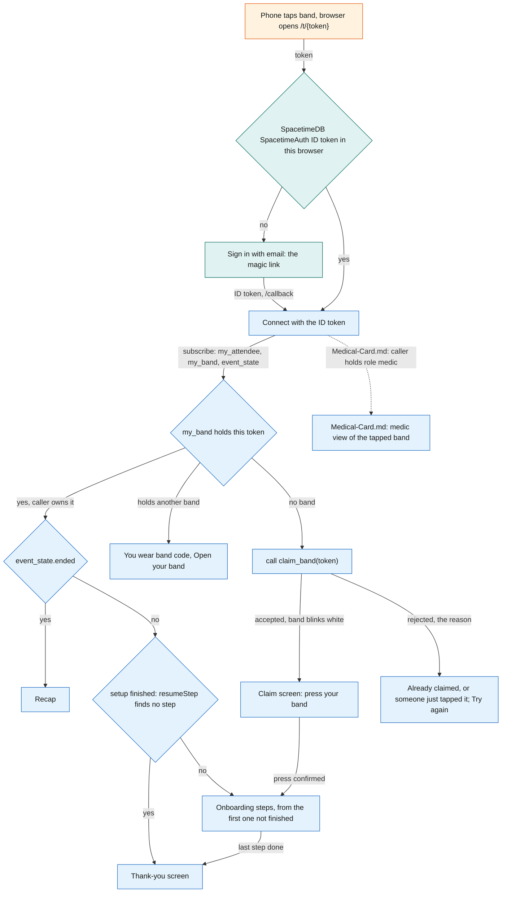
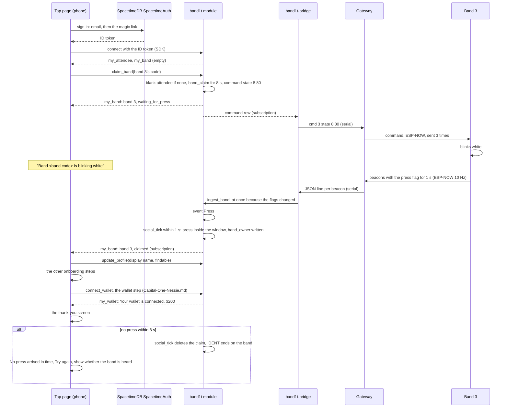
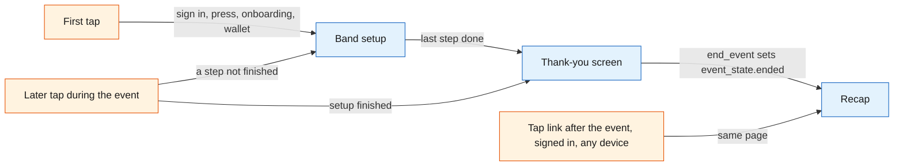
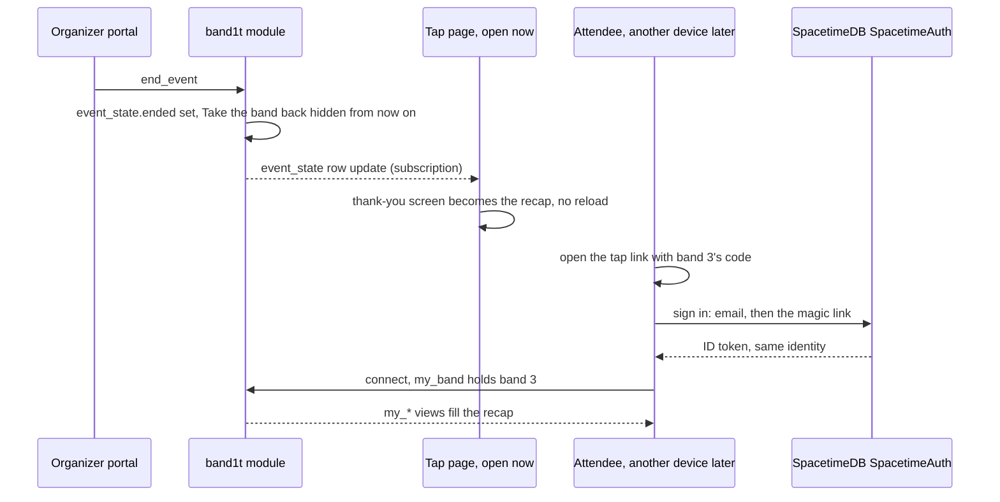

# Tap page

The tap page (/t/code) is the page a band's NFC sticker opens. Its code is `web/src/pages/t.ts`. After the event ends, the same page becomes the attendee's recap.

During the event it does one thing for the attendee: band setup at the first tap (sign in, claim the band by pressing its button, a short onboarding), then a thank-you screen. Staff work in the [organizer portal](Organizer-Portal.md) (/organizer).

It runs in the phone browser and signs the attendee in with SpacetimeDB SpacetimeAuth. It reads everything from the `band1t` module through SpacetimeDB's TypeScript client SDK, and calls `bandit-api` only for file uploads and the recap's people and booths (`GET /api/recap`).

## Role in the system

Responsibilities:

- Resolve the tapped token to a band and decide which screen to show (the landing route).
- Sign the attendee in. At the first tap the attendee signs in with the SpacetimeDB SpacetimeAuth magic link; the SpacetimeDB identity that comes with the sign-in is the attendee id.
- Claim the band by press, then run the onboarding steps, then show the thank-you screen.
- Hold the display name and the findable switch, both set during setup.
- At every later tap during the event, resume setup at the first step not yet finished, or show the thank-you screen once setup is finished, and nothing else.
- Turn every open tap page into the recap, live, when the organizer (`ops`) ends the event, and open it again later for the signed-in owner of the tapped band, on any device.

Not responsible for:

- Safety. The band decides its own colours ([Safety](../6-features/Safety.md)). The ring's colour and, on full bands, the vibration are the only guidance the attendee gets; the tap page shows no band state, zone, exit or alert.
- Holding truth. Every screen is a subscription and every change is a reducer call. If the phone dies, nothing is lost.
- Talking to the gateway or to any external service. Those go through `band1t-bridge`, `bandit-api` and `bandit-workers`.
- Positions. The page shows none; the recap shows zones and booths ([SpacetimeDB](../2-data/SpacetimeDB.md)).

## Interfaces

| Interface | Direction | Between | What flows | Transport |
|---|---|---|---|---|
| NFC tag URL | in | phone OS to tap page | `https://band1t.vip/t/<band code>`, on the one public HTTPS host of `bandit-api` ([Rust-Backend](../3-services/Rust-Backend.md)); the token is the path, the band's code (see Band codes) | NDEF URL read by the OS, opened in the browser |
| Static bundle | in | `bandit-api` to browser | the page itself, served from the same origin as the upload and recap endpoints, so no cross-origin setup is needed | HTTPS |
| SpacetimeDB SpacetimeAuth sign-in | both | tap page and SpacetimeDB SpacetimeAuth | the magic-link email sign-in; an OpenID Connect ID token back | HTTPS, OpenID Connect |
| SpacetimeDB connection | both | tap page and `band1t` module | the ID token, subscriptions, reducer calls | TypeScript client SDK over WebSocket |
| Own-row views | in | module to tap page | `my_attendee` (the display name and the findable switch), `my_band` (the band the caller owns, or the one they are claiming, with the end of its press window) | SDK subscription |
| Public rows | in | module to tap page | `event_state` (its `ended` flag turns the page into the recap); the tapped band's `band` row (whether it is heard); `venue` for the event's name | SDK subscription |
| Reducers | out | tap page to module | `claim_band`, `update_profile` (display name and findable switch), `open_api_session` (the first time a page load calls `bandit-api`, see Identity) | SDK reducer call |
| Blob upload | out | tap page to `bandit-api` | files for features that need them through `POST /api/blobs`, with the API session token; `bandit-api` stores the file under its SHA-256, calls `register_blob` and returns the hash and the URL `/blobs/<sha256>` | HTTPS, endpoint in [Rust-Backend](../3-services/Rust-Backend.md) |
| Medical-Card.md | both | tap page, module and `bandit-api` | the two document steps of setup, "Your medical history" and "Your health insurance": each PDF goes to `POST /api/blobs?purpose=history` or `purpose=insurance` with the API session token, then the page calls `submit_medical_document` with the kind, the hash and the page count; in test mode "Use a test record" loads the synthetic PDF from `/test-records`; the card step after "Are you one of these?", from `my_medical_documents` and `my_medical_card`, with "Looks right" calling `confirm_medical_card`; the medic view on a medic's tap, from `my_roles`, `open_incidents` and `medic_medical_cards`, calling `request_medical_card` and `assign_medic` | HTTPS and SDK |
| Capital-One-Nessie.md | both | tap page and module | the wallet step after the card step, "Connect your Capital One wallet" with "Connect" and "Skip": "Connect" calls `connect_wallet`, the step shows "Connecting your Capital One wallet" until `my_wallet` has a row, then "Your wallet is connected" with the balance ($200 to start) and "Continue"; on the recap, the balance line from `my_wallet` ("$X in your BandIt wallet · Capital One account" and the first 8 characters of the account id, or "Connect your Capital One wallet at band setup to buy merch." without a wallet) and the "Wallet activity" table from `my_wallet_entries`, among them each claim payout | SDK |
| Social.md | both | tap page and module | the setup socials step: the attendee types their Instagram, Facebook and Threads handles, saved with `set_social_handle` into `social_handle` (the page reads them back from `my_handles`); the recap's space-time view from `my_visits` and `my_encounters`; "Your photos" from `my_photos`; the recap's people, the people also there and the booths from `GET /api/recap` (see the Elastic.md row) | SDK and HTTPS |
| Bright-Data.md | both | tap page and module | the profile claim step in setup, "Are you one of these?", shown only when the name matches: the page lists the `person` rows (people scraped from the event pages, each with its title and its `organization`) that share a word of the typed display name and that `claimed_people` does not list; the attendee taps "This is me" and the page calls `claim_person`, which works only for an attendee who already owns a band; "None of these" goes on | SDK |
| Elastic.md | out | tap page to `bandit-api` | `GET /api/recap` when the recap opens, with the `x-bandit-session` header: `bandit-api` builds the recap's people, the people also there and the booths from the `social_*` views, and returns the people and booths in Elastic's order. Without Elastic.md, both keep their minutes order. The page asks again every 5 s until it answers | HTTPS |
| Insurance.md | both | tap page and module | "Hurt at the event?", above setup and the recap, for each resolved incident of the attendee's band with no claim yet (`my_incidents`): the attendee writes what happened and "File a claim" calls `file_claim`; then "Your claim" from `my_claims`, with its status in plain words up to "Paid $X into your wallet" | SDK |
| Incident-Types.md, Insurance.md (next to build) | both | tap page and module | "Something stolen or broken?": the attendee says what it was, what it was worth and what happened, and the incident opens where their band is; their claims of every type with status and payout; "Your charges": what for, how much and whether the organizer approved it | SDK |
| Merch.md | both | tap page and module | the merch section at the bottom of the recap, "Make it merch": suggestions from `my_merch_suggestions` with the reason they were picked, the preview that places the photo in the `merch_template`'s photo area, the one-tap "Buy" that calls `buy_merch` as the signed-in attendee, and "Your orders" from `my_merch_orders` | SDK |

## Design

### Routes

| Route | Who sees it | Purpose |
|---|---|---|
| `/t/{token}` | anyone | The only URL written on the tags, and the attendee's only route; the token is the band's code. Decides the screen from the sign-in, the band and the caller: band setup, then the thank-you screen during the event; the recap for the band's signed-in owner after the event, on any device. |
| Social.md: `/photo` | role `photographer` | The photographer page, served by `bandit-api` beside the tap page: upload a photo through `POST /api/blobs` and call `register_photo`. Content in [Social](../6-features/Social.md). |

`/t/{token}` shows the same thing to every attendee who taps: setup, the thank-you screen or the recap, for the caller's own band. Staff tools live in the [organizer portal](Organizer-Portal.md).

Medical-Card.md: a medic who taps a band gets the medic view of that band instead, and the page never claims it ([Medical-Card](../6-features/Medical-Card.md)). Every tag holds the same host, the public `bandit-api` host, so judges use their own phones on any network.

### Band codes

People never see a band's key, its `band_id`. They see its code, such as `K3QX-9A7M`: on the band, in its tap link `https://band1t.vip/t/<band code>`, on this page and on every staff screen. The code is seven Crockford Base32 characters (digits and capital letters without I, L, O and U) scrambled from the key, then one Luhn mod 32 check character, written as two groups of four.

- The scramble is a bijection, so two bands never share a code, and a code turns back into its key with no lookup table. Neighbouring bands get unrelated codes.
- The check character catches a typo before it opens someone else's band. A code that fails the check is no band, and the page shows "Unknown band" and "This tag is not a BandIt band."
- The module (`band_code`, `band_from_code`) and the web pages (`web/src/band-code.ts`) compute the same function, so no table stores a code. A code is read in any case, with or without the dash, with O read as 0 and I or L as 1.
- `claim_band` reads the token with `band_from_token`. Only bands 1 to 99, the ones the radio's one byte carries, can be claimed. The first stickers say `/t/BANDIT-0n`, which still works; the page shows that band's code.

### Landing route decision

The landing route works out who tapped which band. Who owns a band is private (`band_owner`), and `my_band` returns only the band the caller owns or is claiming, so the route learns a band's status by trying to claim it: `claim_band` accepts, which starts the press window, or rejects. Nothing is lost by trying, because a claim completes only with a press on that band.

1. Sign in. With no valid SpacetimeDB SpacetimeAuth ID token in this browser, the page shows "Sign in with your email to make this band yours." and "Sign in with email", which opens SpacetimeDB SpacetimeAuth's magic-link sign-in (see Identity). The sign-in returns to `/callback`, which sends the browser back to the tap link, so the route continues after the sign-in.
   - Test-Bands.md: in test mode the sign-in screen also offers "Continue without an account". It marks this browser tab as signed in without an account (`bandit-guest` in session storage), and the page connects with a SpacetimeDB token kept in the browser instead of an ID token, so a tester claims a test band without an email.
   - Test-Bands.md: in test mode the page also shows "Test as", a list of "myself" and the people `bandit-claims setup` created, from `bandit-api`'s `GET /api/actors`. Picking one reloads the page as that person (`?as=` with their name), so one browser plays each test attendee. The photographer route has the same list as "Play as".
2. Connect to SpacetimeDB with the ID token and subscribe to the page's views, among them `my_attendee`, `my_band`, `event_state` and the tapped band's `band` row.
   - Medical-Card.md: when `my_roles` holds role `medic`, the page is the medic view of the tapped band, during and after the event, and the route stops here without calling `claim_band`.
3. `my_band` already holds a band with this token: the caller owns it. Once `event_state.ended` is set, the page is the recap.

   Before that, the page resumes setup at the first step not yet finished (`resumeStep`, run on every load). The name step comes first while `my_attendee` has no display name, and the optional steps that have a resume check follow, in setup order. When none is left, the page is the thank-you screen.

   So a later visit by someone who finished setup lands on the thank-you screen, and someone who left setup halfway picks up where they left off.
   - Medical-Card.md: setup resumes at "Your medical history" while no history document is on file, at "Your health insurance" while no insurance document is, and at the card check while the card is not confirmed.
   - Capital-One-Nessie.md: setup resumes at the wallet step while the attendee has no wallet.
4. `my_band` holds another band the caller has claimed: the page says "You wear band <band code>." with "Open your band", a link to that band's tap page, and does not call `claim_band`.
5. Otherwise call `claim_band` with the token:
   - accepted: the band blinks white; show the claim screen ("Press the button on your band to make it yours.").
   - rejected: the page names the reason and offers "Try again". A band someone else owns gives "Band <band code> is already claimed. If it is yours, ask staff at the entrance.", and a band someone else is claiming right now gives "Someone just tapped this band. Wait a few seconds and tap again."

   Anyone can read the tag, so no rejection names the owner. After the event every band keeps its owner, so a stranger who taps a claimed band always gets "already claimed".

The question this diagram answers: which screen does a tap open, in the order the checks run?

### Identity

One sign-in, for attendees and staff alike: the SpacetimeDB SpacetimeAuth magic link. SpacetimeDB SpacetimeAuth is SpacetimeDB's own OpenID Connect provider, in beta. BandIt turns on its magic-link email sign-in only, with no other providers.

The attendee types an email, opens the link SpacetimeDB SpacetimeAuth sends, and comes back to the tap page with an ID token. The SDK presents that token to SpacetimeDB, which derives the identity from the token's issuer and subject. So the same person is the same attendee on every device and in every browser: signing in again with the same email gives the same identity.

The `attendee` row is keyed by this identity: `claim_band` creates it blank and `update_profile` fills it. BandIt keeps no password and no email address, and sends no email: the address belongs to the SpacetimeDB SpacetimeAuth sign-in only. The band press proves who holds the band at claim time; the sign-in proves who the attendee is at every later visit.

Talking to `bandit-api` as that same attendee. `bandit-api` is not a SpacetimeDB client of the phone's connection, so it cannot see who is calling by itself.

The first time a page load needs `bandit-api`, the tap page makes a random token and calls `open_api_session` with the token's SHA-256. The module binds the hash to the caller's identity in an `api_session` row for 12 hours. Then the page sends the plain token in the `x-bandit-session` header on every `bandit-api` request (uploads, `GET /api/recap`). `bandit-api` hashes it and looks the hash up in its `api_sessions` subscription, which gives it the attendee id without any JWT verification ([SpacetimeDB](../2-data/SpacetimeDB.md), [Rust-Backend](../3-services/Rust-Backend.md)).

The token lives in memory, not in storage.

A lost session (private browsing, cleared site data, a new phone, an iOS home-screen web app with its own storage) does not lose the attendee: they sign in again with the same email, get the same identity, and their band is still theirs. A band claimed by mistake is one organizer action: `release_band` on the [organizer portal](Organizer-Portal.md) unclaims the band, and the attendee claims it again by press. The old `attendee` row stays; only the band link moves.

### Claim by press, then onboarding

The tap alone proves nothing, because anyone can read the tag. The press proves that the person signing up is holding the band. The flow is one press, then one field, then a few skippable steps, then the thank-you screen.

1. The landing route calls `claim_band` with the token. The module creates a blank `attendee` row for the caller if none exists, opens an 8 s `band_claim` for the band, and writes one `state` command to it: IDENT (8) for 80 tenths of a second. `my_band` now returns the band to this caller with the status `waiting_for_press` and the end of the window, so the screen says "Band <band code> is blinking white", "Press the button on your band to make it yours." and the seconds left.
2. `band1t-bridge` sends the command as `cmd <band> state 8 80`; the gateway repeats it 3 times, 40 ms apart ([Gateway-Bridge](../3-services/Gateway-Bridge.md)). The band blinks white.
3. The attendee presses once. The band's beacons carry the press flag for 1 s. `band1t-bridge` forwards the changed line at once with `ingest_band`, which logs a `Press` event.
4. `social_tick`, once a second, finds the `Press` event inside the claim window. It deletes the `band_claim`, writes the `band_owner` row and sends `state 0` for a tenth of a second. That command does not end IDENT, so the band keeps blinking white until its 8 s are up and then returns to its density colour ([Hardware](../4-devices/Hardware.md)).
5. The page's `my_band` subscription updates to `claimed`; the screen says "It's yours" and continues with onboarding.
6. Onboarding, in order, each step skippable except the first:
   - Name ("It's yours", "Tell people who you are."): the display name and, on the same screen, the findable switch, saved together with one `update_profile` call (see The findable switch). There is no company field.
   - Social.md: "Your socials". The attendee types their Instagram, Facebook and Threads handles, and the page saves each with `set_social_handle`. No other networks are asked for, and nobody's profile is looked up or scraped ([Social](../6-features/Social.md)).
   - Medical-Card.md: "Your medical history", then "Your health insurance", one PDF each, with "Upload" and "Skip". Each upload goes through `POST /api/blobs` and then `submit_medical_document`, and the Anthropic Claude API reads it into the one `medical_card` (`medical_extract`) while setup goes on ([Medical-Card](../6-features/Medical-Card.md)).
   - Bright-Data.md: "Are you one of these?", shown only when the display name matches unclaimed `person` rows. The page lists the `person` rows whose name matches the typed display name and that `claimed_people` does not list, each with a "This is me" button. The attendee taps theirs, and the page calls `claim_person`; "None of these" goes on.

     There is no second press: the band claim made the attendee a band owner, and `claim_person` refuses anyone who owns no band with "claim your band first". It writes a `person_claim` row and copies the profile's organisation and headshot onto the attendee ([Bright-Data](../7-integrations/Bright-Data.md)).
   - Medical-Card.md: the card check, skipped when nothing was uploaded. While a document is being read it shows "Reading your documents" with "Check later". Then it shows the card with the page of each item, and "Looks right" calls `confirm_medical_card`.

     It is the only time the attendee sees the card ([Medical-Card](../6-features/Medical-Card.md)).
   - Capital-One-Nessie.md: "Connect your Capital One wallet", with "Connect" and "Skip". "Connect" calls `connect_wallet`, which queues the opening of a $200 Capital One Nessie sandbox wallet for merch and claim payouts.

     The step shows "Connecting your Capital One wallet" until `my_wallet` has a row, then "Your wallet is connected" with the balance and "Continue". "Skip" finishes setup without a wallet ([Capital-One-Nessie](../7-integrations/Capital-One-Nessie.md)).
7. Done: the thank-you screen. Within one visit a skipped step is not offered again; a later visit resumes at the first step that is still not finished (see Landing route decision).

If no press arrives within 8 s, `social_tick` deletes the claim, the white blink ends on the band by itself, and the screen says "No press arrived in time." with "Try again", which calls `claim_band` once more. While it waits, the screen also says whether the band is heard, "Your band is being heard." or "Your band is not heard right now: walk toward the gateway.", from the tapped band's public `band` row (heard in the last 5 s), so an attendee whose band is out of range walks toward the gateway rather than pressing again.

The question this diagram answers: which process does what, from the tap to the thank-you screen?

### The findable switch

Setup asks for little: a display name, the findable switch and whatever the optional features add. The switch is the `findable` column of the attendee's own `attendee` row, saved with the name by `update_profile`.

The row starts with `findable` off. The name step's checkbox, "People I spend time with can see my name and socials after the event", starts ticked, so saving the name turns it on unless the attendee unticks it.

The switch exists in the core even if Social.md is deleted; then it has no effect.

| Switch | What it allows | Who enforces it |
|---|---|---|
| `attendee.findable` | People you spent time with see your name, photo and Meta handles in their recap; you can be tagged in photographer photos; you appear in the organizer portal's event graph; Elastic.md: `bandit-indexer` copies your interests to `bandit-people` for the recap ranking | [Social](../6-features/Social.md), [Elastic](../7-integrations/Elastic.md) |

### The thank-you screen

When the last setup step is done, the page shows the thank-you screen: "You're all set", "Thanks, <name>. Enjoy <venue>." and "Keep your band on. After the event, tap it again for your recap: where you went, who you spent time with, and your photos." It shows nothing else: no band status, no zones and how busy they are, no exit colours or alerts, no wallet, no profile, no graph, no schedule and no photos.

Insurance.md: above it, "Hurt at the event?" appears once an incident of the attendee's band is resolved, and "Your claim" once they filed one.

Once setup is finished, every later tap on the band during the event opens the same screen, on any signed-in device; before that, a tap resumes setup at the first step not yet finished. The screen's one live input is `event_state`: when the event ends, it turns into the recap.

Safety guidance reaches the attendee only through the band: the ring's colour and, on full bands, vibration ([Safety](../6-features/Safety.md)). The phone repeats none of it.

The question this diagram answers: which state is the attendee's tap page in, from the first tap to after the event?

### After the event

There is no separate post-event page and no email. The page the attendee already has becomes the recap. Ending the event belongs to the organizer (`ops`): when they press "Event ended" in the [organizer portal](Organizer-Portal.md), `end_event` sets `event_state.ended`.

Every open tap page subscribes to `event_state`, so the thank-you screen turns into the recap live, with no reload. `reopen_event` clears it and the pages show the thank-you screen again, to run the event flow again.

Later, the attendee reopens their tap link `/t/<band code>` on any device, signed in with SpacetimeDB SpacetimeAuth, and the recap opens as them. The link is plain and lasting: it is the URL on the band, not a secret, and it shows the recap only to the band's signed-in owner.

Anyone else who opens it gets the taken page. Once the event has ended, the organizer portal no longer offers "Take the band back", so every band keeps its owner for the recap.

The question this diagram answers: how does the organizer's "Event ended" press turn every open tap page into the recap, and how does the attendee open it again later?

The recap, top to bottom, as `web/src/recap.ts` draws it under "Your <event>" and "Thanks for coming, <name>. Here is your night.". How it looks is front end and not designed here.

1. Social.md: "Where you were", the space-time view, drawn on the phone from `my_visits` (one bar per stay, zones down the side, time along the bottom) and `my_encounters` (a dot per person met), then the stays as text.
2. Social.md: "People you spent time with", from `GET /api/recap`: each person with their photo, how you met (the zone and time, the minutes together, the booths you both visited, the photos you are both in) and their socials. Only `findable` people appear.
3. Social.md: "Also there with you", from `GET /api/recap`: the people you were in the same place with for a while, other than those above, with the zone, the minutes and the time.
4. Social.md: "Booths you spent time at", from `GET /api/recap`: each booth with its zone.
5. Social.md: "Your photos", from `my_photos`: each photo with its caption, zone, time and the people in it. "Share" opens the phone's share sheet with the photo and a line that tags the others' Instagram handles; without a share sheet the page copies the line and downloads the photo.
6. Merch.md: "Make it merch": the wallet's balance line, up to three suggestions from `my_merch_suggestions`, each with one of your own photos placed in its photo area and "Buy" (`buy_merch`, paid from the wallet), then "Your orders" from `my_merch_orders`, then "Wallet activity".

Every call on the recap runs as the signed-in attendee. Other sections, each separable:

- Elastic.md: the order of the recap's people and booths. `GET /api/recap` returns them with the people and booths closest to what the attendee was into first, and logs that order to `bandit-recap-rankings`. Without Elastic.md, both lists keep their minutes order.
- Capital-One-Nessie.md: the wallet, inside "Make it merch": the balance line (`my_wallet`), "$X in your BandIt wallet" with "Capital One account" and the first 8 characters of its id, or "Connect your Capital One wallet at band setup to buy merch." without a wallet; then "Wallet activity", every opening, purchase and claim payout (`my_wallet_entries`), newest first. This is where the attendee spends and receives money. The recap has no button that connects the wallet, and "Buy" stays off without one.
- Merch.md: the wallet's balance line opens the merch section, above the suggestions, and "Wallet activity" closes it, below "Your orders".
- Insurance.md: "Hurt at the event?" and "Your claim" sit above the recap, as they sit above setup during the event.
- Incident-Types.md: "Something stolen or broken?" sits with them, and every claim of every type shows its status and payout (next to build).
- Insurance.md: "Your charges" lists what security named the attendee responsible for: what for, how much, and whether the organizer approved it. An approved charge is collected from the wallet, and payouts, refunds and charges all show in the wallet's movements (next to build).

### Platform notes

- iPhone XS and newer read an NDEF URL in the background whenever the screen is on and show a banner; tapping it opens Safari at the URL. Each tap may open a new tab; the sign-in is per origin, so every tab is the same signed-in attendee.
- Android opens an NDEF URL in the default browser from the system tag dispatch when the phone is unlocked.
- The band claim starts from the OS opening the tag URL, so it works the same on both platforms with no in-page NFC reading.
- The tag is an NTAG215 holding one NDEF URL on the `bandit-api` host, locked read-only once written ([Hardware](../4-devices/Hardware.md)).
- Test-Bands.md: crowd bands have no tag and no tap link; each is a `band` row from 100 that `crowd_tick` moves, worn by a generated attendee that `start_crowd` creates inside the module, named in `crowd_member`.
- Test-Bands.md: the test bands 94 to 99 have a tap link (`/t/<band code>`) but no tag. A tester opens it and claims the band with a press from `bandit-api`'s dev routes instead of a real press ([Test-Bands](../3-services/Test-Bands.md)).

## Failure modes and fallbacks

| Failure | Effect | Design answer |
|---|---|---|
| No press reaches the module within 8 s (band out of range, `band1t-bridge` down) | Claim times out | The screen says "No press arrived in time.", offers "Try again", and shows whether the band is being heard; the white blink ends on the band by itself. |
| Sign-in session lost (private browsing, cleared data, new phone, iOS home-screen app) | The page shows the sign-in screen | The attendee signs in again with the same email and gets the same identity; the band is still theirs, and the page is the thank-you screen again. |
| The sign-in email is slow | The attendee waits on SpacetimeDB SpacetimeAuth's sign-in page | That page sends the link again; the page saved the tap link before the sign-in, so `/callback` returns to it and the claim continues. |
| Stranger taps a claimed band | Could leak the owner | The page says only "Band <band code> is already claimed. If it is yours, ask staff at the entrance." |
| SpacetimeDB connection drops (phone loses signal) | Setup pauses | The SDK reconnects and replays subscriptions; setup buttons are disabled meanwhile. A thank-you screen that missed `end_event` turns into the recap when it reconnects. Safety never depends on the phone: the band decides its own colours. |
| After the event the judge opens the recap on a device that is not signed in | No recap yet | They open `/t/<band code>`, sign in with the email they used, and the recap opens as them. |

## Dependencies

**Depends on**

- [SpacetimeDB](../2-data/SpacetimeDB.md): views `my_attendee`, `my_band`; public `band`, `venue`, `event_state`; reducers `claim_band`, `update_profile`, `open_api_session`; the module's band code functions `band_code`, `band_from_code` and `band_from_token`; the tables `band_claim` and `band_owner`, the `Press` event and `social_tick`, which completes a claim; SpacetimeDB SpacetimeAuth as the one sign-in.
- [Gateway-Bridge](../3-services/Gateway-Bridge.md) and [Hardware](../4-devices/Hardware.md): the IDENT state, the press flag and the `state` command that make claim by press work.
- [Rust-Backend](../3-services/Rust-Backend.md): `bandit-api` serves the bundle on the public host, `/config.json`, the blob upload endpoint, `GET /api/recap` and the `api_sessions` lookup.
- [Organizer-Portal](Organizer-Portal.md): `release_band` by the organizer for band recovery; `grant_role` for staff; the "Event ended" button, which runs `end_event`.

**Used by**

- [Organizer-Portal](Organizer-Portal.md), [SpacetimeDB](../2-data/SpacetimeDB.md), [Hardware](../4-devices/Hardware.md): the band codes.
- [Medical-Card](../6-features/Medical-Card.md): the two document steps and the card step in setup, and the medic view on a medic's tap.
- [Capital-One-Nessie](../7-integrations/Capital-One-Nessie.md): the wallet step at the end of setup, its resume check, and the recap's wallet (the balance line and "Wallet activity").
- [Social](../6-features/Social.md): the socials step, the photographer page, the recap's space-time view, its people and booths, and its photos with "Share".
- [Bright-Data](../7-integrations/Bright-Data.md): the profile claim step, "Are you one of these?".
- [Merch](../6-features/Merch.md): the merch section at the bottom of the recap.
- [Elastic](../7-integrations/Elastic.md): the order of the recap's people and booths.
- [Insurance](../6-features/Insurance.md) and [Incident-Types](../6-features/Incident-Types.md): "Hurt at the event?", "Your claim", and, next to build, "Something stolen or broken?" and "Your charges".
- [Flows](../1-overview/Flows.md): the join and claim step and the recap step of the event.

**If you delete this file**

- The event loses tap to join: `claim_band` would have no caller, so no band would have an owner.
- Medical-Card.md needs another page for its document steps, its card step and the medic view; Insurance.md needs another page for filing a claim.
- Remove the tap page row from the component table in Architecture.md and the attendee row from SpacetimeDB.md's "subscriptions per client".
- Remove the tap page bullets in Social.md, Bright-Data.md, Elastic.md, Merch.md, Insurance.md, Capital-One-Nessie.md and Medical-Card.md.

## Decisions

| Decision | Why |
|---|---|
| During the event the tap page is band setup, then a thank-you screen, and nothing else; the recap replaces it when the event ends | the band carries every safety cue on the wrist, and the night comes back in the recap, so the page has nothing to show in between |
| A later tap during the event resumes setup at the first step not yet finished (`resumeStep`), and opens the same thank-you screen once setup is finished | someone who closed the page halfway does not start over, and the thank-you keeps one meaning: you are set up |
| Safety guidance reaches the attendee only through the band: the ring's colour and, on full bands, vibration; the phone shows none of it | the ring has no compass, so colour and vibration are the guidance, and they work with the phone in a pocket |
| Every tag holds the one public `bandit-api` host; there is no second entry such as a QR code | there is one deployment, so one host always works, on judges' own phones |
| People see a band's code, such as `K3QX-9A7M`, never its number; the code is computed from the band's key and ends in a check character | with numbers, a typo or the next number opens someone else's band; a code's typo fails the check, neighbouring bands share nothing, and the code turns back into the key with no table to keep |
| A rejection of `claim_band` names only its reason: already claimed, someone just tapped it, or you already wear another band | a stranger learns nothing about the owner, and the attendee knows whether to wait, ask staff or open their own band |
| Only the organizer releases a band, with `release_band` on the organizer portal after a confirm tap, until the event ends | the tap page has no screen for it; the organizer fixes a band claimed by mistake, and after the event every band keeps its owner for the recap |
| One sign-in for attendees and staff: the SpacetimeDB SpacetimeAuth magic link, and no other providers | the identity comes from the token's issuer and subject, so it is the same on every device; BandIt keeps no password and no email address |
| There is no recap email; `end_event` turns every open tap page into the recap live, and the tap link `/t/{token}` opens it again later for the band's signed-in owner | the band's own URL is the way back, and the sign-in proves who is opening it |
| The recap runs top to bottom: the space-time view, the social part, then the merch suggestions and checkout | the night first, the people second, shopping last |
| Socials are typed by the attendee at onboarding | no verification flow to build, and nobody's profile is scraped |
| Bright-Data.md: the profile claim is one tap, open only to an attendee who already owns a band | the band claim's press already proved who holds the band, so there is no second press and no email round trip |
| Capital-One-Nessie.md: the wallet is the last setup step, "Connect your Capital One wallet" with "Connect" and "Skip"; setup finishes without it when it is skipped, and the recap has no connect button | the attendee chooses to connect it, every judge who taps has a funded wallet with nothing to type, and the wallet is asked for in one place |
| Staff work in the organizer portal; the tap page shows each attendee only their own band | the tag URL means the same for every attendee who taps it |
| Medical-Card.md: a medic's tap opens the medic view of that band and never claims it | at the person the band's own tag is the quickest way to the card; notes, cost and resolve stay on the incident desk |
| Medical-Card.md: the card check comes just before the wallet, not right after the uploads | the Anthropic Claude API reads the PDFs while the attendee answers the steps in between, so the card is usually ready when the check comes |
| The tap page has no merchant route; BandIt takes no payments at the venue | the band press is kept for claiming a band; merch is paid on the recap after the event |
| Socials are Instagram, Facebook and Threads handles only, and onboarding has no company field | Meta is the sponsor track; `works_at` links come only from the import and a claimed profile |
| Elastic.md: the recap's people and booths come from `GET /api/recap`, which `bandit-api` builds from the `social_*` views and has Elastic only order | nobody appears who was not measured with the attendee; meaning changes only the order |
