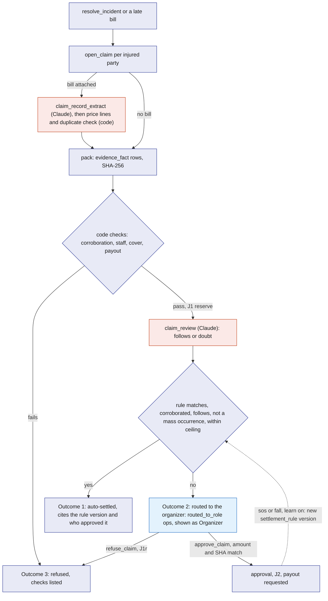
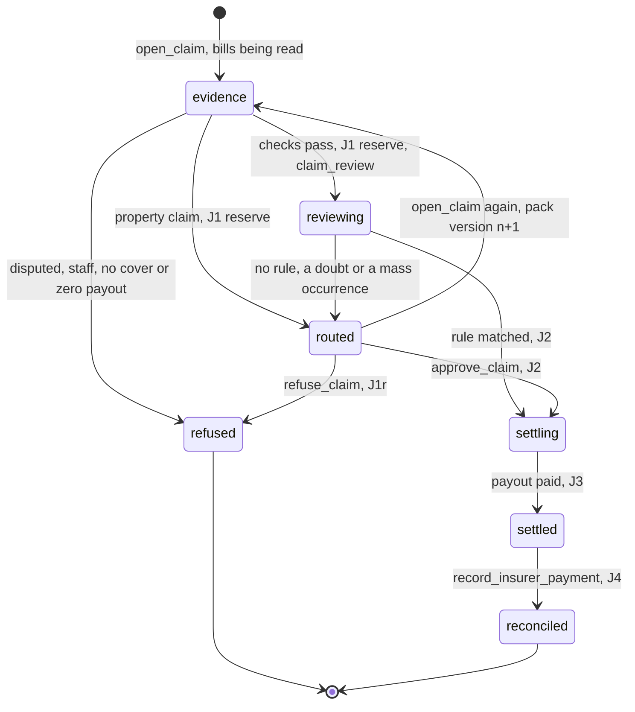
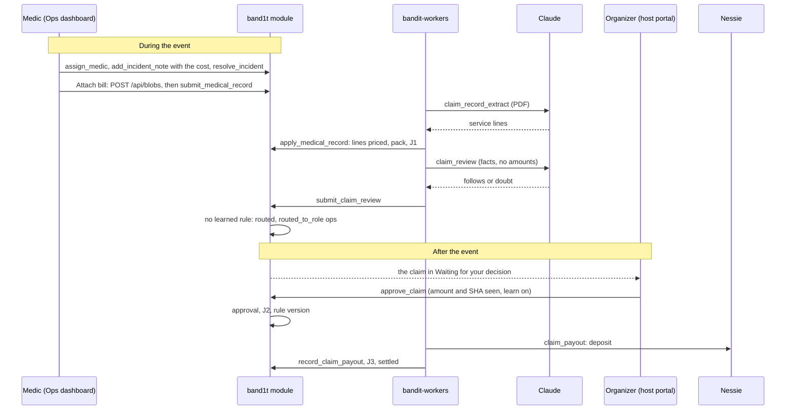
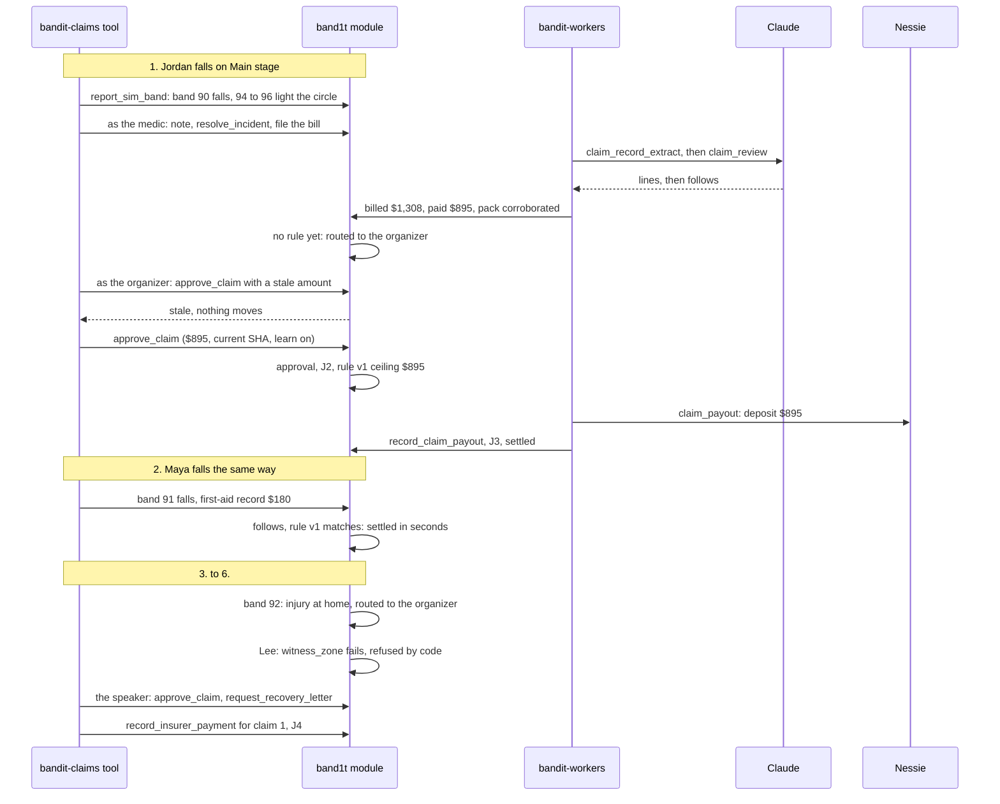
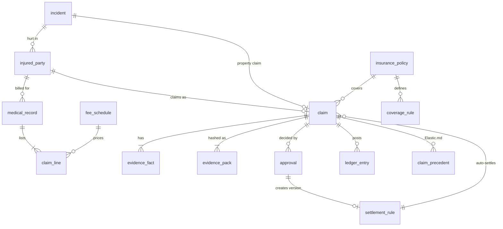

# Insurance

Insurance is BandIt's incident-to-claim workflow, built for Hyphenate's "autonomous systems for finance" track. It turns a resolved safety incident into a hashed evidence pack, reads the urgent-care bill into service lines and prices each line against a fee schedule, asks Claude whether the injury follows from the incident, decides in code whether the venue's insurance covers it and for how much, and then takes one of three routes: settle it automatically under a rule the organizer approved earlier, wait for the organizer, or refuse it in code and show every check. Money moves on a double-entry ledger and lands in the attendee's Nessie wallet. One pattern runs through all of it: code checks the facts and computes every amount, the model reads and explains, the organizer decides every claim that no learned rule settles, and each approval becomes a rule that settles the next claim of that shape without anyone.

In finance terms: the reserve is a general-ledger entry, the insurer receivable is order-to-cash, the bill review and the claimant payment are procure-to-pay, and the reconciliation closes the receivable when the insurer pays. Two staff roles take part. During the event the medic (role `medic`) is the paramedic: they take the incident, note the cost and resolve it, which opens the claim. After the event the organizer (role `ops`) decides every claim that no learned rule settled. Test-Bands.md: in the scripted claims run, judges see the system learn: the organizer's approval of the first claim creates a rule, and the next similar claim settles in seconds under it.

## Role in the system

Responsibilities:

- Open one claim per injured person from a resolved `sos`, `fall` or `crowd_risk` incident that has a first-aid cost or an urgent-care bill, and one claim from a resolved `property` incident that carries a repair cost.
- Bill review: read the urgent-care bill into service lines with Claude (`claim_record_extract`), price every line in code against the seeded `fee_schedule`, and catch duplicate bills across all claims.
- Build and hash the evidence pack from rows the safety system and the bill review already wrote; never from new sensing.
- Check corroboration in code: two independent sources agree on time and zone.
- Refuse in code at claim open, and store and list every check: disputed evidence, a staff claimant, no cover, a zero payout. After that only the organizer can refuse a claim.
- Ask Claude for a causation review (`claim_review`) that can flag a claim and route it to a person, but never refuses it and never changes an amount.
- Compute coverage and amounts in integer cents from `coverage_rule` and the priced bill lines.
- Decide the outcome: auto-settle, route to the organizer, or refuse. Every claim of a mass occurrence goes to the organizer.
- Learn: turn the organizer's approval into a versioned `settlement_rule` with the ceiling they approved.
- Post balanced `ledger_entry` journals for every money movement and keep the claim status honest about them.
- Draft the first notice of loss in the layout of ACORD 3, the claim summary and recovery letters through `bandit-workers` jobs.
- Own `claimant_account`, each attendee's one Nessie account, where claim payouts land.
- Payments-Nessie.md: pay the claimant into their sandbox wallet through [Payments-Nessie](../7-integrations/Payments-Nessie.md); the wallet is the same `claimant_account`, which it opens when the attendee connects it in setup.
- Test-Bands.md: score the accuracy run of planted claims on the Claims queue.
- Elastic.md: send a de-identified copy of each claim to Elastic and record its similar past claims as checks.

Non-responsibilities:

- Detecting incidents, freezing snapshots, recording witnesses: [Safety](Safety.md).
- Medical-ID.md: the attendee's own medical card ([Medical-ID](Medical-ID.md)). Insurance never reads it; a claim rests on the bill, the incident and the venue's policy.
- Camera frames, property-damage detection and the per-incident `vision_assessment`: [Vision](../4-devices/Vision.md) (TBD -- LEO). Insurance only reads those rows into evidence.
- Raw bridge logs: they stay on the venue laptop and are never evidence. The pack reads the `incident_snapshot` frozen in the same transaction as the incident ([Gateway-Bridge](../3-services/Gateway-Bridge.md)).
- Calling banks: [Payments-Nessie](../7-integrations/Payments-Nessie.md). Insurance enqueues the `claim_payout` job and records the result with `record_claim_payout`.
- Prompts, model choice, recording and replay: [Anthropic-Agent](../7-integrations/Anthropic-Agent.md).
- Planting claims: [Test-Bands](../3-services/Test-Bands.md). Insurance's decision code never reads which claims were planted or why.
- Screens: the Claims queue panel and the incident card controls are in [Ops-Dashboard](../5-apps/Ops-Dashboard.md).

## Interfaces

| Interface | Direction | Who | What flows | Transport |
|---|---|---|---|---|
| Hook in `resolve_incident` | in | `band1t` module (Safety.md) | incident id; writes the subject's `injured_party` row for a `sos` or `fall`, then opens a claim for every injured party with a first-aid cost or a bill, or for a `property` incident with a cost note | same transaction, module-internal call to the `open_claim` logic |
| `add_injured_party` | in | the assigned `medic`, `ops` | open incident id, a band picked from the snapshot's bands present, first-aid cost in cents | reducer; writes `injured_party` |
| `POST /api/blobs` with purpose `medical` | in | Ops dashboard incident card ("Attach bill"), for `medic` and `ops`; Test-Bands.md: the `bandit-claims` tool for incidents on test bands | the bill PDF (at most 10 MB); back come its SHA-256, its page count and the URL `/blobs/<sha256>` | HTTPS to `bandit-api`; stored under its SHA-256 and registered as a `staff` blob through the blob upload ([Rust-Backend](../3-services/Rust-Backend.md)) |
| `submit_medical_record` | in | the incident card as the signed-in staff member (roles `medic`, `ops`) | incident id, injured party id, the file's SHA-256 (its registered `blob_ref`), page count; the caller is the uploader | reducer; writes `medical_record`, rejects an identical file, enqueues `claim_record_extract`, opens the claim when the incident is already resolved |
| `apply_medical_record` | in | role `worker` | job id, bill id, validated header and lines, `model_call` id | reducer; rejects a stale lease; prices the lines and runs the duplicate check |
| `enter_claim_lines` | in | `ops` | bill id, header and lines typed from the PDF | reducer; same pricing and duplicate check |
| `submit_claim_review` | in | role `worker` | job id, claim id, verdict, cited fact ids, explanation, `model_call` id | reducer; rejects a stale lease; decides the outcome |
| `open_claim` | in | role `ops` | incident id; opens a claim by hand when the cost note came after resolution, or rebuilds the pack of a `routed` claim ("Rebuild pack") | SpacetimeDB reducer |
| `approve_claim` | in | the organizer: anyone with `ops`, the claim's `routed_to_role`, or the module owner | claim id, amount seen, pack SHA seen, requested rule ceiling, learn flag | reducer |
| `refuse_claim` | in | the organizer, as for `approve_claim` | claim id, pack SHA seen, reason | reducer |
| `record_insurer_payment` | in | `ops` | claim id, amount received in cents, insurer reference | reducer |
| `retry_claim_payout` | in | `ops` | claim id; queues the `claim_payout` job again for a `settling` claim whose payout job is dead | reducer |
| `request_recovery_letter` | in | `ops` | claim id, counterparty name and contact | reducer; enqueues `recovery_letter` |
| `retire_settlement_rule` | in | `ops` | rule id | reducer; new version with ceiling 0 |
| `upsert_insurance_policy`, `upsert_coverage_rule`, `upsert_fee_schedule` | in | `ops` (setup) | policies, cover limits and deductibles, fee schedule caps | reducers, loaded from the seed |
| `attach_claim_letters` | in | role `worker` | job id, claim ids, letter kind, `blob_ref` id, suggested tolerance | reducer; rejects a stale lease |
| Payments-Nessie.md: `record_claim_payout` | in | role `worker` | job id, the Nessie customer, account and deposit ids | reducer; posts J3, settles the claim and adds the wallet's `payout` entry; rejects a stale lease |
| Jobs `claim_record_extract`, `claim_review`, `claim_draft`, `recovery_letter` | out | `bandit-workers` | payloads named below; results through the reducers above | `job` table, `claim_job` and `complete_job` |
| Payments-Nessie.md: job `claim_payout` | out | `bandit-workers` | claim id, claimant, name, the wallet's customer and account ids (empty when the claimant has none), amount in cents, memo | `job` table |
| Claims queue, ledger, rules and scorecard | out | Ops dashboard (roles above) | `claim`, `injured_party`, `medical_record`, `claim_line`, `evidence_fact`, `evidence_pack`, `approval`, `ledger_entry`, `settlement_rule`; Test-Bands.md: `planted_incident`; Elastic.md: `claim_precedent` | SpacetimeDB subscription |
| Vision.md (TBD -- LEO): `vision_assessment`, `camera`, `property_event` rows | in | `bandit-vision` | per-incident judgment (confirmed, confidence, description, frame blob refs, `model_call` id), the camera's zone, property events | tables read by `open_claim` |
| Letters | out | Ops dashboard | the notice, summary and recovery letters as blobs | `bandit-api` blob download for a staff `api_session`; letter blobs carry access class `staff` |
| Elastic.md: Kibana dashboard "BandIt claims evidence" | out | the team, in Kibana | counts and charts over the de-identified claim copies: claims tonight, evidence failing validation, payouts, outcomes by zone and incident kind, and the validation errors | read only on `bandit-claims` |
| Elastic.md: job `claim_verify` and `submit_claim_checks` | both | `bandit-workers` (role `worker`) | a de-identified claim document out to `bandit-claims`; similar past claim ids and scores back | `job` table; HTTPS to Elastic ([Elastic](../7-integrations/Elastic.md)); reducer that rejects a stale lease |

## Design

### Which policy pays

The venue's general liability policy, always. It has medical-payments cover (it pays reasonable treatment costs for a guest hurt on the premises, no fault needed, up to the medical expense limit) and property cover for the venue's own equipment, each with a per-claim limit, an aggregate limit for the event and a deductible. Medical payments excludes the venue's own employees, whose injuries belong to workers' compensation, so code refuses a staff injury. The attendee's medical card is evidence, not a policy. A vendor only ever receives a recovery letter worded as a question.

The seed holds two `insurance_policy` rows with the same covers: the event policy, and a copy for the accuracy run whose period ends before doors open (`purpose` is `event` or `accuracy_run`). A claim falls under the policy whose period contains the incident's open time. Rules match only inside their own policy's period, so whatever the accuracy run learns has expired when the event starts, and the scripted claims run begins with no rule.

### Trigger and injured people

A claim opens from an incident, never from a form: one claim per injured person per incident, and one claim per `property` incident.

1. Injured people. For a `sos` or `fall` incident, the wearer of the subject band is the first `injured_party`, written by the hook in `resolve_incident`. Anyone else hurt in the same incident is added while it is open: the assigned medic or ops picks their band from the incident snapshot's bands present on the incident card and calls `add_injured_party` with the first-aid cost given on site. Ops does the same on a `crowd_risk` incident, which has no subject band.
2. Costs. An injury claim needs a first-aid cost or an urgent-care bill. The subject's first-aid cost is the sum of `cost_cents` on the incident's notes; an added person's is the cost entered with them. The medic or ops attaches a bill to an injured person from the incident card, while the incident is open or within 30 days of resolution (starting value).
3. Opening. `resolve_incident` ends with one separable Insurance hook that opens a claim for every injured party with a cost or a bill, in the same transaction, so a claim can never drift from the incident it came from. A bill attached after resolution opens the claim for its person if none exists.
4. Property. A `property` incident resolved with a note carrying the repair or replacement cost opens one claim. Staff open the incident from the Report property damage button on the Ops dashboard, which calls `open_incident` with kind `property` ([Safety](Safety.md)). Vision.md (TBD -- LEO): `bandit-vision` attaches a `property_event` and a `vision_assessment` with frames to that incident, and they become evidence facts.

`claim.injured_party_id` is unique, and `claim.incident_id` is unique among property claims.

### Bill review

Claude reads the bill; code decides every amount. The urgent-care bill is a PDF. At the event it is a synthetic one.

Upload. "Attach bill" on the incident card sends the PDF to `POST /api/blobs` with purpose `medical`. `bandit-api` takes a PDF of at most 10 MB, stores it in the blob store under its SHA-256, registers it with `register_blob` and access class `staff`, counts the pages and returns the hash and the page count. The card then calls `submit_medical_record` with them as the signed-in staff member. The reducer accepts `medic` and `ops` (Test-Bands.md: the `bandit-claims` tool files planted bills as its `medic` test identity), refuses a hash that is not a registered `blob_ref`, and writes a `medical_record` row in status `uploaded`. A file whose SHA-256 equals any earlier bill on any claim is marked `duplicate` at once; otherwise the row moves to `extracting` and `claim_record_extract` is enqueued.

Extraction. The worker sends the PDF to Claude as a document block with a JSON schema ([Anthropic-Agent](../7-integrations/Anthropic-Agent.md)). Claude returns the header (provider name, provider NPI, invoice number, patient name and service date as printed, billed total, the visit reason as printed) and one line per service (code as printed, description, units, billed amount, page). Claude never sees the fee schedule and returns no paid amounts. Code validates before `apply_medical_record` accepts the record: the lines sum to the billed total, every amount is a positive whole number of cents, every line cites a page within the page count, and the NPI passes its check digit. A bill that fails validation twice is `failed`, and its claim waits for the organizer, who types the lines from the PDF with `enter_claim_lines`. Typed lines go through the same pricing and the same duplicate check.

Pricing. A pure function in the module prices every line against `fee_schedule`, the policy's list of reasonable charges by service code. The result is one `claim_line` row per line.

| Line | `allowed_cents` | `decision` |
|---|---|---|
| code on the fee schedule, billed at or below the cap times units | the billed amount | `paid` |
| code on the fee schedule, billed above the cap times units | the cap times units | `reduced` |
| code not on the fee schedule, or no code | 0 | `excluded` |
| any line of a bill with no valid provider NPI | 0 | `excluded`, reason `no_provider_npi` |

`fee_schedule` rows, set by the venue in the seed with `upsert_fee_schedule` (starting values):

| `code` | Service | `cap_cents` |
|---|---|---|
| `99203` | new patient visit, low complexity | 20000 ($200) |
| `99204` | new patient visit, moderate complexity | 30000 ($300) |
| `73110` | wrist X-ray, three views | 12000 ($120) |
| `73610` | ankle X-ray, three views | 12000 ($120) |
| `29125` | short arm splint | 15000 ($150) |
| `L3908` | wrist brace | 8000 ($80) |
| `12002` | simple wound repair | 25000 ($250) |
| `A6449` | elastic bandage | 1500 ($15) |

Anything else, such as an after-hours fee (`99051`), is not on the schedule and is excluded. The Claims queue shows each line with billed and paid side by side, its decision and reason, and the bill's totals: billed, paid and saved.

Duplicate check. Code compares every priced bill with every earlier bill, on any claim and under any policy:

| Key | Matches when |
|---|---|
| Identical file | the same SHA-256 (checked at upload) |
| Provider and invoice | the same provider NPI and the same invoice number |
| Patient, date and total | the same injured attendee, the same service date and the same billed total |

A match with a bill on another claim sets the bill to `duplicate` with `duplicate_of` and the keys that matched, and its lines are not paid; the claim's checks name the earlier claim. A claim with nothing else to pay is then refused as `zero_payout`. A match with a bill on the same claim (the medic attached it twice) sets only the later bill to `duplicate`, and its lines are not paid.

### Evidence pack

The pack is a set of `evidence_fact` rows plus one `evidence_pack` row that hashes them. Code builds it once every bill of the claim is priced, failed or marked duplicate, from rows that already exist, so the safety path never waits on it.

| `evidence_fact` field | Meaning |
|---|---|
| `claim_id`, `pack_version` | which claim and which pack build the fact belongs to |
| `source` | one of `band_report`, `incident_snapshot`, `light_circle`, `staff_note`, `claimant`, `bill`, `vision_assessment` (TBD -- LEO), `policy` |
| `key`, `value` | what the fact says, as text: for example `fall_flag` = `1`, `zone_id` = `102`, `allowed_cents` = `12000` |
| `observed_at` | the time the fact is about (the beacon time, the note time, the service date, the frame time) |
| `read_at` | when code or the model read it into the pack |
| `reader` | `code` or `model` |
| `ref` | how to fetch it again: table and row id, or the blob SHA-256 and page for a bill or frame |

| Source | Rows read | Facts |
|---|---|---|
| `band_report` | the subject band's last report at incident open, as frozen in `incident_snapshot` (the live row is overwritten) | flags (SOS, fall), `neigh`, `zone`, `state`, report time |
| `incident_snapshot` | the snapshot frozen in `ingest_band_reports` | zone density estimate and risk level, bands present |
| `light_circle` | `incident_band` rows with role witness | witness band ids, their zone and state 4 times |
| `staff_note` | `incident_note` rows | author role, note time, text, `cost_cents` |
| `claimant` | the `injured_party` row and `staff_role` | the injured band, how they were added (`band` or the medic's pick), the venue staff role they hold or none (reader `code`) |
| `bill` | `medical_record` and `claim_line` rows | provider NPI, invoice number, service date, billed total, visit reason and each line's code and billed amount (reader `model`, validated by code); each line's cap, allowed amount and decision (reader `code`); `ref` is the bill's SHA-256 and the page |
| Vision.md (TBD -- LEO): `vision_assessment` | the incident's `vision_assessment` row, written a few seconds after the flag | confirmed yes or no, confidence, description (reader `model`; `ref` is the `model_call` id); each frame's capture time and the camera's zone from its `camera` row (reader `code`; `ref` is the frame's blob SHA-256) |
| `policy` | `insurance_policy`, `coverage_rule` | policy number, purpose, cover kind, limit, deductible, aggregate remaining at open |

Money uses only `code` facts and bill lines that passed code validation. A model judgment (the causation review, the vision assessment) never sets an amount.

The `evidence_pack` row holds `claim_id`, `version`, `fact_count`, `sha256`, `built_at`, `corroboration` and `checks`, a short text list of every comparison made and its result. The module computes the SHA-256 over the facts of that version ordered by id, each serialised as its fields in a fixed order, so an auditor can recompute it from the rows. A pack is never edited: calling `open_claim` again for a `routed` claim (after a late note, for example) builds version n+1 and routes it again. Every approval records the SHA it was shown, which is what makes the stale check possible.

### Corroboration rule (code)

Two independent sources must agree on time and zone before a claim can settle without a person. The band is always the first source. The second is the medic's note plus the light-circle witnesses. Vision.md (TBD -- LEO): when the incident's zone has the camera and a `vision_assessment` exists, the assessment is the second source instead.

| Second source | Agree on time | Agree on zone |
|---|---|---|
| Medic note plus light-circle witnesses | the first `incident_note` by the assigned medic is written while the incident is open or within 30 min of resolution (starting value, calibrate at the venue) | at least 2 witness bands (starting value) in `incident_band` whose zone at state 4 equals the subject band's zone |
| Vision.md (TBD -- LEO): `vision_assessment` | `confirmed` is yes, and the frames' capture times lie within 120 s of the band's fall or SOS time (starting value, calibrate at the venue) | the camera's zone (its `camera` row) equals the band's zone |

The assessment's `confirmed` flag is a model judgment, so code uses it only as a yes or no gate; its confidence is recorded and shown to people, but no threshold on it ever decides money.

Outcomes, stored in `evidence_pack.corroboration`:

- `corroborated`: both sources agree. Eligible for auto-settle.
- `uncorroborated`: no second source exists. Routed to the organizer, who decides with their own eyes; never auto-settled. A `property` incident has no band, and an added injured party's only witness is the person who added them, so both are always `uncorroborated`.
- `disputed`: a second source exists and disagrees on time or zone, or the assessment says not confirmed. Code refuses the claim with the failed check's name as `refusal_reason`: `witness_zone` when the light circle's witness bands sit in another zone, `staff_note_time` when the medic's note falls outside the window, and Vision.md (TBD -- LEO): `vision_confirmed`, `vision_zone` or `vision_time` when the camera disagrees. `checks` lists each comparison with both values, so the refusal shows everywhere it looked.

The rule is deliberately dumb: equality on zone id and a window on time. A judge, the insurer or an auditor can re-run it by hand.

### Coverage and amounts

All amounts are integer cents, USD. A pure function in the module computes them from the matching `coverage_rule` rows and the priced bill lines; the model never sees a figure before code has fixed it.

| `coverage_rule` field | Meaning | Starting values (the venue sets them in the seed) |
|---|---|---|
| `policy_id` | which `insurance_policy` | each of the two policies |
| `kind` | `medical_payments` or `property` | both rows seeded per policy |
| `incident_kinds` | which incident kinds it applies to | medical: `sos`, `fall`, `crowd_risk`; property: `property` |
| `per_claim_limit_cents` | most paid for one claim; for medical payments this is the medical expense limit for one person | medical 500000 ($5,000); property 1000000 ($10,000) |
| `aggregate_limit_cents` | most paid under this cover for the event | medical 2500000 ($25,000); property 5000000 ($50,000) |
| `deductible_cents` | the venue's share per claim | medical 0; property 50000 ($500) |
| `active` | rule in force | true |

Computation, in order:

1. `cost_cents` = the first-aid cost plus the sum of `allowed_cents` over the person's priced bill lines. For a `property` claim, the sum of `cost_cents` over the incident's notes.
2. `payout_cents` = min(`cost_cents`, `per_claim_limit_cents`), then min with the aggregate remaining on `insurance_policy.aggregate_used_cents`. This is what the claimant receives.
3. `recoverable_cents` = max(`payout_cents` - `deductible_cents`, 0). This is what the insurer owes the venue.
4. `venue_cost_cents` = `payout_cents` - `recoverable_cents`.

Code refuses the claim at this point, at claim open, when any of these holds. The reason goes to `refusal_reason`, every check is stored in `checks` and listed in the Claims queue, and no journal is posted.

| Check | `refusal_reason` |
|---|---|
| Corroboration is `disputed` | the failed corroboration check: `witness_zone`, `staff_note_time`; Vision.md (TBD -- LEO): `vision_confirmed`, `vision_zone`, `vision_time` |
| The injured person holds a role in `staff_role` (for example `ops`, `medic` or `photographer`) | `claimant_not_staff`: medical payments excludes the venue's own employees; report it under workers' compensation |
| No active cover for the incident kind | `no_cover` |
| `payout_cents` = 0 | `zero_payout` |

Nothing else refuses a claim on its own. Claude's causation review and Elastic.md's validation can only flag a claim, which routes it to the organizer. After claim open, only the organizer refuses, with `refuse_claim`.

One more code check routes rather than refuses: a bill whose service date is before the incident or more than 3 days after it (starting value) sends the claim to the organizer, with both dates in `checks`.

For a `property` claim the claimant is the venue's repair vendor, so `payout_cents` is what the venue pays the vendor and `recoverable_cents` is what it claims back.

### Claude's causation review

Code knows the band fell, the witnesses saw it and the bill is priced. It cannot read whether the injury on the bill follows from that fall. Claude can, so every injury claim that passes the code checks gets one `claim_review` job before its outcome is decided. Property claims skip it.

The worker sends the pack's facts by id: the band's flag, time and zone, the witnesses, the medic's note text and time, the bill's service date, provider, visit reason and line descriptions, and the incident kind. It sends no amounts. Claude returns a verdict, `follows` or `doubt`, an explanation of a few sentences and the fact ids it relied on ([Anthropic-Agent](../7-integrations/Anthropic-Agent.md)). Code accepts the answer only if every cited id exists in this pack version and the explanation contains no dollar figure. `submit_claim_review` stores it on the claim (`causation`, `causation_text`, `causation_fact_ids`, `causation_model_call_id`) and decides the outcome in the same transaction.

| Verdict | Effect |
|---|---|
| `follows` | the claim may auto-settle if a rule matches |
| `doubt` | never auto-settles; routed to the organizer, with Claude's explanation and the cited lines at the top of the claim |
| `none`: no usable answer (refusal, two failed validations, a dead job, or Anthropic-Agent.md deleted) | treated as `doubt` |

Claude's judgment can hold a claim for a person but never refuses it and never changes an amount: its input has no amounts, its output has no amount field, and the coverage function never reads it.

### Three outcomes and the learning loop

The question this diagram answers: which of the three routes a claim takes, and how the organizer's decision changes the route of the next claim.

J1 is posted when the claim passes the code checks, because from then on it will either settle or wait for a person; a claim refused by the code checks posts nothing.

Outcome 1, auto-settle. Fires only when all of these hold: corroboration is `corroborated`; the causation verdict is `follows`; the claim is not part of a mass occurrence; an active `settlement_rule` of the claim's policy has the same shape (incident kind, cover kind, and zone when the rule names one); `payout_cents` is at or below the rule's `ceiling_cents`. The claim records `decided_by = rule`, the rule id and version and the person whose approval created it, so the dashboard can say "Settled under rule v1, approved by <their name> 2 minutes ago".

Outcome 2, route. Everything else with a positive payout goes to the organizer, whatever its amount. The claim stores status `routed`, `routed_to_role` `ops`, no named person and `routed_to_name` "Organizer". It waits in "Waiting for your decision" on the host portal for anyone with `ops` ([Ops-Dashboard](../5-apps/Ops-Dashboard.md)), and nothing moves until one of them acts. The organizer works that queue after the event. The module does not wait for `event_state.ended`: a routed claim can be decided as soon as it is routed.

Outcome 3, refuse. Either code refuses at claim open (disputed evidence, a staff claimant, no cover, a zero payout), or the organizer refuses a routed claim. Claude and Elastic never refuse. The claim keeps its pack and `checks`, so the reason is always on screen.

### Learned rules

A `settlement_rule` is created by an approval, never typed in. When `approve_claim` succeeds on a `sos` or `fall` claim and the organizer left the learn flag on, code writes a rule, unless an active rule of the same shape already covers the payout:

| Field | Value |
|---|---|
| `policy_id` | the claim's policy |
| `shape`: `incident_kind`, `cover_kind`, `zone_id` | copied from the claim; `zone_id` stays empty unless the organizer ticked "this zone only" |
| `requires_corroborated` | always true |
| `ceiling_cents` | the ceiling the organizer typed, else the approved `payout_cents`; the field offers the tolerance `claim_draft` suggested. No limit caps it |
| `approver`, `approver_name`, `approver_role`, `approval_id`, `created_at` | the decision that made it: the deciding person, their `ops` label and the role `ops` |
| `version`, `status` | n+1 for the same shape; the earlier version becomes `superseded` |

A rule settles nothing above its ceiling. A bigger claim of the same shape goes back to the organizer, and approving it with learn on writes the next version with the higher ceiling. A rule matches only while its policy's period is open, so the next event starts with no rules. Rule history is the full audit trail of policy.

Contradictions never overwrite. A refusal contradicts a rule when the refused claim matched the rule's shape, was `corroborated`, had causation `follows` and was within the ceiling, so the person is saying the rule was wrong. Code then writes a new version with `ceiling_cents` = 0, and the shape goes back to a person until someone approves it again; `retire_settlement_rule` does the same on purpose. A claim that reached a person for its own reason (a doubt, no corroboration, above the ceiling) leaves the rule alone when it is refused.

A `property` claim is never `corroborated`, so a rule for it could never fire; its approval writes no rule.

### Approval, fail closed

The organizer opens the claim from "Waiting for your decision" and sees the bill lines with billed and paid side by side, cost, limit, deductible, payout, recoverable, venue cost, the pack SHA (first 8 characters), the checks, Claude's causation explanation with the facts it cited, and the summary and suggested tolerance from `claim_draft`. `approve_claim` carries the amount and the SHA that were on the screen. The reducer:

1. checks that the claim is `routed` and that the caller holds its `routed_to_role` (`ops`) or is the module owner; anyone else gets "claim N is waiting for Organizer (ops)";
2. recomputes `payout_cents` from the current `coverage_rule` rows and priced lines and compares it with the stored value and with the amount seen;
3. compares the SHA seen with the current `evidence_pack.sha256`;
4. on any mismatch, fails with `stale` and changes nothing; the screen reloads with the current amount and SHA;
5. otherwise writes `approval` (claim, approver identity, name and role, amount, SHA, rules that fired, learn flag, time), posts J2, creates the rule version, requests the payout and moves the claim to `settling`.

`refuse_claim` runs the same role and SHA checks, needs a reason, and writes `approval` with `decision = refuse`. `approval.approver_name` is the deciding person's label on their `ops` row in `staff_role`, or "Organizer" for the module owner with no `ops` row, and `approval.approver_role` is `ops`. Fail closed is the point: a rebuilt pack or a coverage rule edited mid-review makes the approval on screen void rather than silently approving a different claim.

### Mass occurrence

When 3 or more people are hurt in one zone within 5 minutes (starting values), code treats them as one occurrence. It counts the people hurt in the `sos` and `fall` incidents of the claim's zone opened within 5 minutes of the claim's own incident, that incident included. Auto-settle is then off for every claim of the occurrence: each one that code does not refuse goes to the organizer, whatever its amount and whatever rule matches, with the reason "3 people hurt in <zone> within 5 minutes". The notice of each claim lists the others hurt in the same occurrence. The reason is the event's aggregate limit: one occurrence with many people hurt can use up the medical aggregate ($25,000), so the organizer decides those claims one by one with the whole occurrence in view, instead of a rule paying them one by one.

### Claim lifecycle

The question this diagram answers: which statuses a claim can be in, and what moves it.

A `property` claim goes from `evidence` straight to `routed`, because it skips the causation review and can never match a rule.

### Ledger

`ledger_entry` rows are double-entry: each journal (a group of rows sharing `journal_id`) has debits equal to credits, and the posting function rejects a journal that does not balance. Accounts are a fixed set of names in `ledger_entry.account`:

| Account | Kind |
|---|---|
| `claims_expense` | expense |
| `claims_reserve` | liability (what the venue expects to pay claimants) |
| `insurer_receivable` | asset (what the insurer owes the venue) |
| `cash` | asset |

Fields per row: `claim_id`, `journal_id`, `account`, `debit_cents`, `credit_cents`, `memo`, `posted_at`, `posted_by` (reducer name).

| Journal | When | Debit | Credit | Amount |
|---|---|---|---|---|
| J1 reserve | the claim passes the code checks; again for the difference when a rebuilt pack changes a routed claim's payout (a fall in payout swaps the two sides) | `claims_expense` | `claims_reserve` | `payout_cents`, or the difference |
| J1r reserve reversal | a routed claim is refused | `claims_reserve` | `claims_expense` | the reserve still open |
| J2 receivable | approval or auto-settle | `insurer_receivable` | `claims_expense` | `recoverable_cents` |
| J3 claimant payment | payout paid | `claims_reserve` | `cash` | `payout_cents` |
| J4 reconciliation | `record_insurer_payment` | `cash` | `insurer_receivable` | the amount received; a difference from `recoverable_cents` posts one more line to `claims_expense`, so the receivable closes |

This is what "money moving" means on the dashboard: each posting has a reason and traces to a claim and a pack SHA. The ledger panel sums by account and policy, and the totals are what a finance reviewer expects: an expense, a liability that falls when the claimant is paid, a receivable that falls when the insurer pays.

### Letters and the notice in ACORD 3 layout

Claude drafts, code checks, a person sends. Two job kinds:

| Job | When enqueued | Input (payload) | Output |
|---|---|---|---|
| `claim_draft` | once per incident, when its claims are routed or auto-settled, and again for a rebuilt pack | incident id, claim ids and pack versions | the first notice of loss (FNOL) in the layout of ACORD 3, the standard general liability notice of occurrence; a one-paragraph summary per claim for the organizer's screen; a suggested rule tolerance in cents per claim |
| `recovery_letter` | `request_recovery_letter` on a `property` claim | claim id, pack version, counterparty name and contact | one blob: a letter to the vendor or contractor |

The notice follows the sections of ACORD 3. Code fills every field it can from rows; Claude writes only the free-text fields, from the pack facts:

| Section | What it holds | Filled by |
|---|---|---|
| Insurer and policy | insurer, policy number, period, the medical expense limit (the medical payments per-claim limit) and the property limit | code |
| Insured | the venue's name and address, the FNOL contact | code, from the seed |
| Occurrence | date, time, venue and zone name; a short description of what happened | code; the description by Claude |
| Injured party, one block per person | name (`attendee.display_name`), what they were doing when hurt, the injury, where they were treated (the bill's provider) | name and provider by code; activity and injury by Claude |
| Witnesses | the witness bands and their zone, and the medic by role; attendees are never named | code |
| Property damaged | the item, the estimate (`cost_cents`), where it can be seen | estimate by code; item and place by Claude |
| Remarks | claim ids, pack SHA, amounts paid so far | code |

The worker builds the prompt from the pack facts only; [Anthropic-Agent](../7-integrations/Anthropic-Agent.md) owns the prompt, the model `claude-opus-5-5`, the structured output schema and the recording in `model_call`. Two guardrails live in code: every dollar figure in a letter must equal one of the amounts in the payload, otherwise the worker fails the job rather than attaching it; and the recovery letter is worded as a query ("our records show a speaker at Stage B was damaged at 23:40 while your crew was striking the stage; please tell us what you saw"), never as an accusation, which the worker enforces by rejecting output that assigns fault. The worker writes each letter to the blob store and calls `register_blob` with the `worker` role and access class `staff`, so only staff can download it through `bandit-api`. `attach_claim_letters` stores the `blob_ref` id on each claim it names (`fnol_blob_id`, `summary_blob_id`, `recovery_blob_id`) and rejects a stale lease. The organizer sends the notice to the insurer and marks it sent on the dashboard; BandIt never emails a letter.

Anthropic-Agent.md: without it, `claim_draft` and `recovery_letter` fill a fixed template in the same layout from the same payload in code. Settlement never depends on letters.

### Payout

When an injury claim reaches `settling`, the module enqueues `claim_payout` ([Payments-Nessie](../7-integrations/Payments-Nessie.md)) with the claim id, the claimant, their name, their wallet's account, `payout_cents` and the memo `BandIt claim <id> payout`. The worker deposits the amount into the claimant's Nessie wallet, where it shows in the attendee's recap, and calls `record_claim_payout` with the deposit id. That reducer rejects a stale lease, adds the wallet's `payout` entry, posts J3 with the deposit as the reference and moves the claim to `settled`. When the job is dead after its attempts, the claim stays `settling` and the Claims queue shows the job's error; a staff member with `ops` calls `retry_claim_payout`, which queues the same job again. There is no manual payout.

A claimant with no wallet gets one at payout time: the job carries an empty customer and account, the worker opens a Nessie customer and an account with 0, and `record_claim_payout` stores it as their `claimant_account` with the `payout` entry and no $200 opening. Test-Bands.md: the test attendees that the `bandit-claims` tool sets up connect their wallet right after `update_profile`, so their payouts land in a $200 wallet, like a judge's.

A `property` claim pays the venue's repair vendor, who has no Nessie account in BandIt, so J3 posts ledger-only at once, with reference `vendor`, and the claim moves to `settled`. The ledger and letters are the same either way; only the cash leg differs.

### Elastic.md: similar past claims

Every claim gets a precedent search, and its results are only ever checks. When a pack version is built, the module enqueues `claim_verify`. The worker builds a de-identified document in code: the claim id and pack version, the incident kind, cover kind, zone id and time, the amounts (cost, allowed, payout), the bill's service codes, the corroboration result and witness count, and a narrative built by code from a fixed template ("fall in zone 102 at 22:14, 3 witness bands in the same zone, medic note 12 min later, urgent-care bill with codes 99204, 73110, 29125, L3908, 99051"). It holds no names, no attendee or band ids and no medical free text: no note text, no visit reason, nothing from the medical card. The worker indexes it into `bandit-claims` through the ingest pipeline `bandit-claims-validate`, which marks each document valid or invalid and never rejects it, then ranks it by meaning against the 30 seeded past claims and takes the top 3 (starting value) ([Elastic](../7-integrations/Elastic.md)).

`submit_claim_checks` (role `worker`, rejects a stale lease) writes the validation result as a check, and one `claim_precedent` row per result: the past claim's id and its score. A copy the pipeline marks invalid flags the claim: the check fails, and the claim routes to the organizer with the pipeline's errors listed. It is never refused for it. The Claims queue lists the precedents under the claim's checks as "similar past claim P-014, score 0.82". They are not pack facts, are not hashed, and never change an amount or the route.

**Dashboard: "BandIt claims evidence".** One Kibana dashboard over `bandit-claims` (id `bandit-claims`), put in by its own install script from a saved file. A note says what the index holds and how it is checked. Three counts: claims tonight, evidence failing validation, and the amount paid to claimants in USD across all events. Four charts: claims by outcome, payout by zone in USD, claims by incident kind and outcome, and the validation errors `bandit-claims-validate` caught on the way in. The team opens it at the event next to the Claims queue. It reads only the de-identified copies and decides nothing ([Elastic](../7-integrations/Elastic.md)).

### During and after the event

The claims follow the two staff roles. During the event the medic works the incident: they take it, note the cost, resolve it and attach the urgent-care bill from the incident card, which opens the claim. Claude reads the bill, code prices it, Claude reviews it and code decides the route. With no learned rule yet, the claim waits for the organizer. After the event the organizer opens "Waiting for your decision" in the host portal and approves each claim there, with "Learn a rule from this approval" ticked, or refuses it with a reason. The fall in step 4 of the event flow ([Flows](../1-overview/Flows.md)) is decided this way.

The question this diagram answers: who acts on a claim during the event, and who acts after it.

### Test-Bands.md: the scripted claims run

The `bandit-claims` tool's `story` command ([Test-Bands](../3-services/Test-Bands.md)) runs the whole claims flow on the test bands after the event, with the Claims tab on the big screen. It runs before the organizer decides the real claims from the event, so it starts with no rule. The tool plays every person and device: the test bands, the medic (role `medic`), the organizer (the `ops` identity labelled "Ops desk"), the vision stub and the insurer's payment. `bandit-workers` runs the Claude, Elastic and Nessie jobs beside it. Four test attendees wear bands 90 to 93: Jordan Alvarez (90), Maya Chen (91), a third attendee (92) and Lee Park (93). Bands 94 to 99 form the light circles.

Already on the screen when it starts:

- The Claims tab shows the accuracy-run scorecard and the stress-test results (below), run before doors open under the accuracy-run policy. The ledger shows their journals, including J1r refusals after reserve and one J4 where the insurer paid $10 less than the receivable.
- No settlement rule exists under the event policy. The real claims from the event wait in "Waiting for your decision".
- No test attendee holds a staff role, so the staff check passes.

The question this diagram answers: what happens, in which component, from Jordan's fall to Maya's claim settling under the rule the organizer's approval created.

Step by step (the story's own numbers):

1. Jordan falls. Band 90 falls in the Main stage pit, and bands 94, 95 and 96 around him light the circle. The medic notes "left wrist pain and swelling after the crowd surged", resolves the incident and files the urgent-care bill. Claude reads it, and code pays $895 of the $1,308 billed against the fee schedule: six lines are cut to their caps and an unrelated tetanus shot (`90715`) is excluded. The pack is `corroborated` and Claude's review says `follows`. No rule exists yet, so the claim waits for the organizer. The organizer's first approval carries an amount from a screen a minute old, $100 more than the payout, so `approve_claim` fails closed as stale and nothing moves. This is the fail-closed edge case. The second approval carries $895 and the current SHA, with learn on: J2 books the receivable (deductible 0), the Nessie deposit of $895 lands in Jordan's wallet and J3 posts. Rule v1 for (`fall`, `medical_payments`, any zone) is created with ceiling $895, approved by "Ops desk".
2. Maya falls the same way. A minute later band 91 slips near the stage, and bands 97 and 98 light the circle. Her first-aid record is $180. The pack is `corroborated`, Claude says `follows`, and rule v1 matches with $180 under its $895 ceiling, so the claim settles in seconds: "Settled under rule v1, approved by Ops desk". The payout lands in her wallet.
3. The injury at home. Band 92 goes down on the Hacking floor, with bands 94 and 99 around it. The urgent-care record ($565) says the ankle was hurt playing basketball at home the evening before. Every code check passes; Claude's review says `doubt`, citing the history, and the claim waits for the organizer with the explanation on top.
4. Lee's fake claim. Band 93 reports a fall at Main stage, but its light circle (bands 95, 96 and 97) forms on Sponsor row. The `witness_zone` check fails, so corroboration is `disputed`, and code refuses the claim at claim open, before Claude's review and before any money moves. The screen lists every check it made: the band's zone, each witness's zone, the note time and the result.
5. The broken speaker. The organizer opens a `property` incident at Main stage, the tool's vision stub confirms it from the overhead camera, and the organizer logs the $2,400 repair estimate and resolves it. The property claim (payout 240000, recoverable 190000 after the $500 deductible) waits for the organizer, who approves it. J3 posts ledger-only for the repair vendor, and `request_recovery_letter` has Claude draft a letter to the AV vendor, worded as a query.
6. The insurer pays. The organizer records Northwind Mutual's payment of claim 1's receivable ($895, reference `NWM-55120`) with `record_insurer_payment`; J4 closes it and the claim is `reconciled`.

### Edge cases

Test-Bands.md: the scripted claims run shows three of them; the stress test and the accuracy run's fakes show the other two before doors open, and the Claims tab keeps their results.

| Case | What judges see | Guardrail |
|---|---|---|
| The urgent-care record says the injury happened at home | Scripted claims run, step 3: Claude's review says `doubt`, citing the history; the claim waits for the organizer with the explanation on top | Claude can hold money for a person but never refuse or change it; no review, or a doubt, means no auto-settle |
| Witness bands sit in a different zone | Scripted claims run, step 4: Lee's fake claim is refused by code as `witness_zone`, with the band's zone and every witness's zone side by side | the corroboration rule in code: equality on zone id |
| The amount on screen is out of date | Scripted claims run, step 1: the approval fails as stale, and nothing moves until an approval carries the current amount and SHA | `approve_claim` compares the amount and SHA seen with the current ones and fails closed |
| The same bill is filed again | Stress test and accuracy run: the bill is marked `duplicate` and pays nothing, so the claim is refused as `zero_payout`; the checks name the earlier claim | the duplicate check across all claims, in code |
| The injured person is venue staff | Stress test and accuracy run: refused as `claimant_not_staff`: medical payments excludes the venue's own employees, and workers' compensation applies | the staff check in code, on the injured person's `staff_role` rows |

### Test-Bands.md: accuracy run and scorecard

The `bandit-claims` command-line tool ([Test-Bands](../3-services/Test-Bands.md)) plants claims through the same reducers a real medic uses, and Insurance's decision code never reads which ones were planted. Before doors open its `scorecard` command runs three rounds under the accuracy-run policy. Each round plants 2 genuine falls and 4 fakes, one of each kind (starting values):

| Planted type | How it is planted | What should stop it |
|---|---|---|
| Genuine | a fall, 2 or 3 witness bands in the same zone, a medic note, a first-aid record dated that night | nothing: paid, by a rule when one fits, otherwise by the organizer |
| Circle elsewhere | a fall whose 3 witness bands sit in another zone | code: `witness_zone` fails, refused at claim open |
| Injury at home | a fall, witnesses, a medic note, and an urgent-care record that places the injury at home | Claude's causation review (`doubt`), then the organizer refuses it |
| Same bill twice | the first genuine claim's bill filed again on a new fall of the same person | code: the duplicate check, so the claim pays nothing and is refused as `zero_payout` |
| Injured staff | a fall of a person who holds a staff role when the claim opens | code: refused as `claimant_not_staff` |

After each round's flow the tool plays the organizer: it approves every genuine claim that waits for a person, with learn on, and refuses every fake that reached one. Round 1 starts with no rules, so every genuine claim needs the organizer. The approvals create the rule for `fall`, and approving a bigger claim later raises the ceiling by a new version. Round 3 should need the organizer only for claims above the ceiling and for fakes. The tool plants each fall in a zone where no three injuries land within 5 minutes of each other, so the mass-occurrence rule never turns auto-settle off during the run.

The Claims queue shows one scorecard, computed in the browser from `planted_incident`, `incident`, `claim`, `approval`, `claim_line` and `ledger_entry` rows of the accuracy-run policy:

| Measure | How it is computed | Target |
|---|---|---|
| Straight-through rate, rounds 1, 2 and 3 | genuine claims settled with no person, divided by all genuine claims of the round | rises each round as rules are learned |
| Dollars wrongly paid | total `payout_cents` paid on planted decoys, by a rule or by a person | $0 |
| Auto-settle precision and recall | precision: genuine claims among all auto-settled claims; recall: auto-settled genuine claims among all genuine claims; with the weakest decoy type named, the one with the smallest share stopped by code checks alone | precision 1.0; recall reported as measured |
| Bill-review savings | total billed minus total paid over the genuine claims' bills, in dollars and percent of billed | reported as measured |
| Incident to payout | median time from `resolve_incident` to J3 over auto-settled claims; J3 posts when the Nessie deposit lands | seconds |
| Human touches per claim | `approval` rows divided by claims, per round | falls each round |

After the run, the team records the insurer's payment for one accuracy-run claim with `record_insurer_payment`, $10 short, so the ledger shows J4 closing the receivable with its difference.

The stress-test run plants the four fakes once each (the injury at home, the re-scanned bill, the staff injury and a fall with witnesses in another zone), each with its expected outcome; the Claims queue shows each next to what happened.

### Tables

The question this diagram answers: how the Insurance tables relate to each other and to the core incident.

| Table | One row is | Key fields |
|---|---|---|
| `claimant_account` | one attendee's Nessie account, the only one they have | `identity` (the attendee, primary key), `customer_id`, `account_id`, `created_at`; written by `record_claim_payout` for a claimant who has none; Payments-Nessie.md: written by `record_wallet` when the attendee connects the wallet in setup, and used as the BandIt wallet |
| `insurance_policy` | one policy | insurer name, policy number, `purpose` (`event`, `accuracy_run`), period start and end, FNOL contact, the venue's name and address for the notice, `aggregate_used_cents` per cover kind (updated by code at settlement) |
| `coverage_rule` | one cover under a policy | see Coverage and amounts |
| `fee_schedule` | one service code the policy pays | `code`, `description`, `cap_cents`, `cover_kind`, `active` |
| `injured_party` | one person hurt in one incident | `incident_id`, `band_id`, `attendee_id`, `added_by` (`band` or the medic's identity), `first_aid_cents` (added parties), `added_at` |
| `medical_record` | one uploaded bill | `incident_id`, `injured_party_id`, `claim_id`, `blob_id`, `file_sha256`, `page_count`, `status` (`uploaded`, `extracting`, `priced`, `duplicate`, `failed`), `provider_name`, `provider_npi`, `invoice_number`, `service_date`, `billed_total_cents`, `visit_reason`, `duplicate_of`, `duplicate_keys`, `source` (`model`, `typed`), `job_id`, `model_call_id`, `uploaded_by`, `uploaded_at` |
| `claim_line` | one service line of a bill | `medical_record_id`, `claim_id`, `line_no`, `code`, `description`, `units`, `billed_cents`, `page`, `cap_cents` (empty when not listed), `allowed_cents`, `decision` (`paid`, `reduced`, `excluded`), `reason` |
| `claim` | one claim for one injured person, or for one property incident | `incident_id`, `injured_party_id` (unique; empty for property), `attendee_id` (empty for property), `policy_id`, `cover_kind`, `status`, `decided_by` (`rule` or `approver`), `routed_to_role` (`ops` when routed), `routed_to_name` ("Organizer", then the name of whoever approved it), `causation` (`pending`, `follows`, `doubt`, `none`), `causation_text`, `causation_fact_ids`, `causation_model_call_id`, `settlement_rule_id` and version, `cost_cents`, `payout_cents`, `recoverable_cents`, `venue_cost_cents`, `pack_version`, `payout_reference` (the Nessie deposit id, or `vendor`), `fnol_blob_id`, `summary_blob_id`, `recovery_blob_id`, `fnol_sent_at`, `opened_at`, `decided_at`, `settled_at`, `reconciled_at`, `refusal_reason` |
| `evidence_fact` | one fact in a pack | see Evidence pack |
| `evidence_pack` | one hashed build of a claim's facts | `claim_id`, `version`, `fact_count`, `sha256`, `built_at`, `corroboration`, `checks` |
| `settlement_rule` | one version of a learned rule | `policy_id`, shape fields, `requires_corroborated`, `ceiling_cents`, `approver`, `approver_name`, `approver_role`, `approval_id`, `version`, `status` (`active`, `superseded`), `created_at` |
| `approval` | one human decision | `claim_id`, `approver`, `approver_name`, `approver_role`, `decision` (`approve` or `refuse`), `amount_seen_cents`, `pack_sha_seen`, `rules_fired` (text), `learn`, `requested_ceiling_cents`, `reason`, `decided_at` |
| `ledger_entry` | one line of one journal | see Ledger |
| Elastic.md: `claim_precedent` | one similar past claim for one pack version | `claim_id`, `pack_version`, `precedent_id`, `score`, `rank`, `job_id`, `written_at` |

Seed files: the two policies and their covers, and the fee schedule. Elastic.md: the 30 past claims for `bandit-claims`.

### Reducers

| Reducer | Role | Does |
|---|---|---|
| `open_claim` | `ops`; also called by the `resolve_incident` hook and by `submit_medical_record` | opens a claim per injured party, or rebuilds a routed claim's pack; once bills are priced: pack, corroboration, coverage, the refusal checks, J1, `claim_review` |
| `add_injured_party` | the assigned `medic`, `ops` | `injured_party` for a band in the open incident's snapshot |
| `submit_medical_record` | `medic`, `ops` | files a bill uploaded through `POST /api/blobs`: `medical_record`, the identical-file check, `claim_record_extract`; opens the claim when the incident is resolved |
| `apply_medical_record` | `worker` | validates the record, prices the lines, duplicate check; builds the pack when the claim's last bill is done; rejects a stale lease |
| `enter_claim_lines` | `ops` | typed lines for a `failed` bill, then the same steps |
| `submit_claim_review` | `worker` | stores the verdict and decides the outcome: auto-settle (J2, payout) or route; rejects a stale lease |
| `approve_claim` | `ops` (the claim's `routed_to_role`) or the module owner | stale checks, `approval`, J2, rule version, the `claim_payout` job, status `settling` |
| `refuse_claim` | `ops` (the claim's `routed_to_role`) or the module owner | `approval` with `decision = refuse`, J1r, a ceiling-0 rule version when the refusal contradicts a rule, status `refused` |
| `record_insurer_payment` | `ops` | J4, `reconciled` |
| `retry_claim_payout` | `ops` | queues the `claim_payout` job again for a `settling` claim whose payout job is dead |
| `record_claim_payout` | `worker` | Payments-Nessie.md: stores a new claimant's account and adds the wallet's `payout` entry; J3, `settled`; rejects a stale lease |
| `request_recovery_letter` | `ops` | enqueues `recovery_letter` |
| `attach_claim_letters` | `worker` | stores blob ids and the suggested tolerance on each claim it names; rejects a stale lease |
| `retire_settlement_rule` | `ops` | new version with ceiling 0 |
| `upsert_insurance_policy`, `upsert_coverage_rule`, `upsert_fee_schedule` | `ops` | setup rows |
| Elastic.md: `submit_claim_checks` | `worker` | `claim_precedent` rows; rejects a stale lease |

## Failure modes and fallbacks

| Failure | Effect | Design answer |
|---|---|---|
| The medic resolves with no cost note and no bill | No claim | The medic attaches the bill from the incident card, which opens the claim |
| A staff member without `ops`, such as the medic, tries to decide a claim | The wrong person would move money | `approve_claim` and `refuse_claim` refuse with "claim N is waiting for Organizer (ops)"; the host portal hides the buttons anyway |
| Pack rebuilt or coverage rule edited while the organizer looks | The amount or SHA on screen is out of date | `approve_claim` fails `stale` and changes nothing; the screen reloads |
| `claim_record_extract` fails validation twice, or Claude refuses | No priced lines | The bill is `failed`; the claim waits for the organizer, who types the lines with `enter_claim_lines` |
| `claim_review` gives no usable answer | No verdict | Treated as `doubt`: the claim goes to the organizer and never auto-settles |
| A letter quotes a figure not in the payload, or Claude refuses | No usable letter | The worker fails the job and attaches the template letter; settlement is unaffected |
| `claim_payout` dead after its attempts | Claimant unpaid | The claim stays `settling` with the job's error; a staff member with `ops` retries it with `retry_claim_payout` once Nessie answers again |

## Dependencies

**Depends on**

- [SpacetimeDB](../2-data/SpacetimeDB.md): `job`, `blob_ref`, `register_blob`, `staff_role`, `attendee`, roles, the hook mechanism inside core reducers, the seed.
- [Safety](Safety.md): `incident`, `incident_snapshot`, `incident_band`, `incident_note` with `cost_cents`, `resolve_incident`, `open_incident` for `property`.
- [Ops-Dashboard](../5-apps/Ops-Dashboard.md): the Claims queue with "Waiting for your decision", the incident card controls (Attach bill, Add injured person) and the Report property damage button.
- [Rust-Backend](../3-services/Rust-Backend.md): the `bandit-api` blob upload `POST /api/blobs` with purpose `medical`, and the `bandit-workers` handlers.
- Payments-Nessie.md: the `claim_payout` work in `bandit-workers`, which fills this file's `claimant_account`, and the wallet's `wallet_entry`. Without it, every payout is ledger-only: J3 posts at once when the claim reaches `settling`.
- Anthropic-Agent.md: `claude-client`, `model_call`, the prompts for `claim_record_extract`, `claim_review`, `claim_draft` and `recovery_letter`. Without it, bill lines are typed with `enter_claim_lines`, every injury claim's causation is `none` and goes to a person, and letters are templates.
- Vision.md (TBD -- LEO): `vision_assessment`, `camera` zones, frame blobs and `property_event`. Without it, the medic note and witnesses are the second source, and property incidents come only from the staff button.
- Test-Bands.md: planted claims for the accuracy run and the stress test, and the scripted claims run. Without it, there is no scorecard and no scripted claims run: claims come only from real incidents, worked by the medic during the event and decided by the organizer after it.
- Elastic.md: `bandit-claims`, `bandit-claims-validate` and the 30 seeded past claims. Without it, claims carry no precedent checks and decide exactly the same.

**Used by**

- [Ops-Dashboard](../5-apps/Ops-Dashboard.md): the "Claims queue (Insurance.md)" panel row, the incident card controls and the Report property damage button.
- [Flows](../1-overview/Flows.md) and [Architecture](../1-overview/Architecture.md): the accuracy run before doors open (step 0c), steps 9 to 9b and the finance track row.
- [Payments-Nessie](../7-integrations/Payments-Nessie.md): claim payouts are the money that comes into the wallet, and the wallet is this file's `claimant_account`, which it writes when the attendee connects the wallet.
- [Test-Bands](../3-services/Test-Bands.md): `plant_medic_visit` feeds this file's claims.
- [Elastic](../7-integrations/Elastic.md): `bandit-claims` holds this file's de-identified claim copies.

**If you delete this file**

- Drop the tables above (`insurance_policy`, `coverage_rule`, `fee_schedule`, `injured_party`, `medical_record`, `claim_line`, `claim`, `evidence_fact`, `evidence_pack`, `settlement_rule`, `approval`, `ledger_entry`, `claim_precedent`), the reducers above, the job kinds `claim_record_extract`, `claim_review`, `claim_draft`, `recovery_letter`, `claim_verify` and `claim_payout`, and the bill upload's `medical` purpose of `POST /api/blobs`.
- Do not drop `claimant_account`: move its definition into [Payments-Nessie](../7-integrations/Payments-Nessie.md), which keeps writing it for the wallet through `record_wallet`.
- Remove the Insurance hook bullet from `resolve_incident` in Safety.md and SpacetimeDB.md, the Insurance.md rows in SpacetimeDB.md's registry and roles tables, and the policy, coverage and fee schedule files from the seed.
- Remove the Insurance.md rows in Ops-Dashboard.md: the Claims queue with its scorecard, the incident card controls, the Report property damage button, their interface and subscription rows, "Waiting for your decision" and the decision on it. Staff can still open a `property` incident with the core Open incident control.
- Remove the Insurance.md lines in Payments-Nessie.md: the `claim_payout` job, `record_claim_payout` and the `payout` entry.
- Remove the Insurance use cases from Anthropic-Agent.md, and the Insurance.md parts of Test-Bands.md (`plant_medic_visit`, `planted_incident`, the accuracy run, the stress test, the scripted claims run and the seeded staff grant).
- Remove the Insurance.md part of Elastic.md (`bandit-claims`, `bandit-claims-validate`, the past-claims seed, the claims evidence dashboard, and their interface, failure and decision rows) and the claim precedent parts in Architecture.md (interfaces row, container diagram edge, data ownership note, the fourth meeting place and its diagram edge, the store row, the failure notes) and SpacetimeDB.md.
- Remove the Insurance.md rows from the handler and endpoint registries in Rust-Backend.md, the Insurance.md rows in Flows.md (the organizer, step 0c, steps 9 to 9b, their diagram index rows and the decision row), the prize row in Architecture.md, the Insurance consumer rows in Vision.md, F12 in Requirements.md, the two Insurance.md rows in Decisions.md, and the Insurance row and node in README.md.

## Decisions

| Decision | Why |
|---|---|
| Every claim that no learned rule settles goes to the organizer: `routed_to_role` `ops`, no named person, shown as "Organizer"; there are no approver roles and no approval by amount | one person decides money after the event and anyone with `ops` can act for them; the stale check and the learned rule guard the money, not a ladder of roles |
| The organizer decides after the event; the module does not wait for `event_state.ended`, so a routed claim can be decided as soon as it is routed | during the event the medic works the incident and nobody else touches claims; the scripted claims run decides its claims at once |
| The approval records the deciding person's `ops` label as `approver_name`, or "Organizer" for the module owner | the rule and every settlement under it name who approved it |
| Test-Bands.md: the scripted claims run starts with no rule: the organizer's approval of Jordan's claim teaches rule v1, and Maya's similar fall settles under it | the system learning in front of the judges is the point of the track; a rule approved the day before only shows the second half |
| Test-Bands.md: the stale approval is shown in the scripted claims run, with an amount from a screen a minute old | fail closed is the guardrail finance reviewers ask about first, and it costs one extra step |
| The accuracy run and the stress test run before doors open, under a copy of the policy whose period ends before doors open | their learned rules expire before the event, so the scripted claims run really starts with no rule, and the scorecard is ready on screen |
| Claude reads the bill into lines; code validates the lines and prices them against a seeded fee schedule | the model is good at reading a bill and must never decide a payable; a cap per service code is the standard way a policy pays a "reasonable" charge |
| The fee schedule caps are starting values set in the seed | the venue's insurer sets the real schedule; the scripted claims run needs one that cuts lines to their caps and excludes another |
| A bill with no valid provider NPI pays nothing | it is not a medical provider's bill, and the NPI is also the provider key for the duplicate check |
| Duplicates are matched on the identical file, provider and invoice number, and patient, service date and total, across all claims and policies | a re-scan changes the file hash but not the invoice, and a retyped invoice still has the same patient, date and total |
| Claude's causation review can only send a claim to a person; no answer counts as a doubt | a judgment about why someone was hurt should be able to hold money for a person, and must never be able to move it or refuse it |
| Only code at claim open and the organizer refuse a claim; Claude's review and Elastic.md's validation only flag and route | a model or a search never takes money from a person on its own; every refusal is a check anyone can re-run, or a person's name |
| A staff injury is refused, not routed | medical payments excludes the venue's own employees; workers' compensation pays them, so the organizer could not pay it either |
| Three or more people hurt in one zone within 5 minutes are one occurrence: auto-settle is off and the organizer decides every claim of it | one occurrence with many people hurt can use up the event's aggregate limit, so a person decides those claims with the whole occurrence in view |
| An added injured party's claim is always `uncorroborated` | the only witness to their injury is the medic who added them, so a person decides |
| The first notice of loss follows the ACORD 3 sections; code fills every field it can and Claude writes only the free text | insurers read that layout, and every figure in it then comes from code |
| A refusal writes a ceiling-0 rule version only when the rule would have settled that claim | a decoy refused for its own reason must not switch off a good rule during the accuracy run |
| A learned rule matches only while its policy's period is open; it does not carry over to the next event | the rule is an approval under this policy's limits; a new policy starts with no rules |
| Payments-Nessie.md: claim payouts go into the same `claimant_account` the wallet opens when the attendee connects it in setup | one Nessie account per attendee, so a payout and a merch purchase show in one balance |
| A claimant with no wallet, an attendee who skipped the wallet step, is paid into a Nessie account opened at payout time | every payout to a person goes through Nessie, so the ledger and the timing are the same for every claimant |
| Evidence windows: camera frames within 120 s of the band's flag time, the medic note within 30 min of resolution, the bill's service date within 3 days; all starting values, calibrate at the venue | wide enough for a real medic visit and an urgent-care trip, narrow enough that another event's paperwork cannot corroborate |
| J1 is posted when a claim passes the code checks; a claim refused by them posts nothing | nothing was reserved, so nothing needs reversing; J1r then always means a refusal after the reserve |
| `claim_draft` runs per incident when its claims are routed or auto-settled, and again for a rebuilt pack | the organizer needs the summary and the suggested tolerance before deciding, and every figure must match the current pack |
| A `property` claim is always routed to a person and its approval learns no rule | a property incident has no band, so it is never `corroborated`, and a rule for it could never fire |
| A `property` payout to the repair vendor posts J3 ledger-only at once, with reference `vendor` | the vendor has no Nessie account in BandIt |
| A failed Nessie payout leaves the claim `settling` until a staff member with `ops` retries it with `retry_claim_payout`; there is no manual payout | every payout to an attendee goes through Nessie, so the wallet and the ledger always agree |
| The second source is the medic note plus at least 2 witnesses; Vision.md replaces it with the camera assessment when the zone has the camera | it works with bands alone, which is what the event runs on |
| Raw bridge logs are not evidence | they stay on the laptop; the snapshot rows are frozen in the same transaction as the incident |
| Elastic.md: one Kibana dashboard, "BandIt claims evidence", shows the claim copies: claims tonight, payouts by zone, outcomes by incident kind, and the validation errors caught on the way in | the finance judges see the claims and Elastic's checks on them as one picture, and it reads only the de-identified copies |
| Bills are attached from the Ops dashboard incident card, not the attendee app | medics already work incidents on the dashboard on their phones, and the card knows the incident and its injured people |
| Elastic.md: Elastic precedents are checks only; they are not hashed and never change an amount or a route | a similar past claim is context for a person, not evidence, and a claim must decide the same with or without Elastic |
