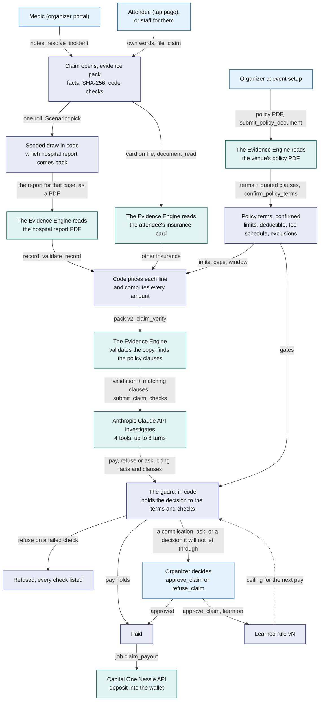
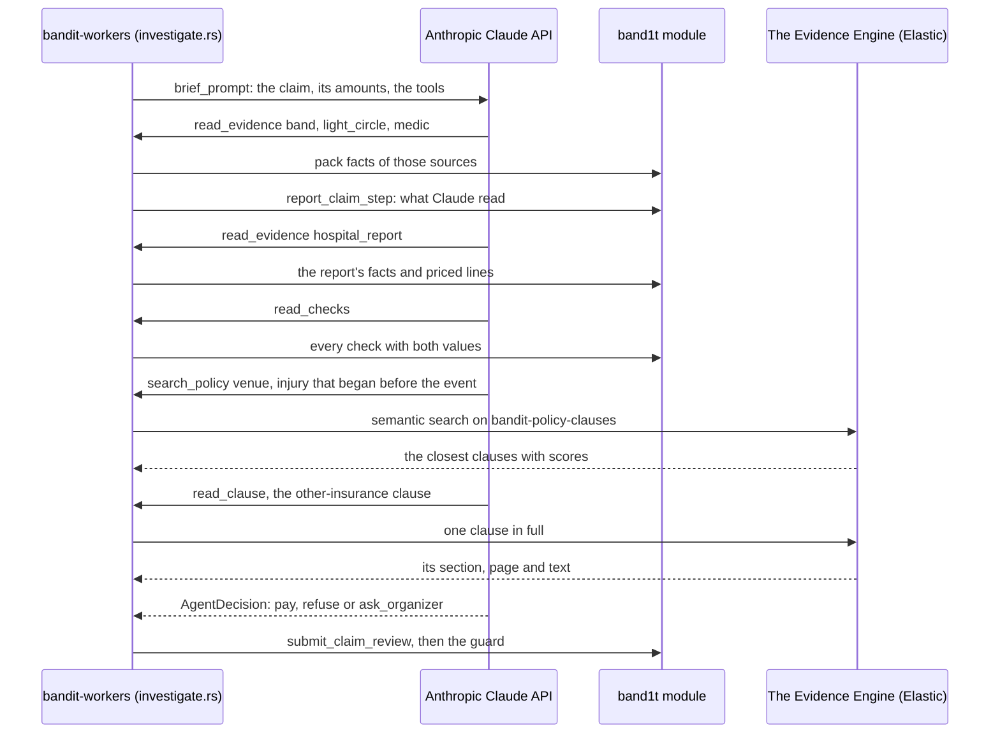
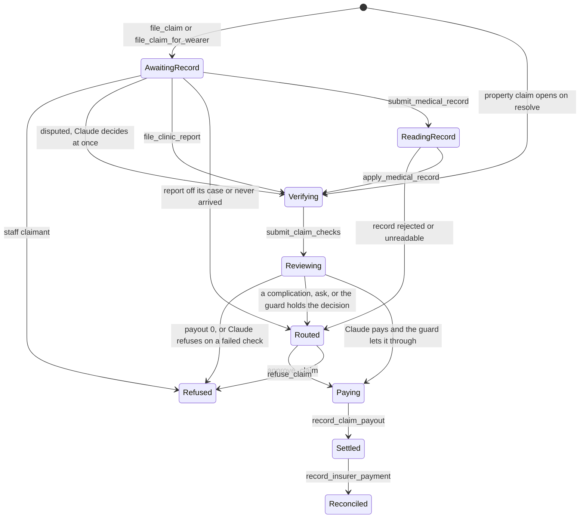
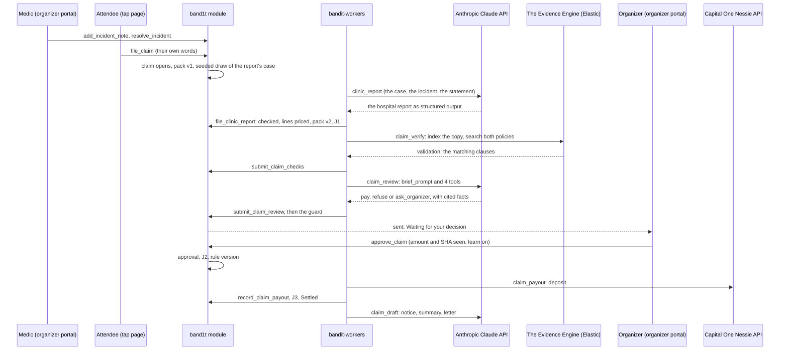
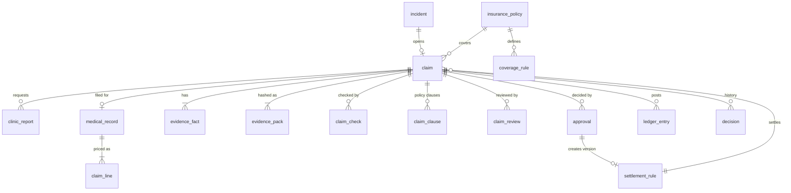

# Insurance

Insurance resolves the money after an incident: who is paid, how much, from which policy, and who pays it back. It turns each incident into a claim that is paid, refused or sent to the organizer, posts every movement on a double-entry ledger, and reconciles what the venue's insurer pays back. It is built for Hyphenate's "autonomous systems for finance" track. When an attendee broke or took something, it can also turn the incident into a charge that the attendee sees on their tap page (next to build). Three parts share the work, and each does what only it can do:

- **The Evidence Engine (Elastic)** reads every insurance document, each a PDF: the venue's policy, the attendee's own health insurance card and the hospital report. For each claim it validates the de-identified copy and finds what the venue's policy and the attendee's own policy say about this claim, clause by clause ([Elastic](../7-integrations/Elastic.md)).
- **The insurance Decision Engine** is the Anthropic Claude API plus the Rust code that decides insurance claims. Claude investigates each claim with tools and decides: pay, refuse or ask the organizer. Code holds that decision to the venue's policy terms and to every check.
- **The organizer** decides each claim that Claude or the guard sends them. A complicated claim, one with a gap or mismatch in the policies, always goes to them and is decided one by one. Approving any other claim can teach a rule, and the next claim of that shape is then paid with nobody involved. A complicated claim teaches no rule: the decision is kept as a precedent that the next such claim shows.

Both sides of a claim are insured. The venue's general liability policy pays the attendee's medical bills and the venue's broken equipment. The attendee's own health plan is the other insurance, and the venue's policy says which pays first.

Money moves on a double-entry ledger. A payout lands in the attendee's wallet, their Capital One Nessie API account.

Sections marked (next to build) are designed here first, and the code follows them.

## The insurance Decision Engine in one picture

The question this diagram answers: what happens to an injury claim, from the venue's policy at setup to the payout, and which part does each step.

A property claim (broken equipment) opens by itself when the organizer resolves the incident with a cost note. It takes the same path without a hospital report or an insurance card, and its payout goes to the repair vendor on the ledger.

BandIt has no connection to a hospital, so the hospital report comes back from a seeded draw: code picks the case, the Anthropic Claude API writes a report that follows it, and the Evidence Engine reads it like any other. Staff can file a real PDF instead.

## Who decides what

| Step | Who decides | What it can change |
|---|---|---|
| The venue's terms: limits, deductible, minimum payout, service window, fee schedule, exclusions, which insurance pays first | The Evidence Engine reads them from the policy PDF; code checks every term against its quoted clause; the organizer confirms them | every limit and gate below (next to build) |
| Is there a claim? | the attendee who wore the band, `file_claim`, or staff for them, `file_claim_for_wearer`; code opens a property claim on resolve | one claim per incident |
| Which hospital report comes back? | code: one roll of the module's seeded generator, `Scenario::pick` | 3 in 6 match the incident; 1 in 6 each are hurt at home, a different injury, or a visit before the event |
| What do the hospital report and the insurance card say? | The Evidence Engine reads each PDF; code validates what it read (`validate_record`) | nothing yet: code prices it next |
| What each billed line pays, and every amount | code, `cover_lines` and `compute_amounts`, under the policy terms | the payout |
| Do the sources agree on time and zone? | code, `corroborate` | a pay needs `corroborated` |
| Is the copy valid, and what do the two policies say about this claim? | The Evidence Engine, `claim_verify`, then Claude's policy searches (next to build) | a failed validation is a failed check; the clauses are what Claude cites |
| Pay, refuse or ask the organizer? | the Anthropic Claude API, investigating with tools (`claim_review`) | proposes the decision, with the facts it rests on |
| Is the claim complicated: a gap or mismatch in the policies? | code, the guard, from the cover and the amounts | sends it to the organizer whatever Claude decided, with every complication listed |
| Does the decision go through? | code, the guard | lets a pay or a refusal through only inside the terms and the checks; otherwise sends it to the organizer |
| A claim sent to a person | the organizer, `approve_claim` or `refuse_claim` | pays or refuses; teaches a rule only from a claim that is not complicated, and keeps a precedent from one that is |
| What the next similar claim does | the organizer's approval, as a `settlement_rule` version | the ceiling under which a pay goes through |
| The wording of the letters | the Anthropic Claude API, `claim_draft` and `recovery_letter`; code checks every figure | words only |
| Did an attendee break or take something? (next to build) | staff name the band; code checks it against the evidence; Claude recommends; the organizer approves | a charge the attendee sees, and can pay or dispute |

## Kinds of incident, and which policy answers each (next to build)

The module knows three incident kinds today: `sos` and `fall`, which are injuries, and `property`, broken equipment. The design adds `theft`, and a report for an attendee's own things. Each kind has its own cover in the venue's policy, so The Evidence Engine searches different clauses for each, and the decision ends in a different place.

| Kind | What happened | How it opens | The evidence | The policy that answers it | Who is paid | Who can be charged |
|---|---|---|---|---|---|---|
| Injury: `sos`, `fall` | an attendee is hurt at the event: a fall, a crush, taken ill | the band's SOS or fall flag, or a medic's report; the attendee files the claim | the band, the light circle, the medic's notes, the security cameras, the hospital report, the attendee's own words | the venue's policy, medical payments cover, which pays whoever was at fault; the attendee's own health plan is the other insurance, and the venue's other-insurance clause says which pays first | the attendee, into their wallet | nobody |
| Property damage: `property` | venue or sponsor equipment is broken | staff report it with a cost note; the claim opens when the incident resolves | the security cameras, staff notes with the repair cost, the bands in the zone at the time, and the attendee staff named, if any | the venue's policy, property cover, above its deductible | the repair vendor | the attendee who broke it, when staff named them and the evidence holds |
| Theft: `theft` | venue or sponsor property is taken, such as merch or a laptop from a booth | staff report it with the item and its value | the security cameras, staff notes, the bands in the zone at the time, and the attendee staff named, if any | the venue's policy, property cover, only when its theft clause covers the loss; many policies exclude a loss with no sign of theft | the venue | the attendee who took it, on the same terms |
| An attendee's own things lost, stolen or broken | an attendee's phone or bag goes missing or breaks | staff report it for the attendee | staff notes, the security cameras | usually not the venue's policy, which excludes property in the venue's care and pays only where the venue was at fault; the attendee's own home or renters insurance answers it | the attendee, only if the venue's clause covers it | nobody |

The last kind never pays on its own. Claude finds the clause the venue's policy decides it by, the claim goes to the organizer with that clause, and the attendee's tap page gives them the incident record to file with their own insurer.

## How the insurance Decision Engine decides

A claim is decided in four steps. Code refuses what no one could pay. Claude investigates and decides. The guard lets that decision through or sends it to the organizer. A complicated claim, and every claim of a mass occurrence, goes to the organizer.

### Complicated claims: gaps and mismatches in the policies

A claim is complicated when the policies leave a serious gap or contradict each other. No rule fits such a claim, so the organizer decides each one, one by one, whatever Claude decided. Every other claim settles or is refused under the guard, and once an organizer has approved a claim of its shape, it settles with nobody involved.

Code finds each complication from stored rows and lists every one the claim has, not only the first.

| Complication | How code finds it | For example |
|---|---|---|
| No policy covers it | no active cover of the venue's policy pays for this kind of incident | an attendee's phone stolen from a booth; venue merch taken when the policy has no theft cover |
| The bill is over the policy's limit | the covered cost is above the per-claim limit or what is left of the aggregate, so the policy pays only part of it, or nothing | a $7,200 emergency room bill against the $5,000 per-claim limit |
| The policies disagree on who pays (next to build) | the attendee's own plan is on file, and the two other-insurance clauses do not settle which pays first: both say they pay second, or the venue's term is not confirmed | the venue's medical payments cover is excess, and the attendee's plan also pays only after any other medical cover |
| The clauses conflict (next to build) | a clause Claude cites covers the claim while another cited clause excludes it, or Claude's `paying_policy` differs from the confirmed other-insurance term | the theft clause covers stolen merch, but its condition excludes a loss with no sign of forced entry |

A billed service the fee schedule does not list is not a complication: the schedule answers it, so the line is excluded, the rest is paid and the `record_lines` check records it. Jordan's Tdap shot, `90715`, is one.

A complicated claim goes to the organizer as `Complication: {each complication}. {Claude's decision}`, for example `Complication: the covered cost $7,200.00 is over the policy's limit, which pays at most $5,000.00. Claude would pay $5,000.00`.

Approving a complicated claim never teaches a rule, because the policies give it none: `approve_claim` ignores `learn` for one, and the organizer screens offer no "teach a rule" or rule ceiling on it. Hyphenate's track still asks that "what happened in March should change what the system does in June", so the organizer's decision is kept as a precedent instead, a `decision` row for each kind of gap:

| The organizer | Precedent row (`what`, then `why`) |
|---|---|
| approves | `Precedent, over the policy's limit: approved $150.00 for Jordan Alvarez` |
| refuses | `Precedent, no cover: refused {name}'s claim`, with the reason |

The next claim with the same kind of gap shows the latest one at the end of its route reason, for example `... Claude would pay $150.00. Precedent, not applied: Ops desk approved $150.00 for Jordan Alvarez (claim 4)`. It still waits for the organizer: a precedent is shown, never applied, and it names the person who decided so the call traces back to them.

When the policy covers none of the claim, there is nothing to approve, and the organizer refuses it with the reason; the attendee keeps the incident record for their own insurer.

### Step 1: what code refuses before Claude

Two cases are refused in code, with every check listed. No judgment is needed for them, and no model is asked.

| Case | `refusal_reason` | Why code and not a person |
|---|---|---|
| The claimant holds a staff role (the policy's staff exclusion) | `medical payments cover excludes staff: {name} holds the staff role {role}` | workers' compensation pays staff, so the organizer could not pay it either |
| The payout is $0 and the covered cost is $0 | `payout is zero after limits` | there is nothing to pay |

No cover for the incident kind, and a payout cut to $0 by a used-up aggregate, are not refused in code. Both are gaps in the policy, so they go to the organizer as complicated claims.

Disputed evidence is not refused here. A claim whose camera check failed, or whose light circle formed in another zone, goes straight to Claude without waiting for a hospital report, and Claude decides it.

### Step 2: Claude investigates

The investigation is the `claim_review` job, run by `crates/bandit-workers/src/investigate.rs`. Claude starts from a short brief of the claim (`brief_prompt`) and reads the rest through four tools, for at most 8 tool turns. Each call is recorded as a `model_call` of kind `claim_investigation`.

| Tool | Reads | Where it comes from |
|---|---|---|
| `read_evidence {source}` | the pack facts of one source: `band`, `light_circle`, `camera`, `medic`, `hospital_report`, `zone` or `policy`; `hospital_report` adds the priced fee-schedule lines and the report's own words | `evidence_fact` and `claim_line` in the module |
| `read_checks` | every check of the pack version, with both values it compared | `claim_check`: code and The Evidence Engine |
| `search_policy {query, policy}` (next to build) | the clauses of the venue's policy (`venue`) or the attendee's own policy (`attendee`) closest in meaning to Claude's own query, for example "injury that began before the event" or "services more than 30 days after the incident"; a query with a claimant's name is refused | The Evidence Engine: semantic search on `bandit-policy-clauses`, field `text`, filtered to the two policies on this claim |
| `read_clause {clause_id}` (next to build) | one clause in full, with its section and page | The Evidence Engine: `bandit-policy-clauses` |

The first build of the two Evidence Engine tools searched decided past claims (`search_past_claims`, `past_claim_stats`). The design drops them: a claim is covered or excluded by what its policies say, and what earlier approvals taught already lives in the organizer's learned rules.

Each step Claude takes is written live into the decision history with `report_claim_step(job_id, actor, what, why)`, so the organizer and the 3D venue page watch the investigation as it happens.

The question this diagram answers: how one investigation moves between Claude, the module and The Evidence Engine.

### What Claude answers

The answer is structured output against `agent_decision_schema` (`decision::AgentDecision` in `crates/bandit-insurance/src/decision.rs`).

| Field | Values |
|---|---|
| `decision` | `pay`, `refuse`, `ask_organizer` |
| `causation` | whether the treated injury follows from this incident at this venue |
| `summary` | one paragraph for the organizer |
| `findings` | one per source read: `source`, `stance` (`supports`, `contradicts`, `neutral`, `missing`), `detail`, `fact_ids` |
| `trusted_source` | the source Claude relied on most when sources disagree |
| `concerns`, `innocent_explanations`, `missing_evidence` | what doubts remain, the readings that would clear the claim, and what a person could ask for |
| `refusal_checks` | for a refusal, the failed checks it rests on |
| `question` | for `ask_organizer`, the one question the organizer should answer |
| `cited_fact_ids` | the fact seqs the decision rests on |
| `cited_clause_ids` (next to build) | the policy clauses the decision rests on: the clause that covers the claim for a pay, the exclusion for a refusal |
| `line_clauses` (next to build) | for each billed line, the clause of the schedule of benefits that caps it, or the exclusion that removes it |
| `paying_policy` (next to build) | which policy pays first, `venue` or `attendee`, with the other-insurance clause it rests on |

### Step 3: the guard

`validate_decision` checks the answer before anything acts on it:

- every cited fact id is a seq of this pack;
- every dollar figure is one of the claim's amounts;
- a `pay` comes only after Claude read the band, the light circle and the hospital report (the camera, for a property claim);
- every cited clause is in `bandit-policy-clauses` and belongs to the venue's policy or this attendee's policy (next to build);
- each line's clause and the paying policy agree with the confirmed policy terms, because code, not the clause Claude picked, still sets every amount (next to build).

A rejected answer is asked once more with code's problems listed. A second rejection sets it aside, and code decides the claim alone.

Then the guard holds the decision to the policy terms and the checks:

First, a complicated claim goes to the organizer, whatever Claude decided. Otherwise:

| Claude decides | Goes through only when | Otherwise |
|---|---|---|
| `pay` | every check of the pack passed, the payout is above $0 and above the policy's minimum, the evidence is `corroborated`, there is no mass occurrence, and the payout is at or under the ceiling of a learned rule for this kind of claim | sent to the organizer with Claude's recommendation |
| `refuse` | at least one check failed, and the refusal cites it in `refusal_checks` | sent to the organizer with Claude's recommendation |
| `ask_organizer` | always: it goes to the organizer with Claude's question | |

A cited exclusion clause does not refuse a claim on its own. The refusal also needs the failed check that tests that exclusion, for example `record_date_window` for a visit before the event, so the refusal rests on the contract and on a check anyone can re-run (next to build).

A decision that goes through is stored with `decided_by` = `claude`. Claude never sets an amount, and it can never pay outside a rule an organizer taught or refuse without a check anyone can re-run.

### What a pay needs

A claim is paid with nobody involved only when all of these hold:

1. The claim is not complicated: an active cover of the policy covers this incident kind, and the covered cost fits inside the policy's limits.
2. The claimant is not excluded as staff.
3. The payout is above $0 and above the policy's minimum payout.
4. No check of the current pack version failed, from code or from The Evidence Engine.
5. Claude decided `pay`, and its answer passed `validate_decision`.
6. The evidence is `corroborated`.
7. An active learned rule matches: same incident kind and cover kind, any zone.
8. The payout is at or under that rule's ceiling.
9. Fewer than 3 injury incidents happened in the same zone within 5 minutes.

### Where each gate's numbers come from (next to build)

Today the limits are seeded and `FEE_SCHEDULE` is compiled into the code. The design reads every number from the venue's confirmed policy terms, and keeps today's values as the defaults for a term the policy does not state.

| Gate or amount | Policy term | Default today |
|---|---|---|
| per-claim and aggregate limits, deductible | each cover's `per_claim_limit_cents`, `aggregate_limit_cents`, `deductible_cents` | medical $5,000 / $25,000 / $0; property $10,000 / $50,000 / $500 |
| minimum payout | each cover's `minimum_payout_cents` | $0 |
| service window | `service_window_days` | 365 days |
| the cap of each billed code | the policy's schedule of benefits, one `fee_schedule_line` per code | the 21 codes of `FEE_SCHEDULE` |
| which incident kinds a cover pays for | each cover's `incident_kinds` | medical payments: `sos`, `fall`; property: `property`, and `theft` where a theft clause covers it |
| the staff refusal | an exclusion of kind `staff` | on |
| what Claude may cite for a refusal | exclusions of kind `pre_existing`, `off_premises` and `other`, found with `search_policy` and read with `read_clause` | none |
| which insurance pays first | `other_insurance`: `primary` or `excess` | `primary` |
| whether the incident is covered at all | `period_start`, `period_end` | not checked |

### Step 4: the organizer, and what an approval teaches

The organizer sees "Waiting for your decision" on the organizer portal's Claims tab. Each claim shows why it is there (for a complicated claim, every complication first), Claude's decision and summary, its findings per source, the checks, the hospital report as read, the billed lines, and each policy clause Claude cited with its page (next to build).

`approve_claim` carries the amount and the pack SHA-256 the organizer saw. It fails closed, writing nothing, when either is out of date:

- `stale: the evidence pack is now {sha}` when the pack hash differs from `claim.pack_hash`;
- `stale: the payout is now {amount}` when the payout, recomputed from the current cover, record or cost notes and aggregate used, differs from the claim's or from the amount seen.

With "Learn a rule from this approval" ticked (the default), the approval writes a `settlement_rule` version:

- its shape is (incident kind, cover kind, any zone);
- its ceiling is the ceiling the organizer typed, else this claim's payout;
- its version is one more than the highest of that shape, and the older active versions become `superseded`;
- no new version is written when an active rule of the shape already covers this payout.

`refuse_claim` needs a reason and stores `refused by {name}: {reason}`. A refusal never changes a rule.

### Mass occurrence

When 3 or more injury incidents open in the same zone within 5 minutes of each other, every claim of that occurrence goes to the organizer. The note reads `{n} people hurt in {zone} within 5 minutes: auto-settle is off and the organizer decides every claim of the occurrence`.

One occurrence with many people hurt can use up the event's aggregate limit, so a person decides with the whole occurrence in view. The occurrence's other claims are listed on each notice of loss.

### Five claims through the decision

These are the scripted claims run's claims (`bandit-claims story`).

| Claim | What happened | What Claude can decide, and what the guard does | Result |
|---|---|---|---|
| Maya Chen, band 91 | Slipped near the stage; 2 witnesses; first-aid report, $180 | Claude pays; every check passed, the evidence is corroborated and $180 is under rule v1's $895 ceiling | paid in seconds, `decided_by` `claude` under rule v1 |
| Jordan Alvarez, band 90 | Fell in the Main stage pit; 3 witnesses; urgent care billed $1,308, covered $895; the Tdap shot (`90715`) is not on the fee schedule | `record_lines` failed, so no pay goes through | waits for the organizer, who approves with learn on and teaches rule v1 |
| Sam Patel, band 92 | Went down on the Hacking floor; the report's history says he hurt the ankle playing basketball at home the evening before | Claude finds the report contradicts the incident and recommends a refusal; no check failed, so the refusal cannot go through alone | waits for the organizer with Claude's finding on top |
| Lee Park, band 93 | The band reports a fall at Main stage, but the light circle forms on Sponsor row | disputed, so Claude decides at once; it refuses on the failed `witness_zone` check, and the guard lets the refusal through | refused, with every check listed |
| The speaker | Knocked off its stand at Main stage; the camera confirms it; repair $2,400 | no property rule exists yet, so a pay cannot go through | waits for the organizer, who approves; J3 pays the repair vendor on the ledger |

Maya runs after Jordan in the script, so Jordan's approval is what lets her claim be paid on its own. That is the learning the track asks to see.

### Every decision is a row: the decision history

Each time someone or something decides about an incident or its claim, the module writes one `decision` row: who acted, their name, what they decided and why. The `actor` is one of `band`, `camera`, `medic`, `organizer`, `Claude`, `Evidence Engine`, `Decision Engine`, `wallet` or `venue`.

The rows come from the claim itself and from each step of Claude's investigation: a status change on every save, the report read ("Read the clinic record: $1,308.00 billed, $895.00 covered"), the checks ("Flagged: record lines"), each source Claude read, each clause it found (next to build), its decision, and the approval ("learned rule v1: the next similar claim up to $895.00 settles on its own").

The 3D venue page (`/live`, the organizer portal's Live tab) lists them live in its "Decision history" panel, coloured by actor. A claim waiting for the organizer there gets the approve button for staff.

## Reading the insurance documents (next to build)

Every document in a claim is a PDF, and The Evidence Engine reads all of them the same way. Code checks what it read, and a person confirms the venue's terms before they set any money.

| Document | Who uploads it, when | What The Evidence Engine reads from it | Where it goes |
|---|---|---|---|
| The venue's insurance policy | the organizer, on the Venue setup tab, when the event is set up (`POST /api/blobs` purpose `policy`, then `submit_policy_document`) | insurer, policy number, period, FNOL contact; each cover with its incident kinds, limits, deductible, minimum payout and service window; the schedule of benefits (code and cap); exclusions; which insurance pays first | `policy_term` rows, then `insurance_policy`, `coverage_rule` and `fee_schedule_line` once confirmed; every clause into `bandit-policy-clauses` |
| The attendee's own insurance: their health insurance card | the attendee, in band setup ("Your health insurance", [Medical-Card](Medical-Card.md)) | insurer, plan, member name, member id, group number, the copays printed on it for urgent care and the emergency room, and its coverage wording | the attendee's `medical_card`; its clauses into `bandit-policy-clauses`; a claim reads it when the attendee files |
| The hospital report | written for the drawn case and rendered as a PDF, or filed by staff (`submit_medical_record`) | the same fields as today's record: document kind, patient, provider, encounter, diagnoses, services with their pages, invoice number and printed total | `medical_record` and `claim_line` |

The worker `document_read` splits each PDF into pages and indexes them into `bandit-documents` through the ingest pipeline `bandit-documents-extract`. Its `attachment` processor takes each page's text layer, and a `semantic_text` field makes the pages searchable by meaning. A page with no text layer, a scan, is first transcribed word for word by the Anthropic Claude API, which extracts nothing from it.

The Elastic Workflow `bandit-read-document` then calls the Elastic Agent Builder agent `bandit-document-reader` in one `ai.agent` step with the JSON schema of that document kind. The agent quotes the clause and the page behind every term, using its tool `bandit.document_pages` to find them. The workflow checks the answer against the schema inside Elastic ([Elastic](../7-integrations/Elastic.md)).

For the venue's policy and the attendee's card, the same answer lists every clause. `bandit-workers` checks that each clause appears word for word on its page and indexes it into `bandit-policy-clauses`: `clause_id`, `policy` (`venue` or `attendee`), `document_hash`, `section` (insuring agreement, limits, schedule of benefits, exclusions, conditions, theft, other insurance, subrogation), `page` and `text`, a `semantic_text` field. Every term points at the clause it was read from. The clauses are what Claude searches and cites when it decides a claim.

Code then checks the terms (`validate_policy_terms`):

- every quoted clause appears word for word on its page of the extracted text;
- every amount parses to cents, and deductible ≤ per-claim limit ≤ aggregate limit;
- the service window is 0 to 730 days, and the period ends after it starts;
- every fee schedule code has the CPT or HCPCS shape, and every cap is above 0.

A term that fails keeps its default and is flagged. The organizer sees every term next to its quoted clause and page, and `confirm_policy_terms` makes them the event's policy. Until then the defaults apply.

**The other insurance.** When the venue's medical payments cover is `primary`, the venue pays the covered amount, and the notice of loss names the attendee's insurer as the other insurance. When it is `excess`, the venue pays only what the attendee's own plan leaves to them: the copay on their card for that kind of visit, at most the covered amount. A first-aid visit has no copay, so the venue pays the covered amount.

The hospital report and the card are the attendee's medical and insurance data. They are indexed in `bandit-documents` and `bandit-policy-clauses` under their file's SHA-256 with no name in the document id, readable only with the workers' own Elastic API key, shown on no dashboard, and deleted from Elastic once the claim is decided. The venue's policy clauses stay for the event.

## Charges to an attendee (next to build)

When an attendee broke or took something, the venue can charge them for it. A charge never goes through on its own, because a wrong charge hurts an attendee as much as a wrong refusal.

1. Staff name the responsible attendee on the incident by tapping their band (`name_responsible_band(incident_id, band_id, note)`). With no named attendee there is no charge.
2. Code checks the named band against the evidence: it was in the incident's zone at the time (`zone_visit`), and the security cameras' sighting, if there is one, agrees. Each comparison is a stored check, as on a claim.
3. Claude reads the evidence and the venue's clauses for that kind of incident, including its subrogation clause, which says who may recover a loss from the person who caused it. It recommends a charge or none, citing the facts and clauses (`charge_recommendation`).
4. Code sets the amount: the repair cost or the item's value from the staff's cost note, never more.
5. The organizer approves the charge with `approve_charge`, which fails closed on a stale amount or pack, like `approve_claim`, or drops it with `waive_charge`.
6. The attendee sees it on the tap page, under "Your charges": what happened, where and when, the evidence in plain words, the clause of the venue's policy, the amount and its status. "Pay from wallet" calls `pay_charge`, a Capital One Nessie API purchase from their wallet, as for merch. "Dispute" calls `dispute_charge` with their own words and sends the charge back to the organizer.

A charge moves through `proposed`, `approved`, then `paid`, `disputed` or `waived`. Code never takes money from a wallet unless the attendee presses pay.

On the ledger, an approved charge posts a balanced journal: debit `attendee_receivable`, credit `recoveries`. A payment moves it from `attendee_receivable` to `cash`. When the insurer already paid the loss, the venue's subrogation clause says what share of the payment goes back to the insurer.

## Role in the system

Responsibilities:

- Open one claim per incident: the attendee files an injury claim in their own words (`file_claim`), or staff file it for them (`file_claim_for_wearer`); a `property` incident with a cost note opens the venue's claim on resolve.
- Get the hospital report: draw its case with the module's seeded generator and have the Anthropic Claude API write it (`clinic_report`), or take a filed PDF; check what was read in code and price every line against the fee schedule.
- Read the venue's policy, the attendee's insurance card and every hospital report PDF through The Evidence Engine, check every term in code, and have the organizer confirm the venue's terms (next to build).
- Build and hash the evidence pack from rows that Safety, Vision and the record already wrote; never from new sensing.
- Check corroboration and every record check in code.
- Ask The Evidence Engine to validate a de-identified copy (`claim_verify`) and find the clauses of both policies that bear on the claim (next to build).
- Have the Anthropic Claude API investigate each claim with tools and decide pay, refuse or ask the organizer (`claim_review`); check its answer in code and hold it to the policy terms and the checks with the guard.
- Compute coverage and amounts in integer cents.
- Refuse in code what no one could pay. Write each decision, and each step of Claude's investigation, to `decision`.
- Turn an approval into a versioned `settlement_rule`.
- Post balanced `ledger_entry` journals for every money movement.
- Pay the claimant into their wallet through the `claim_payout` job ([Capital-One-Nessie](../7-integrations/Capital-One-Nessie.md)).
- Draft the first notice of loss, the claim summary, the determination letter and recovery letters through `bandit-workers` jobs.

Non-responsibilities:

- Detecting incidents, freezing snapshots and recording light-circle witnesses: [Safety](Safety.md).
- The attendee's own medical card: [Medical-Card](Medical-Card.md). Insurance reads only its insurance fields, and only for a claim the attendee filed (next to build); never the medical history.
- Security camera frames and the per-incident `vision_assessment`: [Vision](../4-devices/Vision.md) (TBD -- LEO). Insurance only reads those rows into evidence.
- Raw radio logs: they are never evidence. The pack reads the `incident_snapshot` written in the same transaction that opened the incident.
- Prompts, model choice and call recording: [Anthropic-Claude-API](../7-integrations/Anthropic-Claude-API.md).
- The indices, the pipelines and the policy clauses: [Elastic](../7-integrations/Elastic.md).
- Screens: the Claims tab of the [organizer portal](../5-apps/Organizer-Portal.md) (/organizer) and the 3D venue page.

## Interfaces

| Interface | Direction | Who | What flows | Transport |
|---|---|---|---|---|
| `file_claim` | in | the attendee who wore the band, from the tap page ("Hurt at the event?") | incident id, their statement | reducer; opens the claim, draws the hospital report's case, enqueues `clinic_report` |
| `file_claim_for_wearer` | in | `ops`, `medic`, from "Injuries without a claim" on the organizer portal; the `bandit-claims` tool | incident id, the statement in the wearer's words, the report choice (`matches`, `mismatch`, `random`, `pdf`) | reducer; the same, or waits for a PDF with `pdf` |
| `file_clinic_report` | in | `worker` | job id, the written report as record JSON, its blob hash, the `model_call` | reducer; checks the report against its case, applies it as the record |
| Hook in `resolve_incident` | in | `band1t` module ([Safety](Safety.md)) | a resolved `property` incident with a cost note | same transaction, `on_incident_resolved` |
| `open_claim` | in | `ops` | an incident id; opens a claim by hand for a resolved incident with no claim | reducer |
| `POST /api/blobs` with purpose `medical` | in | organizer portal "File the medical record", for `medic` and `ops`; the `bandit-claims` tool | the record PDF; back come its SHA-256 and page count | HTTPS to `bandit-api` ([Rust-Backend](../3-services/Rust-Backend.md)) |
| `submit_medical_record` | in | `medic`, `ops` | claim id, the file's SHA-256, page count; the claim must be `AwaitingRecord` | reducer; writes `medical_record`, enqueues `claim_record_extract` |
| `apply_medical_record` | in | `worker` | job id, the record JSON, the `model_call` | reducer; validates again, prices the lines, rebuilds the pack |
| `submit_claim_checks` | in | `worker` | job id, the Elastic checks, and the policy clauses that bear on the claim (next to build) | reducer; writes `claim_check` and `claim_clause` (next to build), enqueues `claim_review` |
| `report_claim_step` | in | `worker` | job id, actor, what, why: one step of Claude's investigation | reducer; writes a `decision` row live |
| `submit_claim_review` | in | `worker` | job id, Claude's decision JSON, the `model_call` | reducer; validates again, then the guard decides whether it goes through |
| `submit_policy_document`, `apply_document_terms`, `confirm_policy_terms` (next to build) | in | the organizer (`ops`) at event setup; `worker` | the policy PDF's hash; the terms The Evidence Engine read; the organizer's confirmation of the terms they saw | reducers; `policy_document`, `policy_term`, then the event's policy rows |
| `approve_claim` | in | `ops` or the module owner | claim id, amount seen, pack SHA-256 seen, rule ceiling, learn flag | reducer |
| `refuse_claim` | in | `ops` or the module owner | claim id, pack SHA-256 seen, reason | reducer |
| `record_claim_payout` | in | `worker` | job id, the wallet's customer and account, the deposit id | reducer; J3, `Settled` |
| `retry_claim_payout` | in | `ops` | claim id of a claim stuck in `Paying` | reducer; queues the deposit again |
| `record_insurer_payment` | in | `ops` | claim id, amount received, insurer reference | reducer; J4, `Reconciled` |
| `request_recovery_letter` | in | `ops` | a settled property claim, the counterparty's name and contact | reducer; enqueues `recovery_letter` |
| `attach_claim_letters`, `attach_recovery_letter` | in | `worker` | the letters' blob hashes | reducer |
| Jobs `clinic_report`, `claim_record_extract`, `claim_verify`, `claim_review`, `claim_payout`, `claim_draft`, `recovery_letter`; `document_read` (next to build) | out | `bandit-workers` | the payloads in `crates/bandit-insurance/src/payloads.rs` | `job` table |
| Staff views `claims_board`, `board_facts`, `board_checks`, `board_lines`, `board_reviews`, `board_precedents`, `board_records`, `board_clinic_reports`, `board_approvals`, `board_ledger`, `board_rules`, `board_policies`, `unclaimed_injuries` | out | organizer portal | everything the Claims tab shows, with "How the evidence was gathered" (`web/src/evidence-trail.ts`) | SpacetimeDB subscription |
| Attendee views `my_incidents`, `my_claims` | out | tap page | the attendee's own resolved injuries and their claim's status | SpacetimeDB subscription |
| `decision` | out | the 3D venue page | the decision history | SpacetimeDB subscription |

## Design

### Filing a claim

An injury claim is the attendee's to file. Once the medic resolves a `sos` or `fall` incident, the tap page of the person who wore the band shows "Hurt at the event?", and `file_claim` opens the claim with their statement in their own words.

Staff can file for them from the organizer portal's "Injuries without a claim" list (view `unclaimed_injuries`, roles `ops` and `medic`). `file_claim_for_wearer` takes the statement "in their words" and a hospital report choice: `matches`, `mismatch`, `random`, or `pdf` for a report a person files.

Both check the same things in `file` (`insurance/filing.rs`):

- the statement is 1 to 2,000 characters after trimming;
- the incident is resolved, and it is an injury on a band;
- someone wore the band when the incident opened (`people::wore_band_at`), and for `file_claim` it is the caller;
- the incident has no claim yet: `Claim.incident_id` is unique.

A `property` incident needs no filing. `on_incident_resolved` opens the venue's own claim in the same transaction when the incident has a cost note above 0, so a missing policy fails `resolve_incident` itself.

The claim takes the newest policy and the cover kind for its incident kind: `medical_payments` for `sos` and `fall`, `property` for `property`. The statement becomes the pack's `claimant_statement` fact.

### The hospital report: drawn by code, written or read by the Anthropic Claude API, priced by code

A hospital report reaches the claim one of two ways. Either way it ends as a validated `medical_record` with priced `claim_line` rows.

**The seeded draw.** Filing requests the report at once (an attendee's own filing always uses `random`). `request_report` takes one roll of the module's seeded generator (`ctx.rng()`) and `Scenario::pick` turns it into a case:

| Choice | Case |
|---|---|
| `random` | `matches` 3 in 6; `hurt_at_home`, `different_injury` or `visit_before_event` 1 in 6 each (`Scenario::draw`) |
| `matches` | `matches` |
| `mismatch` | one of the three mismatches, by the roll |

The module stores a `clinic_report` row in `requested` and enqueues `clinic_report` with the case, the visit date (1 to 3 days early for `visit_before_event`), the incident, the claimant, their statement and the medic's notes. The worker asks the Anthropic Claude API to write the hospital's report for that case, as structured output in the same schema as a read record.

Code rejects a report that is off its case (`check_report`): it must validate as a 2-page record with nothing dropped, be made out to the claimant, carry the visit date on the encounter and every service, add up to its printed total, and say "home" for `hurt_at_home` or name the venue for `matches`. One retry, then `file_clinic_report` stores it and applies it as the claim's record.

The Anthropic Claude API never picks the case. It only writes the report the roll chose, and Claude then has to find out from the report itself whether it fits the incident.

**A PDF.** With `pdf`, staff file the report's PDF from the claim ("File the medical record" on the organizer portal). `submit_medical_record` stores a `medical_record` in `reading` and enqueues `claim_record_extract`.

The worker sends the PDF to the Anthropic Claude API (effort `medium`) with "Copy, never infer" rules, and gets back structured output: document kind, patient, provider, encounter, diagnoses (ICD-10-CM), services (CPT or HCPCS, units, charge in cents, page), invoice number and printed total.

Code validates it twice, in the worker and in the module (`validate_record`). It drops a diagnosis or service on a page outside the record, with a bad code shape, an unreadable date or 0 units, and lists each in `dropped`. It rejects the whole record when the patient or encounter page is out of range, the date does not parse, or no valid diagnosis or service remains.

A rejected record is asked once more. A second rejection marks it `failed` and routes the claim: `medical record rejected: {reasons}`.

Code then prices each line (`cover_lines`):

| Line | Outcome | Reason |
|---|---|---|
| Service date outside 0 to `service_window_days` (365) after the incident | `excluded` | "outside the service window" |
| Code not on `FEE_SCHEDULE` | `excluded` | "not on the venue fee schedule" |
| Billed at or under the cap × units | `covered` | |
| Billed above the cap × units | `reduced` to the cap × units | |

`FEE_SCHEDULE` is a compiled list of 21 codes in `crates/bandit-insurance/src/fee_schedule.rs`, for example `99211` first-aid visit $65.00, `99204` new patient visit $275.00, `73110` wrist X-ray $165.00, `29125` short arm splint $210.00 and `L3908` wrist-hand orthosis $95.00.

### Evidence pack

The pack is every fact the decision rests on, one `evidence_fact` row each, with a `seq` Claude cites. Each fact names its source, key, value, the time it was observed and its reader (`code`, `model` or `elastic`).

| Source | Fact keys |
|---|---|
| `incident_snapshot` | `incident_kind`, `opened_by`, `zone_id`; then `bands_present`, `band_count`, `neigh_mean` (how crowded it was), `circle_bands` |
| `band_report` | the subject band at open: `band_id`, `fall_flag`, `sos_flag`, `band_state`, `neigh`, `station_id` |
| `light_circle` | one `witness` per band: "band {id} zone {zone} rssi {signal}" |
| `staff_note` | one `note` per note, "{role}: {text}", and its `cost_cents` |
| `zone_context` | `zone_name`, `zone_kind`, `zone_capacity`, `nearby_booths`, `schedule_now` |
| `presence` | one `zone_stay` per zone the band was in during the 15 minutes before |
| `vision_assessment` | `vision_confirmed`, `vision_confidence`, `vision_description` (reader `model`), `camera_zone_id`, one `frame` per frame |
| `medical_record` | `record_patient`, `record_provider`, `record_date_of_service`, `record_diagnoses`, `record_billed_cents` (reader `model`), `record_covered_cents` (reader `code`) |
| `policy` | `policy_number`, `insurer`, `cover_kind`, `per_claim_limit_cents`, `deductible_cents`, `aggregate_remaining_cents` |

`build_pack` hashes the facts with SHA-256 into `evidence_pack` version n+1, with the corroboration and every check. A pack version is never edited: new evidence makes a new version. `bandit-claims verify-pack` recomputes the hash from the stored facts.

### Corroboration (code)

Two independent sources must agree on time and zone (`crates/bandit-insurance/src/corroboration.rs`). The starting values are in `insurance_settings`: 2 witnesses, a 30-minute note window and a 120-second camera window.

| Result | Injury | Property |
|---|---|---|
| `corroborated` | `staff_note_time` passes, and either `witness_zone` passes or every camera check passes | every camera check passes |
| `disputed` | a camera check fails, or more witnesses sit in another zone than in this one (at least 2) | a camera check fails |
| `uncorroborated` | anything else | no camera assessment |

### Checks

Every check is a `claim_check` row of one pack version, with result `pass`, `fail` or `info`. Any `fail` keeps a pay from going through, and it is what a refusal by Claude must cite.

| Check | Reader | Passes when | When it fails |
|---|---|---|---|
| `witness_zone` | code | at least 2 witnesses in the incident's zone | blocks a pay; feeds `disputed` |
| `staff_note_time` | code | the earliest note is between open and 30 minutes after resolution | blocks a pay |
| `vision_confirmed`, `vision_zone`, `vision_time` | code | the camera confirmed it, in the same zone, within 120 s | `disputed`: Claude decides at once |
| `vision_present` | code | always `info`: no assessment for a property incident | flag only |
| `record_patient_match` | code | the record's patient matches the claimant's name | blocks a pay |
| `record_date_window` | code | the visit is 0 to 365 days after the incident | blocks a pay |
| `record_injury_code` | code | at least one injury code (starting with S or T) | blocks a pay |
| `record_totals` | code | the lines sum to the printed total | blocks a pay |
| `record_lines` | code | no line is off the fee schedule | blocks a pay |
| `record_duplicate` | code | no other claim has the same file, the same invoice and provider, or the same patient, date and total | blocks a pay |
| `claimant_not_staff` | code | the claimant holds no staff role | refused in code |
| `elastic_validation` | elastic | the pipeline `bandit-claims-validate` marked the copy valid | blocks a pay, listing the pipeline's errors |
| `elastic` | elastic | always `info`: The Evidence Engine was unavailable | flag only; Claude still investigates |

### Coverage and amounts

Code computes every amount in integer cents (`crates/bandit-insurance/src/coverage.rs`):

- cost: the record's covered amount for an injury, the sum of the cost notes for property;
- payout = the smallest of the cost, the per-claim limit and what is left of the aggregate;
- recoverable = payout − deductible, at least 0: what the insurer owes the venue;
- venue share = payout − recoverable.

The seeded covers:

| Cover | Incident kinds | Per claim | Aggregate | Deductible | Service window |
|---|---|---|---|---|---|
| `medical_payments` | `sos`, `fall` | $5,000 | $25,000 | $0 | 365 days |
| `property` | `property` | $10,000 | $50,000 | $500 | none |

The speaker's $2,400 repair is a payout of $2,400, recoverable $1,900 and a venue share of $500.

### The Evidence Engine's part

When a pack has something to pay for, the module enqueues `claim_verify`. The worker builds a de-identified copy in code, with no names, no band ids and no note or medical free text, and a narrative from a fixed template, for example "Fall in zone Main stage at 22:14; 3 light-circle witnesses in the same zone; medic note within 4 minutes; ...".

The worker indexes it into `bandit-claims` through the ingest pipeline `bandit-claims-validate`, which marks it valid or invalid and never rejects it. It then searches `bandit-policy-clauses` with the narrative for the clauses of the venue's policy and this attendee's policy that bear on the claim (`semantic_text`, embedded by Elastic's inference endpoint `.jina-embeddings-v5-text-small`), and `submit_claim_checks` stores them as `claim_clause` rows next to the `elastic_validation` check (next to build). Claude then runs its own searches with `search_policy` and reads clauses in full with `read_clause`.

Today's code ranks the 3 closest decided past claims instead (`claim_precedent`, "Similar past claims (Elastic)", from 30 seeded claims of two earlier events at the venue). The design replaces that ranking with the clauses, because how other claims ended says nothing about what this venue's contract covers.

After settlement, `claim_draft` records the outcome on the copy (`auto_settled` or `approved`), which feeds the claims dashboard. The Elastic Kibana dashboard "BandIt claims evidence" (`bandit-claims`) shows the copies; [Elastic](../7-integrations/Elastic.md) has the index, the pipeline and the dashboard.

### Claim lifecycle

The question this diagram answers: which statuses a claim moves through, and which call moves it.

A property claim skips `Paying`: settling it posts J3 to the repair vendor at once and moves it to `Settled`.

### Ledger

`ledger_entry` rows are double-entry: each journal has debits equal to credits, and posting rejects a journal that does not balance.

| Account | Kind |
|---|---|
| `claims_expense` | expense |
| `claims_reserve` | liability: what the venue expects to pay claimants |
| `insurer_receivable` | asset: what the insurer owes the venue |
| `cash` | asset |

| Journal | When | Debit | Credit | Amount |
|---|---|---|---|---|
| J1 reserve | once, when the claim first has something to pay | `claims_expense` | `claims_reserve` | payout |
| J1r reserve reversal | a reserved claim is refused | `claims_reserve` | `claims_expense` | payout |
| J2 receivable | settled on its own or approved | `insurer_receivable` | `claims_expense` | recoverable |
| J3 claimant payment | the deposit lands, or at once for the repair vendor | `claims_reserve` | `cash` | payout |
| J4 reconciliation | `record_insurer_payment` | `cash` | `insurer_receivable` | the amount received; a difference from the recoverable posts one more line to `claims_expense` |

### Payout

Settling an injury claim enqueues `claim_payout` with the claimant, their wallet and the memo `BandIt claim {id} payout`. The worker deposits the payout through the Capital One Nessie API and calls `record_claim_payout`, which adds the wallet's `payout` entry, posts J3 with reference `Nessie deposit {id}` and moves the claim to `Settled`.

A claimant with no wallet gets one: the worker opens a Capital One Nessie customer and account, and `record_claim_payout` stores it as their `claimant_account`.

When the job dies after 3 attempts, the claim stays `Paying` with the error. An organizer retries it with `retry_claim_payout`; there is no manual payout.

### Letters

The Anthropic Claude API drafts, code checks every figure, and a person sends. BandIt never emails a letter.

| Job | When | Output | Code's checks |
|---|---|---|---|
| `claim_draft` | once the claim is `Settled` | the first notice of loss (FNOL) in the ACORD 3 sections, a claim summary and a determination letter to the claimant | every heading of the code template kept; every dollar figure one of the four amounts; every cited fact a pack seq |
| `recovery_letter` | `request_recovery_letter` on a settled property claim | a letter to whoever handled the equipment | worded as a query (`stance` `query`); no fault phrase; figures only from the amounts |

Each job asks once more when code rejects the answer, then falls back to the code template. The worker stores each letter as a staff-only blob and `attach_claim_letters` saves the hashes (`fnol_hash`, `summary_hash`, `determination_hash`, `recovery_hash`).

### During and after the event

During the event the medic works the incident: takes it, notes what they found and resolves it. The attendee then files the claim from their tap page, or staff file it for them. After the event the organizer opens "Waiting for your decision" and decides each routed claim.

The question this diagram answers: who acts on an injury claim, in which order, and where each outside call happens.

### The live run on the 3D venue

The live run plays the whole event on the venue's 3D floor (`/live`). A crowd walks in, and every minute or so someone falls, presses SOS or knocks equipment over. Each incident goes through the medic, the claim and the insurance Decision Engine exactly as a radio band's would.

Who falls, where and when comes from a random number generator seeded with `live_run.seed`, so a run can be played again exactly. The Anthropic Claude API never picks an outcome.

The first beats of `live/script.rs` show every path a claim can take: a fall that teaches a rule, one the rule then settles on its own, a camera-confirmed speaker, an SOS with no claim, a bill above the learned ceiling, and an injury from home. Injuries move between zones so no zone has three within five minutes.

`bandit-claims live` plays the floor staff: the medic, the clinic filing its hospital report, the camera and the organizer's cost notes. It decides a claim left waiting for the organizer after `--approve-after` seconds (30): approved with a learned rule, or refused when Claude found the injury happened away from the event.

### The scripted claims run

`bandit-claims story` ([Test-Bands](../3-services/Test-Bands.md)) runs the five claims above on test bands 90 to 99, with the Claims tab on the big screen. It plays every person: the medic Ari Ramos, the organizer "Ops desk", the camera and the insurer.

1. **Jordan falls.** Band 90 falls in the Main stage pit, and bands 94, 95 and 96 light the circle. The medic notes "left wrist pain and swelling after the crowd surged" and resolves the incident. The organizer files Jordan's claim in his words with the `pdf` choice, and the run files his urgent-care record.

   The Anthropic Claude API reads it, and code covers $895 of the $1,308 billed. Six lines are cut to their caps and the Tdap shot (`90715`) is excluded, so `record_lines` fails and the claim waits for the organizer.

   The first approval carries an amount from a screen a minute old, so `approve_claim` fails as stale and nothing moves. The second carries $895 and the current SHA-256 with learn on: J2 posts, $895 lands in Jordan's wallet, J3 posts, and rule v1 for (`fall`, `medical_payments`, any zone) is created with ceiling $895.
2. **Maya falls the same way.** Band 91 slips near the stage, and bands 97 and 98 light the circle. Her first-aid report is $180, every check passes, Claude pays, and the guard lets it through under rule v1 in seconds.
3. **Sam's injury from home.** Band 92 goes down on the Hacking floor, with bands 94 and 99 around it. His record ($565) looks routine, but its history says he hurt the ankle playing basketball at home the evening before. Claude recommends refusing it, but no check failed, so it waits for the organizer with that finding on top.
4. **Lee's fake fall.** Band 93 reports a fall at Main stage, but its circle (bands 95, 96 and 97) forms on Sponsor row. The evidence is disputed, so Claude decides at once, without waiting for a hospital report. It refuses on the failed `witness_zone` check, the guard lets that through, and the claim lists every check.
5. **The broken speaker.** A speaker falls off its stand at Main stage, and the camera confirms it. The $2,400 repair waits for the organizer, who approves it; J3 pays the repair vendor on the ledger, and `request_recovery_letter` drafts a letter to "Stagecraft AV" worded as a query.
6. **The insurer pays.** The organizer records Northwind Mutual's payment of Jordan's receivable (reference `NWM-55120`) with `record_insurer_payment`; J4 closes it and the claim is `Reconciled`.

### The accuracy run

`bandit-claims scorecard` runs rounds of planted claims through the same reducers a real medic uses; the module's decision code never reads which ones were planted. Each round plants 2 genuine falls and one of each fake.

| Planted | What should stop it |
|---|---|
| Genuine | nothing: paid, by a rule when one fits, otherwise by the organizer |
| Circle elsewhere | Claude refuses on the failed `witness_zone` check |
| Injury at home | Claude's finding that the report contradicts the incident; then the organizer refuses it |
| Same bill twice | code: `record_duplicate` fails, and Claude refuses on it |
| Injured staff | code: `claimant_not_staff`, refused before Claude |

The tool plays the organizer: it approves every genuine claim with learn on and refuses every fake that reached a person. It prints the scorecard:

| Measure | Target |
|---|---|
| Straight-through rate per round: genuine claims settled with nobody | rises each round as rules are learned |
| Dollars wrongly paid on fakes | $0.00 |
| Precision and recall of settling on its own, and the weakest fake type | precision 1.0 |
| Billed versus paid on genuine claims | reported |
| Median time from incident to payout | seconds |
| Human touches per claim | falls each round |

### Tables

The question this diagram answers: how the Insurance tables relate to each other and to the incident.

| Table | One row is | Key fields |
|---|---|---|
| `insurance_policy` | the venue's policy | `policy_number`, `insurer_name`, `fnol_contact`, `period_start`, `period_end`, `medical_used_cents`, `property_used_cents` |
| `coverage_rule` | one cover under the policy | `cover_kind`, `incident_kinds`, `per_claim_limit_cents`, `aggregate_limit_cents`, `deductible_cents`, `service_window_days`, `active` |
| `insurance_settings` | the starting values, one row | `venue_name`, `photo_window_secs`, `note_window_secs`, `min_witnesses`, `tz_offset_minutes`, `review_required` |
| `clinic_report` | one hospital report requested for a claim | `scenario` (the drawn case), `choice`, `visit_date`, `status` (`requested`, `received`, `failed`), `job_id`, `provider_name`, `file_hash` (the report's text), `problems`, `model_call_id` |
| `claim` | one claim for one incident | `incident_id` (unique), `statement` (the attendee's own words), `cover_kind`, `claimant`, `band_id`, `zone_id`, `status`, `status_note`, `pack_version`, `pack_hash`, `corroboration`, the four amounts, `reserved`, `review_verdict`, `decided_by` (`rule`, `approver`, `code`), `settlement_rule_id` and version, `routed_to_role`, `routed_to_name`, `refusal_reason`, `payout_reference`, the four letter hashes, timestamps |
| `evidence_fact` | one fact in one pack version | `seq`, `source`, `key`, `value`, `observed_at`, `reader`, `reference` |
| `evidence_pack` | one hashed build of a claim's facts | `version`, `fact_count`, `hash`, `corroboration`, `checks` |
| `claim_check` | one check of one pack version | `name`, `result`, `detail`, `reader` |
| `medical_record` | the record filed for an injury claim | `file_hash`, `page_count`, `status` (`reading`, `extracted`, `failed`), patient, provider, date, invoice, reason, history, `diagnoses`, `billed_cents`, `covered_cents`, `dropped`, `model_call_id` |
| `claim_line` | one billed service | `code`, `service_date`, `units`, `billed_cents`, `allowed_cents`, `covered_cents`, `outcome` (`covered`, `reduced`, `excluded`), `reason` |
| `claim_precedent` | one similar past claim for one pack version, which `claim_clause` replaces | `reference`, `outcome`, `payout_cents`, `narrative`, `score` |
| `claim_clause` (next to build) | one policy clause that bears on one pack version | `clause_id`, `policy` (`venue`, `attendee`), `section`, `page`, `text`, `score` |
| `claim_review` | Claude's answer for one pack version | `verdict`, `causation`, `summary`, `concerns`, `innocent_explanations`, `missing_evidence`, `cited_fact_ids`, `rejected`, `model_call_id` |
| `settlement_rule` | one version of a learned rule | `incident_kind`, `cover_kind`, `zone_id` (0: any zone), `ceiling_cents`, `approver_name`, `approval_id`, `version`, `status` (`active`, `superseded`) |
| `approval` | one person's decision | `decision` (`approve`, `refuse`), `amount_seen_cents`, `pack_hash_seen`, `learn`, `requested_ceiling_cents`, `reason` |
| `ledger_entry` | one line of one journal | `journal_id`, `journal`, `account`, `debit_cents`, `credit_cents`, `memo`, `posted_by` |
| `claimant_account` | an attendee's Capital One Nessie customer and account: their wallet | `identity`, `customer_id`, `account_id` |
| `decision` | one decision about an incident or its claim | `incident_id`, `claim_id`, `actor`, `who`, `what`, `why` |
| `policy_document` (next to build) | an uploaded policy PDF: the venue's policy or an attendee's insurance card | `owner` (`venue`, `attendee`), `file_hash`, `page_count`, `clause_count`, `status` (`reading`, `read`, `confirmed`, `failed`), `job_id`, `uploaded_by` |
| `policy_term` (next to build) | one term read from the policy | `policy_document_id`, `cover_kind`, `name`, `value`, `clause_id`, `page`, `quote`, `status` (`read`, `flagged`, `confirmed`) |
| `fee_schedule_line` (next to build) | one code of the policy's schedule of benefits | `policy_id`, `code`, `description`, `cap_cents` |
| `charge` (next to build) | what one attendee owes for something they broke or took | `incident_id`, `attendee`, `band_id`, `named_by`, `amount_cents`, `clause_ids`, `recommendation`, `status` (`proposed`, `approved`, `disputed`, `paid`, `waived`), `dispute_text`, `approved_by`, `payment_reference` |

`authority_limit` stays in the schema for the live database; nothing reads or writes it.

### Reducers

| Reducer | Role | Does |
|---|---|---|
| `file_claim` | the attendee who wore the band | opens their injury claim with their statement and requests the hospital report |
| `file_claim_for_wearer` | `ops`, `medic` | the same for the wearer, with a report choice |
| `file_clinic_report` | `worker` | checks the written report against its case and applies it as the record |
| `open_claim` | `ops` | opens a claim by hand for a resolved incident with none |
| `submit_medical_record` | `medic`, `ops` | files the record, enqueues `claim_record_extract` |
| `apply_medical_record` | `worker` | validates the record, prices the lines, rebuilds the pack, J1, enqueues `claim_verify` |
| `submit_claim_checks` | `worker` | stores the Elastic checks and the matching clauses (similar past claims today), enqueues `claim_review` |
| `report_claim_step` | `worker` | one step of Claude's investigation into `decision` |
| `submit_claim_review` | `worker` | validates Claude's decision, then the guard lets it through or sends it to the organizer |
| `submit_policy_document`, `apply_document_terms`, `confirm_policy_terms` (next to build) | `ops`; `worker`; `ops` | the venue's policy PDF, the terms read from it, the organizer's confirmation |
| `name_responsible_band`, `approve_charge`, `waive_charge` (next to build) | `ops`, `medic` for naming; `ops` to approve or waive | a charge to the attendee who broke or took something |
| `pay_charge`, `dispute_charge` (next to build) | the charged attendee | pays from their wallet, or disputes in their own words |
| `approve_claim` | `ops` or the module owner | stale checks, `approval`, J2, rule version, payout |
| `refuse_claim` | `ops` or the module owner | `approval`, J1r, `Refused` |
| `record_claim_payout` | `worker` | the wallet's `payout` entry, J3, `Settled`, enqueues `claim_draft` |
| `retry_claim_payout` | `ops` | queues the deposit again for a claim in `Paying` |
| `record_insurer_payment` | `ops` | J4, `Reconciled` |
| `request_recovery_letter` | `ops` | enqueues `recovery_letter` for a settled property claim |
| `attach_claim_letters`, `attach_recovery_letter` | `worker` | store the letters' hashes |
| `upsert_insurance_policy`, `upsert_coverage_rule`, `set_insurance_settings` | `ops` | setup rows |

## Failure modes and fallbacks

Every job gets 3 attempts with a back-off of 5 s × attempts. A dead job calls `on_job_dead`, which keeps the claim moving and sends anything that needs judgment to a person.

| Failure | Effect | Design answer |
|---|---|---|
| The written hospital report is off its case twice, or the `clinic_report` job dies | no record | the claim routes: `the hospital report could not be read: ...` or `the hospital report did not arrive; a person must file the record` |
| A PDF record cannot be read: rejected twice, refused, or the job dies | no priced lines | the claim routes: `medical record rejected: ...` or `the medical record could not be read; a person must enter it` |
| The Evidence Engine is unavailable | no validation, no policy clauses | an `info` check `elastic`; Claude investigates without them, its policy tools answer empty, and a decision that would rest on a clause goes to the organizer |
| Claude's answer fails `validate_decision` twice, or the job dies | no usable decision | the answer is set aside and code decides alone; nothing is paid on it |
| A policy term cannot be read, or code rejects it (next to build) | that term is unknown | it keeps its default and is flagged for the organizer before they confirm |
| The organizer's screen is out of date | the amount or SHA-256 seen is stale | `approve_claim` fails closed and writes nothing |
| Someone without `ops` tries to decide | the wrong person would move money | `claim N is waiting for Organizer (ops)`; the portal hides the buttons anyway |
| A letter quotes a figure not in the amounts, or the call fails | no usable letter | one retry, then the code template; settlement never waits for letters |
| `claim_payout` dies | the claimant is unpaid | the claim stays `Paying` with the error until `retry_claim_payout` |
| No policy when a claim is filed | the filing fails, and a property incident cannot be resolved | the setup loads the policy before doors open |

## Dependencies

**Depends on**

- [SpacetimeDB](../2-data/SpacetimeDB.md): `job`, `blob_ref`, `staff_role`, `attendee`, roles and the hook inside `resolve_incident`.
- [Safety](Safety.md): `incident`, `incident_snapshot`, `incident_band`, `incident_note` with `cost_cents`, `resolve_incident`.
- [Anthropic-Claude-API](../7-integrations/Anthropic-Claude-API.md): `claude-client`, `model_call`, the prompts and schemas of `claim_record_extract`, `claim_review`, `claim_draft` and `recovery_letter`.
- [Elastic](../7-integrations/Elastic.md): `bandit-claims` and `bandit-claims-validate`; `bandit-documents`, `bandit-documents-extract`, `bandit-policy-clauses`, the workflow `bandit-read-document` and the agent `bandit-document-reader` (next to build).
- [Capital-One-Nessie](../7-integrations/Capital-One-Nessie.md): the `claim_payout` deposit and the wallet.
- [Vision](../4-devices/Vision.md) (TBD -- LEO): `vision_assessment` and camera frames.
- [Rust-Backend](../3-services/Rust-Backend.md): `POST /api/blobs` and the `bandit-workers` handlers.
- [Test-Bands](../3-services/Test-Bands.md): the test bands, `bandit-claims story`, `scorecard` and `live`.

**Used by**

- [Organizer-Portal](../5-apps/Organizer-Portal.md): the Claims tab.
- [Architecture](../1-overview/Architecture.md) and [Sponsor-Tracks](../1-overview/Sponsor-Tracks.md): the Hyphenate, Anthropic and Capital One rows.
- The 3D venue page: the `decision` history and the incident markers.

## Decisions

| Decision | Why |
|---|---|
| The Evidence Engine reads every insurance PDF: the venue's policy, the attendee's insurance card and the hospital report (next to build) | reading documents into searchable, quoted terms is search work; Claude's turn is the judgment that follows |
| Every term read from the venue's policy quotes its clause and page, code checks the quote word for word, and the organizer confirms the terms before they set any money (next to build) | the limits that move money must trace to the venue's own contract, never to a model's summary of it |
| Both the venue and the attendee are insured, and the venue's policy says which pays first (`primary` or `excess`) (next to build) | that is how a venue's medical payments cover meets an attendee's own health plan |
| The Evidence Engine matches a claim against the clauses of both policies, not against past claims (next to build) | a claim is covered or excluded by its contract's wording; how other claims ended says nothing about this one, and the organizer's learned rules already carry what earlier approvals taught |
| Claude cites a clause for the decision, for each billed line and for which policy pays; code checks each clause belongs to a policy on this claim (next to build) | every call traces back to the contract, the way a finance reviewer checks it |
| A charge to an attendee needs a band staff named, the evidence's checks, and the organizer's approval, and the attendee can dispute it (next to build) | a wrong charge hurts an attendee as much as a wrong refusal, so no charge rests on a model or on one person alone |
| Each kind of incident (injury, property damage, theft, an attendee's own things) is answered by its own cover and clauses (next to build) | a venue's policy covers each kind differently, and the attendee's own insurance answers what the venue's does not |
| An exclusion clause refuses only together with the failed check that tests it (next to build) | a wrong refusal hurts an injured attendee most, so it needs both the contract and evidence anyone can re-run |
| The attendee files their own injury claim, in their own words; resolving the incident no longer opens it | the claim is the attendee's, and their account of what happened is evidence Claude compares with the report |
| The hospital report's case comes from the module's seeded generator; the Anthropic Claude API only writes the report for it | BandIt has no hospital connection, a run can be played again exactly, and a model never picks an outcome |
| Claude investigates with tools and decides pay, refuse or ask the organizer | the judgment of whether a story hangs together belongs to the part that can read every source and weigh them |
| The guard lets a pay through only inside a learned rule's ceiling with every check passed and the evidence corroborated, and a refusal only on a failed check | Claude decides, but it never pays outside what an organizer approved, and never refuses on something no one can re-run |
| Code computes every amount; Claude never sets a figure | a model must never decide a payable |
| Code refuses a staff claimant and a claim with nothing to pay before Claude | those need no judgment |
| A complicated claim, one with a gap or mismatch in the policies, always goes to the organizer, one by one | no rule can settle what the contract does not answer; the organizer sees every gap at once |
| A complicated claim teaches no rule; the organizer's decision is kept as a precedent the next claim with the same gap shows, never applied | the system remembers what a person decided without turning one exception into a policy |
| Disputed evidence goes to Claude at once, without waiting for a hospital report | the sources already contradict each other, so there is nothing to wait for |
| Every routed claim goes to the organizer (`ops`), with no approval ladder | one person decides money after the event, and anyone with `ops` can act for them; the stale check and the learned rule guard the money |
| `approve_claim` fails closed on a stale amount or pack | the guardrail finance reviewers ask about first |
| A learned rule's shape is (incident kind, cover kind, any zone), with the ceiling the organizer approved | the next claim of the same shape at or under that amount needs nobody |
| A refusal never changes a rule | a fake refused for its own reason must not switch off a good rule |
| Three or more injuries in one zone within 5 minutes turn automation off for the occurrence | one occurrence can use up the aggregate limit, so a person decides with all of it in view |
| Every decision and every step of Claude's investigation is a `decision` row with who, what and why | judges and the organizer can follow a claim from the band to the payout |
| The live run's incidents come from a seeded generator, never from the Anthropic Claude API | a run can be played again exactly, and a model never picks an outcome |
| A property payout posts J3 to the repair vendor at once, with reference `repair vendor` | the vendor has no Capital One Nessie account in BandIt |
| Letters are drafted only after settlement, and fall back to code templates | settlement never waits for prose, and every figure in a letter comes from code |
