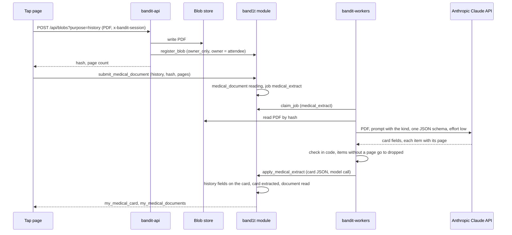
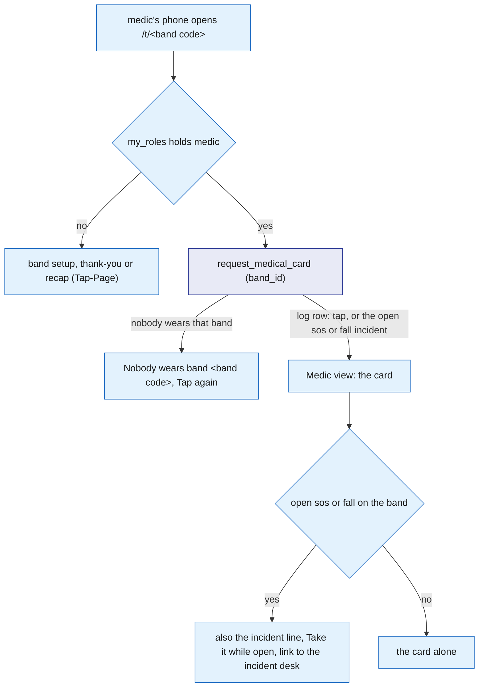

# Medical card

The medical card is the attendee's own health information, the "Wrist assured" card. In band setup an attendee may upload two PDFs: their medical history and their health insurance card. A worker sends each to the Anthropic Claude API, which returns the card fields with the page each item came from.

Code checks the answer and writes it into the attendee's one `medical_card`, which the attendee checks once before setup ends. A medic sees the card by tapping the attendee's band with their phone, or from the incident desk in the organizer portal (/organizer), and every tap is written to `medical_access_log`.

The model reads the document; code decides who sees the card.

## Role in the system

Responsibilities:

- Take the two PDFs, the medical history and the health insurance card, after the tap page (/t/code) stored each in the blob store as an `owner_only` file, and record a `medical_document` of its kind.
- Read each document into the attendee's one `medical_card` with the `medical_extract` job, checked in code.
- Let the attendee check the card once, in setup, and confirm it.
- Apply the medic access rule in one reducer and log every tap.
- Show the medic view when a medic taps a band.
- Serve the card of each band a medic tapped to the medic view and the incident desk.

Non-responsibilities:

- Incident detection, taking an incident, notes and resolution: [Safety](Safety.md). This file only reads `incident` rows.
- The setup screens, their order and the tap's landing route: [Tap-Page](../5-apps/Tap-Page.md). This file defines what the upload, document and card steps and the medic view call and show.
- The incident desk and its layout: [Organizer-Portal](../5-apps/Organizer-Portal.md). This file defines what the medical card part calls and shows.
- The blob store and the upload route: [Rust-Backend](../3-services/Rust-Backend.md).
- The venue's insurance policy and claims: [Insurance](Insurance.md). The health insurance on the card is the attendee's own, and Insurance never reads the card.
- Calling the Anthropic Claude API, `ask_twice`, recording in `model_call`: [Anthropic-Claude-API](../7-integrations/Anthropic-Claude-API.md).

## Interfaces

| Interface | Direction | Who | What flows | Transport |
|---|---|---|---|---|
| `POST /api/blobs?purpose=history` and `purpose=insurance` | in | Tap page, the document steps of setup | one PDF as the request body, the attendee's API session in `x-bandit-session`; back come the hash, the size, the page count and the URL | HTTPS to `bandit-api` ([Rust-Backend](../3-services/Rust-Backend.md)) |
| `register_blob` (core) | out | `bandit-api` (role `api`) | the SHA-256, owner = the attendee, access class `owner_only`, purpose `history` or `insurance`, content type, size | SpacetimeDB reducer ([SpacetimeDB](../2-data/SpacetimeDB.md)) |
| `submit_medical_document` | in | the attendee (own identity) | kind (`history` or `insurance`), the file hash, the page count | reducer; writes `medical_document`, enqueues `medical_extract` |
| Job `medical_extract` | out | `bandit-workers` | payload: document id, kind, file hash, page count | `job` table |
| Anthropic Claude API (Messages) | out | `bandit-workers` through `claude-client` | the PDF, the prompt naming the kind and the page count, one JSON schema; the answer back | HTTPS ([Anthropic-Claude-API](../7-integrations/Anthropic-Claude-API.md)) |
| `apply_medical_extract` | in | role `worker` | job id, the checked card as JSON, the model call | reducer; refuses a job the caller does not hold |
| `confirm_medical_card` | in | the attendee (own identity), in setup | nothing | reducer |
| View `my_medical_documents` | out | the attendee, the card step of setup | own `medical_document` rows | subscription |
| View `my_medical_card` | out | the attendee, the card step of setup | own `medical_card` | subscription |
| `request_medical_card` | in | role `medic`, the medic view and the incident desk | the band id | reducer; applies the access rule, writes `medical_access_log` |
| View `medic_medical_cards` | out | role `medic`, the medic view and the incident desk | one row per band the medic tapped, from the latest tap: incident id (0 without an open incident), band id, name, card | subscription |
| View `board_medical_access` | out | the owner, role `ops` or `medic` | every `medical_access_log` row | subscription |

## Design

### Upload

Setup has two upload steps, each with "Skip": "Your medical history" and then "Your health insurance". The history step tells the attendee: "Upload a PDF from your doctor with your allergies, conditions, medications and emergency contact. It becomes your medical card, which a medic sees by tapping your band."

On "Upload" the page opens an API session if it has none and sends the PDF to `POST /api/blobs?purpose=history` (or `purpose=insurance`) with the session token. `bandit-api` finds the attendee from the session, writes the file to the blob store, calls `register_blob` with the attendee as owner and access class `owner_only`, counts the pages, and returns the hash and the page count. An empty file is refused, and there is no size cap.

The page then calls `submit_medical_document(kind, file_hash, page_count)` as the attendee. It refuses, in order: "kind is history or insurance", "claim your band first" (the caller wears no band), "upload the PDF first" (no `blob_ref` with that hash) and "upload the PDF as your own medical document" (the file came in under another purpose). Otherwise it writes a `medical_document` in status `reading` with the page count (at least 1) and enqueues `medical_extract`.

A new upload is a new document; when it is read, its fields overwrite that kind's fields on the card.

In test mode each upload step also has "Use a test record". It loads the synthetic `medical-history.pdf` or `insurance-card.pdf` from `bandit-api`'s `/test-records` route and files it the same way.

Only the attendee's own `my_medical_documents` shows the file hash. Only a medic sees the card, after their own tap, and no staff member sees the PDF.

### Extraction

The sequence below answers one question: how does an uploaded PDF become fields on the card, and which step is code and which is the model.

The worker gets the PDF from the blob store by its hash and asks the Anthropic Claude API with the default model in `claude-client`, effort low, the PDF, and one JSON schema for both kinds. The prompt says which kind it is and how many pages the document has.

The system prompt says to copy only what is printed, to cite the page of every item, and to leave a field empty rather than guess. The schema asks for:

| Field | Shape |
|---|---|
| `blood_type` | one of A+, A-, B+, B-, AB+, AB-, O+, O- or `unknown` |
| `allergies` | list of {name, reaction, page} |
| `conditions` | list of {name, page} |
| `medications` | list of {name, dose, page} |
| `emergency_contact` | {name, relation, phone, page}, or empty |
| `insurance` | {insurer, plan, member_id, group_number, phone, page}, or empty |
| `notes` | short text a medic should know |

Code then checks the answer and turns it into card fields:

- Blood type outside the list becomes `unknown`.
- Each list keeps at most 20 items. Each item becomes one text line that ends with its page, such as "Penicillin: hives (p. 1)". An item whose page is not between 1 and the page count goes to `dropped` instead, as "allergies: Latex: rash (no page on the document)".
- The emergency contact needs a page. It becomes one line, "Ana Minchev (mother), +18055550142", with the phone cut to digits and the plus sign.
- The insurance needs a page, or its fields stay empty. Its phone becomes `insurer_phone`.
- Notes are cut to 1000 characters.

The check runs through `ask_twice` ([Anthropic-Claude-API](../7-integrations/Anthropic-Claude-API.md)): when it rejects the answer, the worker asks the Anthropic Claude API once more with the first answer and the problems. A failed Anthropic Claude API call fails the attempt, and the job queue tries again up to its last attempt.

`apply_medical_extract` (role `worker`, the job must be leased by the caller) records the model call. It merges the fields of the document's kind into the attendee's card, creating the card when there is none.

History sets `blood_type` (empty becomes `unknown`), `allergies`, `conditions`, `medications`, `emergency_contact` and `notes`. Insurance sets `insurer`, `plan`, `member_id`, `group_number` and `insurer_phone`. The other kind's fields stay as they are.

The card goes back to `extracted`, because a new reading needs the attendee's look again, and the document becomes `read` with its `model_call_id` and `dropped`. An answer that is not readable card JSON sets the document to `failed` and finishes the job.

### The card step

The card step comes after "Are you one of these?" in setup ([Tap-Page](../5-apps/Tap-Page.md)). It reads `my_medical_documents` and `my_medical_card`:

1. No document: the step is skipped and setup goes on to the wallet.
2. A document is still `reading`, or there is no card yet: "Reading your documents", "This takes a few seconds." and "Check later", which goes on to the wallet.
3. Otherwise: "Your medical card", "Read from your PDFs; each item shows the page it came from." It shows the blood type, allergies, conditions, medications, emergency contact and insurance. When a document is `failed` it adds "One document could not be read." "Looks right" calls `confirm_medical_card`, which sets the card to `confirmed`, and setup goes on to the wallet.

This step is the only place the attendee sees the card. After setup the tap page is the thank-you screen and, after the event, the recap; neither shows it.

### The medic opens the card

A medic opens a card in two places, and both call `request_medical_card(band_id)`, so one rule and one log cover both.

**The tap.** At the person, the medic taps the band's tag with their own phone, which opens `/t/<band code>` like any tap ([Tap-Page](../5-apps/Tap-Page.md)). When `my_roles` holds role `medic`, the page shows "Medic view: band <band code>" instead of setup or the recap, never claims the band, and calls `request_medical_card` for that band at once.

It subscribes to `my_roles`, `open_incidents` and `medic_medical_cards`. The card shows as soon as the module answers; no incident is needed.

When the band has an open `sos` or `fall` incident, the view also shows the incident line "<Kind> incident <id>, <status>, opened <time> by <who>.", "Take it" while the incident is still `open` (`assign_medic`, [Safety](Safety.md)), and the link "Notes, cost and resolve on the incident desk" to the organizer portal's Claims tab. A band nobody wears shows "Nobody wears band <band code>." with "Tap again".

**The incident desk.** In the organizer portal's Claims tab, each open incident with a band shows "Tap band <band code> for the medical card", which calls `request_medical_card` with the incident's band ([Organizer-Portal](../5-apps/Organizer-Portal.md)). That tap is tied to the incident, so the card shows inside it.

In both places the card reads "Medical card: <name>, band <band code>", with " (not yet confirmed by the wearer)" until the attendee confirmed it. It lists the blood type, allergies, conditions, medications, emergency contact, insurance and notes, each item with its page. The medic's latest tap on a band decides the card they see for it, and it stays after an incident resolves.

### Access rule

The rule lives in one reducer, `request_medical_card(band_id)`, and nowhere else. The checks, in order:

1. The caller holds role `medic`.
2. Someone wears the band. Otherwise it refuses "nobody wears that band".
3. The reducer writes a `medical_access_log` row with the reader, the attendee who wears the band, the band, the incident, `granted` (always true), the reason and `read_at`. When the band has an unresolved `sos` or `fall` incident, the reason reads "open sos incident 12" or "open fall incident 12" and the row carries that incident; otherwise the reason is "tap" and the incident is 0.

There is no incident check: a medic sees the card of any worn band. The view `medic_medical_cards` returns, for the calling medic, one row per band they tapped, from their latest tap, with that tap's incident.

The only writer of the log is this reducer, so every card a medic sees has a log row. `board_medical_access` shows every tap to the owner, `ops` and `medic`.

The flowchart below answers one question: what does a medic's tap on a band show.

### Tables

| Table | One row is | Fields |
|---|---|---|
| `medical_document` | one uploaded PDF | `id`, `attendee`, `kind` (`history`, `insurance`), `file_hash`, `page_count`, `status` (`reading`, `read`, `failed`), `job_id`, `model_call_id`, `dropped` (the items the Anthropic Claude API returned without a page on the document), `uploaded_at` |
| `medical_card` | one attendee's card, keyed by `attendee` | `attendee`, `blood_type`, `allergies`, `conditions`, `medications` (each a list of text lines ending with their page), `emergency_contact` (one line), `insurer`, `plan`, `member_id`, `group_number`, `insurer_phone`, `notes`, `status` (`extracted`, `confirmed`), `updated_at` |
| `medical_access_log` | one medic tap | `id`, `reader`, `attendee`, `band_id`, `incident_id`, `granted`, `reason`, `read_at` |

### Reducers and views

| Name | Kind | Who | Does |
|---|---|---|---|
| `submit_medical_document` | reducer | the attendee | document row of its kind in `reading`, `medical_extract` job |
| `apply_medical_extract` | reducer | `worker` | merges the document kind's fields into the card; card `extracted`, document `read`, or `failed` on an unreadable answer |
| `confirm_medical_card` | reducer | the attendee | card `confirmed`; refuses "no medical card yet" |
| `request_medical_card` | reducer | `medic` | the access rule; writes the log |
| `my_medical_documents` | view | the attendee | own documents and their status |
| `my_medical_card` | view | the attendee | own card |
| `medic_medical_cards` | view | `medic` | the card of each band the caller tapped, from the latest tap, with the incident, band and name |
| `board_medical_access` | view | the owner, `ops`, `medic` | every access log row |

## Failure modes and fallbacks

| Failure | Effect | Design answer |
|---|---|---|
| Model invents an item | wrong data on a medic's screen | every item needs a page on the document or it goes to `dropped`; the attendee checks the card before "Looks right" |
| An Anthropic Claude API call fails | no reading | the job queue tries again; after its last attempt the document stays `reading`, the card step shows "Check later", and setup goes on to the wallet |
| Answer is not readable card JSON | no reading for that document | the document is `failed`; the card step shows what the other document gave and "One document could not be read." |
| Attendee never confirms | card not checked by the attendee | the medic still sees it, labelled "not yet confirmed by the wearer", because a card with a caveat beats no card in an emergency |
| A medic taps a band nobody wears | nothing to show | the reducer refuses "nobody wears that band"; the medic view shows "Nobody wears band <band code>." with "Tap again" |
| Someone without role `medic` calls `request_medical_card` | could expose the card | the role check comes first and refuses |
| The attendee who wears the band has no card | nothing to show | the tap is still logged; the medic view and the desk show "Medical card: <name>, band <band code>" with "No medical card on file." and the incident goes on |

## Dependencies

**Depends on**

- [SpacetimeDB](../2-data/SpacetimeDB.md): `band_owner`, `attendee`, `staff_role`, `owner`, `job`, `blob_ref` with access classes, `register_blob`, `api_session`, views keyed on the caller.
- [Safety](Safety.md): `incident` kinds and whether it is resolved, `open_incidents`, `assign_medic`.
- [Rust-Backend](../3-services/Rust-Backend.md): `POST /api/blobs` with the purposes `history` and `insurance`, the `/test-records` route, the blob store, and the `bandit-workers` shell.
- [Anthropic-Claude-API](../7-integrations/Anthropic-Claude-API.md): `claude-client`, `ask_twice`, `model_call`. Without it no document is read and there is no card.
- [Tap-Page](../5-apps/Tap-Page.md): the document steps and the card step of setup, and the landing route that sends a medic's tap to the medic view.
- [Organizer-Portal](../5-apps/Organizer-Portal.md): the incident desk in the Claims tab, where the medic view's link leads.

**Used by**

- [Organizer-Portal](../5-apps/Organizer-Portal.md): the medical card in the incident desk and the "Medical access log (Medical-Card.md)" panel row.
- [Flows](../1-overview/Flows.md): the document steps and card check of setup, and the medic step of the event.

**If you delete this file**

- Drop `medical_document`, `medical_card`, `medical_access_log`, the reducers and views above, the job kind `medical_extract`, and the purposes `history` and `insurance` of `POST /api/blobs` and of `blob_ref` in SpacetimeDB.md.
- Remove the Medical-Card.md rows in Tap-Page.md: the two document steps, the card step, the medic view line, node and decision, and the interface row. Setup goes from the socials to "Are you one of these?" and then the wallet, and a medic's tap is like anyone's.
- Remove the Medical-Card.md rows in Organizer-Portal.md: the medical card in the incident desk and the "Medical access log (Medical-Card.md)" panel row.
- Remove the medical card use case from Anthropic-Claude-API.md.
- Remove the Medical-Card.md rows from the route and handler registries and the `/test-records` row in Rust-Backend.md, the Medical-Card.md rows from the registry tables in SpacetimeDB.md, the Medical-Card.md rows in Safety.md, the Medical-Card.md steps and the medic's Medical-Card.md line in Flows.md, the Medical-Card.md line in Hardware.md, the Medical-Card.md rows in Requirements.md and Architecture.md, and the Medical-Card row and node in README.md.

## Decisions

| Decision | Why |
|---|---|
| The medic opens the card by tapping the band, or from the incident desk with "Tap band <band code> for the medical card"; both call `request_medical_card` | at the person the band's own tag is the quickest way in, at the desk the button names the band, and one reducer keeps one rule and one log |
| A medic sees the card of any worn band, with no open incident needed | the card helps most at the person, before anyone has flagged anything; the tap still needs role `medic`, and every tap is logged |
| A tap during an open `sos` or `fall` is tied to that incident; the card stays after the incident resolves | the incident desk shows the card next to the incident, and the medic may still be with the person |
| A medic's tap never claims the band | the medic is never mistaken for the attendee who wears it, and the attendee's band stays theirs |
| The tap page uploads the PDF and then calls `submit_medical_document` as the attendee | the reducer knows the caller, so no service has to vouch for who the attendee is |
| Setup takes two optional PDFs, the medical history and the health insurance card, read into one card | a medic gets one card with everything, including who insures the person |
| Each document is its own `medical_extract` job, with one schema for both kinds and the kind in the prompt | a missing or failed document never holds up the other, and each retry reads one PDF |
| A new upload is a new document whose reading overwrites that kind's fields | the latest PDF wins, with no chain of old rows to follow |
| The attendee sees the card only on the card step in setup | during the event the tap page is the thank-you screen; the card is for medics |
| There is no manual form | the PDF is the source; when it cannot be read the attendee goes on without a card |
| An unconfirmed card is still shown to a medic, labelled | a card with a caveat beats no card in an emergency |
| Effort low for the reading | it copies printed fields; there is nothing to reason about |
