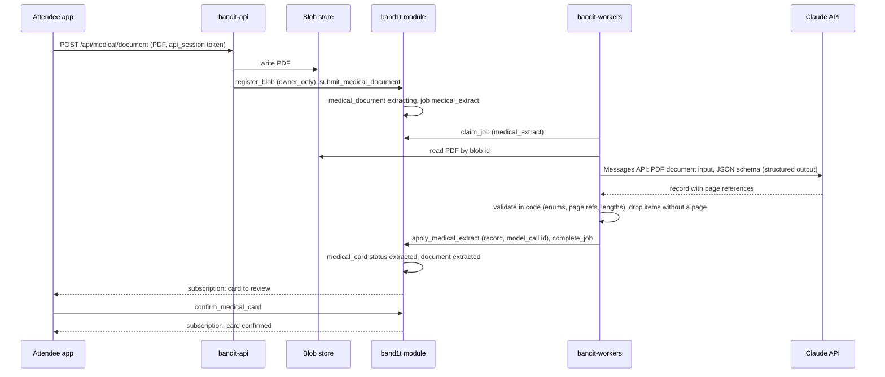
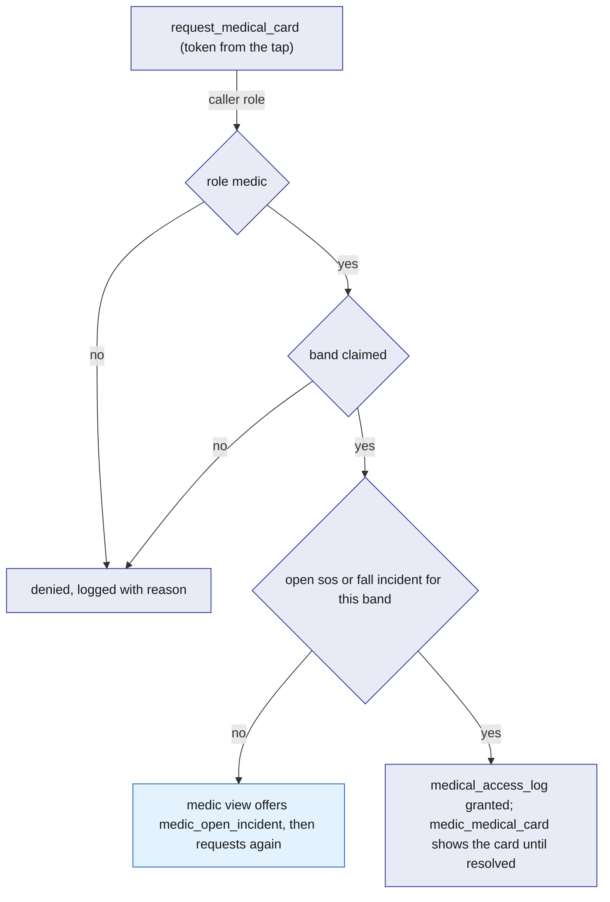
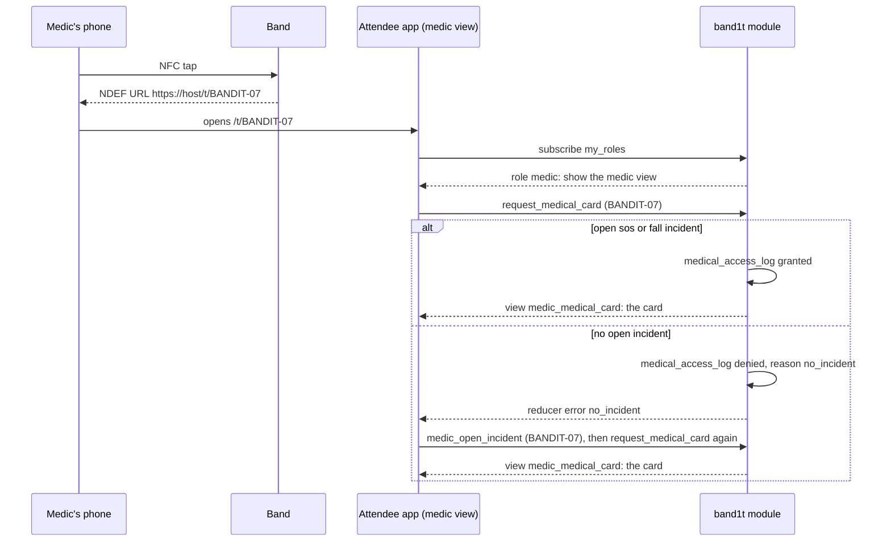

# Medical-ID

Medical-ID is the "Wrist assured" medical card. At sign-up an attendee uploads a medical PDF; a worker sends it to Claude, which returns a structured record with page references; code validates the record and writes a `medical_card`, which the attendee confirms. A medic sees a card only by tapping the band of someone with an open `sos` or `fall` incident, and every medic read is written to `medical_access_log`. The model reads the document; code decides who sees the card.

## Role in the system

Responsibilities:

- Accept the medical PDF through `bandit-api`, store it as an `owner_only` blob, and record a `medical_document`.
- Extract a structured record with the `medical_extract` job, validate it in code, and write `medical_card`.
- Offer a manual-entry form for edits, and for typing the card when extraction fails.
- Enforce the medic access rule in a reducer and log every medic read.
- Let a medic who tapped a band open an `sos` incident for it, which then grants access.
- Serve the card to the medic view opened by tapping the band.

Non-responsibilities:

- Incident detection, acknowledgement, assignment and resolution: [Safety](Safety.md). This file only reads `incident` rows and, in one reducer, opens one.
- The NFC sticker, its URL and read range: [Hardware](../4-devices/Hardware.md).
- Routes and screens (sign-up, the card review screen, the medic view): [Attendee-App](../5-apps/Attendee-App.md). This file defines what they call and what they may show.
- Prompt wording, the output schema, model and effort, PDF input, recording in `model_call`: [Anthropic-Agent](../7-integrations/Anthropic-Agent.md).
- Using the card as claim evidence: [Hyphenate](../7-integrations/Hyphenate.md). This file defines the read it is allowed.

## Interfaces

| Interface | Direction | Who | What flows | Transport |
|---|---|---|---|---|
| `POST /api/medical/document` | in | Attendee app, sign-up and profile screens | the PDF (multipart), the caller's `api_session` token | HTTPS to `bandit-api` |
| `register_blob` (core) | out | `bandit-api` (role `api`) | content type, size, SHA-256, owner, access class `owner_only` | SpacetimeDB reducer ([SpacetimeDB](../2-data/SpacetimeDB.md)) |
| `submit_medical_document` | in | `bandit-api` (role `api`) | attendee id, `blob_ref` id, page count | reducer; writes `medical_document`, enqueues `medical_extract` |
| Job `medical_extract` | out | `bandit-workers` | payload: document id, blob id; result: validated record | `job` table |
| Claude Messages API | out | `bandit-workers` through `claude-client` | the PDF as document input, a JSON schema; structured record back | HTTPS ([Anthropic-Agent](../7-integrations/Anthropic-Agent.md)) |
| `apply_medical_extract` | in | role `worker` | job id, document id, validated record, `model_call` id | reducer; rejects a stale lease |
| `confirm_medical_card` | in | the attendee (own identity) | card id | reducer |
| `save_medical_card` | in | the attendee (own identity) | all card fields, typed or edited | reducer; manual entry or correction |
| `request_medical_card` | in | role `medic` | the band's NFC token from the tap | reducer; applies the access rule, writes `medical_access_log` |
| `medic_open_incident` | in | role `medic` | the band's NFC token | reducer; opens an `sos` incident assigned to the caller |
| View `my_medical_card` | out | the attendee | own `medical_card` and `medical_document` status | subscription |
| View `medic_medical_card` | out | role `medic` | the card for which a granted log row exists for the caller and the incident is not resolved | subscription |
| `medical_card` read by `open_claim` | out | `band1t` module (Hyphenate.md) | card status, emergency contact present, conditions text, logged with `via = claim` | module-internal |
| Access log | out | Ops dashboard (role `ops`) | `medical_access_log` rows | subscription |

## Design

### Upload and storage

The attendee uploads the PDF from the sign-up or profile screen. The app sends it to `bandit-api` with its `api_session` token; `bandit-api` hashes the token, finds the session in its subscription and so knows the attendee ([SpacetimeDB](../2-data/SpacetimeDB.md), `api_session`). It checks the content type is PDF and the size is at most 10 MB, writes the file to the blob store, counts the pages, calls `register_blob` with access class `owner_only`, and calls `submit_medical_document`. That reducer writes a `medical_document` row in status `uploaded`, moves it to `extracting`, and enqueues `medical_extract` with the document and blob ids. An attendee has one current document: a new upload supersedes the old row (`superseded_by`).

`owner_only` keeps the PDF out of every other screen: `bandit-api` serves such a blob only to the owner's own session. Medics, ops and Hyphenate see the extracted card, never the document.

### Extraction

The sequence below answers one question: how does a PDF become a confirmed card, and which step is code and which is the model.

The worker claims the job, reads the blob, and sends the PDF as document input with a JSON schema for the response; the schema is the contract. Claude reads each page as text and as an image, so a scanned PDF works the same way. Model `claude-opus-5-5`, effort set per [Anthropic-Agent](../7-integrations/Anthropic-Agent.md), the call recorded in `model_call`. The worker calls `extend_job_lease` while the model call runs, so a long PDF is not handed to another worker. The schema asks for:

| Field | Shape | Validation in code |
|---|---|---|
| `blood_type` | one of the eight ABO/Rh types or `unknown` | must be in the set; anything else becomes `unknown` |
| `allergies` | list of {name, reaction, page} | at most 20 items; name at most 120 characters; `page` between 1 and the page count; an item without a valid page is dropped |
| `conditions` | list of {name, page} | same |
| `medications` | list of {name, dose, page} | same |
| `emergency_contact` | {name, relation, phone, page} | phone reduced to digits and plus sign, 7 to 15 digits; page required |
| `notes` | free text, list of pages | at most 1000 characters |

Every item carries the page it came from, so a medic can trust it and the owner can check it. Code never accepts a field without a page reference and counts what it dropped in `medical_document.dropped_items`. On success `apply_medical_extract` (role `worker`, rejects a stale lease) writes or replaces the attendee's `medical_card` with `status = extracted`, `source = model`, the `document_id` and `model_call_id`, and sets the document to `extracted`.

### Confirmation and manual entry

The app shows the extracted card next to the page references. `confirm_medical_card` sets `status = confirmed` and `confirmed_at`. `save_medical_card` lets the owner edit any field, or type the whole card; it writes the card with `source = manual` (`model_edited` when it started from an extraction) and `status = confirmed`, since the owner typed it. When extraction fails three times the document is `failed` and the app opens the manual form.

Anthropic-Agent.md: without it, upload is hidden and the manual form is the whole feature; the access rule is unchanged.

A card in `extracted` that was never confirmed is still shown to a medic, labelled "not yet confirmed by the wearer", because a card with a caveat beats no card in an emergency.

### Access rule

The rule lives in one reducer, `request_medical_card`, and nowhere else. The medic always taps the band; the tap supplies the NFC token. The token is static in v0.1, so presenting it counts as the tap. The checks, in order:

1. The caller holds role `medic` in `staff_role`.
2. The token resolves to a claimed `band` and its owner.
3. There is an `incident` of kind `sos` or `fall` for that band with status `open`, `acknowledged` or `responding`.
4. The reducer writes a `medical_access_log` row: card, attendee, reader identity and role, incident id, `via` (`tap`), `granted` true or false, `reason`, `read_at`.

The view `medic_medical_card` returns the card only where a granted log row exists for the caller and the linked incident is not `resolved`. Since the only way to get a log row is this reducer, every read writes `medical_access_log`. When the incident resolves, the card leaves the medic's screen with no cleanup step. A denied request also leaves a log row with its reason, so ops can see attempts.

The flowchart below answers one question: given a medic's tap on a band, when does the card show.

### Opening an incident from a tap

A medic may reach a person before any band flag or dashboard action: the wearer is unwell but did not hold the button, or the band is a lite band with no fall sensor. `medic_open_incident` (role `medic`) takes the token, requires a claimed band with no open `sos` or `fall` incident, and opens an `sos` incident for that band with `status = responding`, `assigned_medic` set to the caller and `opened_by = medic`, freezing the snapshot the same way `ingest_band_reports` does ([Safety](Safety.md) owns the snapshot). No escalation timer is scheduled because a medic is already there. The next `request_medical_card` passes the rule. The band's light state is left alone; the medic is already standing there.

### The medic tap flow

The sequence below answers one question: what happens from the medic's phone touching the band to the card on screen.

The medic view shows the card fields with their page references, the band id, the incident id and status, and nothing from the PDF itself. When the attendee has no card, it shows "no medical card on file" and the incident still stands.

### Hyphenate reads the card

[Hyphenate](../7-integrations/Hyphenate.md)'s `open_claim` reads the subject attendee's `medical_card` when it builds the evidence pack. Code reads only the card's status and whether an emergency contact is present; the conditions text goes to the `claim_draft` job as model-read material for the claim summary. The read writes a `medical_access_log` row with `via = claim`, the claim id in `reason`, and the identity whose call opened the claim as the reader, so the owner's log shows it like any medic read. This is the one kind of row in the access log that belongs to another file.

### Tables

| Table | One row is | Fields |
|---|---|---|
| `medical_document` | one uploaded PDF | `id`, `attendee_id`, `blob_id`, `page_count`, `status` (`uploaded`, `extracting`, `extracted`, `failed`), `job_id`, `model_call_id`, `dropped_items`, `superseded_by`, `uploaded_at` |
| `medical_card` | one attendee's current card | `id`, `attendee_id` (unique), `status` (`extracted`, `confirmed`), `source` (`model`, `model_edited`, `manual`), `blood_type`, `allergies`, `conditions`, `medications` (each a list of items with page references, stored as text lists), `emergency_contact_name`, `emergency_contact_relation`, `emergency_contact_phone`, `emergency_contact_page`, `notes`, `document_id`, `model_call_id`, `extracted_at`, `confirmed_at`, `updated_at` |
| `medical_access_log` | one read or denied attempt | `id`, `card_id`, `attendee_id`, `reader_identity`, `reader_role`, `incident_id`, `via` (`tap`, `claim`), `granted`, `reason`, `read_at` |

### Reducers and views

| Name | Kind | Role | Does |
|---|---|---|---|
| `submit_medical_document` | reducer | `api` | document row, `medical_extract` job |
| `apply_medical_extract` | reducer | `worker` | writes the card from a validated record; rejects a stale lease |
| `confirm_medical_card` | reducer | owner | `extracted` to `confirmed` |
| `save_medical_card` | reducer | owner | manual entry or edits; `confirmed` |
| `request_medical_card` | reducer | `medic` | the access rule; writes the log |
| `medic_open_incident` | reducer | `medic` | opens an `sos` incident assigned to the caller |
| `my_medical_card` | view | owner | own card and document status |
| `medic_medical_card` | view | `medic` | cards with a granted log row for the caller and an unresolved incident |

## Failure modes and fallbacks

| Failure | Effect | Design answer |
|---|---|---|
| Model invents a field | wrong data on a medic's screen | every item needs a page reference or it is dropped; the owner reviews before confirming |
| Model refuses or returns invalid JSON | no record | after 3 failed attempts the document is `failed` and the app opens the manual form |
| Attendee never confirms | card not checked by the wearer | medics see it labelled "not yet confirmed by the wearer" |
| Medic taps a band with no open incident | denied | the medic view offers `medic_open_incident` for the tapped band |
| Someone without role `medic` uses the static token | could expose the card | the role check comes first; the reducer denies and logs the attempt |

## Dependencies

**Depends on**

- [SpacetimeDB](../2-data/SpacetimeDB.md): `band`, `attendee`, `staff_role`, `incident`, `job`, `blob_ref` with access classes, `register_blob`, `api_session`, `extend_job_lease`, views keyed on the caller.
- [Safety](Safety.md): `incident` kinds and statuses, `assigned_medic`, the snapshot function used by `medic_open_incident`.
- [Rust-Backend](../3-services/Rust-Backend.md): the `bandit-api` shell that hosts `POST /api/medical/document`, the blob store, and the `bandit-workers` shell.
- [Anthropic-Agent](../7-integrations/Anthropic-Agent.md) (optional): `claude-client`, the extraction prompt and schema, `model_call`. Without it, manual entry only.
- [Hardware](../4-devices/Hardware.md): the NFC sticker and its URL.
- [Attendee-App](../5-apps/Attendee-App.md): the upload screen, the card review screen, the medic view route opened from `/t/BANDIT-0n`.

**Used by**

- [Hyphenate](../7-integrations/Hyphenate.md): reads `medical_card` as evidence and writes the `via = claim` log row.
- [Ops-Dashboard](../5-apps/Ops-Dashboard.md): the "Medical access log (Medical-ID.md)" panel row.
- [Flows](../1-overview/Flows.md): the medic step of the demo.

**If you delete this file**

- Drop `medical_document`, `medical_card`, `medical_access_log`, the two views, the reducers above, the job kind `medical_extract` and the endpoint `POST /api/medical/document`.
- Remove the upload and card screens and the medic view's card panel in Attendee-App.md (the medic view keeps the incident panel).
- Remove the `medical_card` row from the evidence sources table in Hyphenate.md.
- Remove the Medical-ID use case from Anthropic-Agent.md and the "Medical access log (Medical-ID.md)" panel row from Ops-Dashboard.md.
- Remove the Medical-ID.md rows from the endpoint and handler registries in Rust-Backend.md, the Medical-ID.md rows from the registry tables in SpacetimeDB.md and its `medic_open_incident` mention on `incident`, the Medical-ID.md rows and bullets in Safety.md, the medic step in Flows.md and the prize row in Architecture.md, the Medical-ID.md part of the NFC token row and the dependency bullets in Hardware.md, and the Medical-ID row and node in README.md.
- `medic_open_incident` goes with it.

## Decisions

| Decision | Why |
|---|---|
| The medic always taps the band to see the card; there is no card in the dashboard's incident panel | the tap proves the medic is standing at the person, and it is the demo moment |
| `medic_open_incident` leaves the band's light state alone | the medic is already at the person, so a light circle adds nothing |
| The upload cap is 10 MB | enough for a scanned medical summary of a few pages |
| The static NFC token counts as a tap in v0.1 | the role check and the open-incident check guard the card; every attempt is logged |
| An unconfirmed card is still shown to a medic, labelled | a card with a caveat beats no card in an emergency |
| After 3 failed extraction attempts the app opens the manual form | one fallback keeps the card step from stopping the demo |
