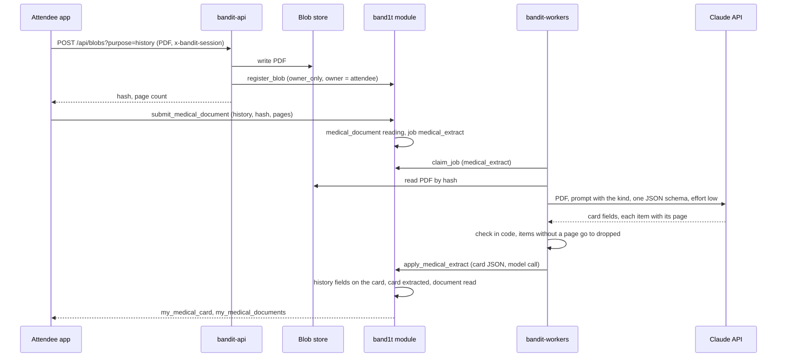
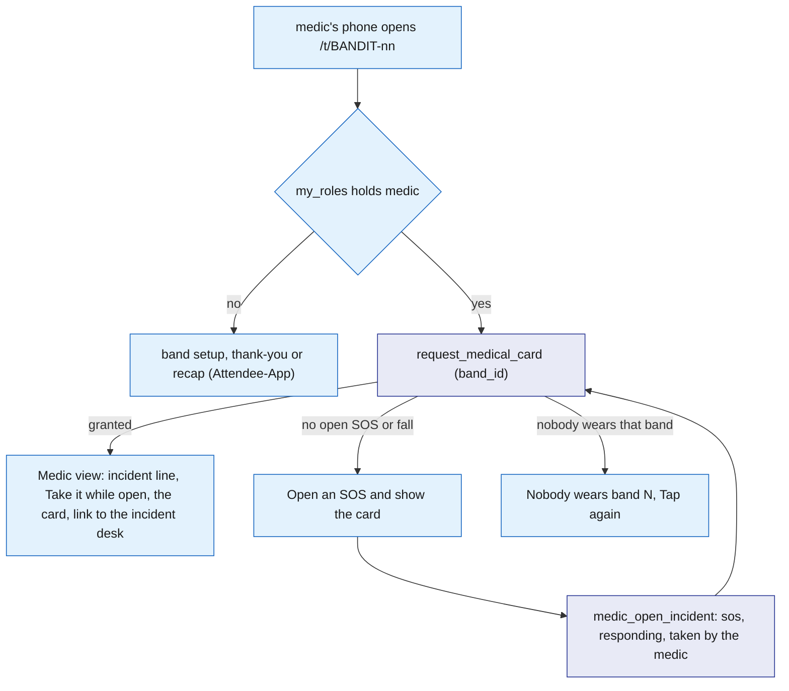
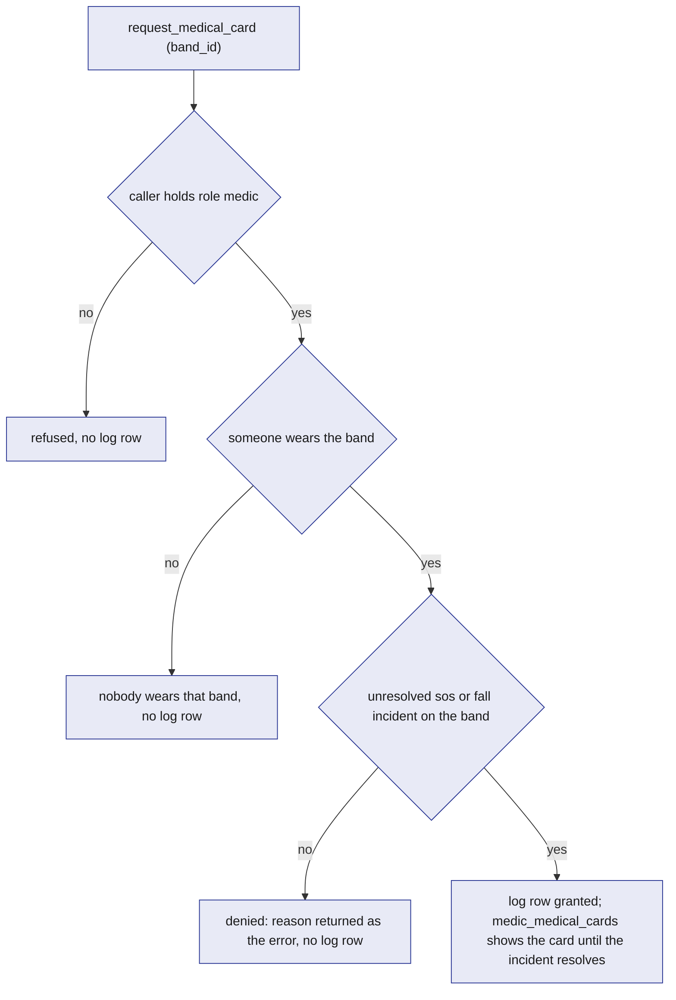

# Medical-ID

Medical-ID is the "Wrist assured" medical card. In band setup an attendee may upload two PDFs: their medical history and their health insurance card. A worker sends each to Claude, which returns the card fields with the page each item came from. Code checks the answer and writes it into the attendee's one `medical_card`, which the attendee checks once before setup ends. A medic sees a card only for a band with an open `sos` or `fall` incident, by tapping that band with their phone or from the incident desk in the Ops dashboard, and every granted read is written to `medical_access_log`. A medic who reaches someone before any flag opens the SOS from the tap. The model reads the document; code decides who sees the card.

## Role in the system

Responsibilities:

- Take the two PDFs, the medical history and the health insurance card, after the attendee page stored each in the blob store as an `owner_only` file, and record a `medical_document` of its kind.
- Read each document into the attendee's one `medical_card` with the `medical_extract` job, checked in code.
- Let the attendee check the card once, in setup, and confirm it.
- Apply the medic access rule in one reducer and log the granted reads.
- Show the medic view when a medic taps a band, and let the medic open an SOS from it when none is open.
- Serve the granted card to the medic view and the incident desk while the incident is open.

Non-responsibilities:

- Incident detection, taking an incident, notes and resolution: [Safety](Safety.md). This file only reads `incident` rows.
- The setup screens, their order and the tap's landing route: [Attendee-App](../5-apps/Attendee-App.md). This file defines what the upload, document and card steps and the medic view call and show.
- The incident desk and its layout: [Ops-Dashboard](../5-apps/Ops-Dashboard.md). This file defines what the medical card part calls and shows.
- The blob store and the upload route: [Rust-Backend](../3-services/Rust-Backend.md).
- The venue's insurance policy and claims: [Insurance](Insurance.md). The health insurance on the card is the attendee's own, and Insurance never reads the card.
- Calling Claude, `ask_twice`, recording in `model_call`: [Anthropic-Agent](../7-integrations/Anthropic-Agent.md).

## Interfaces

| Interface | Direction | Who | What flows | Transport |
|---|---|---|---|---|
| `POST /api/blobs?purpose=history` and `purpose=insurance` | in | Attendee app, the document steps of setup | one PDF as the request body, the attendee's API session in `x-bandit-session`; back come the hash, the size, the page count and the URL | HTTPS to `bandit-api` ([Rust-Backend](../3-services/Rust-Backend.md)) |
| `register_blob` (core) | out | `bandit-api` (role `api`) | the SHA-256, owner = the attendee, access class `owner_only`, purpose `history` or `insurance`, content type, size | SpacetimeDB reducer ([SpacetimeDB](../2-data/SpacetimeDB.md)) |
| `submit_medical_document` | in | the attendee (own identity) | kind (`history` or `insurance`), the file hash, the page count | reducer; writes `medical_document`, enqueues `medical_extract` |
| Job `medical_extract` | out | `bandit-workers` | payload: document id, kind, file hash, page count | `job` table |
| Claude Messages API | out | `bandit-workers` through `claude-client` | the PDF, the prompt naming the kind and the page count, one JSON schema; the answer back | HTTPS ([Anthropic-Agent](../7-integrations/Anthropic-Agent.md)) |
| `apply_medical_extract` | in | role `worker` | job id, the checked card as JSON, the model call | reducer; refuses a job the caller does not hold |
| `confirm_medical_card` | in | the attendee (own identity), in setup | nothing | reducer |
| View `my_medical_documents` | out | the attendee, the card step of setup | own `medical_document` rows | subscription |
| View `my_medical_card` | out | the attendee, the card step of setup | own `medical_card` | subscription |
| `request_medical_card` | in | role `medic`, the medic view and the incident desk | the band id | reducer; applies the access rule, writes `medical_access_log` |
| `medic_open_incident` | in | role `medic`, the medic view | the band id | reducer; opens an `sos` incident on that band, taken by the caller |
| View `medic_medical_cards` | out | role `medic`, the medic view and the incident desk | one row per granted request whose incident is still open: incident id, band id, name, card | subscription |
| View `board_medical_access` | out | the owner, role `ops` or `medic` | every `medical_access_log` row | subscription |

## Design

### Upload

Setup has two upload steps, each with "Skip": "Your medical history" and then "Your health insurance". The history step tells the attendee: "A medic sees the card only if you fall or press SOS, and only by tapping your band." On "Upload" the page opens an API session if it has none and sends the PDF to `POST /api/blobs?purpose=history` (or `purpose=insurance`) with the session token. `bandit-api` finds the attendee from the session, writes the file to the blob store, calls `register_blob` with the attendee as owner and access class `owner_only`, counts the pages, and returns the hash and the page count. An empty file is refused. There is no size cap.

The page then calls `submit_medical_document(kind, file_hash, page_count)` as the attendee. It refuses, in order: "kind is history or insurance", "claim your band first" (the caller wears no band), "upload the PDF first" (no `blob_ref` with that hash) and "upload the PDF as your own medical document" (the file came in under another purpose). Otherwise it writes a `medical_document` in status `reading` with the page count (at least 1) and enqueues `medical_extract`. A new upload is a new document; when it is read, its fields overwrite that kind's fields on the card.

In test mode each upload step also has "Use a test record". It loads the synthetic `medical-history.pdf` or `insurance-card.pdf` from `bandit-api`'s `/samples` route and files it the same way.

Only the attendee's own `my_medical_documents` shows the file hash. Medics and ops see the card, never the PDF.

### Extraction

The sequence below answers one question: how does an uploaded PDF become fields on the card, and which step is code and which is the model.

The worker gets the PDF from the blob store by its hash and asks Claude with the default model in `claude-client`, effort low, the PDF, and one JSON schema for both kinds. The prompt says which kind it is and how many pages the document has. The system prompt says to copy only what is printed, to cite the page of every item, and to leave a field empty rather than guess. The schema asks for:

| Field | Shape |
|---|---|
| `blood_type` | one of A+, A-, B+, B-, AB+, AB-, O+, O- or `unknown` |
| `allergies` | list of {name, reaction, page} |
| `conditions` | list of {name, page} |
| `medications` | list of {name, dose, page} |
| `emergency_contact` | {name, relation, phone, page}, or empty |
| `insurance` | {insurer, plan, member_id, group_number, phone, page}, or empty |
| `notes` | short text a medic should know |

Code then checks the answer and turns it into card fields:

- Blood type outside the list becomes `unknown`.
- Each list keeps at most 20 items. Each item becomes one text line that ends with its page, such as "Penicillin: hives (p. 1)". An item whose page is not between 1 and the page count goes to `dropped` instead, as "allergies: Latex: rash (no page on the document)".
- The emergency contact needs a page. It becomes one line, "Ana Minchev (mother), +18055550142", with the phone cut to digits and the plus sign.
- The insurance needs a page, or its fields stay empty. Its phone becomes `insurer_phone`.
- Notes are cut to 1000 characters.

The check runs through `ask_twice` ([Anthropic-Agent](../7-integrations/Anthropic-Agent.md)): when it rejects the answer, the worker asks Claude once more with the first answer and the problems. A failed Claude call fails the attempt, and the job queue tries again up to its last attempt.

`apply_medical_extract` (role `worker`, the job must be leased by the caller) records the model call. It merges the fields of the document's kind into the attendee's card, creating the card when there is none. History sets `blood_type` (empty becomes `unknown`), `allergies`, `conditions`, `medications`, `emergency_contact` and `notes`. Insurance sets `insurer`, `plan`, `member_id`, `group_number` and `insurer_phone`. The other kind's fields stay as they are. The card goes back to `extracted`, because a new reading needs the wearer's look again, and the document becomes `read` with its `model_call_id` and `dropped`. An answer that is not readable card JSON sets the document to `failed` and finishes the job.

### The card step

The card step comes after "Are you one of these?" in setup ([Attendee-App](../5-apps/Attendee-App.md)). It reads `my_medical_documents` and `my_medical_card`:

1. No document: the step is skipped and setup goes on to the wallet.
2. A document is still `reading`, or there is no card yet: "Claude is reading your documents", "This takes a few seconds." and "Check later", which goes on to the wallet.
3. Otherwise: "Your medical card", "Read by Claude from your PDFs; each item shows the page it came from." It shows the blood type, allergies, conditions, medications, emergency contact and insurance. When a document is `failed` it adds "One document could not be read." "Looks right" calls `confirm_medical_card`, which sets the card to `confirmed`, and setup goes on to the wallet.

This step is the only place the attendee sees the card. After setup the attendee page is the thank-you screen and, after the event, the recap; neither shows it.

### The medic opens the card

A medic opens a card in two places, and both call `request_medical_card(band_id)`, so one rule and one log cover both.

**The tap.** At the person, the medic taps the band's tag with their own phone, which opens `/t/BANDIT-nn` like any tap ([Attendee-App](../5-apps/Attendee-App.md)). When `my_roles` holds role `medic`, the page shows "Medic view: band N" instead of setup or the recap, never claims the band, and calls `request_medical_card` for that band at once. It subscribes to `my_roles`, `open_incidents` and `medic_medical_cards`.

- Granted: the incident line "<Kind> incident <id>, <status>, opened <time> by <who>.", "Take it" while the incident is still `open` (`assign_medic`, [Safety](Safety.md)), the card, and the link "Notes, cost and resolve on the incident desk" to the Ops dashboard's Claims tab.
- No open `sos` or `fall` on the band: "Band N has no open SOS or fall, so its medical card stays closed." with "Open an SOS and show the card". It calls `medic_open_incident(band_id)` and then asks for the card again.
- "Nobody wears band N." and, after the incident resolved, "The incident is resolved, so the medical card is closed.", each with "Tap again".

`medic_open_incident(band_id)` is for a medic who reaches someone before any band flag. It requires role `medic` and a worn band ("nobody wears that band"), and refuses "this band already has an open SOS or fall incident". Otherwise it opens an `sos` incident on that band in the zone of the band's current station, through the same open as a band SOS, so the snapshot is frozen in the same transaction. The incident has `opened_by` `medic`, status `responding` and `assigned_medic` the caller, so it needs no "Take it" and no escalation timer. It shows on the incident desk like any other incident, where the medic adds notes and resolves it ([Safety](Safety.md)).

**The incident desk.** In the Ops dashboard's Claims tab, each open incident with a band shows "Tap band N for the medical card", which calls `request_medical_card` with the incident's band ([Ops-Dashboard](../5-apps/Ops-Dashboard.md)). The granted card shows inside the incident.

In both places the card reads "Medical card: <name>, band N", with " (not yet confirmed by the wearer)" until the wearer confirmed it. It lists the blood type, allergies, conditions, medications, emergency contact, insurance and notes, each item with its page. The card closes when the incident resolves.

The flowchart below answers one question: what does a medic's tap on a band show.

### Access rule

The rule lives in one reducer, `request_medical_card(band_id)`, and nowhere else. The checks, in order:

1. The caller holds role `medic`.
2. Someone wears the band. Otherwise it refuses "nobody wears that band".
3. The band has an incident of kind `sos` or `fall` that is not resolved.
4. The reducer writes a `medical_access_log` row with the reader, the wearer, the band, the incident, `granted`, the reason and `read_at`. A granted reason reads "open sos incident 12" or "open fall incident 12". A denied request returns "no open SOS or fall incident for this band" as its error, and the error rolls the reducer back, so its row does not stay.

The view `medic_medical_cards` returns, for the calling medic, one row per incident with a granted log row whose incident is still open. The only way to get a granted row is this reducer, so every card a medic sees has a log row. When the incident resolves, the card leaves the medic's screen with no cleanup step. `board_medical_access` shows every granted read to the owner, `ops` and `medic`; a denied request leaves no row.

The flowchart below answers one question: given a medic's request for a band, when does the card show.

### Tables

| Table | One row is | Fields |
|---|---|---|
| `medical_document` | one uploaded PDF | `id`, `attendee`, `kind` (`history`, `insurance`), `file_hash`, `page_count`, `status` (`reading`, `read`, `failed`), `job_id`, `model_call_id`, `dropped` (the items Claude returned without a page on the document), `uploaded_at` |
| `medical_card` | one attendee's card, keyed by `attendee` | `attendee`, `blood_type`, `allergies`, `conditions`, `medications` (each a list of text lines ending with their page), `emergency_contact` (one line), `insurer`, `plan`, `member_id`, `group_number`, `insurer_phone`, `notes`, `status` (`extracted`, `confirmed`), `updated_at` |
| `medical_access_log` | one granted medic read | `id`, `reader`, `attendee`, `band_id`, `incident_id`, `granted`, `reason`, `read_at` |

### Reducers and views

| Name | Kind | Who | Does |
|---|---|---|---|
| `submit_medical_document` | reducer | the attendee | document row of its kind in `reading`, `medical_extract` job |
| `apply_medical_extract` | reducer | `worker` | merges the document kind's fields into the card; card `extracted`, document `read`, or `failed` on an unreadable answer |
| `confirm_medical_card` | reducer | the attendee | card `confirmed`; refuses "no medical card yet" |
| `request_medical_card` | reducer | `medic` | the access rule; writes the log |
| `medic_open_incident` | reducer | `medic` | opens an `sos` on a worn band with no open `sos` or `fall`: `opened_by` `medic`, status `responding`, `assigned_medic` the caller |
| `my_medical_documents` | view | the attendee | own documents and their status |
| `my_medical_card` | view | the attendee | own card |
| `medic_medical_cards` | view | `medic` | the cards of the caller's granted requests while the incident is open, with the incident, band and name |
| `board_medical_access` | view | the owner, `ops`, `medic` | every access log row |

## Failure modes and fallbacks

| Failure | Effect | Design answer |
|---|---|---|
| Model invents an item | wrong data on a medic's screen | every item needs a page on the document or it goes to `dropped`; the wearer checks the card before "Looks right" |
| Claude call fails | no reading | the job queue tries again; after its last attempt the document stays `reading`, the card step shows "Check later", and setup goes on to the wallet |
| Answer is not readable card JSON | no reading for that document | the document is `failed`; the card step shows what the other document gave and "One document could not be read." |
| Attendee never confirms | card not checked by the wearer | the medic still sees it, labelled "not yet confirmed by the wearer", because a card with a caveat beats no card in an emergency |
| Medic asks for a band with no open `sos` or `fall` incident | denied | the reason shows as the error; the error rolls the call back, so no log row stays. On the medic view it comes with "Open an SOS and show the card" |
| A medic opens an SOS only to read a card | a read with no emergency behind it | the incident carries `opened_by` `medic` and the medic's identity, shows on every staff screen until resolved, and the read is in `medical_access_log` |
| Someone without role `medic` calls `request_medical_card` | could expose the card | the role check comes first and refuses |
| The wearer has no card | nothing to show | the request is still granted and logged; the medic view and the desk show "Medical card: <name>, band N" with "No medical card on file." and the incident goes on |

## Dependencies

**Depends on**

- [SpacetimeDB](../2-data/SpacetimeDB.md): `band_owner`, `attendee`, `staff_role`, `owner`, `job`, `blob_ref` with access classes, `register_blob`, `api_session`, views keyed on the caller.
- [Safety](Safety.md): `incident` kinds and whether it is resolved, `open_incidents`, `assign_medic`, and the incident open that `medic_open_incident` shares with a band SOS.
- [Rust-Backend](../3-services/Rust-Backend.md): `POST /api/blobs` with the purposes `history` and `insurance`, the `/samples` route, the blob store, and the `bandit-workers` shell.
- [Anthropic-Agent](../7-integrations/Anthropic-Agent.md): `claude-client`, `ask_twice`, `model_call`. Without it no document is read and there is no card.
- [Attendee-App](../5-apps/Attendee-App.md): the document steps and the card step of setup, and the landing route that sends a medic's tap to the medic view.
- [Ops-Dashboard](../5-apps/Ops-Dashboard.md): the incident desk in the Claims tab, where the medic view's link leads.

**Used by**

- [Ops-Dashboard](../5-apps/Ops-Dashboard.md): the medical card in the incident desk and the "Medical access log (Medical-ID.md)" panel row.
- [Flows](../1-overview/Flows.md): the document steps and card check of setup, and the medic step of the event.

**If you delete this file**

- Drop `medical_document`, `medical_card`, `medical_access_log`, the reducers and views above, the job kind `medical_extract`, and the purposes `history` and `insurance` of `POST /api/blobs` and of `blob_ref` in SpacetimeDB.md.
- Remove the Medical-ID.md rows in Attendee-App.md: the two document steps, the card step, the medic view line, node and decision, and the interface row. Setup goes from the socials to "Are you one of these?" and then the wallet, and a medic's tap is like anyone's.
- Remove the `opened_by` value `medic` in SpacetimeDB.md and the Medical-ID.md line in Safety.md.
- Remove the Medical-ID.md rows in Ops-Dashboard.md: the medical card in the incident desk and the "Medical access log (Medical-ID.md)" panel row.
- Remove the Medical-ID use case from Anthropic-Agent.md.
- Remove the Medical-ID.md rows from the route and handler registries and the `/samples` row in Rust-Backend.md, the Medical-ID.md rows from the registry tables in SpacetimeDB.md, the Medical-ID.md rows in Safety.md, the Medical-ID.md steps and the medic's Medical-ID.md line in Flows.md, the Medical-ID.md line in Hardware.md, the Medical-ID.md rows in Requirements.md and Architecture.md, and the Medical-ID row and node in README.md.

## Decisions

| Decision | Why |
|---|---|
| The medic opens the card by tapping the band, or from the incident desk with "Tap band N for the medical card"; both call `request_medical_card` | at the person the band's own tag is the quickest way in, at the desk the button names the band, and one reducer keeps one rule and one log |
| A medic who reaches someone before any flag opens the SOS from the tap with `medic_open_incident`, already taken by them | the card still opens only for an open incident, and the incident the medic opens is the one ops sees on the desk |
| A medic's tap never claims the band | the medic is never mistaken for the wearer, and the wearer's band stays theirs |
| The attendee page uploads the PDF and then calls `submit_medical_document` as the attendee | the reducer knows the caller, so no service has to vouch for who the attendee is |
| Setup takes two optional PDFs, the medical history and the health insurance card, read into one card | a medic gets one card with everything, including who insures the person |
| Each document is its own `medical_extract` job, with one schema for both kinds and the kind in the prompt | a missing or failed document never holds up the other, and each retry reads one PDF |
| A new upload is a new document whose reading overwrites that kind's fields | the latest PDF wins, with no chain of old rows to follow |
| The attendee sees the card only on the card step in setup | during the event the attendee page is the thank-you screen; the card is for medics |
| There is no manual form | the PDF is the source; when it cannot be read the attendee goes on without a card |
| An unconfirmed card is still shown to a medic, labelled | a card with a caveat beats no card in an emergency |
| Effort low for the reading | it copies printed fields; there is nothing to reason about |
