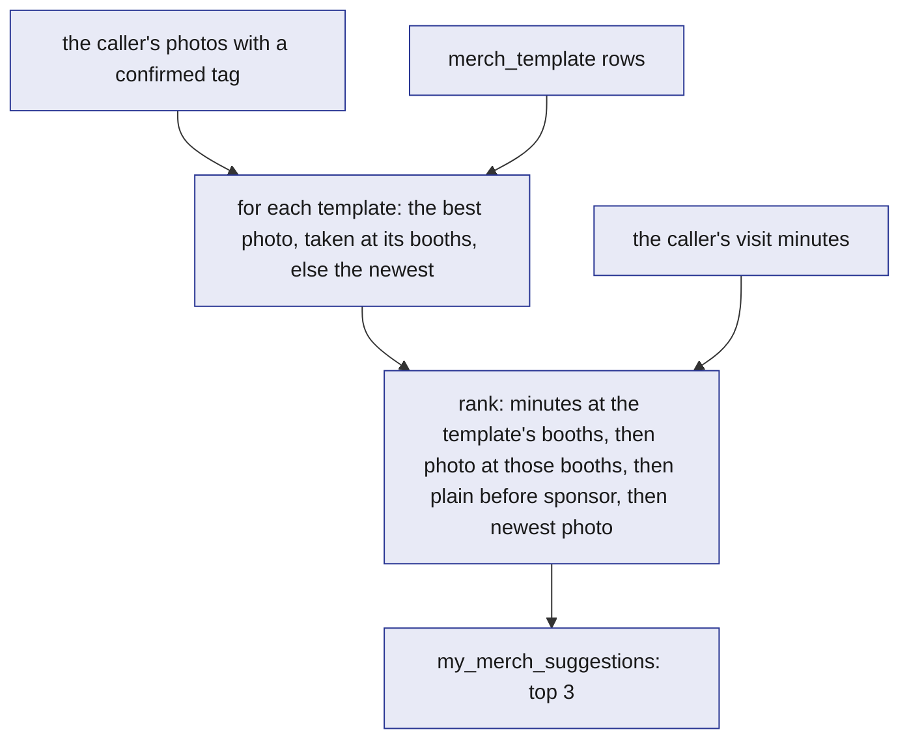
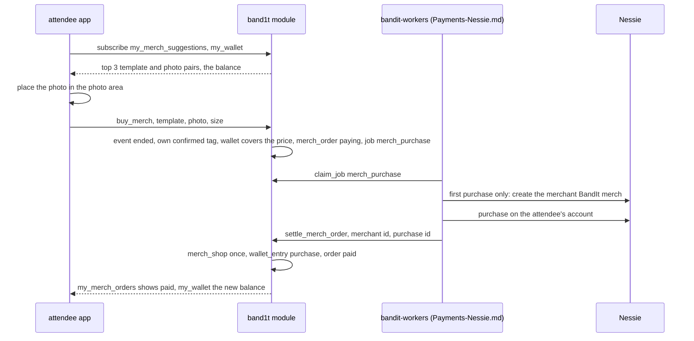
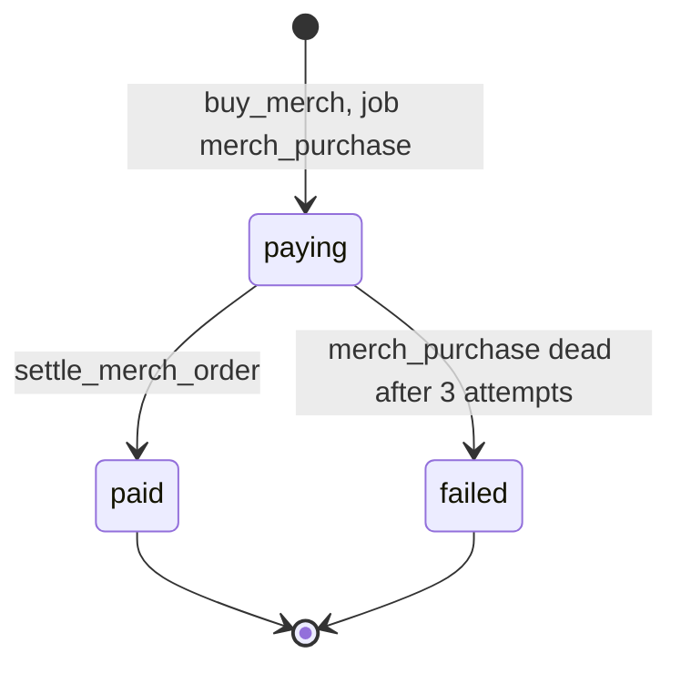

# Merch

Merch turns an attendee's own night into something they can hold. Before the event the team makes six merch templates by hand: for Cal Hacks 13.0, a plain t-shirt, mug and poster, and three that name sponsors. Each template image has a marked photo area. After the event, the bottom of the recap page suggests up to three templates, each with one of the attendee's own confirmed photos, ranked by how long they spent at the booths the template names. The app places the photo straight into the photo area. One tap buys it from the attendee's BandIt wallet. Nothing is generated: no image API, no AI and no rendering on the server. Any event loads its own templates; Cal Hacks 13.0 is the demo instance. The whole feature is optional and far from the safety loop.

## Role in the system

Responsibilities:

- Hold the templates (`merch_template`, loaded from `assets/merch/templates.json` with `load_merch_templates`), the orders (`merch_order`) and the Nessie merchant that BandIt merch is sold as (`merch_shop`).
- Suggest template and photo pairs through the view `my_merch_suggestions`.
- Take an order and its payment in one call, `buy_merch`, and finish it with `settle_merch_order` once the purchase is on Nessie.

Non-responsibilities:

- It generates no images and calls no image API. The team makes the template images by hand before the event (in an ordinary Gemini chat), and the attendee app places the photo into them.
- It renders nothing on the server and stores no merged image.
- It does not derive visits or tag photos; [Social](Social.md) does.
- It does not open wallets or call Nessie; [Payments-Nessie](../7-integrations/Payments-Nessie.md) does. Nothing is sold at the venue.
- It does not print or ship. The demo ends at a paid order.

## Interfaces

| Direction | Who | What flows | Transport |
|---|---|---|---|
| In | Project setup (role `ops` or `ingest`), after the event import | every template in `assets/merch/templates.json`, through `load_merch_templates` | SDK, before the event |
| In | Attendee app | `buy_merch` (template id, photo id, size) | SpacetimeDB TypeScript SDK |
| In | [Social](Social.md) tables | `visit` (minutes per booth), `photo` (zone and time), `photo_tag` (the caller's confirmed tags) | Module tables, read by the view and the reducer |
| In | Core tables | `booth`, `blob_ref`, `job`, `event_state`; BrightData.md: `organization`, to match sponsor names | Module tables |
| In | [Payments-Nessie](../7-integrations/Payments-Nessie.md) | the caller's wallet (`claimant_account`) and its spendable balance (`wallet_entry`) | Module tables, read by `buy_merch` |
| Out | Attendee app | The public table `merch_template`; the views `my_merch_suggestions` and `my_merch_orders` | Subscription |
| Out | Attendee app, through `bandit-api` | The template images, as static files served with the app; the photo from its `photo.url`, `/blobs/<sha256>`, served by `GET /blobs/{hash}` (access class `shared`) | HTTPS ([Rust-Backend](../3-services/Rust-Backend.md)) |
| Out | `bandit-workers` ([Payments-Nessie](../7-integrations/Payments-Nessie.md)) | The job `merch_purchase`: order id, account id, merchant id (empty before the first purchase), amount in cents, memo | `job` table |
| In | `bandit-workers` (role `worker`) | `settle_merch_order` with the job id, the merchant id and the purchase id | Reducer |

## Design

### Templates

Before the event the team makes six template images by hand. They live in `assets/merch/` with `templates.json`. For each image file, `templates.json` gives its `title`, `kind`, `sponsors` (organisation names; empty for a plain template), `width`, `height` and `photo_area` (`x`, `y`, `w`, `h` in pixels). The photo area is painted pure green (`#00FF00`) in each image, so it is easy to see while drawing, and the attendee's photo always covers it completely. The images ship with the attendee app's static files.

After the event import, the setup calls `load_merch_templates` (roles `ops`, `ingest`) once, with every template in the file. The reducer sets the price from the kind. It matches each sponsor name to the imported `organization` rows and stores the booths of those organisations as the template's `booth_ids`. It refuses a sponsor with no booth, so it runs after the import. It upserts by the image file name, so loading the file again changes nothing.

The six templates for Cal Hacks 13.0:

| Image | Title | `kind` | Sponsors |
|---|---|---|---|
| `tee.png` | Cal Hacks 13.0 tee | `tee` | none |
| `mug.png` | Cal Hacks 13.0 mug | `mug` | none |
| `poster.png` | Cal Hacks 13.0 poster | `poster` | none |
| `tee_spacetimedb.png` | SpacetimeDB tee | `tee` | SpacetimeDB |
| `mug_elastic.png` | Elastic mug | `mug` | Elastic |
| `poster_booth_crawl.png` | Booth crawl poster | `poster` | SpacetimeDB, Elastic, Bright Data, Capital One, Hyphenate, Anthropic |

Prices go by kind: a tee is 2500 cents, a mug 1800 and a poster 1500. A tee comes in S, M, L and XL; a mug and a poster in one size.

| `merch_template` field | Meaning |
|---|---|
| `id` | Assigned by SpacetimeDB |
| `name` | The image's file name, unique; the loader upserts by it |
| `title` | Display name |
| `kind` | `tee`, `mug`, `poster` |
| `price_cents` | Integer cents, USD, set from the kind |
| `image_url` | Where the attendee app's static files serve the image: `/assets/merch/<name>` |
| `width`, `height` | The image's size in pixels |
| `photo_x`, `photo_y`, `photo_w`, `photo_h` | The green photo area, in the image's pixels |
| `booth_ids` | The booths of the sponsors the template names; empty for a plain template |
| `updated_at` | The last load |

`merch_template` is a public table: it holds no personal data, and the app needs it to draw the preview.

### Suggestions

The question this diagram answers: which template and photo pairs reach the attendee, and in what order.

`my_merch_suggestions` is a per-caller view. It starts from the photos where the caller has a `confirmed` `photo_tag`. Photo tags exist only for `findable` attendees, and only the tagged person can confirm a tag ([Social](Social.md)), so the buyer is always in the photo. For each template the view picks the caller's best photo: one taken in the zone of one of the template's booths, else the newest. Then it ranks the templates:

1. The caller's minutes at the template's booths, summed over their `visit` rows there. A plain template has no booth and counts 0.
2. Then templates whose photo was taken at those booths.
3. Then plain templates before sponsor templates, so an attendee who never stopped at a sponsor booth sees the plain tee, mug and poster first.
4. Then the newest photo.

The view returns the top 3. Each row holds what the app needs to draw it: the rank, the template's id, title, kind, price, image address, size and photo area, the photo id and its `url` (`/blobs/<sha256>`), and the minutes. A typical first suggestion: the photo taken at the Elastic booth where the attendee spent 40 minutes, on `mug_elastic.png`. There is no job, no AI and no Claude. The view recomputes when a visit or a tag changes, so removing a tag takes that photo out at once.

### The preview

The merch section is the bottom of the recap page, after the space-time view and the social part ([Attendee-App](../5-apps/Attendee-App.md)). For each suggestion the app draws the template image and places the photo over the green photo area, scaled to cover the area and centred, so whatever spills over the edges is cropped and no green shows. The app scales the photo area by the drawn size over `width` and `height`. The photo comes from its `url` in the blob store, through `GET /blobs/{hash}`. The server renders nothing; an order stores the template and the photo, which is all a printer would need.

### From photo to order

The question this diagram answers: what happens between a suggestion on the recap page and a paid order.

1. **Suggest.** The recap page subscribes to `my_merch_suggestions` and shows the three previews, each with its price, next to the wallet balance from `my_wallet` ([Payments-Nessie](../7-integrations/Payments-Nessie.md)).
2. **Buy.** The attendee picks one and, for a tee, a size, and taps "Buy". In one transaction, `buy_merch` checks that the event has ended (`event_state.ended` is set, otherwise "merch opens in your recap once the event ends"), that the size fits the kind, that the caller has a confirmed tag on the photo, that the caller has a wallet (`claimant_account`), and that the wallet's spendable balance covers the price. It then writes a `merch_order` in status `paying`, with the template's price as `amount_cents`, and enqueues `merch_purchase`. From then on the order's amount is held: the spendable balance leaves it out, so a second tap cannot spend the same money.
3. **Settle.** `bandit-workers` records the purchase on the attendee's Nessie account and calls `settle_merch_order` ([Payments-Nessie](../7-integrations/Payments-Nessie.md)). The reducer rejects a stale lease, stores the merchant in `merch_shop` if it is not there yet, adds a `purchase` entry of minus the amount to `wallet_entry`, and sets the order `paid` with the Nessie purchase id.

There is no separate confirm step. The tap on "Buy" is the attendee's confirmation, and the SpacetimeAuth sign-in proves who is buying on any device.

| `merch_order` field | Meaning |
|---|---|
| `id` | Assigned by SpacetimeDB |
| `attendee` | Who ordered: the caller's identity |
| `template_id`, `photo_id` | What: the template and the photo placed in its photo area |
| `size` | S, M, L or XL for a `tee`; empty otherwise |
| `amount_cents` | The template's `price_cents`, copied by the reducer |
| `status` | `paying`, `paid`, `failed` |
| `failure` | Why the purchase failed, from the dead job |
| `nessie_purchase_id` | The Nessie purchase, once paid |
| `created_at`, `updated_at` | Timing |

`merch_shop` has one row, id 0, with `nessie_merchant_id`: the Nessie merchant "BandIt merch". `buy_merch` copies the id into the job. It is empty until the first purchase creates the merchant.

### Order status

The question this diagram answers: which states an order passes through.

When the `merch_purchase` job fails 3 times, the order becomes `failed` with the job's error, and its held amount is free again. The attendee can tap "Buy" again, which makes a new order. There is no cancel and no refund.

## Failure modes and fallbacks

| Failure | Effect | Design answer |
|---|---|---|
| No photo qualifies: no confirmed tag yet | The merch section is empty | The section says there is nothing to suggest yet and points to the photos above, where confirming a tag makes a photo eligible |
| The wallet is still opening | `buy_merch` refuses with "your BandIt wallet is still opening" | The app shows "Buy" again once `my_wallet` has a row |
| Balance too low | `buy_merch` refuses with "not enough money in your BandIt wallet" | No order and no Nessie call |
| Nessie unreachable | The order stays `paying` | The job retries, and a retry reuses a purchase with the same memo, so it never buys twice; after 3 attempts the order is `failed`, the money is free again, and the attendee can buy again |
| Two quick taps | Two orders | Each order holds its amount at once, so the wallet never spends more than it holds |

## Dependencies

**Depends on**

- [Social](Social.md): `visit`, `photo`, `photo_tag` and the confirmed-tag rule. Merch cannot run without it.
- [Payments-Nessie](../7-integrations/Payments-Nessie.md): the wallet (`claimant_account`, `wallet_entry`), its spendable balance, and the `merch_purchase` work in `bandit-workers`. Merch cannot run without it, because every order is paid from the wallet.
- [SpacetimeDB](../2-data/SpacetimeDB.md): `booth`, `blob_ref`, `job`, `event_state`.
- BrightData.md: the imported `organization` rows that sponsor names match. Without it, load only the plain templates.
- [Rust-Backend](../3-services/Rust-Backend.md): `bandit-api` serves the template images with the app and the photos through `GET /blobs/{hash}`.
- [Attendee-App](../5-apps/Attendee-App.md): the merch section at the bottom of the recap page, the preview and the "Buy" button, all run as the signed-in attendee.

**Used by**

- [Attendee-App](../5-apps/Attendee-App.md): the merch section of the recap page.
- [Payments-Nessie](../7-integrations/Payments-Nessie.md): merch is the one purchase the wallet carries; orders still `paying` are left out of the spendable balance.

**If you delete this file**

- Remove the tables `merch_template`, `merch_order` and `merch_shop`, the reducers `load_merch_templates`, `buy_merch` and `settle_merch_order`, and the views `my_merch_suggestions` and `my_merch_orders` from [SpacetimeDB](../2-data/SpacetimeDB.md); `assets/merch/` from the app's static files; and the template load from the setup.
- Remove the `merch_purchase` job and the Merch lines from [Payments-Nessie](../7-integrations/Payments-Nessie.md) and [Rust-Backend](../3-services/Rust-Backend.md); the wallet then holds only the opening and claim payouts. Remove the merch section of the recap page from [Attendee-App](../5-apps/Attendee-App.md).
- Remove the Merch.md step 8 in [Flows](../1-overview/Flows.md), the prize row in [Architecture](../1-overview/Architecture.md), the Merch.md rows in [Requirements](../1-overview/Requirements.md) and [Decisions](../1-overview/Decisions.md), the Merch lines in [BrightData](../7-integrations/BrightData.md), and the Merch row and node in [README](../README.md).

## Decisions

| Decision | Why |
|---|---|
| A few templates are made by hand before the event, each with a marked photo area; the product has no image API and generates no images | A hackathon needs only a few images, so nothing can fail or stall at demo time; any event loads its own templates |
| The photo area is painted pure green (`#00FF00`) in each image, and its rectangle is written in `templates.json` | The team sees the area while drawing, and the app needs only a rectangle, with no image analysis |
| The attendee's own photo goes straight into the photo area, scaled to cover it, drawn by the attendee app | The server renders and stores nothing; an order keeps the template and the photo |
| Suggestions are the view `my_merch_suggestions`, ranked by the caller's minutes at the template's booths, then by a photo taken at those booths, then plain templates before sponsor ones; top 3 | No job and no AI; the suggestion is instant and easy to explain: your photo, from the booth you loved; an attendee who never stopped at a sponsor booth still gets the plain tee, mug and poster |
| A sponsor template names its sponsors in `templates.json`; the loader matches them to the imported organisations and stores their booths | The team knows sponsor names, not database ids, and the booth crawl poster names six sponsors at once; merch from the booth the attendee spent time at is the Visa shopping story |
| A photo can be bought only by someone with a confirmed tag on it; there is no merch consent switch | Tags exist only for `findable` attendees and only the tagged person confirms one, so the buyer is always in the photo |
| Sizes and prices go by kind: a `tee` costs 2500 cents and comes in S, M, L and XL; a `mug` costs 1800 and a `poster` 1500, in one size | No size list to keep, and the same kind costs the same with or without a sponsor |
| One item per order, with no quantity | The demo buys one thing; a second item is a second order |
| Checkout is one tap: `buy_merch` checks the wallet, writes the order and holds its amount in one transaction, and a worker records the purchase on Nessie afterwards | No confirm screen and no payment row; the module's own balance makes the check exact, and a second tap cannot spend the same money |
| Merch is bought only from the recap page after the event, by the signed-in attendee; no counter and no band press | Nothing is paid at the venue, and the SpacetimeAuth sign-in proves who is buying on any device |
| A failed purchase fails the order and frees its money; there is no cancel and no refund | Buying again is a new order, and the demo ends at a paid order |
| Printing and shipping are out of scope | The demo ends at a paid order |
| Merch is deleted together with Social.md or Payments-Nessie.md | Every suggestion starts from a visit and a confirmed photo, and every order is paid from the wallet |
