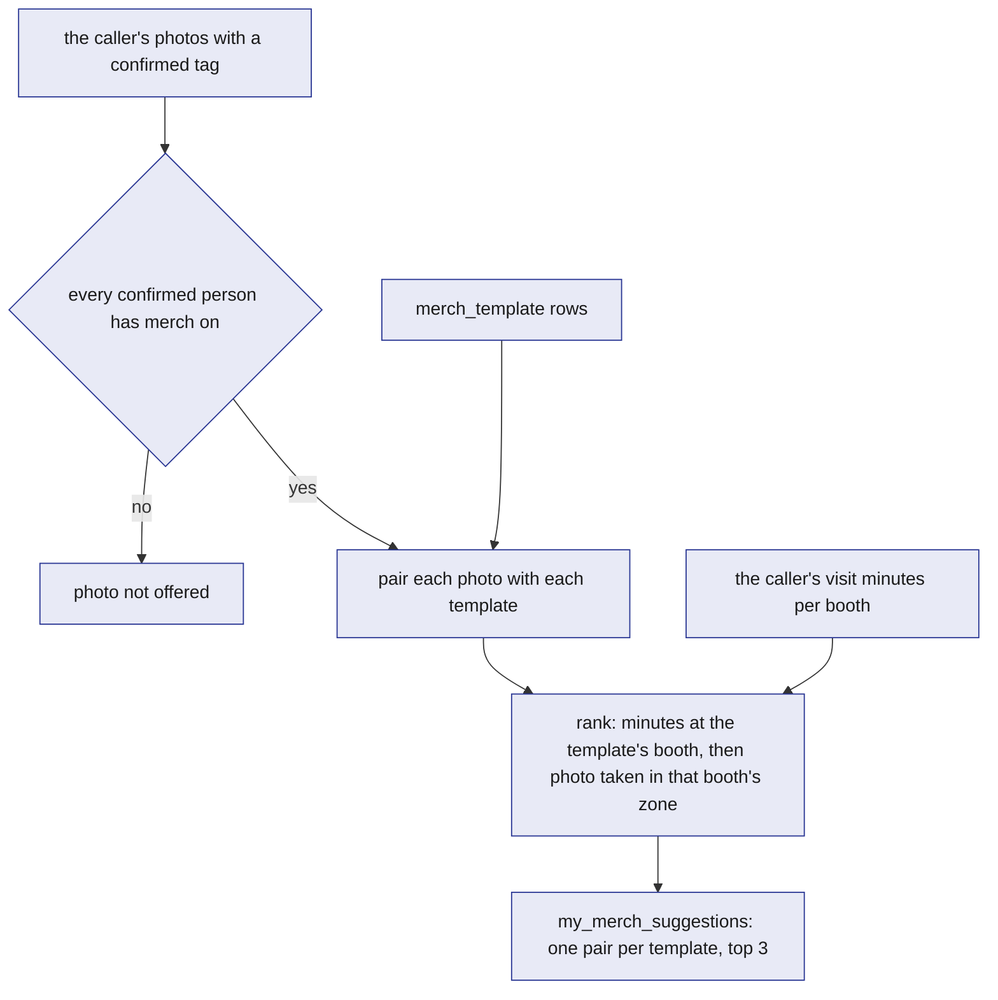
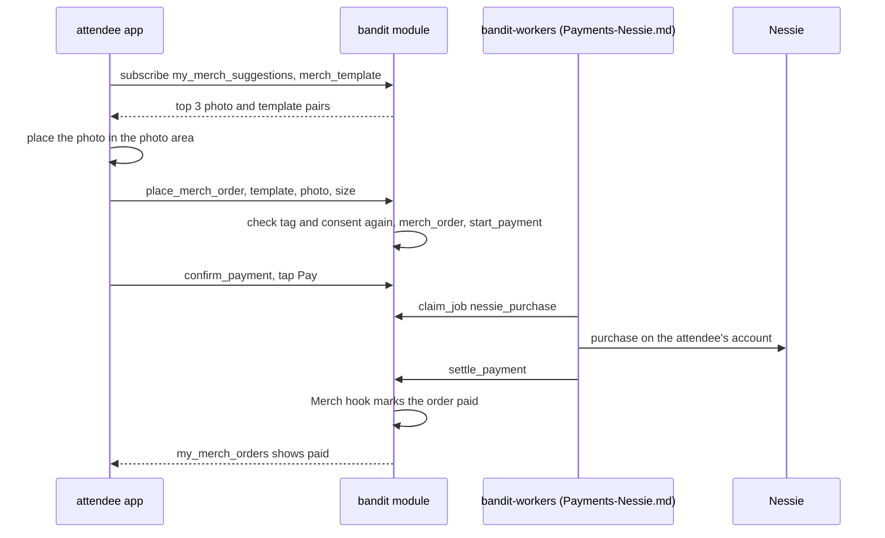
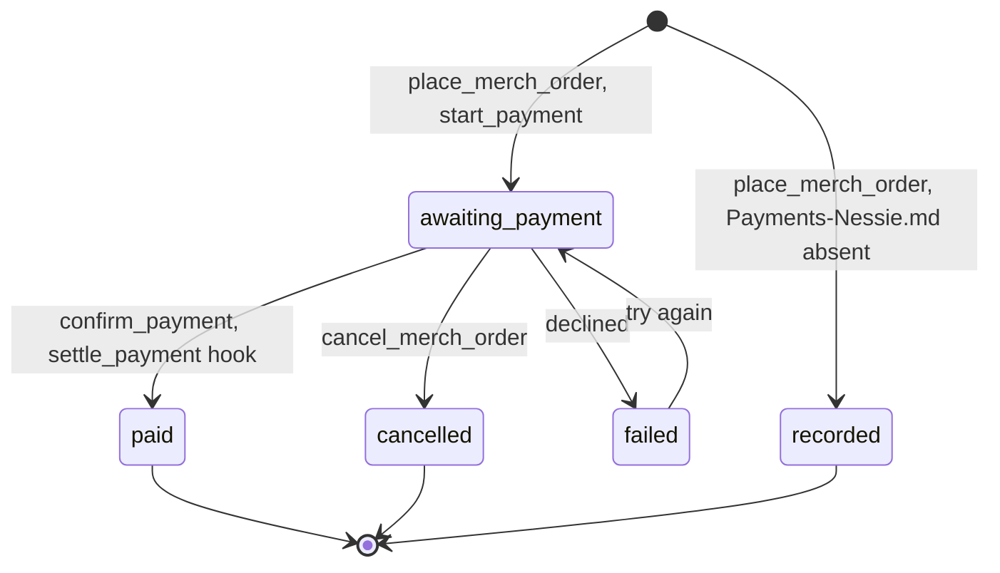

# Merch

Merch turns an attendee's own night into something they can hold. Before the event the team makes a few merch templates by hand: for Cal Hacks 13.0, a plain t-shirt, mug and poster, and three that reference a sponsor's booth. Each template image has a marked photo area. After the event, the bottom of the recap page suggests up to three pairs of one of the attendee's own confirmed photos and one template, ranked by how long they spent at the template's booth. The app places the photo straight into the photo area, and the attendee buys it there. Nothing is generated: no image API, no AI and no rendering on the server. Any event loads its own templates; Cal Hacks 13.0 is the demo instance. The whole feature is optional and far from the safety loop.

## Role in the system

Responsibilities:

- Hold the templates (`merch_template`, loaded from the event's merch seed file with `upsert_merch_template`) and the orders (`merch_order`).
- Suggest photo and template pairs through the view `my_merch_suggestions`.
- Apply the `merch` consent switch: a photo is offered only when every confirmed person in it has it on.
- Take orders with `place_merch_order` and `cancel_merch_order`.
- Payments-Nessie.md: hand checkout to [Payments-Nessie](../7-integrations/Payments-Nessie.md): paid after the event in the app, settled on Nessie; without it, orders are `recorded` with no payment.

Non-responsibilities:

- It generates no images and calls no image API. The team makes the template images by hand before the event (in an ordinary Gemini chat), and the attendee app places the photo into them.
- It renders nothing on the server and stores no merged image.
- It does not derive visits or tag photos; [Social](Social.md) does.
- It does not move money; [Payments-Nessie](../7-integrations/Payments-Nessie.md) does. Nothing is sold at the venue.
- It does not print or ship. The demo ends at a paid order.

## Interfaces

| Direction | Who | What flows | Transport |
|---|---|---|---|
| In | `bandit-ingest` seed mode (role `ingest`) | The templates from `assets/merch/` and the event's merch seed file, through `upsert_merch_template` | SDK, before the event |
| In | Attendee app | `place_merch_order` (template id, photo id, size), `cancel_merch_order` | SpacetimeDB TypeScript SDK |
| In | [Social](Social.md) tables | `visit` (minutes per booth), `photo` (zone and time), `photo_tag` (confirmed people) | Module tables, read by the view and the reducer |
| In | Core tables | `booth`, `consent`, `blob_ref` | Module tables |
| Out | Attendee app | The public table `merch_template`; the views `my_merch_suggestions` and `my_merch_orders` | Subscription |
| Out | Attendee app, through `bandit-api` | The template images, as static files served with the app; the photo bytes through the blob download (access class `shared`) | HTTPS ([Rust-Backend](../3-services/Rust-Backend.md)) |
| Out | Payments-Nessie.md | `start_payment` for the BandIt merch `merchant` row, amount in cents, `ref_kind` `merch_order`, `ref_id` the order id | Module call from `place_merch_order` |
| In | Payments-Nessie.md | The Merch hook in `settle_payment` and `fail_payment` mirrors the payment's result onto the order | Module-internal call |

## Design

### Templates

Before the event the team makes a few template images by hand. They live in `assets/merch/` with `templates.json`, which gives each image its `width`, `height` and `photo_area` (`x`, `y`, `w`, `h` in pixels). The photo area is painted pure green (`#00FF00`) in each image, so it is easy to see while drawing, and the attendee's photo always covers it completely. The images ship with the attendee app's static files. `bandit-ingest` seed mode loads each template with `upsert_merch_template` (roles `ingest`, `ops`): the image, its size and its photo area from `templates.json`, and the name, kind, price and, for a sponsor template, the sponsor's booth number from the event's merch seed file. The reducer upserts by name like the other setup reducers, so re-running the seed changes nothing, and it stores the booth number as that booth's `booth_id`.

The six templates for Cal Hacks 13.0:

| Image | `kind` | Booth | Suggested by |
|---|---|---|---|
| `tee.png` | `tee` | none | the photo alone |
| `mug.png` | `mug` | none | the photo alone |
| `poster.png` | `poster` | none | the photo alone |
| `tee_spacetimedb.png` | `tee` | the SpacetimeDB sponsor booth | minutes at that booth |
| `mug_elastic.png` | `mug` | the Elastic sponsor booth | minutes at that booth |
| `poster_booth_crawl.png`, a booth crawl poster | `poster` | the sponsor booth it names | minutes at that booth |

Prices go by kind: a tee is 2500 cents, a mug 1800 and a poster 1500. A tee comes in S, M, L and XL; a mug and a poster in one size.

| `merch_template` field | Meaning |
|---|---|
| `id` | Assigned by SpacetimeDB |
| `name` | Display name, unique; the seed upserts by it |
| `kind` | `tee`, `mug`, `poster` |
| `price_cents` | Integer cents, USD |
| `image_url` | Path of the template image among the attendee app's static files, for example `assets/merch/mug_elastic.png` |
| `width`, `height` | The template image's size in pixels, from `templates.json` |
| `photo_area` | `x`, `y`, `w`, `h`: the green rectangle in the image's pixels, from `templates.json` |
| `booth_id` | Optional: the sponsor booth the template references; empty for a plain template |

`merch_template` is a public table: it holds no personal data, and the app needs it to draw the preview.

### Suggestions

The question this diagram answers: which photo and template pairs reach the attendee, and in what order.

`my_merch_suggestions` is a per-caller view. It takes the photos where the caller has a `confirmed` `photo_tag` and keeps a photo only if every person with a confirmed tag on it has `merch` on. It pairs each kept photo with each template and ranks the pairs:

1. The caller's minutes at the template's booth, summed over their `visit` rows at that booth. A plain template has no booth and counts 0, so it is suggested by the photo alone and fills the places the sponsor templates leave.
2. Then pairs whose photo was taken in that booth's zone.
3. Then the newest photo.

Each template appears once, with its best photo, and the view returns the top 3. A typical first suggestion: the photo taken at the Elastic booth where the attendee spent 40 minutes, on `mug_elastic.png`. The view returns the template id, the photo id, the photo's blob id, the minutes and the rank. There is no job, no AI and no Claude: the view recomputes when a visit, a tag or a consent switch changes, so turning `merch` off takes a photo out of everyone's suggestions at once.

### The preview

The merch section is the bottom of the recap page, after the space-time view and the social part ([Attendee-App](../5-apps/Attendee-App.md)). For each suggestion the app draws the template image and places the photo over the green photo area, scaled to cover the area and centred, so whatever spills over the edges is cropped and no green shows. The app scales `photo_area` by the drawn size over `width` and `height`. The photo comes from the blob download. The server renders nothing; an order stores the template and the photo, which is all a printer would need.

### From photo to order

The question this diagram answers: what happens between a suggestion on the recap page and a paid order.

1. **Suggest.** The recap page subscribes to `my_merch_suggestions` and `merch_template` and shows the three previews.
2. **Order.** The attendee picks one and, for a tee, a size. `place_merch_order` checks that the caller has a confirmed tag on the photo, that every confirmed person in it has `merch` on, and that the size fits the kind. It writes a `merch_order` with the template's price as `amount_cents`.
3. **Pay.** Payments-Nessie.md: `place_merch_order` calls `start_payment` with `ref_kind` `merch_order` and the order id, and the order is `awaiting_payment`. The attendee taps "Pay" in the session the recap link opened, and the app calls `confirm_payment`. The worker checks the balance and records the purchase on Nessie. When `settle_payment` moves the payment to `paid`, its Merch hook runs the `confirm_merch_order` logic, which checks the payment row and the amount and sets the order `paid` ([Payments-Nessie](../7-integrations/Payments-Nessie.md)). Without Payments-Nessie.md, `place_merch_order` sets the order `recorded`.

| `merch_order` field | Meaning |
|---|---|
| `id` | Assigned by SpacetimeDB |
| `attendee_id` | Who ordered |
| `template_id`, `photo_id` | What: the template and the photo placed in its photo area |
| `size` | S, M, L or XL for a `tee`; empty otherwise |
| `amount_cents` | The template's `price_cents`, copied by the reducer |
| `status` | `awaiting_payment`, `paid`, `recorded`, `cancelled`, `failed` |
| `payment_id` | The [Payments-Nessie](../7-integrations/Payments-Nessie.md) `payment` row |
| `created_at`, `updated_at` | Timing |

### Order status

The question this diagram answers: which states an order passes through.

`cancel_merch_order` sets the order `cancelled` and cancels its pending payment. Payments-Nessie.md: its worker checks the account balance before the purchase and declines when it is short, which sets the order `failed`. "Try again" calls `place_merch_order` with the same template and photo; the reducer reuses the caller's `failed` order for them and starts a new payment. A `recorded` order is a real order with no payment attached, which is how the demo runs when Payments-Nessie.md is deleted.

## Failure modes and fallbacks

| Failure | Effect | Design answer |
|---|---|---|
| No photo qualifies: no confirmed tag yet, or someone in each photo has `merch` off | The merch section is empty | The section says there is nothing to suggest yet and points to the photos above, where confirming a tag makes a photo eligible |
| A person in a photo turns `merch` off after the page loaded | The photo could be ordered without their agreement | `place_merch_order` checks consent again and refuses; orders placed before stay as they are |
| Payment declined (balance short) | Order `failed` | The app says why; "Try again" starts a new payment for the same order |

## Dependencies

**Depends on**

- [Social](Social.md): `visit`, `photo`, `photo_tag` and the confirmed-tag rule. Merch cannot run without it.
- [SpacetimeDB](../2-data/SpacetimeDB.md): `booth`, `consent`, `blob_ref`; the seed mode of `bandit-ingest`.
- [Rust-Backend](../3-services/Rust-Backend.md): `bandit-api` serves the template images with the app and the photos through the blob download.
- [Attendee-App](../5-apps/Attendee-App.md): the merch section at the bottom of the recap page, the preview and the order screen; the recap link that opens the page as the attendee's own identity.
- Payments-Nessie.md: checkout confirmed in the app and settled on Nessie. Without it, orders are `recorded`.

**Used by**

- [Attendee-App](../5-apps/Attendee-App.md): the merch section of the recap page.
- [Payments-Nessie](../7-integrations/Payments-Nessie.md): merch is the one purchase it carries; the merch `merchant` row names the Nessie merchant, a `payment` with `ref_kind` `merch_order` points here through `ref_id`, and its `settle_payment` and `fail_payment` carry the Merch hook.

**If you delete this file**

- Remove the tables `merch_template` and `merch_order`, the Merch reducers (including `upsert_merch_template`) and the views `my_merch_suggestions` and `my_merch_orders` from [SpacetimeDB](../2-data/SpacetimeDB.md), the merch seed file from `bandit-ingest` seed mode, and `assets/merch/` from the app's static files.
- Remove the `merch_order` `ref_kind` value, the Merch hooks and the merch `merchant` row from [Payments-Nessie](../7-integrations/Payments-Nessie.md), which then keeps only claim payouts; the `merch` consent line from [Social](Social.md); and the merch section of the recap page from [Attendee-App](../5-apps/Attendee-App.md).
- Remove the `merch` consent switch from [SpacetimeDB](../2-data/SpacetimeDB.md) and [Attendee-App](../5-apps/Attendee-App.md); nothing else reads it.
- Remove the Merch.md step 8 in [Flows](../1-overview/Flows.md), the prize row in [Architecture](../1-overview/Architecture.md), the Merch.md rows in [Requirements](../1-overview/Requirements.md) and [Decisions](../1-overview/Decisions.md), the Merch lines in [BrightData](../7-integrations/BrightData.md), and the Merch row and node in [README](../README.md).

## Decisions

| Decision | Why |
|---|---|
| A few templates are made by hand before the event, each with a marked photo area; the product has no image API and generates no images | A hackathon needs only a few images, so nothing can fail or stall at demo time; any event loads its own templates from its seed |
| The photo area is painted pure green (`#00FF00`) in each image, and its rectangle is written in `templates.json` | The team sees the area while drawing, and the app needs only a rectangle, with no image analysis |
| The attendee's own photo goes straight into the photo area, scaled to cover it, drawn by the attendee app | The server renders and stores nothing; an order keeps the template and the photo |
| Suggestions are the view `my_merch_suggestions`, ranked by the caller's minutes at the template's booth and then by whether the photo was taken in that booth's zone; one pair per template, top 3 | No job and no AI; the suggestion is instant and easy to explain: your photo, from the booth you loved |
| A sponsor template carries its sponsor's booth (`booth_id`), named in the seed by booth number; a plain template has no booth and is suggested by the photo alone | Merch from the booth the attendee spent time at is the Visa shopping story; the plain tee, mug and poster mean every attendee with a photo gets suggestions; booth ids are assigned by the database, booth numbers are what the team knows |
| A photo is offered only if every confirmed person in it has `merch` on, and `place_merch_order` checks it again | Everyone on a printed photo agreed to it; the reducer check covers a switch turned off after the page loaded |
| Sizes and prices go by kind: a `tee` costs 2500 cents and comes in S, M, L and XL; a `mug` costs 1800 and a `poster` 1500, in one size | No size list to keep in the seed, and the same kind costs the same with or without a sponsor |
| One item per order, with no quantity | The demo buys one thing; a second item is a second order |
| Merch is paid only after the event, from the recap page, with `confirm_payment` in the session the recap link opened, and settled on Nessie; no counter and no band press | Nothing is paid at the venue, and after the event the bands are returned |
| Printing and shipping are out of scope | The demo ends at a paid order |
| Merch is deleted together with Social.md | Every suggestion starts from a visit and a confirmed photo |
| The `merch` consent switch goes when this file goes | No other file reads it |
