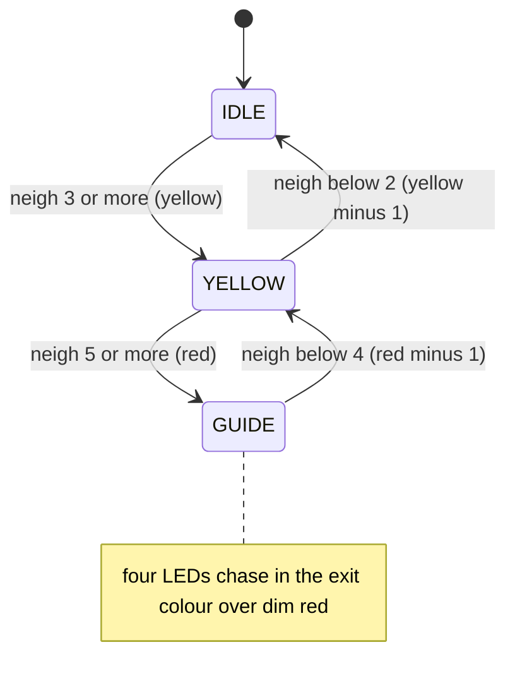
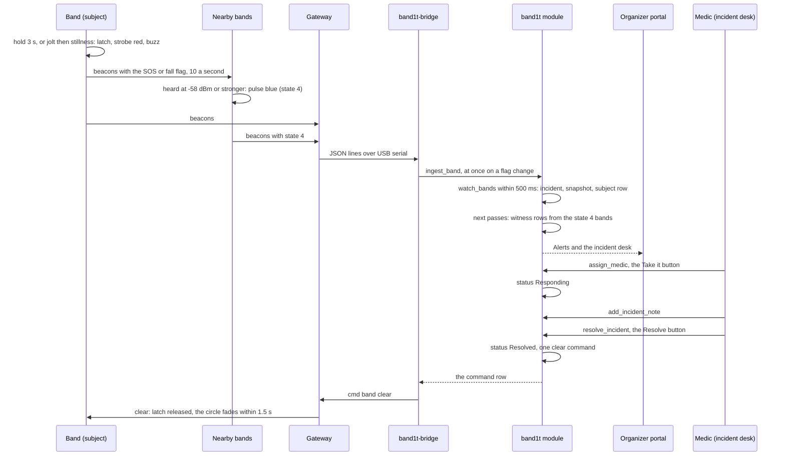
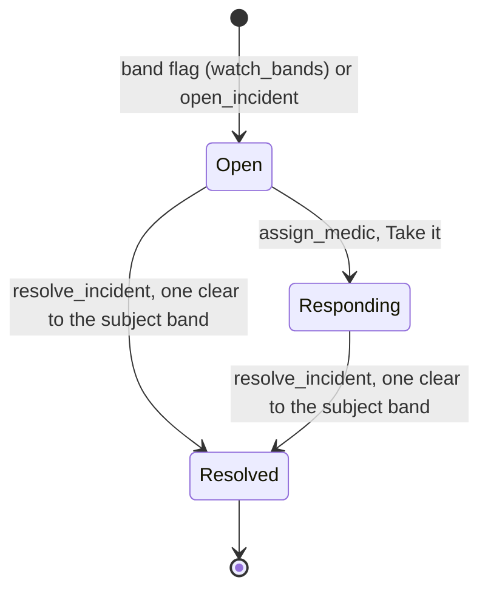

# Safety

Safety is the set of behaviours that keep a crowd from crushing anyone and get help to an attendee who falls or calls for it. Crowd crushes are preceded by measurable density for minutes before anyone is hurt, and a person on the ground needs the people around them to notice before any medic arrives.

So the first reaction happens on the band itself, with the module out of the loop: each band shows how crowded it is around it, a band that calls for help strobes red, and the bands around it pulse blue. The `band1t` module records what the bands report, opens an incident for every SOS and fall, and lets a medic take it, note it and resolve it. Organizers send every other command to the bands by hand, one row at a time.

The station markers stand at the exits, and each exit marker glows its exit's colour. Sending each band its exit colour, and opening space for a medic, are Leo's designs at the end of this file (TBD -- LEO).

## Role in the system

Responsibilities:

- Define what a band does alone: its density colour, the light circle, SOS, fall and the press.
- Define how `watch_bands` opens `sos` and `fall` incidents from band rows, what the snapshot freezes and which bands count as witnesses.
- Define how a medic takes, notes and resolves an incident, and what resolving sends.
- Define low visibility, the Live tab's level, calibration, the override and the forced states, as built.
- Define where the exit markers stand and how a band's colour leads to its nearest door.
- (TBD -- LEO) Define exit routing and the medic approach.
- State what keeps working when the venue laptop, `band1t-bridge` or the module is out of reach.

Non-responsibilities:

- The band's firmware, its thresholds and its radio are in [Hardware](../4-devices/Hardware.md). This file relies on them.
- How beacons become reducer calls, and `command` rows become radio commands, is in [Gateway-Bridge](../3-services/Gateway-Bridge.md).
- Tables and reducers are defined in [SpacetimeDB](../2-data/SpacetimeDB.md); this file specifies the behaviour they carry.
- The staff screens are in the [organizer portal](../5-apps/Organizer-Portal.md) (/organizer); medics work in its incident desk.
- Medical-Card.md: the medical card.
- Insurance.md: claims and evidence.
- Vision.md (TBD -- LEO): what the security cameras and the security view do. This file states only where the camera count shows.

## Interfaces

| Direction | Counterpart | What flows | Tables or reducers | Transport |
|---|---|---|---|---|
| In | `band1t-bridge` | per radio band: state, flags, `neigh`, `zone`, battery; per station marker: its colour; every heard list | `band`, `station`, `link` through `ingest_band`, `ingest_station`, `ingest_heard` | reducer |
| In | Test-Bands.md: the `bandit-claims` tool and `bandit-api`'s dev routes | the same fields for the test bands 90 to 99 | `band` through `report_test_band` ([Test-Bands](../3-services/Test-Bands.md)) | reducer |
| In | Venue import | each zone's station marker, centre, area, capacity and exit colour | `zone` through `import_event`; `set_zone_station` | reducer |
| In | Organizers (`ops`), Live tab | low visibility on or off | `set_low_vis` | TypeScript SDK |
| In | Medics and organizers, incident desk | take, note and resolve | `assign_medic` (role `medic`); `add_incident_note`, `resolve_incident` (roles `ops`, `medic`) | TypeScript SDK |
| In | Organizers (`ops`), SpacetimeDB command line | starting the watch, thresholds, RSSI, override, forced states, `clear`, exit colours | `start_safety_watch`, `set_thresholds`, `set_rssi`, `set_override`, `force_state`, `clear`, `set_exit`, `send_command` | SpacetimeDB command line |
| In | Vision.md: the `vision` role | property events and a camera sighting per incident, judged with the Anthropic Claude API | `report_property_event`, `submit_vision_assessment` ([Vision](../4-devices/Vision.md)) | reducer |
| In | Vision.md (TBD -- LEO): `bandit-vision` | a people count per security camera's zone | `report_zone_count` | reducer |
| Out | `band1t-bridge` | each one-shot command, once | `command` | subscription, then one gateway line |
| Out | Organizer portal | bands, station markers, the gateway and the thresholds; open incidents and their notes | `band`, `station`, `gateway`, `settings`, `open_incidents`, `board_notes` | subscription |
| Out | Insurance.md | the resolved incident with its snapshot, witnesses and notes | the claim hook inside `resolve_incident` | in the module |

## Design

### Three layers, three speeds

| Layer | Decides | Latency | Keeps working without |
|---|---|---|---|
| Band (firmware) | its density colour (IDLE, YELLOW, GUIDE), SOS strobe and buzz, fall detection, joining the light circle, the low-visibility chase | under one beacon interval, about 100 ms | the venue laptop, the gateway and the module |
| `band1t` module (`ingest_band`, `watch_bands`) | the latest row per band, incidents, snapshots, witnesses | `band1t-bridge` forwards a changed flag at once, and `watch_bands` runs every 500 ms | the organizer portal and every phone |
| Staff (Live tab, incident desk, SpacetimeDB command line) | take, note and resolve; low visibility; thresholds, override, forced states, exit colours | human | nothing the bands do depends on them |

The band's precedence order matters for everything below. From the firmware, highest first: IDENT, SOS (the SOS or fall latch), PAID, PAY, FOUND_ME, FIND, CONNECT, the light circle (NEAR_SOS), a forced state, the override (shows IDLE), and the density state.

So a forced state from staff never hides an SOS or a light circle. BandIt never sets PAID, PAY or CONNECT.

### Density and the light circle, on the band

Every 250 ms a band counts the bands (ids 1 to 99) it heard in the last 2 s at a fast-averaged RSSI at or above the neighbour threshold (`neigh_rssi`, -62 dBm by default). `neigh` is a running average of that count, 0.7 of the old value plus 0.3 of the new one, rounded, and every beacon carries it. The density state follows `neigh` with hysteresis against the yellow and red counts (3 and 5 by default).

This diagram answers: how a band's ring moves between green, amber and red, and what stops it flickering.

IDLE breathes green, YELLOW is solid amber, and GUIDE chases four LEDs in the band's exit colour, 80 ms per LED, over dim red. The checks run in that order every 250 ms, so a band can go from IDLE to GUIDE in one step. A band boots with exit colour 1 (blue) and keeps a colour it is sent until it reboots ([Hardware](../4-devices/Hardware.md)).

**The light circle.** A band that hears another band's beacon carrying the SOS or fall flag at -58 dBm or stronger (`circle_rssi`) pulses blue (NEAR_SOS, state 4) until 1.5 s after the last such beacon. It takes no command and gives no buzz.

The module only sees state 4 in the beacons. The circle marks the attendee in trouble for the attendees around them and for the medic walking in.

### SOS, fall and press

- **SOS.** Holding the button 3 s latches SOS: the ring strobes red (125 ms on, 125 ms off), a band with a motor plays the SOS pattern, and every beacon carries the SOS flag.
- **Fall.** A band with the motion sensor reads it every 20 ms. A jolt above 2.8 g, then a total within 0.2 g of 1 g for 1.5 s, all inside 3.5 s, latches a fall: the same red strobe and SOS buzz, with the fall flag.
- **Cancel.** Holding 3 s again clears the latch, so the attendee can cancel. A latch otherwise ends only with a `clear`, sleep or a reboot. The module logs `SosCleared`, and the incident stays open until staff resolve it.
- **Press.** A short press sets the press flag for 1 s, with a short buzz. `ingest_band` logs it as a `Press` event, and its only use is to complete a band claim on the [tap page](../5-apps/Tap-Page.md) (/t/code).

### Incidents: `watch_bands`

`ingest_band` stores each band's latest row and logs `SosRaised` and `Fall` on the rising edge; it opens nothing itself ([SpacetimeDB](../2-data/SpacetimeDB.md)). `band1t-bridge` forwards a band's line at once when its flags change ([Gateway-Bridge](../3-services/Gateway-Bridge.md)). `watch_bands` runs every 500 ms, once an organizer has started it with `start_safety_watch`, and reads the online bands with ids 1 to 99:

1. A band with the SOS or fall flag that is already the subject of an open incident refreshes that incident's `last_signal_at`.
2. Otherwise, if one of that band's incidents was resolved less than 10 s ago, nothing happens: the `clear` is still on its way.
3. Otherwise it opens an incident: kind `fall` when the fall flag is set, else `sos`; `station_id` the band's `zone`; `zone_id` the zone with that station id, or 0 when the band heard no station marker, so an SOS always opens an incident; `opened_by` `band`. In the same transaction it freezes the `incident_snapshot` (the band's state, flags, `neigh` and battery; the online bands in that station marker's zone and their mean `neigh`; every band showing the light circle) and adds the band as the `subject` row in `incident_band`.
4. Every online band in state 4 becomes a `witness` of the newest open band incident in its own zone, or else of the newest one anywhere, with the subject's RSSI as the witness heard it (from `link`). A witness already on the incident gets its `last_seen_at` extended, so the circle's duration is recorded.

Test-Bands.md: the test bands 90 to 99 go through the same steps. The crowd's bands, from 100, never open an incident, never appear in a snapshot and are never witnesses ([Test-Bands](../3-services/Test-Bands.md)).

A forced state 3 from the command line shows the red strobe without the flag, so it opens no incident. Flags from an offline band are ignored.

### Take it, notes and Resolve

The Live tab lists every present band with SOS or fall under "Alerts", as "SOS on band <code> (<name>) in <zone>: the bands around it show the light circle.", together with each open incident ([Organizer-Portal](../5-apps/Organizer-Portal.md)). The incident desk, under "Open incidents", shows each incident from `open_incidents` with its zone, band, status, open time and who opened it, and its notes from `board_notes`. Medics do not wear bands; the blue ring in the venue is what the medic walks toward.

- **Take it.** A medic presses "Take it" on an `Open` incident. `assign_medic` sets the status to `Responding` and `assigned_medic` to the caller. Organizers do not assign medics, and a second medic who presses it takes the incident over.
- Medical-Card.md: "Tap band <code> for the medical card" calls `request_medical_card`, which logs the read with the open incident, and the card shows on the desk.
- **Notes.** "Treatment note", "Cost in dollars (optional)" and "Add note" call `add_incident_note`, which records the author's role and the cost in cents.
- **Resolve.** "Resolve" (an organizer or a medic) calls `resolve_incident` with the resolution "treated on site". It sets the status to `Resolved` and writes one `clear` command to the subject band, which releases the SOS and fall latch, any forced state and the light circle on that band. The witness rows, the snapshot and the notes stay.
- Test-Bands.md: a test band gets no `clear`, so if it still reports the flag 10 s after the resolve, a new incident opens.
- Insurance.md: `resolve_incident` ends with the claim hook. An `sos` or `fall` incident with at least one note, or a `property` or `theft` incident with a note whose cost is above 0, opens a claim; when it qualifies and no `insurance_policy` row exists, the resolve fails and rolls back ([Insurance](Insurance.md)).

**Property incidents.** `open_incident` (roles `ops`, `medic`) opens one by hand with kind `property`, a zone and a note, with the same snapshot. No page calls it.

Test-Bands.md: `bandit-claims property` calls it, and the Bands tab's "Speaker breaks in <zone>" runs that command.

Vision.md: `report_property_event` with no incident opens one in the camera's zone with `opened_by` `vision`. `report_camera_sighting` (the security view's sighting of a band's SOS flash) and `submit_vision_assessment` set the incident's `vision_status` to `confirmed` or `not_confirmed`.

This diagram answers: what happens, in order, from a fall to the medic resolving it.

This diagram answers: which statuses an incident passes through and what moves it.

### Low visibility, as built

In fire or smoke, an organizer presses "Low visibility: guide everyone to the exits" on the Live tab and confirms "Fire or smoke? Every band starts guiding its wearer to the exit." `set_low_vis(true)` stores `settings.low_vis` and sends `lowvis 1` to every band (target 0), and each band saves it. The tab then reads "Low visibility is on: every band guides its wearer to the exit colour of its zone." with a "Turn it off" button, which calls `set_low_vis(false)` and sends `lowvis 0`.

In the firmware, low visibility only changes a band that is already in GUIDE: its chase speeds up as it hears the exit marker glowing its exit colour louder, from 160 ms per LED at -85 dBm or weaker to 40 ms at -45 dBm or stronger (80 ms when it hears no such exit marker), and a band with a motor gives the guide pulse every 2 s. A band that is not crowded stays green, and the station markers ignore `lowvis`. Exit routing (TBD -- LEO) adds the forced GUIDE that sends everyone out.

### The Live tab's level

The Live tab's zone table shows a level per zone, computed in the browser: the mean `neigh` of the present bands whose `zone` is the zone's station id, "very busy" at `settings.red` or more, "busy" at `settings.yellow` or more, otherwise "calm". It uses the same thresholds the bands use, with no hysteresis and no module tick. The status line says "A zone is busy when its bands have <yellow> other bands close by on average, very busy at <red>."

The table also shows "People now", "Hardware and test bands", "Capacity", "Exit" and "Station" ([Organizer-Portal](../5-apps/Organizer-Portal.md)). Each ring follows its own count, so a ring can turn red before its zone's average does.

Test-Bands.md: every 2 s, `crowd_tick` gives each crowd band (from 100) the number of bands within 1.5 m as its `neigh`, and a state 0 to 2 with the firmware's hysteresis against `settings.yellow` and `settings.red`. So the crowd's dots on the Live tab's map show calm, busy and very busy, and the crowd counts in each zone's level.

Vision.md (TBD -- LEO): the camera count for a zone shows in the zone table next to the bands' own average.

### Calibration

Calibration happens in the venue before doors open, with nine attendees wearing bands and the gateway on the venue laptop, before `band1t-bridge` starts. `firmware/tools/gateway_monitor.py --label <name>` logs the gateway's lines for each of three runs: `spread` (the attendees about 2 m apart), `sq15` (all inside a 1.5 m taped square) and `sq12` (all inside a 1.2 m taped square).

`firmware/tools/calibrate.py` reads the logs and suggests the neighbour RSSI threshold that separates the three runs best, a circle threshold 4 dB stronger, and the yellow and red counts. The spread run stays below yellow, the 1.5 m square reaches yellow, and the 1.2 m square reaches red.

Once `band1t-bridge` runs, an organizer sets the values with `set_rssi` and `set_thresholds`. Both store them in `settings` and send `rssi` and `thresh` to every band (target 0), and each band saves them. When no threshold separates the runs, `calibrate.py` says so, and the team runs the override and forced states by hand (below).

### The override and forced states, run by hand

Organizers send these from the SpacetimeDB command line; no page has a control for them. Each call writes one `command` row, which `band1t-bridge` sends once. Target 0 reaches every band and no station marker; target 100 reaches every station marker and no band.

- `set_override(on)` stores `settings.override_density` and sends `override 1` or `0` to every band. A band with the override on shows IDLE (green) instead of its density state. It is not saved, so a band that reboots drops it.
- `force_state(target, state, tenths)` sends `state`. A band forces that state for `tenths` tenths of a second, or with no end at 0; states 7 and 8 start the CONNECT and IDENT timers instead. A station marker takes 0 (breathe), 1 (chase), 2 (strobe) and 9 (off), with no end.
- `clear(target)` sends `clear`. A band releases its SOS and fall latch, any forced state and the light circle; a station marker goes back to breathe. A `clear` to target 0 releases every SOS in the venue, so to hand the bands back without touching an SOS, an organizer forces state 0 for one tenth of a second on target 0.
- `set_exit(target, colour)` sends `exit`. A band takes that exit colour until it reboots; an exit marker glows it and saves it.

**When neighbour counting is unstable in the venue**, an organizer turns the override on, so the rings stay green, and forces GUIDE or YELLOW on the bands by hand with `force_state`. SOS, fall and the light circle are unaffected, because they rank above both. The team tells the judges when the override and forced states are in use.

### Exit markers

Every station marker stands at an exit of the venue, where it works as an exit marker and glows that exit's colour. Each zone has exactly one station marker (`zone.station_id`) and one exit colour (`zone.exit_colour`, 1 to 6), and the zone's exit marker glows that colour.

A band's zone is the station id it hears loudest, the zone pick ([Hardware](../4-devices/Hardware.md)): every 250 ms, the station marker with the strongest signal in the last 3 s. So a band's zone is the one around its nearest door, its zone's exit is its nearest exit, and "follow your colour" leads to the nearest door.

Built today:

- The station markers beacon every 200 ms in every mode, and glow: breathe by default (the colour over 3 s), and chase, strobe and off on `state` 1, 2 and 9. A station marker boots in breathe.
- An exit marker saves its colour. Until it is sent `exit`, it glows its own default, its station id minus 100: 101 blue, 102 magenta, 103 cyan, 104 white, 105 orange.
- `station.exit_colour` is the colour a station marker's beacon reports, written by `ingest_station`.
- `zone.exit_colour` comes from the venue import (the team's station marker plan, `zones.json`) and fills the Live tab's "Exit" column. Today the plan gives one only to Entrance and concierge (1, blue, which exit marker 101 already glows) and Main stage (2, magenta, while exit marker 104 glows white until it is sent `exit 2`); the other zones show "none".
- An organizer can set a band's or an exit marker's colour with `set_exit` from the SpacetimeDB command line. Nothing sends a zone's exit colour to its bands or its exit marker automatically; that is exit routing, below (TBD -- LEO).
- In GUIDE a band chases its exit colour, and under low visibility its chase speeds up as it hears the exit marker glowing that colour louder (40 ms per LED at -45 dBm, 160 ms at -85 dBm), and a band with a motor pulses every 2 s. This is how the firmware already homes an attendee in on the door.
- If a station marker loses power, `sweep` marks its `station` row offline after 5 s, the Live tab's "Station" column shows it offline, and its bands hear the next-loudest station marker, so they report the next-nearest door's zone.

This diagram answers: how a band's colour leads its attendee to the nearest door.

```mermaid
flowchart LR
  A["band hears the station markers"] --> B["loudest station marker: the band's zone"]
  B --> C["that zone's exit_colour"]
  C --> D["exit command to the band (TBD -- LEO)"]
  D --> E["GUIDE chases that colour"]
  E --> F["low visibility: faster chase and a pulse as that exit marker gets louder"]
  F --> G["the exit marker at the door, glowing the same colour"]
  classDef device fill:#FFF3E0,stroke:#E65100,color:#1A1A1A
  classDef stdb fill:#E8EAF6,stroke:#283593,color:#1A1A1A
  classDef tbd fill:#F5F5F5,stroke:#757575,color:#1A1A1A,stroke-dasharray:5 5
  class A,B,E,F,G device
  class C stdb
  class D tbd
```

### Exit routing (TBD -- LEO)

Leo's design for sending the exit colours, built on the code's names. Every command goes through the `command` table, like every command today.

- **Exit marker colours.** At setup each zone's exit marker is sent its zone's `exit_colour` (`exit` to its station id), and the exit marker saves it.
- **Band colours.** When a band's zone changes, and when it comes back online (it forgets its colour on reboot), the module sends it its zone's `exit_colour`.
- **Low visibility.** Turning it on also forces GUIDE on every band (`state` 2 to target 0, with no end) and sets every exit marker to chase (`state` 1 to target 100), so everyone follows their colour to the nearest door. Turning it off forces state 0 for a tenth of a second on target 0, which hands each band back to its density colour, and sets the exit markers back to breathe (`state` 0 to target 100).
- **Dispersion.** When a zone's bands average at or above `settings.red`, the module sends that zone's bands the exit colour of the nearest zone (by distance between zone centres on the plan) whose bands average below `settings.yellow`, and that zone's exit marker chases. When the crowded zone drops below `settings.yellow`, its bands get their own colour back and the exit marker breathes.
- **A blocked door.** An organizer turns its exit marker off (`state` 9 to its station id) and marks the zone's exit closed. Routing then sends that zone's bands the colour of the nearest open zone.

### Medic approach (TBD -- LEO)

The medic who took the incident taps, on the incident desk, the zone they come in from. The bands in the incident zone that are neither the subject nor a witness (`incident_band`) are forced to GUIDE and sent the exit colour of the nearest other zone that is not the medic's entry zone, and that zone's exit marker chases, so attendees move toward a side door while the medic walks in through theirs.

The subject keeps SOS and the witnesses keep the blue light circle, because the band's precedence puts both above a forced state. When the incident resolves, those bands get state 0 for a tenth of a second and their own exit colour back.

### What keeps working when something is down

| Down | Still works | Lost | Design answer |
|---|---|---|---|
| The venue laptop, the gateway or `band1t-bridge` | density colours, SOS strobe and buzz, fall detection, the light circle, and the saved thresholds and low visibility on each band | new band rows, incidents and commands | `sweep` marks the bands, station markers and gateway offline after 5 s, which the Live tab shows; the team restarts `band1t-bridge` |
| The venue laptop's link to SpacetimeDB Maincloud | everything on the bands | every module row and screen | `band1t-bridge` exits on the disconnect; the team restarts it when the link is back, and it registers again with its saved identity |
| One station marker | its bands hear the next-loudest station marker | that door's exit marker | its bands report the next-nearest door's zone; a band that hears no station marker reports zone 0, and its SOS still opens an incident |
| Vision.md (TBD -- LEO): the security cameras | everything band-based | the camera count | nothing waits on the security cameras |

### Safety choreography, mapped

On the real bands, with nine attendees in one zone:

| Moment | What the people do | Band (local) | Module | Live tab |
|---|---|---|---|---|
| Spread out | the nine attendees stand about 2 m apart | green, breathing | `band` rows with a low `neigh` | the zone is "calm" |
| 1.5 m square | all nine step inside the yellow tape | `neigh` reaches 3: solid amber | each change forwarded by `band1t-bridge` | "busy" once the zone's average reaches 3 |
| 1.2 m square | all nine stand inside the red tape | `neigh` reaches 5: red, with the exit colour chasing (blue unless `set_exit` sent another) | the same | "very busy" |
| Step out | everyone walks out of the tape | amber, then green as `neigh` drops below 4 and then below 2 | the same | back to "calm" |
| SOS | one attendee holds the button 3 s | red strobe and the SOS buzz; the bands around pulse blue | `watch_bands` opens an `sos` incident with its snapshot; the blue bands become witnesses | "Alerts" and the incident desk |
| Medic | a teammate as the medic presses "Take it" and walks to the blue ring | the circle stays blue | status `Responding` | the desk shows the new status |
| Medical-Card.md: medical card | the medic taps "Tap band <code> for the medical card" | nothing changes | `request_medical_card` logs the read with the incident | the card shows on the desk |
| Resolve | the medic adds a note and presses "Resolve" | the `clear` arrives: the strobe stops and the blue fades within 1.5 s | status `Resolved` | the incident leaves the desk |
| Low visibility | an organizer presses the button and confirms | a band in GUIDE chases faster as it nears the exit marker glowing its colour, and pulses every 2 s; the others stay as they are | `settings.low_vis` on, one `lowvis 1` | "Low visibility is on" |

Test-Bands.md: with no hardware, `bandit-claims setup` prepares the module (roles, the venue, `start_safety_watch`, the test bands online in their zones, bands 90 to 93 claimed). `bandit-claims fall --band 90 --witnesses 94,95,96` reports the subject in state 3 with the fall flag and the witnesses in state 4 for 2 s, so `watch_bands` opens a `fall` incident with its snapshot and witness rows; `treat` takes it as the medic and adds a note, and `resolve` resolves it.

Test-Bands.md: the Bands tab's "Fall here" runs the same `fall` through `bandit-api`. Test bands do not obey commands, so low visibility, forced states and `clear` change nothing on them.

## Failure modes and fallbacks

| Failure | Effect | Design answer |
|---|---|---|
| `watch_bands` was never started | flags reach the `band` rows but no incident opens | `start_safety_watch` is a setup step, and calling it again changes nothing |
| An SOS reopens right after resolve | a duplicate incident | 10 s of grace after the resolve while the `clear` reaches the band |
| The attendee cancels with the 3 s hold | the band leaves "Alerts", the incident stays open | staff check on the attendee and resolve it |
| A fall fires on a jump | a false `fall` incident | the medic resolves it without a note |
| A band reboots | its exit colour goes back to blue and its override off | an organizer resends them with `set_exit` and `set_override`; exit routing (TBD -- LEO) resends the colour |
| Neighbour counting is unstable in the venue | rings flicker or never turn | the override and forced states, run by hand |

## Dependencies

**Depends on**

- [Hardware](../4-devices/Hardware.md): band states and precedence, flags, thresholds, the light-circle rule, low visibility, the zone pick, what a band saves, and the station markers' colours and modes.
- [SpacetimeDB](../2-data/SpacetimeDB.md): `band`, `station`, `link`, `settings`, `command`, `zone`, the incident tables, `watch_bands`, and the command and settings reducers.
- [Gateway-Bridge](../3-services/Gateway-Bridge.md): `band1t-bridge` forwards the beacons and sends each `command` row once.

**Used by**

- [Organizer-Portal](../5-apps/Organizer-Portal.md) (the Live tab and the incident desk), [Test-Bands](../3-services/Test-Bands.md) (the `bandit-claims` commands that drive these behaviours), [Insurance](Insurance.md) (snapshot, witnesses and notes as evidence), [Vision](../4-devices/Vision.md) (TBD -- LEO) (the rows it feeds), [Flows](../1-overview/Flows.md) (the end-to-end event flow).

**If you delete this file**

- The safety features have no specification: `watch_bands`, `resolve_incident` and the command reducers in [SpacetimeDB](../2-data/SpacetimeDB.md) would have no policy to follow. This file is core and is not deletable.
- Deleting an optional file removes the lines here that start with its name: Vision.md (property events, the camera sighting, the camera count, the camera row of "what keeps working"), Test-Bands.md (the test bands, the crowd's density, the scripted fall), Insurance.md (the claim hook) and Medical-Card.md (the medical card). The band-based path is complete without them.

## Decisions

| Decision | Why |
|---|---|
| Incidents open in `watch_bands` from the latest `band` rows every 500 ms, not in `ingest_band` | the beacon path stays a plain overwrite, and one reducer decides what opens, for radio and test bands alike |
| `fall` wins over `sos` when both flags are set | a fall needs a medic even when the attendee also held the button |
| An SOS from a band that heard no station marker opens an incident in zone 0 | an attendee calling for help must never be dropped because a station marker was not heard |
| A flag within 10 s of its incident's resolve does not reopen it | the `clear` needs a moment to reach the band |
| A witness is any online band in state 4, attached to the newest open band incident in its own zone, or else the newest anywhere | the band already decided by radio that it is in the circle; the zone only picks the incident when two are open |
| The attendee's 3 s cancel leaves the incident open | someone who called for help is checked on before staff close it |
| A medic takes an incident with "Take it" (`assign_medic`, role `medic`); organizers do not assign medics; medics do not wear bands | the medic knows whether they are free |
| Resolving sends one `clear` to the subject band and nothing else | it releases the latch without the attendee holding the button again; the witness bands leave the circle by themselves within 1.5 s |
| Low visibility is one venue-wide `lowvis` command that each band saves | a band keeps it through a reboot, and keeps it when the venue laptop goes down after the command |
| The Live tab computes each zone's level in the browser from the mean `neigh` against `settings.yellow` and `settings.red` | the same thresholds the bands use, with no module tick to fall behind |
| Calibration uses three taped runs and `calibrate.py`, and the values reach the bands through `set_rssi` and `set_thresholds` | the values land in `settings`, so the bands, the Live tab and the crowd use the same numbers |
| The override, forced states, `clear` and exit colours are sent from the SpacetimeDB command line, with no page control | they are rare staff actions, and each one is still a `command` row `band1t-bridge` sends once |
| When neighbour counting is unstable, the override and forced states are run by hand | it works with no optional part built |
| Every station marker stands at an exit as its exit marker and glows that exit's colour, and each zone's station marker is that zone's exit marker | a band's loudest station marker is the exit marker at its nearest door, so "follow your colour" always ends at a light on that door |
| (TBD -- LEO) Each exit marker is sent its zone's colour once, at setup | an exit marker saves its colour, so one command per exit marker is enough |
| (TBD -- LEO) A band is sent its zone's colour on every zone change and when it comes back online | a band forgets its colour on reboot, and a band that moves must follow its new nearest door |
| (TBD -- LEO) Low visibility also forces GUIDE on every band and chase on every exit marker | the firmware's low visibility changes only a band already in GUIDE; the forced state is what makes everyone move |
| (TBD -- LEO) Dispersion sends a crowded zone to the door of the nearest calm zone, by distance between zone centres | the zone centres are already on the plan, and the nearest calm door spreads people with the least walking |
| (TBD -- LEO) A blocked door's exit marker is off, and its zone's bands take the nearest open zone's colour | a dark exit marker never draws anyone to a closed door |
| (TBD -- LEO) The medic who took the incident taps the entry zone on the incident desk, and the crowd is never sent to that zone's door | one input the medic always has, and nobody walks into the medic's way in |
