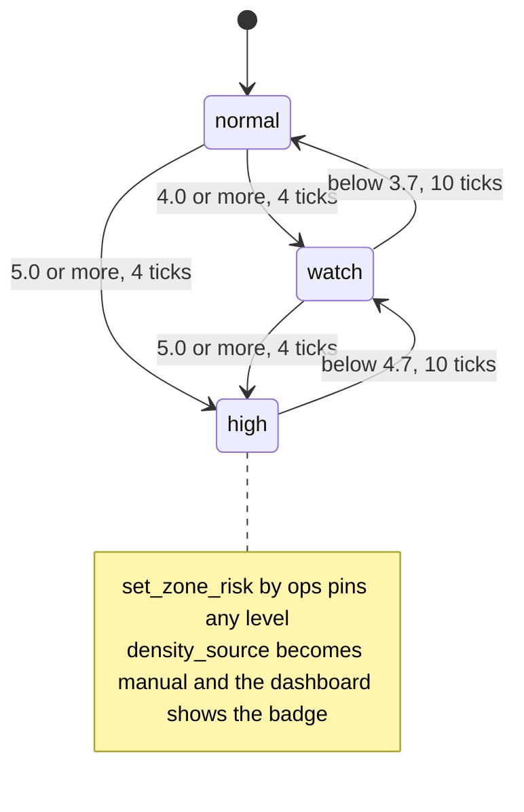
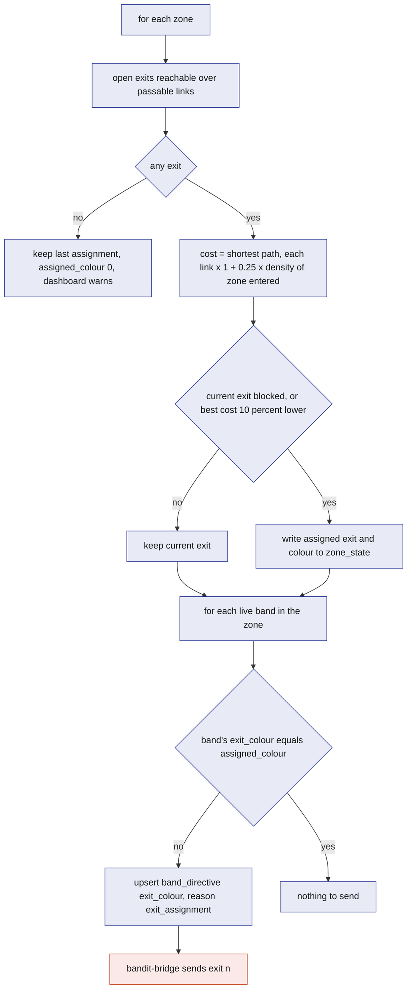
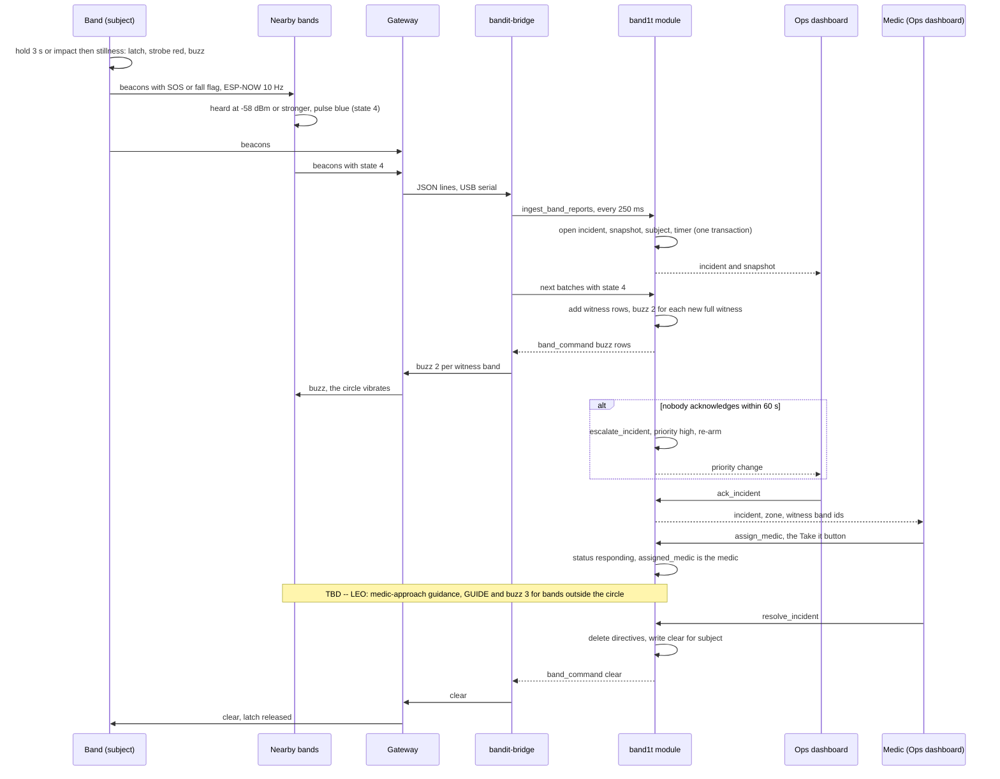
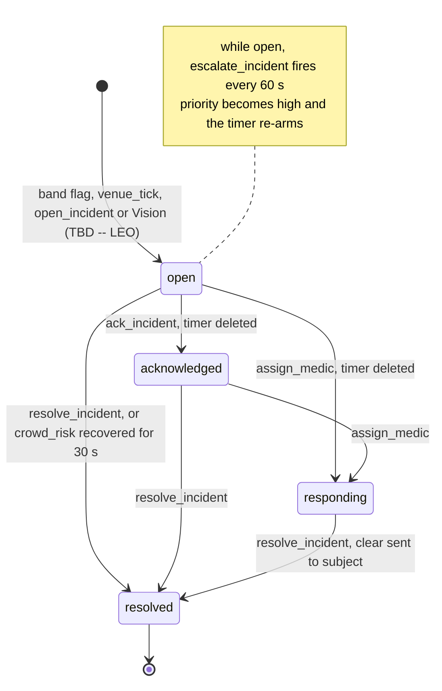

# Safety

Safety is the set of behaviours that keep a crowd from crushing anyone and get help to a person who falls or calls for it: zone density and risk, exit guidance by colour and vibration, SOS and fall handling with the light circle, incident lifecycle and escalation, low visibility, and the manual overrides the team can fall back on. Crowd crushes are preceded by measurable density for minutes before anyone is hurt, and a person on the ground needs the people around them to notice and move before any responder arrives. So the first reaction happens on the band itself, with no server in the loop. The `band1t` module decides only what the bands cannot know alone: which exit, which zone is dangerous, who is coming to help.

## Role in the system

Responsibilities:

- Define how `venue_tick` turns band reports (and Vision.md's camera count (TBD -- LEO)) into a density and a risk level per zone, with hysteresis.
- (TBD -- LEO) Define how each zone is assigned an exit along `zone_link` paths, and how that becomes an exit colour and a vibration on the bands.
- Define when incidents open, are acknowledged, responded to and resolved, what the snapshot freezes, who counts as a witness, and when escalation fires.
- Define how a medic takes an incident, low visibility, manual override and Plan B.
- (TBD -- LEO) Define the medic-approach guidance, blocked exits and rerouting.
- State what keeps working when the laptop, the bridge or the database is out of reach.

Non-responsibilities:

- The band's own state machine, thresholds and radio are in [Hardware](../4-devices/Hardware.md). This file relies on them.
- How directives and commands become gateway commands is in [Gateway-Bridge](../3-services/Gateway-Bridge.md).
- Tables and reducers are defined in [SpacetimeDB](../2-data/SpacetimeDB.md); this file specifies the policy inside them.
- The staff screens are [Ops-Dashboard](../5-apps/Ops-Dashboard.md); medics work in its incident desk.
- Medical-ID.md: the medical card.
- Insurance.md: claims and evidence.
- What the camera does internally is Vision (TBD -- LEO). This file states only what it reads from `camera_count`, `ground_alert` and `vision_assessment`.

## Interfaces

| Direction | Counterpart | What flows | Tables or reducers | Transport |
|---|---|---|---|---|
| In | `bandit-bridge` | per band: `neigh`, `zone`, `state`, SOS, fall and press flags, every 250 ms | `band_report` through `ingest_band_reports` | reducer |
| In | Test-Bands.md: the `bandit-claims` tool and `bandit-api` dev routes | the same fields for test bands 90 to 99, once a second | `band_report` through `report_sim_band` ([Test-Bands](../3-services/Test-Bands.md)) | reducer |
| In | Venue seed | zones with areas, zone graph with distances, exits with colours and status, stations | `zone`, `zone_link`, `exit`, `station` | seed load |
| In | Ops (calibration screen) | measured points mapping `neigh` to people per square metre | `calibration_point` through `set_calibration` | TypeScript SDK |
| In | Ops | low visibility, blocked exits, pinned exit, pinned risk, forced states, reset | `set_low_vis`, `set_exit_status`, `set_zone_exit`, `set_zone_risk`, `force_band_state`, `send_band_command`, `clear_all`, `set_fleet_config` | TypeScript SDK |
| In | Ops, medics | incident handling; a medic takes an incident with `assign_medic` (role `medic`); `ack_incident`, `add_incident_note`, `open_incident` and `resolve_incident` take `ops` or `medic` | `ack_incident`, `assign_medic`, `add_incident_note`, `resolve_incident`, `open_incident` | TypeScript SDK |
| In | Vision.md (TBD -- LEO): `bandit-vision` | a people count for the pit every 3 s; a person-down alert within about a second; a Claude assessment of the event a few seconds later | `report_zone_count`, `report_ground_alert`, `submit_vision_assessment` ([Vision](../4-devices/Vision.md)) | reducer |
| Out | everyone | density, source, risk and assigned exit per zone, twice a second | `zone_state` | subscription |
| Out | `bandit-bridge` | exit colour per band; the guidance and light-circle buzzes; `clear` on resolve | `band_directive`, `band_command` | subscription, then gateway commands |
| Out | `bandit-bridge` | low visibility on or off for every band | `fleet_config.low_vis` | subscription, then `cmd 0 lowvis 1` or `0` |
| (TBD -- LEO) Out | `bandit-bridge` | forced GUIDE for the medic approach | `band_directive` | subscription, then gateway commands |
| Out | staff | incidents, snapshots, witnesses, notes, escalation | `incident`, `incident_snapshot`, `incident_band`, `incident_note` | subscription through staff views |
| Out | history | one row per zone per minute, read by the dashboard | `zone_history` | written by `memory_tick` |

## Design

### Three layers, three speeds

| Layer | Decides | Latency | Keeps working without |
|---|---|---|---|
| Band (firmware) | its own density colour (IDLE, YELLOW, GUIDE), SOS strobe and buzz, fall detection, joining the light circle | under one beacon interval, about 100 ms | the laptop, the gateway and the database |
| `band1t` module (`venue_tick`, `ingest_band_reports`) | density and risk per zone, exit colour per zone, incidents, witnesses, escalation, guidance directives and buzzes | about 0.75 s to the dashboard (one bridge batch plus one tick); about 1 s more back to the bands | the dashboard and every phone |
| Staff (Ops dashboard) | acknowledge, take an incident, block an exit, low visibility, override | human | nothing the bands do depends on them |

The band's precedence order matters for everything below. From the firmware: IDENT, then SOS or fall, then PAID, PAY, CONNECT, then the light circle (NEAR_SOS), then any forced state, then the override flag, then the density state. So a forced GUIDE from the server never hides an SOS or a light circle, and the server relies on that without checking. BandIt never sets PAID, PAY or CONNECT.

### Density and risk per zone

`venue_tick` runs every 500 ms and computes the following for each zone.

**Band estimate.** Live bands are those heard within 2 s. For the zone's live bands the tick takes `band_count` and `neigh_mean`, then keeps the higher of two numbers as `density_band`:

- `density_neigh`: `neigh_mean` mapped to people per square metre through the calibration table, by linear interpolation between the two nearest `calibration_point` rows, clamped at the ends. `neigh` counts bands within radio range, and only a measurement in the real room on real wrists turns that into a density, so the mapping is data, not a formula.
- `density_count`: `band_count` divided by `zone.area_m2`. This is a floor: not everyone wears a band, so it never exceeds the truth, and it catches a calibration table that reads too low.

**Vision.md (TBD -- LEO): camera estimate.** The local detector writes a `camera_count` row for the pit through `report_zone_count` every 3 s. While the row is fresh (within 6 s, starting value), `density_camera` is its count divided by the area the camera covers.

**Choosing.** `density` is the higher fresh estimate, and `density_source` records which one won (`band` or `camera`). A false alarm costs a few seconds of yellow light; a missed one leaves a crowd at risk. When ops has set `zone.forced_risk`, the tick writes that level with `density_source` `manual` and skips the estimate.

**Thresholds.** `normal` below 4.0 people per square metre, `watch` from 4.0, `high` from 5.0. These are the published crowd-safety limits for a moving crowd (4) and a standing crowd (5), and they match the dashboard's yellow and red. They are fixed; the calibration table is what gets tuned.

**Hysteresis.** Raw density flaps at a threshold, so the level changes only after the raw level points the same way for several consecutive ticks, and coming down needs a margin. The tick keeps `candidate_risk` and `candidate_ticks` in `zone_state`. Starting values, calibrate at the venue:

- going up: the candidate holds for 4 ticks (2 s);
- going down: the candidate holds for 10 ticks (5 s) and density is at least 0.3 below the threshold it crossed (`high` releases below 4.7, `watch` below 3.7). Levels step down one at a time.

Danger should show quickly; relief should be certain before the lights change back, or the crowd sees flicker and stops trusting the colour.

This diagram answers: how a zone's risk level moves, and what stops it flickering. Labels give the density in people per square metre and how many consecutive ticks it must hold.

**Band colour before zone colour.** Each band decides its colour from its own neighbour count, so during the event the rings go red a second or two before the zone turns `high` on the dashboard. That is the right order: the crowd learns first, staff confirm second. `zone_state` and `zone_history` record both estimates and the source.

### The calibration table and the taped squares

The calibration table is recorded in the pit with all bands on wrists. Each row is one measurement: a label, the mean `neigh` across bands over a 60 s log, and the density known from the taped area.

| Label | How it is staged | People per square metre (known) | Expected `neigh` (measured on the day) | Band colour | Zone risk |
|---|---|---|---|---|---|
| spread | 9 wearers 2 m apart | about 0.3 (9 people over about 30 m²) | 0 to 1 | green | `normal` |
| 1.5 m square | 9 wearers inside a 1.5 m taped square (2.25 m²) | about 4 | around the yellow threshold, 3 | yellow | `watch` |
| 1.2 m square | 9 wearers inside a 1.2 m taped square (1.44 m²) | about 6 | at or above the red threshold, 5 | red with the exit colour | `high` |

The `neigh` column is filled in from the logs at the venue. The fleet thresholds (`yellow_at` 3, `red_at` 5, `neigh_rssi_min` -62 dBm) are then set with `set_fleet_config` so the squares fire the right band colours, and the calibration points make `density_band` land in the right risk level at the same moment. The 1.2 m square's point must map to 5.0 or more.

The pit zone's `area_m2` is the standing area around its station marker, paced out when the room is measured and written in the seed. It sets only the `density_count` floor.

### Exit assignment (TBD -- LEO)

Zones form a graph: `zone_link` rows carry a walking distance between neighbouring zones. Exits open from `exit` zones, each with a colour index 1 to 6. Every tick assigns each zone one exit.

**Cost.** The cost of an exit for a zone is the shortest path over the graph to the exit's zone, where each link's distance is multiplied by 1 plus `penalty_per_density` times the density of the zone it enters. `penalty_per_density` is 0.25 per person per square metre (starting value, calibrate at the venue). Links that are not passable and exits that are `blocked` are skipped. A path through a dense zone becomes longer, so neighbouring zones spread across exits instead of all choosing the nearest one.

**Stability.** A zone switches exit only when its current exit is blocked or unreachable, or the best exit costs at least 10 percent less (starting value). A crowd that sees its colour change every few seconds stops following it.

**Writing.** The tick stores `assigned_exit_id`, `assigned_colour` and `exit_changed_at` in `zone_state`. Then, for every live band, it compares the band's `band_directive.exit_colour` with its zone's `assigned_colour` and upserts the row when they differ (reason `exit_assignment`). This covers a zone changing its exit and a band walking into another zone. In `normal` risk the colour is not visible (the band is green), but it is already loaded when the band goes to GUIDE. Station markers glow their own `colour_index`.

**No exit reachable.** The zone keeps its last assignment, `assigned_colour` becomes 0, and the dashboard shows a "no exit" warning. Bands in that zone keep the colour they last received rather than going dark.

This diagram answers: what one tick does to assign a zone's exit and get the colour onto the bands.

### Colour and vibration point the way

A band has no compass, so it cannot show an arrow ([Hardware](../4-devices/Hardware.md)). It points the way with two signals: the ring chases in the exit colour, which matches the light of the station at that exit, and a full band's vibration motor tells the wearer to move now and look at the ring. The guidance is "follow your colour to the light of the same colour". Lite bands have no motor and show the colour only. The motor is also used for the light circle (SOS and fall, below), with a different pattern.

Guidance happens in three situations, and the band shows GUIDE (red with the exit colour chasing) in all three:

| Situation | Who is guided | Why the band shows GUIDE | Which colour |
|---|---|---|---|
| Crowd risk | bands in a dense zone | the band's own density logic (its `neigh` reached `red_at`) | the zone's assigned exit, already loaded |
| Low visibility | every band | the `lowvis 1` command, sent to every band while `fleet_config.low_vis` is on | its zone's exit colour |
| (TBD -- LEO) Medic approach | bands in the incident zone, except the subject and the light circle | a forced GUIDE directive, reason `medic_approach` | the exit of a side zone, away from the medic (below) |

**The guidance buzz.** `venue_tick` writes one `band_command` `buzz` with pattern 3 (long) for a full band when its guidance starts and whenever its guided exit colour changes. Guidance starts when the band's zone turns `high` or when low visibility turns on. One buzz per change keeps the motor meaningful: it fires when there is something new to do. The bridge sends it once like any one-shot command ([Gateway-Bridge](../3-services/Gateway-Bridge.md)).

(TBD -- LEO) A medic-approach directive also starts guidance, with the same long buzz.

### Crowd-risk incidents

A zone that stays `high` for 10 consecutive ticks (5 s, starting value) with no open `crowd_risk` incident gets one, opened by `venue_tick` with a snapshot and an escalation timer like any other incident. The risk level already has hysteresis; the extra wait separates "the dashboard went red" from "staff must act", so a crowd that compresses for a moment does not page every medic.

The incident closes itself when the zone has been `normal` for 60 consecutive ticks (30 s, starting value): `venue_tick` sets `resolved` with resolution `recovered`. When a medic has taken it, the tick does not close it; a person resolves it. Ops or a medic can also open a `crowd_risk` incident by hand with `open_incident`.

### SOS and fall

**On the band, first.** Holding the button 3 s latches SOS: the ring strobes red, a full band buzzes the SOS pattern, and every beacon carries the SOS flag. A full band that detects an impact above 2.8 g followed by 1.5 s of stillness latches a fall the same way. Every band that hears those beacons at -58 dBm or stronger pulses blue, refreshed by each beacon: the light circle. This whole first response needs nothing but the bands ([Hardware](../4-devices/Hardware.md)). The module adds the vibration around the person within a batch (below).

**In the module, within one batch.** The next `ingest_band_reports` batch (250 ms) carries the flag. In the same transaction the reducer:

1. opens an `incident` of kind `sos` or `fall` (fall wins when both flags are set), status `open`, `opened_by` `band`, `zone_id` the band's current zone (0 if unzoned, so an SOS always opens an incident), `subject` the band's owner;
2. freezes an `incident_snapshot`: the zone's density, source and risk, the bands present, the bands showing state 4, whether low visibility is on, the assigned exit and its status, the fleet config version, and (TBD -- LEO) the cameras covering the zone;
3. adds the band as the `subject` row in `incident_band`;
4. inserts an `escalation_timer` row 60 s later (starting value).

Later batches refresh `incident.last_signal_at` while the flag stays set, and add every band showing state 4 in the incident zone or a linked zone as a `witness` in `incident_band`. The witness list is the light circle as the server saw it, with first and last times, and it is the list the medic reads to find the person.

**The circle vibrates.** The first time a full band becomes a witness of an incident, `ingest_band_reports` writes one `band_command` `buzz` with pattern 2 (double) for it, in the same transaction. The firmware's blue pulse stays as it is; the buzz makes the people around the person feel it as well as see it. Bands that join the circle later get their buzz when they first appear as witnesses.

**Escalation.** If nobody acknowledges within 60 s, `escalate_incident` sets `priority` `high`, writes an `escalation` note, and arms itself again 60 s later. Every ops and medic screen subscribes to the incident, so the priority change is the alert; the dashboard sounds on it ([Ops-Dashboard](../5-apps/Ops-Dashboard.md)). `ack_incident`, `assign_medic` and `resolve_incident` all delete the timer.

**Vision.md (TBD -- LEO): corroboration and judgment.** A person-down alert from the camera's pose detector that lands in the zone of an open `sos` or `fall` incident within 3 s of the flag (starting value) sets `incident.camera_corroborated`, which the dashboard shows as a second source. A person-down alert with no band flag that lasts 5 s opens its own `fall` incident with `opened_by` `vision` and no band: the same snapshot, timer, escalation and medic approach, with no light circle and no `clear` on resolve. A few seconds after the flag, `bandit-vision` sends Claude frames from around the event and writes a `vision_assessment`, which sets `incident.vision_status` to `confirmed` or `not_confirmed`. None of this gates the band's reaction, the incident, the light circle or escalation; those have already happened.

**Resolving.** `resolve_incident` sets `resolved`, deletes the directives tied to the incident, and writes a `clear` command for the subject band so the SOS latch releases without the wearer holding the button again. For 10 s after resolution (starting value) a still-set flag from that band does not reopen an incident, which gives the `clear` time to arrive. Insurance.md: `resolve_incident` ends with the claims hook, which records the subject of an `sos` or `fall` as an injured party and runs the `open_claim` logic for every injured party with a first-aid cost or an urgent-care bill, or for a `property` incident with a cost note; the snapshot and witness rows are its evidence.

Medical-ID.md: a medic who reaches someone before any flag opens the `sos` from a tap on the band with `medic_open_incident`: the same open and snapshot, `opened_by` `medic`, status `responding` and `assigned_medic` that medic, with no escalation timer ([Medical-ID](Medical-ID.md)).

**Property incidents.** Staff open one from the Ops dashboard with `open_incident`, kind `property` and the zone. Insurance.md: the dashboard's Report property damage button makes this one tap. It gets the same snapshot and escalation timer as any incident and follows the same lifecycle. Vision.md (TBD -- LEO): `bandit-vision` assesses the scene and attaches frames and an assessment through `report_property_event`, and opens the incident itself with `opened_by` `vision` when the camera sees the damage first.

This diagram answers: what happens, in order, from a fall to a medic standing next to the person.

This diagram answers: which statuses an incident passes through and what moves it.

### A medic takes the incident

There are no positions, so the medic flow is zone-level. Medics do not wear bands. A medic works in the incident desk of the [Ops dashboard](../5-apps/Ops-Dashboard.md). "Take it" calls `assign_medic(incident_id)`, role `medic`: it refuses a resolved incident, sets the status to `responding` and `assigned_medic` to the caller, and deletes the escalation timer. Ops does not assign medics. The desk shows the incident zone, the station colour that marks it, the subject band id and the witness band ids; the blue ring in the room is what the medic walks toward.

### Medic approach (TBD -- LEO)

The zone the medic enters from is `incident.medic_entry_zone_id`, which the medic who took the incident taps on the map. On every tick while the incident is `responding`, `venue_tick` opens space around the person:

- it takes the incident zone's neighbours over `zone_link`, drops the neighbour that is the next hop on the shortest path from the entry zone (the way the medic is coming), and picks the least dense remaining neighbour; when no other neighbour remains, it uses the incident zone's own assigned exit;
- every live band in the incident zone that is not the subject and not in the light circle gets a `band_directive` with `forced_state` GUIDE and `exit_colour` set to that neighbour's assigned exit colour, reason `medic_approach`, `incident_id` set, with no expiry (the bridge refreshes it), and a full band also gets the guidance buzz;
- the subject stays in SOS and the circle stays blue, because the band's precedence puts both above a forced state, so the medic can still see the person.

People move sideways, away from the path the medic walks in on. When the incident resolves, `resolve_incident` deletes these directives; the bridge lets the forced states expire, and only the subject band gets an explicit `clear`.

### Low visibility and blocked exits

In fire or smoke, ops presses "Low visibility: guide everyone to the exits" on the Ops dashboard and confirms "Fire or smoke? Every band starts guiding its wearer to the exit." `set_low_vis(true)`, role `ops`, stores `fleet_config.low_vis`, and the bridge sends `cmd 0 lowvis 1` to every band, and again to a band that reboots. Every band then guides its wearer to the exit colour of its zone, the colour of the station light at that exit, and full bands buzz once when guidance starts. "Turn it off" calls `set_low_vis(false)`; the bridge sends `lowvis 0` and the bands return to density colours. `clear_all` also turns low visibility off and sends `clear` to every band, which releases SOS latches too, so it is the reset button, not the way out of a drill.

(TBD -- LEO) Exits and routes. While low visibility is on, `venue_tick` keeps each band's exit colour in step with its zone's assigned exit and buzzes each full band when its colour changes. It sets stations at open exits to chase (mode 1) and stations at blocked exits to off (mode 9), through directives addressed to each station, so the open doors are the moving lights and no light points at a closed door. `set_exit_status` marks an exit `blocked` or `open` at any time. The next tick skips a blocked exit, and the stability margin does not apply when the current exit is the one that was blocked, so the colour changes at once.

### Manual override and Plan B

Two overrides exist, and the team tells the judges when one is used. The dashboard shows an "override" badge whenever a directive has reason `manual` or `plan_b` or a zone has `density_source` `manual`.

**Forcing from the dashboard.** `force_band_state` writes a `band_directive` for one band or for every band (target 0) with a state and a hold; `send_band_command` sends a `buzz` or a `clear`; `clear_all` resets everything in one call. `set_zone_risk` pins a zone's level so the map and the lights agree with what staff see.

**Plan B: when neighbour counting is unstable in the room.** Ops sets `fleet_config.density_override`, which the bridge sends as `override 1`: bands stop driving their own density colour and stay green unless forced. Ops then pins the pit zone's level with `set_zone_risk` and drives the band colours with `force_band_state` (GUIDE for `high`, YELLOW for `watch`, reason `plan_b`). Exit assignment works unchanged. SOS, fall and the light circle are unaffected because the band never gives those up. Vision.md (TBD -- LEO): the camera count becomes the only fresh estimate, so `venue_tick` computes the zone's level from it and ops forces only the band colours.

### What keeps working when something is down

| Down | Still works | Lost | Design answer |
|---|---|---|---|
| Laptop, gateway or bridge | density colours, SOS strobe and buzz, fall detection, light circle, last exit colour and last calibration on each band | zone risk on the dashboard, exit reassignment, incidents, guidance directives and buzzes | the bands are the safety system and the server adds coordination; the `bridge` heartbeat goes red after 15 s and the team restarts it |
| The laptop's hotspot link to Maincloud | everything on the bands; the bridge keeps logging raw lines to its `.jsonl` | every server decision and every screen | the bridge reconnects and resumes on its next batch |
| One station marker | bands near it report zone 0 (unzoned) | that zone's density and exit colour; its bands keep their last colour | unzoned bands are counted in a dashboard "unzoned" bucket; an SOS from an unzoned band still opens an incident with its light-circle witnesses |
| Vision.md (TBD -- LEO): camera | everything band-based | the camera estimate, person-down corroboration and the Claude assessment | `density_source` stays `band`; nothing waits on the camera |
| `venue_tick` stalled | the bands; incidents from `ingest_band_reports` still open | zone risk, assignment, crowd-risk incidents, directives | `venue_mode.tick_at` stops moving and the dashboard says so after 2 s |

### Safety choreography, mapped

| Moment | What the people do | Band (local) | Module | Dashboard |
|---|---|---|---|---|
| Spread out | 9 wearers 2 m apart in the pit zone | green | `density_band` below 4, `normal`, exit colour preloaded | pit zone green |
| 1.5 m square | all 9 step inside the yellow tape | `neigh` reaches 3, yellow | after 4 ticks `watch`, `density` about 4 | pit zone yellow, both estimates shown |
| 1.2 m square | all 9 inside the red tape, the judge in the middle | `neigh` reaches 5, red with the exit colour chasing; full bands buzz once when the zone turns `high` | after 4 ticks `high`; after 10 more a `crowd_risk` incident with snapshot and timer | pit zone red, incident card, the assigned exit's station named |
| Step out | everyone walks toward the station glowing their colour | yellow, then green as `neigh` drops | `watch` after 10 ticks below 4.7, `normal` after 10 more below 3.7; incident `recovered` after 30 s of `normal` | zone back to green, incident resolved |
| SOS | one wearer holds the button 3 s | red strobe; the bands around pulse blue, and full bands among them vibrate | `sos` incident, snapshot with the circle, timer | incident card with zone, subject id, witness ids, 60 s countdown |
| Medic | ops acknowledges; a teammate playing medic taps "Take it" in the incident desk and walks in | the circle stays blue | `responding`, `assigned_medic` set | the incident desk shows the zone and the circle |
| (TBD -- LEO) Medic approach | the medic taps the entry zone | bands outside the circle go GUIDE toward a side exit and full bands buzz | medic-approach directives | the map shows the side exit |
| Medical-ID.md: medical card | the medic taps "Tap band N for the medical card" | nothing changes | `request_medical_card` granted and logged | the card shows inside the incident |
| Resolve | the medic resolves with one tap | `clear` arrives, strobe stops, blue fades in 1.5 s | `resolved`, directives deleted | card closes |

If the manual override or Plan B is used at any step, the badge is visible and the presenter says so.

## Failure modes and fallbacks

| Failure | Effect | Design answer |
|---|---|---|
| Calibration table wrong (the room absorbs more signal than the rehearsal) | zone risk reads too low or too high | ops pins the right level with `set_zone_risk` while the points are re-recorded from a fresh 60 s log |
| Band colours and zone level disagree | judges see red rings on a yellow map | expected for 1 to 2 s by design; the dashboard shows both estimates and the source badge |
| Exit colour flaps between two exits | the crowd stops trusting the colour | the 10 percent switch margin, on top of the risk hysteresis |
| An SOS reopens right after resolve | duplicate incident | 10 s grace after resolution while the `clear` reaches the band |
| A fall fires on a jump | false `fall` incident | ops resolves it with a note |
| (TBD -- LEO) The medic approach guides people toward the medic | the crowd moves into the responder | the next-hop neighbour toward the entry zone is never chosen |

## Dependencies

**Depends on**

- [Hardware](../4-devices/Hardware.md): band states and precedence, flags, thresholds, the light-circle rule, the `buzz` patterns, station colours and modes.
- [SpacetimeDB](../2-data/SpacetimeDB.md): every table and reducer named here, including `zone.forced_exit_id`, `zone.forced_risk`, `fleet_config.low_vis`, `incident.assigned_medic`, `incident.opened_by`, `incident.priority`, `incident.camera_corroborated` and `incident.vision_status` (TBD -- LEO), `zone_state.candidate_risk` and `candidate_ticks`.
- (TBD -- LEO) [SpacetimeDB](../2-data/SpacetimeDB.md): `incident.medic_entry_zone_id` and `zone_link` for the medic approach and exit assignment.
- [Gateway-Bridge](../3-services/Gateway-Bridge.md): directive reconciliation and refresh before the 25.5 s band-side limit, command delivery.

**Used by**

- [Ops-Dashboard](../5-apps/Ops-Dashboard.md) (map colours, incident cards, override badge, calibration screen), [Test-Bands](../3-services/Test-Bands.md) (scenarios that drive these behaviours), [Insurance](Insurance.md) (snapshot and witnesses as evidence), [Vision](../4-devices/Vision.md) (TBD -- LEO) (the rows it feeds), [Flows](../1-overview/Flows.md) (the end-to-end event flow).

**If you delete this file**

- The safety features have no specification: `venue_tick`, the incident steps in `ingest_band_reports` and `escalate_incident` in [SpacetimeDB](../2-data/SpacetimeDB.md) would have no policy to implement. This file is core and is not deletable.
- Deleting Vision removes the lines that start with Vision.md: the camera estimate, corroboration and judgment, the property assessment, its rows in the interfaces and "what keeps working" tables, and the camera sentence in Plan B. The band-based path is complete without it.

## Decisions

| Decision | Why |
|---|---|
| The pit zone's `area_m2` is the standing area around its station marker, paced out when the room is measured and written in the seed | it only sets the `density_count` floor; the taped squares are what the calibration measures |
| A medic takes an incident with "Take it" (`assign_medic`, role `medic`); ops does not assign medics; medics do not wear bands | the medic knows whether they are free, and there is no band zone to look up |
| (TBD -- LEO) The medic who took the incident taps the entry zone on the map | one input that is always there |
| Low visibility is one venue-wide `lowvis` command, and each band guides to its zone's exit colour | one way to send everyone out; the bands keep guiding even when the laptop goes down after the command |
| (TBD -- LEO) Exit choice uses the seed's starting values (crowding penalty 0.25, switch margin 10 percent); the two-exit scenario on the test bands is on the rehearsal checklist | the values are checked once against the test bands before anyone stands in the room |
| A full band gets one long buzz (pattern 3) when its guidance starts or its exit colour changes | the vibration says "move now" and the colour says where; one buzz per change keeps it meaningful |
| A full band gets one double buzz (pattern 2) when it first joins an incident's light circle | the bands around a fallen person vibrate and light up, as the project description asks; the double pattern differs from the long guidance buzz |
| A witness is a state 4 band in the incident zone or a linked zone | the light circle is a few metres wide, so a band further away cannot be in it |
| Plan B is run by hand from the dashboard; Vision.md adds the camera as the density source | the manual path works with no optional part built |
| An SOS from an unzoned band opens an incident in zone 0 | a person calling for help must never be dropped because a station was not heard |
