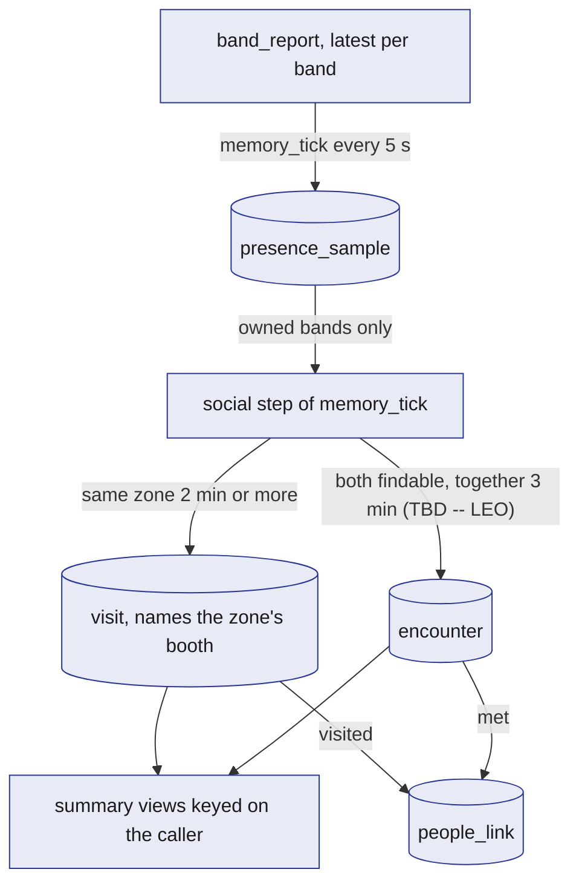
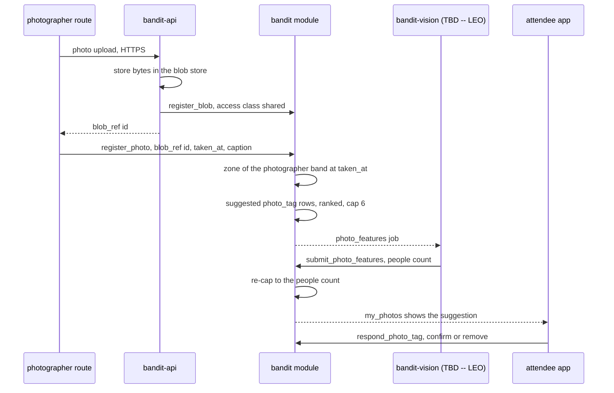

# Social

The social layer turns zone-level presence into memories: where an attendee spent time, who they hung out with, which photos they are in, a live people graph of who met whom and who visited which booth, and a post-event summary they can share. It is built only from what the bands already report (band, zone, time), so it needs no new hardware. Each attendee types their own Meta socials (Instagram, Facebook, Threads) at onboarding. After the event, the summary lists the people they hung out with and shows those people's socials when they allow it with `findable`. Everything here is optional: delete it and the safety demo is untouched.

## Role in the system

Responsibilities:

- Derive `visit` rows from `presence_sample` in the social step of `memory_tick`, and write `encounter` rows there once two `findable` owners have been together for 3 minutes (the encounter rule, TBD -- LEO).
- Hold the people graph: derive `people_link` rows in the same step and serve them through `my_graph` and `event_graph`.
- Own the socials step of onboarding: the attendee types their handles into `social_handle`.
- BrightData.md: place the profile claim ("Is this you", confirmed by a band press) in the same onboarding flow. The `person` rows, the claim reducers and `POST /claim/person` belong to [BrightData](../7-integrations/BrightData.md).
- Hold `social_handle` and show it only to people who share an encounter with its owner, while the owner has `findable` on.
- Register photographer photos, suggest `photo_tag` rows from presence and consent, and let attendees confirm or remove them.
- Provide the post-event summary as views keyed on the caller, and `share_link` tokens.
- Give meaning to the consent switches `findable` and `photo_tagging`, set through `set_consent` (`merch` belongs to [Merch](Merch.md)).

Non-responsibilities:

- It does not write `presence_sample`, `band_report` or any band state; it only reads them ([SpacetimeDB](../2-data/SpacetimeDB.md), [Safety](Safety.md)).
- It does not analyse images. People counts and captions come from Vision (TBD -- LEO) through `submit_photo_features` ([Vision](../4-devices/Vision.md)).
- It does not scrape people. Nobody's social profile is scraped; a handle comes only from its owner.
- Elastic.md: it does not rank by meaning. "The photo of me with the robot" goes from the app's search box to Elastic's search routes over a one-way copy of this file's rows ([Elastic](../7-integrations/Elastic.md)).
- It does not make merch; it supplies the visits and confirmed photos that [Merch](Merch.md) builds its suggestions from.

## Interfaces

| Direction | Who | What flows | Transport |
|---|---|---|---|
| In | `memory_tick` (core, every 5 s) | Calls the social step after writing `presence_sample`; the step reads `presence_sample`, `band`, `attendee`, `consent`, `booth` and writes `visit`, `encounter`, `people_link` | In-module call (one line to remove) |
| In | BrightData.md: imported rows | `organization`, the booth's organisation and a claimed `person` row's organisation, read by the social step for `exhibits` and `works_at` links | Module tables |
| In | Simulator.md: simulated attendees | One simulated `attendee` per simulated band, from the simulator's seed: a made-up display name, Meta handles in `social_handle`, `findable` on; marked by the band's `simulated` flag | Module tables |
| In | Attendee app | `set_social_handle`, `remove_social_handle`, `respond_photo_tag`, `create_share_link`, `revoke_share_link` | SpacetimeDB TypeScript SDK |
| In | BrightData.md: profile claim | `person` rows (name, role, organisation; claimed identity once claimed), used as a display name once claimed; the claim itself (`POST /claim/person` and the confirming band press) is defined in [BrightData](../7-integrations/BrightData.md) | Module table; HTTPS to `bandit-api` |
| In | Photographer route of the attendee app (role `photographer`) | Photo bytes to `bandit-api`, then `register_photo` with the `blob_ref` id, capture time and caption; `hide_photo` | HTTPS upload, then SDK |
| In | `bandit-api` (role `api`) | `register_blob` for the uploaded photo (access class `shared`) | SDK |
| In | Vision.md (TBD -- LEO): `bandit-vision` | `submit_photo_features` for a `photo_features` job: people count and caption | SDK (role `vision`) |
| Out | Attendee app | Views keyed on the caller: `my_visits`, `my_encounters`, `my_graph`, `my_photos`, `my_share_links` | Subscription |
| Out | Ops dashboard big screen | View `event_graph`: the anonymous whole-event graph | Subscription |
| Out | `bandit-api` | `share_link` rows and the rows a link selects, for the public share page; Elastic.md: `people_link`, to find who is in a caller's own graph for `GET /graph/similar` | Subscription (role `api`) |
| Out | Elastic.md: `bandit-indexer` | `visit`, `encounter` (only when both people are `findable`), `photo` and confirmed `photo_tag`, into `bandit-memories` and `bandit-photos`, and each `findable` attendee's top booths into `bandit-people`; never `social_handle` | Subscription (role `indexer`) |
| Out | `job` table | Vision.md: job `photo_features` with the photo id, from `register_photo` | `enqueue_job` |
| Out | [Merch](Merch.md) | `visit`, `photo` and confirmed `photo_tag` rows for the merch suggestions | Module tables |

## Design

### From presence to visits and encounters

Presence is the only input: every 5 s `memory_tick` writes one `presence_sample` (band, zone, time) per live band. The social step runs right after, inside the same scheduled reducer, and considers only bands that have an owner, so unclaimed bands create no memories. Simulator.md: every simulated band has a simulated owner, so the simulated crowd creates visits, encounters and graph links through this same step, and the big screen shows a real-looking crowd.

The question this diagram answers: what each memory row is derived from.

**Visits.** A visit is one attendee staying in one zone. The step keeps, per band, its current zone and how long it has been there, and a zone change counts only once 2 consecutive samples agree. A visit opens when the band has been in the zone for 2 minutes (starting value, calibrate at the venue) and closes when the band has been out of that zone for 2 minutes (starting value, calibrate at the venue), so a short walk past the boundary does not split it. In the demo layout each booth zone holds one booth, so a visit records that booth; a zone with no booth (the pit, an entrance) leaves `booth_id` empty. Why 2 minutes: the band's zone is "loudest station in the last 3 s", which flaps at boundaries, and 2 minutes of persistence filters that without hiding a real stop.

| `visit` field | Meaning |
|---|---|
| `id` | Assigned by SpacetimeDB |
| `attendee_id`, `band_id` | Whose visit, through which band |
| `zone_id`, `booth_id` | Where; `booth_id` is the zone's booth, empty for a zone without one |
| `started_at`, `ended_at` | Open visits have no end yet |
| `samples` | Number of 5 s ticks the band spent in the zone, for the minutes shown in the summary |
| `status` | `open`, `closed` |

**Encounters.** An encounter is two attendees who hung out. It exists once two bands' owners both have `findable` on and have been in the same zone together for 3 minutes (starting value, calibrate at the venue). The rule lives in the social step of `memory_tick`, and Leo will replace it with his own (TBD -- LEO). The social step writes an `encounter` row with the two attendees, the zone, the start, the end and the minutes together, and grows `minutes` while they stay together. The `met` link in the people graph is written in the same transaction. Everything else here reads only those rows, so a new rule changes nothing else.

| `encounter` field | Meaning |
|---|---|
| `id` | Assigned by SpacetimeDB |
| `attendee_a`, `attendee_b` | The pair, lower id first |
| `zone_id` | Where it started |
| `started_at`, `ended_at` | Open encounters have no end yet |
| `minutes` | Minutes together so far |
| `rule` | Which encounter rule produced the row (TBD -- LEO) |
| `status` | `open`, `closed` |

What an encounter shows each side: "Sam, 40 minutes together in Zone B around 21:10", with Sam's socials. Both sides see each other at the same moment, because the encounter exists only when both are `findable`.

### People graph

The graph is the night as people, booths and companies, with the links the bands actually measured. It is derived data: the social step writes `people_link` rows in the same transaction that opens or grows a visit or an encounter, so a new link reaches every screen through its subscription at once. Only `findable` attendees get links; turning `findable` off deletes theirs.

The question this diagram answers: which kinds of nodes and links the graph holds.

| `people_link.kind` | From, to | Written when | Weight |
|---|---|---|---|
| `met` | attendee, attendee | an encounter opens (3 minutes together; starting value, calibrate at the venue) | the encounter's minutes |
| `visited` | attendee, booth | a visit at a booth opens (2 minutes; starting value, calibrate at the venue) | minutes over all of the attendee's visits to that booth |
| `works_at` | attendee, organization | BrightData.md: the attendee claims a `person` profile whose imported row names an organisation | none |
| `exhibits` | booth, organization | BrightData.md: the imported booth names its organisation | none |

| `people_link` field | Meaning |
|---|---|
| `id` | Assigned by SpacetimeDB |
| `kind` | `met`, `visited`, `works_at`, `exhibits` |
| `from_kind`, `from_id` | `attendee` or `booth`, and its id |
| `to_kind`, `to_id` | `attendee`, `booth` or `organization`, and its id |
| `minutes` | Weight for `met` and `visited`; empty for the others |
| `updated_at` | Last change |

There is one row per pair of nodes and kind, updated as minutes grow. Two people at the same booth, or at the same company, are never stored as a pair: both link to the shared booth or organisation node, and that shared node is what pulls them into one cluster when the graph is drawn.

Two views read the table:

| View | Who | Rows |
|---|---|---|
| `my_graph` | each attendee, keyed on the caller | the caller's own links, plus the other `findable` attendees linked to the same booths and organisations; people the caller met appear by display name, everyone else as "someone" |
| `event_graph` | the Ops dashboard's big screen; an anonymous view, the same for every subscriber | every link as node ids, kinds and minutes only: no names, zones or timestamps |

The attendee app and the Ops dashboard draw both views in the browser ([Attendee-App](../5-apps/Attendee-App.md), [Ops-Dashboard](../5-apps/Ops-Dashboard.md)). Elastic.md: the dashed "into the same things" links (`GET /graph/similar` over `bandit-people`) and the semantic lens over `/search/booths` are drawn on top of this graph; they are defined in [Elastic](../7-integrations/Elastic.md), and nothing flows back into this file's tables.

### Onboarding: profile and socials

The socials step comes right after tap to join in the attendee app ([Attendee-App](../5-apps/Attendee-App.md)). There is no sign-in with a social provider and no verification.

**BrightData.md: the profile claim.** When the app asks for a display name, it shows the unclaimed `person` profiles (exhibitors, speakers, sponsors and artists, built from the event's own pages) whose name matches what the attendee typed: the "Is this you" step. The attendee taps theirs and confirms by pressing their band, the same press-to-confirm as the band claim. The app calls `POST /claim/person`; `request_person_claim`, `confirm_person_claim` and the press step are defined in [BrightData](../7-integrations/BrightData.md). A claimed profile gives the attendee its name as their display name and, when the profile names an organisation, a `works_at` link in the people graph. Attendees without a profile skip the step.

**Socials.** The app then asks for the attendee's Meta handles, with or without a claimed profile: Instagram, Facebook and Threads, no other networks. Each one is a `social_handle` row written by `set_social_handle` with the platform and the handle exactly as typed. The owner changes or removes them later from the same screen. Onboarding has no company field: `works_at` comes only from the import and a claimed profile.

| `social_handle` field | Meaning |
|---|---|
| `id` | Assigned by SpacetimeDB |
| `attendee_id` | Owner |
| `platform` | `instagram`, `facebook`, `threads` |
| `value` | The handle, as typed |
| `linked_at` | When it was set |

**Who sees a handle.** A handle is never shown on a profile, a booth page, a share page or in search. The view `my_encounters` joins the counterpart's `social_handle` rows only while the counterpart has `findable` on; that join condition is the whole rule. Turning `findable` off removes the person's name and handles from every counterpart's list at once and closes their open encounters. Reducers: `set_social_handle` and `remove_social_handle`, owner only.

### Photos and tagging

The photographer route is part of the attendee app, gated by the `photographer` role like the medic route. It uploads a photo to `bandit-api`, which stores the bytes in the blob store and calls `register_blob` with access class `shared`; the route then calls `register_photo` with the `blob_ref` id, the capture time and an optional caption. The photographer wears a band, so the photo's zone is the zone of the photographer's band at `taken_at`.

The question this diagram answers: how a photo becomes suggested tags that attendees confirm, and where Vision joins in.

Candidate rule: photo tags are suggested from the bands in the photo's zone at the moment it was taken. An attendee is a candidate when they have `photo_tagging` on and their band's `presence_sample` nearest `taken_at` puts it in the photo's zone. Candidates are ranked by how long their band had been in that zone when the photo was taken, so someone who was there for a while ranks above someone passing through. The list is capped at 6 (starting value) until Vision reports a people count, then at that count. Each candidate gets a `photo_tag` with status `suggested`, visible only to that candidate, who confirms or removes it. Only confirmed tags appear to anyone else, go to Elastic, or count for merch. Identity always comes from the band, never from a face.

Vision.md (TBD -- LEO): `register_photo` enqueues a `photo_features` job, and `bandit-vision` answers with `submit_photo_features`. The module uses the people count to re-cap the suggestions and the caption when the photographer gave none. How Vision computes its output is Leo's.

| `photo` field | Meaning |
|---|---|
| `id` | Assigned by SpacetimeDB |
| `photographer_attendee_id` | Who uploaded (role `photographer`) |
| `blob_ref_id` | The bytes, access class `shared` |
| `taken_at` | Capture time from the file, else upload time |
| `zone_id` | The photographer's band zone at `taken_at` |
| `caption` | From the photographer, or from Vision (TBD -- LEO) |
| `people_count` | From Vision (TBD -- LEO), empty until then |
| `status` | `uploaded`, `tagged`, `hidden` |

| `photo_tag` field | Meaning |
|---|---|
| `id` | Assigned by SpacetimeDB |
| `photo_id`, `attendee_id` | Which photo, who |
| `rank` | Position in the candidate list |
| `status` | `suggested`, `confirmed`, `removed` |
| `updated_at` | Last change |

**Tap to share.** In the summary, each photo shows the people in it, by display name for people the attendee hung out with and as "someone" otherwise, the same way `my_photos` names them. A Share button under the photo opens the phone's own share sheet with the photo file, so the attendee posts it wherever they like. BandIt has no Instagram or Meta login and never tags anyone on a social network.

### The post-event summary

After the event the attendee opens the summary from the link in their recap email, `GET /summary/{token}`, which signs them back in as their own identity; it is the social part of the recap page ([Attendee-App](../5-apps/Attendee-App.md)). During the event the same views show in the app's session. The summary is not one table: it is a set of views keyed on the caller's identity, so every attendee sees only their own rows and the module, not the app, enforces that.

| View | Rows |
|---|---|
| `my_visits` | The caller's `visit` rows joined with `zone` and `booth` names and the booth text, with minutes, plus the most visited booths |
| `my_encounters` | The people the caller hung out with: each `encounter` with the counterpart's display name, zone, time, minutes and `social_handle` rows, while the counterpart is `findable` |
| `my_photos` | Photos where the caller has a `suggested` or `confirmed` tag, with the other confirmed people by display name when the caller has an encounter with them, otherwise as "someone" |
| `my_share_links` | The caller's links and what each exposes |

The timeline is `my_visits` in time order with the gaps filled from `presence_sample` at zone level, computed in the app. Elastic.md: a ranked question about the night ("which robotics booths did I visit") goes from the app's search box to Elastic's search routes over the one-way copy; the summary itself never depends on Elastic.

### Share links

A `share_link` is a token the attendee mints for one selection of their summary: their spacetime history, most visited booths and photos. `create_share_link` takes the selection (timeline yes or no, top zones, visits, people, a list of confirmed photo ids) and stores only a hash of a random token; the app shows the token once in the URL. `bandit-api` serves the page: it finds the link by token hash in its subscription, reads only the selected rows and renders a static page. People appear only as the owner's own summary names them (display name for people the owner hung out with, otherwise "someone") and never with handles, because the page is public to anyone with the link; photos appear only if confirmed and selected. `revoke_share_link` ends the page at once. Links expire 30 days after the event (starting value).

| `share_link` field | Meaning |
|---|---|
| `id` | Assigned by SpacetimeDB |
| `attendee_id` | Owner |
| `token_hash` | SHA-256 of the token in the URL; the token itself is never stored |
| `includes_timeline`, `includes_zones`, `includes_visits`, `includes_people` | The selection |
| `photo_ids` | Confirmed photos selected |
| `created_at`, `expires_at`, `revoked` | Lifetime |

### Consent switches used

| Switch (`consent`, set by `set_consent`) | Effect here |
|---|---|
| `findable` | On: encounters and graph links with this person are created, and the people they hung out with see their display name and socials. Off: no encounters, their graph links are deleted, and their name and handles leave every list |
| `photo_tagging` | Off: never a tag candidate; can still be a photographer |
| `merch` | Merch.md: on means photos the attendee is confirmed in can be put on merch; a photo is offered only when everyone confirmed in it has this on. Listed here because the same switch screen sets it |

## Failure modes and fallbacks

| Failure | Effect | Design answer |
|---|---|---|
| Zone flaps between two stations at a boundary | Visits would split | A zone counts after 2 consecutive samples agree; visits open and close on 2 minute thresholds (starting values) |
| Many people in one zone | Strangers show up as people you hung out with | Only `findable` people appear; an encounter and its `met` link need 3 minutes together in one zone; `my_encounters` sorts by minutes |
| Attendee has no handles | An encounter shows a name with nothing to follow | `my_encounters` shows the display name and "no socials shared" |

## Dependencies

**Depends on**

- [SpacetimeDB](../2-data/SpacetimeDB.md): `presence_sample`, `band`, `attendee`, `consent`, `booth`, `zone`, `blob_ref`, `register_blob`, `job`, `enqueue_job`, `api_session`; the social step hook in `memory_tick`.
- [Attendee-App](../5-apps/Attendee-App.md): the socials step, the summary, graph and consent screens, the photographer route.
- [Ops-Dashboard](../5-apps/Ops-Dashboard.md): the big screen that draws `event_graph`.
- [Rust-Backend](../3-services/Rust-Backend.md): `bandit-api` for photo upload and the share page.
- [Hardware](../4-devices/Hardware.md): zone-level presence (band, zone, time) as the firmware reports it today.
- BrightData.md: `person` rows and the profile claim; `organization` and the booth's organisation for `works_at` and `exhibits` links. Without it, attendees type a display name and their socials, and the graph has no company nodes.
- Simulator.md: simulated attendees for the simulated bands. Without it, the graph holds real attendees only.
- Vision.md (TBD -- LEO): people count and captions. Without it, tags use presence only with the default cap of 6.
- This file does not depend on [Elastic](../7-integrations/Elastic.md); Elastic copies its rows for the attendee app's search box.

**Used by**

- [Merch](Merch.md): visits, photos and confirmed tags for the merch suggestions. Merch needs this file.
- [Elastic](../7-integrations/Elastic.md): `bandit-memories` and `bandit-photos` are copies of this file's rows; `bandit-people` is built from its visits; the dashed links and the lens are drawn on its graph.
- [Attendee-App](../5-apps/Attendee-App.md): the onboarding socials step, the graph and the post-event screens.
- [Ops-Dashboard](../5-apps/Ops-Dashboard.md): the big-screen graph.
- [Simulator](../3-services/Simulator.md): its simulated attendees go through the social step.

**If you delete this file**

- Remove the social step bullet from `memory_tick` in [SpacetimeDB](../2-data/SpacetimeDB.md), the Social.md rows in its registry tables, the Social.md note on `display_name`, and the tables `visit`, `encounter`, `people_link`, `social_handle`, `photo`, `photo_tag`, `share_link`, and the views `my_graph` and `event_graph`.
- Remove the Social.md row from the endpoint registry in [Rust-Backend](../3-services/Rust-Backend.md) (photo upload, share page), the socials onboarding step, the graph screen, the photographer route and the summary screens from [Attendee-App](../5-apps/Attendee-App.md), the `photographer` role row and the big-screen graph from [Ops-Dashboard](../5-apps/Ops-Dashboard.md), the simulated attendees and their handles from the seed of [Simulator](../3-services/Simulator.md), demo steps 5 and 6a in [Flows](../1-overview/Flows.md), the memories row in the data ownership table of [Architecture](../1-overview/Architecture.md), and the Social.md row from the README components table.
- Remove the `bandit-memories`, `bandit-photos` and `bandit-people` indices, the memory and photo search routes, `GET /graph/similar`, the semantic lens and the "Interest map" dashboard from [Elastic](../7-integrations/Elastic.md), and the photo tagging consumer and `photo_features` job from [Vision](../4-devices/Vision.md).
- The profile claim stays with [BrightData](../7-integrations/BrightData.md); a claimed `person` row then has no handles attached.
- Delete [Merch](Merch.md) too: every suggestion starts from a visit and a confirmed photo defined here.
- `presence_sample` stays: it is core and feeds incidents.

## Decisions

| Decision | Why |
|---|---|
| The photographer route lives in the attendee app, gated by the `photographer` role like the medic route | One app on the one public host; the role check is in the module, as for every other route |
| In the demo layout each booth zone holds one booth, so a visit names one booth | Zones are the only resolution the bands give; one booth per zone makes the visit exact with no hand-placed hints |
| Socials are Meta only (Instagram, Facebook, Threads), typed by the attendee at onboarding; no provider sign-in and no `verified` state | Meta is the sponsor track; typing needs no provider approval, and a handle is shown only to people who hung out with its owner |
| Onboarding has no company field; `works_at` comes only from the import and a claimed profile | Every company link then comes from the event's own pages, and onboarding stays short |
| No Bandshake and no connection requests: an encounter between two `findable` attendees is the connection, and each sees the other's name and socials | The project description: find who you hung out with and their Insta, afterwards |
| A handle has no per-handle sharing mode; every handle goes to the owner's encounter counterparts while `findable` is on | One switch, one rule; the former `on_connect` mode was built on connection requests |
| The share page shows display names only, never handles | The page is public to anyone with the link; `findable` shares socials with the people you hung out with, not with the public |
| A photo is shared with one tap through the phone's share sheet; BandIt never logs in to a social network or tags anyone there | tags come from zone and time, not faces, so they name people in the summary but are not tags to post |
| The photo's zone is always the photographer's band zone; the route cannot type a zone | The photographer wears a band; one source of the zone keeps tagging exact |
| After the event the attendee reaches the summary through the one-time link in their recap email, as the social part of the recap page | The bands are returned at the end, so the email is the one way back; the link signs them in as their own identity ([Attendee-App](../5-apps/Attendee-App.md)) |
| An encounter starts when two `findable` owners have been in one zone together for 3 minutes (starting value); the rule is Leo's to replace (TBD -- LEO), and the rest of the design reads only the encounter rows | What counts as two people having met is spatial and vision work, so the rule can change without touching the summary, the graph or merch |
| Photo tags come from presence and Vision's people count only | The design uses the band firmware as it is |
| The summary is the attendee's own visits, people and photos; there is no written story | The project description asks for the night back, not a story; the views already give it |
| The people graph lives in SpacetimeDB as the derived table `people_link`, written by the social step; Elastic adds only the meaning on top | Every link is an exact fact the bands measured, it must reach every screen live, and `findable` must be enforced in the views; ranking by meaning is Elastic's job ([Elastic](../7-integrations/Elastic.md)) |
| Shared booths and companies are shared nodes, never pairs of people | One link per person instead of one per pair, and the shared node is what forms the cluster |
| Links appear when a visit reaches 2 minutes or an encounter opens at 3 minutes (starting values, calibrate at the venue) | Each threshold is the one that opens the visit or the encounter, so the graph and the summary agree |
| `event_graph` is one anonymous view with node ids, kinds and minutes only | The big screen shows the shape of the crowd to everyone in the room without naming anyone |
| Simulated bands get simulated owners from the simulator's seed, with `findable` on, made-up names and Meta handles, going through the same social step | The big screen shows a real-looking crowd instead of at most 9 people; the band's `simulated` flag tells them apart |
