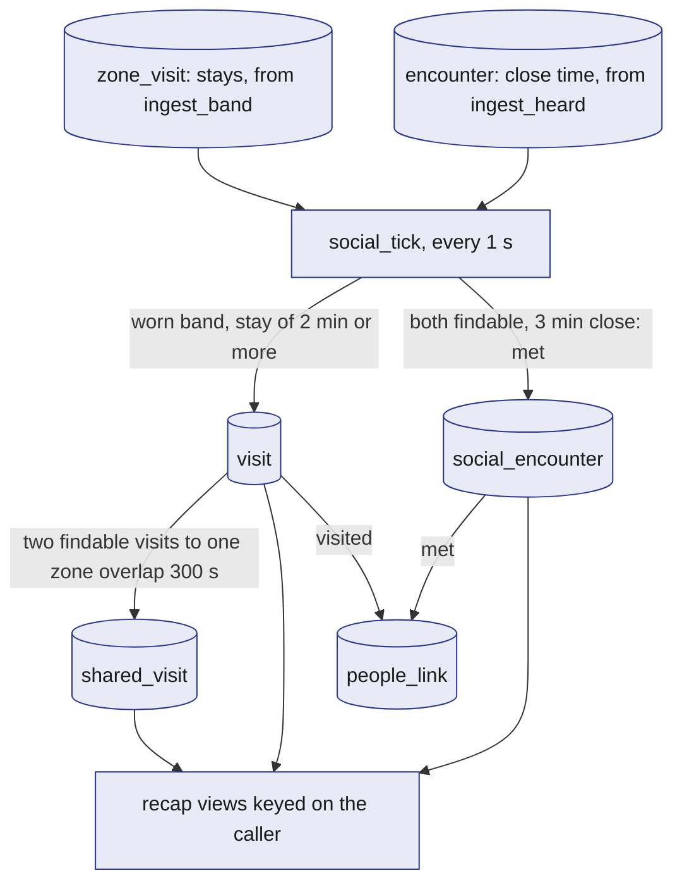
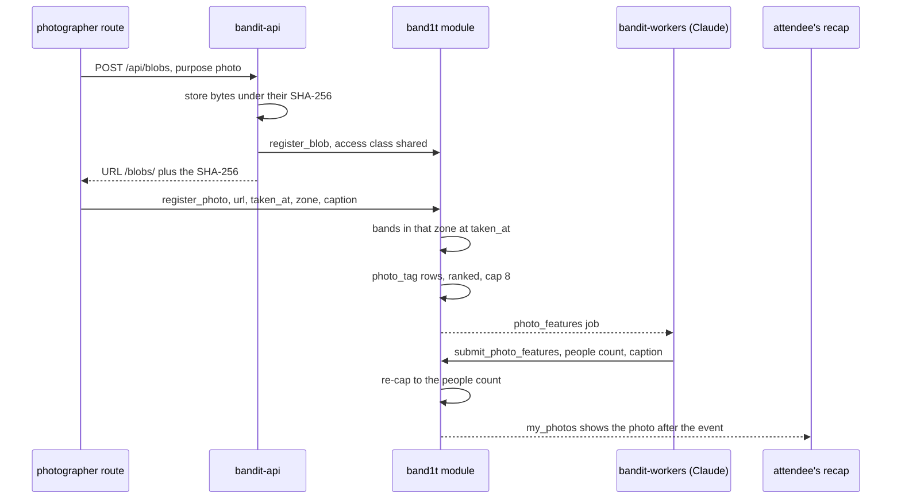

# Social

The social layer turns zone-level presence into memories: where an attendee spent time, who they hung out with, which photos they are in, a live people graph of who met whom and who visited which booth, and the social part of the recap, which they can share. It is built only from what the bands already report (which zone each band is in, and which bands hear each other up close), so it needs no new hardware.

Each attendee types their own Meta socials (Instagram, Facebook, Threads) at onboarding. After the event, the recap lists the people they hung out with and shows those people's socials when they allow it with the findable switch.

Everything here is optional: delete it and the safety features are untouched.

## Role in the system

Responsibilities:

- Run `social_tick` every 1 s: turn the module's `zone_visit` stays into `visit` rows, and its `encounter` rows into `social_encounter` rows between `findable` attendees, which count as met after 3 minutes up close.
- Write `shared_visit` rows in the same tick when two `findable` attendees' visits to one zone overlap for at least 300 s (`SHARED_VISIT_MIN_SECONDS`, starting value), for the recap.
- Hold the people graph: derive `people_link` rows in the same tick and serve them through `my_graph` (the recap) and `event_graph` (the big screen on the organizer portal).
- Give staff every event photo with the `findable` people the bands put in it, through `board_photos`, for the organizer portal's Photos tab and the photos in its event graph.
- Own the socials step of onboarding: the attendee types their handles into `social_handle`.
- Bright-Data.md: place the profile claim ("Are you one of these?", one tap by an attendee who already owns a band) in the same onboarding flow. The `person` rows, `claim_person` and `person_claim` belong to [Bright-Data](../7-integrations/Bright-Data.md).
- Hold `social_handle` and show it only to people who share an encounter or a shared visit with its owner, while the owner has the findable switch on.
- Register photographer photos and tag the findable people whose bands were in the photo's zone, from their stays and `findable`.
- Provide the social part of the recap as views keyed on the caller, and `share_link` tokens.
- Give `bandit-indexer` and `bandit-api` the views `social_attendees`, `social_visits` and `social_encounters`, which return findable attendees only, and give the service roles `social_shared_visits`.
- Give meaning to the findable switch, set through `set_consent`.

Non-responsibilities:

- It does not write `band`, `zone_visit`, `encounter` or `event`; it only reads them ([SpacetimeDB](../2-data/SpacetimeDB.md), [Safety](Safety.md)).
- It does not analyse images itself. People counts and captions come from the `photo_features` job in `bandit-workers`, where Claude reads the photo, through `submit_photo_features`. Claude counts people and never says who anyone is.
- It does not scrape people. Nobody's social profile is scraped; a handle comes only from its owner.
- Elastic.md: it does not rank by meaning. The order of the recap's people, people also there and booths comes from Elastic, through `GET /api/recap` in `bandit-api`, over a one-way copy of this file's findable rows ([Elastic](../7-integrations/Elastic.md)); the lists themselves come from this file's views.
- It does not make merch; it supplies the visits and photos that [Merch](Merch.md) builds its suggestions from.

## Interfaces

| Direction | Who | What flows | Transport |
|---|---|---|---|
| In | Module tables, read by `social_tick` (every 1 s) | `zone_visit` (each band's stays in a zone, written by `ingest_band`), `encounter` (close time per pair of bands, written by `ingest_heard`), `event` (`Press`, for band claims), `band_claim`, `band_owner`, `crowd_member`, `attendee`, `zone`, `booth`; it writes `visit`, `shared_visit`, `social_encounter` and `people_link` | Scheduled reducer |
| In | Bright-Data.md: imported rows | `organization`, the booth's organisation and a claimed `person` row's organisation, read by `social_tick` for `exhibits` links and by `claim_person` for `works_at` | Module tables |
| In | Test-Bands.md: the crowd | One crowd `attendee` per crowd band, written by `start_crowd`: a made-up display name, a placeholder photo, an Instagram handle in `social_handle` made from the name (three in ten also on Threads), `findable` on, marked as a crowd attendee. `crowd_member` names the attendee who wears each crowd band. `crowd_tick` writes the crowd's stays in `zone_visit` (zone, booth, open or closed), adds each close pair's time to `encounter` and syncs that pair's `social_encounter` itself, with the same code `social_tick` uses | Module tables |
| In | Tap page | `set_social_handle`, `remove_social_handle`, `create_share_link`, `revoke_share_link` | SpacetimeDB TypeScript SDK |
| In | Bright-Data.md: profile claim | `person` rows (name, role, organisation, headshot) and the `claimed_people` view; `claim_person`, called by the signed-in tap page, copies a claimed profile onto the attendee and is defined in [Bright-Data](../7-integrations/Bright-Data.md) | Module tables |
| In | Photographer route `/photo`, served with the tap page (role `photographer`) | Photo bytes to `bandit-api` through `POST /api/blobs` with purpose `photo`, then `register_photo` with the returned URL `/blobs/<sha256>`, the capture time, the zone and an optional caption; `hide_photo` | HTTPS upload, then SDK |
| In | `bandit-api` (role `api`) | `register_blob` for the uploaded photo, stored under its SHA-256 (access class `shared`) | SDK |
| In | `bandit-workers` | `submit_photo_features` for a `photo_features` job: people count, caption and the model call | SDK (role `worker`) |
| Out | Tap page | Views keyed on the caller: `my_visits`, `my_encounters`, `my_shared_visits`, `my_graph`, `my_photos`, `my_share_links` | Subscription |
| Out | The big screen on the organizer portal | View `event_graph`: the whole-event graph, people by display name | Subscription |
| Out | Organizer portal, the Event graph and Photos tabs (staff: the owner, `ops`, `medic`) | View `board_photos`: every event photo with its zone, time and caption, and the graph node ids of the `findable` people tagged in it | Subscription |
| Out | `bandit-api` | `share_link` rows and the rows a link selects, for the public share page; Elastic.md: `social_encounters`, `social_shared_visits` and `social_visits`, the recap candidates for `GET /api/recap` | Subscription (role `api`) |
| Out | Elastic.md: `bandit-indexer` | the views `social_attendees`, `social_visits` and `social_encounters`, findable attendees only, into `bandit-memories` and `bandit-people`; never `social_handle` or photos | Subscription (role `indexer`) |
| Out | `job` table | `bandit-workers`: job `photo_features` with the photo id, its blob hash, the zone, the zone's booths and the photographer's caption, from `register_photo` | a `job` row |
| Out | [Merch](Merch.md) | `visit`, `photo` and `photo_tag` rows for the merch suggestions | Module tables |

## Design

### From stays and close time to visits and encounters

`social_tick` is a scheduled reducer that runs every 1 s. The first `claim_band` or `start_crowd` starts it, and it never stops.

It reads two module tables that the bands already fill: `zone_visit`, one row per stay of a band in a zone, and `encounter`, the seconds two bands heard each other up close. It is the one seam between the bands and the social layer: if location is ever reported another way, only `social_tick` changes. Each run does four things, in order:

1. Band claims. A pending `band_claim` whose band logged a `Press` event inside its 8 s window completes: a `band_owner` row, and for a radio band the command `state` 0 1 ([Tap-Page](../5-apps/Tap-Page.md)). Claims past their window are deleted.
2. Visits. Each open stay, and each visit whose stay has just closed, is written as a `visit`, with its `visited` links.
3. Shared visits, for each visit it writes.
4. Encounters, for each pair of worn bands in `encounter`, with their `met` link.

The attendee who wears a band is its `band_owner` for a radio or test band (1 to 99), and the attendee its `crowd_member` row names for a crowd band. Bands nobody wears create no memories.

Test-Bands.md: `crowd_tick` writes each crowd band's stays with the booth the band stands at, and syncs each crowd pair's encounter itself as it adds their close time, with the same code. So the crowd creates visits, encounters and graph links the same way, and the big screen shows a real-looking crowd ([Test-Bands](../3-services/Test-Bands.md)).

The question this diagram answers: what each memory row is derived from.

**Visits.** A visit is one attendee's stay in one zone, and it mirrors one `zone_visit` row. `ingest_band` opens a stay when a band's `zone` byte changes and closes it when the byte changes again or `sweep` marks the band offline.

A stay under 5 s is deleted when the band moves on, and a zone left less than 5 s ago reopens its stay. So a band flapping between two station markers at a boundary keeps one stay.

A stay becomes a visit once it has lasted 2 minutes (`VISIT_MIN_SECONDS`, starting value, calibrate at the venue), counted from when the band was both in the zone and worn, and only when its station id belongs to a zone. A running visit is rewritten at most every 30 s (`REFRESH_SECONDS`), so 1,000 crowd bands stay cheap, and it closes when its stay closes.

A crowd band's stay names the booth it stands at. So does the stay of a band a presenter places on the 3D floor (`place_band`): when the floor spot nearest the click is a sponsor table, the stay names that table's booth, and moving the band to another table starts a new stay.

A stay that only the radio gives, by zone, names no booth, and its `visited` link goes to every booth in the zone.

| `visit` field | Meaning |
|---|---|
| `zone_visit_id` | The stay it mirrors; the key |
| `attendee`, `band_id` | Whose visit, through which band |
| `zone_id`, `booth_id` | Where; `booth_id` is the stay's booth, 0 when only the zone is known |
| `started_at`, `ended_at` | Open visits have no end yet |
| `minutes` | Minutes in the zone, shown in the recap |
| `open` | True while the stay runs |
| `updated_at` | Last rewrite |

**Encounters.** An encounter is two attendees who hung out. It starts from the module's `encounter` row for their two bands, which `ingest_heard` grows while the lower id's band hears the other at or above `settings.neigh_rssi` (gaps under 5 s count, up to 2 s each).

For each `findable` band owner, `social_tick` reads the `encounter` rows in which that owner's band is the lower id. When the attendee who wears the other band is `findable` too, it syncs one `social_encounter` row for the pair. The first sync stores the pair's close time so far as `baseline_seconds`, so time before both were `findable` and wearing their bands does not count.

From then on `seconds_together` is the close time added since, and the encounter is `met` once it reaches 180 s (`ENCOUNTER_MIN_SECONDS`, 3 minutes, starting value, calibrate at the venue). Only met encounters are shown. The `met` link in the people graph is written in the same transaction and grows with the minutes.

Everything else here reads only those rows, so a new rule changes nothing else.

| `social_encounter` field | Meaning |
|---|---|
| `id` | Assigned by SpacetimeDB |
| `band_pair` | The `encounter.key` of the two bands; unique |
| `attendee_a`, `attendee_b` | The pair, lower identity first |
| `zone_id` | The zone of the first band's open stay when tracking began, 0 when unknown |
| `baseline_seconds` | The pair's close time at the first sync; earlier time does not count |
| `seconds_together` | Close time since then |
| `started_at`, `last_seen_at` | When tracking began, and when the bands were last close |
| `met` | True once `seconds_together` reaches 180 s |
| `updated_at` | Last change |

What an encounter shows each side: "Noor", with Noor's socials. Both sides see each other at the same moment, because one row serves both and it exists only when both are `findable`.

**Shared visits.** A shared visit is two attendees who were in the same place for a while: people you were near at a booth, whether or not you met. When `social_tick` writes a visit of a `findable` attendee, it compares it with the other `findable` attendees' visits to the same zone. Where two visits overlap for at least 300 s (`SHARED_VISIT_MIN_SECONDS`, starting value, calibrate at the venue), it writes one `shared_visit` row for that pair of visits and grows `overlap_minutes` while both stay.

A shared visit is not a `people_link` kind and adds nothing to the graph: it is two people measured in the same zone at the same time, shown in the recap next to the encounters.

Test-Bands.md: shared visits are only between people who tapped their bands; crowd attendees get none, because the crowd meets people only up close.

| `shared_visit` field | Meaning |
|---|---|
| `id` | Assigned by SpacetimeDB |
| `attendee_a`, `attendee_b` | The pair, lower id first |
| `zone_id` | Where |
| `visit_a`, `visit_b` | The two overlapping visits, one per attendee |
| `started_at` | When the overlap began |
| `overlap_minutes` | Minutes both have been there together so far |
| `updated_at` | Last change |

What a shared visit shows each side: "You and Maya were both at the Elastic booth for 25 minutes from 21:40", with Maya's card while she is `findable`.

### People graph

The graph is the night as people, booths and companies, with the links the bands actually measured. It is derived data: `social_tick` writes `people_link` rows in the same transaction that writes a visit or an encounter, so a new link reaches every screen through its subscription at once. Only `findable` attendees get links; turning the findable switch off deletes theirs.

The question this diagram answers: which kinds of nodes and links the graph holds.

| `people_link.kind` | From, to | Written when | Weight |
|---|---|---|---|
| `met` | attendee, attendee | an encounter is met (3 minutes close; starting value, calibrate at the venue) | the encounter's minutes |
| `visited` | attendee, booth | a visit at a booth is written (2 minutes; starting value, calibrate at the venue) | minutes over all of the attendee's visits to that booth; it never shrinks |
| `works_at` | attendee, organization | Bright-Data.md: the attendee claims a `person` profile whose imported row names an organisation; Test-Bands.md: or a crowd attendee staffs that organisation's booth | 1 |
| `exhibits` | booth, organization | Bright-Data.md: with the first `visited` link to a booth whose imported row names its organisation | 1 |

| `people_link` field | Meaning |
|---|---|
| `id` | Assigned by SpacetimeDB |
| `key` | `kind:from_id:to_id`, unique, so each link is written once and then updated |
| `kind` | `met`, `visited`, `works_at`, `exhibits` |
| `from_kind`, `from_id` | `person` (the attendee's `node_id`) or `booth`, and its id |
| `to_kind`, `to_id` | `person`, `booth` or `company` (an `organization` id), and its id |
| `weight` | Minutes for `met` and `visited`; 1 for the others |
| `evidence` | How the link was measured: `radio` for `met`, `zone` for `visited`, `profile` for `works_at`, `import` for `exhibits` |
| `updated_at` | Last change |

There is one row per pair of nodes and kind, updated as minutes grow. Two people at the same booth, or at the same company, are never stored as a pair: both link to the shared booth or organisation node, and that shared node is what pulls them into one cluster when the graph is drawn.

Two views read the table, and a third gives the big screen the event photos:

| View | Who | Rows |
|---|---|---|
| `my_graph` | each attendee, keyed on the caller, for the recap's graph | the caller's own links, plus the other `findable` attendees linked to the same booths and organisations; every person appears by display name |
| `event_graph` | the big screen on the organizer portal; one view, computed once and the same for every subscriber | every link with its kind and minutes, and the label of each end: a person's display name, a booth's name or a company's name |
| `board_photos` | staff: the owner, `ops` and `medic`; anyone else gets no rows | every event photo from `photo` and `photo_tag`: its URL, time, zone name and caption, and the graph node ids of the tagged people who are `findable`, never their names |

The recap draws `my_graph` and the big screen on the organizer portal draws `event_graph`, both in the browser ([Tap-Page](../5-apps/Tap-Page.md), [Organizer-Portal](../5-apps/Organizer-Portal.md)). Nothing on the graph comes from Elastic, and there are no links between people who never met. Shared visits stay off the graph; they appear only in the two attendees' recaps.

**The event graph.** The big screen on the organizer portal draws the whole event in 3D: people, booths, companies and the event photos. The links come live from `event_graph`.

Each photo comes from `board_photos` with the people the bands put in it, so the photo floats among the people it caught together. The page draws an `in_photo` link from the photo to each of them; the module never stores it, and `people_link` keeps only `met`, `visited`, `works_at` and `exhibits`.

Every person shows by display name, with their company when they have a `works_at` link, so everyone at the venue sees who met whom. The organizer portal's Photos tab lists the same photos with the same display names ([Organizer-Portal](../5-apps/Organizer-Portal.md)).

### Onboarding: profile and socials

The socials step is part of band setup on the tap page ([Tap-Page](../5-apps/Tap-Page.md)), right after the name step, which holds the findable switch. There is no sign-in with a social provider and no verification.

**Socials.** "Your socials" asks for the attendee's Meta handles: Instagram, Facebook and Threads, no other networks. Each one is a `social_handle` row written by `set_social_handle` with the platform and the handle exactly as typed. The owner changes or removes them in the same step, before setup ends.

Onboarding has no company field: `works_at` comes only from the import and a claimed profile.

| `social_handle` field | Meaning |
|---|---|
| `id` | Assigned by SpacetimeDB |
| `attendee_id` | Owner |
| `platform` | `instagram`, `facebook`, `threads` |
| `value` | The handle, as typed |
| `linked_at` | When it was set |

**Bright-Data.md: the profile claim.** Later in setup the tap page shows "Are you one of these?" with the unclaimed `person` profiles (exhibitors, speakers, sponsors and artists, built from the event's own pages) whose name matches the display name the attendee typed. It is shown only when there is a match.

The attendee taps "This is me", and the signed-in tap page calls `claim_person`, which accepts the claim only from an attendee who already owns a band; `claim_person`, `person_claim` and `claimed_people` are defined in [Bright-Data](../7-integrations/Bright-Data.md). "None of these" goes on. A claimed profile gives the attendee its headshot as their photo and, when the profile names an organisation, a `works_at` link in the people graph.

**Who sees a handle.** A handle is never shown on a profile, a booth page or a share page. The views `my_encounters` and `my_shared_visits` join the counterpart's `social_handle` rows only while the counterpart has the findable switch on; that join condition is the whole rule.

Turning the findable switch off removes the person's name and handles from every counterpart's list at once and deletes their graph links. Reducers: `set_social_handle` and `remove_social_handle`, owner only.

### Photos and tagging

The photographer route `/photo` is served with the tap page, gated by the `photographer` role. It uploads a photo to `bandit-api` through `POST /api/blobs` with purpose `photo`. `bandit-api` stores the bytes in the blob store under their SHA-256, calls `register_blob` with access class `shared` and returns the URL `/blobs/<sha256>`, which `GET /blobs/{hash}` serves ([Rust-Backend](../3-services/Rust-Backend.md)).

The route then calls `register_photo` with that URL, the capture time, the zone and an optional caption. The photographer picks the zone the photo was taken in from the venue's zones.

The question this diagram answers: how a photo becomes tags, and where Claude joins in.

Candidate rule: photo tags come from the bands in the photo's zone at the moment it was taken. An attendee is a candidate when they have `findable` on and their band has a `zone_visit` stay in the photo's zone that covers `taken_at`. Candidates are ranked by how many of the other candidates their band heard up close at that moment (an `encounter` seen within 30 s of `taken_at`), so a group posing together ranks first, then by when the stay began, so someone who was there for a while ranks above someone passing through.

Test-Bands.md: crowd attendees are candidates through their stays, and people who tapped their bands rank before the crowd.

The list is capped at 8 (starting value) until Claude reports a people count, then at that count, at most 20. Each candidate gets a `photo_tag`, and the photo goes straight into their recap with a Share button and counts for merch. There is no confirm step.

Photos never go to Elastic. Identity always comes from the band, never from a face.

Staff see each photo as soon as it is registered: `board_photos` puts it on the organizer portal's Photos tab and, once it has `findable` people in it, in the event graph among them.

`register_photo` enqueues a `photo_features` job for a photo in the blob store, and `bandit-workers` answers with `submit_photo_features`. The worker shrinks the photo to 1568 px on its longest side and asks Claude for the number of people clearly in it and a caption of at most 12 words with no names, hashtags or @ mentions. The module re-caps the tags to the people count and uses the caption when the photographer gave none; the recap's Share button uses it.

| `photo` field | Meaning |
|---|---|
| `id` | Assigned by SpacetimeDB |
| `photographer_attendee_id` | Who uploaded (role `photographer`) |
| `url` | `/blobs/<sha256>`: where the bytes are served from, access class `shared` |
| `taken_at` | Capture time from the file, else upload time |
| `zone_id` | The zone the photographer picked, where the photo was taken |
| `caption` | From the photographer, or from Claude |
| `people_count` | From Claude, 0 until the photo is read |
| `features_call_id` | The model call that read the photo, 0 until then |
| `status` | `uploaded`, `tagged`, `hidden` |

| `photo_tag` field | Meaning |
|---|---|
| `id` | Assigned by SpacetimeDB |
| `photo_id`, `attendee_id` | Which photo, who |
| `rank` | Position in the candidate list |
| `updated_at` | Last change |

**Tap to share.** In the recap, each photo shows the people in it, each by display name, the same way `my_photos` names them. A Share button under the photo opens the phone's own share sheet with the photo file and a caption: the photo's caption ("Good times" when it has none), "at <event>", and the Instagram handle of everyone in the photo who added one, so the post tags all of them.

On a phone with no share sheet, the page saves the photo and copies the caption. BandIt has no Instagram or Meta login; the attendee posts the photo themselves.

### The recap's social part

After the event these views are the social part of the recap ([Tap-Page](../5-apps/Tap-Page.md)). When the organizer (`ops`) runs `end_event`, the recap appears live on every open tap page; later the attendee reopens it from their tap link `/t/{token}`, signed in with SpacetimeDB SpacetimeAuth, on any device. During the event the tap page shows none of them: after setup it is the thank-you screen.

The social part is not one table: it is a set of views keyed on the caller's identity. So every attendee sees only their own rows, and the module, not the page, enforces that.

| View | Rows |
|---|---|
| `my_visits` | The caller's `visit` rows joined with `zone` and `booth` names and the booth text, with minutes, plus the most visited booths |
| `my_encounters` | The people the caller hung out with: each `social_encounter` with the counterpart's display name, zone, time, minutes and `social_handle` rows, while the counterpart is `findable` |
| `my_shared_visits` | The people the caller was in the same place with: each `shared_visit` with the zone, the zone's booths, the start, the overlap minutes and the other person's card (display name and `social_handle` rows), while that person is `findable` |
| `my_photos` | Photos where the caller has a tag, with every other tagged `findable` person by display name and their `social_handle` rows |
| `my_share_links` | The caller's links and what each exposes |

The space-time view, "Where you were", is drawn on the tap page from `my_visits` (one bar per stay, zones down the side, time along the bottom) and `my_encounters` (a dot per person met). The people go by minutes together, the people also there by minutes in the same place, and the booths by minutes. Elastic.md: `GET /api/recap` orders all three, closest to what the attendee was into first; the views never depend on Elastic.

Three service views give the findable rows to `bandit-indexer` and `bandit-api` (roles `indexer` and `api`). A person who turns the findable switch off drops out of all three at once.

| View | Rows |
|---|---|
| `social_attendees` | findable attendees: id and display name |
| `social_visits` | visits of findable attendees, with booth, zone, times and minutes |
| `social_encounters` | encounters whose two attendees are both findable, with zone, times and minutes |

`social_shared_visits` gives the shared visits, which are built only between findable attendees, to the service roles `indexer`, `worker` and `api`.

**Interests.** At a venue, the booths someone stands at are what they are into. So each person under "People you spent time with" and "Also there with you" shows their interests: every booth their band stood at, from their visits that name a booth, with their minutes there.

A booth both of you stood at, at any time of the night, is a shared interest. Shared interests come first, highlighted, with your minutes next to theirs; the person's other booths follow, most minutes first. That is the reason the two of you connect, read straight off the venue.

A visit that names only a zone adds no interest, because one zone such as the sponsor row holds many booths. `GET /api/recap` builds the interests in `bandit-api` from the `social_visits` view, so they come from findable attendees only. Elastic.md: the order of the list comes from the same visits, through the `interests` text of `bandit-people`.

| Interest field | Meaning |
|---|---|
| `booth_id`, `name` | The booth |
| `minutes` | The person's minutes at the booth |
| `your_minutes` | Your minutes at the booth, 0 when you never stood there |
| `shared` | True when you both stood at the booth |

**Also there with you.** These are the people you were near but never met: someone in your zone for at least 5 minutes, but never close for the 3 minutes that make a meeting. `GET /api/recap` builds the list in `bandit-api` from the `social_shared_visits` view: it groups the caller's shared visits by the other person and leaves out everyone with a met `social_encounter` with the caller, since they already have a card under "People you spent time with".

Each person gets one card: their photo and name, each place you shared with its minutes and start (most minutes first), how many interests you share, their interests and their socials. Their interests read as one line, the booths you both stood at first and in bold, such as "Into: Elastic booth 12 min, Claude's Corner 8 min".

The card's first line reads like "At Stage for 25 min from 9:40 PM · 2 shared interests". Elastic.md: the list comes ranked by how close each person's interests are to yours, so the person you should have talked to comes first; without Elastic it goes by your minutes together in the same place.

| Also-there field | Meaning |
|---|---|
| `node_id`, `name`, `photo_url`, `handles` | The person, while they are `findable` |
| `places` | Each shared visit with them: `zone_name`, `started_at` and `minutes`, most minutes first |
| `minutes` | All your shared minutes with them, the order without Elastic |
| `interests` | Their booths, as in the Interest table |
| `score` | Elastic.md: the match to your interests, empty when unranked |

### Share links

A `share_link` is a token the attendee mints for one selection of their recap: their spacetime history, most visited booths and photos. `create_share_link` takes the selection (timeline yes or no, top zones, visits, people, a list of photo ids) and stores only a hash of a random token; the tap page shows the token once in the URL.

`bandit-api` serves the share page: it finds the link by token hash in its subscription, reads only the selected rows and renders a static page. People appear only as the owner's own recap names them (display name for people the owner hung out with, otherwise "someone") and never with handles, because the page is public to anyone with the link. Photos appear only if selected.

`revoke_share_link` ends the page at once. Links expire 30 days after the event (starting value).

| `share_link` field | Meaning |
|---|---|
| `id` | Assigned by SpacetimeDB |
| `attendee_id` | Owner |
| `token_hash` | SHA-256 of the token in the URL; the token itself is never stored |
| `includes_timeline`, `includes_zones`, `includes_visits`, `includes_people` | The selection |
| `photo_ids` | Photos selected |
| `created_at`, `expires_at`, `revoked` | Lifetime |

### The findable switch

| Switch (`consent`, set by `set_consent`) | Effect here |
|---|---|
| `findable` | On: encounters, shared visits and graph links with this person are created, they can be tagged in photos, and the people they hung out with see their display name and socials. Off: no encounters, no shared visits and no photo tags, their graph links are deleted, and their name and handles leave every list; they can still be a photographer |

## Failure modes and fallbacks

| Failure | Effect | Design answer |
|---|---|---|
| Zone flaps between two station markers at a boundary | Visits would split | `ingest_band` deletes a stay under 5 s and reopens a stay left less than 5 s ago; a stay becomes a visit only at 2 minutes (starting value) |
| Many people in one zone | Strangers show up as people you hung out with | Only `findable` people appear; an encounter and its `met` link need 3 minutes of the two bands hearing each other up close, not just the same zone; `my_encounters` sorts by minutes |
| Attendee has no handles | An encounter shows a name with nothing to follow | `my_encounters` shows the display name and "no socials shared" |

## Dependencies

**Depends on**

- [SpacetimeDB](../2-data/SpacetimeDB.md): `zone_visit`, `encounter`, `event`, `band`, `band_owner`, `band_claim`, `attendee`, `consent`, `booth`, `zone`, `blob_ref`, `register_blob`, `job`, `api_session`.
- [Tap-Page](../5-apps/Tap-Page.md): the socials step and the name step's findable switch in setup, the recap with its space-time view and graph, the photographer route.
- [Organizer-Portal](../5-apps/Organizer-Portal.md): the big screen that draws `event_graph` with the photos from `board_photos`, and the Photos tab.
- [Rust-Backend](../3-services/Rust-Backend.md): `bandit-api` for photo upload and the share page.
- [Hardware](../4-devices/Hardware.md): the `zone` byte each band reports (the station id it hears loudest), which `ingest_band` turns into stays, and each band's heard list, which `ingest_heard` turns into close time.
- Bright-Data.md: `person` rows and the profile claim; `organization` and the booth's organisation for `works_at` and `exhibits` links. Without it, attendees type a display name and their socials, and the graph has no company nodes.
- Test-Bands.md: the crowd attendees from `start_crowd`, their stays and close time from `crowd_tick`, and `crowd_member`. Without it, the graph holds real attendees only.
- Vision.md (TBD -- LEO): people count and captions. Without it, tags use the bands' stays only, with the default cap of 8.
- This file does not depend on [Elastic](../7-integrations/Elastic.md); Elastic copies its findable rows to order the recap's suggestions.

**Used by**

- [Merch](Merch.md): visits, photos and tags for the merch suggestions. Merch needs this file.
- [Elastic](../7-integrations/Elastic.md): `bandit-memories` and `bandit-people` are copies of this file's findable rows, read through its `social_*` views, and `GET /api/recap` orders its recap lists with them.
- [Tap-Page](../5-apps/Tap-Page.md): the socials step of setup, the recap's space-time view and its social part with its graph.
- [Organizer-Portal](../5-apps/Organizer-Portal.md): the big-screen graph and the Photos tab.
- [Test-Bands](../3-services/Test-Bands.md): its crowd attendees and test attendees go through the same visit, encounter and graph code.

**If you delete this file**

- Remove the visit, shared-visit and encounter steps of `social_tick` (its band-claim step stays) and the Social.md rows in the registry tables of [SpacetimeDB](../2-data/SpacetimeDB.md), the Social.md note on `display_name`, and the tables `visit`, `social_encounter`, `shared_visit`, `people_link`, `social_handle`, `photo`, `photo_tag`, `share_link`, and the views `my_shared_visits`, `my_graph`, `event_graph`, `board_photos`, `social_attendees`, `social_visits`, `social_encounters` and `social_shared_visits`.
- Remove the Social.md row from the endpoint registry in [Rust-Backend](../3-services/Rust-Backend.md) (photo upload, share page) and the Social.md `photo` purpose of `POST /api/blobs`, the socials setup step, the photographer route, the recap's space-time view and its social part with its graph from [Tap-Page](../5-apps/Tap-Page.md), the `photographer` role row, the Event graph and Photos tabs from [Organizer-Portal](../5-apps/Organizer-Portal.md), the crowd (`start_crowd`, `stop_crowd`, `crowd_tick`, `crowd_member`, `crowd_group` and its crowd attendees) from [Test-Bands](../3-services/Test-Bands.md) and the crowd's lines in [Organizer-Portal](../5-apps/Organizer-Portal.md), steps 1a, 5 and 6a in [Flows](../1-overview/Flows.md), the memories row in the data ownership table of [Architecture](../1-overview/Architecture.md), and the Social.md row from the README components table.
- Remove the `bandit-memories` and `bandit-people` indices and the recap ranking of `GET /api/recap` from [Elastic](../7-integrations/Elastic.md), and the photo tagging consumer and `photo_features` job from [Vision](../4-devices/Vision.md).
- The profile claim stays with [Bright-Data](../7-integrations/Bright-Data.md); a claimed `person` row then has no handles attached.
- Delete [Merch](Merch.md) too: every suggestion starts from a visit and a photo defined here.
- `zone_visit` and `encounter` stay: `ingest_band` and `ingest_heard` write them from the bands either way.

## Decisions

| Decision | Why |
|---|---|
| The photographer route `/photo` is served with the tap page, gated by the `photographer` role | One app on the one public host; the role check is in the module, as for every other route |
| A visit names a booth when the band stood at a sponsor table: a crowd band at its booth, a placed band at the sponsor table nearest its spot; a visit the radio gives by zone names none | The sponsor row is one zone with many booths, so only the band's spot on the 3D floor says which booth it stood at |
| Socials are Meta only (Instagram, Facebook, Threads), typed by the attendee at onboarding; no provider sign-in and no `verified` state | Meta is the sponsor track; typing needs no provider approval, and a handle is shown only to people who hung out with its owner |
| Onboarding has no company field; `works_at` comes only from the import and a claimed profile | Every company link then comes from the event's own pages, and onboarding stays short |
| No Bandshake and no connection requests: an encounter between two `findable` attendees is the connection, and each sees the other's name and socials | The project description: find who you hung out with and their Insta, afterwards |
| A handle has no per-handle sharing mode; every handle goes to the owner's encounter and shared-visit counterparts while the findable switch is on | One switch, one rule; the former `on_connect` mode was built on connection requests |
| The share page shows display names only, never handles | The page is public to anyone with the link; the findable switch shares socials with the people you hung out with, not with the public |
| A photo is shared with one tap through the phone's share sheet, with a caption that tags the Instagram handle of everyone in it who added one; BandIt never logs in to a social network | the attendee posts it themselves, and everyone the bands put in the photo is tagged |
| The photographer picks the photo's zone from the venue's zones, and tags come from the bands in that zone at `taken_at` | The photographer knows where the shot was taken, and the zone list is the same one the bands report, so tagging stays exact |
| After the event the attendee reaches the social part of the recap from their tap link `/t/{token}`, signed in with SpacetimeDB SpacetimeAuth, on any device | The band's own URL is the way back, and the sign-in proves it is them ([Tap-Page](../5-apps/Tap-Page.md)) |
| An encounter is met when two `findable` attendees' bands have heard each other up close for 3 minutes (`ENCOUNTER_MIN_SECONDS`, starting value), counted from the first time both were `findable` and wearing their bands; the rest of the design reads only the encounter rows | The bands' heard lists measure who stood together, which a shared zone cannot; the baseline keeps bands that lay together before they were handed out from meeting, and the rule can change without touching the recap, the graph or merch |
| `social_tick` runs every 1 s and reads only `zone_visit`, `encounter` and `Press` events from the band side | It is the one seam between the bands and the social layer, so a new way of reporting location changes only this tick; a running visit is rewritten at most every 30 s, so a big crowd stays cheap |
| Photo tags come from the bands' stays and Vision's people count only | The design uses the band firmware as it is |
| The recap's social part is the attendee's own visits, people and photos; there is no written story | The project description asks for the night back, not a story; the views already give it |
| The people graph lives in SpacetimeDB as the derived table `people_link`, written by `social_tick`; Elastic draws nothing on it | Every link is an exact fact the bands measured, it must reach every screen live, and `findable` must be enforced in the views; there are no links between people who never met |
| Elastic.md: the recap's people come from `my_encounters`, its booths from `my_visits` and the people also there from `social_shared_visits`; Elastic only orders the people, the people also there and the booths | SpacetimeDB decides who and what is on the list; meaning only changes the order ([Elastic](../7-integrations/Elastic.md)) |
| Each person you spent time with shows their interests: the booths their band stood at, the ones you both stood at first and highlighted, with both people's minutes | At a venue the booths someone stands at are what they are into, and a booth you share is the plainest reason two people connect; a zone-only visit names no booth, so it adds none |
| "Also there with you" holds one card per person you shared a zone with for at least 5 minutes and never met, with their interests, ranked like the people you met | A shared zone alone is a weak reason to reach out; the booths you both stood at make it one, and anyone you met already has a card above |
| `bandit-indexer` and `bandit-api` read the views `social_attendees`, `social_visits` and `social_encounters`, which return findable attendees only | `findable` is enforced once, in the module, before anything leaves it |
| A shared visit is two `findable` attendees' visits to one zone that overlap for at least 300 s (`SHARED_VISIT_MIN_SECONDS`, starting value); it is a recap row, not a `people_link` kind | People you were in the same place with for a while belong in the recap next to the people you met, while the graph keeps only measured meetings and visits |
| Shared booths and companies are shared nodes, never pairs of people | One link per person instead of one per pair, and the shared node is what forms the cluster |
| Links appear when a visit reaches 2 minutes or an encounter is met at 3 minutes (starting values, calibrate at the venue) | Each threshold is the one that makes the visit or the met encounter, so the graph and the recap agree |
| `event_graph` is one view, computed once for every screen, with each person's display name | The big screen shows everyone at the venue who met whom, and one computation serves every viewer |
| The big screen's photos come from `board_photos`, a staff view that gives each photo's tagged people as graph node ids, `findable` people only | A photo joins the people it caught on the graph, where `event_graph` already names them by display name; the Photos tab names them by display name from the attendee list |
| `in_photo` links are drawn by the page from `board_photos` and never stored | The photo and its tags are already rows, so `people_link` keeps only the links the bands and the import measured |
| Test-Bands.md: crowd bands are worn by generated attendees from `start_crowd`, with `findable` on, made-up names and Instagram handles made from the names, going through the same visit and encounter code | The big screen shows a real-looking crowd instead of at most 9 people; the `crowd` column on `attendee` tells them apart, and the attendee list shows it |
| Test-Bands.md: shared visits are only between people who tapped their bands | with 1,000 crowd bands in a few zones, almost every overlap would be a shared visit; the crowd meets people only up close |
