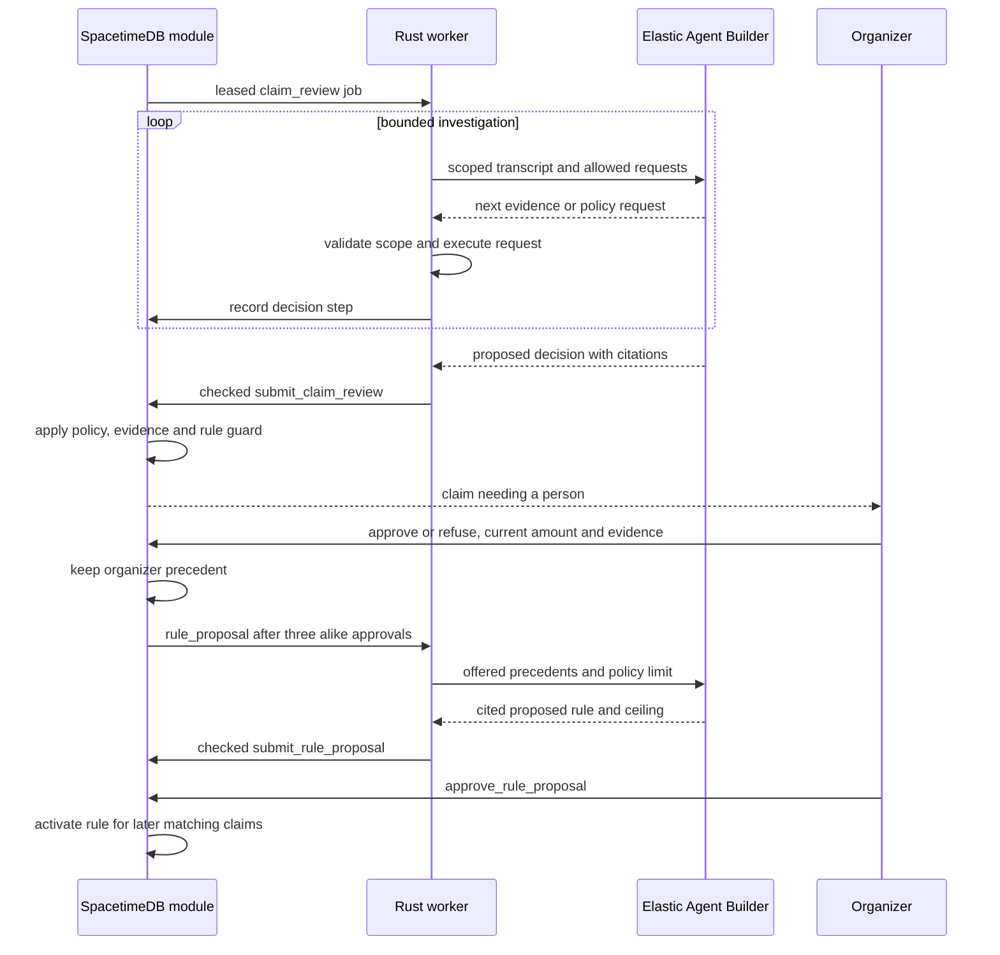

# Anthropic Claude API

Band1t separates the model from the system that runs its work. Elastic Workflows and Agent Builder now execute the worker’s reading, writing, selection and claim-investigation tasks. The Elastic project’s configured model connector may still use Claude underneath; that does not make the worker’s request a direct Anthropic API call.

`claude-client` remains the direct Anthropic transport and the request/schema types used by several handlers. Reusing `MessageRequest` or an `Effort` enum does not prove that a handler calls Anthropic: its `run` function selects the executor. [Elastic](Elastic.md) owns the current workflows, while each feature owns its validation and result reducer.

This document describes source behavior. A deployment is verified separately; adding a workflow or changing a handler does not establish that a live job has run successfully.

## Role in the system

- Keep the direct Anthropic Messages API client in `claude-client`, for call sites that explicitly select it.
- Describe how that transport differs from Elastic’s configured model connector.
- Keep model-call attribution factual: execution owner, execution id, requested model, reported model, usage and failures.
- Keep amounts, access, safety, randomness and changes to business state in Rust and SpacetimeDB reducers.

The direct client does not own the job queue, claim decisions, card extraction or letters merely because those handlers share its Rust request types. No model runs inside the safety loop or the SpacetimeDB module.

## Current execution catalogue

| Job or stage | Execution path | Responsibility and checks |
|---|---|---|
| `medical_extract` | Elastic `bandit-run-task`, one bounded `ai.prompt` step | Read private page text from one medical history or insurance card; code validates page references and fields before `apply_medical_extract`. The private page text is not put in a shared search index |
| `clinic_report` | Elastic `bandit-run-task` | Write only the report for the case code’s seeded generator chose; code validates it, renders the PDF and queues a separate document read |
| `claim_draft`, `recovery_letter` | Elastic `bandit-run-task` | Write from supplied settled facts and code-computed figures. Code validates every amount and cited fact; templates remain the fallback described in [Insurance](../6-features/Insurance.md) |
| `merch_picks` | Elastic `bandit-run-task` | Select from supplied eligible product and photo ids; code checks the ids and text lengths. A selection never purchases anything |
| `venue_find`, `venue_map` inside `venue_setup` | Elastic `bandit-run-task` | Select from the pages and URLs Bright Data supplied. Rust validates each URL and runs the export |
| `plan_find` inside `attendee_policy_lookup` | Elastic `bandit-run-task` | Select candidate URLs for the named health plan; the document reader checks the printed plan wording |
| `venue_policy_find` inside `venue_policy_lookup` | Elastic `bandit-run-task` | Select supplied coverage-form URLs; the document reader checks form numbers and page ranges |
| `document_read` | Elastic `bandit-read-document` and `bandit-document-reader` | Read policy wording and hospital reports with a schema per kind; code checks quoted text on its page and applies terms or the report through the feature’s reducer |
| `claim_review` | Elastic `bandit-investigate-claim` and `bandit-claim-investigator` | Agent Builder chooses evidence reads and policy searches. Rust executes only this claim’s permitted requests, keeps the transcript and turn limit, reports the steps, and validates the final decision |
| `rule_proposal` | Elastic `bandit-propose-rule` and `bandit-rule-proposer` | Count offered precedents with ES\|QL and propose a rule; code checks citations and the ceiling. Only a separate organizer approval activates it |
| `photo_features`, scanned-page `document_transcribe` | Elastic `bandit-read-image` and `bandit-image-reader` | Read one temporary image attachment, validate its count and caption, then delete the upload. Identity still comes from bands |

`attendee_policy_lookup` is the canonical job kind. Workers still handle already queued `plan_lookup` jobs, and the `plan_lookup` table, payload and `finish_plan_lookup` reducer keep their existing names.

A fixed `ai.prompt` step is a bounded transformation of supplied input, not an autonomous agent. It does not choose a next action, call tools or change payment state. Claim investigation has a separate agent loop because it must choose what to inspect next.

## The Decision Engine and organizer approval

The Decision Engine is a product role, implemented by Elastic Agent Builder plus Rust’s validators and payment guard. Its claim agent can choose which evidence source to open, search the policy wording, read a clause and then propose pay, refuse or ask the organizer. The worker bounds the loop and scopes every request to the current claim.

Three similar approved simple claims can open a rule proposal. The proposal agent counts the offered precedents and cites the claims behind its ceiling. The organizer must approve that proposal separately; only then can a later matching claim settle automatically inside the rule’s ceiling and the code guard.

Complicated claims remain individual organizer decisions and do not teach an automatic rule. The agent never invents an amount, chooses a random outcome, approves its own proposal or bypasses the reducer’s lease and role checks.

## Direct Anthropic client

`crates/claude-client` uses non-streaming `POST /v1/messages`. It accepts text, PDF and image blocks, optional tools and structured output. `ANTHROPIC_MODEL` selects its model, with the default in `DEFAULT_MODEL`; these settings do not select Elastic’s connector.

The client records a stable request hash and exposes the model, usage and stop reason returned by Anthropic. It retries selected HTTP failures and connection errors with bounded backoff. The worker records successful and failed attempts and applies feature-specific correction and fallback behavior.

The crate does not implement the earlier design’s Messages streaming, Message Batches or database replay cache. Those capabilities must not be inferred from a use-case table. Worker photo reading and scanned-page transcription now use `bandit-read-image`; no production worker handler selects the direct client. Leo-owned camera work remains a separate integration.

## Model-call records

| Field or content | Meaning |
|---|---|
| `kind`, `request_hash` | The stage and the request being recorded |
| `model_requested` | Direct model name, `elastic-workflow:bandit-run-task`, `elastic-workflow:bandit-read-image`, or `elastic-agent:bandit-claim-investigator`, according to the selected executor |
| `model_used` | The model or connector identity actually reported by the execution; empty when it was not reported |
| `effort` | A setting actually sent to a supporting transport. The fixed Elastic executor does not invent a Claude effort setting |
| `response` | Bounded answer and execution metadata. Workflow and execution ids identify the run; request text is not added to this field |
| Usage fields | Counts returned by the provider. Missing values are not evidence that a request was free; the raw execution metadata records what was available |
| `status`, `error`, `latency_ms` | Whether the attempt completed, its failure reason, and elapsed time |

The fixed text executor accepts only a system instruction, user text and a JSON schema. It rejects image/PDF blocks, caller tools and conversation history before sending a request. Image extraction and claim investigation each use their own workflow instead of silently discarding unsupported input.

## Failure behavior

| Failure | Result |
|---|---|
| Elastic or its connector is unavailable | The job records the failure and follows its queue retry/dead-job handling; it does not silently switch to direct Anthropic |
| Text answer fails domain validation | One correction attempt where the feature supports it; then its documented fallback or failed job |
| Claim agent requests an unknown tool, malformed arguments or another claim’s data | Rust rejects the request before executing an evidence handler |
| Claim decision exceeds code authority | The module rejects or routes it to the organizer; no workflow writes a payout directly |
| A letter still fails validation | A code template replaces it; final-attempt workflow failure also allows the template path |
| Image upload cannot be removed | The image task does not report success; cleanup is also attempted on cancellation |

The band and incident safety paths continue independently of all model execution.

## Dependencies

- [Elastic](Elastic.md): workflows, Agent Builder agents, model connectors, document search and execution records.
- [Rust-Backend](../3-services/Rust-Backend.md): worker dispatch, leases and service configuration.
- [Insurance](../6-features/Insurance.md): investigation, code guard, precedents, proposals and letters.
- [Medical-Card](../6-features/Medical-Card.md), [Merch](../6-features/Merch.md), [Bright-Data](Bright-Data.md): bounded tasks and their result validation.
- [Vision](../4-devices/Vision.md): Leo-owned security-camera integration and its separate status.

## Decisions

| Decision | Why |
|---|---|
| Name the execution system separately from the underlying model | Elastic can run Claude through its connector without a direct worker call to Anthropic |
| Use a fixed workflow for supplied-text transformations | Extraction, selection and drafting do not need an invented autonomous loop |
| Use Agent Builder for claim investigation and rule proposals | The agent chooses evidence or queries, while code scopes access and checks the result |
| Keep the organizer’s proposal approval separate from claim approval | A precedent is evidence for a proposed rule, not permission to apply that rule |
| Keep provider details in model-call records and call the product role Decision Engine | The user follows what decided the claim; diagnostics retain how it ran |
| No silent fallback to another execution provider | A failed migration remains visible and cannot quietly change behavior or billing |
