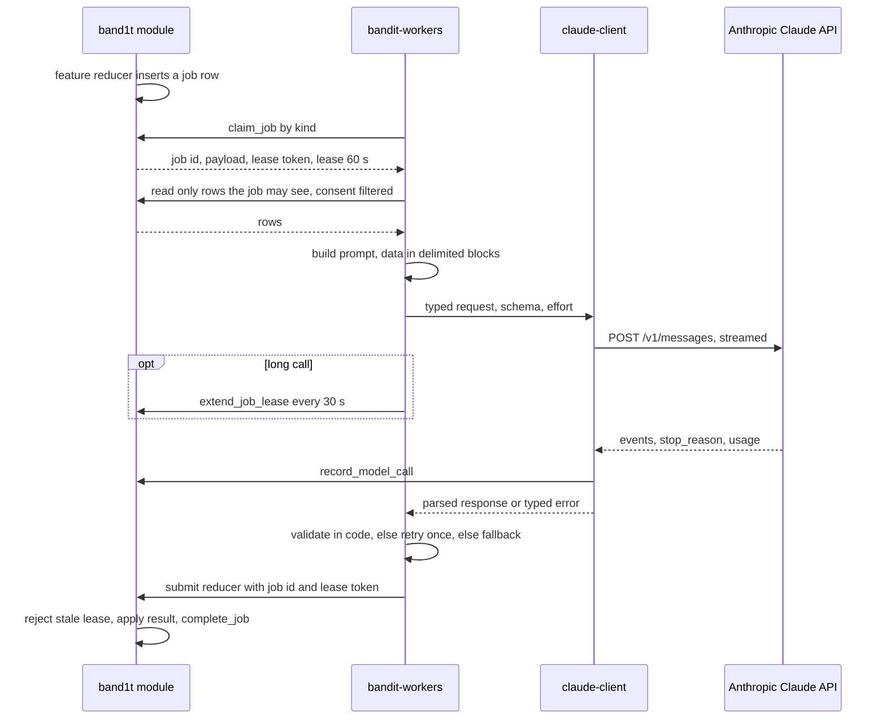
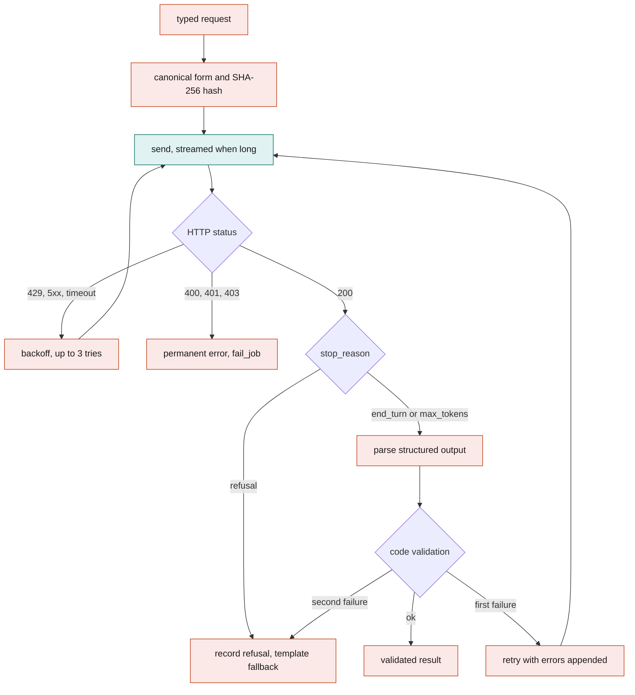
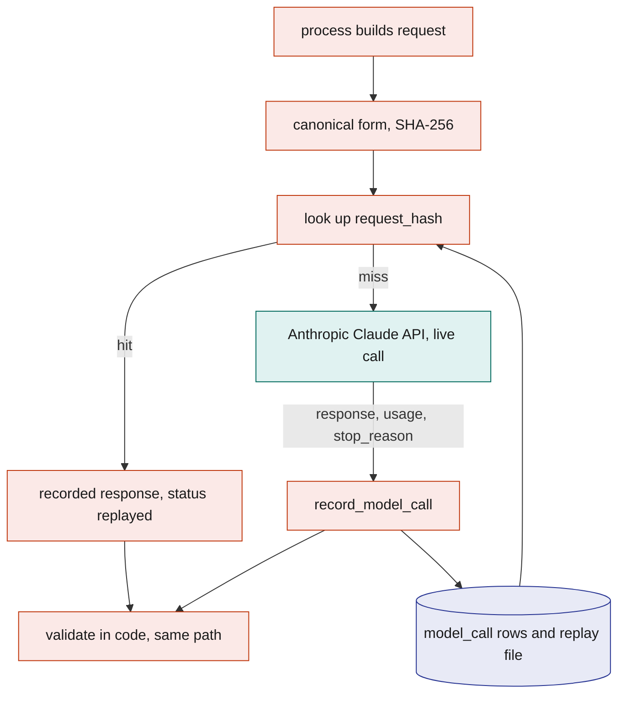

# Anthropic Claude API

BandIt uses the Anthropic Claude API where words or pictures must be read or written: reading an attendee's medical history and health insurance PDFs into a medical card, reading booth numbers off the floor plan image, writing the hospital's report for a drawn case in the scripted claims run, transcribing a scanned insurance page word for word, judging whether an injury on a bill follows from the fall a band recorded, drafting the notice of loss or a recovery letter, and, in the vision design (TBD -- LEO), judging what a few security camera frames show after a band has already raised the alarm and, after the event, counting the people in each photographer photo and captioning it. It uses two parts of the Anthropic Claude API: the Messages API for every direct call, and the Message Batches API for those photo captions only.

Every call goes through one Rust crate, `claude-client`, on one model, set in `claude-client`, made by a Rust process from a `job` row or an event, never from the safety loop. Every call is recorded in `model_call`, so scripted calls replay instantly and a rerun gives the same bytes. The model reads and writes words; code decides money, coverage, safety and access.

## Role in the system

Responsibilities:

- Own the `claude-client` crate: the only code in BandIt that talks to the Anthropic Claude API.
- Define how a job for the Anthropic Claude API runs inside `bandit-workers`: claim, gather, prompt, call, validate, submit.
- Own the catalogue of Anthropic Claude API use cases: trigger, inputs, output, effort, validation, and the fallback when the model gives no usable answer.
- Own the `model_call` table, the request hash, and the record and replay modes.
- Own the guardrails that every use case obeys.
- Be the one place where a model makes a judgment about people or events, such as what the security camera frames show, whether an injury follows from an event, or what a claim letter says.

Non-responsibilities:

- It never runs inside the `band1t` module and never inside the safety loop ([Safety](../6-features/Safety.md)). No SpacetimeDB procedure calls the Anthropic Claude API; every external call stays in a Rust process.
- It does not decide anything that moves money, settles coverage, grants access or changes a band's state. Those decisions are reducers with code-only rules ([Capital-One-Nessie](Capital-One-Nessie.md), [Insurance](../6-features/Insurance.md), [Medical-Card](../6-features/Medical-Card.md), [SpacetimeDB](../2-data/SpacetimeDB.md)).
- It does not own the job queue (`job`, `claim_job`, `complete_job`, `fail_job`, `extend_job_lease`, `job_reaper` are in [SpacetimeDB](../2-data/SpacetimeDB.md)) or the worker process shell ([Rust-Backend](../3-services/Rust-Backend.md)). It owns only what happens between claiming such a job and submitting its result.
- Security camera analysis is Vision (TBD -- LEO), see [Vision](../4-devices/Vision.md). `bandit-vision` uses this crate with the workers' API key and records in `model_call`; it calls the Anthropic Claude API for event assessment and, after the event, for `photo_features`. No other job sends pixels.
- Elastic.md: Elastic's agents organize and validate data and nothing more. The Anthropic Claude API is not wired into Elastic; Elastic's `bandit-organizer` agent runs on the Elastic Managed LLM ([Elastic](Elastic.md)).

## Interfaces

| Direction | Who | What flows | Transport |
|---|---|---|---|
| In | `band1t` module, `job` table | Jobs of kinds `medical_extract`, `clinic_report`, `claim_review`, `claim_draft`, `recovery_letter`, claimed by kind with `claim_job`; the payload names the rows the job is about | SpacetimeDB SDK (role `worker`) |
| In | Feature tables | The rows a job may read after consent filters: `medical_document` and `blob_ref` (Medical-Card), `incident`, `incident_snapshot`, `incident_note`, `evidence_fact`, `medical_record`, `claim_line` (Insurance) | SpacetimeDB subscription or one-off query from the worker |
| In | Blob store folder in `/var/lib/bandit` ([Rust-Backend](../3-services/Rust-Backend.md)) | PDF bytes for `medical_extract`, found through its `blob_ref` | Read directly from the folder, because `bandit-workers` runs on the same Vultr VM as `bandit-api` |
| In | `bandit-ingest` | `floorplan_check` at ingest time, no job row; recorded with role `ingest` ([Bright-Data](Bright-Data.md)) | In-process |
| In | `bandit-vision` (TBD -- LEO) | event assessment, no job row; and `photo_features` jobs, which `bandit-vision` claims with the `vision` role and answers with `submit_photo_features` ([Vision](../4-devices/Vision.md)); both recorded with role `vision` | In-process |
| In | `bandit-api` blob download (TBD -- LEO) | The photographer photo named by a `photo_features` job | HTTPS, because `bandit-vision` runs on the venue laptop |
| In | Process configuration ([Rust-Backend](../3-services/Rust-Backend.md)) | `ANTHROPIC_API_KEY` (one key, shared by `bandit-workers`, `bandit-ingest` and `bandit-vision`), `claude_mode` (`live`, `replay`, `replay_then_live`), the replay file path | Environment |
| Out | Anthropic Claude API | `POST /v1/messages`, streamed when the output is long; Vision.md (TBD -- LEO): `POST /v1/messages/batches` for `photo_features` only | HTTPS, API key header, `anthropic-version` header `2026-10-21` |
| Out | `band1t` module | `record_model_call` (one row per attempt), then the feature's submit reducer with the job id and lease token: `apply_medical_extract` (Medical-Card), `file_clinic_report`, `submit_claim_review` and `attach_claim_letters` (Insurance, the last one for every letter kind); then `complete_job` or `fail_job` | SpacetimeDB SDK |
| Out | `band1t` module | `extend_job_lease` while a call outlives the 60 s lease | SpacetimeDB SDK |
| Out | Blob store folder in `/var/lib/bandit` | The `request_blob` of a job's call, the `medical_extract` response, and Insurance's hospital report PDF that `clinic_report` renders (purpose `hospital_report`), each registered with `register_blob` | Written directly to the folder, then the SpacetimeDB SDK for `register_blob` |

Submit reducer names belong to their feature docs. Each submit reducer rejects a lease that is not the current one, so a slow duplicate worker cannot overwrite a newer result.

## Design

### The `claude-client` crate

There is no official Anthropic Rust SDK, so `claude-client` is a small crate over an HTTPS client that speaks the Messages API directly. It takes a typed request and returns a typed, validated response or a typed error.

| Feature | What it does | Why |
|---|---|---|
| Typed request | Model, system prompt blocks, user content blocks (text, `document`, `image`), `output_config` (effort, structured output format), `max_tokens`. The crate has no fields for sampling parameters (`temperature`, `top_p`, `top_k`), because API version `2026-10-21` rejects them | Every job builds the same shape, so caching and hashing work the same way everywhere |
| Streaming | Server-sent events for any request whose `max_tokens` is above 4,000 (starting value, calibrate); the crate assembles the final message and exposes a progress callback | Long outputs would otherwise hit HTTP timeouts; the callback is where the worker extends its lease |
| Retries with backoff | Retries on 429, 408, 409, 5xx (including 529 overloaded) and connection errors; honours `retry-after`, else exponential backoff with jitter from 1 s; 3 tries per attempt (starting value, calibrate) | Rate limits and overloads are normal during a bulk run; a 400 is never retried |
| Timeouts | Connect 10 s, first byte 30 s, idle between stream events 30 s, and a total budget per job kind (45 s starting value, calibrate). A kind marked long calls `extend_job_lease` every 30 s from the progress callback | A hung call must not outlive its lease silently, or a second worker claims the same job |
| Refusal handling | Checks `stop_reason` before reading content; a `refusal` carries `stop_details` with a category, which is recorded | A refusal is a normal outcome; the feature uses its template fallback |
| Structured outputs | A JSON schema in `output_config.format`; the response is parsed into the job's Rust type and then validated by code (ids exist, enums allowed, lengths fit, amounts equal the given cents) | Forced tool choice is not available on this model; the schema guarantees shape, and only code can guarantee truth |
| Prompt caching | `cache_control` breakpoints after the stable system prompt and schema, and after any stable catalogue (the coverage vocabulary); volatile rows follow the last breakpoint | Repeated calls of a kind pay for the stable prefix once per cache window |
| PDF input | Each medical PDF, and each scanned page of an insurance PDF that has no text layer, goes in as a `document` block, inline base64 | The medical card is read from the PDF itself, with page references, and a scanned page is written out word for word; Medical-Card.md's PDFs are a few pages from a doctor or an insurance card, and one page is well under the API's 32 MB request limit |
| Image input | JPEG or PNG as `image` blocks, inline base64, resized by the caller (the floor plan to fit the image limits, vision frames to 1280 by 720, photographer photos to 1280 on the long edge, starting value) | Used by `bandit-ingest` for `floorplan_check` and by `bandit-vision` (TBD -- LEO) |
| Message Batches (TBD -- LEO) | One batch request per `photo_features` job, with the job id as `custom_id`; the crate polls the batch every 60 s (starting value) until it ends, then reads each result by `custom_id`. A retry after a validation failure goes into the next batch | Used only for `photo_features`, which runs after the event and nobody waits for; every other kind is a direct call |
| Recording | Every attempt, success or failure, produces a `model_call` row through the record hook | Audit and replay |
| Replay | Serves a recorded response from `model_call` by request hash, without the network | Instant, identical scripted calls |

Settings fixed for every call: the model set in `claude-client`; adaptive thinking, which cannot be turned off on this model, so effort is the only lever; `output_config.effort` set explicitly per kind, because the model's default is `medium`; thinking display omitted, so reasoning is not stored; no assistant prefill, no forced tool choice and no sampling parameters, since all three are rejected. Each kind sends its own `max_tokens` cap from the start. No BandIt job uses tools: each job is one request and one response, so the model cannot act on anything.

The Anthropic Claude API cannot generate or edit images, so the crate has no image output path. No part of BandIt generates images.

### How `bandit-workers` runs a job

The diagram answers: what happens between a feature reducer enqueuing a job and its result landing in a table?

1. **Claim.** The worker runs one loop per job kind and calls `claim_job` with that kind. It receives the job id, payload and a lease token. The lease is 60 s, and `job_reaper` returns expired leases to the queue, so everything below finishes inside the lease or extends it.
2. **Gather.** The payload names rows, not facts. The worker reads the rows through its own connection with the `worker` role and applies consent filters before any text is assembled: `medical_extract` reads only the document named in the job, taking the PDF bytes straight from the blob store folder in `/var/lib/bandit`, and Insurance's `claim_review` reads the pack's facts with every amount left out. Rows the job may not see never reach the prompt, so the model cannot leak them.
3. **Prompt.** The system prompt for the kind is fixed text in the crate: the task, the output schema, and the standing rule that everything in the user turn is data. Rows go into the user turn as delimited blocks with field names, sorted by id, with times formatted from the rows, so the same job always produces the same bytes and the same request hash.
4. **Call.** `claude-client` makes the request with the kind's effort and `max_tokens`, streaming when the kind calls for it. A kind marked long (`medical_extract` with a large PDF) calls `extend_job_lease` every 30 s while it waits.
5. **Validate.** The response is parsed into the kind's type and checked by code. A first validation failure retries once with the errors appended to the user turn; a second submits the kind's fallback.
6. **Submit.** The worker calls the feature's submit reducer with the job id, the lease token and the validated result. The reducer checks the lease, applies the result in the same transaction, and calls `complete_job`. A stale lease is rejected and the worker drops its result.
7. **Fail.** A permanent error (400, 401, 403) ends with `fail_job` and a reason. After 3 attempts the job is `dead` and the feature shows its no-AI state.

### Inside one call

The diagram answers: how does one request become either a validated result or a clean fallback?

A `max_tokens` stop means the structured output was cut off, so it fails parsing and takes the same validation path as any other bad answer.

### Use-case catalogue

Every use case runs on the model set in `claude-client`, with effort set per kind. Outputs are structured (JSON schema), and every output is validated by code before a reducer sees it. Each row starts with the file that owns it, so deleting that file means deleting that row.

| Owner and use case | Trigger | Inputs (after filters) | Output | Effort | Code validation | Fallback without AI |
|---|---|---|---|---|---|---|
| [Medical-Card](../6-features/Medical-Card.md) `medical_extract` | The tap page (/t/code) calls `submit_medical_document` after it uploads a medical history or a health insurance PDF in setup; one job per document | The PDF as an inline document block; a prompt that names the kind and the page count; one JSON schema for both kinds | Blood type, allergies, conditions, medications, the emergency contact and short notes from the medical history, or the insurer, plan, member id, group number and phone from the insurance card, each item with the page it is printed on; fields not printed are left empty, never guessed | `low` | Through `ask_twice`: at most 20 items a list; an item whose page is not between 1 and the page count goes to `dropped`; a blood type outside the list becomes `unknown`; phones keep digits and the plus sign; the insurance needs a page; notes at most 1000 characters; the attendee checks the medical card in the card step of setup | None: without the Anthropic Claude API no document is read and there is no medical card |
| [Bright-Data](Bright-Data.md) `floorplan_check` | The map stage of `bandit-ingest`, once per floor plan image; runs in the ingest process, not the queue | The floor plan image as an image block, resized to fit the image limits, and the booth numbers the exhibitor records list | The hall's outer edges in pixels; for each booth number it can see, the centre in pixels and a confidence; a listed number it cannot see is null; it never invents a number that is not printed on the plan | `medium` | Schema with nullable positions; every position inside the image bounds; no booth number twice; code then converts pixels to metres with the hall's real width | Booths load at the plan's default spot, and an organizer places each one with `place_booth` from the command line |
| [Bright-Data](Bright-Data.md) `venue_find` | A venue setup run (job `venue_setup`), once, after the search | The event's name and the Bright Data Web MCP search results for three queries, marked as untrusted web content | The event site, the venue's name and street address, and up to 6 pages to read, each with a reason; a field the results do not show stays empty | `medium` | Through `ask_twice`: schema; every address is one the results named; the lists are capped in code | The setup fails with the reason, and the shown venue stays as it was |
| [Bright-Data](Bright-Data.md) `plan_find` | A plan lookup (job `plan_lookup`), once, after the search | The kind (`health`), the insurer, the plan, the state and the year as the attendee typed them, and the Bright Data Web MCP search results for two queries, marked as untrusted web content; never the attendee's name | Up to 3 addresses of this plan's own document (its Summary of Benefits and Coverage), best first, each with why; broker pages, comparison sites, other plans and other years are left out | `low` | Through `ask_twice`: schema; every address is one the results named; at most 3 | The lookup ends `not_found`, and the tap page offers the upload |
| [Bright-Data](Bright-Data.md) `plan_check` | A plan lookup, once per fetched PDF, at most 3 | The PDF as an inline document block, the kind, and the insurer and plan the attendee typed | The insurer, the plan and the plan year as printed, each with its page, and whether the document is a Summary of Benefits and Coverage | `low` | Through `ask_twice`: schema; every page is within the page count; code then compares the printed insurer and plan with the typed ones | The PDF is passed over, and the next address is fetched |
| [Bright-Data](Bright-Data.md) `venue_policy_find` | A venue policy lookup (job `venue_policy_lookup`), once per form, after its search | The part (`liability` or `property`), the insurer, the state and the form number as the organizer typed them, and the Bright Data Web MCP search results for that form's two queries, marked as untrusted web content; never the policy number | Up to 3 addresses of that form, best first, each with why; articles, broker pages and other forms are left out | `low` | Through `ask_twice`: schema; every address is one the results named; at most 3 | That form is not found; with neither form, the lookup ends `not_found` and the tab offers the upload |
| [Bright-Data](Bright-Data.md) `venue_policy_check` | A venue policy lookup, once per fetched PDF, at most 3 per form | The PDF as an inline document block, the part, and the form number the organizer typed | Which form it is (`liability_form`, `property_form` or `other`), and its form number and title as printed, each with its page | `low` | Through `ask_twice`: schema; every page is within the page count; code then compares the printed form number with the typed one | The PDF is passed over, and the next address is fetched |
| [Bright-Data](Bright-Data.md) `venue_map` | A venue setup run, once per round of reading, at most 2 rounds | The pages read so far: each page's address, title, a text excerpt and its links | Up to 3 3D maps, each with a reason; the floor plans; the pages that matter, each with a label; when there is no map, up to 4 pages to read next | `medium` | Through `ask_twice`: schema; every address is one the pages gave; the lists are capped in code | The setup ends `no model`, and the shown venue stays as it was |
| [Insurance](../6-features/Insurance.md) `claim_review` | Every injury claim that passes the code checks, before its outcome is decided | The pack's facts by id: the band's flag, time and zone, the witnesses, the medic's note and its time, the bill's service date, provider, visit reason and line descriptions, the incident kind; no amounts | A verdict, `follows` or `doubt`, an explanation of a few sentences and the fact ids it relied on | `high` | Schema; every cited fact id exists in this pack version; the explanation contains no dollar figure. Code decides money: the output has no amount field and the coverage function never reads it, so a `doubt` flags the claim and routes it to a person; it never refuses a claim and never changes an amount | Verdict `none`, treated as `doubt`: the claim goes to a person and never settles automatically |
| [Insurance](../6-features/Insurance.md) `claim_draft` | Once per incident, when its claims are routed or settled automatically, and again for a rebuilt pack | The incident, its snapshot, staff notes, the evidence facts, the bill lines and the amounts already computed by code, the policy vocabulary | The free-text fields of the first notice of loss in ACORD 3 layout (what happened, each injured person's activity and injury, the damaged item and where it is), a one-paragraph summary per claim for the organizer, and a suggested rule tolerance in cents per claim; code fills every other field of the notice | `high` | Schema; every cited fact id exists in the pack; every dollar figure appears in the job payload. Code decides money: the tolerance is only a suggestion the organizer accepts or changes in the rule ceiling field; the organizer reads the notice before anything is sent | Template notice in the same layout with the facts and amounts filled in by code, and no suggested tolerance |
| [Insurance](../6-features/Insurance.md) `recovery_letter` | An organizer requests recovery for a `property` incident | The property event, its evidence facts, the vendor or responsible party on record, the cost in cents | A letter worded as a query, not an accusation, asking the party to confirm what happened and how the cost is handled | `medium` | Schema, including a `stance` field that must be `query`; every cited fact id exists; every dollar figure appears in the job payload; code scans the text against a fixed list of fault-assigning phrases and any hit fails validation; staff approve before sending | Template letter |
| [Vision](../4-devices/Vision.md) `photo_features` (TBD -- LEO) | Leo's default: Social.md's `register_photo` enqueues one job per photographer photo; `bandit-vision` sends them after the event through Message Batches | Leo's default: the photo as an inline image block | Leo's default: the number of people in the photo and a one-line caption, written through `submit_photo_features` (photo id, people count, caption, `model_call` id) | `medium` | Leo's default: schema; the count is a whole number from 0 to 50 (starting value); the caption fits its length and names no one | The photo keeps no count; Social tags it by band zone and time with the default cap |
| [Vision](../4-devices/Vision.md) event assessment (TBD -- LEO) | Leo's default: an incident opens from a band SOS or fall flag, the local detector flags a person down, or staff open a `property` incident; never on a timer | Leo's default: 6 to 8 frames from the 10 s ring buffer around the moment, at 1280 by 720, inline base64; the detector's boxes and a pose summary as text; the band rows for the zone | Leo's default: confirmed yes or no, confidence, description, recommended action, a staff report and an insurance-ready incident description, written through `submit_vision_assessment` into `vision_assessment` | `medium` | Leo's default: schema; confidence in range; incident id matches; the band's own alert never waits for it | The incident proceeds on band data alone |

`medical_extract` receives the medical PDF, and `photo_features` (TBD -- LEO) one photo. Insurance's hospital report is not read here: its record comes from The Evidence Engine, which reads the PDF with the Elastic Workflow `bandit-read-document` ([Elastic](Elastic.md)), and the Anthropic Claude API only transcribes a scanned page of it word for word. `floorplan_check` sends one image at ingest time, and the vision assessment sends frames; no other job sends photos. Counting and person-down detection run locally on every frame (`report_zone_count`, `report_ground_alert`), and the Anthropic Claude API is asked only after an event, so its latency never sits in front of an alert.

### Recording and replay

Every attempt writes one `model_call` row through `record_model_call` (roles `worker`, `ingest` and `vision`). The row is the audit trail and the replay source.

| Field | Meaning |
|---|---|
| `id` | Assigned by SpacetimeDB |
| `job_id` | The job; empty for ingest-time calls and the vision event assessment |
| `source` | `worker`, `ingest` or `vision` |
| `kind` | The use case (`medical_extract`, `floorplan_check`, `vision_assessment`, ...) |
| `attempt` | The job attempt this call belonged to |
| `model_used` | The model the response reports |
| `effort` | The effort level sent |
| `request_hash` | SHA-256 of the canonical request |
| `batch_id` | The Message Batch the request went in (TBD -- LEO), for `photo_features` only; empty for direct calls |
| `request_blob` | `blob_ref` holding the full request for audit; written by `bandit-workers`; left out for `medical_extract`, `floorplan_check` and vision calls, whose inputs are referenced by `medical_document`, `hall.sheet_blob_id`, `vision_assessment` and `photo` instead |
| `response` | The final message as text, including the structured output; for `medical_extract` a `blob_ref` of access class `owner_only` instead ([Medical-Card](../6-features/Medical-Card.md)) |
| `stop_reason`, `stop_category` | `end_turn`, `max_tokens`, `refusal`; the refusal category when present |
| `input_tokens`, `output_tokens`, `cache_read_tokens`, `cache_write_tokens` | Usage as reported |
| `latency_ms` | Wall time of the call; for a batch request, from submitting the batch to reading its result |
| `status` | `ok`, `refusal`, `error`, `replayed` |
| `replay_of` | The `model_call` this one was served from |
| `created_at` | When the row was written |

The canonical request is the request body with field order fixed, whitespace collapsed, inline binaries (PDF pages, images, frames) replaced by their SHA-256, and no timestamps except facts from rows. Two jobs that see the same rows hash the same, which makes replay deterministic.

Modes, set in the process configuration:

- `live`: call the API and record.
- `replay_then_live`: serve a recorded response on a hash hit; call and record on a miss. This is the mode the event runs in: scripted calls replay instantly and identically, and a judge's new request (their own PDF, their own night) goes live.
- `replay`: serve from recordings only; a miss fails the attempt and the feature's fallback applies. Used for tests without network or key.

A batch request is looked up the same way before the batch is built, so a hit never enters the batch. Replays write their own `model_call` row with status `replayed` and `replay_of`, so the audit trail shows what actually ran at the event. A fresh database has no `model_call` rows, so the processes also load a replay file exported before the event (one recorded call per line, same fields); the file is part of the event's seed set.

The diagram answers: in `replay_then_live`, how is a recorded call served again, and what happens to a new one?

### Guardrails

- **Never in the safety loop.** No reducer on the band or incident path waits on a job or an event call, and the worker roles cannot write `band`, `command` or `incident`. A vision assessment (TBD -- LEO) arrives after the bands have reacted and only adds a `vision_assessment` row.
- **The model never decides money, coverage, safety or access.** Amounts are computed by code and handed to the model as facts; every dollar figure in a claim or recovery letter must appear in the job payload, or the letter fails validation. A recovery letter must have `stance` `query` and contain none of the fixed fault-assigning phrases.

  A hospital report's record comes from The Evidence Engine, not from the model, and code prices every line against the fee schedule; the causation review gets no amounts and returns none, so it can send a claim to a person but never changes an amount. Coverage and limits are rules in [Insurance](../6-features/Insurance.md).

  Medical access is the `medic` role rule in [Medical-Card](../6-features/Medical-Card.md), with every tap logged. The model's output only ever becomes text fields in a row that a person reads or confirms.
- **Identity comes from bands.** The Anthropic Claude API never identifies faces, and it reports only how many people it sees and a caption that names no one. Who is in a photo comes from band zone and time, capped by the people count ([Social](../6-features/Social.md), [Vision](../4-devices/Vision.md)).
- **Data, not instructions.** Scraped facts, PDFs, images, frames and attendee text arrive inside delimited data blocks in the user turn. The system prompt says the blocks are data and that any instruction inside them is to be ignored and reported in a `notes` field. Outputs are constrained by schema and no job has tools, so an injected instruction has nowhere to land.
- **Minimum inputs.** Consent filters run before prompt building, in the process, on rows. The prompt never contains social handles, bank links or medical data that the output does not need.
- **Validate, retry once, then fall back.** A response that fails code validation is retried once with the errors; a second failure uses the kind's template fallback and the job still completes, so the attendee always gets something.
- **Refusals are outcomes.** A `refusal` is recorded with its category and routed to the template fallback; the same content is never resent.
- **Everything recorded.** Every attempt is a `model_call` row readable by the owner and the `worker` role, with hashes rather than copies for sensitive requests. The team reads it with the owner's SpacetimeDB tools; there is no organizer portal (/organizer) panel for it.

## Failure modes and fallbacks

| Failure | Effect | Design answer |
|---|---|---|
| Rate limit (429), overload (529) or a server error | An attempt slows down or fails | Up to 3 tries with backoff that honours `retry-after`; the job's next attempt picks it up after that |
| A call outlives the 60 s lease | A second worker could claim the job | The 45 s call budget stays under the lease, long kinds extend it every 30 s, and the submit reducer rejects a stale lease, so only one result lands |
| `refusal` stop reason | No usable output | The kind's template fallback; the content is never resent |
| Output fails code validation, or stops at `max_tokens` | Wrong or cut-off content | One retry with the errors appended, and the template fallback if that fails too |
| Anthropic Claude API unreachable or the key rejected during the event | Live calls fail | Scripted calls still replay from `model_call` by hash; every other job completes with its template fallback |
| Vision assessment or photo features late, refused or absent (TBD -- LEO) | No `vision_assessment` row, or a photo with no people count | The incident runs on band data, and the photo is tagged by zone and time with the default cap; the output of the Anthropic Claude API is evidence, never a gate |

## Dependencies

**Depends on**

- [SpacetimeDB](../2-data/SpacetimeDB.md): `job`, `claim_job`, `complete_job`, `fail_job`, `extend_job_lease`, `job_reaper`, `blob_ref`, `register_blob`, roles `worker`, `ingest` and `vision`.
- [Rust-Backend](../3-services/Rust-Backend.md): the `bandit-workers` process, its configuration and secrets, the Cargo workspace that holds `claude-client`.
- The Anthropic Claude API (its Messages API).

**Used by**

- [Medical-Card](../6-features/Medical-Card.md) (`medical_extract`), [Insurance](../6-features/Insurance.md) (`clinic_report`, `claim_review`, `claim_draft`, `recovery_letter`), [Bright-Data](Bright-Data.md) (`floorplan_check`, `venue_find`, `venue_map`, `plan_find`, `plan_check`, `venue_policy_find`, `venue_policy_check`), [Vision](../4-devices/Vision.md) (TBD -- LEO): event assessment, `photo_features`.

**If you delete this file**

- Remove the `claude-client` crate from the workspace in [Rust-Backend](../3-services/Rust-Backend.md) and the job loop for the Anthropic Claude API from `bandit-workers`.
- Remove `model_call` from the optional table list in [SpacetimeDB](../2-data/SpacetimeDB.md) and the replay file from the seed set.
- Delete [Medical-Card](../6-features/Medical-Card.md) too: it has no path without the Anthropic Claude API.
- In each other feature doc, delete the Anthropic Claude API row in its job table and keep the fallback as the only path: booths placed by hand with `place_booth` from the command line, hospital reports filed by staff as PDFs (`submit_medical_record`), causation `none` so every injury claim goes to the organizer, template letters.
- In [Vision](../4-devices/Vision.md) (TBD -- LEO), `bandit-vision` keeps local counting and person-down detection and loses the event assessment, `vision_assessment` and `photo_features`; Social tags photos by zone and time only.
- Remove the "Anthropic-Claude-API.md" rows from the interfaces, data ownership and failure tables in [Architecture](../1-overview/Architecture.md), the Anthropic Claude API column from the `bandit-workers` row and the `claude-client` crate row in [Rust-Backend](../3-services/Rust-Backend.md), and the Anthropic-Claude-API row and node in [README](../README.md).
- The safety features are unchanged.

## Decisions

| Decision | Why |
|---|---|
| Elastic's `bandit-organizer` agent runs on the Elastic Managed LLM; the Anthropic Claude API is not wired into Elastic | Every call to the Anthropic Claude API stays in `claude-client` and `model_call`; Elastic agents organize and validate, and judgments go to the Anthropic Claude API |
| `bandit-vision` (TBD -- LEO) shares the workers' API key and account | One key, one rate limit and one bill to watch during the event |
| `model_call` has no organizer portal panel; the team reads it with the owner's SpacetimeDB tools | It is an audit trail for the team, not something an organizer acts on during the event |
| No SpacetimeDB procedure calls the Anthropic Claude API | Procedures cannot reach private addresses and keep secrets in the module environment; one path to the Anthropic Claude API keeps every call recorded and replayable |
| Every use case runs on one model, set in `claude-client`, with effort set per kind | One model, one cache namespace; effort is the cost lever |
| No server-side fallback to another model | One model everywhere; a refusal takes the feature's template fallback |
| Message Batches only for `photo_features` (TBD -- LEO) | Photo features run after the event and nobody waits for them; every other kind has someone waiting for the answer |
| No Files API; the medical PDFs and a scanned insurance page go inline | One way to send a PDF; each fits the request limit |
| Insurance's `claim_review` gets no amounts and has no amount field | A judgment about cause can hold a claim for a person but can never move money or refuse a claim; code alone prices bills and computes payouts |
| Each kind sends its `max_tokens` cap from the start | A `max_tokens` stop is then a validation failure, so there is one retry path |
| The event runs `claude_mode` `replay_then_live` | Scripted calls replay instantly and identically, while a judge's new request still gets a real answer |
| No `scrape_extract` use case | The Elastic Workflow `bandit-organize` is the one place facts are merged across sources |
| `photo_features` (TBD -- LEO) returns only a people count and a caption | Leo's default: identity always comes from bands; Social needs the count to cap tag suggestions and the caption when the photographer gave none |
