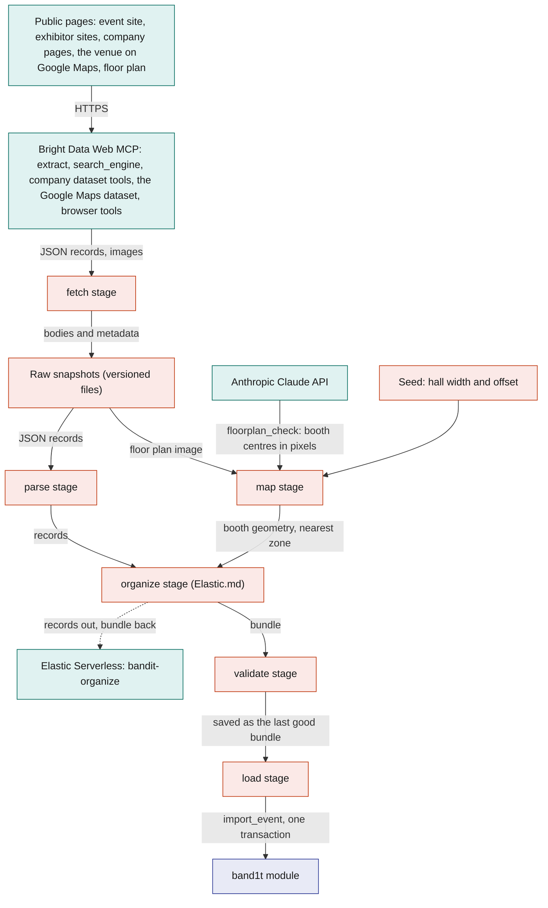
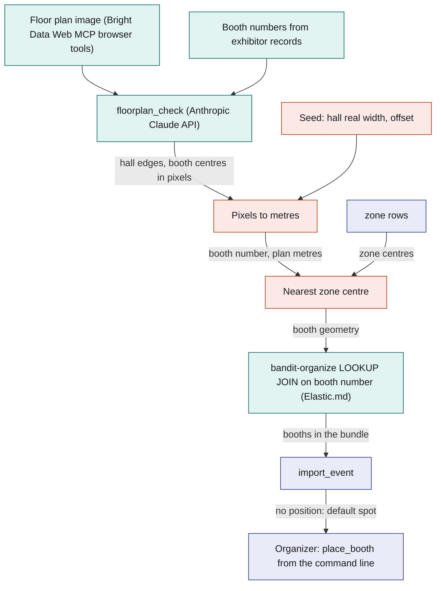
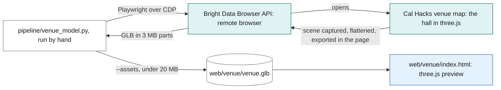
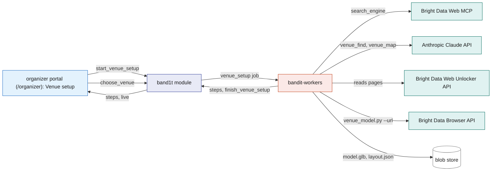
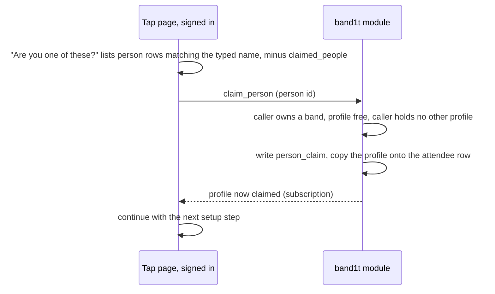
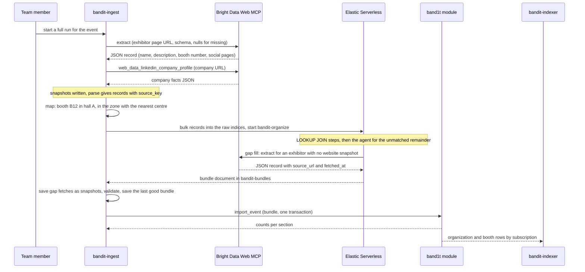

# Bright Data

BandIt uses three Bright Data products: the Bright Data Web MCP for every page the event import reads and for the venue setup's search, the Bright Data Web Unlocker API for the pages a venue setup reads, and the Bright Data Browser API for a 3D model of the venue.

`bandit-ingest` is a Rust command-line tool the team runs before the event. It works for any event: it starts from the list of start URLs in the event's seed and fetches the event's public pages, its organisations' pages and its venue's Google Maps place through the Bright Data Web MCP, saves every fetch as a versioned snapshot kept with the project, has Elastic organize the records into one event bundle (organisations, booths with positions, halls, schedule, unclaimed people profiles), and loads the bundle into SpacetimeDB in one transaction with the `import_event` reducer. Everything downstream sees ordinary SpacetimeDB rows and never knows a scrape happened: the venue map in the organizer portal (/organizer), visits, the profile claim, the Elastic copy.

Bright Data owns every step that touches the web, Elastic every step after the raw records land, and SpacetimeDB everything live or exact. The snapshots mean that no event or rerun depends on a live scrape. Cal Hacks 13.0 is the first event it runs at.

The 3D model of the venue is exported once from the Cal Hacks venue map through the Bright Data Browser API (see The venue model). For any other event, an organizer sets up the venue from the event's name on the organizer portal (see Venue setup from the event's name).

## Role in the system

Responsibilities:

- Fetch any event's public pages through the Bright Data Web MCP, starting from the start URLs in the event's seed: the event's site, its exhibitor or sponsor list, its schedule and its floor plan image; then each organisation's own site and its company facts, and the venue's Google Maps place record. Keep a dated snapshot of every fetch.
- Build the booth geometry: `floorplan_check` on the Anthropic Claude API reads booth numbers and their positions from the floor plan image, the hall's real width from the seed turns pixels into plan metres, and each booth gets the zone whose centre is nearest.
- Build unclaimed `person` profiles from event pages only (speakers, judges, sponsor representatives, exhibitor contacts, artists), and let an attendee who has claimed their band claim their profile at onboarding with one tap.
- Validate the organized bundle in Rust, keep the last good bundle, and load it with `import_event`, keyed by stable source keys so reruns are idempotent. Every scraped row carries `source_url` and `fetched_at`.
- Export the 3D model of the venue from the Cal Hacks venue map through the Bright Data Browser API (`pipeline/venue_model.py`), kept as `web/venue/venue.glb` with its preview page `web/venue/index.html`.
- Set up any event's venue from its name, started from the organizer portal: search, let the Anthropic Claude API pick the event site, the venue and its public 3D map, and save the venue's model (see Venue setup from the event's name).
- Own the optional tables `hall`, `organization`, `person`, `person_claim`, `venue_setup`, `venue_setup_step` and `chosen_venue`, the reducers `import_event`, `claim_person`, `start_venue_setup`, `report_venue_setup_step`, `finish_venue_setup` and `choose_venue`, the view `claimed_people`, and the job kind `venue_setup`.

Non-responsibilities:

- **Never scrapes people.** No person scraper, no social profile, no lookup of a person by name. People come only from what the event itself publishes. Every attendee types their own social handles at onboarding ([Social](../6-features/Social.md) owns `social_handle`).

  Elastic.md: the `bandit-organizer` agent's gap-fill tool is held to the same rule and fetches organisation and event pages only.
- Does not merge facts across sources. That is the job of the Elastic Workflow `bandit-organize` ([Elastic](Elastic.md)). Page extraction happens once, at fetch time, through the Bright Data Web MCP's `extract` with the null rule; Elastic receives JSON records, never page bodies.
- Does not define zones. Each zone, with its station id and its exit colour, is written by hand in the event's `zones.json`, which `bandit-ingest` passes into the bundle unchanged; the scrape never changes a zone ([SpacetimeDB](../2-data/SpacetimeDB.md)).
- Does not scrape merch. [Merch](../6-features/Merch.md) loads its hand-made templates from `assets/merch/templates.json`.
- The import does not run during the event, and no Bright Data call is ever on the safety path. The team runs `bandit-ingest` from the command line before the event; the one Bright Data run the organizer portal starts is a venue setup. Elastic.md: the organizer portal's "Kibana" tab links to the run's scrape pipeline dashboard in Elastic Kibana as "Scrape pipeline" ([Organizer-Portal](../5-apps/Organizer-Portal.md)).
- Does not own `booth`, `schedule_slot` or `venue` ([SpacetimeDB](../2-data/SpacetimeDB.md)); it fills them.

Elastic.md: the organize stage turns the records into the bundle. Without Elastic.md there is no scraped bundle to load, and booths and their organisations are written by hand into the bundle that `import_event` loads.

## Interfaces

| Interface | Direction | Who | What flows | Transport |
|---|---|---|---|---|
| Bright Data Web MCP | out | `bandit-ingest`, fetch stage | `search_engine` to find an organisation's official site; `extract` with a record schema and the null rule for event and exhibitor pages; `web_data_linkedin_company_profile` and `web_data_crunchbase_company` for company facts; `run_scraper`, `get_scraper_progress` and `get_scraper_results` on the Google Maps dataset `gd_m8ebnr0q2qlklc02fz` for the venue's place record; `scrape_as_markdown` to find the floor plan image link; `scraping_browser_navigate` and `scraping_browser_screenshot` to capture the floor plan and logo images | HTTPS JSON-RPC tool calls to the remote MCP server, Pro mode on, with the account token |
| Elastic.md: Bright Data Web MCP, gap fill | out | the `bandit-organizer` agent in Elastic, through an Elastic Agent Builder MCP tool | `extract` on an organisation or event page the raw records name but no snapshot covers; one JSON record back; at most 10 calls per run (starting value) | the same MCP server with a zone token of its own that has its own spending limit ([Elastic](Elastic.md)) |
| Anthropic Claude API | out | `bandit-ingest`, map stage, through `claude-client` | `floorplan_check`: the floor plan image and the booth numbers the exhibitor records list; back come the hall's edges and each visible booth's centre in pixels, or null | HTTPS Messages API, structured output; recorded in `model_call` ([Anthropic-Claude-API](Anthropic-Claude-API.md)) |
| Seed files | in | `bandit-ingest`, fetch, map and load stages | for the event: the list of start URLs, each with its page kind, and the venue's Google Maps place URL; per hall: name, real width in metres, offset in the venue plan frame; for the venue: plan origin and rotation, recorded on site at setup | hand-written files in the event's folder, beside `zones.json` |
| Snapshot and bundle files | out and in | `bandit-ingest`; the team by review | raw snapshots with their fetch metadata, parsed records, and the last good bundle | versioned files kept with the project |
| Elastic.md: raw indices and `bandit-organize` | out and in | `bandit-ingest`, organize stage | parsed JSON records, map-stage geometry and the zones from `zones.json` out to `bandit-raw-pages`, `bandit-raw-orgs` and `bandit-raw-plan`; one execution of the Elastic Workflow `bandit-organize` per run; back comes the bundle document from `bandit-bundles` | HTTPS Bulk API and Elastic Workflows API with the Elastic ingest key ([Elastic](Elastic.md)) |
| `import_event` reducer | out | `bandit-ingest`, load stage (role `ingest`) | the whole bundle; back come row counts per section | SpacetimeDB Rust client SDK, one reducer call, one transaction |
| `claim_person` reducer | in | tap page (/t/code), signed in as the attendee | the `person` id the attendee says is them; refused unless the caller already owns a band | SpacetimeDB reducer call |
| Bright Data Browser API | out | `pipeline/venue_model.py`, run by hand before the event | opens the Cal Hacks venue map in Bright Data's remote browser, captures its three.js scene and exports it in the page as binary glTF; back come the file in 3 MB parts and a screenshot | CDP over a secure WebSocket, through Playwright, with the Browser API zone's customer id, zone name and password (`BRIGHTDATA_CUSTOMER_ID`, `BRIGHTDATA_BROWSER_ZONE`, `BRIGHTDATA_BROWSER_PASSWORD`) |
| Venue model file | out | `pipeline/venue_model.py` to the project | `web/venue/venue.glb` (metres, y up, no lights), copied only when under 20 MB; the run's own copy, screenshot and summary under `var/venue-3d/brightdata/palace-interior/` | file |
| Venue preview page | out | `web/venue/index.html` to a browser | the model, drawn with three.js, GLTFLoader and OrbitControls, lit by the page | `bandit-api` at `/venue`, or any static HTTP server for the `web/venue` folder |
| Venue setup tab | in | organizer portal, role `ops` | `start_venue_setup` with the event's name; `choose_venue` with the setup to show | SpacetimeDB reducer call |
| Bright Data Web MCP, venue setup | out | `bandit-workers`, job `venue_setup` | `search_engine` for the event's name, its venue map and its 3D map | the same MCP server, over HTTPS |
| Bright Data Web Unlocker API | out | `bandit-workers`, job `venue_setup`; `pipeline/venue_model.py` for a model file link | each page the run reads, as raw HTML; a linked `.glb` or `.gltf` file | HTTPS `POST /request` with the Web Unlocker zone (`BRIGHTDATA_API_TOKEN`, `BRIGHTDATA_ZONE`) |
| Anthropic Claude API, venue setup | out | `bandit-workers`, through `claude-client` | `venue_find`: the search results; back come the event site, the venue, its address and the pages to read. `venue_map`: the pages read; back come the 3D maps, the floor plans and the labelled sources, or the next pages | HTTPS Messages API, structured output; recorded in `model_call` ([Anthropic-Claude-API](Anthropic-Claude-API.md)) |
| Venue setup steps and result | out | `bandit-workers` (role `worker`) to the module | `report_venue_setup_step` for each step; `finish_venue_setup` with the venue, the model and layout hashes, and the model's size and part counts | SpacetimeDB reducer calls |
| Loaded rows | out | `bandit-indexer` ([Elastic](Elastic.md)), tap page, organizer portal | `organization`, `booth`, `hall`, `schedule_slot`, `person` rows by subscription; the tap page reads `person` and `claimed_people` in setup and `booth` on the recap | SpacetimeDB subscription |

## Design

### Scope rule

The scrape covers the event, its venue and its organisations, never people. The only person records are unclaimed profiles built from pages the event itself publishes (a speaker page, a judge list, a sponsor's named representative, an exhibitor's listed contact, an artist on the line-up), and they hold only what that page says: name, role, organisation, the photo it shows and the page it came from.

Handles come from the attendee: their Instagram, Facebook and Threads handles, typed at onboarding ([Social](../6-features/Social.md)), with or without a claimed profile.

Every dataset row, from the company datasets and from Google Maps, loses its fields about people (reviews, employees, founders, contacts and the like) before the snapshot is saved. So every fact about a person in the system is one the event published or the person entered.

### Sources

The import is the same for every event. The event's seed lists its start URLs, each with its page kind: the event's own site, its exhibitor or sponsor list, its schedule page, the page that shows its floor plan image, and its venue map page, plus the venue's Google Maps place URL. The page kind picks the record schema.

Each source below is a named entry in the ingest configuration with the Bright Data Web MCP tool that fetches it, the record schema, and the features that need it; only the start URLs change from one event to the next. Core safety needs none of them, which is why the whole file is optional.

The first event it runs at is Cal Hacks 13.0, at the Palace of Fine Arts. Its start URLs are the event's own site, its Devpost page (the sponsor list with tiers, the prizes, and the venue line with its maps.google.com link), its schedule page and its venue map (hive.hackberkeley.org/venue-map), and its venue place is the Palace of Fine Arts on Google Maps.

| Source | Pages | Gives | Bright Data Web MCP tools | Needed by |
|---|---|---|---|---|
| `event_pages` | the start URLs: the event's own site (sponsors, speakers, judges, venue, dates), its exhibitor or sponsor list (with tiers when it gives them) and its schedule page | `organization` candidates with tier; prizes with their cash amount and sponsor; `person` candidates; `schedule_slot` records; event and venue facts, among them the venue's name and address from the venue line's maps.google.com link | `extract` with a schema per page kind | booths and schedule for [Social](../6-features/Social.md) and [Elastic](Elastic.md); booths for the attendee's recap; people for the profile claim |
| `exhibitor_pages` | each organisation's public home and about pages, found from the sponsor list or with `search_engine` | description, tags, logo, company social pages, booth number when the page states it | `search_engine`, `extract`; the browser tools for the logo image | booth descriptions for [Elastic](Elastic.md) |
| `org_facts` | the organisation's LinkedIn company page and Crunchbase company page | industry, headquarters, size range, founding year, short description, funding summary | `web_data_linkedin_company_profile`, `web_data_crunchbase_company` (company pages only) | richer booth documents in [Elastic](Elastic.md) |
| `google_maps` | the venue's Google Maps place page, listed in the seed | one `venue_place` record: the venue's name, address, latitude and longitude, description, website, rating, phone number and opening hours | `run_scraper` with the Google Maps dataset `gd_m8ebnr0q2qlklc02fz`, collected by the place's URL; `get_scraper_progress` and `get_scraper_results` | the event section of the bundle, which is not built without it |
| `floor_plan` | the floor plan image on the start URL of kind map | booth numbers and their positions | `scrape_as_markdown` finds the image link; `scraping_browser_navigate` and `scraping_browser_screenshot` capture the image | booth positions for the organizer portal's venue map, [Social](../6-features/Social.md) visits and the booth copy ([Elastic](Elastic.md)) |
| `venue_map` | the event's venue map page, the start URL of kind `venue_map` | no records; the snapshot records the page the venue model is exported from | `scrape_as_markdown` | the run's record of where the venue model comes from (see The venue model) |

### The Bright Data Web MCP

Every fetch goes through the Bright Data Web MCP server. `bandit-ingest` speaks the MCP protocol directly (JSON-RPC tool calls over HTTPS with the account token), so no agent runtime is involved.

Pro mode is switched on, because `extract`, the company dataset tools, the scraper tools and the browser tools are Pro tools; the credits cover them. Each tool has one job:

| Tool | Used for | Behaviour the design relies on |
|---|---|---|
| `extract` | every event and exhibitor page: a URL becomes JSON against a schema given in the call | always told to return null for a field it cannot find rather than guess; its output is validated against the schema before use |
| `search_engine` | finding an organisation's official site from its name on the sponsor list | one query per organisation that has no website on the event pages |
| `web_data_linkedin_company_profile`, `web_data_crunchbase_company` | company facts, collected by company page URL | structured JSON back; a call can take a minute or more, because Bright Data collects the page before answering |
| `run_scraper`, `get_scraper_progress`, `get_scraper_results` | the venue's Google Maps place: the Bright Data Web Scraper API dataset `gd_m8ebnr0q2qlklc02fz`, collected by the place's Google Maps URL | `run_scraper` starts a collection and returns a snapshot id; the fetch stage polls `get_scraper_progress` until the rows are ready and reads them with `get_scraper_results` |
| `scrape_as_markdown` | reading the event's map page to find the floor plan image link; saving the venue map page as a snapshot | a link hunt and a record of a page need no schema |
| `scraping_browser_navigate`, `scraping_browser_screenshot` | capturing an image: the floor plan and each organisation's logo | the only tools that return an image; used for nothing else |

Elastic.md: the `bandit-organizer` agent's gap-fill tool calls the same `extract` through a separate zone token with its own spending limit, and its results are saved as snapshots like any other fetch.

Constraints the pipeline is built around:

- **Open pages, no sign-in.** Every source is a page anyone can open. `bandit-ingest` never signs in and never fills a form.
- **`extract` must not guess.** Every call carries the null rule and a strict schema. A record with a null required field is dropped and listed in the import report.
- **Credits are finite.** Each source has a page budget the run will not exceed, retries are capped at 3 per URL, and each call waits at most 10 min (starting value).
- **One run per import.** A person starts a run; there are no scheduled re-scrapes. A rerun reads the snapshots first and fetches only what is missing.

### Pipeline

Six stages, one of them in Elastic. Each stage reads the previous stage's artefacts, so any stage can be rerun alone. Bright Data owns the fetch, Rust owns the deterministic stages, and the Elastic Workflow `bandit-organize` owns the organize stage.

| Stage | Reads | Produces | Notes |
|---|---|---|---|
| fetch | the ingest configuration and the event's start URLs from the seed | one raw snapshot per fetch: the JSON record or image, plus URL, time, tool, status and the SHA-256 of the body | never overwrites; the latest snapshot per source is marked. Elastic.md: gap-fill records from an earlier run are snapshots too and are read here, so `bandit-organize` finds no gap on a rerun |
| parse | latest snapshots | records with `source_key`, `source_url`, `fetched_at` | schema validation of the `extract` and dataset JSON; same snapshot, same output |
| map | the floor plan snapshot, the seed's hall entries, the zone rows | booth geometry per hall: booth number, plan position, confidence, nearest zone | the booth map below |
| Elastic.md: organize | parsed records, the map output, the core `station` and `zone` rows | the bundle: organisations deduplicated and merged across sources, booths linked to organisations and geometry, people linked to organisations, categories and tags, schedule slots matched to stages and zones, a reason per merge, a gaps list | writes the records to the raw indices, runs `bandit-organize` once, reads the bundle back and saves gap-fill records as snapshots ([Elastic](Elastic.md)) |
| validate | the bundle, the raw records of the run | a checked bundle, saved as the last good bundle | the same rules `import_event` enforces; a run that fails here leaves the previous last good bundle in place |
| load | the last good bundle | SpacetimeDB rows through one `import_event` call, and an import report with row counts per section, dropped records and the gaps list | one transaction: either the whole event is in or nothing changed. Afterwards the stage compares row counts per table with the bundle, and runs again before doors open |

The diagram answers: how do public pages become one bundle that lands in SpacetimeDB in a single transaction?

### The booth map

The floor plan has one path. Bright Data captures the image the event publishes; the Anthropic Claude API reads the booth numbers off it; one typed number, the hall's real width, turns pixels into metres; and an organizer fixes any booth that lands in the wrong place with `place_booth` from the command line. One floor plan image is one hall and one `hall` row; Cal Hacks 13.0 has one hall.

1. **Capture.** The fetch stage finds the image link on the event's map page (its start URL of kind map) with `scrape_as_markdown`, opens it with `scraping_browser_navigate` and saves `scraping_browser_screenshot` as the floor plan snapshot. The load stage uploads it through `bandit-api`'s blob endpoint, which calls `register_blob` with access class `staff`, and stores the id in `hall.sheet_blob_id`.
2. **Read.** `floorplan_check` ([Anthropic-Claude-API](Anthropic-Claude-API.md)) receives the image and the booth numbers the exhibitor records list. It returns the hall's outer edges in pixels and, for each booth number it can see, the centre in pixels with a confidence. A listed number it cannot see comes back null; it never invents a number that is not printed on the plan.
3. **Pixels to metres.** The seed holds the hall's real width in metres. Metres per pixel is that width divided by the hall's width in pixels, stored as `hall.metres_per_unit`. The hall's top-left corner plus the seed's offset (zero for Cal Hacks 13.0's single hall) places every booth in the venue plan frame, the same frame the zone centres are measured in.
4. **Nearest zone.** Each booth centre is compared with the zone centres (`zone.plan_x_m`, `zone.plan_y_m`, [SpacetimeDB](../2-data/SpacetimeDB.md)); the nearest zone becomes `booth.zone_id`. Zone centres are used, not the positions of the exit markers, because the exit markers stand at the doors.
5. **Join and load.** The map stage hands this geometry to the Elastic Workflow `bandit-organize`, whose `LOOKUP JOIN` step links each exhibitor's booth mention to its geometry by normalised booth number ([Elastic](Elastic.md)). Geometry without a mention becomes a booth named by its number, with kind `other`; a mention without geometry loads at the plan's default spot with `placement` `zone`, for an organizer to place with `place_booth`.
6. **Fix by hand.** Booths without a position load anyway at the plan's default spot. An organizer moves each one to its place with `place_booth` from the command line; that marks the booth `manual`, and a rerun of `import_event` never overwrites a `manual` placement. The organizer portal's venue map shows where every booth stands ([Organizer-Portal](../5-apps/Organizer-Portal.md)).

The diagram answers: where does a booth's position come from?

### The venue model

The Cal Hacks venue map (hive.hackberkeley.org/venue-map) embeds a 3D model of the Palace of Fine Arts hall that the Cal Hacks team built in three.js from their floor plans. `pipeline/venue_model.py` exports that model once, before the event, as one binary glTF file, `web/venue/venue.glb`: the floors, walls, rooms and mezzanine, the hacker and sponsor tables, the chairs and the table numbers, in metres with y up and no lights. It is a script the team runs by hand, not a service.

1. **Open the map.** The script connects Playwright to the Bright Data Browser API over CDP and opens the page the venue map embeds (palace-interior.vercel.app) in Bright Data's remote browser. Before the page loads, a small script stands in for the three.js developer tools, which every three.js scene reports to when it is built, so the page hands over its scenes.
2. **Flatten.** Once a scene is captured, the page waits 8 s for the plan textures to load. The largest scene is then merged into one mesh per material in world coordinates: each repeated table and chair becomes its own geometry, the table numbers are baked in from their number sheet, and lights and helpers are left out.
3. **Export.** In the same page, three.js's GLTFExporter for the page's own three.js release (r186) writes the binary glTF. The script reads it back in 3 MB parts, checks the file's header, and saves it with a screenshot of the map and a summary of its size, meshes and bounds under `var/venue-3d/brightdata/palace-interior/`.
4. **Keep it.** With `--assets`, the script copies the file to `web/venue/venue.glb` when it is under 20 MB; the export is about 12 MB. The model is kept with the project, so nothing at the event calls Bright Data.

The question this diagram answers: where does the venue model come from, and who shows it?

`web/venue/index.html` previews the model: three.js loads it with GLTFLoader, the page adds a sky light and a sun, and OrbitControls turn the view. Any static HTTP server for the folder shows it.

`bandit-api` serves the folder at `/venue`, and the organizer portal's Venue setup tab draws this model as the default venue. The security view does not load it.

The import also lists the venue map page as a start URL of kind `venue_map`. The fetch stage saves it as a snapshot like every page, and the parse stage takes no records from it, so each run records the page the model comes from, with its time and hash.

### Venue setup from the event's name

The Cal Hacks 13.0 model ships with the app and is the default venue. For any other event, an organizer (`ops`) types the event's name on the organizer portal's Venue setup tab, and `bandit-workers` finds the venue and its public 3D map and saves the venue's model.

Each step lands in the module as it happens, so the tab shows the run live ([Organizer-Portal](../5-apps/Organizer-Portal.md)).

1. **Start.** "Find the venue" calls `start_venue_setup(event_name)`, which needs `ops`, a name of 1 to 200 characters and no running setup with the same name. It writes a `venue_setup` row in status `running`, its first step "Queued", and a job of kind `venue_setup`.
2. **Search.** The worker searches through the Bright Data Web MCP's `search_engine` with three queries: the event's name, "<name> venue map" and "<name> venue 3D map floor plan".
3. **Find the event.** The Anthropic Claude API (`venue_find`) reads the results and returns the event site, the venue's name and address, and the pages to read. Code checks that every address in the answer is one the results named.
4. **Read the pages.** The worker reads up to 6 of those pages through the Bright Data Web Unlocker API and keeps each page's title, an excerpt and up to 80 links that look like maps, frames, 3D tours or model files. The Anthropic Claude API (`venue_map`) then picks up to 3 3D maps among those links, with the floor plans and the labelled pages it used. When it finds no map, it names the next pages to read, for one more round.
5. **Export the model.** For each picked map in turn, the worker runs `pipeline/venue_model.py --url <map> --out <dir>` for at most 7 minutes. In the Bright Data Browser API's remote browser, the script catches a three.js scene, a Babylon.js scene or a glTF file the page loads; a link straight to a `.glb` or `.gltf` file is downloaded through the Bright Data Web Unlocker API instead. The first map that gives a model wins.
6. **Finish.** The worker stores `model.glb` and `layout.json` (the model's named parts with their boxes) in the blob store, registers both as `shared` blobs with the purposes `venue_model` and `venue_layout`, and calls `finish_venue_setup`. The setup turns `ready` with its model, or `no model` when no map gave one.
7. **Show it.** The tab's "Shown venue" list holds the default and every `ready` setup, and `choose_venue` stores the choice in the one `chosen_venue` row. The tab draws the chosen model with three.js.

The worker calls `report_venue_setup_step` for each step and `finish_venue_setup` at the end, both only while it holds the job's lease. When the job uses up its attempts, the module marks the setup `failed` with the job's error.

The question this diagram answers: what happens between an event's name and its venue model?

It is not Vision's 3D venue model: Leo's Gaussian splat is trained from a phone walk-through video and drawn in the security view ([Vision](../4-devices/Vision.md)), while this one is the Cal Hacks team's own 3D map, exported as it is.

### Records, the bundle and import_event

Every record carries `source_key` (a stable string such as `event:org:elastic`, `event:person:` plus the listed name in lowercase, `plan:booth:B12`), `source_url` and `fetched_at`. `import_event` looks rows up by `source_key` and inserts or updates, so loading the same bundle twice changes nothing and a corrected description updates the same row (and the same Elastic document). The import never deletes: rows the bundle no longer contains are listed in the import report and a person decides.

The bundle has one section per table, loaded in dependency order inside the one transaction:

| Section | Target table | What `bandit-ingest` supplies | Owner of the table |
|---|---|---|---|
| event | `venue` | name, `starts_at`, `ends_at` and the event facts from the event pages; from the Google Maps record: the venue's name, address, latitude and longitude (the place's pin, not the plan origin), description and source URL, with its rating, phone number and opening hours added to the facts | [SpacetimeDB](../2-data/SpacetimeDB.md) |
| halls | `hall` | see below | this file |
| organizations | `organization` | see below | this file |
| booths | `booth` | `source_key`, name, kind (`sponsor`, `stage`, `food`, `help_desk`, `other`), booth number, `organization_id`, `hall_id`, `zone_id`, `plan_x_m`, `plan_y_m`, `placement` (`plan`, `zone` or `manual`), description and tags (from the organisation when the booth has none), `source_url`, `fetched_at` | [SpacetimeDB](../2-data/SpacetimeDB.md) |
| schedule | `schedule_slot` | title, start, end, location text, `booth_id` when the location maps to a booth, speakers' `person` ids | [SpacetimeDB](../2-data/SpacetimeDB.md) |
| people | `person` | see below | this file |

The event section needs the Google Maps record: a run without one builds no bundle, and the last good bundle stays loaded.

`import_event` is callable by the `ingest` role, and by an organizer (`ops`) for a hand-made bundle. It validates every reference inside the bundle before touching a row (zones exist, organisation keys resolve, booth numbers are unique per hall), then upserts section by section and returns counts.

One bad record aborts the whole call, so there is never a half-loaded event. A hackathon bundle is a few hundred rows, well inside one reducer call.

### Tables owned by this file

**`hall`** (one per floor plan image):

| Field | Type | Meaning |
|---|---|---|
| `id` | auto id | row id |
| `venue_id` | id | the venue |
| `source_key`, `source_url`, `fetched_at` | text, text, timestamp | provenance |
| `name` | text | from the seed |
| `sheet_blob_id` | blob id | the floor plan image, access class `staff` |
| `metres_per_unit` | float | metres per image pixel, from the hall's real width in the seed |
| `offset_x_m`, `offset_y_m` | float | where the hall's top-left corner sits in the venue plan frame, from the seed |

**`organization`** (exhibitor, sponsor, venue operator or act):

| Field | Type | Meaning |
|---|---|---|
| `id` | auto id | row id |
| `source_key`, `source_url`, `fetched_at` | text, text, timestamp | provenance of the primary record |
| `name` | text | |
| `kind` | text | `sponsor`, `exhibitor`, `venue`, `act`, `organiser` |
| `sponsor_tier` | text, optional | as the event lists it |
| `website` | text | official site |
| `logo_blob_id` | blob id, optional | uploaded through `bandit-api`'s blob endpoint, which calls `register_blob` with access class `shared` |
| `description` | text | merged by the `bandit-organizer` agent from the site, LinkedIn company and Crunchbase company facts ([Elastic](Elastic.md)) |
| `tags` | list of text | short lowercase topics; the first is the category the `bandit-organizer` agent gave it |
| `industry`, `headquarters`, `size_range`, `founded_year`, `funding_summary` | text or integer, optional | from the company dataset tools; null when unknown |
| `linkedin_url`, `crunchbase_url` | text, optional | the company pages that were read |
| `social_pages` | list of text | the organisation's own public social pages |

**`person`** (an unclaimed profile from event pages):

| Field | Type | Meaning |
|---|---|---|
| `id` | auto id | row id |
| `source_key`, `source_url`, `fetched_at` | text, text, timestamp | the event page that listed the person |
| `display_name` | text | as listed |
| `role` | text | as listed |
| `organization_id` | id, optional | the organisation the page lists them under |
| `kind` | text | `speaker`, `exhibitor_contact`, `sponsor_rep`, `artist` |
| `headshot_url` | text | the photo the event page shows for the person; empty when it shows none |

`person` is public. Who claimed a profile is kept apart, in `person_claim`.

**`person_claim`** (one claimed profile; private):

| Field | Type | Meaning |
|---|---|---|
| `attendee` | identity, primary key | the attendee who claimed it; one profile per attendee |
| `person_id` | id | the claimed profile; one attendee per profile |
| `claimed_at` | timestamp | |

The view `claimed_people` is anonymous and returns only the claimed `person_id` values, so the tap page can leave taken profiles out of "Are you one of these?" without learning who took them.

### The profile claim, for band owners

A person listed by the event can claim their profile in the onboarding flow, after claiming the band. The proof is the band claim they already made: only an attendee who owns a band can claim a profile, and only the band claim's press makes someone a band owner. The claim needs no second press, no email and no `bandit-api` route.

1. The attendee has claimed their band by press and typed a display name; the step comes later in setup ([Tap-Page](../5-apps/Tap-Page.md)). The tap page lists the `person` rows whose `display_name` matches what they typed and that `claimed_people` does not list: "Are you one of these?" Attendees with no match never see the step, and "None of these" goes on.
2. The attendee taps "This is me" on their profile. The signed-in tap page calls `claim_person` with the `person` id.
3. `claim_person` (person id; the caller is the attendee) checks, in order: the caller owns a band (`band.owner`, [SpacetimeDB](../2-data/SpacetimeDB.md)), otherwise it refuses with "claim your band first"; the profile exists, otherwise "no such profile"; nobody else holds the profile, otherwise "this profile is already claimed"; the caller holds no other profile, otherwise "you already claimed a profile". A repeat call for the profile the caller already holds changes nothing.
4. It writes the `person_claim` row and copies the profile onto the caller's `attendee` row: the `person_id`, the profile's `organization_id`, its `headshot_url` as `photo_url`, and its `display_name` only when the attendee has not typed one. The tap page sees the profile turn claimed through its subscription and continues with the next setup step ([Tap-Page](../5-apps/Tap-Page.md)).

The claim adds one thing to the people graph. Social.md: the claimed profile's `organization_id` gives the attendee their `works_at` link in `people_link`, written in the same transaction; a claimed profile is the only source of that link for an attendee, because onboarding asks for no company.

The attendee's handles come from the socials step whether or not a profile was claimed. The first claim wins.

The sequence answers: how does a band owner claim "this profile is me"?

### One organisation, fetch to load

The sequence answers: for one exhibitor, what does a run do from the first tool call to rows the indexer sees?

`bandit-indexer` subscribes to `booth`, `organization`, `hall` and `schedule_slot`, so each import arrives as insert or update callbacks, and each booth becomes a `bandit-booths` document that carries its organisation's facts ([Elastic](Elastic.md)). `person` rows are never indexed; the tap page reads them from SpacetimeDB.

## Failure modes and fallbacks

| Failure | Effect | Design answer |
|---|---|---|
| A page or dataset call fails during a run | That source has no new data | The run keeps the source's previous snapshot; nothing at the event depends on a fetch |
| `floorplan_check` returns null for a booth | Booth without a position | It loads at the default spot; an organizer places it with `place_booth` before doors open |
| Elastic.md: the `bandit-organize` run fails, or its bundle fails validation | No new bundle | The load stage loads the last good bundle it saved |
| A reference inside the bundle does not resolve | `import_event` would create dangling rows | `import_event` validates everything first and aborts the whole call; the previous load stays as it was |
| An attendee who owns no band tries to claim a profile | No proof of who they are | `claim_person` refuses with "claim your band first"; the tap page shows the band claim screen |
| Two attendees try to claim the same profile | Identity conflict | `claim_person` refuses a profile that is already claimed; the first claim wins, and `claimed_people` hides it from everyone else's list |
| A venue setup finds no 3D map, or no picked map gives a model | No model for that event | The setup ends `no model`, with its venue, floor plans and the pages it used; the shown venue stays as it was |
| The Anthropic Claude API names an address it was not given | A made-up page | Code refuses the answer and asks a second time; when that fails too, the job fails and is retried |
| A venue setup job uses up its attempts | The run stops | The module marks the setup `failed` with the job's error; the organizer can start it again |

## Dependencies

**Depends on**

- [SpacetimeDB](../2-data/SpacetimeDB.md): tables `venue`, `zone` (with `plan_x_m`, `plan_y_m`), `station`, `booth` (with `booth_number`, `organization_id`, `hall_id`, `plan_x_m`, `plan_y_m`, `placement`, `source_url`, `fetched_at`), `schedule_slot`, `band` (its `owner`), `attendee`, `blob_ref`, `api_session`; reducers `grant_role`, `register_blob`, `place_booth`; the `ingest` and `api` roles.
- [Rust-Backend](../3-services/Rust-Backend.md): the `bandit-api` process that hosts the blob endpoint and serves `/venue`; `bandit-workers`, which runs the job `venue_setup` and, for it, `pipeline/venue_model.py` with Python and Playwright on the Vultr VM.
- [Elastic](Elastic.md): the raw indices and the Elastic Workflow `bandit-organize` for the organize stage. Without it, no scraped bundle is loaded.
- [Anthropic-Claude-API](Anthropic-Claude-API.md): `claude-client`, the `floorplan_check` use case, `model_call`. Anthropic-Claude-API.md: without it, booths load without positions and an organizer places each one with `place_booth` from the command line.
- [Social](../6-features/Social.md): the onboarding socials step, which comes before the profile claim (optional; without it a claimed `person` simply has no handles).
- A Bright Data account with credits and a Bright Data Web MCP token in Pro mode; Elastic.md: a second zone token with its own spending limit for the gap-fill tool; for the venue model, a Bright Data Browser API zone with its customer id, zone name and password; for the venue setup, a Bright Data Web Unlocker API zone.

**Used by**

- [Elastic](Elastic.md): its Elastic Workflow `bandit-organize` runs on the raw records this pipeline writes, and its output is loaded by this pipeline (a hard dependency on this file); its indexer copies the loaded booths with their organisation facts and positions.
- [Social](../6-features/Social.md): visits are "at booth B", the profile claim sits in its onboarding flow, and the people graph takes its `exhibits` links from `booth.organization_id` and its `works_at` links from claimed profiles.
- [Tap-Page](../5-apps/Tap-Page.md): the schedule and the "Are you one of these?" step.
- [Organizer-Portal](../5-apps/Organizer-Portal.md): the booths on the venue map, the organisations in the attendee list's Company column, and the Venue setup tab.
- [Merch](../6-features/Merch.md): a sponsor template names organisations, and `load_merch_templates` finds their booths through the imported `organization` rows.
- [Test-Bands](../3-services/Test-Bands.md): the crowd staffs the biggest sponsors' booths first, bigger sponsors draw more of its attendees, and its booth staff work at the booth's organisation.

**If you delete this file**

- `bandit-ingest` keeps only its seed mode, which loads the hand-written seed files through the setup reducers ([SpacetimeDB](../2-data/SpacetimeDB.md)). Remove its scraping stages and the Bright-Data.md parts of its rows in [Rust-Backend](../3-services/Rust-Backend.md) and [Architecture](../1-overview/Architecture.md) (interfaces, data ownership and failure tables).
- Remove `import_event`, `claim_person`, `claimed_people`, `hall`, `organization`, `person` and `person_claim` from the registry tables in [SpacetimeDB](../2-data/SpacetimeDB.md), the Bright-Data.md field rows on `booth`, `attendee` and `venue`, the Bright-Data.md note on the `venue` origin fields, and the Bright-Data.md mentions in its `bandit-ingest` interface row and seed paragraph.
- Remove the Bright-Data.md rows from [Tap-Page](../5-apps/Tap-Page.md) and [Social](../6-features/Social.md) (the "Are you one of these?" step), the Bright-Data.md subscription row and the Bright-Data.md line under the "Kibana" tab from [Organizer-Portal](../5-apps/Organizer-Portal.md), and the Bright-Data.md row from the README components table.
- Remove the `floorplan_check` row from [Anthropic-Claude-API](Anthropic-Claude-API.md).
- Delete `pipeline/venue_model.py`, the `web/venue` folder (the model and its preview page) and the `venue_map` start URL, and remove the two Bright-Data.md lines in [Vision](../4-devices/Vision.md).
- Remove `venue_setup`, `venue_setup_step`, `chosen_venue`, their four reducers and the job kind `venue_setup` from [SpacetimeDB](../2-data/SpacetimeDB.md), the job from `bandit-workers` in [Rust-Backend](../3-services/Rust-Backend.md), the Venue setup tab from [Organizer-Portal](../5-apps/Organizer-Portal.md), and the `venue_find` and `venue_map` rows from [Anthropic-Claude-API](Anthropic-Claude-API.md).
- [Merch](../6-features/Merch.md) loads only its plain templates, because sponsor names have no organisations to match.
- [Test-Bands](../3-services/Test-Bands.md)'s crowd still staffs and visits the booths, each with the same pull, and its booth staff get no `works_at` link; remove the Bright-Data.md lines there.
- [Elastic](Elastic.md) loses the Elastic Workflow `bandit-organize` and keeps the copy of hand-entered booths. Booths, schedule slots and the venue row then come from the seed, written by hand. Behaviour elsewhere is unchanged, because everything reads SpacetimeDB rows either way.

## Decisions

| Decision | Why |
|---|---|
| The floor plan has one path: Bright Data captures the published image, `floorplan_check` on the Anthropic Claude API reads booth numbers and positions, the hall's real width typed in the seed converts pixels to metres, and an organizer fixes any misplaced booth with `place_booth` from the command line | One pipeline to build and rehearse; a wrong position is fixed in seconds by hand, so no second reading method is needed |
| No exhibitor contact export, no `claim_contact` table, no email; `claim_person` accepts a claim only from an attendee who already owns a band | The band claim's press already proved who holds the band one step earlier, so the profile claim needs no second press and no email round trip |
| The signed-in app calls `claim_person` directly; there is no `bandit-api` route for it | The caller's SpacetimeDB identity is the attendee, so the module checks everything itself |
| One profile per attendee and one attendee per profile; the first claim wins | A profile is one listed person, so a second claimant is refused rather than merged |
| No merch scraping | [Merch](../6-features/Merch.md) loads a few hand-made templates from its own file |
| The import uses only the Bright Data Web MCP, in Pro mode, with the tools named above | One product and one token for every page the import reads; the credits cover the Pro tools |
| The venue model goes through the Bright Data Browser API | The export puts a script in the map's page before it loads and runs the page's own exporter inside it, so it needs a remote browser session it drives itself over CDP |
| The venue model is the Cal Hacks team's own 3D venue map, exported as it is | They built the hall in metres from their floor plans, with every table and chair, so one export gives the whole hall |
| The Cal Hacks 13.0 model is exported once before the event and kept with the project as `web/venue/venue.glb`, at most 20 MB, as the default venue | Nothing at the event waits on Bright Data, and the file stays small enough to keep in the repository |
| The export is one Python script in `pipeline/`: run by hand for the default venue, and by `bandit-workers` for a venue setup | It drives Bright Data's remote browser with Playwright over CDP, so both paths share one exporter |
| A venue setup starts from the event's name alone | An organizer at any event knows its name; the search, the Anthropic Claude API and the export find the rest |
| The Anthropic Claude API may name only addresses that the search results and the pages gave it | Code checks every address in its answer, so a setup never opens a page that nothing linked |
| Each step of a venue setup is a `venue_setup_step` row | The tab shows the run live by subscription |
| The organizer picks the shown venue (`chosen_venue`), and the default stays in the list | A new setup never replaces the venue on screen by itself |
| The venue map page is a start URL of kind `venue_map`, saved as a snapshot and parsed into no records | Each run records the page the model comes from, with its time and hash, next to every other source |
| No merge of organisation facts by the Anthropic Claude API (`scrape_extract` is removed) | The Elastic Workflow `bandit-organize` is the one place facts are merged across sources |
| Without Elastic.md no scraped bundle loads; booths are entered by hand | The Elastic Workflow `bandit-organize` is the only path from records to bundle, so there is no rules path to maintain |
| The last good bundle, saved by the validate stage, is the only fallback | The event never depends on a live run |
| Every page that gives records becomes JSON through `extract`; there are no hand-written page parsers | Extraction happens once, at fetch time, with the null rule and a schema |
| The scrape never changes a zone; zones, their station ids and their exit colours are hand-written in `zones.json` | The safety features then stay the same whatever the scrape finds |
| The import works for any event: its input is the list of start URLs in the event's seed, and Cal Hacks 13.0 is the first event it runs at | The product must work at any venue; only the seed changes from one event to the next |
| The hall's width and offset and the venue's plan origin and rotation are typed in the seed; the venue's name, address and map pin come from its Google Maps record | The plan frame is measured on site at setup; the place's public facts are fetched like any other source |
| Booth numbers are joined to geometry once, in the `LOOKUP JOIN` step of `bandit-organize` | One owner per step; the map stage only produces geometry |
