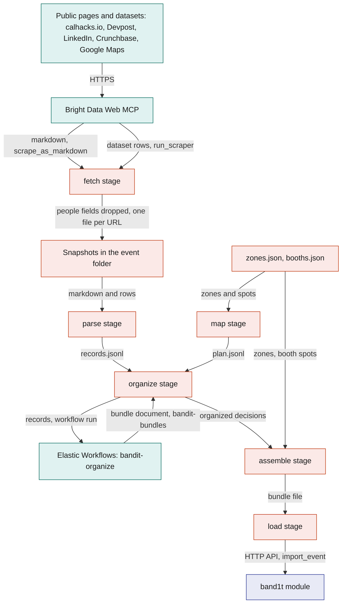
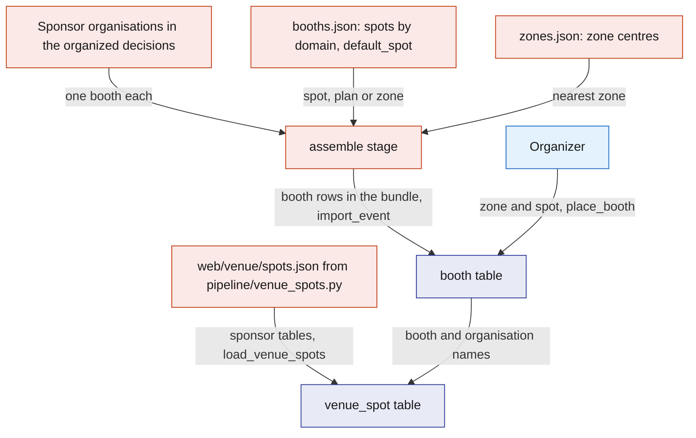
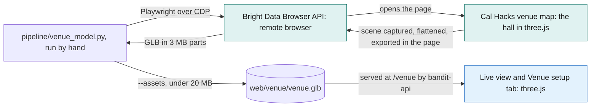
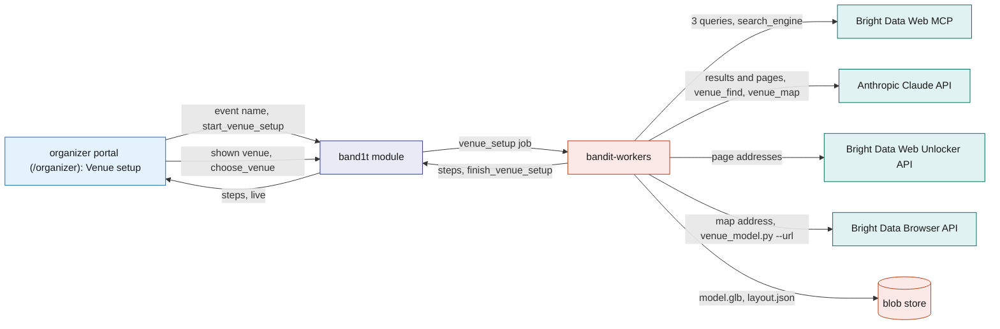
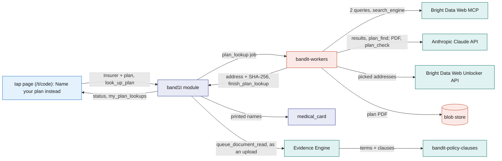
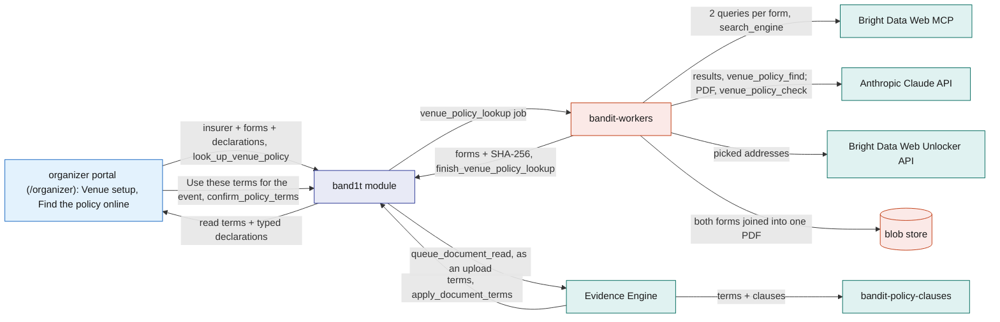
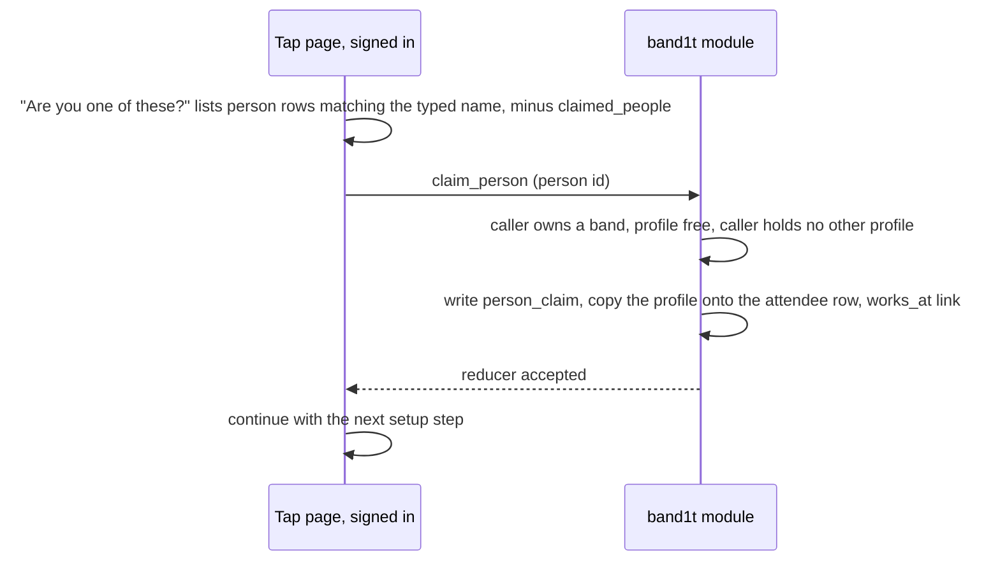
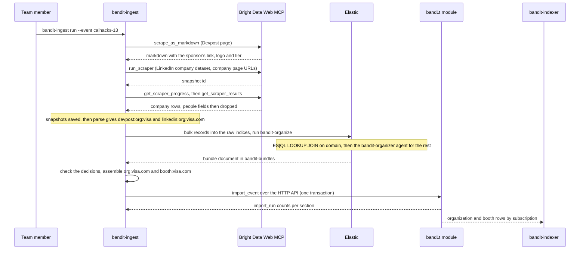

# Bright Data

BandIt uses three Bright Data products, each for the job it does best:

- the Bright Data Web MCP, for every page and dataset the event import reads, and for the search that starts a venue setup, a plan lookup or a venue policy lookup;
- the Bright Data Web Unlocker API, for the raw HTML of the pages a venue setup reads, for a linked model file, and for the PDF of an attendee's plan or of the venue's policy forms;
- the Bright Data Browser API, for exporting a venue's 3D model from inside its own web page.

`bandit-ingest` is a Rust command-line tool the team runs before the event. It reads the event's public pages and three Bright Data datasets through the Bright Data Web MCP, and saves every answer as a snapshot file kept with the project. The Evidence Engine in Elastic then organizes the records, and `bandit-ingest` loads the checked bundle into SpacetimeDB in one `import_event` transaction.

Everything downstream reads ordinary SpacetimeDB rows: the sponsors on the organizer portal (/organizer), the booths of the recap, "Are you one of these?" at onboarding, the people graph's `works_at` and `exhibits` links, and the sponsor merch. Without the import those screens have no sponsors, booths or speakers.

The 3D hall on the Live view (/live) and the organizer portal's Venue setup tab is a model exported through the Bright Data Browser API. For any other event, an organizer sets up the venue from the event's name alone (see Venue setup from the event's name).

An attendee who has no policy PDF at hand names their insurer and plan instead. Bright Data finds the plan's public wording on the web and fetches its PDF, and the Evidence Engine reads it like an uploaded one (see Plan lookup from a plan's name).

The organizer does the same for the venue's policy. They name the venue's insurer and the two forms of its package policy, and type the numbers from its declarations page. Bright Data finds and fetches both forms, and the Evidence Engine reads them like an uploaded policy (see Venue policy lookup from the policy's forms).

## Role in the system

Responsibilities:

- Fetch the event's public pages and its company and place datasets through the Bright Data Web MCP, from the list in the event's `sources.json`, and keep a snapshot of every answer.
- Turn the snapshots into records in Rust, hand them to the Elastic Workflow `bandit-organize`, check what comes back, and assemble one event bundle.
- Give every sponsor a booth: its spot from the hand-written `booths.json`, its zone the one whose centre is nearest.
- Load the bundle with `import_event` over the SpacetimeDB HTTP API, keyed by stable source keys so a rerun updates rows instead of adding them.
- Build unclaimed `person` profiles from event pages only (the event site's speakers), and let an attendee who has claimed their band claim their profile at onboarding with one tap.
- Export the Cal Hacks venue map's 3D model through the Bright Data Browser API (`pipeline/venue_model.py`), kept as `web/venue/venue.glb`.
- Set up any event's venue from its name, started from the organizer portal: search, let the Anthropic Claude API pick the event site, the venue and its public 3D map, and save the venue's model.
- Find an attendee's plan from its name, started from the tap page: search, let the Anthropic Claude API pick the plan's own document, fetch its PDF and hand it to the Evidence Engine's reading.
- Find the venue's policy forms from their form numbers, started from the organizer portal's Venue setup tab: search, let the Anthropic Claude API pick each form's document, fetch both PDFs, join them into one policy PDF and hand it to the Evidence Engine's reading.
- Own the tables `organization`, `person`, `person_claim`, `venue_setup`, `venue_setup_step`, `chosen_venue`, `plan_lookup` and `venue_policy_lookup`, the reducers `claim_person`, `start_venue_setup`, `report_venue_setup_step`, `finish_venue_setup`, `choose_venue`, `look_up_plan`, `finish_plan_lookup`, `look_up_venue_policy` and `finish_venue_policy_lookup`, the views `claimed_people`, `my_plan_lookups` and `board_venue_policy_lookups`, and the job kinds `venue_setup`, `plan_lookup` and `venue_policy_lookup`.

Non-responsibilities:

- **Never scrapes people.** No person scraper, no social profile, no lookup of a person by name. Every attendee types their own social handles at onboarding ([Social](../6-features/Social.md) owns `social_handle`). A plan lookup searches for the insurer's public document, never for the attendee: its queries hold the insurer, the plan, the state and the year, and never a name, a member id or a policy number. A venue policy lookup's queries hold the insurer and the form numbers, never the policy number.
- Does not merge facts across sources. The Elastic Workflow `bandit-organize` does that ([Elastic](Elastic.md)).
- Does not define zones. Each zone, with its station id and exit colour, is written by hand in the event's `zones.json`, which goes into the bundle unchanged ([SpacetimeDB](../2-data/SpacetimeDB.md)).
- Does not scrape merch. [Merch](../6-features/Merch.md) loads its hand-made templates from `assets/merch/templates.json`.
- Runs no Bright Data call on the safety path. The only Bright Data runs the organizer portal starts are a venue setup and a venue policy lookup, and the only one the tap page starts is a plan lookup.
- Does not read the plan's PDF or the venue's policy forms. The Evidence Engine reads it into terms and clauses exactly like an uploaded PDF ([Elastic](Elastic.md)), and [Insurance](../6-features/Insurance.md) decides what those terms may set.
- Does not own `venue`, `zone`, `booth` or `schedule_slot` ([SpacetimeDB](../2-data/SpacetimeDB.md)); `import_event` fills them from the bundle.

## Interfaces

| Interface | Direction | Who | What flows | Transport |
|---|---|---|---|---|
| Bright Data Web MCP, import | out | `bandit-ingest fetch` | `scrape_as_markdown` for each page in `sources.json`; `run_scraper`, `get_scraper_progress` and `get_scraper_results` for each dataset | MCP `tools/call` over HTTPS to `mcp.brightdata.com/mcp`, tool groups `advanced_scraping`, `browser` and `scrapers`, with `BRIGHTDATA_API_TOKEN` |
| Event folder | in | every `bandit-ingest` stage | `event.json` (name, website, time zone), `sources.json` (pages and datasets), `zones.json` (the station marker plan), `booths.json` (booth spots) | hand-written files in `crates/bandit-ingest/events/<slug>/` |
| Snapshots, records and bundles | out and in | each stage writes what the next reads | `snapshots/`, `records/records.jsonl`, `records/plan.jsonl`, `bundles/<run id>.organized.json`, `bundles/<run id>.json` | files in the event folder, kept with the project |
| Elastic raw indices and `bandit-organize` | out and in | `bandit-ingest organize` | records out to `bandit-raw-pages`, `bandit-raw-orgs` and `bandit-raw-plan`; one Elastic Workflows run; back comes one document from `bandit-bundles`; decisions to `bandit-organizer-decisions`; stage timings to `bandit-pipeline-events` | Elasticsearch Bulk, ES\|QL and search APIs with `ELASTICSEARCH_API_KEY`; the Elastic Kibana Workflows API with `KIBANA_API_KEY` ([Elastic](Elastic.md)) |
| `import_event` | out | `bandit-ingest load`, role `ingest` | the bundle; then the `import_run` row with the counts per section | SpacetimeDB HTTP API: `POST /v1/database/<database>/call/import_event`, then `POST /v1/database/<database>/sql` |
| `claim_person` | in | tap page (/t/code), signed in as the attendee | the `person` id the attendee says is them; refused unless the caller already owns a band | SpacetimeDB reducer call |
| Bright Data Browser API | out | `pipeline/venue_model.py`, run by hand before the event, and by `bandit-workers` for a venue setup | opens a venue map in Bright Data's remote browser and exports its 3D scene in the page as binary glTF; back come the file in 3 MB parts and a screenshot | CDP over a secure WebSocket to `brd.superproxy.io:9222`, through Playwright, with `BRIGHTDATA_CUSTOMER_ID`, `BRIGHTDATA_BROWSER_ZONE` and `BRIGHTDATA_BROWSER_PASSWORD` |
| Venue model file | out | `pipeline/venue_model.py` to the project | `web/venue/venue.glb` (metres, y up, no lights), copied only when under 20 MB | file |
| Venue spots | out | `pipeline/venue_spots.py` writes `web/venue/spots.json`; `scripts/e2e-setup` loads it with `load_venue_spots` (role `ops`) | the hall's hacker tables, sponsor tables, stage, food line and doors, in the model's metres | file; SpacetimeDB command line |
| Venue setup tab | in | organizer portal, role `ops` | `start_venue_setup` with the event's name; `choose_venue` with the setup to show | SpacetimeDB reducer call |
| Bright Data Web MCP, venue setup | out | `bandit-workers`, job `venue_setup` | `search_engine` with three queries about the event's name | MCP `tools/call` over HTTPS, with `BRIGHTDATA_API_TOKEN` |
| Bright Data Web Unlocker API | out | `bandit-workers`, job `venue_setup`; `pipeline/venue_model.py` for a model file link | each page the run reads, as raw HTML; a linked `.glb` or `.gltf` file | HTTPS `POST https://api.brightdata.com/request` with the zone `BRIGHTDATA_ZONE` and format `raw` |
| Anthropic Claude API, venue setup | out | `bandit-workers`, through `claude-client` | `venue_find`: the search results in, the event site, the venue, its address and the pages to read out. `venue_map`: the pages read in, the 3D maps, the floor plans and the labelled sources out, or the next pages to read | HTTPS Messages API, structured output; recorded in `model_call` ([Anthropic-Claude-API](Anthropic-Claude-API.md)) |
| Venue setup steps and result | out | `bandit-workers` (role `worker`) to the module | `report_venue_setup_step` for each step; `finish_venue_setup` with the venue, the model and layout hashes, and the model's size and part counts | SpacetimeDB reducer calls |
| Plan lookup | in | tap page (/t/code), signed in as the attendee | `look_up_plan` with the insurer, the plan and the state of the attendee's health plan; `my_plan_lookups` back | SpacetimeDB reducer call and subscription |
| Bright Data Web MCP, plan lookup | out | `bandit-workers`, job `plan_lookup` | `search_engine` with two queries about the insurer and the plan | MCP `tools/call` over HTTPS, with `BRIGHTDATA_API_TOKEN` |
| Anthropic Claude API, plan lookup | out | `bandit-workers`, through `claude-client` | `plan_find`: the search results in; up to 3 addresses of this plan's own document out, best first, each with why. `plan_check`: a fetched PDF in; the insurer, plan and year it prints, each with its page, out | HTTPS Messages API, structured output; recorded in `model_call` ([Anthropic-Claude-API](Anthropic-Claude-API.md)) |
| Bright Data Web Unlocker API, plan PDF | out | `bandit-workers`, job `plan_lookup` | each picked address in turn; back comes the file, kept only when it is a PDF | HTTPS `POST https://api.brightdata.com/request` with the zone `BRIGHTDATA_ZONE` and format `raw` |
| Plan lookup result | out | `bandit-workers` (role `worker`) to the module | `finish_plan_lookup` with the document's address, the printed insurer, plan and year, its SHA-256 and page count, or the reason nothing was found; the PDF is an `owner_only` blob of the attendee with purpose `plan_wording` | SpacetimeDB reducer call; blob store |
| Venue policy lookup | in | organizer portal, Venue setup tab, role `ops` | `look_up_venue_policy` with the insurer, the state, the liability and property form numbers, and the declarations: policy number, period, claims contact, the medical expense limit and general aggregate, the property limit and deductible; `board_venue_policy_lookups` back | SpacetimeDB reducer call and subscription |
| Bright Data Web MCP, venue policy lookup | out | `bandit-workers`, job `venue_policy_lookup` | `search_engine` with two queries for each form | MCP `tools/call` over HTTPS, with `BRIGHTDATA_API_TOKEN` |
| Anthropic Claude API, venue policy lookup | out | `bandit-workers`, through `claude-client` | `venue_policy_find`: one form's search results in; up to 3 addresses of that form out, best first, each with why. `venue_policy_check`: a fetched PDF in; which form it is, its form number and title as printed, each with its page, out | HTTPS Messages API, structured output; recorded in `model_call` ([Anthropic-Claude-API](Anthropic-Claude-API.md)) |
| Bright Data Web Unlocker API, policy forms | out | `bandit-workers`, job `venue_policy_lookup` | each picked address in turn; back comes the file, kept only when it is a PDF | HTTPS `POST https://api.brightdata.com/request` with the zone `BRIGHTDATA_ZONE` and format `raw` |
| Venue policy lookup result | out | `bandit-workers` (role `worker`) to the module | `finish_venue_policy_lookup` with each form's address, form number and title as printed, the joined PDF's SHA-256 and page count and the page the property form starts on, or the reason nothing was found; the PDF is a `staff` blob with purpose `policy`, like an upload | SpacetimeDB reducer call; blob store |
| Loaded rows | out | `bandit-indexer` ([Elastic](Elastic.md)), tap page, organizer portal | `organization`, `booth`, `zone` and `schedule_slot` by subscription to `bandit-indexer`; `venue`, `organization`, `person` and `claimed_people` to the tap page; `venue`, `zone`, `booth` and `organization` to the organizer portal | SpacetimeDB subscription |

## Design

### Scope rule

The import covers the event, its sponsors and its venue, never people. The only person records are unclaimed profiles built from the event's own site: the speakers it lists, each with the name, title, organisation and text that page shows.

Handles come from the attendee: their Instagram, Facebook and Threads handles, typed at onboarding ([Social](../6-features/Social.md)), with or without a claimed profile.

Every dataset row loses its fields about people before its snapshot is saved. The fetch stage drops the 15 fields in `PEOPLE_FIELDS`, among them `employees`, `founders`, `contacts`, `top_reviews`, `investors` and `contact_email`.

### Which Bright Data tool does which job

Each tool was picked for what the step needs, and each is used for nothing else.

| Tool | Product | Used for | Why this tool |
|---|---|---|---|
| `scrape_as_markdown` | Bright Data Web MCP (its Web Unlocker underneath) | every page in `sources.json`: the event site, the Devpost page, the Devpost dates page and the venue map page | the Rust parsers read markdown links and image alt text: a sponsor's link with its logo, a prize's sponsor tag in brackets, the venue line's maps.google.com link |
| `run_scraper`, `get_scraper_progress`, `get_scraper_results` | Bright Data Web MCP (the Bright Data Web Scraper API underneath) | the LinkedIn company dataset `gd_l1vikfnt1wgvvqz95w` (41 company pages), the Crunchbase company dataset `gd_l1vijqt9jfj7olije` (4) and the Google Maps dataset `gd_m8ebnr0q2qlklc02fz` (the venue's place), each collected by URL | structured company and place records with no page to parse; `run_scraper` returns a snapshot id, and the fetch stage polls `get_scraper_progress` every 30 s until `get_scraper_results` has the rows |
| `search_engine` | Bright Data Web MCP (the Bright Data SERP API underneath) | the venue setup's three searches: the event's name, "<name> venue map" and "<name> venue 3D map floor plan"; a plan lookup's two searches for the plan's document; a venue policy lookup's two searches for each form | a venue setup starts from a name alone, a plan lookup from an insurer and a plan name, and a venue policy lookup from an insurer and two form numbers, with no URL |
| Web Unlocker `POST /request` | Bright Data Web Unlocker API | the pages a venue setup reads; a linked `.glb` or `.gltf` file; a plan's PDF; the venue's policy forms | the raw answer keeps the `iframe`, `embed`, `object` and `model-viewer` tags and the model file links that a 3D map hides in, which markdown drops, and the bytes of a PDF, which the Evidence Engine reads page by page |
| Remote browser over CDP | Bright Data Browser API | exporting a venue's 3D scene | only a real browser runs the page's three.js, and the export needs a script in the page before it loads |

The MCP server marks scraped text as untrusted. Both MCP clients keep only the text between its `UNTRUSTED` markers, and the venue setup tells the Anthropic Claude API to treat every page as data and ignore any instruction in it.

### Sources

The import is the same for every event; only the event folder changes. `sources.json` lists the pages, each with its source name and page kind, and the datasets, each with its dataset id and the URLs to collect. The page kind picks the parser.

Cal Hacks 13.0, at the Palace of Fine Arts, is the first event it runs at. Its folder is `crates/bandit-ingest/events/calhacks-13`.

| Source | Page kind | Fetched with | Gives |
|---|---|---|---|
| `site` (calhacks.io) | `event_site` | `scrape_as_markdown` | `organization_candidate` records from the sponsor and partner links, `person_candidate` records from the speaker list, `venue_fact` records from the FAQ |
| `devpost` | `devpost` | `scrape_as_markdown` | `organization_candidate` records with their tier, `prize` records with their cash amount and sponsor tag, the submission deadline, and the venue's name and address from the maps.google.com link |
| `devpost_dates` | `devpost_dates` | `scrape_as_markdown` | `schedule_item` records and the event's start and end |
| `venue_map` (hive.hackberkeley.org/venue-map) | `venue_map` | `scrape_as_markdown` | no records |
| `linkedin` | `linkedin_company` | `run_scraper` on `gd_l1vikfnt1wgvvqz95w` | `company_facts` records: industry, headquarters, size, founding year, about text, logo |
| `crunchbase` | `crunchbase_company` | `run_scraper` on `gd_l1vijqt9jfj7olije` | `company_facts` records: industries, address, founding year, description, a funding summary |
| `gmaps` | `google_maps` | `run_scraper` on `gd_m8ebnr0q2qlklc02fz` | one `venue_place` record: name, address, latitude and longitude, description, website, rating, phone number and opening hours |

The saved Cal Hacks 13.0 run, `calhacks-13-20261024t0828z`, turned these into 245 records. The Elastic Workflow `bandit-organize` made 62 organisations of them: 53 by an exact domain join and 9 merged by the Elastic Agent Builder agent `bandit-organizer`. The bundle holds 62 organisations, 51 booths, 3 people and 2 schedule slots.

### Pipeline

Eight stages, one of them in Elastic. Each stage reads the files the previous one wrote, so any stage can run alone. `bandit-ingest run --event <slug>` runs them all under a fresh run id, the event's slug plus the UTC time, such as `calhacks-13-20261024t0828z`.

| Stage | Command | Reads | Writes |
|---|---|---|---|
| fetch | `bandit-ingest fetch` | `sources.json` | one snapshot per source and URL in `snapshots/<source>/`: the body, the URL, the tool, the time and the body's SHA-256; a new fetch rewrites it |
| parse | `bandit-ingest parse` | the snapshots | `records/records.jsonl`, each record with `source_key`, `source_url`, `fetched_at` and `snapshot_sha256` |
| map | `bandit-ingest map` | `zones.json`, `booths.json` | `records/plan.jsonl`: one `zone` record per zone and one `booth_spot` record per spot, with its nearest zone |
| organize | `bandit-ingest organize` | both record files | the records in the three raw indices, one run of `bandit-organize`, the decisions in `bandit-organizer-decisions`, and `bundles/<run id>.organized.json` |
| assemble | `bandit-ingest assemble` | the records, the organized decisions, `zones.json`, `booths.json` | `bundles/<run id>.json`, the bundle with its `bundle_hash` |
| load | `bandit-ingest load <bundle>` | the bundle | SpacetimeDB rows through one `import_event` call, then the `import_run` counts |
| verify | `bandit-ingest verify <bundle>` | the bundle | row counts per table in SpacetimeDB against the bundle |
| dashboards | `bandit-ingest dashboards` | the run id | the Elastic Kibana dashboards "scrape pipeline" and "sponsors and prizes" for the run |

`bandit-ingest elastic-setup` creates the raw indices, the Elastic Agent Builder tools `bandit.records` and `bandit.candidates`, the agent `bandit-organizer` and the workflow, before the first run.

The organize stage checks the workflow's document before it saves anything. Every key it names must be a record of the run or an organisation it defined, and every organisation candidate, prize, person and schedule item must have a decision; otherwise the stage stops.

The assemble stage checks again in Rust: each category is on the fixed list, every link points at a defined organisation, and the event has its Google Maps `venue_place` record. A run that fails a check writes no bundle.

The question this diagram answers: how do public pages become one bundle that lands in SpacetimeDB in a single transaction?

### Booth positions

The event's pages give no booth positions, so the team places them. There are two steps: a booth row per sponsor, then the sponsor tables on the 3D floor.

1. **A booth per sponsor.** The assemble stage gives every organisation of kind `sponsor` one booth, `booth:<domain>`. Its spot comes from `booths.json`: the entry for its domain gives `placement` `plan`, and no entry gives the file's `default_spot` with `placement` `zone`. Its zone is the one whose centre (`plan_x_m`, `plan_y_m` in `zones.json`) is nearest the spot.
2. **The 3D floor.** `pipeline/venue_spots.py` writes `web/venue/spots.json` from the venue map's named locations and the hall's floor layout: the hacker tables by number, the sponsor tables with the way they face, the stage, the food line and the doors, in the 3D model's metres. `load_venue_spots` (role `ops`, from `scripts/e2e-setup`) stores them as `venue_spot` rows and gives each sponsor table the booth whose name or organisation name matches it; booths left over take the tables left over. The Live tab's 3D view names every sponsor over its tables, once per row of that sponsor's tables.
3. **By hand.** `place_booth` (role `ops`) moves a booth to a zone and a spot and marks it `manual`. A rerun of `import_event` keeps a `manual` booth's zone and spot.

For Cal Hacks 13.0, `booths.json` lists no spots, so all 51 booths load at the sponsor row's centre with `placement` `zone`. The crowd and the Live view send each booth's visitors to its sponsor table.

The question this diagram answers: where does a booth's position come from?

### The venue model

The Cal Hacks venue map (hive.hackberkeley.org/venue-map) embeds a 3D model of the Palace of Fine Arts hall that the Cal Hacks team built in three.js from their floor plans. `pipeline/venue_model.py` exports that model once, before the event, as one binary glTF file, `web/venue/venue.glb`: the floors, walls, rooms and mezzanine, the hacker and sponsor tables, the chairs and the table numbers, in metres with y up and no lights. It is a script the team runs by hand, not a service.

1. **Open the map.** The script connects Playwright to the Bright Data Browser API over CDP and opens the page the venue map embeds (palace-interior.vercel.app) in Bright Data's remote browser. Before the page loads, a small script stands in for the three.js developer tools, which every three.js scene reports to when it is built, so the page hands over its scenes.
2. **Flatten.** Once a scene is captured, the page waits 8 s for the plan textures to load. The largest scene is then merged into one mesh per material in world coordinates: each repeated table and chair becomes its own geometry, the table numbers are baked in from their number sheet, and lights and helpers are left out.
3. **Export.** In the same page, three.js's GLTFExporter for the page's own three.js release (r186) writes the binary glTF. The script reads it back in 3 MB parts, checks the file's header, and saves it with a screenshot of the map and a summary of its size, meshes and bounds under `var/venue-3d/brightdata/palace-interior/`.
4. **Keep it.** With `--assets`, the script copies the file to `web/venue/venue.glb` when it is under 20 MB; the export is about 12 MB. The model is kept with the project, so nothing at the event calls Bright Data.

The question this diagram answers: where does the venue model come from, and who shows it?

`bandit-api` serves the `web/venue` folder at `/venue`. The Live view (/live) draws the model with the bands on it, and the organizer portal's Venue setup tab draws it as the default venue. `web/venue/index.html` previews it on its own with OrbitControls.

### Venue setup from the event's name

The Cal Hacks 13.0 model ships with the app and is the default venue. For any other event, an organizer (`ops`) types the event's name on the organizer portal's Venue setup tab, and `bandit-workers` finds the venue and its public 3D map and saves the venue's model.

Each step lands in the module as it happens, so the tab shows the run live ([Organizer-Portal](../5-apps/Organizer-Portal.md)).

1. **Start.** "Find the venue" calls `start_venue_setup(event_name)`, which needs `ops`, a name of 1 to 200 characters and no running setup with the same name. It writes a `venue_setup` row in status `running`, its first step "Queued", and a job of kind `venue_setup`.
2. **Search.** The worker calls the Bright Data Web MCP's `search_engine` three times: the event's name, "<name> venue map" and "<name> venue 3D map floor plan".
3. **Find the event.** The Anthropic Claude API (`venue_find`) reads the results and returns the event site, the venue's name and address, and up to 6 pages to read. Code checks that every address in the answer is one the results named.
4. **Read the pages.** The worker reads those pages through the Bright Data Web Unlocker API and keeps each page's title, an excerpt and up to 80 links that look like maps, frames, 3D tours or model files. The Anthropic Claude API (`venue_map`) then picks up to 3 3D maps among those links, with the floor plans and the labelled pages it used. When it finds no map, it names up to 4 next pages, for one more round.
5. **Export the model.** For each picked map in turn, the worker runs `pipeline/venue_model.py --url <map> --out <dir>` for at most 7 minutes. In the Bright Data Browser API's remote browser, the script catches a three.js scene, a Babylon.js scene or a glTF file the page loads; a link straight to a `.glb` or `.gltf` file is downloaded through the Bright Data Web Unlocker API instead. The first map that gives a model wins.
6. **Finish.** The worker stores `model.glb` and `layout.json` (the model's named parts with their boxes) in the blob store, registers both as `shared` blobs with the purposes `venue_model` and `venue_layout`, and calls `finish_venue_setup`. The setup turns `ready` with its model, or `no model` when no map gave one.
7. **Show it.** The tab's "Shown venue" list holds the default and every `ready` setup, and `choose_venue` stores the choice in the one `chosen_venue` row. The tab draws the chosen model with three.js.

The worker calls `report_venue_setup_step` for each step and `finish_venue_setup` at the end, both only while it holds the job's lease. When the job uses up its attempts, the module marks the setup `failed` with the job's error.

The question this diagram answers: what happens between an event's name and its venue model?

It is not Vision's 3D venue model: Leo's Gaussian splat is trained from a phone walk-through video and drawn in the security view ([Vision](../4-devices/Vision.md)), while this one is the Cal Hacks team's own 3D map, exported as it is.

### Plan lookup from a plan's name

An attendee's own insurance comes into BandIt in one of two ways: they upload its PDF, or they name it. Naming it is quicker, because most attendees know their insurer and plan but have no PDF on their phone.

A plan lookup finds the plan's public wording and fetches its PDF. From then on the PDF takes the same path as an upload: the Evidence Engine reads it into terms and clauses ([Elastic](Elastic.md)), and [Insurance](../6-features/Insurance.md) decides what those terms may set.

**What the web has.** Insurers publish the wording of each plan, but never a person's own choices.

| Kind | What the attendee types | The public document | What it gives | What it cannot give |
|---|---|---|---|---|
| `health` | insurer, plan, state, such as "Blue Shield of California", "Silver 70 PPO", "CA" | the plan's Summary of Benefits and Coverage (SBC): a standard federal form; every ACA marketplace plan must link its SBC on HealthCare.gov in one click, and large insurers post theirs | the deductible, the out-of-pocket limit, the copays and coinsurance for the emergency room and urgent care, and the excluded services | the member id; the deductible already met this year |

**The run.**

1. **Start.** On the tap page, "Name your plan instead" calls `look_up_plan(insurer, plan, state)`. It needs a claimed band, an insurer and a plan of 2 to 80 characters each, and a two-letter state. It writes a `plan_lookup` row in status `searching` and a job of kind `plan_lookup`.
2. **Search.** The worker calls the Bright Data Web MCP's `search_engine` twice: "<insurer> <plan> <state> <year> summary of benefits and coverage pdf" and "<insurer> <plan> SBC <year>".
3. **Pick.** The Anthropic Claude API (`plan_find`) reads the results and returns up to 3 addresses of this plan's own document, best first, each with why. It passes over broker pages, comparison sites, other plans and other years. Code keeps only addresses the results named.
4. **Fetch.** The worker fetches the addresses in turn through the Bright Data Web Unlocker API. An answer counts only when it starts with `%PDF-` and is at most 15 MB.
5. **Check.** The Anthropic Claude API (`plan_check`) reads the PDF and returns the insurer, the plan and the plan year as printed, each with its page, and whether the document is a Summary of Benefits and Coverage. Code compares them with what the attendee typed: at least half the words of the typed insurer, and of the typed plan, must be in what is printed, so "Blue Shield" finds "Blue Shield of California" but not "Anthem Blue Cross". A PDF of another plan is passed over, and the next address is fetched.
6. **Land.** The worker stores the first PDF that passes in the blob store, registers it as an `owner_only` blob of the attendee with purpose `plan_wording`, and calls `finish_plan_lookup` with the address, the printed insurer, plan and year, the SHA-256 and the page count. In one transaction the module turns the lookup `found` and writes what it gives: an empty insurer and plan on the attendee's `medical_card`, from what is printed.
7. **Read.** The module files the PDF for the Evidence Engine like an upload (`queue_document_read`): kind `health_plan`, source `plan_lookup`, the address it came from. Its terms and clauses become the attendee's policy in `bandit-policy-clauses` ([Elastic](Elastic.md)). A PDF over 50 pages stays `found` but is not read, since the reading takes 1 to 50 pages.

When no address gives a PDF, the lookup turns `not_found`; when PDFs came back but none was this plan's, it turns `wrong_plan`. Either way nothing is written, and the tap page offers the upload: "We couldn't find your plan's documents online. Upload your policy instead."

The question this diagram answers: what happens between an attendee's plan name and the terms the insurance Decision Engine reads?

**`plan_lookup`** (one plan lookup; the attendee's own, through `my_plan_lookups`):

| Field | Type | Meaning |
|---|---|---|
| `id` | auto id | row id |
| `attendee` | identity, indexed | who asked |
| `kind` | text | `health` |
| `insurer`, `plan`, `state` | text | as the attendee typed them |
| `status` | text | `searching`, `found`, `not_found`, `wrong_plan` or `failed` |
| `source_url`, `printed_insurer`, `printed_plan`, `plan_year` | text | the document the lookup found, and what it prints |
| `file_hash`, `page_count` | text, u32 | the PDF in the blob store |
| `job_id` | id | the `plan_lookup` job |
| `note` | text | why it ended `not_found`, `wrong_plan` or `failed`, in plain words |
| `created_at`, `updated_at` | timestamps | |

`finish_plan_lookup` is callable only by the `worker` holding the job's lease. When the job uses up its attempts, the module marks the lookup `failed` with the job's error. A new lookup of the same kind replaces what the last one wrote.

### Venue policy lookup from the policy's forms

The venue's policy comes into BandIt in one of two ways, both in the insurance policy section of the Venue setup tab: the organizer uploads its PDF, or names it. Naming it works because most of a venue's policy is public.

A venue holds one package policy with a liability part and a property part. Each part is a coverage form: most often the standard ISO Commercial General Liability Coverage Form, CG 00 01, and the ISO Building and Personal Property Coverage Form, CP 00 10, or the insurer's own version of each. The declarations page lists the forms in its forms schedule and prints the policy's own numbers. The forms are public, and the declarations page is not.

**What the web has.**

| Part | What the organizer types | The public document | What it gives | What it cannot give |
|---|---|---|---|---|
| `liability` | the form number from the declarations' forms schedule, such as "CG 00 01 04 13" | the commercial general liability coverage form | Coverage C, Medical Payments: what it pays, regardless of fault; the one-year window for expenses; its exclusions, such as any insured, hired persons and athletic activities; the other insurance and transfer of rights conditions | the medical expense limit, the general aggregate limit, the policy number, the period |
| `property` | the form number, such as "CP 00 10 10 12" | the property coverage form | the property it covers, its deductible clause, how a loss is valued, its loss conditions | the limit of insurance and the deductible |

The organizer types from the declarations page what no form prints: the insurer, the policy number, the policy period, where claims are reported, the medical expense limit for any one person, the general aggregate limit, and the property limit and deductible. They are the organizer's own word, so each shows in the terms table as `typed`, and the organizer confirms them with the terms the forms gave.

**The run.**

1. **Start.** "Find the policy online" calls `look_up_venue_policy(insurer, state, liability_form, property_form, declarations)`. It needs `ops`; an insurer of 2 to 80 characters and a two-letter state; two form numbers of 4 to 24 letters, digits and spaces; a policy number and a claims contact; a period that ends after it starts; a medical expense limit above $0 and at most the aggregate; and a property deductible below the property limit. No other lookup may be running. It writes a `venue_policy_lookup` row in status `searching` and a job of kind `venue_policy_lookup`.
2. **Search.** For each form, the worker calls the Bright Data Web MCP's `search_engine` twice. For the liability form: "<insurer> <form> commercial general liability coverage form pdf" and "<form> commercial general liability coverage form pdf". For the property form: "<insurer> <form> commercial property coverage form pdf" and "<form> building and personal property coverage form pdf". The second query of each finds the standard form, which many insurers use as it is.
3. **Pick.** For each form, the Anthropic Claude API (`venue_policy_find`) reads its results and returns up to 3 addresses of that form, best first, each with why. It prefers the insurer's own copy, then a state insurance department's filing, then any copy with that form number and edition, and passes over articles, broker pages and other forms. Code keeps only addresses the results named.
4. **Fetch.** The worker fetches each form's addresses in turn through the Bright Data Web Unlocker API. An answer counts only when it starts with `%PDF-` and is at most 15 MB.
5. **Check.** The Anthropic Claude API (`venue_policy_check`) reads the PDF and returns which form it is (`liability_form`, `property_form` or `other`), and its form number and title as printed, each with its page. Code compares the form number with what the organizer typed, letters and digits only: the printed number must hold the typed one. So "CG 00 01" finds "CG 00 01 04 13", but "CG 00 01 04 13" does not find the 2007 edition "CG 00 01 12 07". A PDF of another form is passed over, and the next address is fetched.

   A form often comes inside a longer PDF, such as a specimen policy with its declarations, endorsements and other forms. So the check also returns the pages where the form itself starts and ends, and its form number must be printed on those pages, not only in the declarations' forms schedule. Code checks the pages are in the PDF, refuses a form of over 50 pages, and cuts the form's own pages out with lopdf. The lookup's note says which pages of which PDF the form came from.
6. **Join.** The worker joins the two forms into one PDF, the liability form first, as the forms schedule lists them. When both together would be over 50 pages, it keeps the liability form alone and notes it, because the reading takes 1 to 50 pages; CG 00 01 and CP 00 10 have 16 pages each.
7. **Land.** The worker stores the PDF in the blob store, registers it as a `staff` blob with purpose `policy` like an upload, and calls `finish_venue_policy_lookup` with each form's address, form number, title and first page, the SHA-256 and the page count. In one transaction the module turns the lookup `found` and files the PDF for the Evidence Engine like an upload (`queue_document_read`): kind `venue_policy`, source `policy_lookup`, the liability form's address.
8. **Read.** The Evidence Engine reads the PDF into terms and clauses, and every clause goes to `bandit-policy-clauses` as the venue's ([Elastic](Elastic.md)). When the module stores the terms (`apply_document_terms`), code puts the typed declarations over the terms they name: the insurer, the policy number, the claims contact, the period, the medical payments per-claim and aggregate limits, and the property limit, as both its per-claim and aggregate limit, and its deductible. Each becomes `typed`. The service window, the minimum payout, the exclusions, the other insurance and the schedule of benefits come from the forms, or keep their defaults.
9. **Confirm.** The organizer sees every term next to its quote and page, or marked `typed`, and "Use these terms for the event" (`confirm_policy_terms`) makes them the event's policy, as for an upload. Until then claims keep the policy in effect.

When neither form gives a PDF, the lookup turns `not_found`; when PDFs came back but none was a typed form, it turns `wrong_form`. Either way nothing is filed, and the tab offers the upload: "We couldn't find the policy's forms online. Upload the policy instead." When only one form is found, the lookup is still `found`, with that form alone, and its note names the missing one.

The question this diagram answers: what happens between the forms the organizer names and the terms the insurance Decision Engine reads?

**`venue_policy_lookup`** (one lookup of the venue's policy; staff only, through `board_venue_policy_lookups`):

| Field | Type | Meaning |
|---|---|---|
| `id` | auto id | row id |
| `insurer`, `state`, `liability_form`, `property_form` | text | as the organizer typed them |
| `policy_number`, `fnol_contact`, `period_start`, `period_end` | text | from the declarations page, as typed; the dates as `YYYY-MM-DD` |
| `medical_limit_cents`, `medical_aggregate_cents`, `property_limit_cents`, `property_deductible_cents` | u64 | from the declarations page, as typed |
| `status` | text | `searching`, `found`, `not_found`, `wrong_form` or `failed` |
| `forms` | list | each form the lookup found: its part (`liability` or `property`), its address, its form number and title as printed, and the page it starts on and its page count in the joined PDF |
| `file_hash`, `page_count` | text, u32 | the joined PDF in the blob store |
| `document_id` | id | the `policy_document` the PDF was filed as |
| `job_id` | id | the `venue_policy_lookup` job |
| `note` | text | a form that was not found, or why the lookup ended `not_found`, `wrong_form` or `failed`, in plain words |
| `requested_by`, `created_at`, `updated_at` | identity, timestamps | |

`finish_venue_policy_lookup` is callable only by the `worker` holding the job's lease. When the job uses up its attempts, the module marks the lookup `failed` with the job's error.

### Records, the bundle and import_event

Every record carries `source_key` (its source, then a stable key: `devpost:org:anthropic`, `site:person:enoreyes`, `linkedin:org:visa.com`), `source_url`, `fetched_at` and the snapshot's SHA-256. The bundle's own keys are `event:calhacks-13` for the venue, `org:<domain>` for an organisation and `booth:<domain>` for a booth.

`import_event` looks every row up by `source_key` and inserts or updates it, so loading the same bundle twice changes nothing and a corrected description updates the same row (and the same Elastic document). The import never deletes.

The bundle has one section per table, loaded in this order inside the one transaction:

| Section | Target table | What `bandit-ingest` supplies | Owner of the table |
|---|---|---|---|
| venue | `venue` | the event's name, website and time zone from `event.json`; its start and end from the Devpost dates page; from the Google Maps record, the venue's name, address, latitude and longitude, description and source URL, with its rating, phone number and opening hours added to the facts; the FAQ answers as facts | [SpacetimeDB](../2-data/SpacetimeDB.md) |
| zones | `zone` | each zone of `zones.json` as written | [SpacetimeDB](../2-data/SpacetimeDB.md) |
| organizations | `organization` | see below | this file |
| people | `person` | see below | this file |
| booths | `booth` | `source_key`, the zone and organisation keys, name, kind `sponsor`, description and tags (the organisation's category first), `plan_x_m`, `plan_y_m`, `placement` (`plan` or `zone`), `source_url`, `fetched_at`; `booth_number` stays empty, because no source gives one | [SpacetimeDB](../2-data/SpacetimeDB.md) |
| schedule | `schedule_slot` | title, kind, start, end, location text, and the zone and host organisation the agent linked | [SpacetimeDB](../2-data/SpacetimeDB.md) |

`import_event` is callable by the `ingest` role, and by an organizer (`ops`) for a hand-made bundle. It needs a `source_key` and a name on every row, refuses a bundle in which two zones share a station id, and refuses a key that points at a zone, organisation, person or booth the bundle does not define.

A refusal rolls back the whole call, so there is never a half-loaded event. Each call also writes one `import_run` row with the run id, the bundle hash, who imported it and the rows inserted and updated per section.

### Tables owned by this file

**`organization`** (a sponsor or partner the event lists):

| Field | Type | Meaning |
|---|---|---|
| `id` | auto id | row id |
| `source_key`, `venue_id` | text, id | `org:<domain>`, and the event |
| `name`, `domain`, `website` | text | as the event lists it; the domain is the organisation's primary website domain |
| `kind` | text | `sponsor`, or `partner` when every record lists it as a partner |
| `sponsor_tier` | text | the tier Devpost lists |
| `logo_url` | text | the logo from the company facts or Devpost |
| `description`, `category`, `tags` | text, text, list of text | merged by the `bandit-organizer` agent from the event's records and the company facts ([Elastic](Elastic.md)); the category is one of 15 fixed values |
| `industry`, `headquarters`, `size_range`, `founded_year`, `linkedin_url` | text or number | from the LinkedIn company record the agent picked; empty when there is none |
| `crunchbase_url`, `funding_summary` | text | from the Crunchbase company record; empty when there is none |
| `prizes` | list of text | the prizes the agent linked to it, each with its cash amount |
| `source_url`, `fetched_at`, `updated_at` | text, timestamps | provenance of its first record, and the last change |

**`person`** (an unclaimed profile from the event site):

| Field | Type | Meaning |
|---|---|---|
| `id` | auto id | row id |
| `source_key`, `venue_id` | text, id | `site:person:` plus the listed name, and the event |
| `display_name`, `title`, `bio` | text | as listed |
| `kind`, `role` | text | `speaker`, and the speaker slot such as "opening speaker" |
| `organization_id` | id, 0 for none | the organisation the agent linked them to |
| `headshot_url`, `links` | text, list of text | empty in the Cal Hacks 13.0 bundle |
| `source_url`, `fetched_at`, `updated_at` | text, timestamps | provenance |

`person` is public. Who claimed a profile is kept apart, in `person_claim`.

**`person_claim`** (one claimed profile; private):

| Field | Type | Meaning |
|---|---|---|
| `attendee` | identity, primary key | the attendee who claimed it; one profile per attendee |
| `person_id` | id, indexed | the claimed profile; one attendee per profile |
| `claimed_at` | timestamp | |

The view `claimed_people` is anonymous and returns only the claimed `person_id` values, so the tap page can leave taken profiles out of "Are you one of these?" without learning who took them.

### The profile claim, for band owners

A person listed by the event can claim their profile in the onboarding flow, after claiming the band. The proof is the band claim they already made: only an attendee who owns a band can claim a profile, and only the band claim's press makes someone a band owner. The claim needs no second press, no email and no `bandit-api` route.

1. The attendee has claimed their band by press and typed a display name; the step comes later in setup ([Tap-Page](../5-apps/Tap-Page.md)). The tap page lists the `person` rows whose `display_name` contains a word of what they typed and that `claimed_people` does not list: "Are you one of these?" Attendees with no match never see the step, and "None of these" goes on.
2. The attendee taps "This is me" on their profile. The signed-in tap page calls `claim_person` with the `person` id.
3. `claim_person` (person id; the caller is the attendee) checks, in order: the caller owns a band (a `band_owner` row, [SpacetimeDB](../2-data/SpacetimeDB.md)), otherwise it refuses with "claim your band first"; the profile exists, otherwise "no such profile"; nobody else holds the profile, otherwise "this profile is already claimed"; the caller holds no other profile, otherwise "you already claimed a profile". A repeat call for the profile the caller already holds changes nothing.
4. It writes the `person_claim` row and copies the profile onto the caller's `attendee` row: the `person_id`, the profile's `organization_id`, its `headshot_url` as `photo_url`, and its `display_name` only when the attendee has not typed one. The tap page continues with the next setup step ([Tap-Page](../5-apps/Tap-Page.md)).

The claim adds one thing to the people graph. Social.md: the claimed profile's `organization_id` gives the attendee their `works_at` link in `people_link`, written in the same transaction; a claimed profile is the only source of that link for an attendee, because onboarding asks for no company.

The attendee's handles come from the socials step whether or not a profile was claimed. The first claim wins.

The question this diagram answers: how does a band owner claim "this profile is me"?

### One organisation, fetch to load

The question this diagram answers: for one sponsor, what does a run do from the first tool call to rows the indexer sees?

`bandit-indexer` subscribes to `zone`, `organization`, `booth` and `schedule_slot`, so each import arrives as insert or update callbacks, and each booth becomes a `bandit-booths` document that carries its organisation's description and tags ([Elastic](Elastic.md)). `person` rows are never indexed; the tap page reads them from SpacetimeDB.

## Failure modes and fallbacks

| Failure | Effect | Design answer |
|---|---|---|
| A page or dataset call fails during a fetch | The fetch stage stops | The snapshots already in the event folder stay, so parse, organize, assemble and load run again from them without Bright Data; nothing at the event depends on a fetch |
| A dataset collection is slow | The fetch waits | The stage polls `get_scraper_progress` every 30 s, and each MCP call waits at most 10 minutes |
| The `bandit-organize` run fails, or its document names an unknown key or leaves a record without a decision | No organized file for that run | The organize stage stops; the last bundle file in `bundles/` stays, and `scripts/e2e-setup` loads the newest one |
| A category is off the list, a link points at an undefined organisation, or there is no Google Maps record | No bundle for that run | The assemble stage stops before it writes a file |
| A reference inside the bundle does not resolve | `import_event` would create dangling rows | `import_event` refuses and the whole call rolls back; the previous load stays as it was |
| A booth has no spot in `booths.json` | The booth stands at the default spot | It loads with `placement` `zone` in its nearest zone; `load_venue_spots` gives it a sponsor table, and `place_booth` moves it by hand |
| An attendee who owns no band tries to claim a profile | No proof of who they are | `claim_person` refuses with "claim your band first" |
| Two attendees try to claim the same profile | Identity conflict | `claim_person` refuses a profile that is already claimed; the first claim wins, and `claimed_people` hides it from everyone else's list |
| A venue setup reads no page | No pages to pick a map from | Pages that fail are skipped; when none can be read, the job fails and is retried |
| A venue setup finds no 3D map, or no picked map gives a model | No model for that event | The setup ends `no model`, with its venue, floor plans and the pages it used; the shown venue stays as it was |
| The Anthropic Claude API names an address it was not given | A made-up page | Code refuses the answer and asks a second time with the problems listed; when that fails too, the job fails and is retried |
| A venue setup job uses up its attempts | The run stops | The module marks the setup `failed` with the job's error; the organizer can start it again |
| A plan lookup finds no PDF of the plan | No public wording for that plan, common for an employer's plan | The lookup ends `not_found`, and the tap page offers the upload instead |
| The PDF a plan lookup found is another plan's | Wrong terms for the attendee | Code compares the insurer and plan the PDF prints (`plan_check`) with what the attendee typed; the next address is tried, and when none matches the lookup ends `wrong_plan` with nothing written |
| A venue policy lookup finds neither form | No policy wording to read | The lookup ends `not_found`, or `wrong_form` when PDFs came back but none was the typed form, and nothing is filed; the tab offers the upload |
| A venue policy lookup finds one form of the two | The other part's clauses are missing | The lookup ends `found` with the one form, and its note names the missing one; that part's terms are the typed ones and the defaults |
| The organizer types a wrong number from the declarations page | A wrong limit for the event | Every typed term shows as `typed` in the terms table, next to what the forms say, and nothing sets money until the organizer confirms the terms |

## Dependencies

**Depends on**

- [SpacetimeDB](../2-data/SpacetimeDB.md): tables `venue`, `zone` (with `plan_x_m`, `plan_y_m`), `booth` (with `organization_id`, `plan_x_m`, `plan_y_m`, `placement`, `source_url`, `fetched_at`), `schedule_slot`, `import_run`, `venue_spot`, `band_owner`, `attendee`, `blob_ref`; reducers `import_event`, `grant_role`, `place_booth`, `load_venue_spots`; the `ingest`, `ops` and `worker` roles.
- [Rust-Backend](../3-services/Rust-Backend.md): the `bandit-api` process that serves `/venue`; `bandit-workers`, which runs the job `venue_setup` and, for it, `pipeline/venue_model.py` with Python and Playwright on the Vultr VM.
- [Elastic](Elastic.md): the raw indices and the Elastic Workflow `bandit-organize` for the organize stage. Without it, no bundle is assembled.
- [Anthropic-Claude-API](Anthropic-Claude-API.md): `claude-client`, the `venue_find`, `venue_map`, `plan_find`, `plan_check`, `venue_policy_find` and `venue_policy_check` calls, `model_call`.
- [Elastic](Elastic.md): the job `document_read`, which reads a plan lookup's PDF and a venue policy lookup's joined PDF into terms and clauses; [Insurance](../6-features/Insurance.md): `queue_document_read`, `apply_document_terms` and `confirm_policy_terms`.
- [Social](../6-features/Social.md): the onboarding socials step, which comes before the profile claim (optional; without it a claimed `person` simply has no handles).
- A Bright Data account with credits and an API token for the Bright Data Web MCP; a Bright Data Web Unlocker API zone; a Bright Data Browser API zone with its customer id, zone name and password.

**Used by**

- [Elastic](Elastic.md): its Elastic Workflow `bandit-organize` runs on the raw records this pipeline writes, and its output is assembled and loaded by this pipeline; its indexer copies the loaded booths with their organisation facts.
- [Social](../6-features/Social.md): visits are "at booth B", the profile claim sits in its onboarding flow, and the people graph takes its `exhibits` links from `booth.organization_id` and its `works_at` links from claimed profiles.
- [Tap-Page](../5-apps/Tap-Page.md): the "Are you one of these?" step, and "Name your plan instead" in the insurance steps.
- [Insurance](../6-features/Insurance.md) and [Medical-Card](../6-features/Medical-Card.md): an attendee's health plan, when the attendee named it instead of uploading a PDF (next to build).
- [Organizer-Portal](../5-apps/Organizer-Portal.md): the sponsors in the attendee list's Company column, and the Venue setup tab with its insurance policy section.
- [Merch](../6-features/Merch.md): a sponsor template names organisations, and `load_merch_templates` finds their booths through the imported `organization` rows.
- [Test-Bands](../3-services/Test-Bands.md): the crowd staffs the sponsors' booths, sends visitors to their sponsor tables, and its booth staff work at the booth's organisation.

**If you delete this file**

- `bandit-ingest` and its event folder go. Booths, schedule slots and the venue row then come from a hand-written bundle loaded with `import_event`, such as `scripts/e2e/bundle.json`. Remove the Bright-Data.md parts of its rows in [Rust-Backend](../3-services/Rust-Backend.md) and [Architecture](../1-overview/Architecture.md).
- Remove `claim_person`, `claimed_people`, `organization`, `person` and `person_claim` from the registry tables in [SpacetimeDB](../2-data/SpacetimeDB.md), and the Bright-Data.md field rows on `booth`, `attendee`, `schedule_slot` and `venue`.
- Remove the Bright-Data.md rows from [Tap-Page](../5-apps/Tap-Page.md) and [Social](../6-features/Social.md) (the "Are you one of these?" step), the Bright-Data.md subscription row and the scrape pipeline line under the Kibana tab from [Organizer-Portal](../5-apps/Organizer-Portal.md), and the Bright-Data.md row from the README components table.
- Delete `pipeline/venue_model.py`, `pipeline/venue_spots.py` and the `web/venue` folder (the model, its spots and its preview page), and remove the two Bright-Data.md lines in [Vision](../4-devices/Vision.md). The Live view then has no 3D hall.
- Remove `venue_setup`, `venue_setup_step`, `chosen_venue`, their four reducers and the job kind `venue_setup` from [SpacetimeDB](../2-data/SpacetimeDB.md), the job from `bandit-workers` in [Rust-Backend](../3-services/Rust-Backend.md), the Venue setup tab from [Organizer-Portal](../5-apps/Organizer-Portal.md), and the `venue_find` and `venue_map` rows from [Anthropic-Claude-API](Anthropic-Claude-API.md).
- [Merch](../6-features/Merch.md) loads only its plain templates, because sponsor names have no organisations to match.
- [Test-Bands](../3-services/Test-Bands.md)'s crowd still visits the booths of the hand-written bundle, and its booth staff get no `works_at` link; remove the Bright-Data.md lines there.
- [Elastic](Elastic.md) loses the Elastic Workflow `bandit-organize` and keeps the copy of hand-entered booths. Behaviour elsewhere is unchanged, because everything reads SpacetimeDB rows either way.

## Decisions

| Decision | Why |
|---|---|
| The import reads every page and dataset through the Bright Data Web MCP: `scrape_as_markdown` for pages, `run_scraper` with `get_scraper_progress` and `get_scraper_results` for datasets | one token and one protocol for the whole fetch stage; markdown keeps the links and alt text the parsers read, and the datasets give company and place facts with no page to parse |
| Company facts come from the LinkedIn and Crunchbase company datasets, and the venue's place from the Google Maps dataset, collected by URL | structured records by URL, so sponsor descriptions, headquarters and the venue's address and pin need no scraper of our own |
| Every dataset row loses its people fields (`PEOPLE_FIELDS`) before its snapshot is saved | every fact about a person in the system is one the event published or the person entered |
| The venue setup reads pages through the Bright Data Web Unlocker API as raw HTML | a 3D map hides in `iframe`, `embed`, `object` and `model-viewer` tags and model file links, which markdown drops |
| The venue model goes through the Bright Data Browser API | the export puts a script in the map's page before it loads and runs the page's own exporter inside it, so it needs a remote browser session it drives itself over CDP |
| Every Bright Data answer is a snapshot file kept with the project, rewritten by the next fetch of the same URL | parse, organize, assemble and load rerun without Bright Data, and the event never waits on a live scrape |
| Pages are parsed in Rust, one parser per page kind; Elastic receives JSON records, never page bodies | the page kinds are few and known, and a parser's output is the same for the same snapshot |
| `bandit-ingest` calls `import_event` through the SpacetimeDB HTTP API with its own saved identity | a one-shot loader needs no subscription, and its first load prints the one `grant_role` command that gives it `ingest` |
| A booth's spot comes from the hand-written `booths.json`, its zone from the nearest zone centre, and its sponsor table on the 3D floor from `load_venue_spots` by name | the event publishes no booth positions; the team writes the few that matter, and every other booth still has a zone and a table |
| An organizer moves a booth with `place_booth`, and a re-import keeps a `manual` booth | a wrong spot is fixed in seconds by hand, and the fix survives the next run |
| No exhibitor contact export and no email; `claim_person` accepts a claim only from an attendee who already owns a band | the band claim's press already proved who holds the band one step earlier, so the profile claim needs no second press and no email round trip |
| The signed-in app calls `claim_person` directly; there is no `bandit-api` route for it | the caller's SpacetimeDB identity is the attendee, so the module checks everything itself |
| One profile per attendee and one attendee per profile; the first claim wins | a profile is one listed person, so a second claimant is refused rather than merged |
| No merch scraping | [Merch](../6-features/Merch.md) loads a few hand-made templates from its own file |
| The venue model is the Cal Hacks team's own 3D venue map, exported once before the event and kept as `web/venue/venue.glb`, at most 20 MB | they built the hall in metres from their floor plans, with every table and chair, so one export gives the whole hall, and nothing at the event waits on Bright Data |
| The export is one Python script in `pipeline/`: run by hand for the default venue, and by `bandit-workers` for a venue setup | both paths share one exporter |
| A venue setup starts from the event's name alone | an organizer at any event knows its name; the search, the Anthropic Claude API and the export find the rest |
| The Anthropic Claude API may name only addresses that the search results and the pages gave it | code checks every address in its answer, so a setup never opens a page that nothing linked |
| An attendee may name their plan instead of uploading its PDF; Bright Data finds and fetches the plan's public wording, and the Evidence Engine reads it like an upload | attendees know their insurer and plan but rarely carry the PDF; a health plan's SBC is a standard public form, and one reading path serves both ways in |
| The organizer may name the venue's policy forms instead of uploading the policy; Bright Data finds and fetches them, and the organizer types the declarations | a package policy's coverage forms are public, most often ISO's CG 00 01 and CP 00 10, while its declarations page, with the policy's own limits, is the venue's alone |
| The two forms are joined into one PDF, the liability form first, and filed as one `venue_policy` document | an uploaded policy is one PDF with both parts, so the reading, the clause index and the organizer's confirmation stay one path |
| Code checks a found form by the form number it prints, against the number the organizer typed from the declarations' forms schedule | a form number and its edition name one exact wording, which no title or insurer name does |
| The hospital report stays an upload | it is the attendee's medical record and never public |
| The Anthropic Claude API picks the plan's document among the search results and reads what the PDF prints; code keeps only addresses the results named, only a real PDF, and only a PDF whose printed insurer and plan match what the attendee typed | a search for a plan returns broker pages, comparison sites and other years' forms, and telling them apart is judgment; whether a file is a PDF, and whether two names share their words, is not |
| A venue policy lookup's typed declarations stand over whatever the forms read for the same terms, and show as `typed` | a public form only points at "the Declarations" for its limits; the organizer typed the venue's own numbers and confirms them with the rest |
| Each step of a venue setup is a `venue_setup_step` row, and the organizer picks the shown venue (`chosen_venue`) | the tab shows the run live by subscription, and a new setup never replaces the venue on screen by itself |
| The Elastic Workflow `bandit-organize` is the one place facts are merged across sources, and `bandit-ingest` checks its answer twice, once after the workflow and once while assembling | one owner per step, and a wrong key never reaches SpacetimeDB |
| The scrape never changes a zone; zones, their station ids and their exit colours are hand-written in `zones.json` | the safety features stay the same whatever the scrape finds |
| The import works for any event: its input is the event folder, and Cal Hacks 13.0 is the first event it runs at | the product must work at any venue; only the folder changes from one event to the next |
