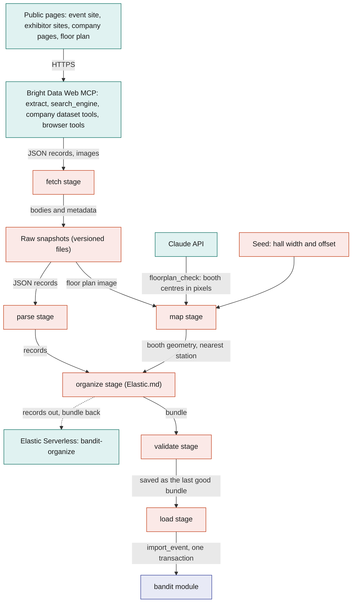
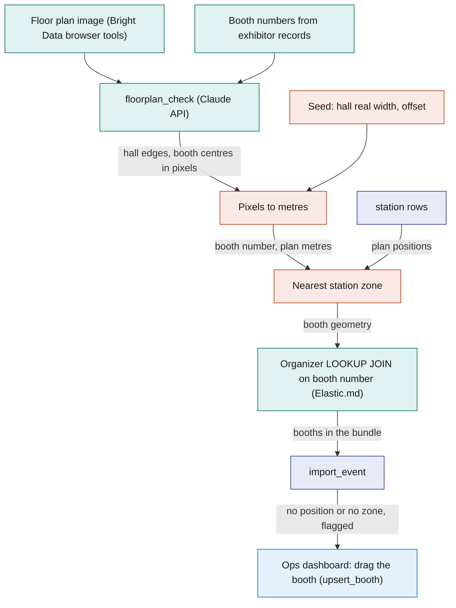
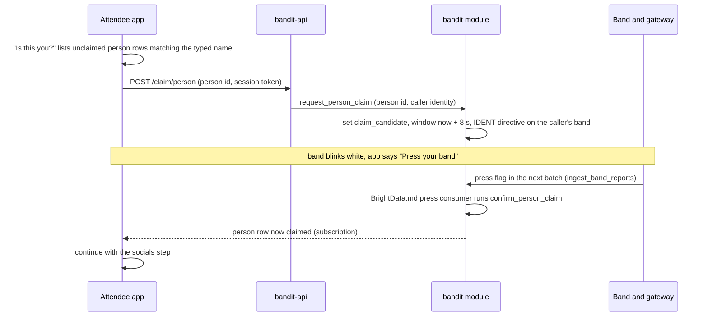
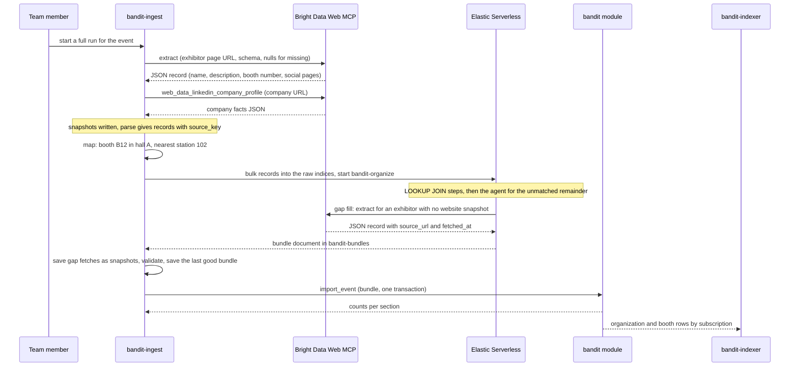

# Bright Data

`bandit-ingest` is a Rust command-line tool the team runs before the event. It works for any event: it starts from the list of start URLs in the event's seed and fetches the event's public pages and its organisations' pages through the Bright Data Web MCP, saves every fetch as a versioned snapshot kept with the project, has Elastic organize the records into one event bundle (organisations, booths with positions, halls, schedule, unclaimed people profiles), and loads the bundle into SpacetimeDB in one transaction with the `import_event` reducer. Everything downstream (the Ops dashboard map, visits, the profile claim, the search copy) sees ordinary SpacetimeDB rows and never knows a scrape happened. Bright Data owns every step that touches the web, Elastic every step after the raw records land, and SpacetimeDB everything live or exact. The snapshots mean that no demo or rerun depends on a live scrape. Cal Hacks 13.0 is the demo instance.

## Role in the system

Responsibilities:

- Fetch any event's public pages through the Bright Data Web MCP, starting from the start URLs in the event's seed: the event's site, its exhibitor or sponsor list, its schedule and its floor plan image; then each organisation's own site and its company facts. Keep a dated snapshot of every fetch.
- Build the booth geometry: Claude's `floorplan_check` reads booth numbers and their positions from the floor plan image, the hall's real width from the seed turns pixels into plan metres, and each booth gets the nearest station's zone.
- Build unclaimed `person` profiles from event pages only (speakers, judges, sponsor representatives, exhibitor contacts, artists), and let a person claim theirs at onboarding by pressing their band.
- Validate the organized bundle in Rust, keep the last good bundle, and load it with `import_event`, keyed by stable source keys so reruns are idempotent. Every scraped row carries `source_url` and `fetched_at`.
- Own the optional tables `hall`, `organization` and `person`, the reducers `import_event`, `request_person_claim` and `confirm_person_claim`, and the route `POST /claim/person` in `bandit-api`.
- Report progress through `heartbeat` while it runs, like every Rust service.

Non-responsibilities:

- **Never scrapes people.** No person scraper, no social profile, no lookup of a person by name. People come only from what the event itself publishes. Every attendee types their own social handles at onboarding ([Social](../6-features/Social.md) owns `social_handle`). Elastic.md: the organizer's gap-fill tool is held to the same rule and fetches organisation and event pages only.
- Does not merge facts across sources. That is the organizer's job ([Elastic](Elastic.md)). Page extraction happens once, at fetch time, through Bright Data `extract` with the null rule; Elastic receives JSON records, never page bodies.
- Does not define zones or exits. The core seed in [SpacetimeDB](../2-data/SpacetimeDB.md) creates the station zones and the exits; the bundle never changes them.
- Does not scrape merch. [Merch](../6-features/Merch.md) loads its hand-made templates from the event's merch seed.
- Does not run during the event and is never on the safety path.
- Does not own `booth`, `schedule_slot` or `venue` ([SpacetimeDB](../2-data/SpacetimeDB.md)); it fills them.

Elastic.md: the organize stage turns the records into the bundle. Without Elastic.md there is no scraped bundle to load, and booths and their organisations are entered by hand on the Ops dashboard with `upsert_booth`.

## Interfaces

| Interface | Direction | Who | What flows | Transport |
|---|---|---|---|---|
| Bright Data Web MCP | out | `bandit-ingest`, fetch stage | `search_engine` to find an organisation's official site; `extract` with a record schema and the null rule for event and exhibitor pages; `web_data_linkedin_company_profile` and `web_data_crunchbase_company` for company facts; `scrape_as_markdown` to find the floor plan image link; `scraping_browser_navigate` and `scraping_browser_screenshot` to capture the floor plan and logo images | HTTPS JSON-RPC tool calls to the remote MCP server, Pro mode on, with the account token |
| Elastic.md: Bright Data Web MCP, gap fill | out | the organizer agent in Elastic, through an Agent Builder MCP tool | `extract` on an organisation or event page the raw records name but no snapshot covers; one JSON record back; at most 10 calls per run (starting value) | the same MCP server with a zone token of its own that has its own spending limit ([Elastic](Elastic.md)) |
| Claude API | out | `bandit-ingest`, map stage, through `claude-client` | `floorplan_check`: the floor plan image and the booth numbers the exhibitor records list; back come the hall's edges and each visible booth's centre in pixels, or null | HTTPS Messages API, structured output; recorded in `model_call` ([Anthropic-Agent](Anthropic-Agent.md)) |
| Seed files | in | `bandit-ingest`, map and load stages | for the event: the list of start URLs, each with its page kind; per hall: name, real width in metres, offset in the venue plan frame; for the venue: plan origin and rotation, recorded on site at setup | hand-written files next to the core seed ([SpacetimeDB](../2-data/SpacetimeDB.md)) |
| Snapshot and bundle files | out and in | `bandit-ingest`; the team by review | raw snapshots with their fetch metadata, parsed records, and the last good bundle | versioned files kept with the project |
| Elastic.md: raw indices and the organizer | out and in | `bandit-ingest`, organize stage | parsed JSON records, map-stage geometry and the core station and zone rows out to `bandit-raw-pages`, `bandit-raw-orgs` and `bandit-raw-plan`; one `bandit-organize` workflow execution per run; back comes the bundle document from `bandit-bundles` | HTTPS Bulk API and Workflows API with the Elastic ingest key ([Elastic](Elastic.md)) |
| `import_event` reducer | out | `bandit-ingest`, load stage (role `ingest`) | the whole bundle; back come row counts per section | SpacetimeDB Rust client SDK, one reducer call, one transaction |
| `heartbeat` reducer | out | `bandit-ingest` while running | name, version, pages fetched, records built, rows imported, failures, every 5 s | SpacetimeDB reducer call |
| `POST /claim/person` | in | Attendee app (caller identified by `api_session`) | the `person` id the attendee says is them; `bandit-api` calls `request_person_claim`, and the caller's band blinks white | HTTPS JSON on `bandit-api` |
| Band press | in | `ingest_band_reports` ([SpacetimeDB](../2-data/SpacetimeDB.md)) | a press from the claimant's band inside the 8 s window; the BrightData.md press consumer runs `confirm_person_claim` in the same transaction | press flag in the batched band reports |
| Loaded rows | out | `bandit-indexer` ([Elastic](Elastic.md)), Attendee app, Ops dashboard | `organization`, `booth`, `hall`, `schedule_slot`, `person` rows by subscription | SpacetimeDB subscription |

## Design

### Scope rule

The scrape covers the event and organisations, never people. The only person records are unclaimed profiles built from pages the event itself publishes (a speaker page, a judge list, a sponsor's named representative, an exhibitor's listed contact, an artist on the line-up), and they hold only what that page says: name, role, organisation and the page it came from. Handles come from the attendee: their Instagram, Facebook and Threads handles, typed at onboarding ([Social](../6-features/Social.md)), with or without a claimed profile. So every fact about a person in the system is one the event published or the person entered.

### Sources

The import is the same for every event. The event's seed lists its start URLs, each with its page kind: the event's own site, its exhibitor or sponsor list, its schedule page and the page that shows its floor plan image. The page kind picks the record schema. Each source below is a named entry in the ingest configuration with the Web MCP tool that fetches it, the record schema, and the features that need it; only the start URLs change from one event to the next. Core safety needs none of them, which is why the whole file is optional.

The demo instance is Cal Hacks 13.0, at the Palace of Fine Arts. Its start URLs are the event's own site, its Devpost page (the sponsor list with tiers) and its schedule page.

| Source | Pages | Gives | Web MCP tools | Needed by |
|---|---|---|---|---|
| `event_pages` | the start URLs: the event's own site (sponsors, speakers, judges, venue, dates), its exhibitor or sponsor list (with tiers when it gives them) and its schedule page | `organization` candidates with tier; `person` candidates; `schedule_slot` records; event and venue facts | `extract` with a schema per page kind | booths and schedule for [Social](../6-features/Social.md), [Elastic](Elastic.md) and the attendee app; people for the profile claim |
| `exhibitor_pages` | each organisation's public home and about pages, found from the sponsor list or with `search_engine` | description, tags, logo, company social pages, booth number when the page states it | `search_engine`, `extract`; the browser tools for the logo image | booth descriptions for [Elastic](Elastic.md) |
| `org_facts` | the organisation's LinkedIn company page and Crunchbase company page | industry, headquarters, size range, founding year, short description, funding summary | `web_data_linkedin_company_profile`, `web_data_crunchbase_company` (company pages only) | richer booth documents in [Elastic](Elastic.md) |
| `floor_plan` | the floor plan image on the start URL of kind map | booth numbers and their positions | `scrape_as_markdown` finds the image link; `scraping_browser_navigate` and `scraping_browser_screenshot` capture the image | booth positions for the Ops map, [Social](../6-features/Social.md) visits and [Elastic](Elastic.md) geo search |

### The Bright Data Web MCP

Every fetch goes through the Bright Data Web MCP server. `bandit-ingest` speaks the MCP protocol directly (JSON-RPC tool calls over HTTPS with the account token), so no agent runtime is involved. Pro mode is switched on, because `extract`, the company dataset tools and the browser tools are Pro tools; the credits cover them. Each tool has one job:

| Tool | Used for | Behaviour the design relies on |
|---|---|---|
| `extract` | every event and exhibitor page: a URL becomes JSON against a schema given in the call | always told to return null for a field it cannot find rather than guess; its output is validated against the schema before use |
| `search_engine` | finding an organisation's official site from its name on the sponsor list | one query per organisation that has no website on the event pages |
| `web_data_linkedin_company_profile`, `web_data_crunchbase_company` | company facts, collected by company page URL | structured JSON back; a call can take a minute or more, because Bright Data collects the page before answering |
| `scrape_as_markdown` | reading the event's map page to find the floor plan image link | a link hunt needs no schema |
| `scraping_browser_navigate`, `scraping_browser_screenshot` | capturing an image: the floor plan and each organisation's logo | the only tools that return an image; used for nothing else |

Elastic.md: the organizer's gap-fill tool calls the same `extract` through a separate zone token with its own spending limit, and its results are saved as snapshots like any other fetch.

Constraints the pipeline is built around:

- **Open pages, no sign-in.** Every source is a page anyone can open. `bandit-ingest` never signs in and never fills a form.
- **`extract` must not guess.** Every call carries the null rule and a strict schema. A record with a null required field is dropped and listed in the import report.
- **Credits are finite.** Each source has a page budget the run will not exceed, retries are capped at 3 per URL, and each call waits at most 10 min (starting value).
- **One run per import.** A person starts a run; there are no scheduled re-scrapes. A rerun reads the snapshots first and fetches only what is missing.

### Pipeline

Six stages, one of them in Elastic. Each stage reads the previous stage's artefacts, so any stage can be rerun alone. Bright Data owns the fetch, Rust owns the deterministic stages, and the Elastic organizer owns the organize stage.

| Stage | Reads | Produces | Notes |
|---|---|---|---|
| fetch | the ingest configuration and the event's start URLs from the seed | one raw snapshot per fetch: the JSON record or image, plus URL, time, tool, status and the SHA-256 of the body | never overwrites; the latest snapshot per source is marked. Elastic.md: gap-fill records from an earlier run are snapshots too and are read here, so the organizer finds no gap on a rerun |
| parse | latest snapshots | records with `source_key`, `source_url`, `fetched_at` | schema validation of the `extract` and dataset JSON; same snapshot, same output |
| map | the floor plan snapshot, the seed's hall entries, the station rows | booth geometry per hall: booth number, plan position, confidence, nearest station | the booth map below |
| Elastic.md: organize | parsed records, the map output, the core station and zone rows | the bundle: organisations deduplicated and merged across sources, booths linked to organisations and geometry, people linked to organisations, categories and tags, schedule slots matched to stages and zones, a reason per merge, a gaps list | writes the records to the raw indices, runs `bandit-organize` once, reads the bundle back and saves gap-fill records as snapshots ([Elastic](Elastic.md)) |
| validate | the bundle, the raw records of the run | a checked bundle, saved as the last good bundle | the same rules `import_event` enforces; a run that fails here leaves the previous last good bundle in place |
| load | the last good bundle | SpacetimeDB rows through one `import_event` call, and an import report with row counts per section, dropped records and the gaps list | one transaction: either the whole event is in or nothing changed. Afterwards the stage compares row counts per table with the bundle, and runs again before doors open |

The diagram answers: how do public pages become one bundle that lands in SpacetimeDB in a single transaction?

### The booth map

The floor plan has one path. Bright Data captures the image the event publishes; Claude reads the booth numbers off it; one typed number, the hall's real width, turns pixels into metres; and ops fixes any booth that lands in the wrong place by dragging it on the Ops dashboard map. One floor plan image is one hall and one `hall` row; the Cal Hacks demo has one hall.

1. **Capture.** The fetch stage finds the image link on the event's map page (its start URL of kind map) with `scrape_as_markdown`, opens it with `scraping_browser_navigate` and saves `scraping_browser_screenshot` as the floor plan snapshot. The load stage uploads it through `bandit-api`'s blob endpoint, which calls `register_blob` with access class `staff`, and stores the id in `hall.sheet_blob_id`.
2. **Read.** `floorplan_check` ([Anthropic-Agent](Anthropic-Agent.md)) receives the image and the booth numbers the exhibitor records list. It returns the hall's outer edges in pixels and, for each booth number it can see, the centre in pixels with a confidence. A listed number it cannot see comes back null; it never invents a number that is not printed on the plan.
3. **Pixels to metres.** The seed holds the hall's real width in metres. Metres per pixel is that width divided by the hall's width in pixels, stored as `hall.metres_per_unit`. The hall's top-left corner plus the seed's offset (zero for the single demo hall) places every booth in the venue plan frame, the same frame the station positions are measured in.
4. **Nearest station zone.** Each booth centre is compared with the station positions (`station.plan_x_m`, `station.plan_y_m`, [SpacetimeDB](../2-data/SpacetimeDB.md)); the nearest station's zone becomes `booth.zone_id`. A booth farther than 40 m (starting value, calibrate) from every station gets no zone.
5. **Join and load.** The map stage hands this geometry to the organizer, whose `LOOKUP JOIN` step links each exhibitor's booth mention to its geometry by normalised booth number ([Elastic](Elastic.md)). Geometry without a mention becomes a booth named by its number, with kind `other`; a mention without geometry loads with `placement_source` `none`.
6. **Fix by hand.** Booths without a position or a zone load anyway, flagged, and appear in the Ops dashboard's booth fix-up panel (one panel row in [Ops-Dashboard](../5-apps/Ops-Dashboard.md) starting with "BrightData.md"). Ops drags each one to its place on the map, which calls `upsert_booth` and sets `booth.placement_source` to `manual`; a rerun of `import_event` never overwrites a `manual` placement.

The diagram answers: where does a booth's position come from?

### Records, the bundle and import_event

Every record carries `source_key` (a stable string such as `event:org:elastic`, `event:person:` plus the listed name in lowercase, `plan:booth:B12`), `source_url` and `fetched_at`. `import_event` looks rows up by `source_key` and inserts or updates, so loading the same bundle twice changes nothing and a corrected description updates the same row (and the same Elastic document). The import never deletes: rows the bundle no longer contains are listed in the import report and a person decides.

The bundle has one section per table, loaded in dependency order inside the one transaction:

| Section | Target table | What `bandit-ingest` supplies | Owner of the table |
|---|---|---|---|
| event | `venue` | name, `starts_at` and `ends_at` from the event pages; `origin_lat`, `origin_lon` and `plan_rotation_deg` from the seed | [SpacetimeDB](../2-data/SpacetimeDB.md) |
| halls | `hall` | see below | this file |
| organizations | `organization` | see below | this file |
| booths | `booth` | `source_key`, name, kind (`sponsor`, `stage`, `food`, `help_desk`, `other`), booth number, `organization_id`, `hall_id`, `zone_id`, `plan_x_m`, `plan_y_m`, `placement_source` (`plan`, `manual`, `none`), description and tags (from the organisation when the booth has none), `source_url`, `fetched_at` | [SpacetimeDB](../2-data/SpacetimeDB.md) |
| schedule | `schedule_slot` | title, start, end, location text, `booth_id` when the location maps to a booth, speakers' `person` ids | [SpacetimeDB](../2-data/SpacetimeDB.md) |
| people | `person` | see below | this file |

`import_event` is callable by the `ingest` role, and by `ops` for a hand-made bundle. It validates every reference inside the bundle before touching a row (zones exist, organisation keys resolve, booth numbers are unique per hall), then upserts section by section and returns counts. One bad record aborts the whole call, so there is never a half-loaded event. A hackathon bundle is a few hundred rows, well inside one reducer call.

### Tables owned by this file

**`hall`** (one per floor plan image):

| Field | Type | Meaning |
|---|---|---|
| `id` | auto id | row id |
| `venue_id` | id | the venue |
| `source_key`, `source_url`, `fetched_at` | text, text, timestamp | provenance |
| `name` | text | from the seed |
| `sheet_blob_id` | blob id | the floor plan image, access class `staff`; the Ops dashboard draws it under the zones |
| `metres_per_unit` | float | metres per image pixel, from the hall's real width in the seed |
| `offset_x_m`, `offset_y_m` | float | where the hall's top-left corner sits in the venue plan frame, from the seed |

**`organization`** (exhibitor, sponsor, venue operator or act):

| Field | Type | Meaning |
|---|---|---|
| `id` | auto id | row id |
| `source_key`, `source_url`, `fetched_at` | text, text, timestamp | provenance of the primary record |
| `name` | text | |
| `kind` | text | `sponsor`, `exhibitor`, `venue`, `act`, `organiser` |
| `sponsor_tier` | text, optional | as the event lists it |
| `website` | text | official site |
| `logo_blob_id` | blob id, optional | uploaded through `bandit-api`'s blob endpoint, which calls `register_blob` with access class `shared` |
| `description` | text | merged by the organizer from the site, LinkedIn company and Crunchbase company facts ([Elastic](Elastic.md)) |
| `tags` | list of text | short lowercase topics; the first is the organizer's category |
| `industry`, `headquarters`, `size_range`, `founded_year`, `funding_summary` | text or integer, optional | from the company dataset tools; null when unknown |
| `linkedin_url`, `crunchbase_url` | text, optional | the company pages that were read |
| `social_pages` | list of text | the organisation's own public social pages |

**`person`** (an unclaimed profile from event pages):

| Field | Type | Meaning |
|---|---|---|
| `id` | auto id | row id |
| `source_key`, `source_url`, `fetched_at` | text, text, timestamp | the event page that listed the person |
| `display_name` | text | as listed |
| `role` | text | as listed |
| `organization_id` | id, optional | the organisation the page lists them under |
| `kind` | text | `speaker`, `exhibitor_contact`, `sponsor_rep`, `artist` |
| `claim_candidate` | identity, optional | the attendee whose claim is waiting for a press |
| `claim_pending_until` | timestamp, optional | end of that press window, 8 s after the request |
| `claimed_identity` | identity, optional | the attendee who claimed the profile |
| `claimed_at` | timestamp, optional | |

Attendees read `display_name`, `role`, `organization_id` and whether the profile is claimed; the claim fields stay private.

### The profile claim, confirmed by a band press

A person listed by the event can claim their profile in the onboarding flow, right after claiming the band. The proof is the same as for the band: a press on the band they hold. The claim uses no email and no sign-in.

1. The attendee has claimed their band by press and typed a display name ([Attendee-App](../5-apps/Attendee-App.md)). The app lists the unclaimed `person` rows whose `display_name` matches what they typed: "Is this you?" Attendees with no match never see the step.
2. The attendee taps their profile. The app calls `POST /claim/person` with the `person` id. `bandit-api` finds the caller through `api_session` and calls `request_person_claim`.
3. `request_person_claim` (person id, claiming identity; role `api`) rejects a profile that is already claimed, or that has another attendee's press window open, and a caller who owns no band. Otherwise it sets `claim_candidate` and `claim_pending_until` (now plus 8 s) and upserts a `band_directive` for the caller's band with forced state IDENT (8) for 8 s, reason `person_claim`. The band blinks white and the app says "Press your band to confirm this is you".
4. The attendee presses. The press reaches `ingest_band_reports` in the next bridge batch. The BrightData.md press consumer runs right after the band claim consumer ([SpacetimeDB](../2-data/SpacetimeDB.md)): a press from a band whose owner is the `claim_candidate` of a `person` row with an open window runs `confirm_person_claim`.
5. `confirm_person_claim` (person id, claiming identity) runs in the same transaction as the press; no client calls it. It sets `claimed_identity` and `claimed_at`, clears the candidate fields, and deletes the IDENT directive; the bridge then lets the forced blink expire ([Gateway-Bridge](../3-services/Gateway-Bridge.md)). The app sees the profile turn claimed through its subscription and continues with the socials step ([Social](../6-features/Social.md)).

The claim adds one thing to the people graph. Social.md: the claimed profile's `organization_id` gives the attendee their `works_at` link in `people_link`; a claimed profile is the only source of that link for an attendee, because onboarding asks for no company. The attendee's handles come from the socials step whether or not a profile was claimed. The first confirmed claim wins.

The sequence answers: how does a press on the band confirm "this profile is me"?

### One organisation, fetch to load

The sequence answers: for one exhibitor, what does a run do from the first tool call to rows the indexer sees?

`bandit-indexer` subscribes to `booth`, `organization`, `hall` and `schedule_slot`, so each import arrives as insert or update callbacks, and each booth becomes a `bandit-booths` document that carries its organisation's facts ([Elastic](Elastic.md)). `person` rows are never indexed; the app reads them from SpacetimeDB.

## Failure modes and fallbacks

| Failure | Effect | Design answer |
|---|---|---|
| A page or dataset call fails during a run | That source has no new data | The run keeps the source's previous snapshot; nothing at the event depends on a fetch |
| `floorplan_check` returns null for a booth, or a booth is farther than 40 m from every station | Booth without a position or a zone | It loads flagged; ops drags it into place on the Ops dashboard map before doors open |
| Elastic.md: the organizer run fails, or its bundle fails validation | No new bundle | The load stage loads the last good bundle it saved |
| A reference inside the bundle does not resolve | `import_event` would create dangling rows | `import_event` validates everything first and aborts the whole call; the previous load stays as it was |
| No press reaches the module within 8 s during the profile claim | Claim times out | The window passes, the IDENT directive ends on its own, and the screen offers "Try again" |
| Two attendees try to claim the same profile | Identity conflict | `request_person_claim` rejects a profile that is claimed or has another attendee's window open; the first confirmed claim wins |

## Dependencies

**Depends on**

- [SpacetimeDB](../2-data/SpacetimeDB.md): tables `venue`, `zone`, `station` (with `plan_x_m`, `plan_y_m`), `booth` (with `booth_number`, `organization_id`, `hall_id`, `plan_x_m`, `plan_y_m`, `placement_source`, `source_url`, `fetched_at`), `schedule_slot`, `band`, `band_directive`, `blob_ref`, `api_session`; reducers `heartbeat`, `grant_role`, `register_blob`, `upsert_booth`, and the press consumer step in `ingest_band_reports`; the `ingest` and `api` roles; the core zone and station seed.
- [Rust-Backend](../3-services/Rust-Backend.md): the `bandit-api` process that hosts `POST /claim/person` and the blob endpoint.
- [Elastic](Elastic.md): the raw indices and the `bandit-organize` workflow for the organize stage. Without it, no scraped bundle is loaded.
- [Anthropic-Agent](Anthropic-Agent.md): `claude-client`, the `floorplan_check` use case, `model_call`. Anthropic-Agent.md: without it, booths load without positions and ops drags each one into place.
- [Social](../6-features/Social.md): the onboarding socials step that follows the profile claim (optional; without it a claimed `person` simply has no handles).
- A Bright Data account with credits and a Web MCP token in Pro mode; Elastic.md: a second zone token with its own spending limit for the gap-fill tool.

**Used by**

- [Elastic](Elastic.md): its organizer runs on the raw records this pipeline writes, and its output is loaded by this pipeline (a hard dependency on this file); its indexer copies the loaded booths with their organisation facts and positions.
- [Social](../6-features/Social.md): visits are "at booth B", the profile claim sits in its onboarding flow, and the people graph takes its `exhibits` links from `booth.organization_id` and its `works_at` links from claimed profiles.
- [Attendee-App](../5-apps/Attendee-App.md): the schedule and the "Is this you?" step.
- [Ops-Dashboard](../5-apps/Ops-Dashboard.md): the hall's floor plan image and the booth fix-up panel.

**If you delete this file**

- `bandit-ingest` keeps only its seed mode, which loads the hand-written seed files through the setup reducers ([SpacetimeDB](../2-data/SpacetimeDB.md)). Remove its scraping stages and the BrightData.md parts of its rows in [Rust-Backend](../3-services/Rust-Backend.md) and [Architecture](../1-overview/Architecture.md) (interfaces, data ownership and failure tables).
- Remove `import_event`, `request_person_claim`, `confirm_person_claim`, `hall`, `organization` and `person` from the registry tables in [SpacetimeDB](../2-data/SpacetimeDB.md), the BrightData.md field row on `booth`, the BrightData.md note on the `venue` origin fields, the BrightData.md press consumer in `ingest_band_reports`, and the BrightData.md mentions in its `bandit-ingest` interface row and seed paragraph.
- Remove the `POST /claim/person` route from [Rust-Backend](../3-services/Rust-Backend.md), the BrightData.md rows from [Attendee-App](../5-apps/Attendee-App.md) and [Social](../6-features/Social.md) (the "Is this you?" step), the booth fix-up panel row, subscription row and `ingest` service card from [Ops-Dashboard](../5-apps/Ops-Dashboard.md), and the BrightData.md row from the README components table.
- Remove the `floorplan_check` row from [Anthropic-Agent](Anthropic-Agent.md).
- [Elastic](Elastic.md) loses its organizer and keeps search over hand-entered booths. Booths, schedule slots and the venue row are entered by hand through `upsert_booth`, `upsert_schedule_slot` and the seed. Behaviour elsewhere is unchanged, because everything reads SpacetimeDB rows either way.

## Decisions

| Decision | Why |
|---|---|
| The floor plan has one path: Bright Data captures the published image, Claude `floorplan_check` reads booth numbers and positions, the hall's real width typed in the seed converts pixels to metres, and ops drags any misplaced booth on the Ops dashboard map | One pipeline to build and rehearse; a wrong position is fixed in seconds by hand, so no second reading method is needed |
| No exhibitor contact export, no `claim_contact` table, no email; a profile claim is confirmed by a press on the attendee's band | The band press already proves who holds the band, the attendee learned it one step earlier, and it needs no email round trip |
| The profile claim blinks the band white (IDENT) for 8 s, like the band claim | Same visible prompt and same window as the press the attendee just did |
| No merch scraping | [Merch](../6-features/Merch.md) loads a few hand-made templates from its own seed |
| Only the Bright Data Web MCP, in Pro mode, with the tools named above | One product and one token to set up; the credits cover the Pro tools |
| No Claude merge of organisation facts (`scrape_extract` is removed) | The Elastic organizer is the one place facts are merged across sources |
| Without Elastic.md no scraped bundle loads; booths are entered by hand | The organizer is the only path from records to bundle, so there is no rules path to maintain |
| The last good bundle, saved by the validate stage, is the only fallback | The demo never depends on a live run |
| Every page becomes JSON through `extract`; there are no hand-written page parsers | Extraction happens once, at fetch time, with the null rule and a schema |
| The bundle never changes zones or exits | The core seed owns them, so the safety demo is the same with or without this file |
| The import works for any event: its input is the list of start URLs in the event's seed, and Cal Hacks 13.0 is the demo instance | The product must work at any venue; only the seed changes from one event to the next |
| The hall's width and offset and the venue's plan origin and rotation are typed in the seed | They are measured on site at setup; no map or geocoding source is scraped |
| Booth numbers are joined to geometry once, in the organizer's `LOOKUP JOIN` step | One owner per step; the map stage only produces geometry |
