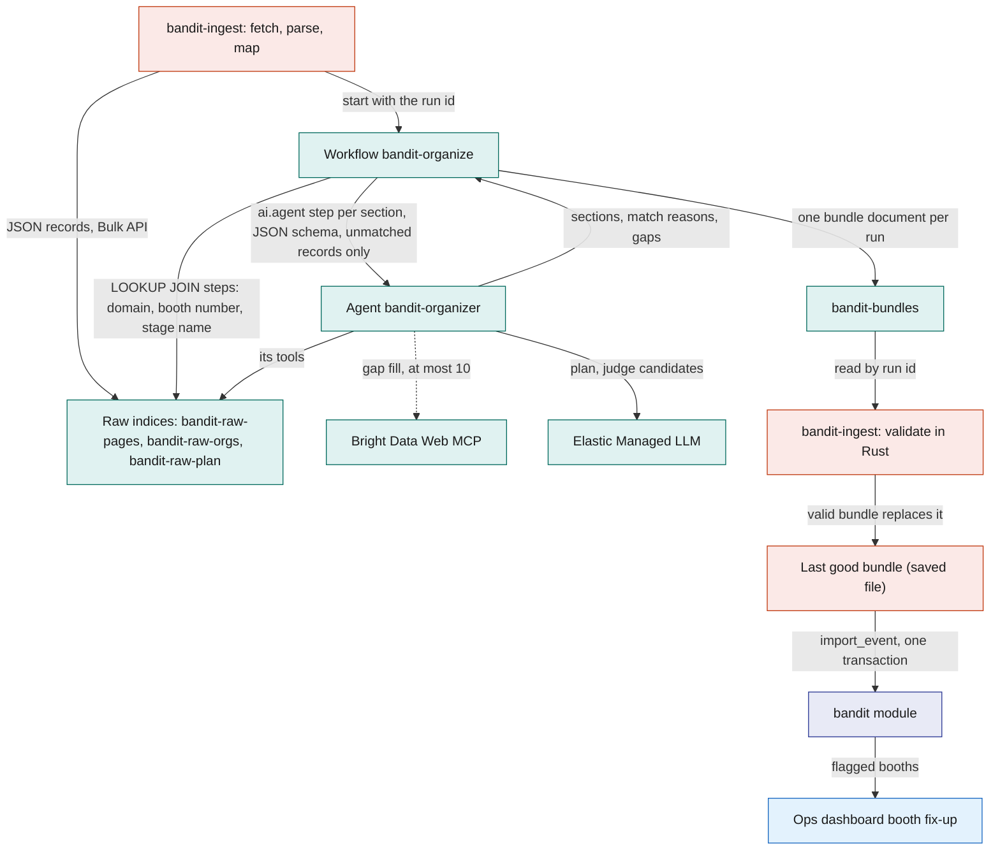
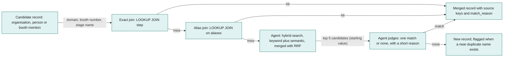
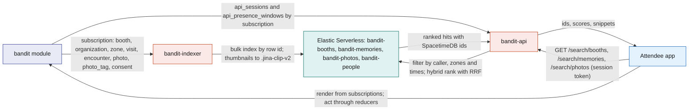
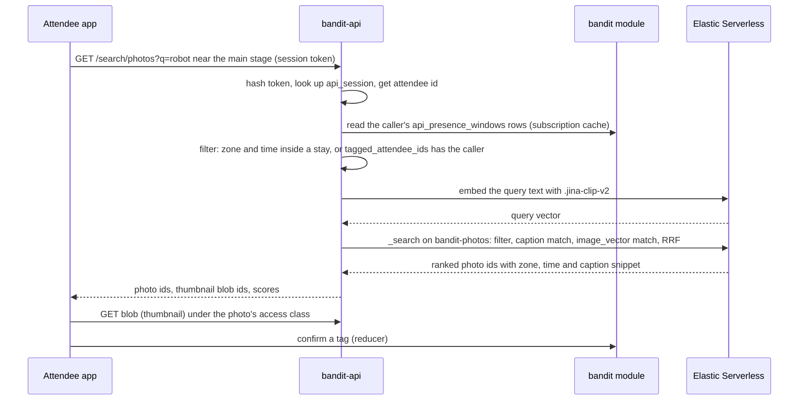
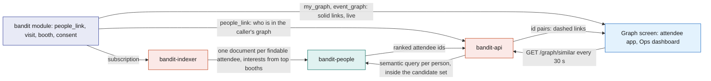
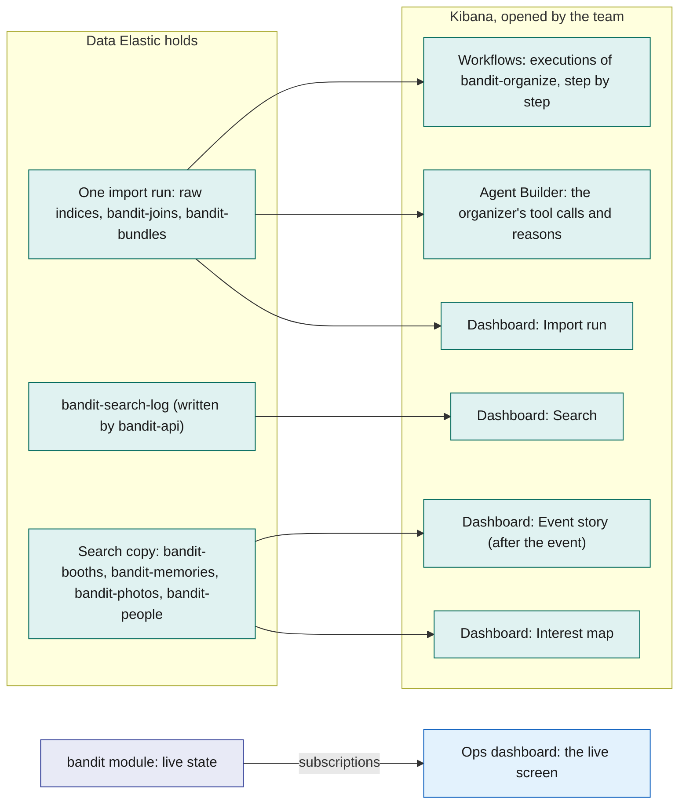

# Elastic

Elastic Serverless does two jobs for BandIt, and nobody chats with it. Before the event it organizes the scraped data: `bandit-ingest` writes the raw Bright Data records into raw indices, the Elastic Workflow `bandit-organize` joins and links them into one event bundle, and `bandit-ingest` validates that bundle in Rust and loads it into SpacetimeDB with `import_event`. During and after the event it adds meaning: `bandit-indexer` keeps a one-way copy of booths, consented memories, photos and findable attendees' interests, `bandit-api` serves three search routes that first narrow results to where and when the caller was, then rank by meaning, and the route `GET /graph/similar` draws the dashed "into the same things" links on the people graph. The team shows both jobs in Kibana. Elastic never holds truth and never sits in the safety loop: if it disappears, the last good bundle stays loaded, the search box hides and the graph keeps only its solid links.

## Role in the system

Responsibilities:

- Hold the raw scraped records of one import run in three raw indices: `bandit-raw-pages`, `bandit-raw-orgs`, `bandit-raw-plan`.
- Run the organizer. The Workflow `bandit-organize` makes the exact joins with fixed ES|QL `LOOKUP JOIN` steps, then calls the Agent Builder agent `bandit-organizer` with a JSON schema for the fuzzy remainder. The result is one structured bundle in `bandit-bundles`: organisations deduplicated, each organisation's facts merged across its site, LinkedIn and Crunchbase records, booths linked to organisations and people, categories and tags, schedule slots matched to stages and zones, and gaps flagged. The agent may fill a gap with at most 10 Bright Data MCP calls per run.
- Keep a one-way copy of booths, consented memories, photos and findable attendees' interests in four search indices: `bandit-booths`, `bandit-memories`, `bandit-photos`, `bandit-people`.
- Serve three attendee-scoped search routes in `bandit-api`: `GET /search/booths`, `GET /search/memories`, `GET /search/photos`. `bandit-api` holds every Elastic credential; browsers never talk to Elastic.
- Serve `GET /graph/similar` in `bandit-api`: attendee ids ranked by meaning, drawn as dashed links on the people graph that [Social](../6-features/Social.md) holds in SpacetimeDB.
- Define one view for the search filter, `api_presence_windows`, which gives `bandit-api` the caller's zones and time windows from SpacetimeDB.
- Give the team its Kibana views: the Workflows execution view of `bandit-organize`, the organizer's tool calls in Agent Builder, and four dashboards: Import run, Search, Event story and Interest map.

Non-responsibilities:

- Not a source of truth. The organizer never writes to SpacetimeDB; `bandit-ingest` validates its output and calls `import_event` ([BrightData](BrightData.md)). Search results carry SpacetimeDB ids, and any action on a result (a tag confirmation, a merch job) is an ordinary reducer call made by the app, owned by [Social](../6-features/Social.md) or [Merch](../6-features/Merch.md).
- No chat. No agent talks to attendees or staff, there is no conversation route, and there are no per-attendee agent tools or keys. The one agent runs once per import, started by `bandit-ingest`.
- No decisions. Elastic agents organize and validate data. A judgment about people or events goes to Claude through `claude-client` over SpacetimeDB rows ([Anthropic-Agent](Anthropic-Agent.md)); incidents never enter Elastic.
- Not in the safety path. Incidents, directives, density and exit assignment never read or write Elastic ([Safety](../6-features/Safety.md)). No Kibana view runs the live event: the live screen is the [Ops-Dashboard](../5-apps/Ops-Dashboard.md).
- Does not hold the people graph. The links between people, booths and companies are facts the bands measured, kept in SpacetimeDB (`people_link`, `my_graph`, `event_graph`, [Social](../6-features/Social.md)). Elastic only ranks who is into the same things, and nothing flows back from Elastic into SpacetimeDB.
- Never receives medical, insurance, payment or bank data, raw `band_report` or `presence_sample` rows, incidents, `person` rows, or any visit, encounter or photo tag the attendee has not consented to share. Scraped people appear only as raw records of one import run, taken from event pages.
- Does not fetch pages. Bright Data owns every step that touches the web ([BrightData](BrightData.md)). Elastic receives JSON records, never HTML or Markdown. The one web call made from Elastic is the organizer's gap-fill tool, itself a capped Bright Data MCP call.

## Interfaces

| Interface | Direction | Who | What flows | Transport |
|---|---|---|---|---|
| Elastic Bulk API, raw indices | in | `bandit-ingest`, organize stage ([BrightData](BrightData.md)) | JSON records from Bright Data `extract` and the company dataset tools, map-stage booth geometry, and the core station and zone rows; one document per record, tagged with the run id | HTTPS, ingest API key (write on `bandit-raw-*`, read on `bandit-bundles`) |
| Workflows API | in | `bandit-ingest`, organize stage | start one execution of `bandit-organize` with the run id; poll its status | HTTPS to Kibana, ingest API key |
| Agent tools | internal | `bandit-organizer` | fixed ES\|QL queries and one index search tool over the raw indices; one MCP tool for gap filling | Elastic-internal |
| Bright Data Web MCP, gap fill | out | `bandit-organizer`, through an Agent Builder MCP tool | `extract` with the null rule on an organisation or event page URL that the raw records name but no snapshot covers; one JSON record back with `source_url` and `fetched_at`; at most 10 calls per run (starting value) | HTTPS JSON-RPC to the remote MCP server, with a Bright Data zone token of its own that has its own spending limit ([BrightData](BrightData.md)) |
| `bandit-bundles` | out | `bandit-ingest` | one bundle document per run: the organized sections, a match reason per merge, a gaps list, the gap-fill records, the agent's tool-call count | HTTPS `_search` by run id, ingest API key |
| SpacetimeDB subscription | in | `bandit-indexer` (role `indexer`) | rows of `venue`, `zone`, `station`, `booth`, `schedule_slot`, `consent`; from BrightData.md: `organization`, `hall`; from Social.md: `visit`, `encounter`, `photo`, `photo_tag` | SpacetimeDB Rust client SDK over WebSocket; initial sync, then every committed change |
| Blob store folder on the Fly volume | in | `bandit-indexer` | photo thumbnails for `image_vector` | read directly from the folder, because `bandit-indexer` runs on the same Fly.io Machine as `bandit-api` |
| `heartbeat` reducer | out | `bandit-indexer` | service `indexer`, version, documents written, bulk failures, lag seconds, every 5 s | SpacetimeDB reducer call |
| Elastic Bulk API and inference, search indices | out | `bandit-indexer` | index and delete operations keyed by document id; one `.jina-clip-v2` embedding call per photo thumbnail | HTTPS, indexer API key (write on the four search indices, use of the inference endpoints) |
| `GET /search/booths` | in | Attendee app; the people graph's semantic lens in the Attendee app and the Ops dashboard | query text, optional `near` (a zone id), `limit`; returns ranked booths with `booth_id`, `zone_id`, name, snippet, score | HTTPS JSON on `bandit-api`; `api_session` token optional, booths are public |
| `GET /search/memories` | in | Attendee app | query text, optional `kind` (`visit`, `encounter`), optional `since` and `until`, `limit`; returns the caller's own ranked memories with `memory_id`, `booth_id`, `zone_id`, times, and `other_attendee_id` only when that person allows it | HTTPS JSON on `bandit-api`; `api_session` token required |
| `GET /search/photos` | in | Attendee app | query text, optional `since` and `until`, `limit`; returns ranked photos taken where and when the caller was, or that the caller is tagged in, with `photo_id`, `zone_id`, `taken_at`, caption snippet, `thumbnail_blob_id` | HTTPS JSON on `bandit-api`; `api_session` token required |
| `GET /graph/similar` | in | the people graph screens in the Attendee app and the Ops dashboard | no parameters; the caller's role decides the candidate set; returns pairs of attendee ids with a score, ids only | HTTPS JSON on `bandit-api`; `api_session` token required |
| `api_session` lookup | in | `bandit-api` | the app's session token, hashed and matched against `bandit-api`'s subscription to `api_session` to get the caller's attendee id | SpacetimeDB subscription ([SpacetimeDB](../2-data/SpacetimeDB.md)) |
| `api_presence_windows` view | in | `bandit-api` (role `api`) | one row per stay for every attendee: attendee id, zone id, start, end, collapsed from `presence_sample` by the module | SpacetimeDB subscription; the view is defined by this file |
| `people_link` rows and the caller's role | in | `bandit-api` (role `api`) | who is in a caller's own graph, and whether the caller holds the `ops` role | SpacetimeDB subscription ([Social](../6-features/Social.md), [SpacetimeDB](../2-data/SpacetimeDB.md)) |
| Elasticsearch search | out | `bandit-api` | one `.jina-clip-v2` embedding of the query text for photo searches, then one filtered hybrid query on a search index; semantic queries on `bandit-people` for `GET /graph/similar` | HTTPS, one service API key (read on the four search indices, use of the inference endpoints, write on `bandit-search-log`) |
| `bandit-search-log` | out | `bandit-api` | one document per search: route, time, latency, hit count, and for booth searches only the top booth ids and the query text; no attendee id | HTTPS index request with the same service key, fire and forget |
| Kibana | in | the team, signed in to the Elastic Cloud project | the Workflows execution view, Agent Builder, and the Import run, Search, Event story and Interest map dashboards; read only on every BandIt index | HTTPS in a browser; Elastic Cloud logins, never attendees |

## Design

### Why Elastic and not SpacetimeDB

Each store does what it is best at. SpacetimeDB owns all live state and every write (reducers are the only write path), the subscriptions that push changes to the apps, the space-time mapping of zones and times, every exact list, and the consent filter. Elastic owns two things SpacetimeDB is not built for: fuzzy entity resolution across messy scraped sources before the import, and ranking by meaning with semantic and vector search over booths, memories and photos. It ranks only inside candidates SpacetimeDB has already narrowed by zone, time and consent, it never decides access, and it never holds live state. The line is drawn by the question: exact, live or transactional questions go to SpacetimeDB; questions of meaning and similarity go to Elastic. The people graph follows the same split: its nodes and links are facts in SpacetimeDB, drawn as solid lines, and Elastic adds meaning, drawn as dashed lines.

| Question | Who answers | Why |
|---|---|---|
| "Is `Elastic` on the event's sponsor list the same company as `Elastic N.V.` on LinkedIn?" | Elastic, the organizer | Entity resolution over messy text, before the import |
| "Which booth does the schedule line `Stage A, Hall 1` belong to?" | Elastic, the organizer | Free-text location matched to stage booths and zone names |
| "Which zone is band 7 in right now?" | SpacetimeDB | Live `band_report` row, pushed by subscription |
| "Who is in the light circle around the fallen person?" | SpacetimeDB | Written inside the incident transaction; must never wait on a search |
| "Show my timeline" | SpacetimeDB | Exact `visit` and `encounter` rows for one attendee, already a view |
| "Who did I hang out with tonight?" | SpacetimeDB, the people graph | `met` links in `people_link`, read through `my_graph`; the bands measured them, and `findable` is checked in the view |
| "Which booths and companies tie the crowd together?" | SpacetimeDB, the people graph | `visited`, `works_at` and `exhibits` links to shared booth and company nodes, pushed live to the ops screen through `event_graph` |
| "Who that I met is into the same things as me?" | Elastic, `GET /graph/similar` | Two people who visited different booths can still care about the same things; only embeddings of the booth texts can tell |
| "Light up everyone into wearable robotics" | Elastic, the semantic lens | The phrase ranks booths by meaning through `GET /search/booths`; the graph highlights those booths and everyone linked to them |
| "Booths about wearable robotics" | Elastic, search | Matches meaning in booth descriptions, not exact words |
| "That drone booth near the main stage" | Elastic, search | Meaning plus a place (geo distance from a zone centroid) |
| "The photo of me near the main stage around 9 with the robot" | Elastic, search | Filter to where and when I was, then rank caption meaning and image content |
| "Which AI hardware booths did I spend the most time at?" | Elastic, search | My own visits ranked by what each booth is about |

Presence is zone-level only ([SpacetimeDB](../2-data/SpacetimeDB.md)), so a memory is "in zone Z, at booth B, from T1 to T2" or "an encounter with attendee X in zone Z from T1 to T2". The indices hold no finer position than a zone centroid or a booth point.

### What Elastic does not do

- It does not serve plain lists. "My visits", "my encounters", "my photos in zone Z between 9 and 10" and "the booth with number B12" are SpacetimeDB views in the apps; the search routes require a query and answer only ranked questions.
- It does not decide who may see what. The indexer copies only rows the `consent` rows allow, and `bandit-api` builds every caller filter from SpacetimeDB rows (`api_session`, `api_presence_windows`, `people_link`). No Elastic query, model or key decides access.
- It does not hold or discover graph links. The bands measure who met whom and who stood at which booth, and SpacetimeDB stores those links ([Social](../6-features/Social.md)). Kibana Graph is not used: it is unavailable on Elastic Cloud Serverless, and it discovers links from terms that occur together in documents, while here the links are already measured.
- It does not hold live state or history. Live counts, zone state, incidents and `zone_sample` stay in the module. The Kibana dashboards read only the organizer's working data, the search log and the consented copy; none of them shows a live count, a zone's density or a person.
- It does not write to SpacetimeDB. The bundle is loaded by `bandit-ingest` through `import_event`; a search result becomes an action only through a reducer the app calls.
- It does not talk to anyone. The one agent runs once per import over the raw indices of that run.
- It does not fetch or crawl. Elastic's Open Crawler is not used, and there are no scheduled re-scrapes: one run per import. Bright Data cannot deliver to Elasticsearch directly, so `bandit-ingest` bulk-indexes the records itself.
- It does not read floor plans. Booth geometry comes from the map stage in `bandit-ingest`, where Claude's `floorplan_check` reads the plan image, and reaches Elastic as plan records.

### Part one: the organizer, upstream of SpacetimeDB

Scraped records are messy in regular ways. One organisation appears under three names (the event's sponsor list, its own site, its LinkedIn page); booth numbers come as `B12`, `B-12` and `12`; schedule locations are free text; speakers are listed under slightly different company names. Fixed ES|QL `LOOKUP JOIN` steps handle the regular cases deterministically, before any model runs. The irregular remainder is where a model with search tools helps: it finds candidates by meaning, picks one or none, and says why. Each step has one owner: Bright Data fetched and extracted every page, the workflow's join steps make the exact links, the agent makes the fuzzy ones, and Rust decides what is loadable.

The diagram answers: how do raw records become the bundle that lands in SpacetimeDB, and what is loaded when a run fails?

**Raw indices.** `bandit-ingest` writes every record with a `run_id`, so the agent's tools always filter on the current run and an old run never leaks into a new bundle. Page bodies stay in the snapshots; Elastic sees JSON records only. The indices are small (a few hundred to a few thousand documents) and are rebuilt from the saved snapshots at every run. `bandit-raw-orgs` and `bandit-raw-plan` are created with `index.mode` set to `lookup`, so they can sit on the right side of a `LOOKUP JOIN`. Every document carries its provenance, normalised join keys, and a `text` field mapped as `semantic_text` so candidates can be found by meaning.

| Index | One document per | Fields |
|---|---|---|
| `bandit-raw-pages` | record from an event or exhibitor page (the JSON that Bright Data `extract` produced) | `run_id`, `source_key`, `source_url`, `fetched_at`, `fetched_by` (`ingest`, `organizer`), `snapshot_sha256`, `record_kind` (`organization_candidate`, `person_candidate`, `schedule_item`, `booth_mention`, `venue_fact`), `name` (text with a keyword sub-field), `aliases` (keyword: website domain, normalised name, booth number as printed), `domain`, `booth_number_norm`, `location_norm`, `org_key` (keyword: the join keys the `LOOKUP JOIN` steps use), `text` (semantic_text: the record's description), `tier_text`, `role_text`, `location_text`, `start_text`, `end_text`, `links` and `raw` (not indexed) |
| `bandit-raw-orgs` (lookup mode) | company-facts record from a dataset tool | `run_id`, `source_key`, `source_url`, `fetched_at`, `dataset` (`linkedin_company`, `crunchbase_company`), `name` (text with a keyword sub-field), `aliases`, `domain` (keyword: the join key), `website`, `text` (semantic_text: the dataset's description), `industry`, `headquarters`, `size_range`, `founded_year`, `funding_summary`, `social_pages` (not indexed) |
| `bandit-raw-plan` (lookup mode) | booth geometry item from the map stage, or a reference row | `run_id`, `record_kind` (`booth_geometry`, `station`, `zone`, `hall`), `source_key`, `hall_name`, `booth_number_text`, `booth_number_norm`, `location_norm`, `aliases`, `plan_x_m`, `plan_y_m`, `placement_confidence`, `nearest_station_id`, `nearest_station_distance_m`, and for reference rows the zone or station name, id and plan position copied from SpacetimeDB |

**The workflow.** `bandit-organize` is an Elastic Workflow that `bandit-ingest` starts once per import run through the Workflows API, passing the run id. Workflows are generally available on Elastic Cloud Serverless; the feature is switched on in the project settings and needs a role with workflow privileges. Its first steps are fixed ES|QL queries with `LOOKUP JOIN`, parameterised only by the run id, that write the exact joins to a per-run join index, `bandit-joins`. They join an organisation candidate to its company facts on `domain`, a booth mention to its geometry on `booth_number_norm`, a schedule item to a stage booth or zone on `location_norm`, and a person candidate to an organisation on the `org_key` printed on the same page. Nothing a model says can change these rows. Then come the `ai.agent` steps, one per bundle section, in dependency order (organisations, booths, people, then schedule and gaps). Each step has that section's JSON `schema` and gets only the records the joins left unmatched plus the join results, so the answer is structured and a malformed one fails inside Elastic. A final index step writes the sections, the match reasons, the gap-fill records and the gaps list as one document to `bandit-bundles`, keyed by the run id.

`bandit-ingest` polls the execution, reads the document, saves every gap-fill record as a snapshot and indexes it into the raw indices of the run, and validates the bundle in Rust against the rules `import_event` enforces: every `source_key` exists in the raw indices of that run, every organisation reference resolves, booth numbers are unique per hall, zone and stage names exist, every category is on the fixed list, and the gap-fill count is within the cap. A valid bundle is saved as the last good bundle and loaded. If the run fails or the bundle fails validation, `bandit-ingest` loads the last good bundle it saved, and the failed run stays in Kibana for review. Elastic shapes the bundle, Rust decides whether it is loadable, and `import_event` checks once more inside the transaction.

**What the agent decides.** The instructions, in prose (the exact wording lives in the agent configuration):

- Organize one import run, identified by `run_id`; use only records of that run. Build on the join results; never undo a join the workflow made.
- Deduplicate the organisations the joins left unmatched with the matching ladder below. Never merge two records on a name alone when their website domains differ.
- Merge each organisation's facts across its records into one description and one tag set: typed fields (industry, headquarters, size, founding year) from the dataset record, the description from the site first.
- Link every unmatched booth mention and every unmatched person candidate to one organisation or to none, with a short reason for every link. A person's organisation is where the people graph's `works_at` link comes from once that profile is claimed ([Social](../6-features/Social.md)).
- Fill a gap with `bandit.fetch_gap` only when a record names an organisation or event page URL that has no raw record (an exhibitor whose website was never fetched). Never a person's page, never a web search for a name, at most 10 calls per run (starting value). Put every result in the gap fetches section with its `source_url` and `fetched_at`.
- Give every organisation and booth one category from the fixed list and up to five lowercase tags from its own text. The category becomes the first entry of `tags`, so no table changes.
- Match every schedule item's location text to a stage booth or a zone name from `bandit-raw-plan`; flag it when nothing fits.
- Return null rather than a guess. Never invent a source key, a booth number or a person. List every unresolved item in the gaps section with a reason, so the booth fix-up panel can show it.

The fixed category list (starting value, calibrate against the real exhibitor list): `ai`, `hardware`, `developer_tools`, `cloud`, `data`, `security`, `fintech`, `health`, `education`, `consumer`, `sponsor_services`, `food`, `stage`, `other`.

**Tools.** Fixed, parameterised ES|QL queries where the rule is known, one index search tool where meaning matters, and one MCP tool for the web. Fixed queries keep the run filter, the limits and the field choices where the model cannot drop them.

| Tool id | Type | Index | Parameters | Returns | Why this shape |
|---|---|---|---|---|---|
| `bandit.joins` | ES\|QL, fixed | `bandit-joins` | `run_id`, `record_kind`, `key` | what the `LOOKUP JOIN` steps decided for that key | the agent builds on an exact join instead of redoing it |
| `bandit.unmatched` | ES\|QL, fixed | `bandit-raw-pages`, `bandit-raw-orgs` | `run_id`, `record_kind` | the records the joins left without a partner | the agent's work list |
| `bandit.candidates` | index search tool | `bandit-raw-pages`, `bandit-raw-orgs` | the record's name and text; hybrid keyword plus semantic retrieval merged with reciprocal rank fusion, filtered on `run_id` and `record_kind`, row limit 5 | the top candidates with name, aliases, source key and a snippet | the one place the model shapes a query |
| `bandit.plan_items` | ES\|QL, fixed | `bandit-raw-plan` | `run_id`, `hall_name` | geometry items with booth number, position and nearest station | booth linking and gap detection |
| `bandit.stages_and_zones` | ES\|QL, fixed | `bandit-raw-plan`, `bandit-raw-pages` | `run_id` | stage booth mentions, zone names and station ids | schedule matching |
| `bandit.schedule_items` | ES\|QL, fixed | `bandit-raw-pages` | `run_id` | schedule items with location, start and end text | the schedule section |
| `bandit.people_for_org` | ES\|QL, fixed | `bandit-raw-pages` | `run_id`, `org_key` | person candidates listed under that organisation | people linking |
| `bandit.record_by_key` | built-in document lookup | any raw index | document id | the document | expand a key the agent already holds |
| `bandit.fetch_gap` | MCP tool: Bright Data Web MCP `extract` | the web, through Bright Data ([BrightData](BrightData.md)) | `url`, the record schema for that kind, the null rule | one JSON record with `source_url`, `fetched_at` and `fetched_by` `organizer` | the only web call; at most 10 per run (starting value) |

Every ES|QL tool has a `LIMIT`, the index search tool has a row limit, and the agent runs one section at a time, because the most common Agent Builder failure is a tool response or an answer larger than the model's context.

**The matching ladder.** Elastic's documented entity-resolution pattern, used for organisation deduplication and for linking people and booths to organisations. The diagram answers: in what order is a match tried, and when does the model get involved?

Steps one and two are `LOOKUP JOIN` steps, deterministic and cheap, so most records never reach the model. Step four is the only place the model decides; it must pick from the candidates it was given and write one sentence of reason, which lands in the bundle next to the merge. The reviewer reads the reasons, not the prompt.

**The LLM behind Agent Builder.** Agent Builder runs on the Elastic Managed LLM served by the Elastic Inference Service, which works the moment the Serverless project exists. Claude is not wired into Elastic; every Claude call stays in `claude-client` ([Anthropic-Agent](Anthropic-Agent.md)).

### Part two: search, downstream of SpacetimeDB

Data enters the search indices only from SpacetimeDB and leaves only as ids. The diagram answers: how does a committed row become searchable, and how does a search stay inside what the caller may see?

**bandit-indexer.** A Rust process with the `indexer` service role, on the Fly.io VM next to `bandit-api`. It is an ordinary SpacetimeDB client: one connection to the `bandit` database, subscriptions to the copied tables, and reactions to row callbacks. On first start it prints its identity so the owner can grant the `indexer` role with `grant_role` ([SpacetimeDB](../2-data/SpacetimeDB.md)). It calls `heartbeat` every 5 s, so the Ops dashboard can show whether search is fresh.

- **Sync.** A new subscription first delivers all current rows, then each committed change. The indexer treats both the same way: a row arrived, rebuild the documents that depend on it. There is no backfill mode and no "indexed" flag in SpacetimeDB, so the module knows nothing about Elastic.
- **Joins happen in the indexer.** A booth document needs its zone name, station id, organisation facts and schedule slots; a memory document needs the booth text and zone centroid. The builders read the related rows from the SDK cache, and a change to a parent row rebuilds every dependent document. Copying text in at index time avoids joins at query time.
- **Idempotent writes.** Every document id comes from the SpacetimeDB row id, so a retried bulk request, a restart or a duplicated callback overwrites the same document. Deletes are bulk delete operations; deleting a missing document is ignored.
- **Coalescing.** Changes are queued by document id and flushed every 1 s or at 500 operations (starting values, calibrate). A failed bulk request is retried whole with backoff, because every operation is idempotent.
- **Rebuild.** Each logical index is an alias (`bandit-booths`) over a generation index (`bandit-booths-003`). To change a mapping, the operator points the indexer at generation N+1 and restarts; the initial sync repopulates it, and the alias moves when it is complete. `bandit-api` only names the alias.

| Table (owner) | Copied to | Filter |
|---|---|---|
| `venue`, `zone`, `station` (SpacetimeDB.md) | folded into every document (names, centroids, the origin for geo conversion) | none; venue layout is public |
| `booth`, `schedule_slot` (SpacetimeDB.md) | `bandit-booths` | none; venue content |
| `organization`, `hall` (BrightData.md) | folded into `bandit-booths`: a booth document carries its organisation's facts and its hall name; there is no organisation index | none; facts about companies, not people |
| `visit` (Social.md) | `bandit-memories`; folded into `bandit-people` | only visits of attendees whose `consent` row `findable` is granted; indexed when it opens, updated when it closes; a closed visit rebuilds that attendee's `bandit-people` document |
| `encounter` (Social.md) | `bandit-memories`, one document per participant | a participant's document exists only if that participant has `findable`; the other participant's id is included only if the other also has `findable`, otherwise the document says "someone" |
| `photo`, `photo_tag` (Social.md) | `bandit-photos` | a photo is indexed once it has a caption or a thumbnail; `tagged_attendee_ids` holds only confirmed tags whose attendee has `photo_tagging`; `findable_attendee_ids` is the subset that also has `findable` |
| `consent` (SpacetimeDB.md) | not indexed | read by the builders; a change rebuilds or deletes every memory and photo document of that attendee |
| `zone_sample`, `presence_sample`, `band_report` (SpacetimeDB.md) | never | history and live data stay in the module |
| `person` (BrightData.md), `people_link` (Social.md) | never | people enter Elastic only as attendee ids on their own consented memories and interests; the graph links stay in the module |
| everything else (incidents, medical, payments, insurance, `job`, `blob_ref`, vision tables) | never | out of Elastic's remit |

The consent switches `findable` and `photo_tagging` are defined in [SpacetimeDB](../2-data/SpacetimeDB.md) and given meaning by [Social](../6-features/Social.md); this file only uses them. When a switch turns off, the indexer deletes the attendee's documents from `bandit-memories` by query on `attendee_id`, rebuilds the encounter documents of everyone they met, and rebuilds every photo they were tagged in. Turning `findable` off also deletes the attendee's `bandit-people` document.

**Positions for geo queries.** There are no positions for people. The only positions in Elastic are the zone centroid (`zone.plan_x_m`, `zone.plan_y_m`), used on memories, photos and the `near` boost, and the booth point (`booth.plan_x_m`, `booth.plan_y_m`), used on booths; a booth with `placement_source` `none` has no `location`. Plan metres become latitude and longitude with one shared Rust function, used by the indexer at index time and by `bandit-api` for the `near` zone, so Elastic `geo_point` queries and the Kibana map use real coordinates. The function reads the plan origin (`venue.origin_lat`, `venue.origin_lon`) and the plan's rotation from true north (`venue.plan_rotation_deg`), rotates the plan offset into north and east metres, and adds them to the origin with local metres-per-degree factors (about 111 km per degree of latitude, about 88 km per degree of longitude at this latitude), which is exact enough for a site a few hundred metres wide. Starting value for the origin in the demo instance: the Palace of Fine Arts, 3601 Lyon Street, San Francisco, roughly 37.8029 north, 122.4486 west; the real origin corner is recorded on site at setup. SpacetimeDB keeps plan metres, which is what the Ops dashboard draws.

**Index conventions.**

- The document id is the SpacetimeDB row id. Where an index merges tables, the id is prefixed with the table name (`visit-42`), and encounter documents are suffixed with the viewer's attendee id (`encounter-17-<attendee id>`). The plain row id is also stored as a field.
- Attendee ids are the SpacetimeDB identity as a hex string, mapped as `keyword`. Timestamps are `date`.
- Text vectors: every `semantic_text` field names its inference endpoint, `.jina-embeddings-v5-text-small` on the Elastic Inference Service. Pinning it matters because scores from different models cannot be mixed in one field.
- Image vectors: `bandit-photos` carries `image_vector`, a `dense_vector` from `.jina-clip-v2`, the multimodal model on the Elastic Inference Service. The indexer sends the thumbnail to the endpoint at index time; `bandit-api` sends the query text to the same endpoint at search time. Text and images share one vector space, so a text query finds a photo by what is in it, not only by its caption.
- Ranks from different fields are merged with reciprocal rank fusion, which merges ranks, not scores, so the text and image models never need comparable scores.

**`bandit-booths`** (one document per `booth` row, carrying its organisation's facts).

| Field | Type | Source |
|---|---|---|
| `booth_id` | long | `booth` row id |
| `source_key` | keyword | stable key from the scrape ([BrightData](BrightData.md)) |
| `name` | text with a keyword sub-field | `booth.name` |
| `booth_number` | keyword | `booth.booth_number` |
| `kind` | keyword (`sponsor`, `stage`, `food`, `help_desk`, `other`) | `booth.kind` |
| `description` | semantic_text, `.jina-embeddings-v5-text-small` | `booth.description`, then the organisation's description, tags and the booth's schedule titles, so one meaning search covers all of them |
| `tags` | keyword | `booth.tags` merged with `organization.tags`; the first is the organizer's category |
| `organization_id` | long | `booth.organization_id` |
| `org_name` | text with a keyword sub-field | `organization.name` |
| `org_kind` | keyword (`sponsor`, `exhibitor`, `venue`, `act`, `organiser`) | `organization.kind` |
| `sponsor_tier` | keyword | `organization.sponsor_tier` |
| `org_industry`, `org_headquarters`, `org_size_range` | keyword | from `organization` |
| `org_founded_year` | integer | from `organization` |
| `org_website`, `org_linkedin_url`, `org_crunchbase_url` | keyword, not indexed | from `organization`, for the card |
| `logo_blob_id` | keyword, not indexed | `organization.logo_blob_id` |
| `hall_id`, `hall_name` | long, keyword | `booth.hall_id`, joined from `hall` |
| `zone_id`, `zone_name` | long, keyword | `booth.zone_id`, joined from `zone`; absent while unassigned |
| `station_id` | integer | the zone's station |
| `location` | geo_point | booth point; absent when `placement_source` is `none` |
| `schedule_text` | text | titles and times of the booth's `schedule_slot` rows |
| `schedule_slot_ids` | long | ids of those rows |
| `next_slot_at` | date | start of the next slot, rebuilt when slots change |
| `updated_at` | date | indexer write time |

**`bandit-memories`** (one document per visit, one per encounter participant).

| Field | Type | Source |
|---|---|---|
| `memory_id` | keyword | document id |
| `kind` | keyword (`visit`, `encounter`) | table of origin |
| `source_row_id` | long | `visit` or `encounter` row id |
| `attendee_id` | keyword | the attendee this document belongs to |
| `started_at`, `ended_at` | date | from the row; `ended_at` absent while open |
| `minutes` | double | duration, recomputed on close |
| `zone_id`, `zone_name` | long, keyword | zone of the memory |
| `location` | geo_point | zone centroid |
| `booth_id` | long | visits only |
| `booth_name` | text with a keyword sub-field | copied from the booth |
| `booth_description` | semantic_text, `.jina-embeddings-v5-text-small` | copied from the booth |
| `booth_tags` | keyword | copied from the booth |
| `other_attendee_id` | keyword | encounters only; present only when the other participant has `findable` |
| `updated_at` | date | indexer write time |

**`bandit-photos`** (one document per `photo` row with a caption or a thumbnail).

| Field | Type | Source |
|---|---|---|
| `photo_id` | long | `photo` row id |
| `taken_at` | date | `photo.taken_at` |
| `zone_id`, `zone_name` | long, keyword | `photo.zone_id` (the photographer's band zone at capture, [Social](../6-features/Social.md)) |
| `location` | geo_point | zone centroid |
| `caption` | semantic_text, `.jina-embeddings-v5-text-small` | the photographer's caption or the vision caption (TBD -- LEO), as [Social](../6-features/Social.md) stores it |
| `caption_source` | keyword (`photographer`, `vision`) | which one |
| `image_vector` | dense_vector from `.jina-clip-v2` | embedded from the thumbnail at index time |
| `tagged_attendee_ids` | keyword, multi-valued | confirmed `photo_tag` rows whose attendee allows photo tagging |
| `findable_attendee_ids` | keyword, multi-valued | the subset that also allows being found |
| `thumbnail_blob_id` | keyword, not indexed | `blob_ref` id the app uses to show the thumbnail |
| `updated_at` | date | indexer write time |

**`bandit-people`** (one document per findable attendee with at least one visit; the document id is the attendee id).

| Field | Type | Source |
|---|---|---|
| `attendee_id` | keyword | the attendee |
| `interests` | semantic_text, `.jina-embeddings-v5-text-small` | names, descriptions and tags of the attendee's top 5 booths by visit minutes (starting value), most minutes first |
| `top_booth_ids` | long, multi-valued | those booths |
| `top_category` | keyword | the category (first tag) of the booth with the most minutes |
| `visit_minutes` | double | total consented visit minutes |
| `updated_at` | date | indexer write time |

**The space-time filter.** Every memory and photo search is narrowed before anything is ranked, and the narrowing comes from SpacetimeDB, not from the query text. `bandit-api` identifies the caller through `api_session` and reads the caller's stays from `api_presence_windows`: one row per stay, collapsed by the module from `presence_sample` with a 2 minute gap tolerance (starting value, calibrate). Because it is built from a core table, it works whether or not [Social](../6-features/Social.md) is present. The filter says:

- memories: `attendee_id` equals the caller (the indexer wrote only consented rows, so this is the whole rule);
- photos: the photo's `zone_id` and `taken_at` fall inside one of the caller's stays, or `tagged_attendee_ids` contains the caller;
- booths: no caller filter; `near` boosts by distance from that zone's centroid.

Only then does ranking start: a keyword match on names and tags, a semantic match on `description`, `booth_description` or `caption`, and for photos a vector match of the query against `image_vector`, all merged with reciprocal rank fusion. `bandit-api` builds every filter itself and uses one service key, so there are no per-attendee Elastic keys and no model is handed an attendee id.

The sequence answers: when an attendee searches "robot near the main stage", who talks to whom, and where does the filter come from?

**Search endpoints in bandit-api.** [Rust-Backend](../3-services/Rust-Backend.md) owns the process; this file owns these routes. Every route requires a query; with no query the app shows the exact list from its own subscriptions instead (`my_visits`, `booth` rows, the photos it is tagged in).

| Endpoint | Caller identity | What it does | Elastic call |
|---|---|---|---|
| `GET /search/booths` | `api_session` token optional | Keyword match on `name` and `tags` plus semantic match on `description`, fused with RRF; `near` boosts booths by geo distance from that zone's centroid. Returns at most `limit` (default 10) hits with `booth_id`, `zone_id`, `name`, a snippet and the score. The app highlights the booths on its own map from SpacetimeDB rows | one `_search` on `bandit-booths` |
| `GET /search/memories` | `api_session` token required | Filters `attendee_id` to the caller and optionally `kind`, `since` and `until`; ranks keyword matches on `booth_name` and `booth_tags` with a semantic match on `booth_description`, fused with RRF; returns at most `limit` (default 10) hits with `memory_id`, `source_row_id`, `booth_id`, `zone_id`, `started_at`, `ended_at`, `minutes` and, for encounters, `other_attendee_id` when present | one `_search` on `bandit-memories` |
| `GET /search/photos` | `api_session` token required | Builds the space-time filter, applies optional `since` and `until`, ranks a semantic match on `caption` and a vector match on `image_vector`, fused with RRF; returns at most `limit` (default 8) hits with `photo_id`, `zone_id`, `taken_at`, a caption snippet and `thumbnail_blob_id` | one `_inference` call for the query vector, then one `_search` on `bandit-photos` |

Every response carries SpacetimeDB ids only. The app renders cards from its own subscriptions, shows thumbnails through `bandit-api`'s blob download under the photo's access class ([Social](../6-features/Social.md) sets it), and acts by calling reducers. The Elastic call has a 10 s timeout (starting value, calibrate).

### Part three: meaning on the people graph

The people graph itself lives in SpacetimeDB ([Social](../6-features/Social.md)): `people_link` holds `met`, `visited`, `works_at` and `exhibits` links, `my_graph` gives each attendee their own neighbourhood, and `event_graph` gives the ops big screen the whole event without names. Those are the solid lines, pushed live. Elastic adds two things on top, and neither writes anything back into SpacetimeDB.

**`GET /graph/similar`.** The dashed "into the same things" links. One rule serves both screens: for each person in a candidate set, the 3 others in the same set whose `interests` are closest in meaning (starting value). The caller's role picks the set:

- a caller with the `ops` role, on the Ops dashboard's big screen: every findable attendee. The answer is anonymous, attendee ids only, matching the node ids of `event_graph`.
- any other caller, in the attendee app: the caller and the people already in the caller's own graph, that is, linked to the caller by a `met` link or through a booth or company they are both linked to in `people_link`. Strangers are never suggested.

`bandit-api` runs one semantic query on `bandit-people` per person in the set, with that person's `interests` text as the query and a filter to the set, and returns pairs of attendee ids with a score. It caches the event-wide answer for 30 s, the interval at which the graph screens refresh their dashed links. A person without a `bandit-people` document gets no dashed links. The browser draws the pairs next to the solid links and can cluster by them.

**The semantic lens.** A phrase typed on the graph screen ("wearable robotics") goes to the existing `GET /search/booths`, which ranks booths by meaning. The screen highlights the returned booths and everyone linked to them in its own graph.

The diagram answers: how does a dashed link reach the graph screen, and what stays in SpacetimeDB?

### Part four: Kibana, what the team shows

Kibana is Elastic's web app: the screens, opened in a browser, where a team looks inside an Elastic project. In Kibana you configure features such as Workflows and Agent Builder, watch each workflow run step by step, and build charts, maps and dashboards over any index. For BandIt it is the most visual way to show the Elastic side: how messy scraped records became one checked bundle, what people searched for, how the night looked once it was over, and what the crowd was into. Kibana reads only what Elastic already holds. The live event is shown on the [Ops-Dashboard](../5-apps/Ops-Dashboard.md) from SpacetimeDB subscriptions, so no Kibana view repeats a live count, a zone's density or an incident. Only the team opens Kibana, signed in to the Elastic Cloud project.

The diagram answers: which Kibana view reads which data, and where does that data come from?

| Kibana view | Reads | What it shows | When the team opens it |
|---|---|---|---|
| Workflows, executions of `bandit-organize` | the workflow's own run record | each step of one import run in order: the `LOOKUP JOIN` steps with their match counts, each `ai.agent` section, the final index step, the time each took and any error | in the demo, to show how the event got loaded |
| Agent Builder, the organizer | the agent's runs | the tools the agent called, the candidates each search returned, the gap fetches it made, and the reason behind every merge | in the demo, next to the workflow; when a reviewer checks a merge |
| Dashboard: Import run | raw indices, `bandit-joins`, `bandit-bundles` for the latest run | records per source and kind; how each record was matched (exact join, alias join, agent, unmatched) as one stacked bar per kind; a table of merges with their reasons; the gaps list; gap-fill calls used against the cap; booths with and without a plan position | before the load stage, to review the bundle; in the demo, to show the validation |
| Dashboard: Search | `bandit-search-log` | searches per route over time, latency, the share of searches with no hit, the booths booth searches returned most, and the most common booth queries | during and after the event, as a health check on search |
| Dashboard: Event story | `bandit-booths`, `bandit-memories`, `bandit-photos` | a Kibana Maps layer of booths sized by total consented visit minutes; visit minutes per booth category per hour; photos per zone per hour; the top booths by time spent. Totals only, never a person | after the event, in the closing demo |
| Dashboard: Interest map | `bandit-memories`, `bandit-people` | anonymous totals: visit minutes per booth category, people per `top_category`, and the top booths for each `top_category`. A Vega panel draws a network of booths, sized by visit minutes and linked when the same people spent the most time at both, read with ES\|QL from `top_booth_ids` | in the demo, next to the people graph on the ops screen |

Every dashboard is saved with the project setup, so it shows the saved import run even when no new run happens. The Event story and the Interest map count only the consented search copy, so a visit or photo an attendee withheld is never counted. Vega is generally available on Serverless, so its panel is the network view there; Kibana Graph is not, and is not used.

## Failure modes and fallbacks

| Failure | Effect | Design answer |
|---|---|---|
| A `bandit-organize` run fails (managed LLM quota, agent error) or its bundle fails the Rust validation | No new bundle | `bandit-ingest` loads the last good bundle it saved; the failed run stays in Kibana and in `bandit-bundles` for review |
| The agent merges two different organisations | Wrong facts on a booth | A merge needs a domain match or a ladder candidate, never a name alone; every merge carries a reason, and the team reads them on the Import run dashboard before the load stage |
| The gap-fill tool runs away (too many calls, or a person's page) | Credits spent, scope rule broken | Three holds: the instruction caps it at 10 per run, the Bright Data zone token has its own spending limit, and the Rust validation drops any gap-fill record of kind person and rejects a bundle over the cap |
| Elastic Serverless unreachable at the event | Search routes and `GET /graph/similar` fail | `bandit-api` returns an unavailable error; the attendee app hides the search box and shows exact lists, and the graph screens keep their solid links from SpacetimeDB. Nothing live reads Elastic |
| `bandit-indexer` down | New visits and photos are not searchable | The heartbeat stops and the Ops dashboard shows the indexer red; on restart the initial sync re-delivers every row and idempotent writes make the catch-up safe |
| Consent switched off after indexing | Stale documents show what the attendee withdrew | The consent change triggers a delete by query on `attendee_id` and a rebuild of the dependent encounter and photo documents |

## Dependencies

**Depends on**

- [BrightData](BrightData.md): the `bandit-ingest` pipeline that writes the raw indices, starts the workflow, validates the bundle and calls `import_event`; a Bright Data zone token of its own for the gap-fill tool; the `organization` and `hall` rows and booth points that the search copy carries.
- [SpacetimeDB](../2-data/SpacetimeDB.md): tables `venue`, `zone`, `station`, `booth`, `schedule_slot`, `consent`, `presence_sample`, `api_session`, `service_heartbeat`; reducers `heartbeat`, `grant_role`; the `indexer` and `api` service roles; this file adds the `api_presence_windows` view for the `api` role.
- [Rust-Backend](../3-services/Rust-Backend.md): the `bandit-api` and `bandit-ingest` process shells, the Fly.io VM and its blob store folder, and secret handling for the Elastic keys.
- [Social](../6-features/Social.md): `visit`, `encounter`, `photo`, `photo_tag`, `people_link` and the consent meaning behind them. Social.md: without it `bandit-memories`, `bandit-photos` and `bandit-people` stay empty, `GET /graph/similar` has no graph to draw on, and only booth search works.
- An Elastic Cloud Serverless project with Agent Builder, Workflows and the Elastic Inference Service, and Kibana for the team.

**Used by**

- [BrightData](BrightData.md): the organize stage of its pipeline (one row starting with "Elastic.md").
- [Attendee-App](../5-apps/Attendee-App.md): the search box over `GET /search/booths`, `GET /search/memories` and `GET /search/photos`; the dashed links and the semantic lens on the attendee's graph screen.
- [Ops-Dashboard](../5-apps/Ops-Dashboard.md): the indexer's heartbeat card; the dashed links and the semantic lens on the people graph big screen.
- [Social](../6-features/Social.md): the meaning layer drawn on its people graph.
- [Architecture](../1-overview/Architecture.md) and [Flows](../1-overview/Flows.md): the organizer and search container, steps 0b and 7 and the Kibana close.
- The team, in Kibana.

**If you delete this file**

- Remove `bandit-indexer`, the three `/search/*` routes and `GET /graph/similar` from [Rust-Backend](../3-services/Rust-Backend.md) (process table, binaries row, endpoint registry) and from [Architecture](../1-overview/Architecture.md) (interfaces rows, context, container and deployment diagrams, data ownership rows, the prize row and the failure row; in "What each database does best", the paragraph starting "Elastic.md:", its table and the diagram after it). Remove the Elastic.md rows (step 0b, step 7, its diagram index row and its failure row), the Elastic.md decision row and the Kibana paragraph from [Flows](../1-overview/Flows.md).
- Remove the "Elastic.md" rows from [SpacetimeDB](../2-data/SpacetimeDB.md) (the `bandit-indexer` interfaces row, the `indexer` role row, the subscriptions row, the registry row and the `api_presence_windows` mention on the `api` role) and turn its "Copied" markers into "Not copied".
- Remove the Elastic.md organize stage row, interface rows, diagram nodes, sequence steps, failure row and dependency bullets from [BrightData](BrightData.md). `bandit-ingest` then has no scraped bundle to load, and booths and their organisations are entered by hand on the Ops dashboard with `upsert_booth`.
- Remove the search box rows from [Attendee-App](../5-apps/Attendee-App.md), the indexer heartbeat rows from [Ops-Dashboard](../5-apps/Ops-Dashboard.md), the Elastic.md bullet from [Anthropic-Agent](Anthropic-Agent.md), the Elastic bullets from [Social](../6-features/Social.md), and the Elastic row and node in [README](../README.md). The graph screens in [Social](../6-features/Social.md), [Attendee-App](../5-apps/Attendee-App.md) and [Ops-Dashboard](../5-apps/Ops-Dashboard.md) lose their dashed links, the interest clusters and the semantic lens, and keep the solid links.
- The `indexer` role can be dropped from the seed; `booth.plan_x_m`, `booth.plan_y_m`, `zone.plan_x_m`, `zone.plan_y_m` and the `venue` origin fields stay, because the Ops dashboard map uses them.
- Delete the Elastic Serverless project; no data is lost, because Elastic only held a copy and working data.

## Decisions

| Decision | Why |
|---|---|
| The gap-fill cap of 10 calls per run is held by the agent's instruction, the Bright Data zone token's spending limit and the Rust validation | Three independent holds already enforce it, so the design does not need Agent Builder to count calls |
| The Workflow `bandit-organize` is the only organizer path | Workflows are generally available on Serverless; the join steps, the schema-checked `ai.agent` steps and the run record in Kibana are what the demo shows |
| A failed run loads the last good bundle; there is no second organizer | The demo never waits on a live organize run, and the bundle always went through the same joins and the same agent |
| Agent Builder uses the Elastic Managed LLM; Claude is not wired into Elastic | It works the moment the project exists, needs no second key, and keeps every Claude call in `claude-client` and `model_call`. Elastic agents organize and validate; judgments go to Claude |
| Photos carry `image_vector` from `.jina-clip-v2` from the start, in a `dense_vector` field filled by the inference API | A text query finds a photo by its content even without a caption; the documented inference call needs no preview field type |
| Every text field uses `.jina-embeddings-v5-text-small`, named on the field | Scores from different models cannot be mixed, and the Serverless default can change |
| Booth search has one place parameter, `near`, a zone id | The app knows zones, not coordinates; one parameter means one way to say "near" |
| Plan metres become latitude and longitude in one shared Rust function | The indexer and `bandit-api` must agree on positions, and SpacetimeDB keeps plan metres |
| `bandit-indexer` runs on the Fly.io VM next to `bandit-api` | One always-on host for the cloud services, and the indexer reads photo thumbnails straight from the blob store folder on that Machine |
| The joins of exhibitor records to booth geometry happen once, in the `LOOKUP JOIN` steps | One owner per step; the map stage in `bandit-ingest` only produces geometry |
| The people graph's links live in SpacetimeDB; Elastic adds only the dashed similar links and the semantic lens, and nothing flows back | Links are exact, private facts that change live; meaning is the one thing only Elastic's embeddings can add |
| Kibana Graph is not used; the network picture in Kibana is the Vega panel on the Interest map | Graph is unavailable on Elastic Cloud Serverless, and it discovers links from co-occurring terms, while the links are already rows in SpacetimeDB |
| `GET /graph/similar` uses one rule on both screens: the top 3 per person inside a candidate set, which is every findable attendee for `ops` and the caller's own graph for anyone else | One query shape; strangers are never suggested to an attendee, and the ops screen shows ids only |
| `bandit-people` builds `interests` from the attendee's top 5 booths by visit minutes | Where someone spent time says what they are into, and the booth texts are already clean after the import |
