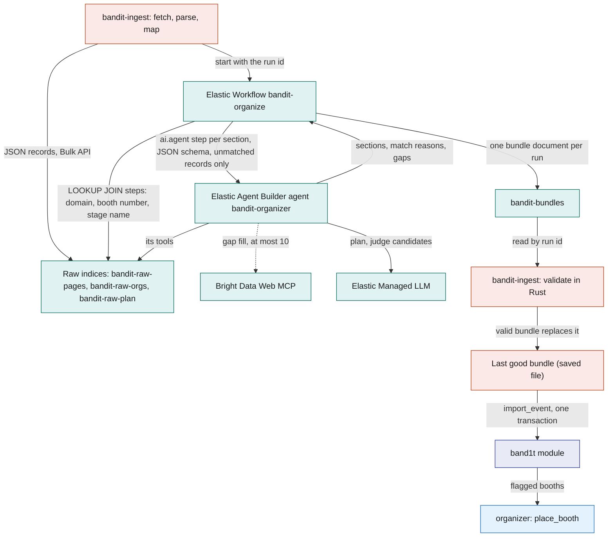
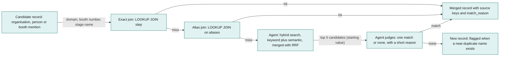
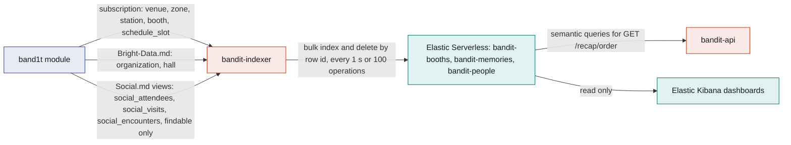
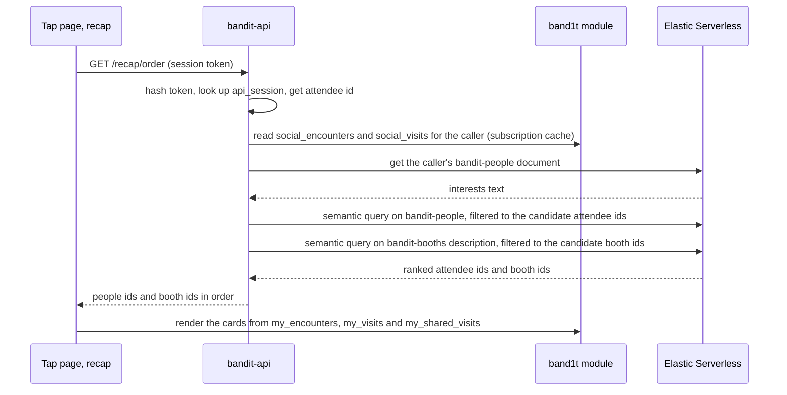
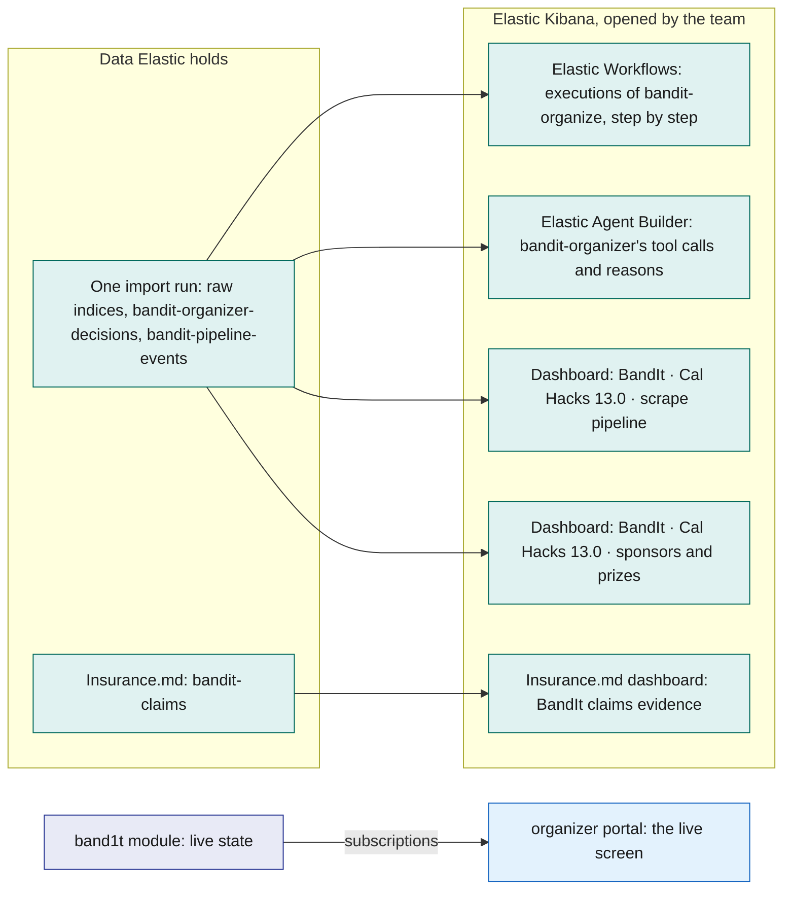

# Elastic

Elastic Serverless works in the background for BandIt, and nobody chats with it. Each job below is one paragraph, and the team watches every job in Elastic Kibana.

Recap suggestions rank the people and booths on each attendee's recap by interest match. `bandit-indexer` keeps a one-way copy of booths and of findable attendees' memories and interests, and `bandit-api` serves one route, `GET /recap/order`, that orders them by how close they are to what the attendee was into. SpacetimeDB decides who and what is on the list (exact, private, live); Elastic decides only the order, and there is no typed search.

Elastic organizes the scraped event data before import. `bandit-ingest` writes the raw Bright Data records into raw indices, the Elastic Workflow `bandit-organize` joins and links them into one event bundle with the Elastic Agent Builder agent `bandit-organizer`, and `bandit-ingest` validates that bundle in Rust and loads it into SpacetimeDB with `import_event`.

Vision.md: Elastic stores the raw radio data and the event photo records for Elastic Kibana and for matching photos against the band data after the event. Leo's recorders on the venue laptop write them, and nothing live reads them.

Insurance.md: as The Evidence Engine, Elastic's part of a claim, it also ranks a de-identified copy of each insurance claim against 30 seeded past claims, and the similar past claims come back to SpacetimeDB only as checks on the claim, as ids and scores written through a reducer.

Elastic never holds truth and never sits in the safety loop. If it disappears, the last good bundle stays loaded and the recap lists its suggestions by minutes together.

## Role in the system

Responsibilities:

- Hold the raw scraped records of one import run in three raw indices: `bandit-raw-pages`, `bandit-raw-orgs`, `bandit-raw-plan`.
- Keep two logs of each import run for Elastic Kibana: `bandit-organizer-decisions`, one document per decision `bandit-organize` made, and `bandit-pipeline-events`, one document per step of the run.
- Organize the scraped data. The Elastic Workflow `bandit-organize` makes the exact joins with fixed Elastic ES|QL `LOOKUP JOIN` steps, then calls the Elastic Agent Builder agent `bandit-organizer` with a JSON schema for the fuzzy remainder. The result is one structured bundle in `bandit-bundles`: organisations deduplicated, each organisation's facts merged across its site, LinkedIn and Crunchbase records, booths linked to organisations and people, categories and tags, schedule slots matched to stages and zones, and gaps flagged.

  The `bandit-organizer` agent may fill a gap with at most 10 Bright Data Web MCP calls per run.
- Keep a one-way copy of booths and of findable attendees' memories and interests in three indices: `bandit-booths`, `bandit-memories`, `bandit-people`.
- Order the recap's suggestions. `GET /recap/order` in `bandit-api` takes the candidates SpacetimeDB lists for the caller (people from `my_encounters`, booths from `my_visits`) and returns them in order of meaning.

  The recap's shared visits (`my_shared_visits`) stay in time order and are not sent. `bandit-api` holds every Elastic credential; browsers never talk to Elastic.
- Vision.md: hold Leo's raw radio log and photo records in `bandit-raw-radio`, `bandit-raw-heard`, `bandit-raw-gateway` and `bandit-raw-photos`, for matching photos and band data afterwards.
- Insurance.md: hold the index `bandit-claims` and its ingest pipeline `bandit-claims-validate`, and rank each de-identified claim copy by meaning against 30 seeded past claims.
- Give the team its Elastic Kibana views: the Elastic Workflows execution view of `bandit-organize`, the `bandit-organizer` agent's tool calls in Elastic Agent Builder, and the two dashboards `bandit-ingest` installs for each event: "BandIt · Cal Hacks 13.0 · scrape pipeline" and "BandIt · Cal Hacks 13.0 · sponsors and prizes" for Cal Hacks 13.0. Vision.md: the "BandIt band radio and photos" dashboard. The "BandIt recap suggestions" dashboard. Insurance.md: the "BandIt claims evidence" dashboard.
- Keep each attendee's latest recap ranking in `bandit-recap-rankings`, written by `bandit-api` and read only by Elastic Kibana.
- Give the organizer portal (/organizer) its "Kibana" tab: Elastic's jobs in the order of the event, a short note on each, and links to its Elastic Kibana views ([Organizer-Portal](../5-apps/Organizer-Portal.md)).

Non-responsibilities:

- Not a source of truth. The Elastic Workflow `bandit-organize` never writes to SpacetimeDB; `bandit-ingest` validates its output and calls `import_event` ([Bright-Data](Bright-Data.md)). The recap order carries SpacetimeDB ids only, and any action on a suggestion (a tag answer, a merch order) is an ordinary reducer call made by the app, owned by [Social](../6-features/Social.md) or [Merch](../6-features/Merch.md).

  Insurance.md: the one thing that comes back from Elastic is precedent checks on claims, as past-claim ids and scores that `bandit-workers` writes through `submit_claim_checks`; they never change an amount.
- No chat. No agent talks to attendees or staff, there is no conversation route, and there are no per-attendee agent tools or keys. The one agent runs once per import, started by `bandit-ingest`.
- No decisions. Elastic agents organize and validate data. A judgment about people or events goes to the Anthropic Claude API through `claude-client` over SpacetimeDB rows ([Anthropic-Claude-API](Anthropic-Claude-API.md)); incidents never enter Elastic (Insurance.md: a claim copy names only the incident's kind, zone and time). Ranking similar past claims decides nothing: a claim's route and amounts never read the precedents.
- Not in the safety path. Bands, commands, density and incidents never read or write Elastic ([Safety](../6-features/Safety.md)). No Elastic Kibana view runs the live event: the live screen is the [organizer portal](../5-apps/Organizer-Portal.md).
- Does not hold the people graph. The links between people, booths and companies are facts the bands measured, kept in SpacetimeDB (`people_link`, `my_graph`, `event_graph`, [Social](../6-features/Social.md)). Elastic draws no links on the graph, and nothing about the graph flows back from Elastic into SpacetimeDB.
- Never receives medical, insurance, payment or bank data, raw `band`, `zone_visit` or `encounter` rows, incidents, `person` rows, photo images, or any visit or encounter of an attendee who is not findable. Scraped people appear only as raw records of one import run, taken from event pages. Insurance.md: the one exception for insurance data is the de-identified claim copy in `bandit-claims`: codes, amounts, zones, times, check results and a narrative built by code, with no names, no attendee or band ids and no medical free text. The recap rankings name the attendee and the people on their recap by display name.
- Does not fetch pages. Bright Data owns every step that touches the web ([Bright-Data](Bright-Data.md)). Elastic receives JSON records, never HTML or Markdown. The one web call made from Elastic is the `bandit-organizer` agent's gap-fill tool, itself a capped Bright Data Web MCP call.

## Interfaces

| Interface | Direction | Who | What flows | Transport |
|---|---|---|---|---|
| Elastic Bulk API, raw indices | in | `bandit-ingest`, organize stage ([Bright-Data](Bright-Data.md)) | JSON records from the Bright Data Web MCP's `extract`, the company dataset tools and the Google Maps dataset, map-stage booth geometry, and the core `station` and `zone` rows; one document per record, tagged with the run id | HTTPS, ingest API key (write on `bandit-raw-*`, read on `bandit-bundles`) |
| Elastic Workflows API | in | `bandit-ingest`, organize stage | start one execution of `bandit-organize` with the run id; poll its status every 5 s | HTTPS to Elastic Kibana, ingest API key |
| Agent tools | internal | `bandit-organizer` | fixed Elastic ES\|QL queries and one index search tool over the raw indices; one MCP tool for gap filling | Elastic-internal |
| Bright Data Web MCP, gap fill | out | `bandit-organizer`, through an Elastic Agent Builder MCP tool | `extract` with the null rule on an organisation or event page URL that the raw records name but no snapshot covers; one JSON record back with `source_url` and `fetched_at`; at most 10 calls per run (starting value) | HTTPS JSON-RPC to the remote MCP server, with a Bright Data zone token of its own that has its own spending limit ([Bright-Data](Bright-Data.md)) |
| `bandit-bundles` | out | `bandit-ingest` | one bundle document per run: the organized sections, a match reason per merge, a gaps list, the gap-fill records, the agent's tool-call count | HTTPS `_search` by run id, ingest API key |
| Elastic Bulk API, run logs | in | `bandit-ingest`, organize stage | one `bandit-organizer-decisions` document per decision in the bundle it read back, and one `bandit-pipeline-events` document per step of the run, with its time and counts | HTTPS, ingest API key, which also writes these two indices |
| Elastic Kibana Dashboards API | in | `bandit-ingest`, at the end of each full run; `kibana/install.sh` | the two event dashboards, created or replaced with that run's id in every query; the radio and photos, recap suggestions and (Insurance.md) claims evidence dashboards from their saved files in `kibana/` | HTTPS to Elastic Kibana, Elastic Kibana API key |
| SpacetimeDB subscription | in | `bandit-indexer` (role `indexer`) | rows of `venue`, `zone`, `station`, `booth`, `schedule_slot`; from Bright-Data.md: `organization`, `hall`; from Social.md: the views `social_attendees`, `social_visits`, `social_encounters`, which return findable attendees only | SpacetimeDB Rust client SDK over WebSocket; initial sync, then every committed change |
| Elastic Bulk API, copy indices | out | `bandit-indexer` | index and delete operations keyed by document id | HTTPS, indexer API key (write on the three copy indices, use of the inference endpoint) |
| `GET /recap/order` | in | the recap on the tap page (/t/code) ([Tap-Page](../5-apps/Tap-Page.md)) | no parameters; returns the caller's recap people as attendee ids and recap booths as booth ids, each list in order | HTTPS JSON on `bandit-api`; `api_session` token required |
| `api_session` lookup | in | `bandit-api` | the app's session token, hashed and matched against `bandit-api`'s subscription to `api_session` to get the caller's attendee id | SpacetimeDB subscription ([SpacetimeDB](../2-data/SpacetimeDB.md)) |
| Social views `social_encounters`, `social_visits` | in | `bandit-api` (role `api`) | the caller's candidates: the people the caller met and the booths the caller visited, with minutes; findable attendees only | SpacetimeDB subscription ([Social](../6-features/Social.md)) |
| Elasticsearch search | out | `bandit-api` | for `GET /recap/order`: a get of the caller's `bandit-people` document, then one semantic query on `bandit-people` and one on `bandit-booths` | HTTPS, one service API key (read on the three copy indices, use of the inference endpoint) |
| `bandit-recap-rankings` | in | `bandit-api` | after each ranked recap, one document per attendee (id: attendee id): the places their interests text names, the order Elastic chose with the first booth's and person's scores, and the booth that minutes alone put first | HTTPS, the same service API key |
| Vision.md: Elastic Bulk API, raw radio and photos | in | Leo's `feed.py` and `photos.py` on the venue laptop ([Vision](../4-devices/Vision.md)) | one document per gateway line and per photo, with a document id from its content, so a second upload adds nothing | HTTPS, from the laptop's `.env` keys |
| Insurance.md: `bandit-claims`, through the pipeline `bandit-claims-validate` | in | `bandit-workers`, job `claim_verify`; `bandit-ingest` seed mode for the 30 past claims | one de-identified claim document per pack version; the seeded past claims | HTTPS; the worker uses the claims API key (write on `bandit-claims`, use of the inference endpoint), the seed uses the ingest API key, which also writes `bandit-claims` |
| Insurance.md: precedent search | out | `bandit-workers` | one semantic query on `bandit-claims` per claim copy; the top 3 seeded past claims as ids and scores, which the worker writes to SpacetimeDB through Insurance.md's `submit_claim_checks` | HTTPS, the claims API key (read on `bandit-claims`) |
| Elastic Kibana | in | the team, signed in to the Elastic Cloud project | the Elastic Workflows execution view, Elastic Agent Builder, and the scrape pipeline and sponsors and prizes dashboards; Insurance.md: the claims evidence dashboard; read only on every BandIt index | HTTPS in a browser; Elastic Cloud logins, never attendees |

## Design

### Why Elastic and not SpacetimeDB

Each store does what it is best at. SpacetimeDB owns all live state and every write (reducers are the only write path), the subscriptions that push changes to the apps, the space-time mapping of zones and times, every exact list, and the consent filter. Elastic owns two things SpacetimeDB is not built for: fuzzy entity resolution across messy scraped sources before the import, and ordering by meaning with semantic search over booth texts and interests.

SpacetimeDB decides who and what is on the list (exact, private, live); Elastic decides the order by meaning (and organizes the scraped data, and finds claim precedents). Elastic orders only candidates SpacetimeDB already listed, it never decides access, and it never holds live state. The people graph is all SpacetimeDB: its nodes and links are facts the bands measured.

| Question | Who answers | Why |
|---|---|---|
| "Is `Elastic` on the event's sponsor list the same company as `Elastic N.V.` on LinkedIn?" | Elastic, `bandit-organize` | Entity resolution over messy text, before the import |
| "Which booth does the schedule line `Stage A, Hall 1` belong to?" | Elastic, `bandit-organize` | Free-text location matched to stage booths and zone names |
| "Which zone is band 7 in right now?" | SpacetimeDB | Live `band` row, pushed by subscription |
| "Who is in the light circle around the fallen person?" | SpacetimeDB | Written inside the incident transaction; must never wait on a search |
| "Show my timeline" | SpacetimeDB | Exact `visit` and `social_encounter` rows for one attendee, already a view |
| "Who did I hang out with tonight?" | SpacetimeDB, `my_encounters` | Exact encounter rows the bands measured; `findable` is checked in the view |
| "Which booths did I spend time at?" | SpacetimeDB, `my_visits` | Exact visit rows with minutes |
| "Who was I in the same place with for a while?" | SpacetimeDB, `my_shared_visits` | Exact `shared_visit` rows: two findable attendees' visits to one zone that overlapped for at least 5 min |
| "Which booths and companies tie the crowd together?" | SpacetimeDB, the people graph | `visited`, `works_at` and `exhibits` links to shared booth and company nodes, pushed live to the big screen through `event_graph` |
| "Of the people I hung out with, who is most into the same things as me?" | Elastic, `GET /recap/order` | Two people who visited different booths can still care about the same things; only embeddings of the booth texts can tell. The answer is an order, never a new name on the list |
| "Of the booths I visited, which fit me best?" | Elastic, `GET /recap/order` | My interests matched to booth descriptions by meaning |
| Insurance.md: "Which past claims look like this one?" | Elastic, `bandit-claims` | Meaning over a de-identified narrative; the answer is checks on the claim, never an amount |

Presence is zone-level only ([SpacetimeDB](../2-data/SpacetimeDB.md)), so a memory is "in zone Z, at booth B, from T1 to T2" or "an encounter with attendee X in zone Z from T1 to T2". The indices hold no finer position than a zone centroid or a booth point.

### What Elastic does not do

- It does not serve lists or search. There is no typed query anywhere in BandIt. "My visits", "my encounters", "my photos" and "the booth with number B12" are SpacetimeDB views in the apps. The one attendee route, `GET /recap/order`, only orders ids that SpacetimeDB already listed for the caller.
- It does not decide who may see what. The indexer reads only the Social views, which return findable attendees only, and `bandit-api` takes every candidate from SpacetimeDB rows (`api_session`, `social_encounters`, `social_visits`). No Elastic query, model or key decides access.
- It does not hold or discover graph links. The bands measure who met whom and who stood at which booth, and SpacetimeDB stores those links ([Social](../6-features/Social.md)). Elastic Kibana Graph is not used: it is unavailable on Elastic Cloud Serverless, and it discovers links from terms that occur together in documents, while here the links are already measured.
- It does not hold live state or history. Live counts, band rows, stays and incidents stay in the module. The Elastic Kibana dashboards read the import run's records and logs, the recap copy and rankings, Vision.md: the raw radio log and photo records, and Insurance.md: the de-identified claim copies; none of them shows a live count or a zone's density.

  Vision.md: Leo's raw radio log is a record of what the gateway heard, kept for after the event and never read live.
- It does not write to SpacetimeDB. The bundle is loaded by `bandit-ingest` through `import_event`; the recap order becomes an action only through a reducer the app calls. Insurance.md: precedent ids and scores reach SpacetimeDB only because `bandit-workers` writes them through `submit_claim_checks`.
- It does not talk to anyone. The one agent runs once per import over the raw indices of that run.
- It does not fetch or crawl. Elastic's Open Crawler is not used, and there are no scheduled re-scrapes: one run per import. Bright Data cannot deliver to Elasticsearch directly, so `bandit-ingest` bulk-indexes the records itself.
- It does not read floor plans. Booth geometry comes from the map stage in `bandit-ingest`, where `floorplan_check` on the Anthropic Claude API reads the plan image, and reaches Elastic as plan records.

### Part one: organizing the scraped data, upstream of SpacetimeDB

Scraped records are messy in regular ways. One organisation appears under three names (the event's sponsor list, its own site, its LinkedIn page); booth numbers come as `B12`, `B-12` and `12`; schedule locations are free text; speakers are listed under slightly different company names.

Fixed Elastic ES|QL `LOOKUP JOIN` steps handle the regular cases deterministically, before any model runs. The irregular remainder is where a model with search tools helps: it finds candidates by meaning, picks one or none, and says why.

Each step has one owner: Bright Data fetched and extracted every page, the join steps of `bandit-organize` make the exact links, the agent makes the fuzzy ones, and Rust decides what is loadable.

The diagram answers: how do raw records become the bundle that lands in SpacetimeDB, and what is loaded when a run fails?

**Raw indices.** `bandit-ingest` writes every record with a `run_id`, so the agent's tools always filter on the current run and an old run never leaks into a new bundle. Page bodies stay in the snapshots; Elastic sees JSON records only.

The indices are small (a few hundred to a few thousand documents) and are rebuilt from the saved snapshots at every run. `bandit-raw-orgs` and `bandit-raw-plan` are created with `index.mode` set to `lookup`, so they can sit on the right side of a `LOOKUP JOIN`. Every document carries its provenance, normalised join keys, and a `text` field mapped as `semantic_text` so candidates can be found by meaning.

| Index | One document per | Fields |
|---|---|---|
| `bandit-raw-pages` | record from an event or exhibitor page (the JSON that the Bright Data Web MCP's `extract` produced) | `run_id`, `source_key`, `source_url`, `fetched_at`, `fetched_by` (`ingest`, `bandit-organizer`), `snapshot_sha256`, `record_kind` (`organization_candidate`, `prize`, `person_candidate`, `schedule_item`, `booth_mention`, `venue_fact`; a `prize` carries its cash amount in USD and the sponsor named beside it), `name` (text with a keyword sub-field), `aliases` (keyword: website domain, normalised name, booth number as printed), `domain`, `booth_number_norm`, `location_norm`, `org_key` (keyword: the join keys the `LOOKUP JOIN` steps use), `text` (semantic_text: the record's description), `tier_text`, `role_text`, `location_text`, `start_text`, `end_text`, `links` and `raw` (not indexed) |
| `bandit-raw-orgs` (lookup mode) | company-facts record from a dataset tool; also the one Google Maps venue record (`record_kind` `venue_place`), which `bandit-organize` leaves alone: `bandit-ingest` reads it straight into the bundle's event section ([Bright-Data](Bright-Data.md)) | `run_id`, `source_key`, `source_url`, `fetched_at`, `dataset` (`linkedin_company`, `crunchbase_company`, `google_maps`), `name` (text with a keyword sub-field), `aliases`, `domain` (keyword: the join key), `website`, `text` (semantic_text: the dataset's description), `industry`, `headquarters`, `size_range`, `founded_year`, `funding_summary`, `social_pages` (not indexed) |
| `bandit-raw-plan` (lookup mode) | booth geometry item from the map stage, or a reference row | `run_id`, `record_kind` (`booth_geometry`, `station`, `zone`, `hall`), `source_key`, `hall_name`, `booth_number_text`, `booth_number_norm`, `location_norm`, `aliases`, `plan_x_m`, `plan_y_m`, `placement_confidence`, `nearest_station_id`, `nearest_station_distance_m`, and for reference rows the zone or station marker name, id and plan position copied from SpacetimeDB |

**The workflow.** `bandit-organize` is an Elastic Workflow that `bandit-ingest` starts once per import run through the Elastic Workflows API, passing the run id. Elastic Workflows are generally available on Elastic Cloud Serverless; the feature is switched on in the project settings and needs a role with workflow privileges.

Its first steps are fixed Elastic ES|QL queries with `LOOKUP JOIN`, parameterised only by the run id, that write the exact joins to a per-run join index, `bandit-joins`. They join an organisation candidate to its company facts on `domain`, a booth mention to its geometry on `booth_number_norm`, a schedule item to a stage booth or zone on `location_norm`, and a person candidate to an organisation on the `org_key` printed on the same page. Nothing a model says can change these rows.

Then come the `ai.agent` steps, one per bundle section, in dependency order (organisations, booths, people, then schedule and gaps). Each step has that section's JSON `schema` and gets only the records the joins left unmatched plus the join results, so the answer is structured and a malformed one fails inside Elastic. A final index step writes the sections, the match reasons, the gap-fill records and the gaps list as one document to `bandit-bundles`, keyed by the run id.

`bandit-ingest` polls the execution every 5 s, reads the document, saves every gap-fill record as a snapshot and indexes it into the raw indices of the run, and validates the bundle in Rust against the rules `import_event` enforces: every `source_key` exists in the raw indices of that run, every organisation reference resolves, booth numbers are unique per hall, zone and stage names exist, every category is on the fixed list, and the gap-fill count is within the cap. A valid bundle is saved as the last good bundle and loaded.

If the run fails or the bundle fails validation, `bandit-ingest` loads the last good bundle it saved, and the failed run stays in Elastic Kibana for review. Elastic shapes the bundle, Rust decides whether it is loadable, and `import_event` checks once more inside the transaction.

**Run logs.** Two more indices record each run for the Elastic Kibana dashboards. `bandit-ingest` writes both; the agent's tools never read them. Before writing a run's documents it deletes that run's old ones, so a rerun of the same run id replaces them.

| Index | One document per | Fields |
|---|---|---|
| `bandit-organizer-decisions` | decision in the bundle `bandit-ingest` read back: one per organisation, prize link, person link, schedule link and gap | `run_id`, `decision_kind` (`organization`, `prize_link`, `person_link`, `schedule_link`, `gap`), `key` (the record or organisation decided on), `organization_key`, `name`, `category`, `tags`, `match_method` (`exact_domain` or `agent`, on organisations), `reason` (text: the agent's sentence), `at` |
| `bandit-pipeline-events` | step of one run: indexing the records, each workflow step, reading the bundle back, writing the decisions, saving the bundle | `run_id`, `stage`, `at`, `duration_ms`, `counts` (an object of counts for that step), `note` |

**What the `bandit-organizer` agent decides.** The instructions, in prose (the exact wording lives in the agent configuration):

- Organize one import run, identified by `run_id`; use only records of that run. Build on the join results; never undo a join `bandit-organize` made.
- Deduplicate the organisations the joins left unmatched with the matching ladder below. Never merge two records on a name alone when their website domains differ.
- Merge each organisation's facts across its records into one description and one tag set: typed fields (industry, headquarters, size, founding year) from the dataset record, the description from the site first.
- Link every unmatched booth mention and every unmatched person candidate to one organisation or to none, with a short reason for every link. A person's organisation is where the people graph's `works_at` link comes from once that profile is claimed ([Social](../6-features/Social.md)).
- Fill a gap with `bandit.fetch_gap` only when a record names an organisation or event page URL that has no raw record (an exhibitor whose website was never fetched). Never a person's page, never a web search for a name, at most 10 calls per run (starting value). Put every result in the gap fetches section with its `source_url` and `fetched_at`.
- Give every organisation and booth one category from the fixed list and up to five lowercase tags from its own text. The category becomes the first entry of `tags`, so no table changes.
- Match every schedule item's location text to a stage booth or a zone name from `bandit-raw-plan`; flag it when nothing fits.
- Return null rather than a guess. Never invent a source key, a booth number or a person. List every unresolved item in the gaps section with a reason, so an organizer can place that booth by hand with `place_booth`.

The fixed category list (starting value, calibrate against the real exhibitor list): `ai`, `developer_tools`, `cloud`, `data`, `security`, `fintech`, `crypto`, `venture`, `design`, `hardware`, `gaming`, `food_drink`, `health`, `education`, `other`.

**Tools.** Fixed, parameterised Elastic ES|QL queries where the rule is known, one index search tool where meaning matters, and one MCP tool for the web. Fixed queries keep the run filter, the limits and the field choices where the model cannot drop them.

| Tool id | Type | Index | Parameters | Returns | Why this shape |
|---|---|---|---|---|---|
| `bandit.joins` | Elastic ES\|QL, fixed | `bandit-joins` | `run_id`, `record_kind`, `key` | what the `LOOKUP JOIN` steps decided for that key | the agent builds on an exact join instead of redoing it |
| `bandit.unmatched` | Elastic ES\|QL, fixed | `bandit-raw-pages`, `bandit-raw-orgs` | `run_id`, `record_kind` | the records the joins left without a partner | the agent's work list |
| `bandit.candidates` | index search tool | `bandit-raw-pages`, `bandit-raw-orgs` | the record's name and text; hybrid keyword plus semantic retrieval merged with reciprocal rank fusion, filtered on `run_id` and `record_kind`, row limit 5 | the top candidates with name, aliases, source key and a snippet | the one place the model shapes a query |
| `bandit.plan_items` | Elastic ES\|QL, fixed | `bandit-raw-plan` | `run_id`, `hall_name` | geometry items with booth number, position and nearest zone | booth linking and gap detection |
| `bandit.stages_and_zones` | Elastic ES\|QL, fixed | `bandit-raw-plan`, `bandit-raw-pages` | `run_id` | stage booth mentions, zone names and station ids | schedule matching |
| `bandit.schedule_items` | Elastic ES\|QL, fixed | `bandit-raw-pages` | `run_id` | schedule items with location, start and end text | the schedule section |
| `bandit.people_for_org` | Elastic ES\|QL, fixed | `bandit-raw-pages` | `run_id`, `org_key` | person candidates listed under that organisation | people linking |
| `bandit.record_by_key` | built-in document lookup | any raw index | document id | the document | expand a key the agent already holds |
| `bandit.fetch_gap` | MCP tool: Bright Data Web MCP `extract` | the web, through Bright Data ([Bright-Data](Bright-Data.md)) | `url`, the record schema for that kind, the null rule | one JSON record with `source_url`, `fetched_at` and `fetched_by` `bandit-organizer` | the only web call; at most 10 per run (starting value) |

Every Elastic ES|QL tool has a `LIMIT`, the index search tool has a row limit, and the agent runs one section at a time, because the most common Elastic Agent Builder failure is a tool response or an answer larger than the model's context.

**The matching ladder.** Elastic's documented entity-resolution pattern, used for organisation deduplication and for linking people and booths to organisations. The diagram answers: in what order is a match tried, and when does the model get involved?

Steps one and two are `LOOKUP JOIN` steps, deterministic and cheap, so most records never reach the model. Step four is the only place the model decides; it must pick from the candidates it was given and write one sentence of reason, which lands in the bundle next to the merge. The reviewer reads the reasons, not the prompt.

**The LLM behind Elastic Agent Builder.** Elastic Agent Builder runs on the Elastic Managed LLM served by the Elastic Inference Service, which works the moment the Serverless project exists. The Anthropic Claude API is not wired into Elastic; every call to it stays in `claude-client` ([Anthropic-Claude-API](Anthropic-Claude-API.md)).

### Part two: the one-way copy, downstream of SpacetimeDB

Data enters the copy indices only from SpacetimeDB and leaves only as ids. The diagram answers: which rows reach the copy, and who reads it?

**bandit-indexer.** A Rust process with the `indexer` service role, on the Vultr VM next to `bandit-api`, as the systemd service `bandit@indexer`. It is an ordinary SpacetimeDB client: one connection to the `band1t` database, subscriptions to the copied tables and views, and reactions to row callbacks. On first start it prints its identity so the owner can grant the `indexer` role with `grant_role` ([SpacetimeDB](../2-data/SpacetimeDB.md)).

- **Sync.** A new subscription first delivers all current rows, then each committed change. The indexer treats both the same way: a row arrived, rebuild the documents that depend on it. There is no backfill mode and no "indexed" flag in SpacetimeDB, so the module knows nothing about Elastic.
- **Joins happen in the indexer.** A booth document needs its zone name, station id, organisation facts and schedule slots; a memory document needs the booth text and zone centroid; a `bandit-people` document needs the texts of the attendee's top booths. The builders read the related rows from the SDK cache, and a change to a parent row rebuilds every dependent document. Copying text in at index time avoids joins at query time.
- **Idempotent writes.** Every document id comes from the SpacetimeDB row id, so a retried bulk request, a restart or a duplicated callback overwrites the same document. Deletes are bulk delete operations; deleting a missing document is ignored.
- **Coalescing.** Changes are queued by document id and flushed every 1 s or at 100 operations (starting values, calibrate). A failed bulk request is retried whole with backoff, because every operation is idempotent.
- **Rebuild.** Each logical index is an alias (`bandit-booths`) over a generation index (`bandit-booths-001`). To change a mapping, the operator points the indexer at generation N+1 and restarts; the initial sync repopulates it, and the alias moves when it is complete. `bandit-api` only names the alias.

| Table (owner) | Copied to | Filter |
|---|---|---|
| `venue`, `zone`, `station` (SpacetimeDB.md) | folded into every document (names, centroids, the plan origin for coordinates) | none; venue layout is public |
| `booth`, `schedule_slot` (SpacetimeDB.md) | `bandit-booths` | none; venue content |
| `organization`, `hall` (Bright-Data.md) | folded into `bandit-booths`: a booth document carries its organisation's facts and its hall name; there is no organisation index | none; facts about companies, not people |
| `social_visits` view (Social.md) | `bandit-memories`; folded into `bandit-people` | the view returns visits of findable attendees only; indexed when it opens, updated when it closes; a closed visit rebuilds that attendee's `bandit-people` document |
| `social_encounters` view (Social.md) | `bandit-memories`, one document per participant | the view returns encounters whose two attendees are both findable |
| `social_attendees` view (Social.md) | `bandit-people` | findable attendees only; an attendee who turns `findable` off drops out of the view |
| `consent` (SpacetimeDB.md) | never read | the Social views apply it |
| `photo`, `photo_tag` (Social.md) | never | photos stay in SpacetimeDB and the blob store |
| `band`, `zone_visit`, `encounter` (SpacetimeDB.md) | never | live band data and raw stays stay in the module |
| `person` (Bright-Data.md), `people_link` (Social.md) | never | people enter Elastic only as attendee ids on their own findable memories and interests; the graph links stay in the module |
| everything else (incidents, medical, payments, insurance, `job`, `blob_ref`, vision tables) | never | out of Elastic's remit; Insurance.md: a de-identified claim copy reaches `bandit-claims` from `bandit-workers`, never through the indexer |

The findable switch (`findable`) is defined in [SpacetimeDB](../2-data/SpacetimeDB.md) and given meaning by [Social](../6-features/Social.md); the Social views apply it, so the indexer never reads `consent`. When an attendee turns `findable` off, they drop out of the views; the indexer deletes their documents from `bandit-memories` and `bandit-people` by query on `attendee_id`, and the encounter documents of everyone they met that name them.

**Positions.** There are no positions for people. The only positions in Elastic are the zone centroid (`zone.plan_x_m`, `zone.plan_y_m`), used on memories, and the booth point (`booth.plan_x_m`, `booth.plan_y_m`), used on booths.

Plan metres become latitude and longitude with one Rust function in the indexer, so every document carries real coordinates. The plan origin is the venue's pin from the import (`venue.latitude`, `venue.longitude`), with plan x pointing east and plan y pointing north; the function adds the offset with local metres-per-degree factors (about 111 km per degree of latitude, about 88 km per degree of longitude at this latitude), which is exact enough for a site a few hundred metres wide. SpacetimeDB keeps plan metres, which is what the organizer portal draws.

**Index conventions.**

- The document id is the SpacetimeDB row id. Where an index merges tables, the id is prefixed with the table name (`visit-42`), and encounter documents are suffixed with the viewer's attendee id (`encounter-17-<attendee id>`). The plain row id is also stored as a field.
- Attendee ids are the SpacetimeDB identity as a hex string, mapped as `keyword`. Timestamps are `date`.
- Text vectors: every `semantic_text` field names its inference endpoint, `.jina-embeddings-v5-text-small` on the Elastic Inference Service. Pinning it matters because scores from different models cannot be mixed in one field.

**`bandit-booths`** (one document per `booth` row, carrying its organisation's facts).

| Field | Type | Source |
|---|---|---|
| `booth_id` | long | `booth` row id |
| `source_key` | keyword | stable key from the scrape ([Bright-Data](Bright-Data.md)) |
| `name` | text with a keyword sub-field | `booth.name` |
| `booth_number` | keyword | `booth.booth_number` |
| `kind` | keyword (`sponsor`, `stage`, `food`, `help_desk`, `other`) | `booth.kind` |
| `description` | semantic_text, `.jina-embeddings-v5-text-small` | `booth.description`, then the organisation's description, tags and the booth's schedule titles, so one meaning search covers all of them |
| `tags` | keyword | `booth.tags` merged with `organization.tags`; the first is the category the `bandit-organizer` agent gave it |
| `organization_id` | long | `booth.organization_id` |
| `org_name` | text with a keyword sub-field | `organization.name` |
| `org_kind` | keyword (`sponsor`, `exhibitor`, `venue`, `act`, `organiser`) | `organization.kind` |
| `sponsor_tier` | keyword | `organization.sponsor_tier` |
| `org_industry`, `org_headquarters`, `org_size_range` | keyword | from `organization` |
| `org_founded_year` | integer | from `organization` |
| `org_website`, `org_linkedin_url`, `org_crunchbase_url` | keyword, not indexed | from `organization`, for the card |
| `logo_blob_id` | keyword, not indexed | `organization.logo_blob_id` |
| `hall_id`, `hall_name` | long, keyword | `booth.hall_id`, joined from `hall` |
| `zone_id`, `zone_name` | long, keyword | `booth.zone_id`, joined from `zone`; absent while unassigned |
| `station_id` | integer | the zone's station id |
| `location` | geo_point | booth point |
| `schedule_text` | text | titles and times of the booth's `schedule_slot` rows |
| `schedule_slot_ids` | long | ids of those rows |
| `next_slot_at` | date | start of the next slot, rebuilt when slots change |
| `updated_at` | date | indexer write time |

**`bandit-memories`** (one document per visit, one per encounter participant).

| Field | Type | Source |
|---|---|---|
| `memory_id` | keyword | document id |
| `kind` | keyword (`visit`, `encounter`) | the table of origin: `visit` or `social_encounter` |
| `source_row_id` | long | `visit` or `social_encounter` row id |
| `attendee_id` | keyword | the attendee this document belongs to |
| `started_at`, `ended_at` | date | from the row; `ended_at` absent while open |
| `minutes` | double | duration, recomputed on close |
| `zone_id`, `zone_name` | long, keyword | zone of the memory |
| `location` | geo_point | zone centroid |
| `booth_id` | long | visits only |
| `booth_name` | text with a keyword sub-field | copied from the booth |
| `booth_description` | semantic_text, `.jina-embeddings-v5-text-small` | copied from the booth |
| `booth_tags` | keyword | copied from the booth |
| `other_attendee_id` | keyword | encounters only: the other participant |
| `updated_at` | date | indexer write time |

**`bandit-people`** (one document per findable attendee with at least one visit; the document id is the attendee id).

| Field | Type | Source |
|---|---|---|
| `attendee_id` | keyword | the attendee |
| `interests` | semantic_text, `.jina-embeddings-v5-text-small` | the attendee's top 5 spots by visit minutes (starting value): for each, the zone's name, then the name, description and tags of the booth the visit names, or of every booth in the zone when it names none. The spots go in zone and booth order, so the document changes only when the set of spots changes, not as minutes add up |
| `top_booth_ids` | long, multi-valued | the booths of those spots |
| `top_category` | keyword | the category (first tag) of the booth with the most minutes |
| `visit_minutes` | double | total visit minutes |
| `updated_at` | date | indexer write time |

### Part three: ordering the recap's suggestions

The recap ([Tap-Page](../5-apps/Tap-Page.md)) shows two lists of suggestions: the people the attendee hung out with, from `my_encounters` (with Meta handles while the person is `findable`), and the booths they spent time at, from `my_visits` ([Social](../6-features/Social.md)). Next to them it shows the shared visits from `my_shared_visits`, in time order, which Elastic does not order.

SpacetimeDB decides who and what is on each list. Elastic only decides the order of the first two, so the people and booths closest to what the attendee was into come first. There is no query box: the attendee's own `interests` text is the query.

**`GET /recap/order`.** One route in `bandit-api`, handler `rank_recap`, called by the recap page with the `api_session` token. [Rust-Backend](../3-services/Rust-Backend.md) owns the process; this file owns the route.

1. `bandit-api` hashes the token, finds the caller's attendee id in `api_session`, and reads the caller's candidates from its subscription cache: the people from `social_encounters` with minutes together, and the booths from `social_visits` with minutes spent.
2. It gets the caller's `bandit-people` document.
3. It runs one semantic query on `bandit-people` `interests`, with the caller's `interests` text as the query, filtered to the candidate attendee ids, and one semantic query on `bandit-booths` `description`, filtered to the candidate booth ids.
4. It returns the two lists of ids in order. Candidates with no document come after the ranked ones, by minutes. With no `bandit-people` document for the caller, or after a 10 s timeout (starting value, calibrate), it returns both lists by minutes.

The answer carries ids only. The tap page renders the cards from its own subscriptions and acts through reducers. If Elastic is down, the tap page shows both lists by minutes.

The sequence answers: when the recap page opens, who talks to whom, and where does the list come from?

### Insurance.md: similar past claims (The Evidence Engine), `bandit-claims` and `bandit-claims-validate`

[Insurance](../6-features/Insurance.md) sends a de-identified copy of each claim here, so Elastic, as The Evidence Engine, can rank it by meaning against 30 past claims. It is the only insurance data Elastic receives.

The copy is built in code by `bandit-workers` (job `claim_verify`) from the claim's pack, never by the indexer, and it holds no names, no attendee or band ids and no medical free text: no note text, no visit reason, nothing from a medical card. The 30 past claims are synthetic, written by the team, and loaded by `bandit-ingest` seed mode through the same pipeline.

**`bandit-claims`** (one document per claim pack version, plus the 30 seeded past claims; the document id is `<claim id>-v<pack version>`, so a retried job overwrites the same document).

| Field | Type | Holds |
|---|---|---|
| `claim_id` | keyword | the SpacetimeDB claim id, or `P-001` to `P-030` for a seeded past claim |
| `pack_version` | integer | the pack version the copy was built from; 1 on a seeded claim |
| `origin` | keyword | `live` or `seed` |
| `incident_kind` | keyword | `sos`, `fall` or `property` |
| `cover_kind` | keyword | `medical_payments` or `property` |
| `zone_id` | keyword | the incident's zone |
| `occurred_at` | date | the incident's time |
| `cost_cents`, `allowed_cents`, `payout_cents` | long | the amounts code computed |
| `service_codes` | keyword | the hospital report's service codes |
| `corroboration` | keyword | `corroborated`, `uncorroborated` or `disputed` |
| `witness_count` | integer | witness bands in the subject's zone |
| `narrative` | semantic_text, `.jina-embeddings-v5-text-small` | one sentence built by code from a fixed template, such as "fall in zone 102 at 22:14, 3 witness bands in the same zone, medic note 12 min later, urgent-care bill with codes 99204, 73110, 29125, L3908, 99051" |

**`bandit-claims-validate`** is the index's final pipeline, so no write can skip it. It never rejects a document. It writes `validation.valid` and one entry in `validation.errors` for each of these:

- a required field is missing (`claim_id`, `origin`, `incident_kind`, `cover_kind`, `zone_id`, `occurred_at`, `narrative`);
- an amount is negative or not a whole number of cents;
- `origin`, `incident_kind`, `cover_kind` or `corroboration` holds a value outside its list above;
- the document holds a field outside the table above.

The worker passes the result to Insurance.md's `submit_claim_checks`. An invalid copy flags the claim, which routes it to the organizer with the errors listed; Elastic never refuses a claim. The copy builder in code uses fixed fields and a fixed template, so no name or note can reach the copy.

**The search.** After the write, the worker runs one `semantic` query on `narrative` with the copy's own narrative as the query text, filtered to `origin` `seed` and the same `cover_kind`, and takes the top 3 (starting value). It writes the past-claim ids and scores to SpacetimeDB with Insurance.md's `submit_claim_checks`, which rejects a stale lease. The precedents are information on the claim, shown in the Claims queue; they never change an amount or a route.

### Part four: Elastic Kibana, what the team shows

Elastic Kibana is Elastic's web app: the screens, opened in a browser, where a team looks inside an Elastic project. In Elastic Kibana you configure features such as Elastic Workflows and Elastic Agent Builder, watch each workflow run step by step, and build charts, maps and dashboards over any index.

For BandIt it is the most visual way to show the Elastic side: how messy scraped records became one checked bundle, and what the scrape found about the event's sponsors and prizes. Insurance.md: and what tonight's claims look like, what was paid and which evidence failed validation.

Elastic Kibana reads only what Elastic already holds. The live event is shown in the [organizer portal](../5-apps/Organizer-Portal.md) from SpacetimeDB subscriptions, so no Elastic Kibana view repeats a live count, a zone's density or an incident. Only the team opens Elastic Kibana, signed in to the Elastic Cloud project.

The diagram answers: which Elastic Kibana view reads which data, and where does that data come from?

| Elastic Kibana view | Reads | What it shows | When the team opens it |
|---|---|---|---|
| Elastic Workflows, executions of `bandit-organize` | the run record of `bandit-organize` | each step of one import run in order: the `LOOKUP JOIN` steps with their match counts, each `ai.agent` section, the final index step, the time each took and any error | at the event, to show judges how the event got loaded |
| Elastic Agent Builder, the `bandit-organizer` agent | the agent's runs | the tools the agent called, the candidates each search returned, the gap fetches it made, and the reason behind every merge | at the event, next to the workflow; when a reviewer checks a merge |
| Dashboard: "BandIt · Cal Hacks 13.0 · scrape pipeline" (id `bandit-pipeline-calhacks-13`) | the three raw indices, `bandit-organizer-decisions` and `bandit-pipeline-events`, for the run it was installed with | a note naming the run and who did each part; four counts: raw records from Bright Data, organisations after merging, matches only the agent could make, gaps flagged for review; records by source and kind; how each organisation was matched (exact domain or agent); a table of the decisions `bandit-organize` made, with their reasons; the time each pipeline step took; the gaps list | before the load stage, to review the bundle; at the event, to show judges how the event got loaded |
| Dashboard: "BandIt · Cal Hacks 13.0 · sponsors and prizes" (id `bandit-event-calhacks-13`) | `bandit-raw-pages`, `bandit-raw-orgs` and `bandit-organizer-decisions`, for the same run | four counts: prize cash in USD, prizes, sponsors and partners, company profiles from LinkedIn and Crunchbase; prize cash by sponsor; sponsors by the category the agent gave them; sponsors by tier; a tag cloud of what the sponsors work on; a table of the companies with domain, source, industry, headquarters, size and founding year | at the event, to show what the scrape found about it |
| Insurance.md: Dashboard: "BandIt claims evidence" (id `bandit-claims`) | `bandit-claims` | a note on what the index holds, how it is checked and what comes back to the claim; four counts: claims tonight, past claims to match against, evidence failing validation, paid tonight in USD; tonight's claims as Elastic holds them; outcomes and incident kinds, tonight and past; paid tonight by zone in USD; the validation result of every document | at the event, next to the Claims queue in the organizer portal |

| Vision.md: Dashboard: "BandIt band radio and photos" (id `bandit-radio`) | `bandit-raw-radio`, `bandit-raw-heard`, `bandit-raw-gateway`, `bandit-raw-photos` | a note on what the recorders write; four counts: beacons heard, bands heard, heard lists, photos recorded; beacons every 10 s by bands and station markers; each band and station marker with its beacons and signal at the gateway; band beacons by zone and by flag (SOS, fall, button press); heard lists per band; the recording sessions; the photo records | after a recording, to check what the gateway heard |
| Dashboard: "BandIt recap suggestions" (id `bandit-recap`) | `bandit-booths`, `bandit-people`, `bandit-recap-rankings` | a note on who decides the list and who decides the order; four counts: booths it ranks, attendees it ranks, recaps ranked, recaps where meaning changed the first booth; each attendee's latest ranking with the first booth by meaning next to the first by minutes; the booths and people suggested first most often; the booths it ranks | after "Event ended", once attendees open their recaps |

The organizer portal's "Kibana" tab walks through Elastic's jobs in the order of the event: organizing the scraped event data, the bands' radio log and the photos, ordering the recap's suggestions, and checking claim evidence. Each job has a short note and links to its views: the two event dashboards, the `bandit-organize` workflow runs and the `bandit-organizer` agent; the radio and photos dashboard; the recap suggestions dashboard; Insurance.md: the claims evidence dashboard. Every chart opens in Elastic Kibana ([Organizer-Portal](../5-apps/Organizer-Portal.md)).

Every chart and count is an Elastic ES|QL query. `bandit-ingest` installs the two event dashboards through the Elastic Kibana Dashboards API at the end of each full run, one pair per event (the ids end in the event's slug, `calhacks-13` for Cal Hacks 13.0), with that run's id fixed in every query, and can install them again for any saved run. So they keep showing the saved import run even when no new run happens.

The radio and photos, recap suggestions and (Insurance.md) claims evidence dashboards go in through the same API from their saved files in `kibana/`, by `kibana/install.sh`.

Elastic Kibana Graph is not used: it is unavailable on Serverless.

### Vision.md: the raw radio log and photos

Leo's recorders on the venue laptop write four more raw indices ([Vision](../4-devices/Vision.md)). They are separate from the import run's raw indices, and `bandit-organize`, the indexer and the recap never read them. They are for Elastic Kibana and for matching photos against the band data after the event; live state never comes from them.

| Index | One document per | Main fields |
|---|---|---|
| `bandit-raw-radio` | band or station marker beacon the gateway heard | session, time, band id or station id, the SOS, fall and press flags, `neigh`, zone, battery, state, `seq`; for an exit marker, its exit colour |
| `bandit-raw-heard` | heard list from a band (packet type 4, sent about every 1 s) | session, time, band id, the RSSI of each neighbour band and of each station marker, and the five station marker RSSIs as one vector |
| `bandit-raw-gateway` | other gateway line (boot, info, ack, error) | session, time, kind, the raw text |
| `bandit-raw-photos` | imported photo, never the image itself | session, time (corrected by the sync shot for a camera), file name and SHA-1, camera make and model, size, location and its accuracy |

## Failure modes and fallbacks

| Failure | Effect | Design answer |
|---|---|---|
| A `bandit-organize` run fails (managed LLM quota, agent error) or its bundle fails the Rust validation | No new bundle | `bandit-ingest` loads the last good bundle it saved; the failed run stays in Elastic Kibana and in `bandit-bundles` for review |
| The agent merges two different organisations | Wrong facts on a booth | A merge needs a domain match or a ladder candidate, never a name alone; every merge carries a reason, and the team reads them in the scrape pipeline dashboard's decisions table before the load stage |
| The gap-fill tool runs away (too many calls, or a person's page) | Credits spent, scope rule broken | Three holds: the instruction caps it at 10 per run, the Bright Data zone token has its own spending limit, and the Rust validation drops any gap-fill record of kind person and rejects a bundle over the cap |
| Elastic Serverless unreachable | `GET /recap/order` fails | `bandit-api` returns an unavailable error, and the recap page shows both lists by minutes. Insurance.md: the `claim_verify` job fails after its attempts, and the claim carries no precedent checks and decides the same way. Nothing live reads Elastic |
| Insurance.md: `bandit-claims-validate` marks a claim copy invalid | The claim is flagged | `submit_claim_checks` stores the pipeline's errors as a failed check, and the claim routes to the organizer; it is never refused for it |
| `bandit-indexer` down | New visits and interests are not copied | The recap order uses the last copy; on restart the initial sync re-delivers every row and idempotent writes make the catch-up safe |
| `findable` switched off after indexing | Stale documents of an attendee who is no longer findable | The attendee drops out of the Social views; the indexer deletes their documents by query on `attendee_id`, and the encounter documents that name them |

## Dependencies

**Depends on**

- [Bright-Data](Bright-Data.md): the `bandit-ingest` pipeline that writes the raw indices, starts `bandit-organize`, validates the bundle and calls `import_event`; a Bright Data zone token of its own for the gap-fill tool; the `organization` and `hall` rows and booth points that the copy carries.
- [SpacetimeDB](../2-data/SpacetimeDB.md): tables `venue`, `zone`, `station`, `booth`, `schedule_slot`, `api_session`; reducer `grant_role`; the `indexer` and `api` service roles.
- [Rust-Backend](../3-services/Rust-Backend.md): the `bandit-api` and `bandit-ingest` process shells, the Vultr VM, and secret handling for the Elastic keys; Insurance.md: the `bandit-workers` shell for the `claim_verify` job and the Elastic claims key.
- [Social](../6-features/Social.md): the views `social_attendees`, `social_visits` and `social_encounters`, and the consent meaning behind them. Social.md: without it `bandit-memories` and `bandit-people` stay empty, there is no recap list to order, and only the booth copy works.
- An Elastic Cloud Serverless project with Elastic Agent Builder, Elastic Workflows and the Elastic Inference Service, and Elastic Kibana for the team.

**Used by**

- [Bright-Data](Bright-Data.md): the organize stage of its pipeline (one row starting with "Elastic.md").
- [Tap-Page](../5-apps/Tap-Page.md): the order of the recap's people and booths, through `GET /recap/order`.
- [Organizer-Portal](../5-apps/Organizer-Portal.md): the "Kibana" tab.
- [Social](../6-features/Social.md): the order of its recap suggestions.
- [Insurance](../6-features/Insurance.md): `bandit-claims` and `bandit-claims-validate` rank its de-identified claim copies against 30 seeded past claims, and the precedents come back as checks through its `submit_claim_checks`.
- [Architecture](../1-overview/Architecture.md) and [Flows](../1-overview/Flows.md): the Elastic container for `bandit-organize` and the recap order, steps 0b and 7 and the Elastic Kibana close.
- The team, in Elastic Kibana.

**If you delete this file**

- Remove `bandit-indexer` and `GET /recap/order` from [Rust-Backend](../3-services/Rust-Backend.md) (process table, binaries row, endpoint registry) and from [Architecture](../1-overview/Architecture.md) (interfaces rows, context, container and deployment diagrams, data ownership rows, the prize row and the failure row; in "What each database does best", the paragraph starting "Elastic.md:", its table and the diagram after it). Remove the Elastic.md rows (step 0b, step 7, its diagram index row and its failure row), the Elastic.md decision row and the Elastic Kibana paragraph from [Flows](../1-overview/Flows.md).
- Remove the "Elastic.md" rows from [SpacetimeDB](../2-data/SpacetimeDB.md) (the `bandit-indexer` interfaces row, the `indexer` role row, the subscriptions row and the registry row) and turn its "Copied" labels into "Not copied".
- Remove the Elastic.md organize stage row, interface rows, diagram nodes, sequence steps, failure row and dependency bullets from [Bright-Data](Bright-Data.md). `bandit-ingest` then has no scraped bundle to load, and booths and their organisations are written by hand into the bundle that `import_event` loads.
- Remove the recap order rows from [Tap-Page](../5-apps/Tap-Page.md) and the Elastic bullets from [Social](../6-features/Social.md); the recap then lists its people and booths by minutes. Remove the "Kibana" tab from [Organizer-Portal](../5-apps/Organizer-Portal.md), the Elastic.md bullet from [Anthropic-Claude-API](Anthropic-Claude-API.md), and the Elastic row and node in [README](../README.md).
- In [Insurance](../6-features/Insurance.md), remove its "Elastic.md:" part (similar past claims, the `claim_verify` job, the `claim_precedent` table, `submit_claim_checks`, the 30 past claims seed, the claims evidence dashboard and the Elastic.md rows in its tables), and the claim precedent rows in [Architecture](../1-overview/Architecture.md), [SpacetimeDB](../2-data/SpacetimeDB.md), [Rust-Backend](../3-services/Rust-Backend.md) and [Decisions](../1-overview/Decisions.md). Claims then decide exactly the same, with no precedent checks.
- The `indexer` role can be dropped from the seed, and the Social views lose their `indexer` and `api` readers; `booth.plan_x_m`, `booth.plan_y_m`, `zone.plan_x_m`, `zone.plan_y_m` and the `venue` origin fields stay, because the organizer portal's venue map uses them.
- Delete the Elastic Serverless project; no data is lost, because Elastic only held a copy and working data.

## Decisions

| Decision | Why |
|---|---|
| The gap-fill cap of 10 calls per run is held by the agent's instruction, the Bright Data zone token's spending limit and the Rust validation | Three independent holds already enforce it, so the design does not need Elastic Agent Builder to count calls |
| The Elastic Workflow `bandit-organize` is the only organize path | Elastic Workflows are generally available on Serverless; the join steps, the schema-checked `ai.agent` steps and the run record in Elastic Kibana are what judges see at the event |
| A failed run loads the last good bundle; there is no second organize path | The event never waits on a live organize run, and the bundle always went through the same joins and the same agent |
| Elastic Agent Builder uses the Elastic Managed LLM; the Anthropic Claude API is not wired into Elastic | It works the moment the project exists, needs no second key, and keeps every call to the Anthropic Claude API in `claude-client` and `model_call`. Elastic agents organize and validate; judgments go to the Anthropic Claude API |
| Every text field uses `.jina-embeddings-v5-text-small`, named on the field | Scores from different models cannot be mixed, and the Serverless default can change |
| Plan metres become latitude and longitude in one Rust function in the indexer | The copy's documents carry real coordinates, and SpacetimeDB keeps plan metres |
| `bandit-indexer` runs on the Vultr VM next to `bandit-api` | One always-on host for the cloud services |
| The joins of exhibitor records to booth geometry happen once, in the `LOOKUP JOIN` steps | One owner per step; the map stage in `bandit-ingest` only produces geometry |
| The people graph's links live in SpacetimeDB; Elastic draws nothing on the graph, and nothing about the graph flows back | Links are exact, private facts that change live |
| Insurance.md: a de-identified copy of each claim goes to `bandit-claims`; precedents come back only as past-claim ids and scores, written by `bandit-workers` through `submit_claim_checks`, and never change an amount | Ranking similar past claims by meaning is what Elastic does best; money, routes and live state stay in SpacetimeDB |
| Insurance.md: `bandit-claims-validate` is the index's final pipeline; it never rejects a document, it marks it valid or invalid, and an invalid copy flags the claim and routes it to the organizer | Elastic checks data and never decides money; a person looks at anything it flags |
| Elastic Kibana Graph is not used, and no Elastic Kibana view draws a network | Elastic Kibana Graph is unavailable on Elastic Cloud Serverless, and it discovers links from co-occurring terms, while the links are already rows in SpacetimeDB, drawn live on the big screen's event graph ([Social](../6-features/Social.md)) |
| SpacetimeDB decides who and what is on the recap list; Elastic only orders it, through `GET /recap/order` | The list is exact and private and comes from what the bands measured; meaning is the one thing only Elastic's embeddings add, and a stranger can never appear |
| There is no typed query; the caller's own `interests` text is the only query | The recap shows suggestions, not search results |
| Candidates with no document, and both lists when Elastic is down, go by minutes | The recap always opens with the full exact list |
| `bandit-people` builds `interests` from the attendee's top 5 spots by visit minutes, a booth or a whole zone, listed in zone and booth order | Where someone spent time says what they are into, the booth texts are already clean after the import, and a stable order means a document is rewritten only when the spots change |
