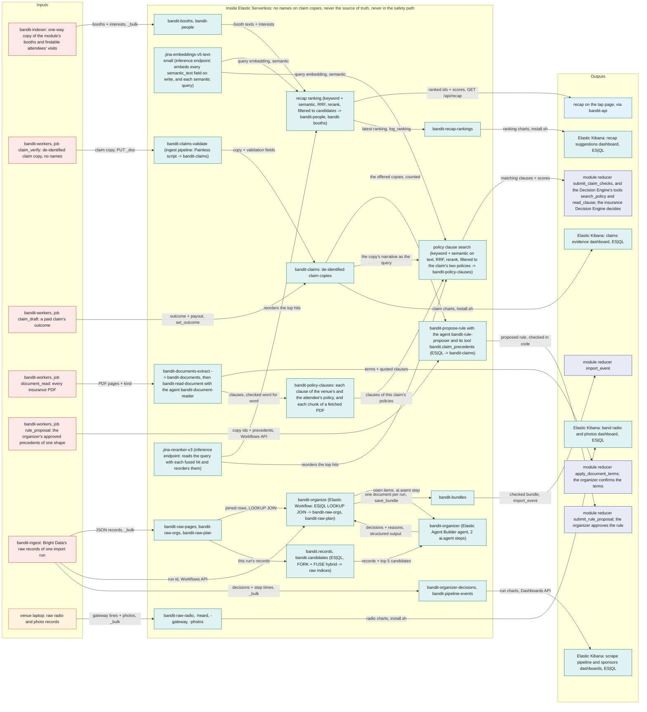
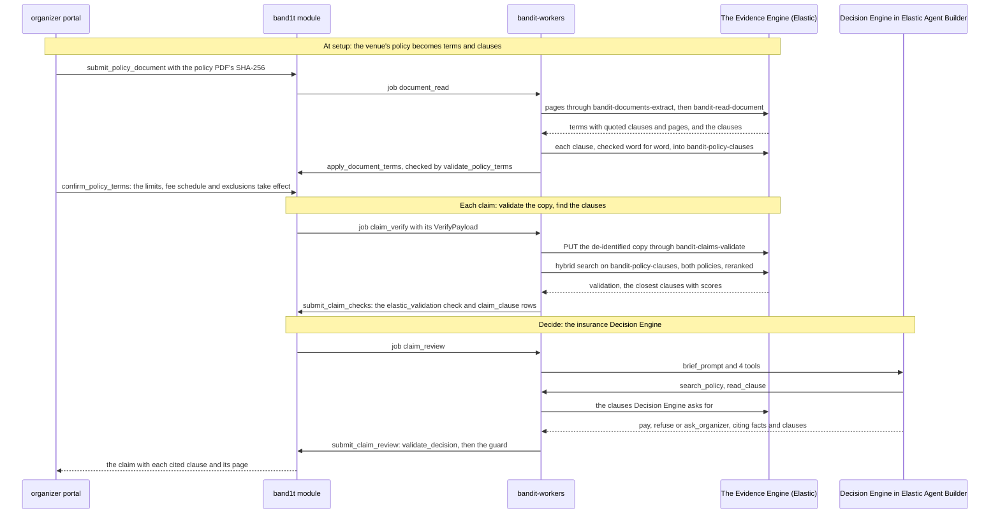
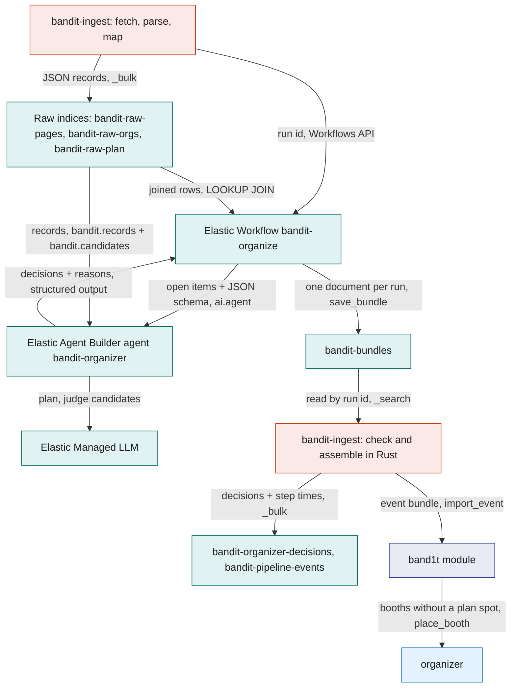
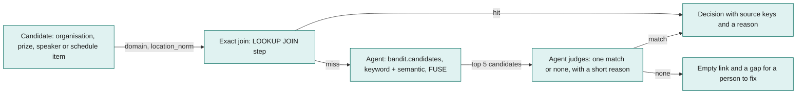
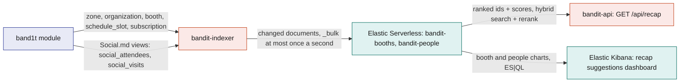
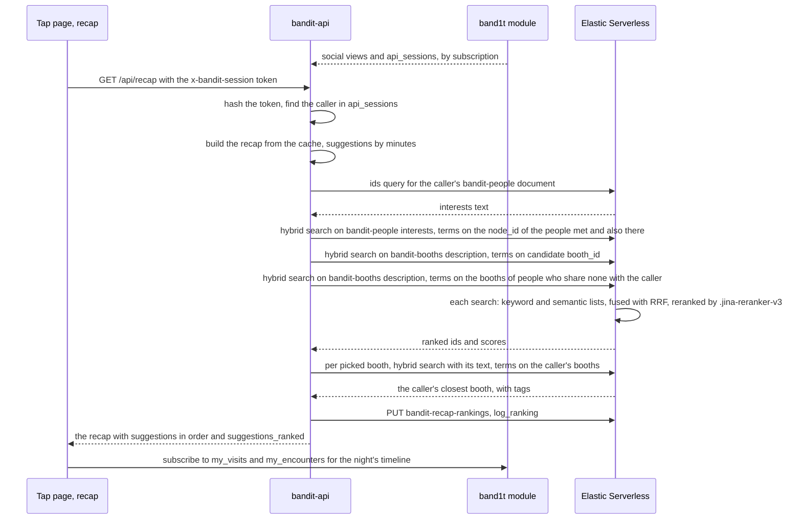
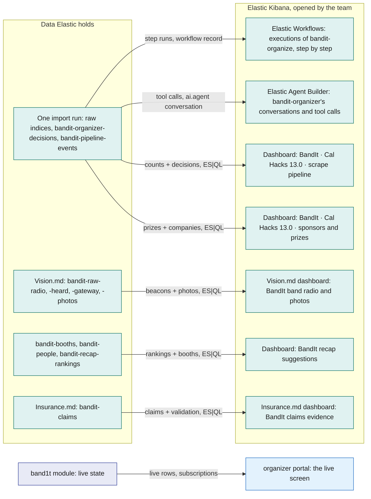
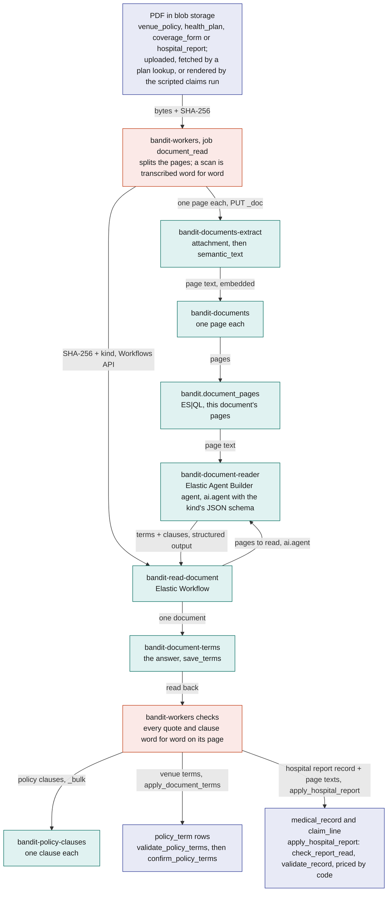
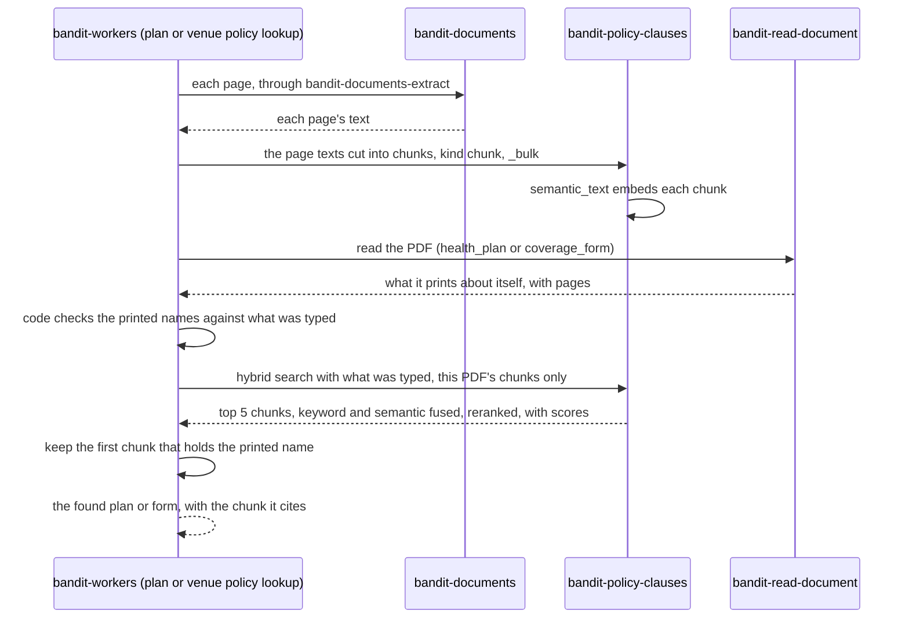

# Elastic

The Evidence Engine uses Elastic Cloud Serverless for document reading, validation, organization and search by meaning. Elastic Workflows also executes the worker’s bounded writing and selection tasks, and Elastic Agent Builder runs the Decision Engine’s claim investigation and rule proposals. SpacetimeDB remains the source of live state and the only authority that applies a checked result.

The execution system and underlying model are separate. Elastic uses its configured connector, which may run Claude. The worker records the workflow, execution and model information actually returned; it does not relabel a fixed `ai.prompt` task as an autonomous agent.

The finance story is the organizer’s loop: approve individual simple claims, retain those precedents, receive a rule proposal that cites at least three, approve that rule separately, then let later matching claims settle automatically inside the code guard. A complicated claim still requires an individual decision and never teaches an automatic rule.

## Role in the system

- Organize scraped records with `bandit-organize` and the `bandit-organizer` agent before `bandit-ingest` validates and imports the bundle.
- Keep one-way copies of booths and findable attendees’ interests; rank recap candidates with hybrid search and a reranker.
- Read policy wording and hospital reports with `bandit-read-document`; code checks quoted terms, clauses and report fields against the pages.
- Validate de-identified claim copies and search only the policy documents attached to that claim.
- Run `bandit-investigate-claim`: Agent Builder chooses the next evidence read or policy query, while Rust keeps a bounded transcript and executes only allowed, claim-scoped requests.
- Run `bandit-propose-rule`: the agent counts the offered claim precedents through ES|QL and proposes a ceiling code checks before organizer approval.
- Run bounded text tasks in `bandit-run-task`: medical-card fields, report and letter writing, merch selection, venue selection and policy URL selection.
- Read temporary images with `bandit-read-image`, with code validation and upload cleanup.
- Keep workflow execution records and the existing Kibana dashboards for import, radio data, recaps and claim evidence.

Elastic never writes business state directly. Workers submit checked results through reducers with the current lease; code computes amounts, applies coverage and enforces the organizer-approved rule. Models never choose seeded random outcomes or enter the band safety loop.

Data boundaries depend on the operation. Claim-copy indices are de-identified, while a private investigation transcript can include this claim’s evidence and names. Medical-history and insurance-card text goes to a bounded workflow without a shared search index; policy wording and hospital reports use the document indices. These are distinct paths, and indexed documents must not be described as automatically deleted when a claim ends: that cleanup is not implemented.

## Interfaces

| Interface | Direction | Who | What flows | Transport |
|---|---|---|---|---|
| Elastic Bulk API, raw indices | in | `bandit-ingest`, organize stage ([Bright-Data](Bright-Data.md)) | one JSON record per document, parsed from Bright Data's snapshots (event pages, the LinkedIn and Crunchbase company datasets, the Google Maps venue) and from the team's plan files; id `<run_id>:<source_key>`; the run's old documents are deleted first | HTTPS, `ELASTICSEARCH_API_KEY` |
| Elastic Workflows API | in | `bandit-ingest`, organize stage | start one execution of `bandit-organize` with the run id; poll it every 5 s, for at most 30 minutes | HTTPS to Elastic Kibana, `KIBANA_API_KEY` |
| Agent tools | internal | `bandit-organizer` | two fixed Elastic ES\|QL tools over the raw indices: `bandit.records` and `bandit.candidates` | Elastic-internal |
| Insurance.md: agent tool | internal | `bandit-document-reader` | one fixed Elastic ES\|QL tool over `bandit-documents`, `bandit.document_pages`, limited to the one document being read | Elastic-internal |
| Insurance.md: Elastic Workflows API, rule proposals | in | `bandit-workers`, job `rule_proposal` | start one execution of `bandit-propose-rule` per proposal, and one more when code rejects the first answer; poll it every 5 s, for at most 10 minutes | HTTPS to Elastic Kibana, `KIBANA_API_KEY` |
| Insurance.md: agent tool | internal | `bandit-rule-proposer` | one fixed Elastic ES\|QL tool over `bandit-claims`, `bandit.claim_precedents`, limited to the claim copies one proposal offers | Elastic-internal |
| `bandit-bundles` | out | `bandit-ingest` | one document per run: the domain join rows, the organisation decisions, the prize, speaker and schedule links, the gaps and the model connector | HTTPS `_search` with a `term` on `run_id` |
| Elastic Bulk API, run logs | in | `bandit-ingest`, organize stage | one `bandit-organizer-decisions` document per decision in the bundle it read back, and one `bandit-pipeline-events` document per step of the run, with its time and counts | HTTPS, `ELASTICSEARCH_API_KEY` |
| Elastic Kibana Dashboards API | in | `bandit-ingest`, at the end of each full run; `kibana/install.sh` | the two event dashboards, created or replaced with that run's id in every query; the radio and photos, recap suggestions and (Insurance.md) claims evidence dashboards from their saved files in `kibana/` | HTTPS to Elastic Kibana, `KIBANA_API_KEY` |
| Elastic setup | in | `bandit-ingest elastic-setup` | the index mappings, the two agent tools, the agent and the workflow, from `crates/bandit-ingest/elastic/` | HTTPS to Elasticsearch and Elastic Kibana |
| SpacetimeDB subscription | in | `bandit-indexer` (role `indexer`) | rows of `zone`, `organization`, `booth`, `schedule_slot`; from Social.md: the views `social_attendees` and `social_visits` | SpacetimeDB Rust client SDK over WebSocket; initial sync, then every committed change |
| Elastic Bulk API, copy indices | out | `bandit-indexer` | index and delete operations on `bandit-booths` and `bandit-people`, keyed by booth id and attendee id | HTTPS, `ELASTICSEARCH_API_KEY` |
| `GET /api/recap` | in | the recap on the tap page (/t/code) ([Tap-Page](../5-apps/Tap-Page.md)) | the session token in the `x-bandit-session` header; returns the caller's recap, with `suggested_people`, `also_there` and `suggested_booths` in order, each with its score, and `suggestions_ranked` | HTTPS JSON on `bandit-api` |
| `api_sessions` and Social views | in | `bandit-api` (role `api`) | the session token, hashed with SHA-256 and matched in `api_sessions` to get the caller's identity; `social_attendees`, `social_visits`, `social_encounters` and the other rows the recap shows | SpacetimeDB subscription ([SpacetimeDB](../2-data/SpacetimeDB.md), [Social](../6-features/Social.md)) |
| Elasticsearch search | out | `bandit-api` | for `GET /api/recap`: an `ids` query for the caller's `bandit-people` document, then one hybrid search on `bandit-people` (the people met and the people also there together) and one on `bandit-booths`, each a keyword and a semantic query fused with RRF and reranked by `.jina-reranker-v3`; each call times out after 10 s | HTTPS, `ELASTICSEARCH_API_KEY` |
| `bandit-recap-rankings` | in | `bandit-api` | after each ranked recap, one document per attendee (id: attendee id): the places their interests text names, the order Elastic chose with the first booth's and person's scores, the first person also there with their score, and the booth that minutes alone put first | HTTPS, `ELASTICSEARCH_API_KEY` |
| Vision.md: Elastic Bulk API, raw radio and photos | in | Leo's `feed.py` and `photos.py` on the venue laptop ([Vision](../4-devices/Vision.md)) | one document per gateway line and per photo, with a document id from its content, so a second upload adds nothing | HTTPS, from the laptop's `.env` keys |
| Insurance.md: `bandit-claims`, through the pipeline `bandit-claims-validate` | in | `bandit-workers`: job `claim_verify`, the seed when it first creates the index, and job `claim_draft` | one de-identified document per pack version (`claim-<id>-v<n>`); the 30 seeded past claims (`history-01` to `history-30`); the outcome and payout once a claim is paid | HTTPS, `ELASTICSEARCH_API_KEY` |
| Insurance.md: `bandit-documents`, through the pipeline `bandit-documents-extract` | in | `bandit-workers`: job `document_read` | one document per page of an insurance PDF (`<sha256>-p<n>`), with the page's bytes for the `attachment` processor | HTTPS, `ELASTICSEARCH_API_KEY` |
| Insurance.md: Elastic Workflows API, `bandit-read-document` | in | `bandit-workers`: job `document_read` | start one execution per document with its SHA-256 and kind (`venue_policy`, `health_plan`, `coverage_form`, `hospital_report`); poll it every 5 s; read back the terms and clauses from `bandit-document-terms` | HTTPS to Elastic Kibana, `KIBANA_API_KEY` |
| Insurance.md: `bandit-policy-clauses` | in | `bandit-workers`: job `document_read`; Bright-Data.md: the plan lookup and the venue policy lookup | one document per clause of the venue's policy or an attendee's health-plan wording, once code found its text word for word on its page; and one document per chunk of each page of a PDF a lookup fetched, the moment it arrives | HTTPS, `ELASTICSEARCH_API_KEY` |
| Insurance.md: policy clause search | out | `bandit-workers`: job `claim_verify`, and the Decision Engine's tools `search_policy` and `read_clause` in job `claim_review` | a hybrid search on `bandit-policy-clauses`: a keyword `match` on `text.words` and a `semantic` query on `text`, fused with RRF and reranked by `.jina-reranker-v3`, filtered to the venue's policy and this attendee's health-plan wording; each clause's id, policy, section, page, text and score, written through `submit_claim_checks` or handed to Decision Engine | HTTPS, `ELASTICSEARCH_API_KEY` |
| Elastic Kibana | in | the team, signed in to the Elastic Cloud project | the Elastic Workflows execution view, Elastic Agent Builder, and the five dashboards: scrape pipeline, sponsors and prizes, band radio and photos, recap suggestions and (Insurance.md) claims evidence; read only on every BandIt index | HTTPS in a browser; Elastic Cloud logins, never attendees |

## Design

### Worker workflows and bounded tasks

| Workflow | Step type | What owns the next action | Output |
|---|---|---|---|
| `bandit-run-task` | `ai.prompt` | Rust supplies the complete text and schema; there is no tool loop | one structured answer for a domain validator |
| `bandit-investigate-claim` | `ai.agent`, `bandit-claim-investigator` | the agent chooses allowed evidence and policy requests; Rust scopes and executes them within the turn limit | the next request or final claim decision |
| `bandit-propose-rule` | `ai.agent`, `bandit-rule-proposer` | the agent queries offered precedents with `bandit.claim_precedents` | a cited proposed rule, never its approval |
| `bandit-read-document` | `ai.agent`, `bandit-document-reader` | the agent reads this document’s pages through its ES\|QL tool | terms/clauses or a hospital report record |
| `bandit-read-image` | `ai.agent`, `bandit-image-reader` | one bounded attachment read; no caller tools or business actions | count/caption or transcription, then upload deletion |

`bandit-run-task` receives only system text, prompt text and a JSON schema; it rejects binaries, tools and conversation history. It covers `medical_extract`, `clinic_report`, `claim_draft`, `recovery_letter`, `merch_picks`, `venue_find`, `venue_map`, `plan_find` and `venue_policy_find`. Each result still passes its existing domain validator and result reducer.

`attendee_policy_lookup` is the canonical job kind around `plan_find`. Existing queued `plan_lookup` jobs remain accepted by the worker and completion/dead-job handling; the table and public reducer names remain stable. Bright Data performs the searches and fetches; the bounded workflow selects only from supplied URLs.

These source paths do not by themselves prove deployment. A workflow must be installed and a live execution checked before a release is described as verified.

### The Evidence Engine in one picture

The question this diagram answers: what goes into The Evidence Engine, what Elastic does with it, and what comes out?



The title of the middle box is the boundary. Every output passes through a Rust process that checks it: `bandit-api` for the recap, `bandit-workers` for `submit_claim_checks`, for every insurance document's terms and clauses and for every proposed rule, and `bandit-ingest` for `import_event`. Elastic itself never calls the module.

### Indices

One row per index. "Names" means names of people; company and booth names are public facts.

| Index | One document | Written by | Read by, and how | Names |
|---|---|---|---|---|
| `bandit-raw-pages` | one record parsed from a public event page: `organization_candidate`, `prize`, `person_candidate` (a speaker), `schedule_item` or `venue_fact` | `bandit-ingest`, organize stage, `_bulk`, id `<run_id>:<source_key>` | `bandit-organize` (Elastic ES\|QL); the agent's tools `bandit.records` (Elastic ES\|QL) and `bandit.candidates` (Elastic ES\|QL, keyword plus semantic); both event dashboards (Elastic ES\|QL) | speakers' names as the event's pages print them |
| `bandit-raw-orgs` (lookup mode) | one company facts record from LinkedIn or Crunchbase (`company_facts`), or the Google Maps venue (`venue_place`) | `bandit-ingest`, as above | `LOOKUP JOIN ... ON run_id, domain`; both agent tools; both event dashboards | none: `fetch` strips the datasets' people fields |
| `bandit-raw-plan` (lookup mode) | one zone or one sponsor's booth spot from the team's plan files (`zone`, `booth_spot`) | `bandit-ingest`, as above | `LOOKUP JOIN ... ON run_id, location_norm`; `bandit.records`; the scrape pipeline dashboard | none |
| `bandit-bundles` | the organized result of one import run, id = run id | the workflow's last step, `save_bundle` (`elasticsearch.index`) | `bandit-ingest`, `_search` with a `term` on `run_id` | speakers only as source keys |
| `bandit-organizer-decisions` | one decision with its reason: `organization`, `prize_link`, `person_link`, `schedule_link` or `gap` | `bandit-ingest`, `_bulk`, after it checks the bundle | both event dashboards (Elastic ES\|QL) | speakers' names on `person_link` decisions |
| `bandit-pipeline-events` | one step of one run, with its time and counts | `bandit-ingest`, `POST _doc` from `log_event` | the scrape pipeline dashboard (Elastic ES\|QL) | none |
| `bandit-booths` | one booth, with its organisation's facts, its tags and its schedule titles in `description` | `bandit-indexer`, `_bulk` index and delete, id = booth id | `bandit-api` for `GET /api/recap`: a hybrid search (keyword on `description.words`, `semantic` on `description`, RRF, reranked), filtered to the candidate booth ids; the recap suggestions dashboard (Elastic ES\|QL) | none |
| `bandit-people` | one findable attendee: attendee id, graph node id, company name and `interests` | `bandit-indexer`, `_bulk` index and delete, id = attendee id | `bandit-api`: an `ids` query for the caller's own `interests`, then a hybrid search (keyword on `interests.words`, `semantic` on `interests`, RRF, reranked), filtered to the candidate node ids; the recap suggestions dashboard | none: ids and a company name |
| `bandit-recap-rankings` | one attendee's latest recap ranking, id = attendee id: the places their interests name, the people, the people also there and the booths in Elastic's order, the first person's, person also there's and booth's scores, and the booth that minutes alone put first | `bandit-api`, `PUT _doc` from `log_ranking`, after each ranked recap | only the recap suggestions dashboard (Elastic ES\|QL) | the attendee and the people on their recap, by display name |
| `bandit-claims` | one de-identified claim pack version or seeded past claim | workers validate the copy, record its settled outcome and update approved precedents | the claim narrative queries policy clauses; `bandit.claim_precedents` counts only the copies offered to a proposal; the claims dashboard shows outcomes | no names in the copy |
| `bandit-documents` | one page of policy wording or a hospital report, keyed by document hash and page | `document_read` and policy lookups, through `bandit-documents-extract` | the scoped document reader and code’s quote checks; not dashboards | hospital report content may identify its patient; claim-end deletion is not implemented |
| `bandit-document-terms` | the document reader’s checked-schema answer and reader version | workflow `save_terms` | workers read by document hash | same content boundary as its document; claim-end deletion is not implemented |
| `bandit-rule-proposals` | what `bandit-propose-rule` proposed for one try of one proposal, id `proposal-<id>-<try>`: `proposal_key`, `model` (the connector), `answer` (the structured output) and `usage` | the workflow's last step, `save_proposal` (`elasticsearch.index`) | `bandit-workers`, `_doc` by id | none: claim ids, codes and amounts |
| `bandit-policy-clauses` | one passage of a policy PDF, of one of two kinds: a clause of the venue's policy or an attendee's health-plan wording (`kind` `clause`, id `<sha256>-c<n>`), or a chunk of one page of a PDF a lookup fetched (`kind` `chunk`, id `<sha256>-p<page>-k<n>`). Each has `clause_id`, `kind`, `policy` (`venue`, `attendee`), `document_hash`, `section` (empty for a chunk), `page`, `text` (with its keyword subfield `text.words`) | `bandit-workers`: job `document_read`, `_bulk`, after it finds each clause word for word on its page; Bright-Data.md: the plan lookup and the venue policy lookup, `_bulk`, each fetched PDF's chunks before anything reads it, and the joined PDF's chunks when the venue policy lookup files it | `bandit-workers`: a hybrid search (keyword on `text.words`, `semantic` on `text`, RRF, reranked) over clauses only, filtered with `terms` on the claim's two `document_hash` values, for `claim_verify` and the Decision Engine's `search_policy`; `ids` for `read_clause`; the lookups' chunk search, the same hybrid search over one PDF's chunks, for the chunk each check cites | policy wording; claim-end deletion is not implemented |
| `bandit-raw-radio`, `bandit-raw-heard`, `bandit-raw-gateway`, `bandit-raw-photos` | one gateway line, heard list or photo record | `feed.py` and `photos.py` on the venue laptop, `_bulk` | only the band radio and photos dashboard (Elastic ES\|QL), after the event | none |

Every `semantic_text` field names the inference endpoint `.jina-embeddings-v5-text-small` on the Elastic Inference Service: `text` in the three import raw indices, `description`, `interests` and `narrative`, and `text` in `bandit-documents` and `bandit-policy-clauses`. Elastic embeds a document's text when it is written and the query text when it is searched, so no BandIt process computes a vector.

The three fields that a hybrid search reads, `text` in `bandit-policy-clauses`, `interests` and `description`, each have a `words` subfield: a plain `text` field with the `english` analyzer, for the keyword half. The keyword half finds a policy's exact words, such as "employee" or "pre-existing", that a meaning search can rank low. The semantic half finds the same idea in other words.

The `rrf` retriever fuses the two lists by rank. The `text_similarity_reranker` retriever then has `.jina-reranker-v3` read the query next to each fused hit and reorder them. If the reranker call fails, the same search runs again without it and keeps the fused order.

`bandit-indexer`, `bandit-api` and `bandit-workers` put `ELASTIC_INDEX_PREFIX` (`bandit` on the VM) in front of their index names. A local run writes `bandit-e2e-*` and never mixes into the live indices.

### The six evidence jobs

Each job says what starts it, what it gets, what Elastic does, what comes out and what that result can change. The Parts further down hold the detail.

#### Organize the scraped event data before import

**Trigger.** The team runs `bandit-ingest run --event calhacks-13` once before the event; its organize stage does this job.

**Input.** The 250 JSON records of one import run, parsed in Rust from what Bright Data fetched, plus the team's zones and booth spots.

**In Elastic.**

1. `_bulk` writes the records into `bandit-raw-pages`, `bandit-raw-orgs` and `bandit-raw-plan`, and `semantic_text` embeds each record's `text`.
2. `bandit-ingest` starts the Elastic Workflow `bandit-organize` with the run id through the Elastic Workflows API, and polls it every 5 s.
3. Elastic ES|QL steps make the exact joins: `join_orgs` (`LOOKUP JOIN bandit-raw-orgs ON run_id, domain`), `join_keys` (`STATS ... BY org_key`) and `join_schedule` (`LOOKUP JOIN bandit-raw-plan ON run_id, location_norm`). Two more list the prizes and speakers, and two `data.parseJson` steps build JSON schemas that require exactly one decision per domain, prize, speaker and schedule item.
4. Two `ai.agent` steps call the Elastic Agent Builder agent `bandit-organizer` with those schemas: `organize_orgs` decides who is who across domains, and `link_records` links prizes, speakers and schedule items. The agent's only tools are the Elastic ES|QL tools `bandit.records` and `bandit.candidates`.
5. `save_bundle` (`elasticsearch.index`) writes the result as one document to `bandit-bundles`.

**Output.** `bandit-ingest` reads the document back, checks it in Rust, logs every decision to `bandit-organizer-decisions`, assembles the event bundle and loads it with `import_event`.

**Can change** which organisations, booths, speakers and schedule slots the module imports, with their categories, tags and descriptions. **Cannot** write to the module, invent a key (the Rust check rejects any key that is not in the run), or touch anything live. Detail: [Part one](#part-one-organizing-the-scraped-data-upstream-of-spacetimedb).

#### Order each attendee's recap suggestions by meaning

**Trigger.** After the organizer ends the event, the recap on the tap page calls `GET /api/recap` on `bandit-api` with its session token.

**Input.** The caller's candidates, which `bandit-api` builds from SpacetimeDB rows: the findable people they hung out with, the findable people they shared a zone with for at least 5 minutes but never met ("Also there with you"), and the booths their band stood at. `bandit-indexer` keeps the copy they are ranked against.

**In Elastic.**

1. An `ids` query gets the caller's `bandit-people` document and its `interests` text.
2. Two hybrid searches run at once with that text: one on `bandit-people` `interests`, filtered with `terms` on the `node_id` of both lists of people, and one on `bandit-booths` `description`, filtered on the candidates' `booth_id`. Each runs a keyword `match` on the `words` subfield and a `semantic` query on the field, fuses the two lists with RRF, and has `.jina-reranker-v3` reorder the fused candidates against the interests text.
3. Elastic returns the candidates best match first, with the reranker's scores.
4. Social.md: for the people who share no booth with the caller, a third hybrid search in the same round, on `bandit-booths` `description` with the same text and filtered to those people's booths, puts each person's booths in order of how close they are to the caller's interests. Then, for each person's closest booth, one hybrid search with that booth's text, filtered to the caller's own booths, finds the caller's closest booth. Each answer brings back the booths' `tags`.

**Output.** `bandit-api` puts `suggested_people`, `also_there` and `suggested_booths` in that order and sets `suggestions_ranked`. One people query serves both lists of people, so the same score orders each. Social.md: each person who shares no booth with the caller gets `similar`: their closest booth, the caller's closest booth and a tag both carry, for the card's "why" line. It then writes the caller's latest ranking to `bandit-recap-rankings` (`log_ranking`) for the recap suggestions dashboard; a failed write is only logged.

**Can change** the order of the three lists, and which pair of booths a card's "why" line names when two people share none. **Cannot** add a person or a booth (every query is filtered to the candidates), decide who is findable, or hold up the recap: after 10 s, or on any error, the lists stay in minutes order. Detail: [Part two](#part-two-the-one-way-copy-downstream-of-spacetimedb) and [Part three](#part-three-ordering-the-recaps-suggestions).

#### Read every insurance document

The document reader handles `venue_policy`, `health_plan`, `coverage_form` and `hospital_report`. Attendee insurance cards use `medical_extract` with kind `insurance`, private page text and `bandit-run-task`; they are not an `insurance_card` kind in this indexed workflow.

**Trigger.** A PDF arrives: the organizer uploads the venue's policy when the event is set up (`submit_policy_document`), a plan lookup fetches the public wording of a plan the attendee named, a venue policy lookup fetches the venue's two policy forms the organizer named and joins them into one PDF ([Bright-Data](Bright-Data.md)), or a hospital report is written for a claim or filed by staff. The module enqueues the job `document_read` through `queue_document_read`. A plan lookup and a venue policy lookup run the same steps on each PDF they fetch before they keep it, to read what it prints about itself, and put the PDF's chunks in `bandit-policy-clauses` first, so it is searchable by meaning the moment it arrives ([Fetched PDFs](#fetched-pdfs-searchable-by-meaning-the-moment-they-arrive), [Bright-Data](Bright-Data.md)).

**Input.** The PDF from blob storage, its SHA-256, its kind (`venue_policy`, `health_plan`, `coverage_form` or `hospital_report`) and its source: `upload`, `attendee_policy_lookup` with the address it came from, or `policy_lookup` with the liability form's address. A hospital report's job names its `medical_record` row and its page count.

**In Elastic.**

1. `bandit-workers` splits the PDF into pages and writes each to `bandit-documents` through the ingest pipeline `bandit-documents-extract`. Its `attachment` processor takes the page's text layer, and `semantic_text` embeds it. A page with no text layer, a scan, is first transcribed word for word through the private Elastic image workflow, which extracts nothing from it.
2. `bandit-workers` starts the Elastic Workflow `bandit-read-document` with the SHA-256, the kind and the reader's version, and polls it every 5 s. When `bandit-document-terms` already holds an answer for this PDF and kind from the same version, such as the one a plan lookup's check saved, it uses that answer and starts nothing.
3. A `data.parseJson` step picks the JSON schema of that kind, and one `ai.agent` step calls the Elastic Agent Builder agent `bandit-document-reader` with it. The agent's only tool is the Elastic ES|QL tool `bandit.document_pages`, limited to this document's pages. Every term it returns quotes its clause and page, and a policy's answer also lists its clauses.
4. `save_terms` (`elasticsearch.index`) writes the answer, with the kind and the reader's version, as one document to `bandit-document-terms`.

**Output.** `bandit-workers` reads the answer back and checks it in Rust: every quote and every clause must appear word for word on its page. It writes each clause of a policy to `bandit-policy-clauses`. The venue's terms go to the module through `apply_document_terms`, which runs `validate_policy_terms`, and the organizer confirms them with `confirm_policy_terms`. The hospital report's answer and its page texts go to the module through `apply_hospital_report`, which runs `check_report_read` again, then `validate_record`, and code prices every line against the policy's fee schedule, as today. A hospital report is not a policy: it gets no `policy_document` row, and none of its text goes to `bandit-policy-clauses`.

**Can change** every limit, deductible, minimum payout, service window, fee schedule cap and exclusion that the insurance Decision Engine is held to, once the organizer confirms them, which clauses Decision Engine can cite, and the billed lines a claim is priced from. **Cannot** set a term that code rejects (a quote that is not on its page, a deductible above its limit), move money, or decide a claim. Detail: [Part five](#part-five-reading-every-insurance-document).

#### Validate the claim copy and find the policy clauses that bear on it

**Trigger.** The module enqueues the job `claim_verify` each time it builds a pack version of a claim that has an amount to pay.

**Input.** The job's `VerifyPayload`, which `bandit-workers` turns into a de-identified copy: codes, amounts, zone, time and one narrative sentence from a fixed template (`narrative_for`).

**In Elastic.**

1. `PUT bandit-claims/_doc/claim-<id>-v<n>?pipeline=bandit-claims-validate`: the ingest pipeline's Painless `script` processor checks the copy and writes `validation.valid` and `validation.errors`. It never rejects a document.
2. `semantic_text` embeds the `narrative`.
3. One hybrid search on `bandit-policy-clauses`, with the copy's narrative as the query, filtered to the venue's confirmed policy, on an injury the claimant's own health plan (the newest one read, which the plan lookup found at sign-up), and the sections that can decide the claim's kind (`sections_for_kind`): a keyword `match` on `text.words` and a `semantic` query on `text`, fused with RRF and reranked by `.jina-reranker-v3`. The worker keeps the top 5.

**Output.** One `elastic_validation` check and the matching clauses (clause id, policy, section, page, text, score) as `claim_clause` rows, written through `submit_claim_checks`. Decision Engine then searches the same clauses with its own queries.

**Can change** the route: a failed validation sends the claim to the organizer. A clause reaches the decision only when Decision Engine cites it. **Cannot** change an amount, refuse a claim, or see a name. Detail: the next section and [the claims part](#insurancemd-the-claim-copy-bandit-claims-and-bandit-claims-validate).

#### Propose a payment rule from the organizer's approvals

**Trigger.** The organizer approves a third simple claim of one shape (incident kind and cover) that no rule pays yet. The module opens a `rule_proposal` row and enqueues the job `rule_proposal` ([Insurance](../6-features/Insurance.md#proposed-rules)).

**Input.** The job's `RuleProposalPayload`: the shape, the cover's per-claim limit and minimum payout, the rule in force, the approved precedents offered (claim, claimant, zone, payout, diagnoses, service codes, who approved it and when) and the shape's refused ones with their reasons.

**In Elastic.**

1. `bandit-workers` finds each precedent's newest copy in `bandit-claims`, by `indexed_at`. When an approved claim's letters have not yet written its outcome, it writes `approved` and the payout on that copy (`set_outcome`), so the approval that opened the proposal is counted.
2. `bandit-workers` starts the Elastic Workflow `bandit-propose-rule` with the claims index, those copies' ids, the precedents as text and the JSON schema of the answer, and polls it every 5 s.
3. One `ai.agent` step calls the Elastic Agent Builder agent `bandit-rule-proposer`. Its only tool is the Elastic ES|QL tool `bandit.claim_precedents`, which counts the offered copies by outcome, diagnosis code and kind of item, with each group's claim ids, its highest and lowest payout and its service codes. The agent cites at least three approved claims that share one injury and treatment, takes the group's highest payout as the ceiling, and writes the rule in one sentence and why.
4. `save_proposal` (`elasticsearch.index`) writes the answer to `bandit-rule-proposals`.

The tool's query:

```
FROM bandit*-claims METADATA _index
| WHERE _index == ?claims_index AND MV_CONTAINS(SPLIT(?doc_ids, ","), doc_id)
| STATS claims = COUNT_DISTINCT(claim_id), claim_ids = VALUES(claim_id),
        highest_payout_cents = MAX(payout_cents), lowest_payout_cents = MIN(payout_cents),
        service_codes = VALUES(service_codes)
  BY outcome, diagnosis_codes, item_kind
| SORT outcome, claims DESC
| LIMIT 50
```

**Output.** `bandit-workers` reads the answer back and checks it in Rust (`check_proposal`): at least three cited claims, all from the approved precedents offered; a ceiling equal to the highest payout among them; and at most the cover's per-claim limit. A rejected answer runs the workflow once more with the problems listed. The answer goes to the module through `submit_rule_proposal`, which checks it again, with the agent's run as its `model_call`.

**Can change** what the organizer sees on the Proposed rules tab. **Cannot** make a rule: only the organizer's `approve_rule_proposal` writes a `settlement_rule`, and never from the identity that proposed it. It cannot set a ceiling above what the organizer already approved, or above the policy's limit.

#### Show the team the data in Elastic Kibana

**Trigger.** `bandit-ingest` installs the two event dashboards at the end of each full run through the Elastic Kibana Dashboards API (`PUT /api/dashboards/<id>`). `kibana/install.sh` installs the other three through the same API, from `kibana/radio.json`, `kibana/recap.json` and `kibana/claims.json`.

**Input.** The import raw indices and the two run logs, the raw radio and photo indices, the copy indices with `bandit-recap-rankings`, and `bandit-claims`.

**In Elastic.**

1. Every chart and count is an Elastic ES|QL query, such as `FROM bandit-organizer-decisions | WHERE run_id == "<run>" | STATS ...`, with the run id fixed in the two event dashboards.
2. The Elastic Workflows execution view shows each step of `bandit-organize` with its time and output.
3. Elastic Agent Builder keeps each `ai.agent` step's conversation (`create-conversation: true`), so the team can open every tool call of `bandit-organizer`.

**Output.** Five dashboards: "BandIt · Cal Hacks 13.0 · scrape pipeline" (`bandit-pipeline-calhacks-13`), "BandIt · Cal Hacks 13.0 · sponsors and prizes" (`bandit-event-calhacks-13`), "BandIt band radio and photos" (`bandit-radio`), "BandIt recap suggestions" (`bandit-recap`) and "BandIt claims evidence" (`bandit-claims`).

The organizer portal's "Kibana" tab walks through Elastic's jobs in the order of the event: before it (organizing), during it (the radio log and photos), after it (the recap), claims, and the payment rules proposed from the organizer's approvals. Each has a short note and links to its views: the five dashboards, the `bandit-organize` and `bandit-propose-rule` runs (`/app/workflows`) and the `bandit-organizer` and `bandit-rule-proposer` agents (`/app/agent_builder`).

**Can change** nothing: every view is read only. **Cannot** show anything live; the organizer portal shows the live event from SpacetimeDB. Detail: [Part four](#part-four-elastic-kibana-what-the-team-shows).

### How The Evidence Engine feeds the insurance Decision Engine

The insurance Decision Engine is Elastic Agent Builder plus Rust’s scoped tool execution, validation and payment guard ([Insurance](../6-features/Insurance.md)). The Evidence Engine gives it three things:

- the venue's policy terms, which set every limit and gate once the organizer confirms them;
- a validation check for each pack version of a claim;
- the clauses of the venue's policy and, on an injury, of the attendee's health insurance that bear on the claim, which Decision Engine searches and cites.

The question this diagram answers: how a policy PDF becomes the limits a claim is held to, and how the clauses reach the Decision Engine's decision.



**The terms set the limits.** Code reads every limit, deductible, minimum payout, service window, fee schedule cap and exclusion from the confirmed `policy_term` rows. Today's seeded values stay only as the default for a term the policy does not state ([Insurance](../6-features/Insurance.md#where-each-gates-numbers-come-from-next-to-build)).

**The clauses reach the decision only through Decision Engine.** Code never reads a clause to decide. Decision Engine cites the clauses its decision rests on (`cited_clause_ids`), one per billed line (`line_clauses`), and the other-insurance clause for which policy pays (`paying_policy`). `validate_decision` checks that each is in `bandit-policy-clauses` and belongs to a policy on this claim, and an exclusion refuses only together with the failed check that tests it.

**The validation check routes.** A copy that fails `bandit-claims-validate` becomes a failed `elastic_validation` check, so the guard lets no pay through and the claim goes to the organizer. If Elastic is down, `on_job_dead` stores the info check "Elastic was unavailable; no validation or policy clauses" and queues `claim_review` anyway, and the Decision Engine's policy tools answer empty.

**The organizer sees them.** The claim's detail in the organizer portal shows each clause Decision Engine cited, with its policy, section and page, next to the evidence.

**Current clause path.** `claim_verify` returns matching policy clauses, and the Decision Engine uses `search_policy` and `read_clause` over those documents. Past outcomes remain available to the approved-precedent rule workflow and dashboards; they are not the basis for deciding whether a policy covers a new claim.

**The attendee's own words stay out of Elastic.** The `claimant_statement`, the attendee's own words from `file_claim`, goes to `claim_review` only, because `claim_doc` builds the Elastic copy from fixed fields and a fixed template.

### Insurance.md: each incident type, and the clauses The Evidence Engine finds for it

[Incident-Types](../6-features/Incident-Types.md) lists the four incident types. Each one turns on different clauses of the policy that pays it, so The Evidence Engine handles each type explicitly:

- The de-identified claim document carries the type, the cover, the kind of item (`laptop`, `phone`, `speaker`), its value and whether a person was named at the spot. It never carries a name.
- `bandit-claims-validate` knows the four types and refuses nothing: a `theft` with no item or no value fails validation.
- The clause search is filtered to the policy and cover that pay that type, so Decision Engine reads the right part of the right policy.

| Type | The policy and cover searched | The sections it searches | What Decision Engine asks `search_policy`, for example | What can come of it |
|---|---|---|---|---|
| `fall`, `sos` | the venue's policy, medical payments cover; the attendee's own health plan | insuring agreement, limits, schedule of benefits, exclusions (`staff`, `pre_existing`, `off_premises`), conditions (service window), other insurance | "injury that began before the event", "treatment more than 30 days after the incident", "which policy pays first for urgent care" | a payout into the attendee's wallet |
| `property` | the venue's property policy | insuring agreement, limits, deductible, exclusions, subrogation | "equipment damaged by a guest", "the insurer's right to recover from the person who caused a loss" | a payout for the repair, and a charge to the person security named |
| `theft` | the venue's property policy, theft as a cause of loss | theft, conditions, exclusions, deductible, subrogation | "a sponsor's laptop taken from its booth", "theft with no sign of forced entry" | a payout for what was taken, and a charge to the person security named |

For a charge, the organizer sees the subrogation clause of the policy that paid next to the person security named ([Insurance](../6-features/Insurance.md#charges-to-an-attendee-next-to-build)).

### Why Elastic and not SpacetimeDB

Each store does what it is best at. SpacetimeDB owns all live state and every write (reducers are the only write path), the subscriptions that push changes to the apps, the space-time mapping of zones and times, every exact list, and the findable switch. Elastic owns four things SpacetimeDB is not built for: fuzzy entity resolution across messy scraped sources before the import, ordering by meaning with semantic search, checking each claim copy as it arrives, and reading every insurance PDF into searchable clauses.

SpacetimeDB decides who and what is on the list (exact, private, live); Elastic decides the order by meaning. Elastic orders only candidates SpacetimeDB already listed, it never decides access, and it never holds live state. The people graph is all SpacetimeDB: its nodes and links are facts the bands measured.

| Question | Who answers | Why |
|---|---|---|
| "Is `Elastic` on the event's sponsor list the same company as the LinkedIn record under another domain?" | Elastic, `bandit-organize` | Entity resolution over messy text, before the import |
| "Which zone does the schedule line `Stage A, Hall 1` belong to?" | Elastic, `bandit-organize` | Free-text location matched to zone names, by `LOOKUP JOIN` first and by the agent second |
| "Which zone is band 7 in right now?" | SpacetimeDB | Live `band` row, pushed by subscription |
| "Who is in the light circle around the fallen person?" | SpacetimeDB | Written inside the incident transaction; must never wait on a search |
| "Who did I hang out with tonight?" | SpacetimeDB, `my_encounters` | Exact encounter rows the bands measured; `findable` is checked in the view |
| "Which booths and companies tie the crowd together?" | SpacetimeDB, the people graph | `visited`, `works_at` and `exhibits` links to shared booth and company nodes, pushed live to the big screen through `event_graph` |
| "Of the people I hung out with, who is most into the same things as me?" | Elastic, `GET /api/recap` | Two people who visited different booths can still care about the same things; only embeddings of the booth texts can tell. The answer is an order, never a new name on the list |
| "Of the people I was near but never met, who should I have talked to?" | Elastic, `GET /api/recap` | The same match over "Also there with you": a shared zone puts them on the list, and shared interests put the right one first |
| "Of the booths I stood at, which fit me best?" | Elastic, `GET /api/recap` | My interests matched to booth descriptions by meaning |
| Insurance.md: "What do this venue's policy and this attendee's policy say about a fall at the Main stage?" | Elastic, `bandit-policy-clauses` | Meaning over the policy's own wording, which rarely uses the claim's words, and its exact terms, such as "employee"; a reranker reads each clause against the question; the answer is a clause Decision Engine can cite, never an amount |

Presence is zone-level only ([SpacetimeDB](../2-data/SpacetimeDB.md)), and the copy indices hold no positions at all: a booth carries its zone's id and name, and an attendee's interests name zones and booths.

### What Elastic does not do

- It does not serve lists or search. There is no typed query anywhere in BandIt. "My visits", "my encounters", "my photos" and "the booth with number B12" are SpacetimeDB views in the apps; the one attendee route, `GET /api/recap`, builds its lists from SpacetimeDB rows and only orders three of them with Elastic.
- It does not decide who may see what. The indexer copies only findable attendees, and `bandit-api` takes every candidate from SpacetimeDB rows (`api_sessions`, `social_attendees`, `social_encounters`, `social_shared_visits`, `social_visits`). No Elastic query, model or key decides access.
- It does not hold or discover graph links. The bands measure who met whom and who stood at which booth, and SpacetimeDB stores those links ([Social](../6-features/Social.md)). Elastic Kibana Graph is not used: it is unavailable on Elastic Cloud Serverless, and it discovers links from terms that occur together in documents, while here the links are already measured.
- It does not hold live state or history. Live counts, band rows, stays and incidents stay in the module. The Elastic Kibana dashboards read the import run's records and logs, the recap copy and rankings, Vision.md: the raw radio log and photo records, and Insurance.md: the de-identified claim copies; none of them shows a live count or a zone's density.
- It does not fetch or crawl. Elastic's Open Crawler is not used, the agent has no web tool, and there are no scheduled re-scrapes: one run per import. Bright Data cannot deliver to Elasticsearch directly, so `bandit-ingest` bulk-indexes the records itself.
- It does not apply a claim decision or set an amount. Agent Builder proposes a decision; Rust checks it and SpacetimeDB applies the guard. A proposed rule pays nothing until the organizer approves it.
- It does not read floor plans. Zones and booth spots come from the team's plan files (`zones.json`, `booths.json`) through the map stage of `bandit-ingest`, and reach Elastic as `bandit-raw-plan` records.

### Part one: organizing the scraped data, upstream of SpacetimeDB

Scraped records are messy in regular ways. One organisation appears under several website domains (its own site, a careers or short-link domain, a parent company in a dataset); a prize names its sponsor in a tag such as `[Acme] Best Use of Acme`; a speaker's company and a schedule item's location are free text.

Fixed Elastic ES|QL `LOOKUP JOIN` steps handle the regular cases deterministically, before any model runs. The irregular remainder is where a model with search tools helps: it finds candidates by meaning, picks one or none, and says why.

Each step has one owner: Bright Data fetched every page, Rust parsed the pages into records, the join steps of `bandit-organize` make the exact links, the agent makes the fuzzy ones, and Rust decides what is loadable.

The question this diagram answers: how do raw records become the bundle that lands in SpacetimeDB?



**Raw indices.** `bandit-ingest` writes every record with a `run_id` and deletes the run's old documents first, so a rerun replaces them and the agent's tools always filter on the current run. `bandit-raw-orgs` and `bandit-raw-plan` are created with `index.mode` set to `lookup`, so they can sit on the right side of a `LOOKUP JOIN`.

Every document carries its source (`source_key`, `source_url`, `fetched_at`, `snapshot_sha256`), its join keys (`domain`, `org_key`, `location_norm`, `aliases`), a `text` field mapped as `semantic_text`, the printed texts (`tier_text`, `role_text`, `location_text`, `start_text`, `end_text`) and everything else under `fields`, such as a prize's `fields.cash_usd`. The Cal Hacks 13.0 run holds 250 documents, of the kinds the [Indices](#indices) table lists.

**The workflow.** `bandit-organize` is an Elastic Workflow, defined in `crates/bandit-ingest/elastic/workflows/bandit-organize.yaml`, that `bandit-ingest` starts once per import run through the Elastic Workflows API, passing the run id. Elastic Workflows are generally available on Elastic Cloud Serverless; the feature is switched on in the project settings.

| Step | Elastic feature | What it does |
|---|---|---|
| `join_orgs` | Elastic ES\|QL, `LOOKUP JOIN bandit-raw-orgs ON run_id, domain` | joins every organisation candidate to the company facts records with the same website domain; one row per domain |
| `join_keys` | Elastic ES\|QL, `STATS ... BY org_key` | groups prizes and speakers with the organisation candidates that print the same normalised name |
| `join_schedule` | Elastic ES\|QL, `LOOKUP JOIN bandit-raw-plan ON run_id, location_norm` | matches each schedule item's location to a zone name |
| `list_prizes`, `list_people` | Elastic ES\|QL | the prizes and speakers to link |
| `org_schema`, `link_schema` | `data.parseJson` | JSON schemas that require exactly one decision per domain, prize, speaker and schedule item |
| `organize_orgs` | `ai.agent`, agent `bandit-organizer` | who is who across domains: key, name, facts record, category, tags, description, match method and reason; organisation gaps |
| `link_records` | `ai.agent`, agent `bandit-organizer` | each prize, speaker and schedule item to an organisation and a zone, with a reason; link gaps |
| `save_bundle` | `elasticsearch.index` | one document in `bandit-bundles`, id = run id |

Every Elastic ES|QL step ends in `LIMIT 500`, and nothing a model says can change the join rows: the agent gets them in its message and must never undo them. A malformed answer fails its schema inside Elastic.

`bandit-ingest` polls the execution every 5 s, reads the document back and checks it in Rust: every key it uses must be a `source_key` of the run or an organisation key it defined, and every organisation candidate, prize, speaker and schedule item must have a decision. `assemble` then checks that every category is on the fixed list, that no organisation appears twice and that every link points at a defined organisation, builds the event bundle from the run's records and hashes it; `import_event` checks once more inside the transaction.

If the workflow fails or a check fails, `bandit-ingest` stops before `import_event`, so the module keeps the event it loaded last. The failed execution stays in Elastic Kibana, the bundles of earlier runs stay saved in `events/calhacks-13/bundles/`, and `bandit-ingest load` loads one of them.

**Run logs.** Two more indices record each run for the Elastic Kibana dashboards. `bandit-ingest` writes both, and the agent's tools never read them; a rerun of the same run id replaces that run's decisions.

| Index | One document per | Fields |
|---|---|---|
| `bandit-organizer-decisions` | decision in the bundle `bandit-ingest` read back: one per organisation, prize link, person link, schedule link and gap | `run_id`, `decision_kind` (`organization`, `prize_link`, `person_link`, `schedule_link`, `gap`), `key` (the record or organisation decided on), `organization_key`, `name`, `category`, `tags`, `match_method` (`exact_domain` or `agent`, on organisations), `reason` (the agent's sentence), `at` |
| `bandit-pipeline-events` | step of one run: `index_records`, each workflow step as `workflow.<step>`, `workflow`, `read_bundle`, `write_decisions`, `save_bundle` | `run_id`, `stage`, `at`, `duration_ms`, `counts` (an object of counts for that step), `note` |

**What the `bandit-organizer` agent decides.** It decides who is who and how records link, and nothing else. The exact wording lives in `crates/bandit-ingest/elastic/agents/bandit-organizer.instructions.md`:

- Use only records of the run in the task. Build on the exact joins the workflow made; never undo one.
- For what the joins left open, look up candidates with `bandit.candidates` and pick one or none. Never merge on a name alone when the domains differ; merge different domains only on clear evidence beyond the name. Every merge and every link gets a one-sentence reason.
- Every key returned is a `source_key` from the task or a tool result, or an organisation key the agent defined (`org:` plus the primary domain). Never invent a key.
- Pick as `facts_key` the one company facts record that is clearly about the organisation, else `""`. Give it one category from the fixed list and at most 5 lowercase tags; descriptions and tags come only from the text in the records, never from the model's own knowledge.
- When not sure, leave the link empty (`""`) and add a gap: something a person has to fix, with the record's key and a one-sentence reason.

The fixed category list: `ai`, `developer_tools`, `cloud`, `data`, `security`, `fintech`, `crypto`, `venture`, `design`, `hardware`, `gaming`, `food_drink`, `health`, `education`, `other`. The JSON schema of `organize_orgs` enforces it, and `assemble` checks it again.

**Tools.** Two fixed, parameterised Elastic ES|QL tools, defined in `crates/bandit-ingest/elastic/tools/`. Fixed queries keep the run filter, the limits and the field choices where the model cannot drop them, and the agent's built-in Elastic tools are off (`enable_elastic_capabilities: false`), so these two are all it can call.

| Tool id | Index | Parameters | Returns | Why this shape |
|---|---|---|---|---|
| `bandit.records` | `bandit-raw-pages`, `bandit-raw-orgs`, `bandit-raw-plan` | `run_id`, `record_kind` | every record of that kind in the run, sorted by `source_key`, at most 300 rows, `text` cut to 300 characters | the agent's work list |
| `bandit.candidates` | `bandit-raw-pages`, `bandit-raw-orgs` | `run_id`, `query` | the 5 best records: `FORK` runs a keyword `MATCH` on `name` and a semantic `MATCH` on `text`, and `FUSE` merges them with reciprocal rank fusion | the one place the model shapes a query |

Both tools have a `LIMIT`, and the agent runs one section at a time, because the most common Elastic Agent Builder failure is a tool response or an answer larger than the model's context.

**The matching ladder.** Elastic's entity-resolution pattern, used for organisation merging and for linking prizes, speakers and schedule items.

The question this diagram answers: in what order is a match tried, and when does the model get involved?



The exact joins are deterministic and cheap, so most records never need the model's judgment. The judge step is the only place the model decides; it must pick from the candidates it was given and write one sentence of reason, which lands in `bandit-organizer-decisions` next to the decision. The reviewer reads the reasons, not the prompt.

**The model behind Elastic.** Workflows and Agent Builder use the project’s configured connector, which may use Claude. The saved import run recorded `.anthropic-claude-5-sonnet-chat_completion`; that historical value is not a guarantee of the model used by another run. `model_call` keeps the execution id and model/usage actually reported.

### Part two: the one-way copy, downstream of SpacetimeDB

Data enters the copy indices only from SpacetimeDB. It leaves only as ids and scores for `bandit-api`, and as charts in the recap suggestions dashboard.

The question this diagram answers: which rows reach the copy, and who reads it?



**bandit-indexer.** A Rust process with the `indexer` service role, on the Vultr VM next to `bandit-api`, as the systemd service `bandit@indexer`. It is an ordinary SpacetimeDB client: one connection to the `band1t` database, subscriptions to the copied tables and views, and a dirty flag that every row callback sets. On start it prints its identity so the owner can grant the `indexer` role with `grant_role` ([SpacetimeDB](../2-data/SpacetimeDB.md)).

- **Rebuild, then write the difference.** At most once a second, when something changed, the indexer rebuilds every document from the SDK cache, writes the ones that differ from what it last wrote, and deletes the ones it no longer builds, in bulk requests of 100. Joins happen here, at build time, so queries never join.
- **Self-repair.** On start it creates each index whose alias is missing and lists the ids already in Elastic, so the first flush deletes anything stale. An operation Elastic did not apply leaves the flag set, and the next flush tries again.
- **Generations.** Each logical index is an alias (`bandit-booths`) over a generation index (`bandit-booths-001`); `bandit-api` only names the alias. The module knows nothing about Elastic: there is no "indexed" flag in SpacetimeDB.

| Table or view (owner) | Copied to | Filter |
|---|---|---|
| `zone` (SpacetimeDB.md) | folded into both: the zone name on a booth; the zone's name and description in `interests` | none; venue layout is public |
| `booth`, `schedule_slot` (SpacetimeDB.md) | `bandit-booths` | none; venue content |
| `organization` (Bright-Data.md) | folded into `bandit-booths` (name, kind, sponsor tier, description, tags) and `bandit-people` (the attendee's company name) | none; facts about companies |
| `social_attendees` view (Social.md) | `bandit-people` | the indexer keeps only attendees with `findable` on |
| `social_visits` view (Social.md) | folded into `bandit-people` `interests` | visits of findable attendees only |
| everything else: `band`, `zone_visit`, `encounter`, `person`, `people_link`, `photo`, `photo_tag`, incidents, medical, payments, insurance, `job`, `blob_ref`, vision tables | never | live band data, graph links and photos stay in the module and the blob store; Insurance.md: a de-identified claim copy reaches `bandit-claims` from `bandit-workers`, never through the indexer |

The findable switch is `attendee.findable`, given meaning by [Social](../6-features/Social.md). When an attendee turns it off, the next flush no longer builds their `bandit-people` document and deletes it.

**`bandit-booths`** (one document per `booth` row, id = booth id): `booth_id`, `name`, `booth_number`, `kind`, `tags` (the booth's tags, then its organisation's), `zone_id`, `zone_name`, `organization_id`, `org_name`, `org_kind`, `sponsor_tier`, and `description` (semantic_text): the booth's description, its organisation's description, the tags and its schedule titles, one per line, so one meaning search covers all of them.

**`bandit-people`** (one document per findable attendee, id = attendee id as hex): `attendee_id`, `node_id` (the attendee's node in the people graph, which the recap ranks by), `organization` (their company's name), and `interests` (semantic_text). `interests` is built from the attendee's top 5 spots by visit minutes: for each, the zone's name and description, then the name, description and tags of the booth the visit names; a visit that names no booth adds only its zone. The spots go in zone and booth order, so the document changes only when the set of spots changes, not as minutes add up.

### Part three: ordering the recap's suggestions

The recap ([Tap-Page](../5-apps/Tap-Page.md)) asks `bandit-api` for `GET /api/recap` once the organizer ends the event. `bandit-api` builds the whole recap from its subscription cache, including three lists of suggestions: `suggested_people`, everyone the attendee hung out with who is findable; `also_there`, the findable people they shared a zone with for at least 5 minutes but never met, one per person with the places, the minutes and their interests; and `suggested_booths`, the booths their band stood at, with their minutes at each ([Social](../6-features/Social.md)).

SpacetimeDB rows decide who and what is on each list. Elastic only decides the order of these three, so the people and booths closest to what the attendee was into come first; there is no query box, and the attendee's own `interests` text is the query.

**`GET /api/recap`.** One route in `bandit-api`, handler `recap`; [Rust-Backend](../3-services/Rust-Backend.md) owns the process and this file owns the ranking. It hashes the `x-bandit-session` token, finds the caller in the `api_sessions` view, builds the recap from its cache with every list by minutes, and ranks them as [the recap job](#order-each-attendees-recap-suggestions-by-meaning) shows. A caller with no `bandit-people` document is ranked with the same kind of text built from their visits in the cache (`visited_text`).

`apply_ranking` puts the three lists in Elastic's order with their scores; candidates Elastic did not return follow without a score, by minutes, and `suggestions_ranked` becomes true. `log_ranking` then writes the caller's latest ranking to `bandit-recap-rankings`, next to the booth that minutes alone put first, for the recap suggestions dashboard.

If an Elastic call fails or takes more than 10 s, the recap comes back with the suggestions by minutes and `suggestions_ranked` false. The tap page draws the suggestion cards from this answer and acts through reducers.

The question this diagram answers: when the recap page opens, who talks to whom, and where does the list come from?



### Insurance.md: the claim copy, `bandit-claims` and `bandit-claims-validate`

[Insurance](../6-features/Insurance.md) sends a de-identified copy of each claim pack version here. It is the only insurance data Elastic receives, and [How The Evidence Engine feeds the insurance Decision Engine](#how-the-evidence-engine-feeds-the-insurance-decision-engine) shows where the results go.

`bandit-workers` builds the copy in code (`claim_doc` in job `claim_verify`) from the job's `VerifyPayload`, never through the indexer. It holds no names, no attendee or band ids, and no staff notes, visit reasons or history; a property claim's damage is written only as "equipment damaged", because staff type its description.

The 30 past claims are synthetic, written by the team in `crates/claims-elastic/src/history.rs`: two earlier events at the same venue, with 13 auto-settled, 13 approved and 4 refused. `bandit-workers` seeds them through the same pipeline when it first creates the index, and checks that every one passed validation.

**`bandit-claims`** (one document per claim pack version, id `claim-<claim id>-v<pack version>`, so a retried job overwrites the same document; plus the seeded past claims). The mapping is `dynamic: false`, so a field outside this table is never indexed.

| Field | Type | Holds |
|---|---|---|
| `doc_id` | keyword | the document id; `history-01` to `history-30` for a seeded claim |
| `claim_id` | long | the SpacetimeDB claim id; 800001 to 800030 for a seeded claim |
| `pack_version` | integer | the pack version the copy was built from; 1 on a seeded claim |
| `source` | keyword | `live` or `history` |
| `venue` | keyword | the venue's name |
| `incident_kind` | keyword | `sos`, `fall` or `property` |
| `cover_kind` | keyword | `medical_payments` or `property` |
| `zone_id`, `zone_name` | long, keyword | the incident's zone |
| `incident_at` | date | the incident's time |
| `corroboration` | keyword | `corroborated`, `uncorroborated` or `disputed` |
| `witness_count` | integer | light-circle witnesses in the incident zone |
| `diagnosis_codes`, `service_codes` | keyword | the hospital report's ICD-10-CM codes, and its CPT and HCPCS codes |
| `record_sha256` | keyword | the hospital report's SHA-256; the report itself stays outside Elastic |
| `billed_cents`, `covered_cents`, `payout_cents` | long | the amounts code computed |
| `outcome` | keyword | empty while open; `auto_settled` or `approved` once paid; seeded claims also hold `refused` |
| `narrative` | semantic_text, `.jina-embeddings-v5-text-small` | one sentence built by `narrative_for` from a fixed template, such as "Fall in zone Main stage left at 22:10 during a headline set; 3 light-circle witnesses in the same zone; medic note within 12 minutes; right wrist sprain S63.501A; first aid only." |
| `validation.valid`, `validation.errors` | boolean, keyword | written by the pipeline |
| `indexed_at` | date | written by the pipeline |

**`bandit-claims-validate`** is the index's default pipeline (`index.default_pipeline`), and every write also names it. One Painless `script` processor never rejects a document: it writes `validation.valid` and one entry in `validation.errors` for each problem.

- `missing:<field>`: `claim_id`, `pack_version`, `incident_kind`, `cover_kind`, `incident_at` or `narrative` is empty;
- `bad_incident_kind`, `bad_incident_at`, and `incident_in_future` for a time more than 60 s ahead;
- `injury_needs_zone` and `injury_needs_witness_count` on an SOS or a fall;
- `bad_cents:<field>` for an amount that is negative or not a whole number of cents, and `covered_exceeds_billed`;
- `bad_diagnosis_code` and `bad_service_code` for a code that is not shaped like ICD-10-CM, CPT or HCPCS.

An empty narrative is dropped so the embedding cannot fail the write, and a processor error marks the document invalid with `pipeline_error`. The worker turns the result into the `elastic_validation` check: an invalid copy fails it, which routes the claim to the organizer with the errors listed, and Elastic never refuses a claim.

**The coverage search.** After validating the copy, the worker searches only the claim’s policy documents with hybrid keyword and semantic search plus reranking. It returns checked policy clauses through `submit_claim_checks`. The separate proposal workflow counts the offered approved precedents; it does not use past-claim similarity as a coverage test.

### Part four: Elastic Kibana, what the team shows

Elastic Kibana is Elastic's web app, where a team configures Elastic Workflows and Elastic Agent Builder, watches each workflow run step by step, and builds dashboards over any index. For BandIt it is the most visual way to show the Elastic side: how messy scraped records became one checked bundle, what the scrape found about the event's sponsors and prizes, what the gateway heard, and where meaning changed a recap's order. Insurance.md: and what the claims look like, what was paid and which evidence failed validation.

Elastic Kibana reads only what Elastic already holds. The live event is shown in the [organizer portal](../5-apps/Organizer-Portal.md) from SpacetimeDB subscriptions, so no Elastic Kibana view repeats a live count, a zone's density or an incident. Only the team opens Elastic Kibana, signed in to the Elastic Cloud project.

The question this diagram answers: which Elastic Kibana view reads which data, and where does that data come from?



| Elastic Kibana view | Reads | What it shows | When the team opens it |
|---|---|---|---|
| Elastic Workflows, executions of `bandit-organize` | the execution record of `bandit-organize` | each step of one import run in order: the Elastic ES\|QL join steps with their rows, both `ai.agent` sections, the final index step, the time each took and any error | at the event, to show judges how the event got loaded |
| Elastic Agent Builder, the `bandit-organizer` agent | the conversation each `ai.agent` step saved | the tools the agent called, the candidates each search returned, and the reason behind every merge and link | at the event, next to the workflow; when a reviewer checks a merge |
| Dashboard: "BandIt · Cal Hacks 13.0 · scrape pipeline" (id `bandit-pipeline-calhacks-13`) | the three raw indices, `bandit-organizer-decisions` and `bandit-pipeline-events`, for the run it was installed with | a note naming the run and who did each part; four counts: raw records from Bright Data, organisations after merging, matches only the agent could make, gaps flagged for review; records by source and kind; how each organisation was matched (exact domain or agent); a table of the decisions with their reasons; the time each pipeline step took; the gaps list | before the load stage, to review the bundle; at the event, to show judges how the event got loaded |
| Dashboard: "BandIt · Cal Hacks 13.0 · sponsors and prizes" (id `bandit-event-calhacks-13`) | `bandit-raw-pages`, `bandit-raw-orgs` and `bandit-organizer-decisions`, for the same run | four counts: prize cash in USD, prizes, sponsors and partners, company profiles from LinkedIn and Crunchbase; prize cash by sponsor; sponsors by the category the agent gave them; sponsors by tier; a tag cloud of what the sponsors work on; a table of the companies with domain, source, industry, headquarters, size and founding year | at the event, to show what the scrape found about it |
| Insurance.md: Dashboard: "BandIt claims evidence" (id `bandit-claims`) | `bandit-claims` | a note on what the index holds, how it is checked and what comes back to the claim; four counts: claims tonight, past claims to match against, evidence failing validation, paid tonight in USD; tonight's claims as Elastic holds them; outcomes and incident kinds, tonight and past; paid tonight by zone in USD; the validation result of every document | at the event, next to the Claims queue in the organizer portal |
| Vision.md: Dashboard: "BandIt band radio and photos" (id `bandit-radio`) | `bandit-raw-radio`, `bandit-raw-heard`, `bandit-raw-gateway`, `bandit-raw-photos` | a note on what the recorders write; four counts: beacons heard, bands heard, heard lists, photos recorded; beacons every 10 s by bands and station markers; each band and station marker with its beacons and signal at the gateway; band beacons by zone and by flag (SOS, fall, button press); heard lists per band; the recording sessions; the photo records | after a recording, to check what the gateway heard |
| Dashboard: "BandIt recap suggestions" (id `bandit-recap`) | `bandit-booths`, `bandit-people`, `bandit-recap-rankings` | a note on who decides the list and who decides the order; four counts: booths it ranks, attendees it ranks, recaps ranked, recaps where meaning changed the first booth; each attendee's latest ranking with the first booth by meaning next to the first by minutes; the booths and people suggested first most often; the booths it ranks | after "Event ended", once attendees open their recaps |

The organizer portal's "Kibana" tab walks through Elastic's jobs in the order of the event: organizing the scraped event data, the bands' radio log and the photos, ordering the recap's suggestions, and checking claim evidence. Each job has a short note and links to its views: the two event dashboards, the `bandit-organize` workflow runs and the `bandit-organizer` agent; the radio and photos dashboard; the recap suggestions dashboard; Insurance.md: the claims evidence dashboard. Every chart opens in Elastic Kibana ([Organizer-Portal](../5-apps/Organizer-Portal.md)).

Every chart and count is an Elastic ES|QL query. `bandit-ingest` installs the two event dashboards through the Elastic Kibana Dashboards API at the end of each full run, one pair per event (the ids end in the event's slug, `calhacks-13` for Cal Hacks 13.0), with that run's id fixed in every query, and its `dashboards` command installs them again for any saved run. So they keep showing the saved import run even when no new run happens.

The radio and photos, recap suggestions and (Insurance.md) claims evidence dashboards go in through the same API from their saved files in `kibana/`, by `kibana/install.sh`.

Elastic Kibana Graph is not used: it is unavailable on Serverless.

### Part five: reading every insurance document

[Insurance](../6-features/Insurance.md) sends policy wording and hospital reports to the indexed document reader. It extracts checked policy terms and clauses, and reads hospital reports into records. Medical-history and insurance-card fields follow the separate private `medical_extract` path. Code checks every term and clause, and the organizer confirms the venue's terms before they set any money.

The document reader handles `venue_policy`, `health_plan`, `coverage_form` and `hospital_report`. Attendee insurance cards use `medical_extract` with kind `insurance`, private page text and `bandit-run-task`; they are not an `insurance_card` kind in this indexed workflow.

The question this diagram answers: how one insurance PDF becomes checked terms and searchable clauses.



**`bandit-documents-extract`** is the default pipeline of `bandit-documents`:

1. `attachment` reads `data`, the page's bytes in base64, and drops them after (`remove_binary: true`).
2. `set` copies `attachment.content` into `text`, unless the worker sent a transcription.
3. A Painless `script` marks a page whose text is empty as `needs_transcription`. The worker renders that page as an image, reads it through `bandit-read-image`, deletes the temporary upload, and writes the page again with the transcription.

**`bandit-read-document`** is one Elastic Workflow for every kind of document:

1. `pages` (`elasticsearch.esql.query`): `FROM bandit-documents | WHERE document_hash == "<sha>" | STATS pages = COUNT(*)`, to check every page arrived.
2. `schema` (`data.parseJson`): the JSON schema of the kind.
3. `read` (`ai.agent`): the agent `bandit-document-reader` with that schema and `create-conversation: true`, so Elastic Agent Builder keeps every tool call for the team.
4. `save_terms` (`elasticsearch.index`): the answer, as one document in `bandit-document-terms`, with the kind and the reader's version, so the same PDF is read once by the same reader.

**`bandit-document-reader`** uses the project’s configured model connector, like `bandit-organizer`. Its instructions say to copy and never infer: every term quotes, word for word, the clause it was read from and that clause's page, and a term the document does not state is left out. Its only tool, `bandit.document_pages`, is an Elastic ES|QL query over `bandit-documents` limited to this document's SHA-256, by page range or by a `MATCH` on `text`.

What each kind's schema asks for:

| Kind | Terms | Clauses |
|---|---|---|
| `venue_policy` | insurer, policy number, period, FNOL contact; each cover with its incident kinds, per-claim and aggregate limits, deductible, minimum payout and service window; the schedule of benefits (code, description, cap); exclusions (`staff`, `pre_existing`, `off_premises`, `care_custody_control`, `other`); the theft clause and its conditions; other insurance (`primary` or `excess`); the subrogation clause. A venue policy lookup's public forms print no limits, policy number or period; the organizer types those from the declarations page, and they stand over what the forms gave | every clause, with its section: insuring agreement, limits, schedule of benefits, exclusions, conditions, theft, other insurance, subrogation |
| Medical card, separate `medical_extract` path | private medical-history or insurance-card fields with page references, validated by Rust | no policy clauses or shared search index |
| `health_plan` | a plan's Summary of Benefits and Coverage: insurer, plan, plan year, deductible, out-of-pocket limit, the copays and coinsurance for urgent care and the emergency room, excluded services. What it prints about itself, each copied exactly with its page: the kind of document (`sbc` or `other`), the insurer, the plan, the plan year, and the copays for one urgent care and one emergency room visit; a plan lookup keeps the PDF only when the names match what the attendee typed, and code keeps a copay only when it is on its page and reads as an amount | every row of its benefits table and its excluded services |
| `coverage_form` | one coverage form a venue policy lookup fetched, maybe inside a longer PDF such as a specimen policy; read only to check it, never filed: which form it is (`liability_form`, `property_form` or `other`), its form number with its edition and its title, each copied exactly with its page, and the pages where the form starts and ends | none |
| `hospital_report` | the record, with a quote and page behind every fact: document kind (`first_aid_record`, `urgent_care_record`, `emergency_record`, `other`); patient (name, date of birth); provider (name, address); encounter (date of service, time, reason for visit, history of present illness); each diagnosis (ICD-10-CM code, description); each service line (CPT or HCPCS code, description, date, units, charge as printed); invoice number; total billed as printed. The patient, the provider, the encounter, each diagnosis, each service line, the invoice number and the total each carry `quote`, the printed line or row copied word for word, and `page`. Code's checks (`check_report_read`, in the worker and again in the module): every quote is on its page word for word; the patient's name, the encounter date, each diagnosis code, each service's code, date and printed charge, the invoice number and the total are inside their quotes; the reason for visit and the history are printed word for word in the report; code parses every amount (`$385.00` to 38500 cents). A diagnosis or service line that fails is dropped with a reason, a patient or encounter that fails rejects the read, and any other field that fails is left empty, with a line in `dropped`. Then `validate_record` runs, and code prices every line | none |

**The clause search.** `claim_verify` and the Decision Engine's `search_policy` run one hybrid search on `bandit-policy-clauses`, filtered with `terms` on `document_hash` to the venue's confirmed policy and this attendee's health-plan wording: a keyword `match` on `text.words` and a `semantic` query on `text`, fused with RRF and reranked by `.jina-reranker-v3`. They take the top 5: clause id, policy, section, page, text and score. They read clauses only: a document of `kind` `chunk` never comes back, so a claim is decided on clauses code checked. `read_clause` is an `ids` query. A query that holds the claimant's name is refused before it is sent.

#### Fetched PDFs, searchable by meaning the moment they arrive

A plan lookup and a venue policy lookup fetch PDFs from the web through Bright Data ([Bright-Data](Bright-Data.md)). Each fetched PDF goes into `bandit-policy-clauses` the moment it arrives, before the reader reads it, so the Evidence Engine can search its wording by meaning at once. The lookup's check then cites the chunk that matched what was typed.

1. **Pages.** `bandit-workers` writes each page through `bandit-documents-extract`, as for any PDF, and the `attachment` processor takes its text.
2. **Chunks.** Code cuts each page's text into chunks at line breaks, at most 60 words each, and writes them to `bandit-policy-clauses` with `_bulk`: `kind` `chunk`, id `<sha256>-p<page>-k<n>`, the policy they belong to (`attendee` for a plan, `venue` for a coverage form), the page and the text. `semantic_text` embeds each chunk with `.jina-embeddings-v5-text-small`. A chunk is the page's own words, so it needs no check.
3. **Read.** `bandit-read-document` reads the PDF, and code checks what it prints about itself, as before.
4. **Cite.** For a PDF that passes, the clause search's hybrid search with rerank runs on `bandit-policy-clauses`, filtered to `kind` `chunk` and this PDF's `document_hash`, with what was typed as the query text: the keyword half finds the exact plan name or form number, and the semantic half finds the same words broken across lines or spelled out. For a plan that is the insurer and the plan, with "summary of benefits and coverage". For a coverage form it is the form number and the form's title, and the query is also filtered to the form's own pages. Of the top 5 hits, code keeps the first that holds the printed plan name or form number, else the first hit. The lookup records it: chunk id, page, text and score.
5. **Keep or drop.** A PDF that is passed over leaves Elastic: its pages, its answer and its chunks. A PDF the blob store holds stays, because a lookup kept it: when two attendees have the same plan, its PDF has the same SHA-256, so it is stored, read and chunked once, and the second lookup's check reuses all three. The plan's PDF keeps its chunks. The venue policy lookup writes the chunks of the joined PDF it files, with the joined page numbers, moves each citation onto them, and deletes the fetched PDFs' chunks when the job ends.

The question this diagram answers: what does Elastic do with a PDF a lookup fetched, from its arrival to the chunk the check cites?



**Document retention.** Private medical-history and insurance-card page text is sent to `bandit-run-task` without a shared search index. Policy wording and hospital reports use `bandit-documents` and `bandit-document-terms`, with checked policy clauses in `bandit-policy-clauses`. Automatic deletion of those indexed documents when a claim ends is not implemented.

### Vision.md: the raw radio log and photos

Leo's recorders on the venue laptop write four more raw indices through `pipeline/elastic.py` ([Vision](../4-devices/Vision.md)). They are separate from the import run's raw indices, and `bandit-organize`, the indexer and the recap never read them. They are kept for the team to line photos up against the band data in Elastic Kibana after the event; live state never comes from them.

| Index | One document per | Main fields |
|---|---|---|
| `bandit-raw-radio` | band or station marker beacon the gateway heard | session, time, band id or station marker id, the SOS, fall and press flags, `neigh`, zone, battery, state, `seq`; for an exit marker, its exit colour |
| `bandit-raw-heard` | heard list from a band (packet type 4, sent about every 1 s) | session, time, band id, the RSSI of each neighbour band and of each station marker, and the five station marker RSSIs as one vector |
| `bandit-raw-gateway` | other gateway line (boot, info, ack, error) | session, time, `event`, the raw text |
| `bandit-raw-photos` | imported photo, never the image itself | session, time (corrected by the sync shot for a camera), file name and SHA-1, camera make and model, size, location and its accuracy |

## Failure modes and fallbacks

| Failure | Effect | Design answer |
|---|---|---|
| A `bandit-organize` run fails (model quota, agent error) or its bundle fails the Rust checks | No new bundle | `bandit-ingest` stops before `import_event`, so the module keeps the event it loaded last; the failed execution stays in Elastic Kibana, and `bandit-ingest load` loads a bundle saved by an earlier run |
| The agent merges two different organisations | Wrong facts on a booth | A merge of different domains needs evidence beyond the name; every merge carries a reason, and the team reads them in the scrape pipeline dashboard's decisions table before the load stage |
| Elastic Serverless unreachable | `GET /api/recap` cannot rank | The recap comes back with the suggestions by minutes and `suggestions_ranked` false. Insurance.md: `claim_verify` fails after its attempts, `on_job_dead` stores the info check "Elastic was unavailable; no validation or policy clauses" and queues `claim_review`, so the claim continues without clause checks. If Agent Builder is also unavailable, investigation follows its own retries and dead-job handling; the module’s guard remains authoritative. The band safety path does not read Elastic |
| Insurance.md: `bandit-claims-validate` marks a claim copy invalid | The claim is flagged | The `elastic_validation` check fails with the pipeline's errors, and `decide` routes the claim to the organizer; it is never refused for it |
| Insurance.md: writing the outcome back fails | The claims dashboard misses that payout | `claim_draft` logs it and carries on; the claim itself is not affected |
| Insurance.md: a policy PDF cannot be read, or a term fails code's checks | That term is unknown | It keeps its default and is flagged for the organizer before they confirm; a failed run leaves the event on its default terms |
| Insurance.md: a quote or a clause is not on its page | The agent misread the document | `bandit-workers` drops that term or clause and flags it; nothing unverified reaches the module or the clause index |
| Insurance.md: the clause search finds nothing | No clause to cite | the Decision Engine's decision cites none; a pay still needs every check and a learned rule, and a refusal still needs a failed check |
| `bandit-indexer` down | New visits are not copied | The recap ranks against the last copy, and a caller with no document is ranked by `visited_text`; on restart the indexer lists the ids in Elastic, rebuilds every document and writes the difference |
| `findable` switched off after indexing | A stale document of an attendee who is no longer findable | The next flush no longer builds the attendee's `bandit-people` document and deletes it |

## Dependencies

**Depends on**

- [Bright-Data](Bright-Data.md): the `bandit-ingest` pipeline that writes the raw indices, starts `bandit-organize`, checks the bundle and calls `import_event`; the `organization` rows that the copy carries.
- [SpacetimeDB](../2-data/SpacetimeDB.md): tables `zone`, `booth`, `schedule_slot`; reducer `grant_role`; the `indexer` and `api` service roles.
- [Rust-Backend](../3-services/Rust-Backend.md): the `bandit-api` and `bandit-ingest` process shells, the Vultr VM, and the `.env` that holds `ELASTICSEARCH_API_KEY` and `KIBANA_API_KEY`; Insurance.md: the `bandit-workers` shell for the `claim_verify` job, and for `document_read`.
- [Social](../6-features/Social.md): the views `social_attendees`, `social_visits`, `social_encounters` and `api_sessions`, and the `findable` meaning behind them. Social.md: without it `bandit-people` stays empty, there is no recap list to order, and only the booth copy works.
- An Elastic Cloud Serverless project with Elastic Agent Builder, Elastic Workflows and the Elastic Inference Service, and Elastic Kibana for the team.

**Used by**

- [Bright-Data](Bright-Data.md): the organize stage of its pipeline (one row starting with "Elastic.md").
- [Tap-Page](../5-apps/Tap-Page.md): the order of the recap's people and booths, through `GET /api/recap`.
- [Organizer-Portal](../5-apps/Organizer-Portal.md): the "Kibana" tab.
- [Social](../6-features/Social.md): the order of its recap suggestions.
- [Insurance](../6-features/Insurance.md): `bandit-claims` and `bandit-claims-validate` validate its de-identified claim copies, with the results coming back through its `submit_claim_checks`. In the design, `bandit-documents`, `bandit-read-document` and `bandit-policy-clauses` read its insurance PDFs into the terms its limits come from and the clauses its decisions cite.
- [Architecture](../1-overview/Architecture.md) and [Flows](../1-overview/Flows.md): the Elastic container for `bandit-organize` and the recap order, steps 0b and 7 and the Elastic Kibana close.
- The team, in Elastic Kibana.

**If you delete this file**

- Remove `bandit-indexer`, and the Elastic ranking and `bandit-recap-rankings` in `GET /api/recap`, from [Rust-Backend](../3-services/Rust-Backend.md) (process table, binaries row, endpoint registry) and from [Architecture](../1-overview/Architecture.md) (interfaces rows, context, container and deployment diagrams, data ownership rows, the prize row and the failure row; in "What each database does best", the paragraph starting "Elastic.md:", its table and the diagram after it). Remove the Elastic.md rows (step 0b, step 7, its diagram index row and its failure row), the Elastic.md decision row and the Elastic Kibana paragraph from [Flows](../1-overview/Flows.md).
- Remove the "Elastic.md" rows from [SpacetimeDB](../2-data/SpacetimeDB.md) (the `bandit-indexer` interfaces row, the `indexer` role row, the subscriptions row and the registry row) and turn its "Copied" labels into "Not copied".
- Remove the Elastic.md organize stage row, interface rows, diagram nodes, sequence steps, failure row and dependency bullets from [Bright-Data](Bright-Data.md). `bandit-ingest` then has no organized bundle to load, and booths and their organisations are written by hand into the bundle that `import_event` loads.
- Remove the recap order rows from [Tap-Page](../5-apps/Tap-Page.md) and the Elastic bullets from [Social](../6-features/Social.md); the recap then lists its people and booths by minutes. Remove the "Kibana" tab from [Organizer-Portal](../5-apps/Organizer-Portal.md), the Elastic.md bullet from [Anthropic-Claude-API](Anthropic-Claude-API.md), and the Elastic row and node in [README](../README.md).
- In [Insurance](../6-features/Insurance.md), remove its "Elastic.md:" part (the claim copy and similar past claims, the `claim_verify` job, the `claim_precedent` table, `submit_claim_checks`, the 30 past claims seed, the claims evidence dashboard, the document reading and the policy clauses, and the Elastic.md rows in its tables), and the claim precedent rows in [Architecture](../1-overview/Architecture.md), [SpacetimeDB](../2-data/SpacetimeDB.md), [Rust-Backend](../3-services/Rust-Backend.md) and [Decisions](../1-overview/Decisions.md). Removing Elastic also removes the current investigation, proposal, extraction and writing executors; it requires an explicit replacement plan or the corresponding feature fallbacks. It does not restore a direct Anthropic path.
- The `indexer` role can be dropped from the seed, and the Social views lose their `indexer` and `api` readers; `booth.plan_x_m`, `booth.plan_y_m`, `zone.plan_x_m`, `zone.plan_y_m` and the `venue` origin fields stay, because the organizer portal's venue map uses them.
- Delete the Elastic Serverless project; no data is lost, because Elastic only held a copy and working data.

## Decisions

| Decision | Why |
|---|---|
| The Elastic Workflow `bandit-organize` is the only organize path | Elastic Workflows are generally available on Serverless; the join steps, the schema-checked `ai.agent` steps and the execution record in Elastic Kibana are what judges see at the event |
| A failed run loads nothing, and there is no second organize path | The event never waits on a live organize run, and every loaded bundle went through the same joins and the same agent |
| The exact joins happen once, in the workflow's `LOOKUP JOIN` steps, and the agent gets their rows | One owner per step; the model judges only what the joins left open |
| The agent has two fixed Elastic ES\|QL tools and no web tool | Fixed queries keep the run filter and the limits out of the model's hands, and Bright Data owns every step that touches the web |
| Elastic Workflows and Agent Builder use a configured connector, which may run Claude | execution ownership and model identity are recorded separately; model calls keep reported metadata rather than assuming a provider |
| Insurance.md: the Elastic agent `bandit-rule-proposer` proposes payment rules, counting the organizer's approvals in `bandit-claims` with one fixed Elastic ES\|QL tool | The approvals already sit in `bandit-claims` with their codes, outcome and payout, and grouping them is a count, which ES\|QL does exactly. A proposal decides nothing: code holds its ceiling to what the organizer approved, and only the organizer turns it into a rule |
| Every text field uses `.jina-embeddings-v5-text-small`, named on the field | Scores from different models cannot be mixed, and the Serverless default can change |
| `bandit-indexer` rebuilds every document and writes the difference, at most once a second | No per-row bookkeeping, and a restart or a lost write repairs itself at the next flush |
| The people graph's links live in SpacetimeDB; Elastic draws nothing on the graph, and nothing about the graph flows back | Links are exact, private facts that change live |
| Insurance.md: a de-identified copy of each claim goes to `bandit-claims`; a check and the matching clauses come back only through `submit_claim_checks` | Money, routes and live state stay in SpacetimeDB; Elastic checks the copy and finds the contract's own words for it |
| Insurance.md: The Evidence Engine reads every insurance PDF in one workflow, `bandit-read-document`, with a JSON schema per kind, and every term quotes its clause and page | Reading documents into searchable, quoted terms is search work; code can check every quote word for word, and the organizer confirms what they read |
| Insurance.md: a scanned page is transcribed word for word through the private Elastic image workflow before Elastic reads it | OCR through an API is enough for a scan, and the extraction itself stays in Elastic |
| Insurance.md: `bandit-claims-validate` is the index's default pipeline; it never rejects a document, it marks it valid or invalid, and an invalid copy routes the claim to the organizer | Elastic checks data and never decides money; a person looks at anything it flags |
| Bright-Data.md: every PDF a lookup fetches is cut into chunks in `bandit-policy-clauses` the moment it arrives, and each check cites the chunk Elastic found by meaning | The wording of a fetched plan or form is searchable before anything reads it, and a check shows the person the passage it rests on. Code cuts the chunks from the page's own text, so they need no check, and the claim searches still read only checked clauses |
| Insurance.md: a claim is matched against the clauses of the venue's and the attendee's policies, not against past claims | Whether a claim is covered is written in the contract; how other claims ended says nothing about this one, and the organizer's learned rules carry what earlier approvals taught |
| Elastic Kibana Graph is not used, and no Elastic Kibana view draws a network | Elastic Kibana Graph is unavailable on Elastic Cloud Serverless, and it discovers links from co-occurring terms, while the links are already rows in SpacetimeDB, drawn live on the big screen's event graph ([Social](../6-features/Social.md)) |
| SpacetimeDB decides who and what is on the recap list; Elastic only orders it, through `GET /api/recap` | The list is exact and private and comes from what the bands measured; meaning is the one thing only Elastic's embeddings add, and a stranger can never appear |
| `bandit-people` builds `interests` from the attendee's top 5 spots by visit minutes, a booth or a whole zone, listed in zone and booth order | Where someone spent time says what they are into, the booth texts are already clean after the import, and a stable order means a document is rewritten only when the spots change |
