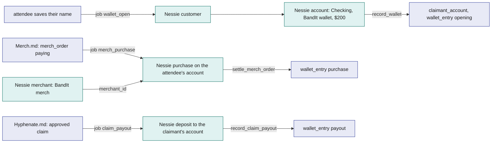
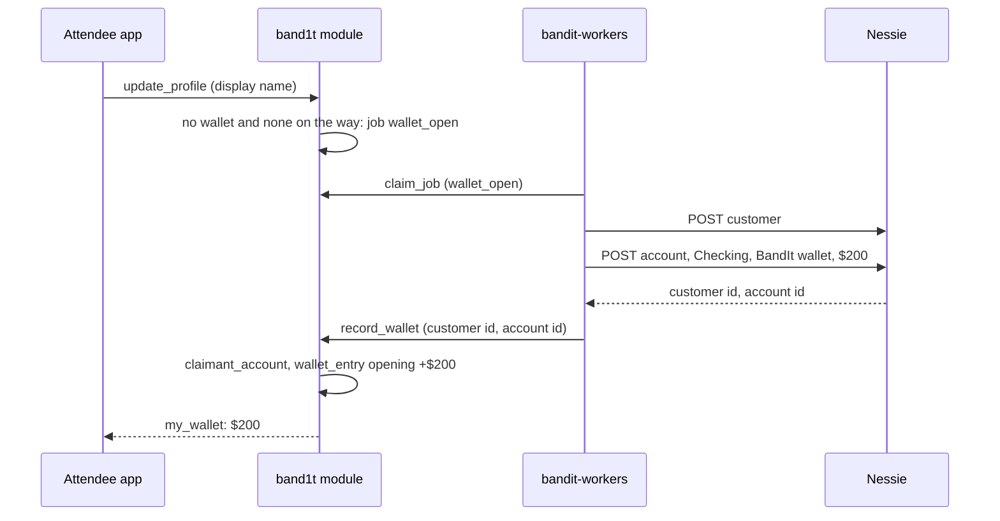
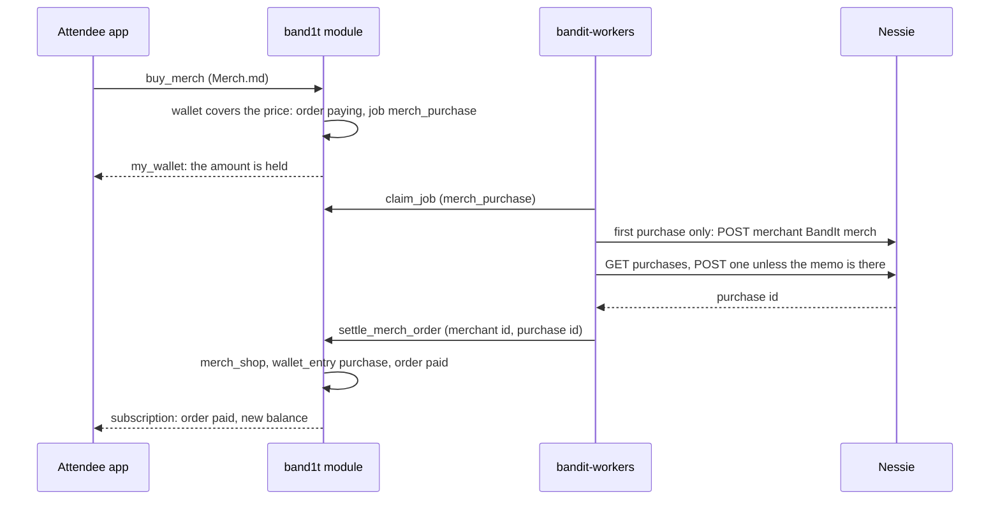

# Payments-Nessie

Payments-Nessie moves BandIt's money on Capital One's Nessie sandbox bank API. Every attendee gets a BandIt wallet: a Nessie customer and a checking account, opened with $200 when they save their display name. After the event they buy merch from it with one tap on their recap page ([Merch](../6-features/Merch.md)). Insurance claim settlements from [Hyphenate](Hyphenate.md) are paid into it as Nessie deposits. The Nessie sandbox records every purchase and deposit but never changes an account's balance, so the module keeps the wallet's own ledger, `wallet_entry`, and the balance the attendee sees is its exact sum. BandIt takes no payments at the venue: the firmware's PAY and PAID band states exist, but BandIt does not use them.

## Role in the system

Responsibilities:

- Open a wallet for every attendee when they save their display name: `update_profile` enqueues `wallet_open`, and `record_wallet` stores the account in `claimant_account` with a $200 `opening` entry.
- Keep the wallet ledger `wallet_entry`: the opening, minus each merch purchase, plus each claim payout. Show it through `my_wallet` (the balance) and `my_wallet_entries` (the movements).
- Give `buy_merch` the spendable balance, so it refuses what the wallet cannot cover in the same transaction ([Merch](../6-features/Merch.md)).
- Make every Nessie call from `bandit-workers`, through its `nessie` module: `wallet_open`, Merch.md's `merch_purchase` and Hyphenate.md's `claim_payout`.

Non-responsibilities:

- The templates, suggestions and orders: [Merch](../6-features/Merch.md). Claims, the payout amount and the claims ledger: [Hyphenate](Hyphenate.md).
- The wallet screen itself: [Attendee-App](../5-apps/Attendee-App.md). This file defines what it shows.
- Job leasing, retries and the reaper: [SpacetimeDB](../2-data/SpacetimeDB.md).

## Interfaces

| Interface | Direction | Who | What flows | Transport |
|---|---|---|---|---|
| `update_profile` | in | the attendee app, at the name step ([Attendee-App](../5-apps/Attendee-App.md)) | the display name; the module enqueues `wallet_open` with the name and 20000 cents, unless the attendee is simulated, already has a wallet, or has one on the way | reducer, then a module-internal call |
| `record_wallet` | in | role `worker` | job id, Nessie customer id, account id | reducer; writes `claimant_account` and the `opening` entry; rejects a stale lease |
| Merch.md: `settle_merch_order` | in | role `worker` | job id, merchant id, purchase id | reducer in Merch.md; adds the `purchase` entry |
| Hyphenate.md: `record_claim_payout` | in | role `worker` | job id, customer id, account id, deposit id | reducer in Hyphenate.md; stores the account if the claimant had none and adds the `payout` entry |
| Jobs `wallet_open`, `merch_purchase`, `claim_payout` | out | `bandit-workers` | payloads named below | `job` table, `claim_job`, `fail_job` |
| `my_wallet`, `my_wallet_entries` | out | Attendee app | the account id, the spendable balance and when the wallet opened; the entries, oldest first | subscription |
| Spendable balance | out | Merch.md's `buy_merch` | the sum of the caller's entries minus their merch orders still `paying` | module-internal call |
| Nessie REST API | out | `bandit-workers` | customers, accounts, merchants, purchases, deposits | HTTPS; base URL and api key from configuration; the key as the `key` query parameter |

## Design

### Nessie and how BandIt maps to it

Nessie is Capital One's hackathon banking sandbox. Every request carries the api key as the `key` query parameter, and creation calls return the new object's id. Amounts in Nessie are dollars as decimal numbers. The worker writes them from integer cents with integer division (2500 cents becomes `25.00`) and never uses floating point. The sandbox sets an account's balance when the account is created and never moves it afterwards, so BandIt never reads it.

| Nessie entity | Fields BandIt sets | BandIt row | Created by |
|---|---|---|---|
| Customer | `first_name`, `last_name` (the display name split at the first space; one word gets the last name "Claimant"), a placeholder address | `claimant_account.customer_id` | `wallet_open`; Hyphenate.md: `claim_payout` for a claimant with no wallet |
| Account (belongs to a customer) | `type` `Checking`, `nickname` "BandIt wallet", `rewards` 0, `balance` in whole dollars (200 for a new wallet) | `claimant_account.account_id`; the `opening` entry | `wallet_open`; Hyphenate.md: `claim_payout`, opened with 0 |
| Merchant | `name` "BandIt merch", `category` "Clothing", a placeholder address and geocode | Merch.md: `merch_shop.nessie_merchant_id` | the first `merch_purchase` |
| Purchase (on an account) | `merchant_id`, `medium` `balance`, `purchase_date`, `amount`, `status` `completed`, `description` (the memo) | Merch.md: `merch_order.nessie_purchase_id`; the `purchase` entry | `merch_purchase` |
| Deposit (on an account) | `medium` `balance`, `transaction_date`, `amount`, `status` `completed`, `description` (the memo) | Hyphenate.md: the claim's payout reference; the `payout` entry | `claim_payout` |

A Nessie merchant is a directory record, not an account. A purchase is recorded on the attendee's account, and nothing is credited on the Nessie side. The merch takings are the sum of the paid `merch_order` rows in BandIt.

The flowchart below answers one question: which BandIt row stands for which Nessie object, and which job creates it.

### The wallet

The attendee app saves the display name with `update_profile` ([Attendee-App](../5-apps/Attendee-App.md)). The reducer then enqueues `wallet_open` with the name and the opening amount, 20000 cents ($200, starting value). It skips simulated attendees, attendees who already have a wallet, and attendees whose `wallet_open` job is still open, so saving the name again queues nothing. The worker creates the customer and a `Checking` account named "BandIt wallet" with $200, then calls `record_wallet` with both ids. The reducer rejects a stale lease, writes the `claimant_account` row and adds an `opening` entry of +20000. BandIt opens a new account rather than linking an existing one, so every judge has a funded wallet, with no bank details typed and no screen of its own.

Hyphenate.md: `claimant_account` is defined in [Hyphenate](Hyphenate.md), which pays claims into it. The wallet writes the same row at sign-up, so claim payouts and merch purchases use one Nessie account per attendee. It holds every attendee's wallet.

| `claimant_account` field | Meaning |
|---|---|
| `identity` | The attendee; primary key |
| `customer_id`, `account_id` | The Nessie customer and account |
| `created_at` | When the wallet opened |

| `wallet_entry` field | Meaning |
|---|---|
| `id` | Assigned by SpacetimeDB |
| `identity` | Whose wallet |
| `kind` | `opening`, `purchase`, `payout` |
| `amount_cents` | Signed: money in is positive, money out negative |
| `memo` | For the wallet screen, for example "BandIt merch: Elastic mug" |
| `nessie_id` | The Nessie account, purchase or deposit |
| `created_at` | When |

The balance is the module's exact sum: the $200 opening, minus merch, plus claim payouts. `my_wallet` returns the account id, the spendable balance and when the wallet opened. Spendable means the sum of the entries minus the merch orders still `paying` ([Merch](../6-features/Merch.md)), so money already promised to a purchase cannot be spent twice. `my_wallet_entries` lists the entries, oldest first, for the wallet screen.

The sequence below answers one question: how a new attendee's wallet opens.

### Merch checkout

After the event the attendee buys merch from the bottom of their recap page with one tap ([Merch](../6-features/Merch.md)). `buy_merch` runs as the signed-in attendee: SpacetimeAuth gives the same SpacetimeDB identity on any device ([Attendee-App](../5-apps/Attendee-App.md)), so the attendee who taps is the attendee who pays. In the same transaction the reducer reads the caller's `claimant_account` and spendable balance, refuses anything the wallet cannot cover, writes the order as `paying` and enqueues `merch_purchase`.

The worker claims the job. On the first purchase the payload's merchant id is empty, so the worker creates the "BandIt merch" merchant and keeps its id in its data folder (`<data_dir>/nessie/merchant.json`). It then looks for a purchase on the account whose description equals the memo (`BandIt merch order <id>: <title>`). It reuses that purchase, or posts a new one. Then it calls `settle_merch_order` with the merchant id and the purchase id. That reducer stores the merchant in `merch_shop` once, adds the `purchase` entry and marks the order paid.

The sequence below answers one question: what happens, in which component, from the "Buy" tap to the paid order.

### Payouts

A payout is money to an attendee: a claim settlement from [Hyphenate](Hyphenate.md). When a claim is approved, Hyphenate.md enqueues `claim_payout` with the claim id, the claimant, their name, their wallet's customer and account ids, the amount and the memo `BandIt claim <id> payout`. The worker deposits the amount into the account, reusing a deposit with the same memo, and calls `record_claim_payout` ([Hyphenate](Hyphenate.md)). That reducer adds a `payout` entry, so the money shows in the attendee app with the claim's memo.

A claimant with no wallet (Simulator.md: every simulated claimant) gets a new Nessie customer and an account opened with 0 at payout time. The worker keeps their ids in `<data_dir>/nessie/claim-<id>.json` until `record_claim_payout` stores them as the claimant's `claimant_account`. A payout whose job fails 3 times leaves the claim waiting until a risk manager or adjuster calls `retry_claim_payout`, which queues the same job again.

### Retries

Every Nessie job is safe to retry, so the job's 3 attempts never create money twice:

- `wallet_open`: the customer and account made for a job are kept in `<data_dir>/nessie/wallet-job-<id>.json` until `record_wallet` stores them.
- `merch_purchase`: a purchase whose description equals the memo is reused, and the merchant id is kept in `merchant.json`.
- `claim_payout`: a deposit whose description equals the memo is reused, and the ids made for a claimant with no wallet are kept until the module stores them.

### The `nessie` module

A small module inside `bandit-workers`. It has a base URL and api key from configuration ([Rust-Backend](../3-services/Rust-Backend.md)), one call for each entity above, the cents-to-dollars conversion at the boundary, and a 30 s timeout per call. Its error messages never contain the request URL, so the key never reaches a log. It records nothing itself: the `job`, `wallet_entry` and feature rows are the record.

### Reducers and views

| Reducer or view | Role | Does |
|---|---|---|
| `update_profile` (core) | the attendee | after saving the name, enqueues `wallet_open` once |
| `record_wallet` | `worker` | writes `claimant_account` and the `opening` entry; rejects a stale lease |
| Merch.md: `settle_merch_order` | `worker` | adds the `purchase` entry |
| Hyphenate.md: `record_claim_payout` | `worker` | adds the `payout` entry, and the account for a claimant who had none |
| `my_wallet` | the attendee | account id, spendable balance, opened at |
| `my_wallet_entries` | the attendee | the entries, oldest first |

## Failure modes and fallbacks

| Failure | Effect | Design answer |
|---|---|---|
| Balance too low | The purchase cannot be covered | `buy_merch` refuses before any order or Nessie call; the app shows "not enough money in your BandIt wallet" |
| Nessie unreachable when the wallet opens | No wallet yet | The job retries within its 3 attempts; `buy_merch` says the wallet is still opening; once the job is dead, saving the name again queues a new `wallet_open` |
| Nessie unreachable during a purchase | The order stays `paying` | The job retries; after 3 attempts the order is `failed` and its money is free again, and the attendee can buy again |
| Nessie unreachable during a payout | The claimant is not paid yet | The job retries; after 3 attempts the claim waits for `retry_claim_payout` (Hyphenate.md) |
| A worker stops after Nessie answered | The job is leased again | The retry reuses the kept ids, the purchase or the deposit, so nothing is created twice |
| The sandbox balance never changes | Nessie shows the opening balance after every purchase | BandIt never reads it; the balance is the sum of `wallet_entry` |

## Dependencies

**Depends on**

- [SpacetimeDB](../2-data/SpacetimeDB.md): `attendee`, `staff_role`, `job`, the job reducers, `update_profile`.
- Hyphenate.md: the definition of `claimant_account`. Without Hyphenate.md, the table moves into this file unchanged ([Hyphenate](Hyphenate.md)).
- [Attendee-App](../5-apps/Attendee-App.md): the name step and the wallet view.
- [Rust-Backend](../3-services/Rust-Backend.md): `bandit-workers` and the Nessie base URL and key in its configuration.
- Nessie (external): sandbox availability and the api key.

**Used by**

- [Merch](../6-features/Merch.md): the wallet, the spendable balance and the `merch_purchase` work. Merch cannot run without this file.
- [Hyphenate](Hyphenate.md): the `claim_payout` work and the wallet's `payout` entry. Without this file, Hyphenate pays ledger-only.
- [Flows](../1-overview/Flows.md): the merch checkout and claim payout steps of the event.

**If you delete this file**

- Delete [Merch](../6-features/Merch.md) too: every order is paid from the wallet.
- Drop `wallet_entry`, `record_wallet`, the views `my_wallet` and `my_wallet_entries`, the job kind `wallet_open` and its call in `update_profile`, and the `nessie` module in `bandit-workers`.
- Remove the wallet view in Attendee-App.md.
- Remove the `claim_payout` job and `record_claim_payout` in Hyphenate.md; every payout becomes ledger-only. Drop `claimant_account` from Hyphenate.md too: without the wallet and `claim_payout`, nothing writes it.
- Remove the Nessie settings from Rust-Backend.md's process table and the Payments-Nessie.md row from its handler registry.
- Remove the Payments-Nessie.md registry rows in SpacetimeDB.md, the Nessie node, the prize row and the "Nessie is down" failure row in Architecture.md, the payment steps in Flows.md, and the Payments-Nessie row and node in README.md.

## Decisions

| Decision | Why |
|---|---|
| The wallet opens when the attendee saves their display name: `update_profile` queues `wallet_open`, with no screen of its own | Every judge has a funded wallet for merch and claim payouts, with nothing to type |
| Every new wallet opens with $200 | Enough for every template at once |
| The balance is the sum of `wallet_entry` in the module, never Nessie's balance | The sandbox never moves an account's balance; the module's sum is exact and live |
| `buy_merch` checks the spendable balance and holds the amount in the same transaction; orders still being paid count as spent | The sandbox's overdraft behaviour never matters, and two taps cannot spend the same money |
| Checkout is one tap, with no separate confirm call | `buy_merch` runs as the signed-in attendee, so the tap is the confirmation |
| BandIt takes no payments at the venue: no merchant terminal, no `merchant` role, no payment prompt on the band | The money moments are merch after the event and claim payouts; the band press stays for claiming a band |
| No venue receiving account; the purchase from the attendee's account is the money movement shown | One Nessie call per purchase, and the purchase is visible in the sandbox |
| There is no merchant table; the first purchase creates the "BandIt merch" Nessie merchant, and `merch_shop` keeps its id | Nothing to seed, and the merchant exists as soon as anyone buys |
| Every Nessie job is safe to retry, through kept ids and reuse by memo | A worker that stops after Nessie answered never opens a second account or buys twice |
| A claimant with no wallet gets a Nessie account at payout time | Every payout to a person goes through Nessie, so the wallet and the claims ledger agree |
| No refunds and no manual payouts; the only payout is a claim settlement through `claim_payout` | Hyphenate.md: a payout that fails waits until a risk manager or adjuster retries it with `retry_claim_payout` |
