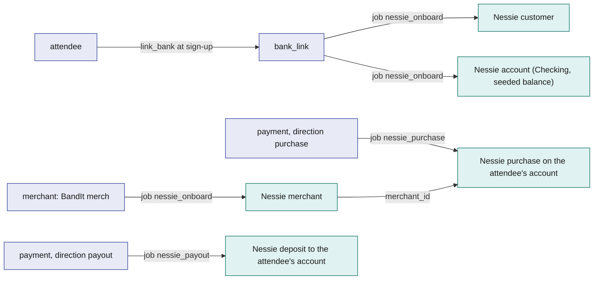
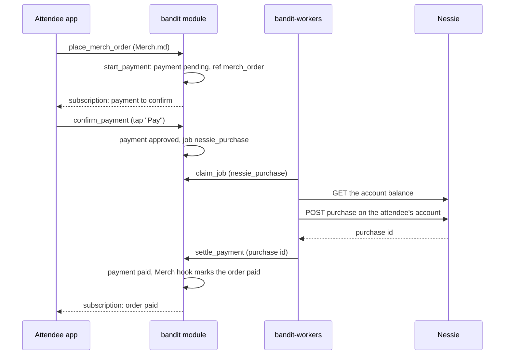
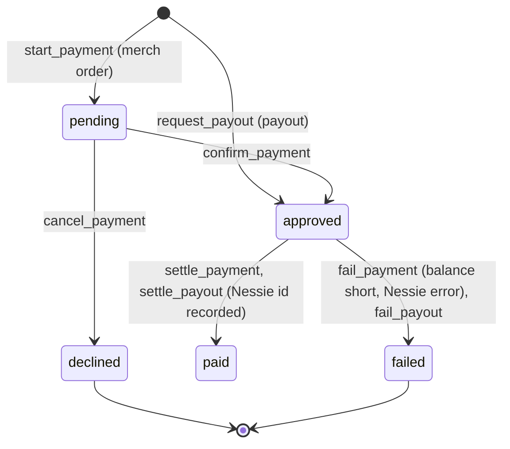

# Payments-Nessie

Payments-Nessie moves BandIt's money on Capital One's Nessie sandbox bank API. Every attendee gets a Nessie customer and a funded demo account at sign-up. After the event, an attendee buys merch on their recap page in the attendee app, confirms the payment there, and a worker records the purchase in Nessie. Insurance claim settlements from [Hyphenate](Hyphenate.md) are paid the same way, as Nessie deposits. BandIt takes no payments at the venue: the firmware's PAY and PAID band states exist, but BandIt does not use them.

## Role in the system

Responsibilities:

- Give every attendee a Nessie customer and a demo account at sign-up (`nessie_onboard`), and the BandIt merch `merchant` a Nessie merchant record.
- Own the `payment` lifecycle: pending, approved, paid, declined, failed.
- Settle merch purchases confirmed in the app, and claim payouts to attendees.
- Call Nessie only from `bandit-workers` (jobs `nessie_onboard`, `nessie_purchase`, `nessie_payout`) through the `nessie-client` crate.
- Expose `request_payout` so [Hyphenate](Hyphenate.md) can pay claimants without knowing Nessie.

Non-responsibilities:

- The merch templates, suggestions and orders: [Merch](../6-features/Merch.md). Claims and the ledger: [Hyphenate](Hyphenate.md).
- The wallet and confirm screens themselves: [Attendee-App](../5-apps/Attendee-App.md). This file defines what they call and show.
- Job leasing, retries and the reaper: [SpacetimeDB](../2-data/SpacetimeDB.md).

## Interfaces

| Interface | Direction | Who | What flows | Transport |
|---|---|---|---|---|
| `register_merchant` | in | `bandit-ingest` seed mode (role `ingest`; `ops` by hand), once | merchant name ("BandIt merch") and category | SpacetimeDB reducer; enqueues `nessie_onboard` (subject merchant) |
| `link_bank` | in | the attendee (own identity), called by the app right after the display name is saved ([Attendee-App](../5-apps/Attendee-App.md)) | nothing but the caller | reducer; creates `bank_link` pending, enqueues `nessie_onboard` (subject attendee) |
| `start_payment` | in | Merch.md's `place_merch_order`, inside the module | the attendee, amount in cents, memo, `ref_kind` (`merch_order`) and `ref_id` (the order id) | module-internal call; creates `payment` pending |
| `confirm_payment` | in | the paying attendee (own identity) | payment id | reducer; pending to approved, enqueues `nessie_purchase` |
| `cancel_payment` | in | the paying attendee, `ops` | payment id | reducer; only while `pending` |
| `request_payout` | in | module-internal, from Hyphenate.md | attendee id, amount in cents, `ref_kind` (`claim`), `ref_id` (the claim id), memo | internal call; creates `payment` direction payout, enqueues `nessie_payout` |
| `complete_bank_link`, `settle_payment`, `fail_payment`, `settle_payout`, `fail_payout` | in | role `worker` | job id plus Nessie ids or a failure reason | reducers; each rejects a stale lease |
| Jobs `nessie_onboard`, `nessie_purchase`, `nessie_payout` | out | `bandit-workers` | payloads named below | `job` table, `claim_job`, `complete_job`, `fail_job` |
| Nessie REST API | out | `bandit-workers` through `nessie-client` | customers, accounts, merchants, purchases, deposits | HTTPS to `api.nessieisreal.com`, api key as the `key` query parameter |
| Wallet and confirm views | out | Attendee app | the attendee's own `bank_link` and `payment` rows | subscription |
| Payment and payout callers | out | Merch.md (`ref_kind = merch_order`), Hyphenate.md (`ref_kind = claim`) | the result of a payment or payout, through one separable hook: Merch.md's in `settle_payment` and `fail_payment`, Hyphenate.md's in `settle_payout` and `fail_payout` | module-internal |

## Design

### Nessie and how BandIt maps to it

Nessie is Capital One's hackathon banking sandbox. Every request to `api.nessieisreal.com` carries the api key as the `key` query parameter, and creation calls return the new object's id. Amounts in Nessie are dollars as decimal numbers, so `nessie-client` converts integer cents to a two-decimal dollars string at the boundary and back, and never does arithmetic in floating point.

| Nessie entity | Fields BandIt sets or reads | BandIt row | Created by |
|---|---|---|---|
| Customer | `first_name`, `last_name`, `address` (placeholder venue address) | `bank_link.nessie_customer_id` | `nessie_onboard`, subject attendee |
| Account (belongs to a customer) | `type` (`Checking`), `nickname` ("BandIt wallet"), `balance`, `rewards`, `account_number` | `bank_link.nessie_account_id`; the seeded demo balance is recorded as `bank_link.seeded_cents` | `nessie_onboard`, subject attendee |
| Merchant | `name`, `category`, `address`, `geocode` | `merchant.nessie_merchant_id` | `nessie_onboard`, subject merchant |
| Purchase (on an account) | `merchant_id`, `medium` (`balance`), `purchase_date`, `amount`, `status`, `description` | `payment` with `direction = purchase`; the purchase id lands in `payment.nessie_ref` | `nessie_purchase` |
| Deposit (on an account) | `medium` (`balance`), `transaction_date`, `amount`, `status`, `description` | `payment` with `direction = payout`; the deposit id lands in `payment.nessie_ref` | `nessie_payout` |

A Nessie merchant is a directory record, not an account, so a purchase debits the attendee's account and nothing is credited on the Nessie side. The merch takings are the sum of the paid `payment` rows in BandIt. The debit from the attendee's account is the money movement the demo shows.

The flowchart below answers one question: which BandIt row stands for which Nessie object, and which job creates it.

### Onboarding at sign-up

The attendee app calls `link_bank` right after the display name is saved ([Attendee-App](../5-apps/Attendee-App.md)). The reducer writes a `bank_link` row in status `pending` for the caller and enqueues `nessie_onboard` with the attendee id. The worker creates the customer from the display name (split into first and last name; a single word becomes the first name and "BandIt" the last), creates a `Checking` account named "BandIt wallet" with an initial balance of 20000 cents ($200, starting value), and calls `complete_bank_link` with both ids. The row becomes `linked`. The demo creates an account rather than linking an existing one, so every judge has a funded wallet with no bank details typed. After three failed attempts the row is `failed`, and the wallet screen offers a retry that calls `link_bank` again.

The seed registers one merchant, "BandIt merch", with `register_merchant`, which writes a `merchant` row with `nessie_merchant_id` empty and enqueues `nessie_onboard` with the merchant id. Merch payments start only once that row has its Nessie id.

### Merch checkout

After the event the attendee orders merch from the bottom of their recap page ([Merch](../6-features/Merch.md)). The page runs in the session that the one-time link in the recap email opened, as the attendee's own SpacetimeDB identity ([Attendee-App](../5-apps/Attendee-App.md)), so the attendee who confirms is the attendee who pays. `place_merch_order` calls `start_payment` inside the module with the attendee, the amount, `ref_kind = merch_order` and the order id. `start_payment` checks that the attendee has a `linked` `bank_link`, then writes a `payment` with `direction = purchase`, `status = pending` and `started_at`. The app shows the amount and a "Pay" button. The attendee taps it, and the app calls `confirm_payment`, which the reducer accepts only from the paying attendee's identity. It sets `status = approved` and `approved_at`, and enqueues `nessie_purchase` with the payment id.

The worker claims `nessie_purchase` and reads the account balance. When the balance covers the amount, it posts the purchase on the attendee's account with the merch `merchant_id`, `medium` `balance`, the amount as dollars, and `description` "BandIt payment <payment id>", then calls `settle_payment` with the purchase id. The reducer rejects a stale lease, sets `status = paid`, `paid_at` and `nessie_ref`, and runs the Merch hook, which marks the order paid. When the balance is short, the worker calls `fail_payment` with reason `insufficient_funds` and posts nothing.

The sequence below answers one question: what happens, in which component, from the "Pay" tap to the paid order.

### Payment status

The state diagram below answers one question: which statuses can a payment have and what moves it between them.

`failed` is final for that row: the app offers "try again", which starts a new payment for the same order.

### Payouts

A payout is money to an attendee: a claim settlement from [Hyphenate](Hyphenate.md). `request_payout` writes a `payment` with `direction = payout`, the attendee, the amount, `ref_kind` `claim` and the claim id as `ref_id`, already in `status = approved` because receiving money needs no confirmation, and enqueues `nessie_payout`. The worker posts a deposit on the attendee's account with `description` "BandIt payout <payment id>: <memo>", so the deposit shows in the attendee app's wallet with the claim's memo, and calls `settle_payout`; after three failed attempts it calls `fail_payout`. Both reducers end with Hyphenate.md's separable hook, which posts its cash journal and moves the claim on. A payout to an attendee with no `linked` `bank_link` fails at once with `no_wallet`; Hyphenate.md then pays ledger-only. Simulator.md: simulated attendees have no wallet, so Hyphenate.md posts their payouts ledger-only and never calls `request_payout` for them.

### The `nessie-client` crate

A small Rust crate used only by `bandit-workers`: a base URL and key from configuration ([Rust-Backend](../3-services/Rust-Backend.md)), typed request and response structs for the five entities above, cents-to-dollars conversion at the boundary, a timeout per call, and error types that separate "Nessie said no" (do not retry: bad request) from "could not reach Nessie" (retry under the job's attempts). It records nothing itself; the `payment` row and the `job` row are the record.

### Tables

| Table | One row is | Fields |
|---|---|---|
| `merchant` | the Nessie merchant record for BandIt merch | `id`, `name`, `category`, `nessie_merchant_id`, `onboard_job_id`, `active`, `created_at` |
| `bank_link` | an attendee's Nessie customer and account | `attendee_id` (unique), `status` (`pending`, `linked`, `failed`), `nessie_customer_id`, `nessie_account_id`, `seeded_cents`, `onboard_job_id`, `linked_at` |
| `payment` | one purchase or one payout | `id`, `direction` (`purchase`, `payout`), `attendee_id`, `merchant_id` (purchase), `amount_cents`, `memo`, `status`, `ref_kind`, `ref_id`, `started_at`, `approved_at`, `paid_at`, `decline_reason`, `failure_reason`, `nessie_ref`, `job_id` |

### Reducers

| Reducer | Role | Does |
|---|---|---|
| `register_merchant` | `ingest`, `ops` | merchant row, `nessie_onboard` job |
| `link_bank` | the attendee | `bank_link` pending, `nessie_onboard` job |
| `complete_bank_link` | `worker` | records Nessie ids, `linked`; rejects a stale lease |
| `start_payment` | module-internal (Merch.md) | checks the wallet, `payment` pending |
| `confirm_payment` | the paying attendee | pending to approved, `nessie_purchase` job |
| `cancel_payment` | the paying attendee, `ops` | pending to declined, reason `cancelled` |
| `settle_payment` | `worker` | approved to paid, `nessie_ref`; Merch hook; rejects a stale lease |
| `fail_payment` | `worker` | approved to failed with a reason (`insufficient_funds` or Nessie's message); Merch hook |
| `request_payout` | module-internal (Hyphenate.md) | payout row approved, `nessie_payout` job |
| `settle_payout`, `fail_payout` | `worker` | payout paid or failed; Hyphenate hook |

## Failure modes and fallbacks

| Failure | Effect | Design answer |
|---|---|---|
| Balance too low | the purchase cannot be covered | the worker calls `fail_payment` with `insufficient_funds` before any Nessie purchase; the app shows "not enough money in your BandIt wallet" |
| Nessie unreachable | approved but not recorded | the job retries within its 3 attempts and then fails the row; the app offers to pay again, and Hyphenate flags the claim |
| Wallet not created at sign-up | the attendee cannot pay | `start_payment` refuses with `no_wallet`; the wallet screen retries `link_bank` |

## Dependencies

**Depends on**

- [SpacetimeDB](../2-data/SpacetimeDB.md): `attendee`, `staff_role`, `job`, the job reducers.
- [Attendee-App](../5-apps/Attendee-App.md): the `link_bank` call at sign-up, the wallet view, the "Pay" confirm screen.
- [Rust-Backend](../3-services/Rust-Backend.md): `bandit-workers` shell and the Nessie key in configuration.
- Nessie (external): sandbox availability and the api key.

**Used by**

- [Merch](../6-features/Merch.md): `start_payment` with `ref_kind = merch_order`, and the Merch hooks. Without this file, Merch orders are recorded without payment.
- [Hyphenate](Hyphenate.md): `request_payout` for claim settlements. Without this file, Hyphenate pays ledger-only.
- [Flows](../1-overview/Flows.md): the merch checkout and claim payout steps of the demo.

**If you delete this file**

- Drop `merchant`, `bank_link`, `payment`, the reducers above, the job kinds `nessie_onboard`, `nessie_purchase`, `nessie_payout`, and the `nessie-client` crate.
- Remove the `link_bank` call, the wallet view and the "Pay" confirm screen in Attendee-App.md.
- Remove the `request_payout` bullets in Hyphenate.md (payout becomes ledger-only) and the payment bullets in Merch.md (orders become `recorded`).
- Remove the Nessie key from Rust-Backend.md's secrets list, the Payments-Nessie.md row from its handler registry and the `nessie-client` row from its crate table, with the `NessieC` node in its workspace diagram.
- Remove the Payments-Nessie.md registry rows in SpacetimeDB.md, the Nessie node, the prize row and the "Nessie is down" failure row in Architecture.md, the payment steps in Flows.md, and the Payments-Nessie row and node in README.md.

## Decisions

| Decision | Why |
|---|---|
| `bandit-workers` reads the account balance before each purchase and ends the payment with `fail_payment` reason `insufficient_funds` when it is short | the sandbox's overdraft behaviour never matters |
| BandIt takes no payments at the venue: no merchant terminal, no `merchant` role, no payment prompt on the band | the money moments are merch after the event and claim payouts; the band press stays for claiming a band and a profile |
| No venue receiving account; the purchase from the attendee's account is the money movement shown | one Nessie call per payment, and the debit is visible in the sandbox |
| Every payment is confirmed in the attendee app with `confirm_payment`, in the session the recap link opened | after the event the bands are returned; the one-time recap link signs the attendee in as their own identity, so that session proves who is paying |
| Every attendee gets a funded demo account at sign-up, created by `nessie_onboard` | the wallet is ready when merch is bought and when a claim pays out |
| One merchant row, "BandIt merch", registered in the seed | a Nessie purchase needs a merchant id, and merch is the only thing BandIt sells |
| No refunds and no manual payouts; the only payout is a claim settlement through `request_payout` | the demo's money moments are the merch checkout and the claim payout; a payout that fails is recorded ledger-only by Hyphenate.md's `mark_claim_paid_manually` |
