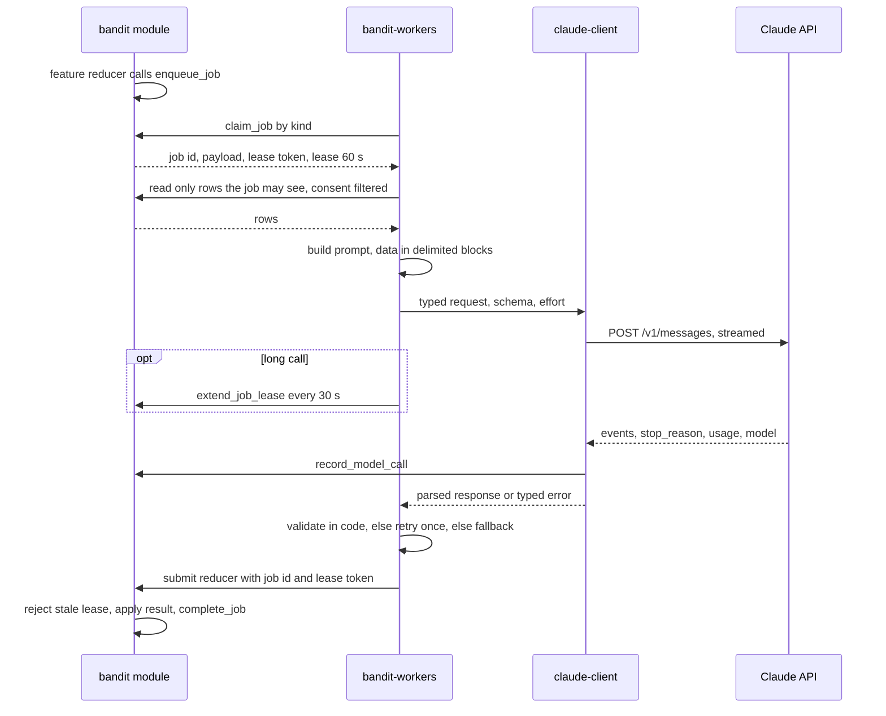
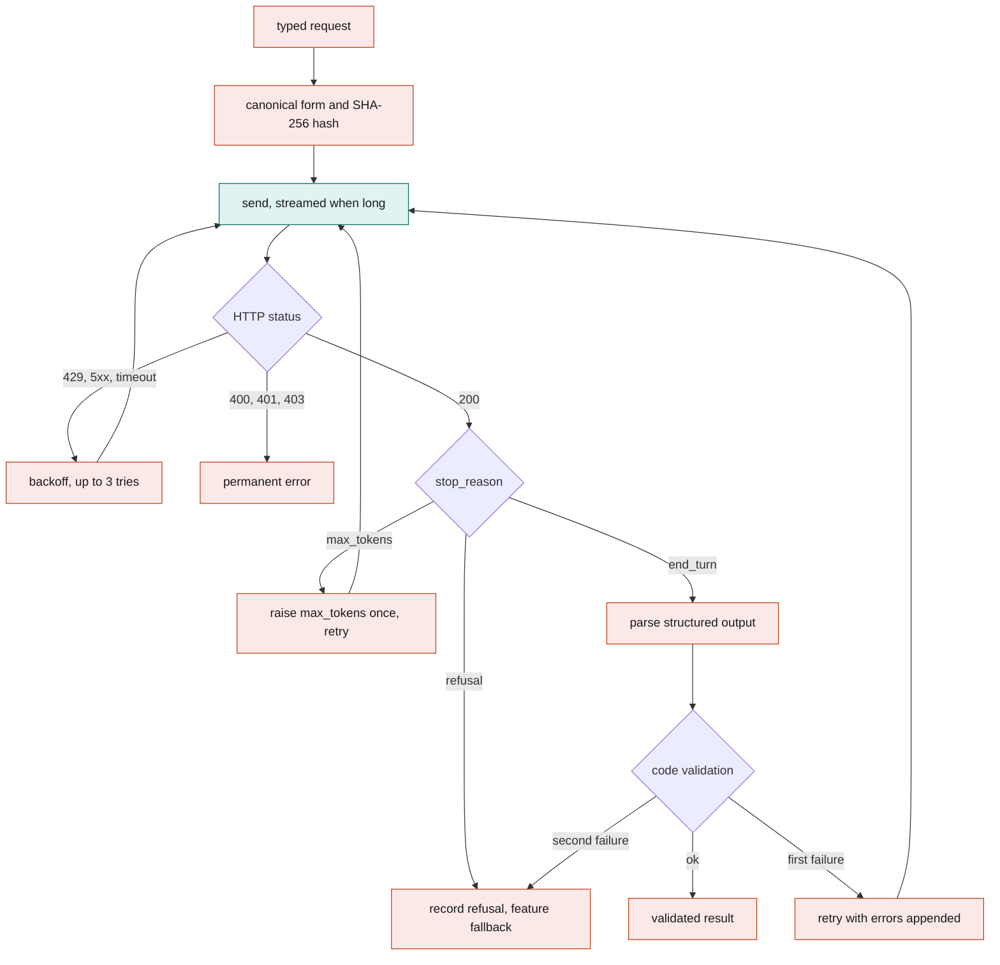
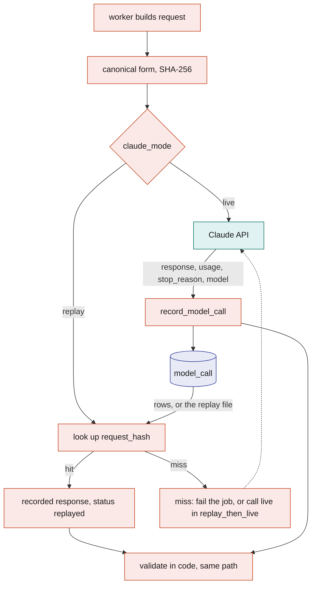

# Anthropic Agent

BandIt uses Claude to read and write words where code alone would be clumsy: reading a medical PDF into a card, turning a scraped page into booth rows, drafting a claim or a recovery letter, writing a design brief for a piece of merch, telling an attendee the story of their night, and, in the proposed vision design (TBD -- LEO), judging what a few camera frames show after a band has already raised the alarm. Every call goes through one Rust crate, `claude-client`, and every call is made by a Rust worker from a `job` row or an event, never from the safety loop. Each call is recorded in `model_call`, so the demo can run offline from recordings and a rerun gives the same bytes. The model reads and writes words; code decides money, coverage, safety and access.

## Role in the system

Responsibilities:

- Own the `claude-client` crate: the only code in BandIt that talks to the Claude Messages API.
- Define how a Claude job runs inside `bandit-workers`: claim, gather, prompt, call, validate, submit.
- Own the catalogue of Claude use cases: trigger, inputs, output, model and effort, validation, and the fallback when the model is unavailable.
- Own the `model_call` table, the request hash, and the record and replay modes.
- Own the guardrails that every Claude use case obeys.

Non-responsibilities:

- It never runs inside the `bandit` module and never inside the safety loop ([Safety](Safety.md)). SpacetimeDB 2.x procedures can make outbound HTTP calls, but they block private and loopback addresses and keep secrets in plain module environment, so the decision is: no procedures on the live path, every external call stays in a Rust worker.
- It does not decide anything that moves money, settles coverage, grants access or changes a band's state. Those decisions are reducers with code-only rules ([Payments-Nessie](Payments-Nessie.md), [Hyphenate](Hyphenate.md), [Medical-ID](Medical-ID.md), [SpacetimeDB](SpacetimeDB.md)).
- It does not own the job queue (`job`, `claim_job`, `complete_job`, `fail_job`, `extend_job_lease`, `job_reaper` are in [SpacetimeDB](SpacetimeDB.md)) or the worker process shell ([Rust-Backend](Rust-Backend.md)). It owns only what happens between claiming a Claude job and submitting its result.
- Camera and photo analysis is Vision (TBD -- LEO), see [Vision](Vision.md). The proposed `bandit-vision` process uses this crate and records in `model_call`, but what it sends and when is Leo's decision; this file lists only the proposed shape. No social or merch job sends pixels: they receive photo ids, captions and counts.
- Elastic's organizer agent (`bandit-organizer`) has its own LLM inside Elastic Agent Builder ([Elastic](Elastic.md)); this component only documents the optional use of Claude as that agent's LLM.

## Interfaces

| Direction | Who | What flows | Transport |
|---|---|---|---|
| In | `bandit` module, `job` table | Claude jobs of kinds `medical_extract`, `claim_draft`, `recovery_letter`, `merch_design`, `summary_story`, claimed by kind with `claim_job`; payload names the rows the job is about | SpacetimeDB SDK (worker role `worker`) |
| In | Feature tables | The rows a job is allowed to read after consent filters: `medical_document` and `blob_ref` (Medical-ID), `incident`, `incident_snapshot`, `incident_note`, `evidence_fact` (Hyphenate), `visit`, `encounter`, `photo`, `photo_tag`, `social_handle` (Social), `booth`, `schedule_slot`, `zone`, `merch_product` (Merch, BrightData) | SpacetimeDB subscription or one-off query from the worker |
| In | `bandit-api` blob store | PDF bytes for `medical_extract`, looked up by `blob_ref` | HTTPS from the worker, service token |
| In | `bandit-ingest` | Calls `claude-client` directly for `floorplan_check` and, only without Elastic.md, `scrape_extract` at ingest time (no job row); records with role `ingest` | In-process |
| In | `bandit-vision` (TBD -- LEO) | Calls `claude-client` directly for event judgments and after-event photo tagging; records with role `vision` | In-process |
| In | Worker configuration ([Rust-Backend](Rust-Backend.md)) | API key `ANTHROPIC_API_KEY`, `claude_mode` (`live`, `replay`, `replay_then_live`), optional replay file path | Environment |
| Out | Claude API | Messages API requests: `POST /v1/messages`, `/v1/messages/batches`, `/v1/files`; streaming responses | HTTPS, API key header, `anthropic-version` header `2026-10-21` |
| Out | `bandit` module | `record_model_call` (one row per attempt), then the feature's submit reducer with the job id and lease token: `apply_medical_extract` (Medical-ID), `attach_claim_letter` (Hyphenate, one reducer for every letter kind), `submit_merch_design` (Merch), `submit_summary_story` (Social); then `complete_job` or `fail_job` | SpacetimeDB SDK |
| Out | `bandit` module | `extend_job_lease` while a call or a pending batch outlives the 60 s lease | SpacetimeDB SDK |
| Out | `bandit` module | `heartbeat` every 5 s (owned by [Rust-Backend](Rust-Backend.md)); the Claude loop adds counters for calls, replays, refusals and failures | SpacetimeDB SDK |
| Out | Elastic (optional) | Nothing at run time. If the organizer agent's LLM is Claude, the `chat_completion` inference endpoint is configured in Elastic with its own key and never passes through `claude-client` | Elastic configuration |

Submit reducer names belong to their feature docs; the names above are the owners' names. Each submit reducer rejects a lease that is not the current one, so a slow duplicate worker cannot overwrite a newer result.

## Design

### The `claude-client` crate

There is no official Anthropic Rust SDK, so `claude-client` is a small crate over an HTTPS client that speaks the Messages API directly. It does one thing well: take a typed request, return a typed and validated response, and never surprise the caller. Its features, and why each exists:

| Feature | What it does | Why |
|---|---|---|
| Typed request | Model, system prompt blocks, user content blocks (text, `document`, `image`, file reference), `output_config` (effort, structured output format), `max_tokens`, optional `fallbacks`, beta headers. API version `2026-10-21`. The crate has no fields for sampling parameters (`temperature`, `top_p`, `top_k`) because this API version rejects them | Every job builds the same shape, so caching and hashing work the same way everywhere |
| Streaming | Server-sent events for any request whose `max_tokens` is above 4,000 (starting value, calibrate) or whose output is expected to run to paragraphs; the crate assembles the final message and exposes a progress callback | Long outputs would otherwise hit HTTP timeouts; the callback is also where the worker extends its lease |
| Retries with backoff | Retries on 429, 408, 409, 5xx (including 529 overloaded) and connection errors; honours the `retry-after` header when present, else exponential backoff with jitter starting at 1 s; 3 tries per attempt (starting value, calibrate) | Rate limits and overloads are normal during a bulk run; a 400 is never retried because the request itself is wrong |
| Timeouts | Connect timeout 10 s, first-byte timeout 30 s, idle timeout between stream events 30 s, and a total budget per job kind (45 s starting value, calibrate). A kind marked long calls `extend_job_lease` every 30 s from the progress callback while the call runs | A hung call must not outlive its lease silently, or a second worker will claim the same job |
| Refusal handling | Checks `stop_reason` before reading content; a `refusal` carries `stop_details` with a category. Requests opt into the server-side fallback option (`fallbacks` set to `default` under the `server-side-fallback-2026-07-01` beta header), which reroutes by category; the response's `model` field says which model answered and is recorded | A refusal is a normal outcome, not an error; the feature then uses its template fallback |
| Structured outputs | A JSON schema in `output_config.format`; the response is parsed into the job's Rust type and then validated by code (ids exist, enums allowed, lengths fit, amounts equal the given cents) | Forced tool choice is not available on this model, so extraction uses structured outputs; the schema guarantees shape, and only code can guarantee truth |
| Prompt caching | `cache_control` breakpoints after the stable system prompt and schema, and after any stable catalogue (merch template library, coverage vocabulary, a reference frame for vision); volatile data follows the last breakpoint | The stable prefix is identical across jobs of a kind, so repeated calls pay for it once per cache window |
| PDF input | A PDF goes in as a `document` block, either inline base64 or by Files API id | The medical card is read from the PDF itself, with page references |
| Image input | JPEG or PNG images as `image` blocks, inline base64, resized by the caller before the call (1280 by 720 proposed for vision frames). Frames are never uploaded to the Files API because that store is not eligible for zero data retention | Used by `bandit-ingest` for `floorplan_check` and by `bandit-vision` (TBD -- LEO) |
| Files API | Uploads the medical PDF once and reuses it by id; the worker keeps a local cache from blob SHA-256 to file id, and falls back to inline base64 when the upload fails | Retries and re-extractions do not resend the bytes |
| Message Batches | Groups non-urgent requests into one batch at lower cost, keyed by `custom_id` equal to the job id, and polls until the batch ends | All post-event stories at once cost half and need no latency; after-event photo tagging (TBD -- LEO) can use the same path |
| Recording | Every attempt, success or failure, produces a `model_call` row through the record hook | Audit and replay |
| Replay | In `replay` mode the crate serves a response from a recorded `model_call` by request hash without touching the network | Offline demo, identical reruns |

Settings fixed for every call: model `claude-opus-5-5`; adaptive thinking (it cannot be turned off on this model, so effort is the only lever); `output_config.effort` set explicitly per job kind because the model's default is `medium`; thinking display omitted (reasoning is not stored); no assistant prefill, no forced tool choice and no sampling parameters (all three are rejected). No BandIt job uses tools: each job is one request and one response, which keeps the model from acting on anything.

Claude cannot generate or edit images, so the crate has no image output path. Merch designs are composited in Rust from templates and chosen photos ([Merch](Merch.md)); Claude only writes the brief.

Choosing a cheaper model for a high-volume route such as bulk `summary_story` is a later call for Viktor; the default is `claude-opus-5-5` everywhere, with effort as the cost control.

### How `bandit-workers` runs a Claude job

The question this diagram answers: what happens between a feature reducer enqueuing a job and its result landing in a table.

Step by step:

1. **Claim.** The worker runs one loop per job kind it is configured for and calls `claim_job` with that kind. It receives the job id, payload and a lease token. The lease is 60 s and `job_reaper` returns expired leases to the queue, so everything below either finishes inside it or extends it.
2. **Gather.** The payload names rows, not facts. The worker reads the rows through its own SpacetimeDB connection, which carries the `worker` role. Consent filters are applied here, before any text is assembled: for example `summary_story` drops encounter counterparts who are not connected to the attendee, `merch_design` drops anyone whose `merch` consent is off, and `medical_extract` reads only the document named in the job. Rows the job is not allowed to see never reach the prompt, so the model cannot leak what it was never given.
3. **Prompt.** The system prompt for the kind is a fixed text in the crate: the task, the output schema, and the standing rule that everything in the user turn is data. Rows go into the user turn as clearly delimited blocks with field names. The builder sorts rows by id and formats times from the rows, never from the wall clock, so the same job always produces the same bytes and the same request hash.
4. **Call.** `claude-client` makes the request with the kind's effort and `max_tokens`, streaming when the kind calls for it. A kind marked long (`medical_extract` with a large PDF, batch delivery) calls `extend_job_lease` every 30 s while it waits.
5. **Validate.** The response is parsed into the kind's type and checked by code. On a validation failure the worker retries once with the validation errors appended to the user turn; on a second failure it submits the kind's fallback instead (see the catalogue).
6. **Submit.** The worker calls the feature's submit reducer with the job id, the lease token and the validated result. The reducer checks the lease, applies the result in the same transaction, and calls `complete_job`. If the lease is stale the reducer rejects the call and the worker drops its result.
7. **Fail.** Any error the crate classifies as permanent (400, 401, 403, a second validation failure with no fallback) ends with `fail_job` and a reason. After 3 attempts the job is `dead` and the feature shows its no-AI state.

### Inside one call

The question this diagram answers: how one request becomes either a validated result or a clean fallback.

### Use-case catalogue

Every use case runs on `claude-opus-5-5`. Effort is set per job and is the first cost lever. Outputs are structured (JSON schema) unless the row says otherwise, and every output is validated by code before a reducer sees it. Each row starts with the file that owns it, so deleting that file means deleting that row.

| Owner and use case | Trigger | Inputs (after filters) | Output | Effort | Code validation | Fallback without AI |
|---|---|---|---|---|---|---|
| [Medical-ID](Medical-ID.md) `medical_extract` | Attendee uploads a medical PDF; the upload flow enqueues the job | The PDF as a document block (Files API id or inline), the attendee's display name, the card schema | A draft medical card: allergies, conditions, medications, blood type, emergency contact, each with the page it came from and a confidence; fields not found are left empty, never guessed | `medium` | Schema; enum values; page references within the page count; the attendee confirms the draft in the app before a medic can ever see it | Manual entry form in the attendee app; the card is typed by the attendee |
| [BrightData](BrightData.md) `scrape_extract` | `bandit-ingest` assembles a bundle without Elastic.md, or a section the organizer failed; one call per organisation, in the ingest process, not the queue. With Elastic present the organizer owns this merge and the call never runs | That organisation's parsed records: the site record from Bright Data `extract`, the LinkedIn company and Crunchbase company facts; the organisation schema and the fixed category list | One description and one tag set merged from the given records, with the record each sentence came from; typed fields copied from the dataset record; nulls where unknown | `low` | Schema; every fact traces to one of the given records; the category is from the fixed list; it never merges two organisations (that is a rules join by domain) | Rules: the site description used as is, dataset facts fill the typed fields, tags from the site's own keywords |
| [BrightData](BrightData.md) `floorplan_check` | `bandit-ingest` reaches the last rung of its booth-map ladder: no interactive floor-plan JSON and no vector PDF, only a raster image; runs in the ingest process, not the queue | One hall's raster floor plan as an image block (one hall per page, resized to fit the image limits), the OCR results as booth numbers with text boxes and coordinates, and the scraped booth list | For each OCR booth number: confirmed or not, the confirmed position on the page in image coordinates and a confidence, or null when the plan does not support the OCR reading; booth numbers the OCR missed are listed as unreadable, never guessed | `medium` | Schema with nullable positions; every position inside the page bounds; every booth number either present in the OCR text or flagged unreadable; code then normalises coordinates to metres, joins booths by number and assigns each to the nearest station zone; nulls and leftovers are fixed by hand in the Ops dashboard's booth fix-up panel (BrightData.md) | OCR positions only, with manual placement in the booth fix-up panel |
| [Hyphenate](Hyphenate.md) `claim_draft` | `open_claim` enqueues the job | The incident, its snapshot, staff notes, the evidence facts and the amounts already computed by code, the policy vocabulary | A claim narrative and a first notice of loss letter that cite only the given facts by id | `high` | Schema; every cited fact id exists in the pack; every dollar figure in the letter appears in the job payload; a named approver reads it before anything is sent | Template letter with the facts and amounts filled in by code |
| [Hyphenate](Hyphenate.md) `recovery_letter` | Ops requests recovery for a `property` incident | The property event, its evidence facts, the vendor or responsible party on record, the cost in cents | A letter worded as a query, not an accusation, asking the party to confirm what happened and how the cost is handled | `medium` | Schema, including a `stance` field that must be `query`; every cited fact id exists; every dollar figure in the letter appears in the job payload; a letter that assigns fault is rejected: code scans the text against a fixed list of fault-assigning phrases and any hit fails validation; staff approve before sending | Template letter |
| [Merch](Merch.md) `merch_design` | `request_merch_design` enqueues the job | Facts about the picked memory (booth and schedule text, zone, times), the names of connected people who allow `merch`, confirmed photo ids with captions when present, the template library with its slots, the product's print area | A design brief: concept, title, subtitle, date line, palette id, template id, and which photo id and text fills each slot. The worker composites the SVG and mockups in Rust; the model never writes markup or pixels | `high` | Schema; template and palette ids in the library; text fits each slot's length; only given photo ids and names appear | Template with the attendee's name, the zone or booth name and the date |
| [Social](Social.md) `summary_story` | `request_summary_story` by the attendee, or `request_summary_stories` by ops for everyone after the event (batch delivery) | Timeline of zones, visits with booth text, encounter counterparts (connected ones by display name, others as "someone"), photo count, top zones | A short second-person story of the night in a few sections, plus one-line captions for the top three moments | `medium` | Schema; section lengths; only given names appear; no handles | A templated recap built from the same rows ("You spent 40 minutes at ...") |
| [Elastic](Elastic.md) Claude as the organizer agent's LLM (optional) | `bandit-ingest` runs the `bandit-organizer` agent once per import, inside an Elastic Workflow, after the workflow's fixed `LOOKUP JOIN` steps | The records the joins left unmatched, the results of the agent's fixed tools over the raw scraped indices of that run, and at most 10 gap-fill fetches through Bright Data's MCP | The bundle sections as structured output against a JSON schema, which `bandit-ingest` validates again in Rust | Elastic's managed LLM by default; if the Serverless plan caps it, an external `chat_completion` endpoint set to `claude-opus-5-5`; these calls are made by Elastic and are not in `model_call` | Schema in the workflow step, Rust validation, unknown source keys rejected, a reason recorded per merge | Rules plus `scrape_extract` in `bandit-ingest` |
| [Vision](Vision.md) event judgment (TBD -- LEO) | Leo decides. Proposed: an incident opens from a band SOS or fall flag, the local detector flags a person down, or staff press the property button; never on a timer | Proposed: 6 to 8 frames from a 10 s ring buffer around the moment, resized to 1280 by 720, inline base64; the detector's boxes and a pose summary as text; the band rows for the zone | Proposed: confirmed yes or no, confidence, description, recommended action, a staff report and an insurance-ready incident description, written through `submit_vision_assessment` into `vision_assessment` | Proposed `medium`, with the server-side fallback option | Proposed: schema; confidence in range; incident id matches; the band's own alert never waits for it | The incident proceeds on band data alone, as it does today |
| [Vision](Vision.md) `photo_features` (TBD -- LEO) | Leo decides. Proposed: photographer uploads queue a `photo_features` job that `bandit-vision` claims with the `vision` role and runs after the event through Message Batches | Proposed: the photo, the candidate bands for that zone and time, and, with the proposed IDENT per-band colour firmware extension, the colour each band showed | Proposed: how many people, where they stand, which ring colours show, written through `submit_photo_features`; identity always comes from bands, never faces | Proposed `medium` | Proposed: schema; count caps; colours limited to the palette the bands can show | Candidates by zone and time with a default cap ([Social](Social.md)) |

Three notes on inputs. The medical PDF is the only binary a queued job receives, and it goes to the model as a document, never as text pasted by code, so page references are the model's own; `floorplan_check` at ingest time sends one raster page, and the proposed vision calls send frames. Social and merch jobs never send photos: `merch_design` and `summary_story` receive photo ids, captions and counts, and the captions come from the photographer or from Vision (TBD -- LEO). In the proposed vision design there is no periodic Claude loop: counting and person-down detection run locally on every frame (`report_zone_count`, `report_ground_alert`), and Claude is asked only after an event, so its latency never sits in front of an alert.

### Message Batches and the job lease

A batch can take up to a day to end, and a job lease lasts 60 s, so batch delivery leans on `extend_job_lease`. A job whose payload says `delivery` is `batch` runs like this: the worker claims it, builds the request, and adds it to the batch it is collecting; after 20 s of collecting or 100 requests (starting values, calibrate) it submits the batch and writes a `model_call` row per request with status `submitted`, the batch id and the `custom_id`. While the batch runs, the worker holds every lease in it, calling `extend_job_lease` every 30 s, and polls the batch every 60 s (starting value, calibrate). When the batch ends it takes each result by `custom_id` and continues at the validate step. If the worker dies, the leases expire, `job_reaper` requeues the jobs, and the next claimer finds the `model_call` row with status `submitted` and resumes polling the same batch instead of resubmitting, so a batch is never paid for twice. A batch result that is errored or expired falls back to one live streamed call for that job.

### Recording and replay

Every attempt writes one `model_call` row through `record_model_call` (roles `worker`, `ingest` and `vision`). The row is the audit trail and the replay source.

| Field | Meaning |
|---|---|
| `id` | Assigned by SpacetimeDB |
| `job_id` | The job, empty for ingest-time and vision event calls |
| `source` | `worker`, `ingest` or `vision` |
| `kind` | The use case (`medical_extract`, `vision_assessment`, ...) |
| `attempt` | The job attempt this call belonged to |
| `model_requested`, `model_used` | What was asked for and what answered (they differ after a server-side fallback) |
| `effort` | The effort level sent |
| `request_hash` | SHA-256 of the canonical request (see below) |
| `request_blob` | Optional `blob_ref` holding the full request for audit; omitted for `medical_extract` and for vision calls, whose frames are referenced by `vision_assessment` instead |
| `response` | The final message as text, including the structured output; for `medical_extract` a `blob_ref` of access class `owner_only` instead ([Medical-ID](Medical-ID.md)) |
| `stop_reason`, `stop_category` | `end_turn`, `max_tokens`, `refusal`; the refusal category when present |
| `input_tokens`, `output_tokens`, `cache_read_tokens`, `cache_write_tokens` | Usage as reported |
| `latency_ms` | Wall time of the call |
| `status` | `ok`, `refusal`, `error`, `submitted` (batch pending), `replayed` |
| `batch_id`, `custom_id` | For batch delivery |
| `replay_of` | The `model_call` this one was served from, in replay mode |
| `created_at` | When the row was written |

The canonical request is the request body with volatile parts removed and stable parts normalised: field order fixed, whitespace collapsed, inline binaries (PDF pages, image frames) replaced by their SHA-256, file ids replaced the same way, and no timestamps unless they are facts from rows. Two jobs that see the same rows therefore hash the same, which is what makes replay deterministic, and a recorded vision judgment replays as long as the same frames are sent.

The question this diagram answers: how a recorded call is served again without the network.

Modes, set in the worker's configuration:

- `live`: call the API and record.
- `replay`: serve from `model_call` by `request_hash`; a miss fails the attempt with a clear reason, and the feature's fallback applies. The network is never used. This is the demo mode.
- `replay_then_live`: serve on a hit, call and record on a miss. Rehearsal mode.

Replays write their own `model_call` row with status `replayed` and `replay_of`, so the audit trail shows what the demo actually did. Because a fresh database has no `model_call` rows, the worker can also load a replay file exported before the demo (one recorded call per line, same fields); the file is part of the demo's seed set so Maincloud and the laptop fallback replay identically.

### Guardrails

- **Never in the safety loop.** No reducer on the band or incident path waits on a job or an event call, and the worker roles cannot write `band_directive`, `band_command`, `incident` or `zone_state`. A vision judgment (TBD -- LEO) arrives after the bands have already reacted and only adds a `vision_assessment` row.
- **The model never decides money, coverage, safety or access.** Amounts are computed by code and handed to the model as facts; every dollar figure in a claim or recovery letter must appear in the job payload, or the letter fails validation. A recovery letter that assigns fault is rejected: the schema requires a `stance` of `query`, and code scans the text against a fixed list of fault-assigning phrases, retrying once with the hits named and then falling back to the template. Coverage and limits are rules in [Hyphenate](Hyphenate.md). Medical access is the open-incident rule in [Medical-ID](Medical-ID.md). The model's output only ever becomes text fields in a row that a person reads or confirms.
- **Identity comes from bands.** Claude never identifies faces. In the proposed vision design it counts and describes; who is in a photo comes from zone, time and ring colour ([Social](Social.md), [Vision](Vision.md)).
- **Data, not instructions.** Scraped pages, PDFs, frames and attendee text arrive inside delimited data blocks in the user turn. The system prompt says that the blocks are data and that any instruction found inside them is to be ignored and reported in a `notes` field. Outputs are constrained by schema, so an injected instruction has nowhere to land, and no job has tools, so the model cannot act.
- **Minimum inputs.** Consent filters run before prompt building, in the worker, on rows. The prompt never contains social handles, bank links or medical data that the output does not need. Frames go inline and are never uploaded to the Files API.
- **Validate, retry once, then fall back.** A response that fails code validation is retried once with the errors; a second failure uses the kind's template fallback and the job still completes, so the attendee always gets something.
- **Refusals are outcomes.** A `refusal` stop reason is recorded with its category and routed to the fallback; the same content is never resent in a loop.
- **Everything recorded.** Every attempt is a `model_call` row readable by roles `owner` and `worker`, with hashes rather than copies for sensitive requests.

## Failure modes and fallbacks

| Failure | Effect | Design answer |
|---|---|---|
| Rate limit (429) or overload (529) | Calls slow down during a bulk run | Honour `retry-after`, backoff with jitter, 3 tries; bulk work uses Message Batches |
| Server error (5xx) or connection drop | A single attempt fails | Same retry policy; after the tries, `fail_job` and the next attempt |
| Call outlives the 60 s lease | A second worker could claim the job; two results race | Default call budget 45 s below the lease; long kinds call `extend_job_lease` every 30 s; the submit reducer rejects a stale lease, so only one result lands |
| `refusal` stop reason | No usable output | Server-side fallback option first; if still refused, record the category and use the template fallback |
| `max_tokens` stop | Truncated, invalid structured output | Raise `max_tokens` to the kind's cap and retry once; then fallback |
| Output fails code validation | Shape is right, content is wrong (unknown id, wrong amount, too long) | Retry once with errors appended; then template fallback |
| API key missing or rejected (401, 403) | Every Claude job fails fast | No retry; jobs fail with a config reason; every feature shows its no-AI state; `replay` mode needs no key |
| No network on demo day | Live calls impossible | `replay` mode serves recorded responses by request hash; the replay file ships with the seed set |
| Replay miss (the prompt changed since recording) | The job cannot be served offline | The attempt fails with "no recording for hash"; the feature's template fallback applies; rehearse in `replay_then_live` to fill the gaps |
| Batch expired or errored | Pending jobs have no result | One live streamed call per job, then the normal path |
| Worker dies with a batch pending | Leases expire | `job_reaper` requeues; the next claimer resumes polling the recorded batch id instead of resubmitting |
| Prompt cache misses | Cost only | Keep the stable prefix first and volatile rows last; check `cache_read_tokens` in `model_call` during rehearsal |
| Prompt injection in a scraped page, PDF or frame | Output could contain planted text | Delimited data blocks, schema-constrained output, code validation, no tools, a person confirms anything that is shown to others |
| Vision judgment late, refused or absent (TBD -- LEO) | No `vision_assessment` row | The incident runs on band data, which is the design today; the assessment is evidence, not a gate |

## Dependencies

**Depends on**

- [SpacetimeDB](SpacetimeDB.md): `job`, `claim_job`, `complete_job`, `fail_job`, `extend_job_lease`, `job_reaper`, `blob_ref`, `register_blob`, `heartbeat`, roles `worker`, `ingest` and `vision`.
- [Rust-Backend](Rust-Backend.md): the `bandit-workers` process, its configuration and secrets, the Cargo workspace that holds `claude-client`.
- Claude API (Anthropic Messages API, Files API, Message Batches).

**Used by**

- [Medical-ID](Medical-ID.md) (`medical_extract`), [Hyphenate](Hyphenate.md) (`claim_draft`, `recovery_letter`), [Merch](Merch.md) (`merch_design`), [Social](Social.md) (`summary_story`), [BrightData](BrightData.md) (`scrape_extract`, `floorplan_check`), [Vision](Vision.md) (TBD -- LEO: event judgment, photo tagging), and optionally [Elastic](Elastic.md) (Claude as the organizer agent's LLM).

**If you delete this file**

- Remove the `claude-client` crate from the workspace in [Rust-Backend](Rust-Backend.md) and the Claude job loop from `bandit-workers`.
- Remove `model_call` from the optional table list in [SpacetimeDB](SpacetimeDB.md) and the `model_call` replay file from the seed set.
- In each feature doc, delete the Claude row in its job table and keep the fallback as the only path: manual medical entry, hand parsers and manual booth placement for scraping, template letters, template merch, templated recap.
- In [Vision](Vision.md) (TBD -- LEO), `bandit-vision` keeps local counting and person-down detection and loses the event judgment and `vision_assessment`, or brings its own HTTP client.
- Remove the "Anthropic-Agent.md" rows from the interfaces, data ownership and failure tables in [Architecture](Architecture.md), the Claude API column from the `bandit-workers` row and the `claude-client` crate row in [Rust-Backend](Rust-Backend.md), and the Anthropic-Agent row and node in [README](README.md).
- The safety demo is unchanged.

## Open questions

- Does the Elastic Serverless plan include enough LLM use for the organizer agent's import runs, or does the Claude endpoint need its own key from the start?
- Does `bandit-vision` (TBD -- LEO) share the worker's API key and account tier, or use its own?
- Should `model_call` rows be visible in the Ops dashboard as an audit panel, or only through the owner's tools?
- Is a text-only SpacetimeDB procedure (for example an end-of-event incident summary from rows) worth adding as a showcase, given that it would be the one Claude call outside `claude-client` and `model_call`?
- Which routes, if any, move to a cheaper model after the event: Viktor's call, not a default.
