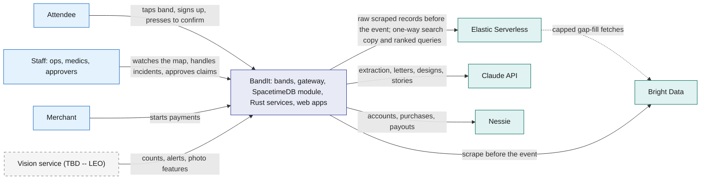
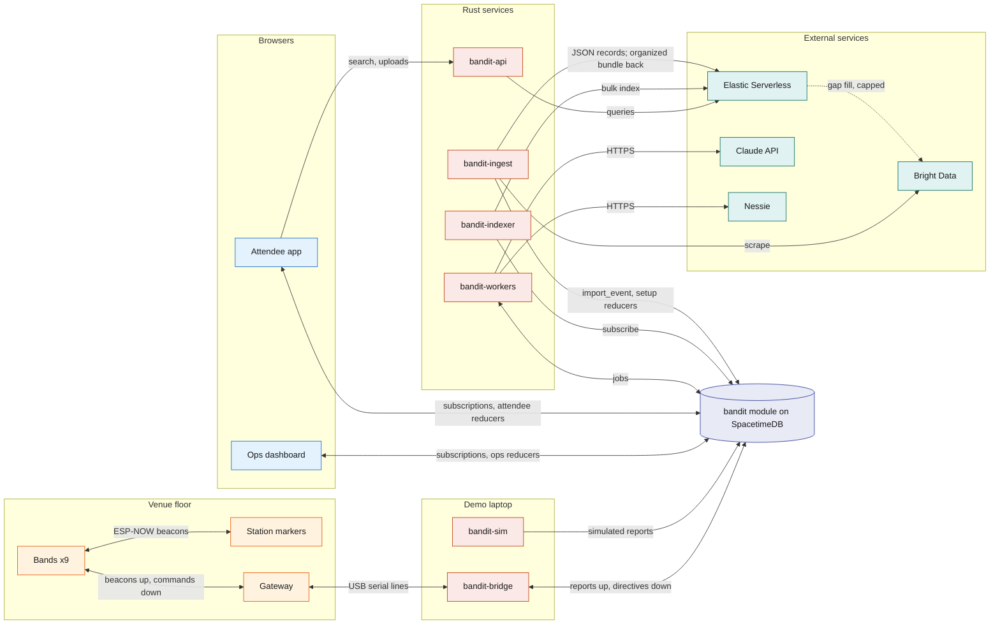
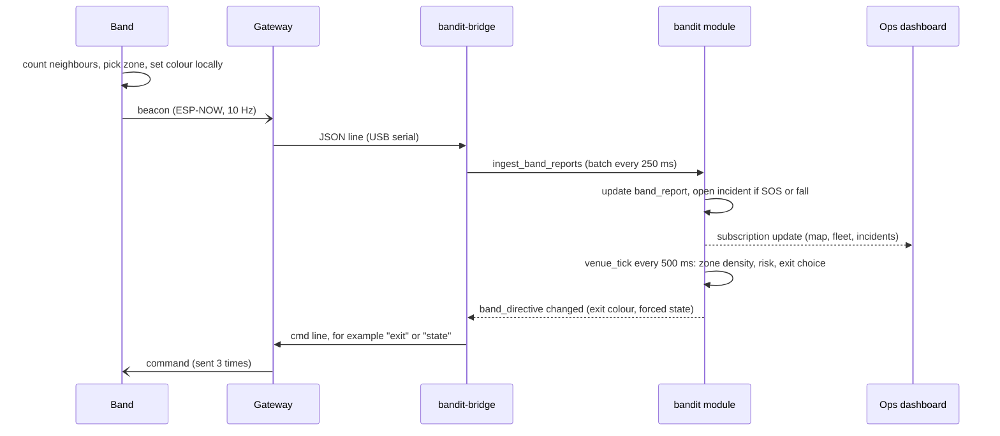
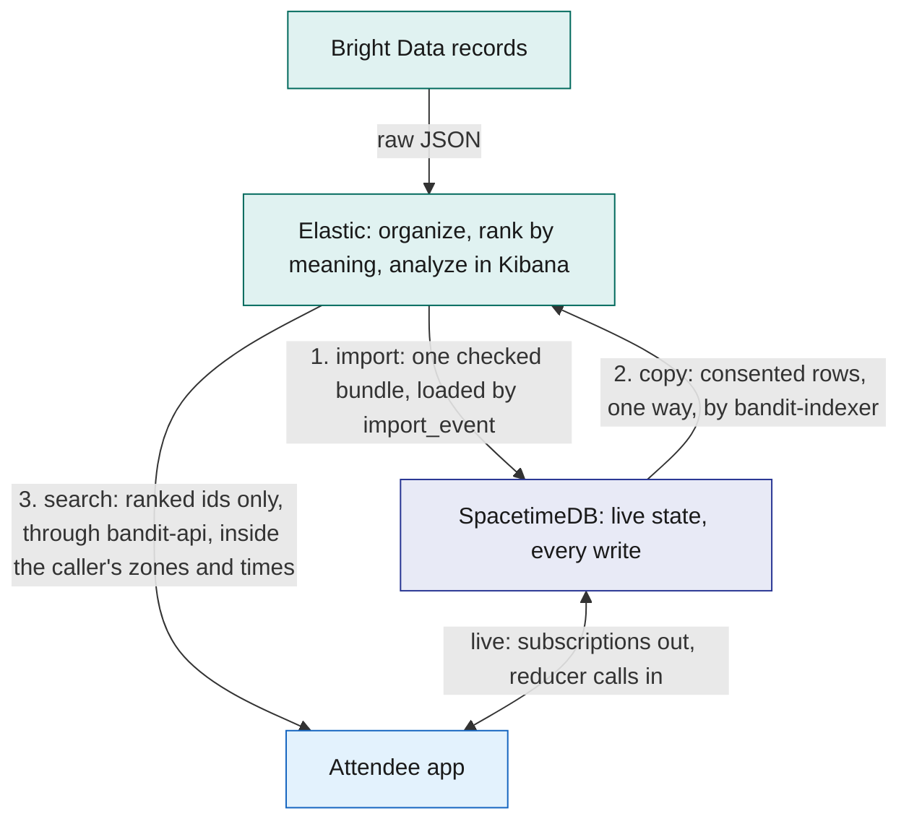
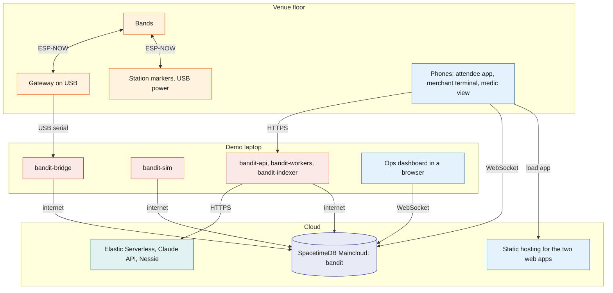

# Architecture

BandIt is a festival wristband plus a backend that turns a crowd of bands into a live, shared map of the event. The bands sense crowd density and emergencies on their own; one SpacetimeDB database holds every piece of live state and performs every action; feature services (search, AI, payments, insurance, merch) hang off that database and can be removed one by one. This file is the map: it shows how the parts fit, where data lives, how the system is deployed, and what happens when a part fails.

## Role in the system

This file owns:

- the system context and the container view (every process and who it talks to);
- the data ownership rules (which store is the source of truth for what);
- the deployment topology for the demo and the fallback;
- the end-to-end demo flows, each pointing to the doc that owns the detail;
- the cross-cutting failure matrix and the mapping from prize tracks to components.

It does not describe any component's internals. Those live in the component files listed in [README](README.md).

## Interfaces

Every connection in the system, grouped by transport. Names match the component docs.

| From | To | What flows | Transport |
|---|---|---|---|
| Band | Band, station marker, gateway | beacons (id, flags, neighbour count, zone, state, seq) | ESP-NOW broadcast, channel 1, 10 Hz |
| Station marker | Band, gateway | station beacons (id, exit colour) | ESP-NOW broadcast, 5 Hz |
| Gateway | Band, station marker | commands (`state`, `exit`, `pay`, `paid`, `clear`, `buzz`, `thresh`, `rssi`, `override`) | ESP-NOW broadcast, each sent 3 times |
| Gateway | `bandit-bridge` | one JSON line per packet heard; command lines back | USB serial, 115200 baud |
| `bandit-bridge` | `bandit` module | `ingest_band_reports` every 250 ms; subscriptions to `band_directive`, `band_command`, `fleet_config` | SpacetimeDB Rust client SDK (WebSocket) |
| Simulator.md: `bandit-sim` | `bandit` module | simulated band reports through the same reducer | SpacetimeDB Rust client SDK |
| Ops dashboard, Attendee app | `bandit` module | reducer calls; subscriptions to their slice | SpacetimeDB TypeScript client SDK (WebSocket) |
| Attendee app | `bandit-api` | uploads; Elastic.md: booth search | HTTPS |
| `bandit-workers` | `bandit` module | claim jobs, submit results | SpacetimeDB Rust client SDK |
| Anthropic-Agent.md, Payments-Nessie.md: `bandit-workers` | Claude API, Nessie | AI calls, bank calls | HTTPS |
| Elastic.md: `bandit-indexer` | `bandit` module, Elastic Serverless | subscription in, bulk index writes out | SDK in, HTTPS out |
| Elastic.md: `bandit-api` | Elastic Serverless | meaning-ranked search queries, filtered first by SpacetimeDB rows | HTTPS |
| `bandit-ingest` | `bandit` module | the seed through the setup reducers | SDK |
| BrightData.md: `bandit-ingest` | Bright Data, OpenStreetMap, `bandit` module | scrape requests; `import_event` | HTTPS; SDK |
| Elastic.md: `bandit-ingest` | Elastic Serverless | parsed JSON records in; the organizer workflow's bundle back | HTTPS |
| Elastic.md: the organizer agent | Bright Data | capped gap-fill `extract` calls through an Agent Builder MCP tool; one JSON record back per call, saved as a snapshot by `bandit-ingest` | HTTPS |
| Vision.md (TBD -- LEO): `bandit-vision` | `bandit` module, Claude API | zone counts, ground alerts, incident assessments, property events, photo features; frames to Claude | reducer calls; HTTPS |

## Design

### Principles

1. **Safety never waits.** Density colours, SOS, fall detection and the light circle run on the bands themselves. The server adds coordination (exit choice, evacuation, escalation) but the bands stay useful if the laptop, the network or the cloud is gone.
2. **One source of truth.** The SpacetimeDB module `bandit` holds all live state. Every change is a reducer call, so it happens completely or not at all, and every screen sees the same committed state through subscriptions.
3. **Each store does what it does best, and copies flow one way.** SpacetimeDB holds every write, every live row, every plain list and the consent filter. Elastic receives a one-way copy only to rank by meaning, and organizes scraped data before it is imported. Results come back as SpacetimeDB ids, and acting on them is again a reducer call.
4. **Slow and external work goes through a queue.** AI, bank and rendering work are `job` rows claimed by `bandit-workers`. Code decides money, coverage, safety and access; the model only reads and writes words.
5. **Every feature can be deleted.** Core components are enough for the safety demo. Each optional feature owns its tables, reducers and jobs, so removing its doc and code removes it cleanly.
6. **The backend is Rust.** The module, every service and every shared library are Rust; only the two browser apps are TypeScript.

### System context

Who uses BandIt and which outside services it relies on.

### Containers

Every running process and the main flows between them. The left half is the live safety path; the right half is the feature services.

The Vision service (TBD -- LEO) is left out of this picture on purpose. The current proposal is a Rust process, `bandit-vision`, on the demo laptop: it reads frames from the overhead phone camera, runs a local person detector with pose estimation on every frame for head counts and person-down alerts, calls Claude only when a band or the detector flags an event (to judge a few frames against the band data and write the report), and writes the results through the reducers in [Vision](Vision.md). Claude never identifies faces; identity always comes from the bands.

### The live loop in one picture

What happens to one beacon, and how a server decision gets back to a band. Everything here is either on the band or a reducer call; nothing waits on AI or a queue.

### Data ownership

Where each kind of data lives, and where copies go. "Source of truth" means the only place that data may be changed.

| Data | Source of truth | Written by | Copies |
|---|---|---|---|
| Venue layout: zones, exits, stations, booths, schedule | `bandit` module | the setup reducers from the seed (`bandit-ingest` seed mode), ops; BrightData.md: `import_event` | none; Elastic.md: `bandit-booths` |
| Bands, attendees, consent, staff roles | `bandit` module | attendee app, ops | none |
| Live band reports, zone state, directives, commands | `bandit` module | `bandit-bridge`, `venue_tick`; Simulator.md: `bandit-sim` | none |
| Incidents, snapshots, witnesses, notes | `bandit` module | `ingest_band_reports`, ops, medics | none |
| Presence history | `bandit` module | `memory_tick` | none; Social.md: derives `visit` and `encounter` from it, which Elastic.md copies to `bandit-memories` under consent |
| Zone history | `bandit` module (`zone_sample`) | `memory_tick` | none |
| Medical-ID.md, Hyphenate.md: medical card, insurance policy | `bandit` module, private tables | attendee app, workers | never copied |
| Payments-Nessie.md, Hyphenate.md: payments, claims, ledger | `bandit` module | reducers; workers record external ids | Nessie holds the mirror bank records |
| Files: photos, PDFs, letters, merch images | the blob store | `bandit-api` and `bandit-workers`, each through `register_blob` | `blob_ref` row in the module (hash, size, owner) |
| Raw radio log | `.jsonl` files on the laptop | `bandit-bridge` | used for calibration and replay |
| BrightData.md: raw scrape snapshots | versioned files kept with the project | `bandit-ingest` | loaded into the module through `import_event` |
| Anthropic-Agent.md: model calls | `model_call` rows plus response blobs | `bandit-workers`, `bandit-ingest`; Vision.md (TBD -- LEO): `bandit-vision` | used for audit and offline replay |
| Elastic.md: raw scraped records and the organized bundle | Elastic raw indices and `bandit-bundles` | `bandit-ingest`, the organizer workflow | working data before the import; rebuilt from the snapshots at every run, never read at the event |

### What each database does best

SpacetimeDB solves live shared state: many devices, services and screens changing and watching the same venue at once, where every screen must agree within one transaction.

What only SpacetimeDB does here:

| Strength | Where BandIt uses it | Why it matters here |
|---|---|---|
| Logic runs inside the database, as transactions | `ingest_band_reports` opens an SOS incident, freezes its snapshot, picks the light circle and schedules the escalation in one reducer ([SpacetimeDB](SpacetimeDB.md), [Safety](Safety.md)) | every screen sees all of it or none of it; there is no app server between a band flag and the incident row |
| Push to every client on commit | the Ops map, the medic phone, the attendee app and the bridge subscribe to queries and receive each change, with a local cache to render from | an SOS reaches the medic without polling, and the bridge reads its directives from the cache |
| Timers inside the database | scheduled reducers: `venue_tick` turns band reports into zone state and exit colours; `memory_tick` turns presence into visits and encounters | the derived safety state is computed where the data lives, on a fixed cadence |
| Identity and access next to the data | claiming a band by pressing it binds the band to the phone's identity; reducers check `staff_role`; views return only the caller's rows (`staff_incidents` for staff; the caller's own band and consent for attendees) | access is enforced once, in the database, for every client, so an app bug cannot widen it |
| The space-time mapping | `presence_sample`, written by `memory_tick`: which band was in which zone, and when | it is the filter other questions start from (Social.md: visits and encounters; Elastic.md: the search filter through `api_presence_windows`) |
| One schema, typed clients, run anywhere | `spacetime generate` gives the Rust services and both TypeScript apps the same types; the same module runs on Maincloud and standalone on the demo laptop | six kinds of clients stay in step with one schema, and the demo survives the venue Wi-Fi |

Elastic.md: BandIt uses a second database because it has a second, different problem. Elastic solves finding by meaning: messy scraped text, captions and images, where the answer is a ranked list and a judgment about what matches, plus the analysis of all of it. Neither database is used for the other's job, and they meet in exactly three places, shown in the diagram after this table. What only Elastic does here:

| Strength | Where BandIt uses it | Why it matters here |
|---|---|---|
| Ranking by meaning | `semantic_text` embeddings plus keyword matching, merged with reciprocal rank fusion, in `GET /search/booths`, `/search/memories` and `/search/photos` ([Elastic](Elastic.md)) | "booths about wearable robotics" finds booths that never use those words; SpacetimeDB filters by exact values and has no relevance ranking or vectors |
| Images and text in one vector space | a multimodal embedding of each photo thumbnail | "the photo of me with the robot" finds photos by what is in them, not only by caption |
| An agent that resolves messy records | the Agent Builder agent `bandit-organizer`, run by the Workflow `bandit-organize` with a JSON schema per section, searching candidates and giving a reason per merge | one company spelled three ways becomes one organisation before anything reaches the live database |
| Bulk joins where raw data lands | ES\|QL `LOOKUP JOIN` steps match booth numbers, domains and stage names across thousands of raw records | the messy raw records never enter the live database; only the checked bundle does |
| Place as a ranking signal | `geo_point` distance boosts "near the east hall" | distance shapes the ranking instead of only filtering it |
| Analysis you can see | Kibana: the Workflows execution view, Agent Builder, and the Import run, Search and Event story dashboards | the team can show how the data was organized and what people looked for, without touching the live screens |

The diagram answers: where do the two meet, and which way does data flow at each meeting point?

### Which store does what

| Query or data | Store | Why |
|---|---|---|
| Every write: claims, incidents, payments, consent, imports | SpacetimeDB reducers | one transactional write path, so every screen sees the same committed state |
| Live state: band reports, zone state, directives, incidents | SpacetimeDB tables and subscriptions | pushed to every client the instant a transaction commits; nothing polls |
| The space-time mapping: who was in which zone, when | SpacetimeDB (`presence_sample`, `visit`; Elastic.md: the `api_presence_windows` view) | derived by the ticks from raw reports; it is the filter every other question starts from |
| Plain lists: my visits, my encounters, my photos by zone and time, my connections, a booth by id or name | SpacetimeDB views | exact rows, already scoped to the caller by the view; no ranking needed |
| Consent and access: who may see a card, a tag, a memory | SpacetimeDB views and reducers | enforced by the database on every read; an app or index bug cannot widen it |
| Zone history and density over the night | SpacetimeDB (`zone_sample`) | sampled history next to the live rows; no second store to keep in step |
| Elastic.md: organizing scraped data before import | Elastic (raw indices, fixed `LOOKUP JOIN` steps, the organizer agent, `bandit-bundles`) | exact joins are deterministic queries and fuzzy entity resolution across messy sources is search work; Bright Data did every fetch before the records arrived, and the result is still loaded by a reducer |
| Elastic.md: "booths about wearable robotics", "the photo of me with the robot near the main stage" | Elastic (`bandit-booths`, `bandit-memories`, `bandit-photos`) | ranking by meaning with semantic and image vectors, over candidates SpacetimeDB narrowed by zone, time and consent |
| Files: photos, PDFs, letters, renders | the blob store, with a `blob_ref` row | big bytes stay out of rows and subscriptions; access class is still decided in the module |

### Deployment

Normal setup for the demo. The SpacetimeDB database runs on Maincloud so phones, staff and services reach it from anywhere; everything that needs the gateway's USB cable runs on the demo laptop.

**Fallback when venue internet is bad.** The same module runs on SpacetimeDB standalone on the demo laptop, loaded from the same seed files. Phones join the laptop's hotspot and open the app from a QR code on the demo table, because the band's NFC tag holds the primary host. The services point at the local database. Only one database is live at a time, so there is never a second source of truth. Features that need an external service work if the laptop still has any uplink; otherwise each feature doc's offline fallback applies (recorded model responses, a hidden search box, payments that time out).

`bandit-api`, `bandit-workers` and `bandit-indexer` run on the demo laptop by default because that is one less machine to keep alive. They connect to the database like any other client, so moving them to a small cloud VM changes nothing else. `bandit-ingest` runs once before the event, from any laptop, to load the seed and any imported bundle.

### Identifiers that cross component boundaries

| Identifier | Format | Assigned by | Used by |
|---|---|---|---|
| Band id | 1 to 9 for real bands (one byte on the radio); 1000 and up for simulated bands | firmware flag; `bandit-sim` | radio, bridge, module, dashboard |
| Station id | 101 to 105; exit colour index defaults to id minus 100 | firmware flag | radio, zone selection, exit guidance |
| Gateway id | 200 | firmware | radio |
| NFC token | `BANDIT-01` to `BANDIT-09` in the URL `https://<host>/t/BANDIT-0n` | written to each sticker | attendee app landing, merchant terminal, medic view |
| Attendee id | SpacetimeDB identity of the attendee app's connection | SpacetimeDB | every per-person table and view |
| Service identity | one SpacetimeDB identity per Rust process, with a `staff_role` row | owner at setup | role checks in reducers |
| Row ids | auto-increment ids assigned by the module | SpacetimeDB | every other table, Elastic document ids, job payloads |

### End-to-end demo flows

The demo runs in this order. Each step names the docs that own it.

| Step | What the audience sees | What happens underneath | Owned by |
|---|---|---|---|
| 1. Join | A judge taps the band with a phone, signs up, presses the band's button when it blinks white | NFC URL opens the attendee app; `claim_band_start`; the press flag in the next beacon completes the claim | [Attendee-App](Attendee-App.md), [Hardware](Hardware.md), [SpacetimeDB](SpacetimeDB.md) |
| 2. Pay (Payments-Nessie.md) | The merchant taps the band, the ring spins yellow, the judge presses, the ring flashes green | press-to-confirm payment, settled on Nessie | [Payments-Nessie](Payments-Nessie.md) |
| 3. Crowd density | Nine people step into a taped 1.2 m square; rings go yellow then red and chase an exit colour; the exit's station marker glows the same colour; people step out and rings go green | bands count neighbours locally; `venue_tick` raises zone risk on the dashboard and keeps exit colours assigned | [Safety](Safety.md), [Hardware](Hardware.md), [Ops-Dashboard](Ops-Dashboard.md) |
| 4. SOS and light circle | Someone holds their button for 3 s; their ring strobes red; every band close by pulses blue; the dashboard shows the incident with its witnesses | band-local reaction first; the incident, snapshot and escalation timer open inside `ingest_band_reports` | [Safety](Safety.md) |
| 5. Medic (Medical-ID.md) | A teammate playing medic taps the person's band and their medical card appears | medic role plus an open incident unlocks the card; access is logged | [Medical-ID](Medical-ID.md) |
| 6. After the event (Social.md, Elastic.md, Merch.md) | The attendee opens their summary: timeline, booths, people met, photos; searches their photos and the booths by meaning; orders personalised merch | presence becomes visits and encounters; ranked search over the Elastic copy, filtered by the attendee's own zones and times; merch jobs with Claude | [Social](Social.md), [Elastic](Elastic.md), [Merch](Merch.md) |
| 7. The claim (Hyphenate.md) | The fall from step 4 becomes a claim that settles automatically under a learned rule; a bigger one waits for a named approver | evidence pack, coverage in code, authority matrix, ledger entries | [Hyphenate](Hyphenate.md) |

Simulator.md: a crowd of a few hundred simulated bands can run alongside the real ones so the map looks like a real event.

Elastic.md: Kibana closes step 6. The team opens the Workflows run that loaded the event's real exhibitors, one merge with the agent's reason, and the Event story dashboard of where people spent their time, while the Ops dashboard stays on the live venue.

### Access model in one paragraph

Every privileged reducer checks the caller's `staff_role`. People roles are `owner`, `ops`, `medic`, `merchant`, `photographer`, `floor_manager`, `risk_manager` and `adjuster`; each Rust service has its own identity with a service role (`bridge`, `simulator`, `vision`, `ingest`, `indexer`, `worker`, `api`). Tables with personal data are private; clients read them only through views keyed on who is asking, so rules such as "a medic sees a card only during an open incident" are enforced by the database, not by the app ([SpacetimeDB](SpacetimeDB.md)).

### Prize tracks and where they live

| Track | What BandIt shows | Main docs |
|---|---|---|
| SpacetimeDB | the whole live world in one module: reducers as transactions (an SOS incident, its snapshot, its light circle and its escalation in one commit), subscriptions pushing every change to six kinds of clients, scheduled reducers computing zone state and visits, identity and per-caller views enforcing access, typed bindings for Rust and TypeScript, Maincloud with a standalone fallback | [SpacetimeDB](SpacetimeDB.md), [Safety](Safety.md), [Gateway-Bridge](Gateway-Bridge.md) |
| Elastic.md: best use of Elastic Agent Builder on Serverless | an Agent Builder agent (`bandit-organizer`) run by a Workflow with a schema per section, which resolves messy scraped records into one checked bundle before it loads into SpacetimeDB; meaning-ranked search over booths, memories and photos (text and image vectors); Kibana views of every import run and dashboards of what people searched and where they spent time | [Elastic](Elastic.md) |
| Hyphenate.md: autonomous systems for finance | incident-to-claim with evidence packs, coverage in code, authority matrix, learned rules, ledger | [Hyphenate](Hyphenate.md) |
| Payments-Nessie.md: Capital One, best use of Nessie | tap to pay with press to confirm; claim payouts | [Payments-Nessie](Payments-Nessie.md) |
| Merch.md: Visa, reimagining shopping | merch made from your own memories, bought after the event | [Merch](Merch.md) |
| Social impact and real-world tracks | preventive crowd-crush guidance, SOS light circle; Medical-ID.md: medic access to the card | [Safety](Safety.md), [Hardware](Hardware.md); Medical-ID.md |

## Failure modes and fallbacks

What the system does when each part fails. The first five rows matter most because they are on the live path.

| Failure | Effect | Design answer |
|---|---|---|
| Laptop, bridge or gateway dies | No new reports reach the server; the dashboard goes grey after 5 s | Bands keep density colours, SOS, fall detection and the light circle locally. Restarting the bridge resyncs directives. |
| Venue internet drops (Maincloud unreachable) | Bridge, apps and services lose the database | Switch to the laptop standalone database with phones on the laptop hotspot ([SpacetimeDB](SpacetimeDB.md)). |
| Radio density readings are noisy or flap | Wrong colours in the demo square | Live recalibration from the dashboard; Plan B uses the camera count as the density source (Vision.md, TBD -- LEO) or ops forces states; the team tells judges when override is used ([Safety](Safety.md)). |
| A band reboots | It loses forced states and live calibration | The bridge sees its `seq` reset and re-sends directives and `fleet_config` ([Gateway-Bridge](Gateway-Bridge.md)). |
| SpacetimeDB tick runs slow | Zone state lags | Live rows are overwritten in place, history is sampled, and the tick only touches zones with live bands ([SpacetimeDB](SpacetimeDB.md)). |
| Elastic.md: Elastic is down or out of trial quota | At import time the organizer cannot run; at the event the search box stops | `bandit-ingest` assembles the bundle itself with rules plus `scrape_extract`; nothing live depends on Elastic; the app hides search and the summary still comes from SpacetimeDB views ([Elastic](Elastic.md)). |
| Anthropic-Agent.md: Claude API is down or refuses | Extraction, letters, designs and stories stall | Jobs retry, then fall back to templates or manual entry; demo runs use recorded responses ([Anthropic-Agent](Anthropic-Agent.md)). |
| Payments-Nessie.md: Nessie is down | Payments cannot settle | Payments stay pending and time out as declined; claims fall back to ledger-only payouts ([Payments-Nessie](Payments-Nessie.md)). |
| BrightData.md: Bright Data blocks a page | Venue or merch data missing | The pipeline loads from the last saved snapshot; booths can be entered by hand ([BrightData](BrightData.md)). |
| Vision.md (TBD -- LEO): Vision is absent | No camera counts, ground alerts or photo features | Density uses bands only; falls rely on the band; claims corroborate with staff notes and light-circle witnesses; photo tagging uses presence only ([Vision](Vision.md)). |

## Dependencies

**Depends on:** every component doc, for the detail behind each box.

**Used by:** [README](README.md) points here first; every component doc refers here for the big picture.

**If you delete a component:** remove its row from the Interfaces table, the Data ownership table, the demo flow table, the prize table and the failure table above, and its node from the diagrams. Core components (Hardware, Gateway-Bridge, SpacetimeDB, Safety, Ops-Dashboard, Attendee-App, Rust-Backend) are not meant to be deleted.

## Open questions

- Does the venue Wi-Fi allow the laptop a stable uplink to Maincloud, or should the demo start on the laptop standalone database?
- Which event's pages are scraped for the demo booths and schedule: Cal Hacks 13.0 itself (the default) or another real event?
- Do the web apps live on a public static host for judges' own phones, or only on the team's phones?
