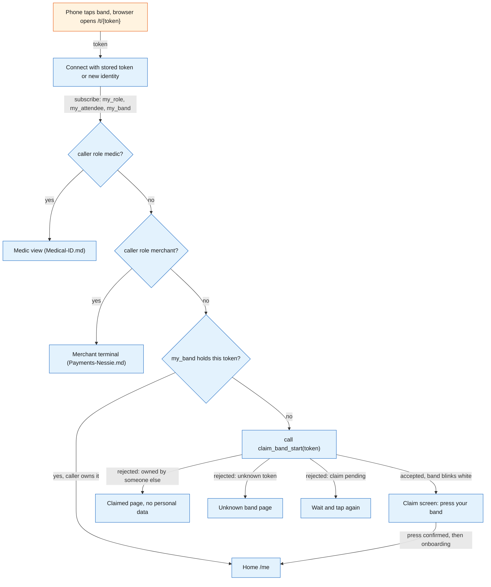
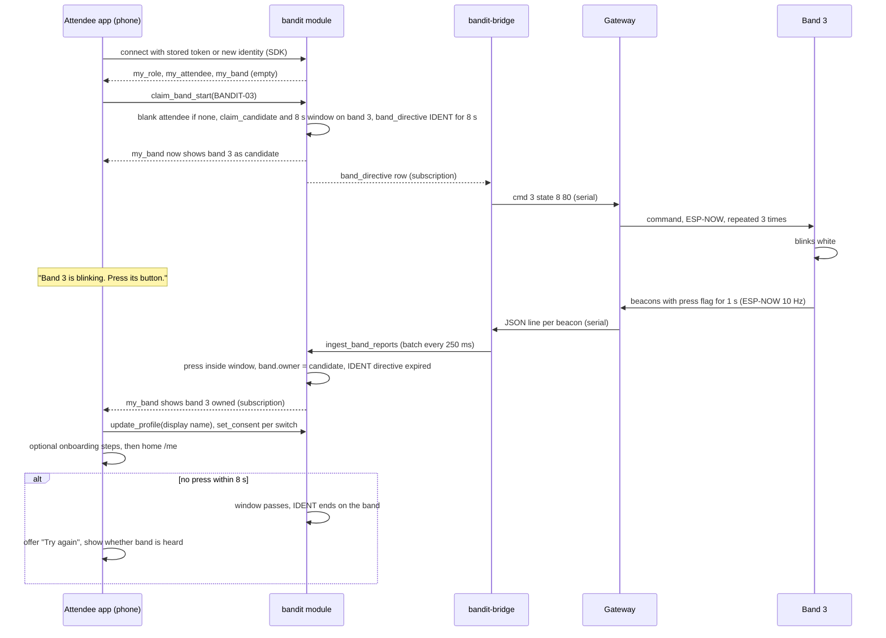
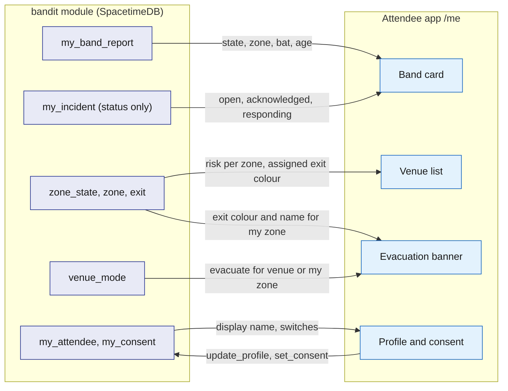

# Attendee app

The attendee app is the web app that opens when a phone taps a band's NFC sticker. It is the attendee's whole relationship with BandIt: claiming the band by pressing its button, a short onboarding, the consent switches, a live mirror of the band and of how busy the venue is, and the way back in after the event. It also renders the medic view and the merchant terminal, because every band carries exactly one URL and the caller's role, not the URL, decides what that URL shows. It runs in the phone browser, reads everything from the `bandit` module through SpacetimeDB's TypeScript client SDK, and calls `bandit-api` only for search and file uploads.

## Role in the system

Responsibilities:

- Resolve the tapped token to a band and decide which screen to show (the landing route).
- Give each phone an identity. The SpacetimeDB connection identity is the attendee id.
- Claim the band by press, then run the onboarding steps.
- Hold the profile and the three consent switches.
- Mirror the band's state, the zone's busy level and evacuation alerts on screen during the event.
- Offer the post-event entry points: tap the band again, or open the bookmarked home.
- Host staff views at the tag URL for callers with staff roles.
- Medical-ID.md: the medic view, whose content that file owns.
- Payments-Nessie.md: the merchant terminal, whose content that file owns.

Not responsible for:

- Safety decisions. The band decides its own colours and the module decides directives ([Safety](Safety.md)). The app only displays.
- Holding truth. Every screen is a subscription and every change is a reducer call. If the phone dies, nothing is lost.
- Talking to the gateway or to any external service. Those go through `bandit-bridge`, `bandit-api` and `bandit-workers`.
- Positions. There are none; the app shows zones ([SpacetimeDB](SpacetimeDB.md)).

## Interfaces

| Interface | Direction | Between | What flows | Transport |
|---|---|---|---|---|
| NFC tag URL | in | phone OS to app | `https://<host>/t/BANDIT-0n`; the token is the path | NDEF URL read by the OS, opened in the browser |
| Static bundle | in | `bandit-api` to browser | the app itself, served from the same origin as the upload and search endpoints so no cross-origin setup is needed | HTTPS |
| SpacetimeDB connection | both | app and `bandit` module | identity token, subscriptions, reducer calls | TypeScript client SDK over WebSocket |
| Own-row views | in | module to app | `my_role`, `my_attendee`, `my_consent`, `my_band` (bands the caller owns or is the claim candidate for), `my_band_report`, `my_incident` (status and snapshot of the caller's own incidents), `my_presence` (post-event timeline), `my_jobs` | SDK subscription |
| Public venue rows | in | module to app | `venue`, `zone`, `booth`, `schedule_slot`, `exit` (name and colour for the banner), `zone_state`, `venue_mode` | SDK subscription |
| Reducers | out | app to module | `claim_band_start`, `update_profile`, `set_consent`, `open_api_session` (once per session, see Identity) | SDK reducer call |
| Blob upload | out | app to `bandit-api` | files for features that need them, with the API session token; `bandit-api` stores the file, calls `register_blob` and returns the `blob_ref` id | HTTPS, endpoint in [Rust-Backend](Rust-Backend.md) |
| Medical-ID.md | both | app, module and `bandit-api` | the PDF through `POST /api/medical/document` with the API session token, then the confirm-card screen for the extracted `medical_card`; the medic view card panel opened from `/t/BANDIT-0n` for role `medic`, which calls `request_medical_card` with the token and reads the `medic_medical_card` view | HTTPS and SDK |
| Payments-Nessie.md | both | app and module | the merchant terminal route (rendered at `/t/{token}` for role `merchant`, and `/terminal` as the merchant home) with `start_payment`; `link_bank` at sign-up; the wallet view (`bank_link`, `payment` history) on `/me`; `claim_band_start` refuses while a payment is pending on that band | SDK |
| Social.md | both | app and module | the onboarding socials step: LinkedIn, TikTok or X sign-in, or a typed handle, into `social_handle` with how it was verified (`oauth` or `typed`); Bandshake feedback when the band shows state 7; the summary, connections and share-link views through `my_visits`, `my_encounters`, `my_connections`, `my_photos`, `my_story` and `my_share_links`; the photographer route (role `photographer`) that uploads a photo and calls `register_photo` | SDK and HTTPS |
| BrightData.md | both | app, module and `bandit-api` | the profile claim screen: the attendee picks their unclaimed `person` row (exhibitor, speaker or artist scraped from event pages); `POST /claim/person` calls `request_person_claim` and sends a magic link to that row's `claim_contact` email; `GET /claim/confirm/{token}` calls `confirm_person_claim`, which links the `person` row to the attendee identity | HTTPS and SDK |
| Hyphenate.md | both | app and module | `insurance_policy` details on the profile | SDK |
| Elastic.md | out | app to `bandit-api` | the search box: `GET /search/booths`, `GET /search/memories` and `GET /search/photos`, meaning-ranked only; `bandit-api` identifies the caller by `api_session` and narrows to the caller's zones and times first. Plain lists (timeline, tagged photos, booths by name) come from the app's own subscriptions, never from search | HTTPS |
| Merch.md | both | app and module | the merch pick, design and order flow through `merch_catalogue`, `my_merch_designs` and `my_merch_orders`; it pays through Payments-Nessie.md in app-confirm mode once bands are returned | SDK |

## Design

### Routes

| Route | Who sees it | Purpose |
|---|---|---|
| `/t/{token}` | anyone | Landing. Decides the screen from the band and the caller. The only URL written on the tags. |
| `/me` | a signed-up attendee | Home: band card, venue, alerts, profile and consent, and the post-event content. |
| Payments-Nessie.md: `/terminal` | role `merchant` | Merchant home when no band has been tapped yet. Content in [Payments-Nessie](Payments-Nessie.md). |
| Social.md: `/photo` | role `photographer` | Upload a photo and call `register_photo`. Content in [Social](Social.md). |

The staff screens render at `/t/{token}` rather than at separate paths because the tag holds one URL, and every staff view needs "this band" as its input; the tap supplies it. Keeping one URL also means the tags can be locked read-only early ([Hardware](Hardware.md)).

### Landing route decision

The landing route answers one question: who tapped which band? Band rows are private, and `my_band` returns only bands the caller owns or is the claim candidate for, so the route learns a band's status by trying to claim it: `claim_band_start` either accepts, which starts the press window, or rejects with a reason the app turns into a page. Nothing is lost by trying, because a claim completes only with a press on that band.

1. Connect to SpacetimeDB with the token in browser storage; with no token the SDK issues a new identity and the app stores its token.
2. Subscribe to `my_role`, `my_attendee` and `my_band`.
3. Caller has a staff role: render that role's view for this band. Medical-ID.md: role `medic` gets the medic view for this band's wearer. Payments-Nessie.md: role `merchant` gets the merchant terminal with this band preselected. Staff roles win over ownership because a medic may also wear a band. Roles are granted by the owner with `grant_role` from the [Ops dashboard](Ops-Dashboard.md); the staff phone shows its identity there so the owner can pick it.
4. `my_band` already holds a band with this token: the caller owns it. Home at `/me`.
5. Otherwise call `claim_band_start` with the token:
   - accepted: the band blinks white; show the claim screen ("Press the button on your band").
   - rejected, owned by someone else: a "claimed" page showing the band id and nothing personal, with a hint to ask staff. Anyone can read the tag, so this page must not reveal the owner.
   - rejected, no band with this token: the tag was never registered with `register_band`. Show "unknown band".
   - rejected, another claim pending on this band: someone tapped it moments ago. Show "wait a few seconds and tap again".
   - Payments-Nessie.md: rejected, a payment is pending on this band: show "finish the payment first".

The flowchart below shows the decision in the order the checks run.

### Identity

The SpacetimeDB connection identity is the attendee id. On the first connection the SDK issues an identity and a token; the app keeps the token in browser storage (localStorage, scoped to the app's origin) and presents it on every later connection, so the same phone is the same attendee across taps, tabs and reloads. The `attendee` row is keyed by this identity: `claim_band_start` creates it blank and `update_profile` fills it. There are no passwords and no email: the band press is the credential at claim time and the stored token is the credential afterwards. This is enough for a one-weekend event and keeps sign-up to one press and one field.

Talking to `bandit-api` as that same attendee. `bandit-api` is not a SpacetimeDB client of the phone's connection, so it cannot see who is calling by itself. Once per session the app generates a random token, calls `open_api_session` with the token's hash (the module binds the hash to the caller's identity in an `api_session` row with an expiry), and then sends the plain token in a header on every `bandit-api` request (search, uploads, claim links). `bandit-api` hashes it and looks the hash up in its `api_sessions` subscription, which gives it the attendee id without any JWT verification ([SpacetimeDB](SpacetimeDB.md), [Rust-Backend](Rust-Backend.md)). The token lives in memory, not in storage, so a reload opens a new session.

What breaks the identity: private browsing, cleared site data, a different phone, or opening the app as an iOS home-screen web app, which has its own storage separate from Safari. The app therefore never prompts to "add to home screen", and recovery is an ops action: `release_band` on the [Ops dashboard](Ops-Dashboard.md) unclaims the band, and the wearer claims again by press. The old `attendee` row stays; only the band link moves.

### Claim by press, then onboarding

The tap alone proves nothing, because anyone can read the tag. The press proves that the person signing up is holding the band. The flow is one press, then one field, then optional steps.

1. The landing route calls `claim_band_start` with the token. The module creates a blank `attendee` row for the caller if none exists, sets `band.claim_candidate` to the caller and `band.claim_pending_until` to now plus 8 s, and upserts a `band_directive` for the band with forced state IDENT (8), `forced_until` now plus 8 s, reason `claim_ident`. `my_band` now returns the band to this caller as its candidate, so the screen can say "Band 3 is blinking white. Press its button to make it yours."
2. `bandit-bridge` sees the directive and sends the state command; the gateway repeats it 3 times, 40 ms apart ([Gateway-Bridge](Gateway-Bridge.md)). The band blinks white.
3. The wearer presses once. The band's beacons carry the press flag (bit 2) for 1 s. The bridge batches the changed report into `ingest_band_reports` within 250 ms.
4. Inside `ingest_band_reports`, in the same transaction as the report, the module sees a press from a band whose `claim_candidate` is set and whose window has not passed: it sets `band.owner` to the candidate, clears the candidate, and expires the IDENT directive (sets its `forced_until` to now rather than deleting it, so the bridge sends no stray `clear`). The band returns to density-driven colours. The press flag stays in beacons for 1 s, so later batches see no candidate and do nothing.
5. The app's `my_band` subscription updates with the owner set; the screen says "It's yours" and continues with onboarding.
6. Onboarding, in order, each step skippable except the first:
   - Display name: `update_profile`.
   - Consent switches, all off by default: `set_consent` per switch (see Profile and consent).
   - Social.md: add your socials. Sign in with LinkedIn, TikTok or X, or type a handle; each becomes a `social_handle` row marked `oauth` or `typed`, shown to others only after a connection both sides accepted. Social.md owns the sign-in step.
   - BrightData.md: the profile claim screen ("Are you one of these?"). It lists unclaimed `person` rows whose name matches the display name, scraped from the event's exhibitor, speaker and artist pages. The attendee picks one, the app calls `POST /claim/person`, `bandit-api` calls `request_person_claim` and sends a magic link to that row's `claim_contact` email, and opening the link hits `GET /claim/confirm/{token}`, which calls `confirm_person_claim` to write the attendee identity onto the `person` row.
   - Payments-Nessie.md: `link_bank`, so tap to pay works at the first booth.
   - Medical-ID.md: upload a medical PDF through `POST /api/medical/document`, then the confirm-card screen once `medical_extract` has produced the `medical_card`.
7. Done: home at `/me`. Every skipped step is reachable again from the profile.

If no press arrives within 8 s the pending claim expires, the IDENT directive ends on its own (a band holds a forced state for at most 25.5 s per command, and the directive asked for 8 s), and the screen offers "Try again", which calls `claim_band_start` once more. The screen also shows whether the band is being heard at all (alive or stale from `my_band_report`, which already returns the candidate's band), so an attendee whose band is out of range knows to walk toward the gateway rather than press again.

The sequence below shows which process does what, from tap to home.

### Profile and consent

The profile is deliberately small: a display name and whatever optional features add. Consent is per feature, stored in `consent` through `set_consent`, one row per switch, all off until the attendee turns them on. The switches exist in the core even if the feature that uses one is deleted; an unused switch simply has no effect.

| Switch (`consent` kind) | What it allows | Who enforces it |
|---|---|---|
| `findable` | People you were co-present with can see you in their post-event summary and send a connection request | [Social](Social.md) |
| `photo_tagging` | You can be suggested as a tag in photographer photos | [Social](Social.md) |
| `merch` | You can appear in merch designs made from shared memories | [Merch](Merch.md) |

Optional profile sections, each a separable block on `/me`:

- Social.md: social handles (`social_handle`, the onboarding step reachable again here), the connections view (`my_connections`) and connection requests.
- BrightData.md: the profile claim screen from onboarding, for anyone who skipped it.
- Medical-ID.md: the medical PDF upload and the confirm-card screen; the status of the extracted `medical_card`.
- Hyphenate.md: insurance details (`insurance_policy`).
- Payments-Nessie.md: the wallet view: `bank_link` status and `payment` history.

### Live view during the event

The home screen during the event has three parts, each fed by a subscription and nothing else.

Band card. The card mirrors the band's own row from `my_band_report`: the state chip uses the same colour the ring shows, the zone name comes from `zone` through the report's `zone`, and the card turns grey when the report is older than 5 s (the same alive and stale rule the [Ops dashboard](Ops-Dashboard.md) uses). Battery shows only when `bat` is not 255, because most bands have no divider fitted. The chip text tells the wearer what the colour means:

| Band state | Chip | What the app says |
|---|---|---|
| 0 IDLE | green | "All calm" |
| 1 YELLOW | yellow | "Getting busy around you" |
| 2 GUIDE | red with the exit colour swatch | "Move out: follow the <colour> lights" |
| 3 SOS | red | "Staff alerted", then "Staff have seen it" when the incident is acknowledged and "A medic is coming" when it is responding |
| 4 NEAR_SOS | blue | "Someone next to you needs help. Keep your ring visible so the medic can find them." |
| 5 PAY, 6 PAID | yellow, green | Payments-Nessie.md: "Press to approve", "Paid" |
| 7 CONNECT | pink | Social.md: Bandshake feedback, "Connected" with the other person's display name once both sides accepted |
| 8 IDENT | white | "Press to claim" |
| 9 OFF | grey | "Ring off" |

The incident lines on the SOS row come from `my_incident`, which returns the attendee's own incidents and snapshots; the attendee sees status, never staff notes.

Venue. A list of zones (or the floor-plan image when the venue has one) with each zone's risk from `zone_state` in attendee words: `normal` "calm", `watch` "busy", `high` "very busy", plus the colour of the exit assigned to that zone. Zone-level only: the app never shows where any person is.

Alerts. When `venue_mode` is `evacuate` for the venue, or the wearer's zone has `evacuating` set, the app shows a full-screen banner with the assigned exit's colour swatch and name: "Evacuate. Follow the <colour> lights to <exit>." The ring has no compass and cannot point ([Hardware](Hardware.md)), so the phone repeats the colour and the exit name rather than a direction. The banner stays until the mode returns to normal. When an exit is blocked and the zone's assignment changes, the banner updates on the next subscription event, with no reload.

The flowchart below shows which rows feed which part of the home screen.

### Post-event entry points

There is no separate post-event app. `/me` has a "Now" tab and a "Your event" tab; while the band is alive the app opens on "Now", and once the band has been stale for longer than the zone window it opens on "Your event". Two ways in:

- Tap the band again. `/t/{token}` finds the band in `my_band` and goes to `/me`.
- Open the bookmark. `/me` reads the stored token; the identity is the same.

Core content of "Your event" is the attendee's own zone timeline, rendered on the phone from `my_presence` (one `presence_sample` per 5 s while the band was alive): "20:10 to 20:40 near Stage B". Optional sections, each separable:

- Social.md: the summary, connections and share-link views: visits and booth descriptions (`my_visits`), people met (`my_encounters`, `my_connections`), photos you are tagged in (`my_photos`), the generated summary story (`my_story`) and share links (`my_share_links`).
- Elastic.md: the search box ("robotics booths", "the photo of me with the robot") over `GET /search/booths`, `GET /search/memories` and `GET /search/photos` through `bandit-api`; the exact timeline and tagged photos stay subscription views.
- Merch.md: the merch pick, design and order flow: pick a memory, see designs in `my_merch_designs` from the `merch_catalogue`, order into `my_merch_orders`; payment goes through Payments-Nessie.md in app-confirm mode because the bands have been returned by then.
- Payments-Nessie.md: the wallet view with payment history.

### Platform notes

- iPhone XS and newer read an NDEF URL in the background whenever the screen is on and show a banner; tapping it opens Safari at the URL. Older iPhones need the NFC reader in Control Center. Each tap may open a new tab; storage is per origin, so every tab is the same attendee.
- Android opens an NDEF URL in the default browser from the system tag dispatch when the phone is unlocked.
- Web NFC, which lets a page read tags from inside the page, works on Android Chrome only. A staff view whose only input is the tap works the same on both platforms.
- Payments-Nessie.md: the merchant terminal uses Web NFC to read band after band without leaving the page. On an iPhone the merchant taps a band, the OS opens `/t/{token}`, and the landing route renders the terminal with that band preselected; the terminal must therefore keep its cart state across reopenings.
- Medical-ID.md: the medic view needs no Web NFC; the tap is its only input on both platforms.
- The tag is an NTAG215 holding one NDEF URL, locked read-only once the host is final ([Hardware](Hardware.md)).
- Simulator.md: simulated bands have no tag and an empty `nfc_token`; the simulator registers and claims them through its own path.

## Failure modes and fallbacks

| Failure | Effect | Design answer |
|---|---|---|
| No press reaches the module within 8 s (band out of range, bridge down, gateway unplugged) | Claim times out | Screen offers "Try again" and shows whether the band is being heard; the window passes on its own and the IDENT directive ends on the band. Ops sees the bridge's heartbeat on the dashboard. |
| Browser storage cleared, new phone, or the app opened as an iOS home-screen app | New identity; the band looks claimed by someone else | Never prompt to install; ops unclaims the band with `release_band`, the wearer claims again by press. |
| Two people tap the same unclaimed band within 8 s | The second `claim_band_start` is rejected | "Wait and tap again" page; the press decides who gets it. |
| SpacetimeDB unreachable (venue Wi-Fi) | Screens freeze | The SDK reconnects and replays subscriptions; the app greys stale cards and disables reducer buttons. Safety does not depend on the phone: the band decides its own colours. |
| Fallback deployment (module on the laptop, phones on its hotspot) | The host written in the tags points at the primary deployment | The tags keep the primary host; the fallback is reached through a QR code on the demo table whose URL points at the laptop. Tags are locked only once the host is final. |
| Stranger taps a claimed band | Could leak the owner | The claimed page shows the band id only. |
| Tag token never registered | `claim_band_start` rejects | "Unknown band" page; ops registers it with `register_band`. |
| API session expired or lost on reload | `bandit-api` rejects the request | The app opens a new session with `open_api_session` and retries once. |
| 500 simulated bands | Not an issue: the app subscribes to zone rows (2 to 5 real zones) and its own band, never to the fleet | Zone-level and own-row subscriptions only. |
| Own `band_report` arrives at 4 updates a second | Battery and redraw cost on the phone | Render at most a few times a second; the SDK delivers rows, the app throttles the paint. |

## Dependencies

**Depends on**

- [SpacetimeDB](SpacetimeDB.md): views `my_role`, `my_attendee`, `my_consent`, `my_band`, `my_band_report`, `my_incident`, `my_presence`, `my_jobs`; public `venue`, `zone`, `booth`, `schedule_slot`, `exit`, `zone_state`, `venue_mode`; reducers `claim_band_start`, `update_profile`, `set_consent`, `open_api_session`; the band fields `owner`, `claim_candidate`, `claim_pending_until`.
- [Gateway-Bridge](Gateway-Bridge.md) and [Hardware](Hardware.md): the IDENT state, the press flag and the forced-state command that make claim by press work.
- [Safety](Safety.md): meaning of band states, risk levels, evacuation and exit colours.
- [Rust-Backend](Rust-Backend.md): `bandit-api` serves the bundle, the blob upload endpoint and the `api_sessions` lookup.
- [Ops-Dashboard](Ops-Dashboard.md): `release_band` for identity recovery; `grant_role` for staff phones.

**Used by**

- [Medical-ID](Medical-ID.md): medic view at `/t/{token}`, the upload and confirm-card screens.
- [Payments-Nessie](Payments-Nessie.md): merchant terminal at `/t/{token}` and `/terminal`, `link_bank` at onboarding, the wallet view.
- [Social](Social.md): the socials step, Bandshake feedback, the photographer route, the summary, connections and share-link views.
- [BrightData](BrightData.md): the profile claim screen and the magic link.
- [Merch](Merch.md): the pick, design and order flow.
- [Hyphenate](Hyphenate.md), [Elastic](Elastic.md): profile and post-event sections.
- [Architecture](Architecture.md): the tap-to-join and claim flows.

**If you delete this file**

- The demo loses tap-to-join; bands would be registered to people by ops only (`register_band`) and `claim_band_start` would have no caller.
- Medical-ID.md and Payments-Nessie.md need another host for the medic view and the merchant terminal; Social.md needs another host for the photographer route.
- Remove the Attendee app row from the component table in Architecture.md and the attendee row from SpacetimeDB.md's "subscriptions per client".
- Remove the "attendee app" bullets in Social.md, BrightData.md, Elastic.md, Merch.md, Hyphenate.md, Payments-Nessie.md and Medical-ID.md.

## Open questions

- The tag holds one host. If the laptop fallback goes live, do we accept the QR-code entry, or write a host into the tags that the hotspot can resolve to the laptop?
- Should the "claimed" page shown to a stranger include the public venue busy list (useful for people without bands), or stay empty?
- Should `release_band` refuse while the band is alive and worn, to stop an accidental release during the event?
