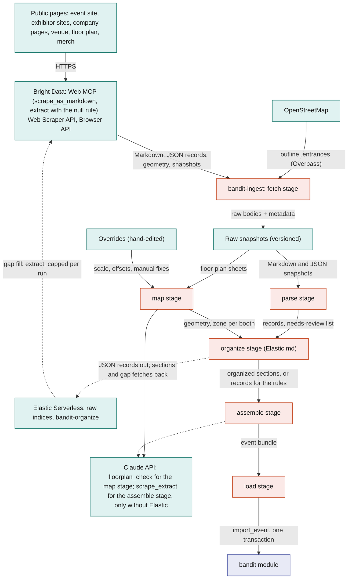
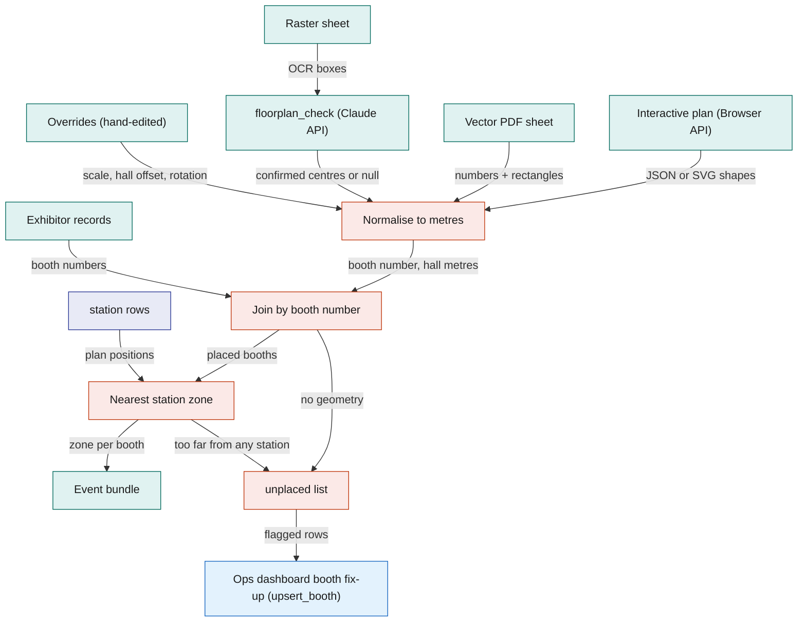
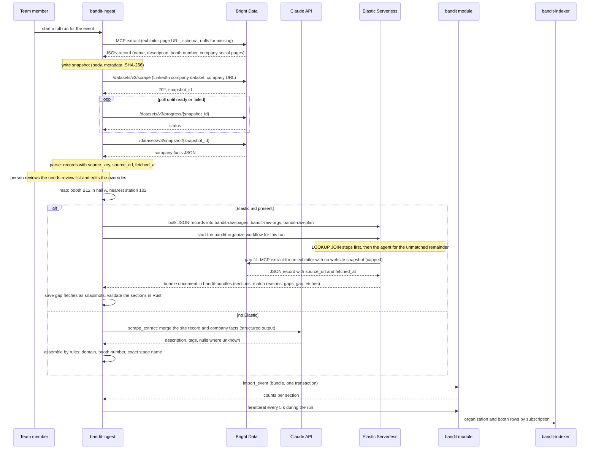

# Bright Data

`bandit-ingest` is a Rust command-line tool run on any laptop before the event. It fetches public pages about the event, its organisations, the venue and the official merch through Bright Data, saves every raw fetch as a versioned snapshot kept with the project, turns the snapshots into one event bundle (organisations, booths with positions, halls, schedule, unclaimed people profiles, merch products), and loads the bundle into SpacetimeDB in one transaction through the `import_event` reducer. Everything downstream (the Ops dashboard map, visits, merch, the claim flow, the search copy) sees ordinary SpacetimeDB rows and never knows a scrape happened. Elastic.md: when present, its organizer turns the raw records into the bundle before the load (exact joins by fixed queries, fuzzy links and the cross-source merge by its agent); without it the pipeline assembles the bundle itself with rules plus `scrape_extract`. The split is fixed: Bright Data owns every step that touches the web, Elastic owns every step after the raw records land, and SpacetimeDB owns everything live or exact. The snapshots exist so that no demo, rerun or offline test ever depends on a live scrape.

## Role in the system

Responsibilities:

- Scrape the event and its organisations: event pages, exhibitor and sponsor sites, company facts, venue facts, floor plans, merch pages. Keep a dated raw snapshot of every fetch.
- Build the booth map: get booth geometry from the best available floor-plan source, normalise it to metres, join it to exhibitor records by booth number, and assign each booth to the nearest station zone.
- Build unclaimed `person` profiles from event pages only (exhibitor contacts, speakers, sponsor representatives, artists), with a private `claim_contact` so the person can claim the profile at the event.
- Assemble one bundle per event and load it with `import_event`, keyed by stable source keys so reruns are idempotent. Every scraped row carries `source_url` and `fetched_at`.
- Own the optional tables `hall`, `organization`, `person` and `claim_contact`, the `import_event`, `request_person_claim` and `confirm_person_claim` reducers, and the two claim routes in `bandit-api`.
- Report progress through `heartbeat` while it runs, like every Rust service.

Non-responsibilities:

- **Never scrapes people.** No LinkedIn, Instagram or any other person scraper, no profile lookups by name. People come only from what the event itself publishes. Social handles are never scraped; every attendee enters their own during onboarding in the attendee app ([Social](Social.md) owns `social_handle`). Elastic.md: the organizer's gap-fill tool is held to the same rule; it may fetch organisation and event pages only.
- Does not merge facts across sources when Elastic is present: that is the organizer's job ([Elastic](Elastic.md)), and `scrape_extract` does it only without Elastic. Page extraction itself happens once, at fetch time, through Bright Data `extract` with the null rule; no model reads a page after that, and Elastic receives JSON records, never page bodies.
- Does not define the demo's station zones or exits for the safety demo. The core seed in [SpacetimeDB](SpacetimeDB.md) creates the two to five station zones and the exits whether or not this file exists; the bundle may refine their geometry, never remove them.
- Does not depend on Elastic and keeps no data there. Elastic.md: the raw records the organize stage writes to the raw indices are working data for one run, and `bandit-indexer` copies the loaded rows for search afterwards ([Elastic](Elastic.md)).
- Does not run during the event and is never on the safety path.
- Does not own `booth`, `schedule_slot`, `venue`, `zone`, `exit` ([SpacetimeDB](SpacetimeDB.md)) or `merch_product` ([Merch](Merch.md)); it fills them.

## Interfaces

| Interface | Direction | Who | What flows | Transport |
|---|---|---|---|---|
| Bright Data Web MCP | out | `bandit-ingest`, fetch stage | tool calls `scrape_as_markdown`, `extract`, `scrape_batch` (and `search_engine` to find official sites) for event, exhibitor, speaker, schedule and merch pages; back come Markdown or JSON; `extract` carries the record schema and the null rule, so page extraction happens here, once | HTTPS JSON-RPC tool calls to the remote MCP server with the API token; tool groups `advanced_scraping`, `browser`, `scrapers` enabled |
| Elastic.md: Bright Data Web MCP, gap fill | out | the organizer agent in Elastic, through an Agent Builder MCP tool | `extract` on an organisation or event page the raw records name but no snapshot covers; one JSON record back with `source_url` and `fetched_at`; at most 10 calls per run (starting value) | the same MCP server with a zone token of its own that has its own spending limit; the records come back inside the bundle document and are saved as snapshots ([Elastic](Elastic.md)) |
| Bright Data Web Scraper API | out | `bandit-ingest`, fetch stage | dataset runs "collect by URL": Google Maps place for the venue, LinkedIn company and Crunchbase company pages for organisations, product pages where a merch store sits on a covered domain; structured JSON back, directly or as a snapshot to poll | HTTPS, `/datasets/v3/scrape` (sync) or `/datasets/v3/trigger`, `/datasets/v3/progress/{snapshot_id}`, `/datasets/v3/snapshot/{snapshot_id}` |
| Bright Data Browser API | out | `bandit-ingest`, fetch stage | one navigation to an interactive floor plan; back comes the booth geometry the page loaded (JSON or SVG) | remote browser over the Chrome DevTools Protocol, one page navigation per session, 30 min session limit |
| Bright Data Scraper Studio | out | `bandit-ingest`, fetch stage | runs of a custom scraper built for an event site with no ready dataset; results arrive like any dataset snapshot | same endpoints as the Web Scraper API |
| Bright Data Web Unlocker API | out | `bandit-ingest`, fetch stage (fallback) | a public URL; back comes raw HTML in one response | HTTPS REST with bearer key and Unlocker zone; the same engine behind `scrape_as_markdown` |
| OpenStreetMap | out | `bandit-ingest`, fetch stage | the venue building outline and its entrance nodes | HTTPS query to the Overpass API (not a Bright Data product) |
| Claude API | out | `bandit-ingest`, map stage, and the assemble stage only without Elastic.md, through `claude-client` | `floorplan_check`: confirm OCR booth numbers and positions on a raster plan, or return null; `scrape_extract` (only when Elastic.md is absent or its organizer failed a section): merge one organisation's site record, LinkedIn and Crunchbase facts into one description and tag set | HTTPS Messages API, structured outputs; every call recorded in `model_call` ([Anthropic-Agent](Anthropic-Agent.md)) |
| Snapshot, record and bundle artefacts | out and in | `bandit-ingest`; the team by review | raw snapshots with their fetch metadata, parsed records, the hand-edited overrides (scale, hall offsets, manual placements, confirmed exits) and the event bundle | versioned files kept with the project, except claim contacts (see Records) |
| Elastic.md: raw indices and the organizer | out and in | `bandit-ingest`, organize stage | parsed JSON records (never page bodies), map-stage geometry and the core station and zone rows out to `bandit-raw-pages`, `bandit-raw-orgs` and `bandit-raw-plan`; one `bandit-organize` workflow execution per run; back comes the bundle document from `bandit-bundles` with any gap-fill records, which are saved as snapshots, then validated in Rust before the load stage | HTTPS Bulk API and Workflows API with the Elastic ingest key ([Elastic](Elastic.md)) |
| `import_event` reducer | out | `bandit-ingest`, load stage (role `ingest`) | the whole bundle; back come row counts per section | SpacetimeDB Rust client SDK, one reducer call, one transaction |
| `heartbeat` reducer | out | `bandit-ingest` while running | name, version, pages fetched, records built, rows imported, failures, every 5 s | SpacetimeDB reducer call |
| `POST /claim/person` | in | Attendee app (caller identified by `api_session`) | the `person` id the attendee says is them; `bandit-api` generates a token, calls `request_person_claim` and emails a magic link to the `claim_contact` address | HTTPS JSON on `bandit-api` |
| `GET /claim/confirm/{token}` | in | the person's email client | `bandit-api` hashes the token, finds the `claim_contact` in its subscription, checks expiry and calls `confirm_person_claim` | HTTPS on `bandit-api` |
| Loaded rows | out | `bandit-indexer` ([Elastic](Elastic.md)), `bandit-workers` ([Merch](Merch.md)), Attendee app, Ops dashboard | `organization`, `booth`, `hall`, `schedule_slot`, `person`, `merch_product` rows by subscription | SpacetimeDB subscription |

## Design

### Scope rule

The scrape covers the event and organisations, never people. The only person records are unclaimed profiles built from pages the event itself publishes (an exhibitor's listed contact, a speaker page, a sponsor's named representative, an artist on the line-up), and they hold only what that page says: name, role, organisation and the page it came from. No person scraper is run, no profile is looked up by name on a social network, and no social handle is scraped. Handles come from the attendee themself: [Social](Social.md) collects them during onboarding through sign-in or typed entry, with or without a claimed profile, and reveals them only on mutual opt-in. This is a design choice: the band knows who you are because the event listed you and you claimed it, so every fact about a person in the system is one they confirmed.

### Sources

The demo default is the Cal Hacks 13.0 event itself at the Palace of Fine Arts. Each source is a named entry in the ingest configuration with its URLs, the product that fetches it, the parser or extraction schema, and the features that need it. Core safety needs none of them, which is why the whole file is optional.

| Source | Pages | Gives | Product | Needed by |
|---|---|---|---|---|
| `event_pages` | the event's Devpost page (sponsors with tiers, venue address, dates), its schedule page, the event's own site (sponsors, speakers, judges, FAQ, venue) and the open pages of the live platform | `organization` candidates with tier; `person` candidates (speakers, named representatives); `schedule_slot` records; event and venue facts | Web MCP `scrape_as_markdown` and `extract`; `scrape_batch` for the list pages; Scraper Studio if a directory is paginated and irregular | booths and schedule for [Social](Social.md), [Elastic](Elastic.md), the attendee app; people for the claim flow |
| `exhibitor_pages` | each organisation's public home and about pages, found from the sponsor list or with `search_engine` | description, tags, logo, company social pages, booth number when the exhibitor page states it | Web MCP `extract` with a fixed schema and the null rule | booth descriptions for [Elastic](Elastic.md) and [Merch](Merch.md) |
| `org_facts` | the organisation's LinkedIn company page and Crunchbase company page | industry, headquarters, size range, founding year, short description, funding summary | Web Scraper API datasets "LinkedIn company" and "Crunchbase company", collect by URL (company pages only) | richer booth documents in [Elastic](Elastic.md); design facts in [Merch](Merch.md) |
| `venue_place` | the venue's Google Maps place | name, address, latitude and longitude, opening hours, phone, website | Web Scraper API dataset "Google Maps", collect by URL | the geo origin in [Elastic](Elastic.md); the venue card |
| `venue_outline` | OpenStreetMap | building outline polygon and entrance nodes | Overpass API | the Ops dashboard map background; exit candidates for the core seed |
| `floor_plan` | the event or venue floor plan: an interactive map page, a vector PDF, or a raster image | booth geometry per hall | Browser API for interactive maps; Web MCP or direct download for PDF and images | booth positions for [Elastic](Elastic.md) geo search, the Ops map and [Social](Social.md) visits |
| `merch_catalogue` | the official merch store if public; otherwise a public print-on-demand catalogue the team picks | `merch_product` records: name, kind, price, variants, image URL | Web MCP `scrape_as_markdown` and `extract`; a Web Scraper API product dataset where the store is on a covered domain | [Merch](Merch.md) only |

### Bright Data products and how they are used

| Product | Used for | Behaviour the design relies on |
|---|---|---|
| Web MCP server | every ordinary page: `scrape_as_markdown` turns a URL into Markdown; `extract` turns a URL into JSON against a schema given in the call; `scrape_batch` handles a list of URLs in one call; `search_engine` finds an organisation's official site | `bandit-ingest` speaks the MCP protocol directly (JSON-RPC tool calls over HTTPS with the account token), so no agent runtime is involved. `extract` is always told to return null for a field it cannot find rather than guess, and its output is validated against the record schema before use. Elastic.md: the organizer's gap-fill tool calls the same `extract` through a separate zone token with its own spending limit, and its results are saved as snapshots like any other fetch. The free tier exposes only two tools; `extract`, `scrape_batch` and the browser group need the paid mode, which the credits are expected to cover (label: assumption, confirm at setup) |
| Web Scraper API | sites with an official, maintained dataset: Google Maps (venue), LinkedIn company and Crunchbase company (organisations), product datasets for a merch store on a covered domain | `/datasets/v3/scrape` is synchronous for a small input list and returns structured JSON; a job that runs past about a minute answers 202 with a `snapshot_id` instead; `/datasets/v3/trigger` is asynchronous from the start; progress is polled through `starting`, `running`, `ready`, `failed`; results download as JSON, NDJSON or CSV; snapshots stay available for 30 days |
| Browser API | interactive floor plans that load booth geometry as JSON or SVG | a remote browser `bandit-ingest` drives over the DevTools protocol; one page navigation per session and a 30 min session limit, so each plan page gets its own session and the fetch stage captures the geometry response or the rendered SVG before closing |
| Scraper Studio | an event site with no ready dataset and a structure too irregular for `extract` (for example a paginated exhibitor directory) | a custom scraper hosted by Bright Data; its runs come back through the same snapshot endpoints as the Web Scraper API |
| Web Unlocker API | fallback for `scrape_as_markdown` when the MCP server is unavailable or the paid mode is not | one REST request, raw HTML back; `bandit-ingest` parses it locally; a page its parsers cannot read goes to the needs-review list and its facts are typed into the overrides |
| SERP API | not needed separately; `search_engine` on the MCP server covers the one use (finding official sites) | |
| Residential proxies, Dataset Marketplace | not used | no bulk dataset and no custom egress is needed for a few hundred pages |

### Constraints to design around

- **Open pages, no sign-in.** Every source is a page anyone can open. `bandit-ingest` never signs in to a site and never fills a form, so a run needs nothing but the Bright Data token and the configuration; a page that needs a session is simply not a source, and its facts are typed into the overrides.
- **Async snapshots.** A Scraper API job that runs long returns a `snapshot_id` instead of data. The `fetch` stage treats every dataset call as potentially asynchronous: it saves the snapshot id in the fetch metadata at once (so a crashed run resumes by polling), polls with a backoff capped at 10 s (starting value, calibrate), and gives up on a source after a 20 min budget (starting value) rather than hanging.
- **`extract` must not guess.** Every `extract` call carries the instruction to return null for missing fields, the output is validated against the schema, and a record with nulls in required fields goes to the `needs_review` list rather than into the bundle.
- **Browser API sessions.** One navigation per session and a 30 min cap; the plan page is loaded once per hall and the pipeline never tries to click through a multi-page map in one session.
- **Pages change shape.** Parsers and extraction schemas are checked against saved snapshots, so a redesign breaks a future fetch, never a demo. A rerun whose record counts differ from the last bundle prints a diff and asks before the load stage.
- **Credits are finite and charged per success.** Each source has a page budget the run will not exceed; failed requests cost nothing, but retries are still capped at 3 per URL.
- **One run per import.** A person starts a run; there are no scheduled re-scrapes. The demo uses the saved bundle, and a rerun reads the snapshots first.
- **Claim contacts live outside the repo.** The organiser's export of exhibitor contact emails feeds `claim_contact`. That section of the bundle is a separate private artefact kept outside the versioned project files and merged at load time into the private table, so the shared bundle holds no email addresses.

### Pipeline

Seven stages, one of them optional. Each stage reads the previous stage's artefacts, so any stage can be rerun alone, and a full run executes them in order. Each stage has one owner: Bright Data for everything that touches the web (fetch), Rust for the deterministic stages (parse, map, assemble, load, verify), and the Elastic organizer for the organize stage when it is present.

| Stage | Reads | Produces | Notes |
|---|---|---|---|
| fetch | source configuration | one raw snapshot per fetch: the body (Markdown, the JSON record from `extract`, HTML, PDF or image) plus metadata: URL, time, product and tool or dataset id, status, `snapshot_id` if any, SHA-256 of the body | never overwrites; the latest snapshot per source is marked. Page extraction happens here, once, through Bright Data `extract` with the null rule. Elastic.md: gap-fill records the organizer fetched in an earlier run are snapshots too and are read here, so the organizer finds no gap on a rerun |
| parse | latest snapshots | parsed records per source, each with `source_key`, `source_url`, `fetched_at`, plus a needs-review list | deterministic: the Markdown parsers for regular pages, schema validation for `extract` JSON; same snapshot, same output, checked against saved snapshots. A record with nulls in required fields goes to the needs-review list, which a person works through before the assemble stage |
| map | floor-plan snapshots, the overrides, station positions | booth geometry per hall and an unplaced list | the booth map pipeline below; geometry is always read here, in Rust |
| Elastic.md: organize | parsed records, the map output, the core station and zone rows | the organized sections (organisations deduplicated and their facts merged across sources, booths linked to organisations and people, categories and tags, schedule slots matched to stages and zones) with a reason per merge, a gaps list, and any gap-fill records | writes the records to Elastic's raw indices, runs the `bandit-organize` workflow once (fixed `LOOKUP JOIN` steps first, the agent for the fuzzy remainder), reads the bundle document back, saves gap-fill records as snapshots and validates the sections in Rust; a section that fails validation falls back to the rules below ([Elastic](Elastic.md)) |
| assemble | the organized sections when the organize stage ran, otherwise all records; the overrides | the event bundle, plus the private claim-contact section kept outside the versioned files | without the organize stage: Claude `scrape_extract` ([Anthropic-Agent](Anthropic-Agent.md)) merges each organisation's site record, LinkedIn and Crunchbase facts into one description and tag set, and rules join organisations to booths and people by normalised name and domain, schedule locations to booths by exact name, booths to zones by geometry; fails loudly on an unknown zone name. `scrape_extract` runs in no other case |
| load | the bundle | SpacetimeDB rows through one `import_event` call, and an import report with row counts per section | one transaction: either the whole event is in or nothing changed |
| verify | SpacetimeDB subscription | a count comparison per table against the bundle | run after the load stage and again before doors open |

The diagram answers: how do public pages become one bundle that lands in SpacetimeDB in a single transaction?

### The booth map pipeline

Floor plans are the one input that rarely arrives as data. The map stage tries three sources in order of preference and stops at the first that yields geometry for a hall. One hall is one sheet: one page of a PDF, one image, or one interactive map view, and becomes one `hall` row.

| Preference | Input | How geometry is read | Output quality |
|---|---|---|---|
| 1 | interactive floor plan (a web map that loads booth shapes as JSON or SVG) | Browser API session navigates to the page once and captures the geometry response or the rendered SVG; booth number and polygon per booth | exact shapes in page units |
| 2 | vector PDF | the page's text runs (booth numbers) and rectangles or paths are read from the content stream; each number is attached to the rectangle that encloses it or the nearest one | exact rectangles in PDF points |
| 3 | raster image (or a scanned PDF) | an OCR pass finds booth-number text with pixel boxes; the `floorplan_check` Claude call receives the image and the OCR list and returns, per number, a confirmed box centre or null, plus numbers OCR missed; it never invents a number that is not visible | centre points in pixels, with a confidence per booth |

Then, for every hall:

1. **Normalise to metres.** Page units become hall metres through a scale taken, in order, from a scale bar on the sheet, from a known hall dimension (the OpenStreetMap outline), or from two reference points measured on site and written in the overrides. Each hall also has an offset and rotation into the venue plan frame, fitted to the outline or written in the overrides; these land on the `hall` row so the Ops map can draw every hall in one frame.
2. **Join by booth number.** Exhibitor records carry a booth number when the event lists one. Numbers are normalised (case, spaces, leading zeros) and joined to geometry. Geometry without a record becomes a booth named by its number with kind `other`; a record without geometry is unplaced.
3. **Assign the nearest station zone.** Each booth centre is compared with the station positions (`station.plan_x_m`, `station.plan_y_m`, [SpacetimeDB](SpacetimeDB.md)); the nearest station's zone becomes `booth.zone_id`. A booth farther than 40 m (starting value, calibrate) from every station is left unassigned.
4. **Leftovers go to a fix-up view.** Unplaced and unassigned booths are loaded anyway, flagged, and listed in the Ops dashboard's booth fix-up panel (one panel row in [Ops-Dashboard](Ops-Dashboard.md) starting with "BrightData.md"), where ops sets the zone and position through `upsert_booth`. A rerun of `import_event` keeps a hand fix because the fix sets `booth.placement_source` to `manual`, which the import does not overwrite.

The diagram answers: where does a booth's position come from, and what happens when a source fails?

### Records, the bundle and import_event

Every record carries `source_key` (a stable string such as `devpost:org:elastic`, `site:person:jane-doe-elastic`, `plan:booth:B12`, `gmaps:venue:palace-of-fine-arts`, `merch:store:classic-tee`), `source_url` and `fetched_at`. `import_event` looks rows up by `source_key` and inserts or updates, so loading the same bundle twice changes nothing and a corrected description updates the same row (and the same Elastic document) rather than creating a duplicate. The import never deletes: rows the bundle no longer contains are listed by `verify` and a person decides.

The bundle has one section per table, loaded in dependency order inside the one transaction:

| Section | Target table | What `bandit-ingest` supplies | Owner of the table |
|---|---|---|---|
| event | `venue` | name, address, latitude and longitude, hours, description; plan origin latitude and longitude and rotation from the overrides (`origin_lat`, `origin_lon`, `plan_rotation_deg`) | [SpacetimeDB](SpacetimeDB.md) |
| halls | `hall` | see below | this file |
| zones | `zone` | geometry refinements only: area, plan centroid, hall id, outline, matched by zone name to the core seed; never new zones, never deletions | [SpacetimeDB](SpacetimeDB.md) |
| exits | `exit` | entrance candidates from the OpenStreetMap outline that a person confirmed in the overrides, matched by name | [SpacetimeDB](SpacetimeDB.md) |
| organizations | `organization` | see below | this file |
| booths | `booth` | `source_key`, name, kind (`sponsor`, `stage`, `food`, `help_desk`, `other`), booth number, `organization_id`, `hall_id`, `zone_id`, `plan_x_m`, `plan_y_m`, outline polygon when known, `placement_source` (`plan`, `manual`, `none`), description and tags (copied from the organisation when the booth has none of its own), `source_url`, `fetched_at` | [SpacetimeDB](SpacetimeDB.md) |
| schedule | `schedule_slot` | title, start, end, location text, `booth_id` when the location maps to a booth, speakers' `person` ids | [SpacetimeDB](SpacetimeDB.md) |
| people | `person` | see below | this file |
| claim contacts | `claim_contact` | see below; loaded from the private claim-contact artefact | this file |
| merch | `merch_product` | `source_key`, name, kind, `price_cents` (integer cents, USD), variants, image URL, source URL | [Merch](Merch.md) |

`import_event` is callable by the `ingest` role (and `ops` for a hand-made bundle). It validates every reference inside the bundle before touching a row (zone names exist, organisation keys resolve, booth numbers are unique per hall), then upserts section by section and returns counts. One bad record aborts the whole call, which is the point: there is never a half-loaded event. The bundle for a hackathon is a few hundred rows, well inside a single reducer call (label: assumption; if a larger event exceeds the argument limit, the bundle is split per hall, each half still one transaction).

### Tables owned by this file

**`hall`** (one per floor-plan sheet):

| Field | Type | Meaning |
|---|---|---|
| `id` | auto id | row id |
| `venue_id` | id | the venue |
| `source_key`, `source_url`, `fetched_at` | text, text, timestamp | provenance |
| `name` | text | as printed on the sheet or given in the overrides |
| `sheet_blob_id` | blob id, optional | the PDF page or image, uploaded through `bandit-api`'s blob endpoint, which calls `register_blob` with access class `staff` |
| `sheet_kind` | text | `interactive`, `vector_pdf`, `raster` |
| `metres_per_unit` | float | the scale that was applied |
| `offset_x_m`, `offset_y_m`, `rotation_deg` | float | placement of the hall in the venue plan frame |
| `outline` | list of plan points | hall outline in venue metres, when known |

**`organization`** (exhibitor, sponsor, venue operator or act):

| Field | Type | Meaning |
|---|---|---|
| `id` | auto id | row id |
| `source_key`, `source_url`, `fetched_at` | text, text, timestamp | provenance of the primary record |
| `name` | text | |
| `kind` | text | `sponsor`, `exhibitor`, `venue`, `act`, `organiser` |
| `sponsor_tier` | text, optional | as the event lists it |
| `website` | text | official site |
| `logo_blob_id` | blob id, optional | uploaded through `bandit-api`'s blob endpoint, which calls `register_blob` with access class `shared` |
| `description` | text | merged from the site, LinkedIn company and Crunchbase company facts by the organizer (Elastic.md) or, without Elastic, by `scrape_extract` |
| `tags` | list of text | short lowercase topics |
| `industry`, `headquarters`, `size_range`, `founded_year`, `funding_summary` | text or integer, optional | from the company datasets; null when unknown |
| `linkedin_url`, `crunchbase_url` | text, optional | the company pages that were read |
| `social_pages` | list of text | the organisation's own public social pages |

**`person`** (an unclaimed profile from event pages):

| Field | Type | Meaning |
|---|---|---|
| `id` | auto id | row id |
| `source_key`, `source_url`, `fetched_at` | text, text, timestamp | the event page that listed the person |
| `display_name` | text | as listed |
| `role` | text | as listed (speaker, exhibitor contact, representative, artist) |
| `organization_id` | id, optional | the organisation the page lists them under |
| `kind` | text | `speaker`, `exhibitor_contact`, `sponsor_rep`, `artist` |
| `claimed_identity` | identity, optional | the attendee who claimed the profile |
| `claimed_at` | timestamp, optional | |

`person` rows are readable by attendees (name, role, organisation only) so the app can offer "is this you?" after a band tap; everything private is in `claim_contact`.

**`claim_contact`** (private; readable only by the `ingest` and `api` roles):

| Field | Type | Meaning |
|---|---|---|
| `id` | auto id | row id |
| `person_id` | id | the profile it belongs to |
| `email` | text | from the organiser's export or a company-domain address the event page itself shows |
| `email_source` | text | `organiser_export`, `event_page` |
| `token_hash` | text, optional | hash of the magic-link token of the current claim attempt |
| `token_expires_at` | timestamp, optional | 15 min after issue (starting value) |
| `token_used_at` | timestamp, optional | set on confirmation |
| `source_url`, `fetched_at` | text, timestamp | provenance |

Claim reducers, both role `api` because `bandit-api` performs the email step:

- `request_person_claim` (person id, claiming identity, token hash, expiry): rejects a person already claimed by someone else, writes the token fields on the `claim_contact`.
- `confirm_person_claim` (person id, claiming identity): checks the token was issued to that identity and has not expired or been used, sets `person.claimed_identity` and `claimed_at`, marks the token used. The claim changes nothing else: the attendee's handles come from the onboarding socials step ([Social](Social.md)) whether or not a profile was claimed, and [Attendee-App](Attendee-App.md) shows the claim as a single BrightData.md row.

Email sending is a `bandit-api` concern configured in [Rust-Backend](Rust-Backend.md); in a demo without an email provider, `bandit-api` shows the link on the ops laptop's console instead.

### One organisation, fetch to load

The sequence answers: for one exhibitor, what does a run do from the first tool call to rows the indexer sees? It shows the synchronous MCP path, the asynchronous dataset path with polling, the organizer when Elastic is present (with one gap-fill fetch) and the Claude merge when it is not, and the single import.

### How the indexer picks the rows up

`bandit-indexer` is subscribed to `booth`, `organization`, `hall` and `schedule_slot`, so each import arrives as insert or update callbacks and each booth becomes a `bandit-booths` document that carries its organisation's facts ([Elastic](Elastic.md)); there is no separate organisation index. A rerun that changes a description updates the same rows and the same documents. A booth that gains a position later moves from a document without `location` to one with it. `person`, `claim_contact` and `merch_product` are never indexed; the app reads `person` from SpacetimeDB and [Merch](Merch.md) reads `merch_product`.

## Failure modes and fallbacks

| Failure | Effect | Design answer |
|---|---|---|
| Scraper API answers 202 instead of data | Sync call did not finish in time | `snapshot_id` saved to metadata at once; poll `progress` with capped backoff; download `snapshot` on `ready`; a crashed run resumes from the saved id |
| Snapshot status `failed` | No data for that organisation or the venue | Retry once with the same input; then fall back to `extract` on the public page; then the field stays null |
| `extract` returns nulls for required fields | Record incomplete | Record goes to the needs-review list; a person fills or drops it; nothing with a null name enters the bundle |
| `extract` or `scrape_extract` invents a value | Wrong fact on a booth | Null rule on every call; strict schemas; reviewed records fixed before the assemble stage; the reviewer edits the record, not the prompt |
| A page cannot be fetched by any product | Source missing | The record is written by hand into the parsed records, or the plan is placed by hand in the overrides; the saved bundle is what the demo uses |
| MCP paid mode not covered by credits | `extract`, `scrape_batch`, browser tools unavailable | Web Unlocker API for the page body plus local parsing; pages the parsers cannot read go to the needs-review list; `scrape_as_markdown` remains on the free tier |
| Browser API session hits its navigation or time limit | Interactive plan not captured | One session per hall by design; fall back to the PDF or raster path |
| OCR misses or misreads booth numbers | Wrong or missing positions | `floorplan_check` confirms against the image and returns null rather than a guess; the leftovers list goes to the fix-up panel |
| No floor plan published | No geometry | Booths load unplaced; ops places them in the fix-up panel; search by place degrades, nothing blocks |
| Booth farther than the limit from every station | No zone | Left unassigned, flagged, fixed in the panel; visits for that booth are not derived until it has a zone |
| Site changed shape since the saved snapshot | Parser output differs | Parsers are checked against saved snapshots; a rerun prints a count diff and asks before the load stage; the demo uses the saved bundle |
| Reference inside the bundle does not resolve (zone name, organisation key) | Import would create dangling rows | `import_event` validates everything first and aborts the whole call; nothing is half-loaded |
| Rerun after a corrected bundle | Duplicates feared | Upserts by `source_key`; manual placements survive because `placement_source` `manual` is not overwritten |
| Claim email cannot be sent | Person cannot confirm | `bandit-api` shows the link on the ops console in demo mode; the token still expires |
| Two attendees claim the same person | Identity conflict | First confirmed claim wins; `request_person_claim` rejects a profile already claimed; ops can clear a claim by hand |
| Credits exhausted | Fetch fails | Per-source page budgets; saved snapshots and bundle cover the demo; nothing at the event depends on a fetch |
| Elastic.md: organizer unavailable, or its output fails the Rust validation | No organized sections | The assemble stage runs on rules plus `scrape_extract` for that section; the bad output stays in `bandit-bundles` for review; the saved bundle covers the demo |
| Elastic.md: the organizer's gap-fill tool fetches a page | A live fetch inside the organize stage | The record comes back with `source_url` and `fetched_at`, is saved as a snapshot and indexed with the run; the next run reads the snapshot and the organizer finds no gap; the tool's zone token has its own spending limit |

## Dependencies

**Depends on**

- [SpacetimeDB](SpacetimeDB.md): tables `venue`, `zone`, `exit`, `station` (with `plan_x_m`, `plan_y_m`), `booth` (with `booth_number`, `organization_id`, `hall_id`, `plan_x_m`, `plan_y_m`, `placement_source`, `source_url`, `fetched_at`), `schedule_slot`, `blob_ref`, `api_session`; reducers `heartbeat`, `grant_role`, `register_blob`, `upsert_booth`; the `ingest` and `api` roles; the core zone and station seed whose names and positions the map stage uses.
- [Rust-Backend](Rust-Backend.md): the `bandit-api` process that hosts the two claim routes and the email configuration.
- [Anthropic-Agent](Anthropic-Agent.md): `claude-client`, the `floorplan_check` use case and, only without Elastic, `scrape_extract`; `model_call`.
- [Merch](Merch.md): `merch_product` (optional; without Merch the `merch_catalogue` source is not configured and the bundle has no merch section).
- [Social](Social.md): `social_handle` from the onboarding socials step (optional; without Social a claimed `person` simply has no handles).
- [Elastic](Elastic.md): the raw indices and the `bandit-organize` workflow for the organize stage (optional; without Elastic the assemble stage runs on rules plus `scrape_extract`).
- A Bright Data account with credits, the MCP token, Scraper API access and a Browser API zone; Elastic.md: a second MCP zone token with its own spending limit for the organizer's gap-fill tool; the Overpass API.

**Used by**

- [Elastic](Elastic.md): its organizer runs on the raw records this pipeline writes and its output is loaded by this pipeline (a hard dependency on this file); its gap-fill tool uses Bright Data's Web MCP through a zone token this account provides; its indexer copies the loaded booths with their organisation facts and plan positions.
- [Social](Social.md): visits are "at booth B" and the claim flow starts from a `person` row.
- [Merch](Merch.md): the product catalogue and organisation descriptions that ground designs.
- [Attendee-App](Attendee-App.md): the schedule, the venue card, the "is this you?" claim step.
- [Ops-Dashboard](Ops-Dashboard.md): hall outlines for the map background and the booth fix-up panel.

**If you delete this file**

- `bandit-ingest` keeps only its seed mode, which loads the hand-written seed files through the setup reducers ([SpacetimeDB](SpacetimeDB.md)). Remove its scraping stages and the BrightData.md parts of its rows in [Rust-Backend](Rust-Backend.md) and [Architecture](Architecture.md) (interfaces, data ownership and failure tables).
- Remove `import_event`, `request_person_claim`, `confirm_person_claim`, `hall`, `organization`, `person` and `claim_contact` from the registry tables in [SpacetimeDB](SpacetimeDB.md), the BrightData.md field row on `booth`, and the BrightData.md mentions in its `bandit-ingest` interface row and seed paragraph.
- Remove the `/claim/person` and `/claim/confirm/{token}` routes and the mail sender secret from [Rust-Backend](Rust-Backend.md), the BrightData.md rows from [Attendee-App](Attendee-App.md) and [Social](Social.md) (the claim step), the booth fix-up panel row, subscription row and `ingest` service card from [Ops-Dashboard](Ops-Dashboard.md), and the BrightData.md row from the README components table.
- Remove the `scrape_extract` and `floorplan_check` rows from [Anthropic-Agent](Anthropic-Agent.md).
- Booths, schedule slots and the venue row are then entered by hand through `upsert_booth`, `upsert_schedule_slot` and the seed; [Elastic](Elastic.md) loses its organizer input and drops the organisation fields from `bandit-booths`; [Merch](Merch.md) seeds `merch_product` by hand. Behaviour elsewhere is unchanged because everything reads SpacetimeDB rows either way.

## Open questions

- Which floor-plan form will the event publish, if any? That decides whether the Browser API is used at all.
- Will the organiser share an exhibitor contact export for `claim_contact`, or do claims rely only on company-domain addresses printed on event pages?
- Is the official merch store public, and on which domain? That decides between `extract` and a product dataset, or a stand-in catalogue.
- Do the credits cover the MCP paid mode, or does the pipeline run on `scrape_as_markdown` plus the Web Unlocker API with local parsing?
