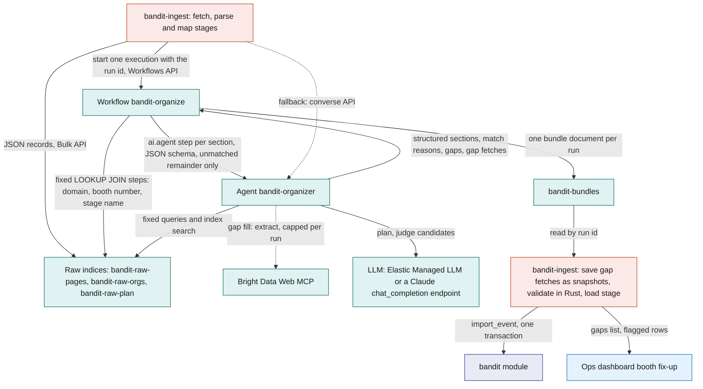
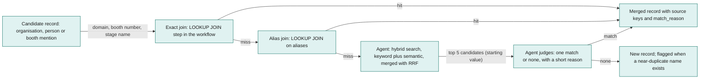
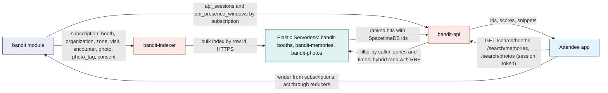
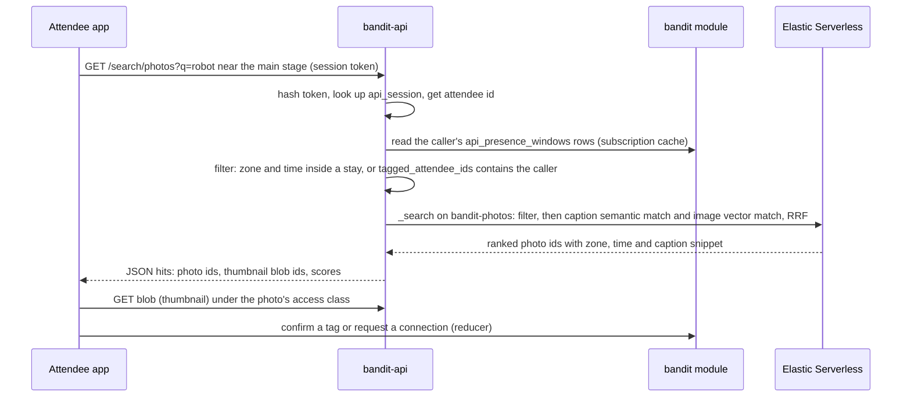
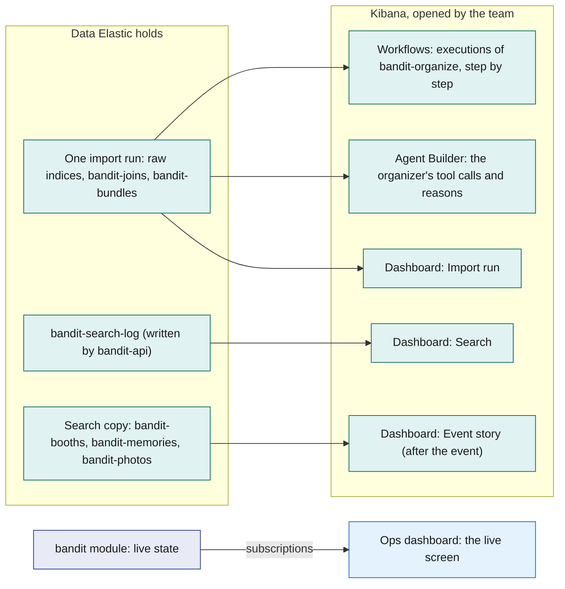

# Elastic

Elastic Serverless does two jobs for BandIt, and nobody chats with it. Before the event it is the organizer of scraped data: `bandit-ingest` writes the raw Bright Data records into raw indices, an Elastic Workflow runs the Agent Builder agent `bandit-organizer` over them, and the organized event bundle comes back as one document that `bandit-ingest` validates and loads into SpacetimeDB with `import_event`. During and after the event it is the attendee's search: `bandit-indexer` keeps a one-way copy of booths, consented memories and photos, and `bandit-api` serves three search routes that first narrow results to where and when the caller was, then rank by meaning. The team shows both jobs in Kibana: each import run step by step in the Workflows view, the agent's tool calls in Agent Builder, and three dashboards built only on data Elastic already holds. Elastic agents organize and validate data; decisions belong to Claude ([Anthropic-Agent](Anthropic-Agent.md)). Elastic never holds truth and never sits in the safety loop: if it disappears, the import falls back to rules and the search box hides, and nothing live changes.

## Role in the system

Responsibilities:

- Hold the raw scraped records of one import run in three raw indices: `bandit-raw-pages`, `bandit-raw-orgs`, `bandit-raw-plan`.
- Run the organizer: the Workflow `bandit-organize` first makes the exact joins with fixed ES|QL `LOOKUP JOIN` steps, then calls the agent `bandit-organizer` with a JSON schema for the fuzzy remainder, so the result is a structured bundle (organisations deduplicated, each organisation's facts merged across its site, LinkedIn and Crunchbase records, booths linked to organisations and people, categories and tags, schedule slots matched to stages and zones, gaps flagged), and writes it to `bandit-bundles`. The agent may fill a gap with a capped number of Bright Data MCP calls.
- Keep a one-way copy of booths, consented memories and photos in three search indices: `bandit-booths`, `bandit-memories`, `bandit-photos`.
- Serve three attendee-scoped search routes in `bandit-api`: `GET /search/booths`, `GET /search/memories`, `GET /search/photos`. `bandit-api` holds every Elastic credential; browsers never talk to Elastic.
- Define one view for the search filter, `api_presence_windows`, which gives `bandit-api` the caller's zones and time windows from SpacetimeDB.
- Give the team its Kibana views for the demo and for review: the Workflows execution view of `bandit-organize`, the organizer's tool calls in Agent Builder, and the dashboards Import run, Search and Event story, over the raw and working indices, a search log `bandit-api` writes, and the consented search copy.

Non-responsibilities:

- Not a source of truth. The organizer never writes to SpacetimeDB; `bandit-ingest` validates its output in Rust and calls `import_event` ([BrightData](BrightData.md)). Search results carry SpacetimeDB ids, and any action on a result (a tag confirmation, a connection request, a merch job) is an ordinary reducer call made by the app, owned by [Social](Social.md) or [Merch](Merch.md).
- No chat. There is no agent that attendees or staff talk to, no conversation route and no per-attendee agent tools or keys. The one agent runs once per import, started by `bandit-ingest`.
- No decisions. Elastic agents organize and validate data. Anything that is a judgment about people or events, including any question from staff or [Hyphenate](Hyphenate.md) about an incident, goes to Claude through `claude-client` over SpacetimeDB rows ([Anthropic-Agent](Anthropic-Agent.md)); incidents never enter Elastic.
- Not in the safety path. Incidents, directives, density decisions and exit assignment never read or write Elastic ([Safety](Safety.md)). No zone statistics live here, and no Kibana view is used to run the live event: the live screen is the [Ops-Dashboard](Ops-Dashboard.md).
- Never receives medical, insurance, payment or bank data, raw `band_report` or `presence_sample` rows, incidents, scraped `person` or `claim_contact` rows, or any visit, encounter or photo tag the attendee has not consented to share.
- Does not fetch pages. Bright Data owns every step that touches the web and `bandit-ingest` drives it ([BrightData](BrightData.md)). Elastic receives JSON records, never raw HTML or Markdown, and never runs a model pass per page. The one web call made from Elastic is the organizer's gap-fill tool, which is itself a Bright Data MCP call, capped per run.

## Interfaces

| Interface | Direction | Who | What flows | Transport |
|---|---|---|---|---|
| Elastic Bulk API, raw indices | in | `bandit-ingest`, organize stage ([BrightData](BrightData.md)) | parsed JSON records (the output of Bright Data `extract` and of the Markdown parsers, never a page body), map-stage geometry and the core station and zone rows, one document per record, tagged with the run id | HTTPS, ingest API key (write on `bandit-raw-*`, read on `bandit-bundles`) |
| Workflows API | in | `bandit-ingest`, organize stage | start one execution of `bandit-organize` with the run id; poll its status | HTTPS to Kibana, ingest API key |
| Agent Builder, inside the workflow | internal | the `ai.agent` step | the run id and a JSON schema per bundle section; back comes structured output | Elastic-internal |
| Agent tools | internal | `bandit-organizer` | fixed ES\|QL queries and one index search tool over the raw indices; one MCP tool for gap filling | Elastic-internal |
| Bright Data Web MCP, gap fill | out | `bandit-organizer`, through an Agent Builder MCP tool | `extract` with the null rule on an organisation or event page URL that the raw records name but no snapshot covers (for example an exhibitor whose website was never fetched); back comes one JSON record with `source_url` and `fetched_at`; at most 10 calls per run (starting value) | HTTPS JSON-RPC from Elastic to the remote MCP server, with a Bright Data zone token of its own that has its own spending limit ([BrightData](BrightData.md)) |
| `bandit-bundles` | out | `bandit-ingest` | one bundle document per run: the organized sections, a match reason per merge, a gaps list, the gap-fill records with their `source_url` and `fetched_at`, the agent's model and tool-call count | HTTPS `_search` by run id, ingest API key |
| Agent Builder converse (fallback) | in | `bandit-ingest` | when a workflow execution fails to start or errors before writing the bundle: `agent_id` `bandit-organizer`, the run id and the section schema in the input; back comes JSON text that `bandit-ingest` validates itself | HTTPS to Kibana, ingest API key |
| SpacetimeDB subscription | in | `bandit-indexer` (role `indexer`) | rows of `venue`, `zone`, `station`, `booth`, `schedule_slot`, `consent`; from BrightData.md: `organization`, `hall`; from Social.md: `visit`, `encounter`, `photo`, `photo_tag` | SpacetimeDB Rust client SDK over WebSocket; initial full sync then every committed change |
| `heartbeat` reducer | out | `bandit-indexer` | service `indexer`, version, counters (documents written, bulk failures, lag seconds) every 5 s into `service_heartbeat` | SpacetimeDB reducer call |
| Elastic Bulk API, search indices | out | `bandit-indexer` | index and delete operations keyed by document id | HTTPS, indexer API key (write on `bandit-booths`, `bandit-memories`, `bandit-photos`) |
| `GET /search/booths` | in | Attendee app | query text, optional `zone_id`, optional `near` (latitude, longitude), `limit`; returns ranked booths with `booth_id`, `zone_id`, name, snippet, score | HTTPS JSON on `bandit-api`; `api_session` token optional, booths are public |
| `GET /search/memories` | in | Attendee app | query text, optional `kind` (`visit`, `encounter`), optional `since` and `until`, `limit`; returns the caller's own ranked memories with `memory_id`, `booth_id`, `zone_id`, times, and `other_attendee_id` only when that person allows it | HTTPS JSON on `bandit-api`; `api_session` token required |
| `GET /search/photos` | in | Attendee app | query text, optional `since` and `until`, `limit`; returns ranked photos taken where and when the caller was, or that the caller is tagged in, with `photo_id`, `zone_id`, `taken_at`, caption snippet, `thumbnail_blob_id` | HTTPS JSON on `bandit-api`; `api_session` token required |
| `api_session` lookup | in | `bandit-api` | the app's session token in the `Authorization` header, hashed and matched against `bandit-api`'s subscription to `api_session` to get the caller's attendee id | SpacetimeDB subscription (defined in [SpacetimeDB](SpacetimeDB.md)) |
| `api_presence_windows` view | in | `bandit-api` (role `api`) | one row per stay for every attendee: attendee id, zone id, start, end, collapsed from `presence_sample` by the module | SpacetimeDB subscription; the view is defined by this file |
| Elasticsearch search | out | `bandit-api` | filtered hybrid queries on the three search indices | HTTPS, one service API key (read on `bandit-booths`, `bandit-memories`, `bandit-photos`; write on `bandit-search-log`) |
| `bandit-search-log` | out | `bandit-api` | one document per search: route, time, latency, hit count, the top booth ids for booth searches and the query text for booth searches only; no attendee id, and no query text for memory or photo searches | HTTPS index request with the same service key, fire and forget |
| Kibana | in | the team, signed in to the Elastic Cloud project | the Workflows execution view, Agent Builder, and the dashboards Import run, Search and Event story; read only on every BandIt index | HTTPS in a browser; Elastic Cloud logins, never attendees |

## Design

### Why Elastic and not SpacetimeDB

Each store gets only what it does best. SpacetimeDB owns all live state and every write (reducers are the only write path), the subscriptions that push changes to the apps and the dashboard, the space-time mapping of zones and times, every plain list (my visits, my encounters, my photos by zone and time window, exact booth lookup by id or name, connections) and the consent filter. Elastic owns two things SpacetimeDB is not built for: fuzzy entity resolution across messy scraped sources before the import, and ranking by meaning with semantic and vector search over photos, memories and booths. It ranks only over candidates SpacetimeDB has already narrowed by zone, time and consent, it never decides access, and it never holds live state. The organizer turns messy records into a clean bundle, but the bundle only becomes real when `import_event` accepts it. Search turns a question into ranked SpacetimeDB ids, but the app renders from its own subscriptions and acts through reducers. The line is drawn by the question: exact, live or transactional questions go to SpacetimeDB; questions of meaning and similarity go to Elastic.

| Question | Who answers | Why |
|---|---|---|
| "Is `Elastic` on the Devpost sponsor list the same company as `Elastic N.V.` on LinkedIn?" | Elastic, the organizer | Entity resolution over messy text, before the import |
| "Which booth does the schedule line `Stage A, Hall 1` belong to?" | Elastic, the organizer | Free-text location matched to stage booths and zone names |
| "Which zone is band 7 in right now?" | SpacetimeDB | Live `band_report` row, pushed by subscription |
| "Who is in the light circle around the fallen person?" | SpacetimeDB | Written inside the incident transaction; must never wait on a search |
| "Show my timeline" | SpacetimeDB | Exact `visit` and `encounter` rows for one attendee, already a view |
| "Booths about wearable robotics" | Elastic, search | Matches meaning in booth descriptions, not exact words |
| "That drone booth near the east hall" | Elastic, search | Meaning plus a place (geo distance to a zone centroid or booth point) |
| "The photo of me near the main stage around 9 with the robot" | Elastic, search | Filter to where and when I was, then rank caption meaning and image content |
| "Which AI hardware booths did I spend the most time at?" | Elastic, search | My own visits ranked by what each booth is about |

Presence is zone-level only ([SpacetimeDB](SpacetimeDB.md)), so a memory is "in zone Z, at booth B, from T1 to T2" or "co-present with attendee X in zone Z from T1 to T2". The indices carry no finer position than a zone centroid or a hand-placed booth point.

### What Elastic does not do

- It does not serve plain lists. "My visits", "my encounters", "my photos in zone Z between 9 and 10", "the booth with number B12" and "my connections" are SpacetimeDB views and subscriptions in the apps; the search routes require a query and answer only ranked questions.
- It does not decide who may see what. The indexer copies only rows the `consent` rows allow, and `bandit-api` builds every caller filter from SpacetimeDB rows (`api_session`, `api_presence_windows`). No Elastic query, model or key ever decides access.
- It does not hold live state or history. Live counts, zone state, incidents and the zone history in `zone_sample` stay in the module and reach screens by subscription. The Kibana dashboards read only the organizer's working data, the search log and the consented copy; none of them shows a live count, a zone's density or a person.
- It does not write to SpacetimeDB. The organizer's bundle is loaded by `bandit-ingest` through `import_event`; a search result becomes an action only through a reducer the app calls.
- It does not decide. The organizer links and checks records; judgments about incidents, claims, summaries and merch are Claude's ([Anthropic-Agent](Anthropic-Agent.md)).
- It does not talk to anyone. There is no chat agent; the one agent runs once per import and reads the raw indices of that run, plus at most a handful of Bright Data MCP calls to fill gaps, whose results go back into the raw indices and the snapshots.
- It does not fetch or crawl. Elastic's Open Crawler is not used: it handles only static sites, and Bright Data owns fetching ([BrightData](BrightData.md)). Raw records reach Elastic through `bandit-ingest`'s bulk indexing, because Bright Data cannot deliver to Elasticsearch directly, and there are no scheduled re-scrapes: one run per import.
- It does not read floor plans. Booth geometry comes from the Rust map stage in `bandit-ingest` and reaches Elastic as plan records; `floorplan_check` stays a Claude call in that stage.
- It is not on the safety path and is never a dependency of anything live.

### Part one: the organizer, upstream of SpacetimeDB

Scraped records are messy in regular ways. One organisation appears under three names (the Devpost sponsor list, its own site, its LinkedIn page); booth numbers come as `B12`, `B-12` and `12`; schedule locations are free text; speakers are listed under slightly different company names. Fixed ES|QL `LOOKUP JOIN` steps handle the regular cases, deterministically, before any model runs. The irregular remainder is where a model with search tools helps: it can look up candidates by meaning and decide, and it can say why. The agent has fixed tools, so it never writes queries freely except through one index search tool, it reaches the web only through one capped Bright Data tool, and it never writes anywhere but its own answer. Each step has one owner: Bright Data fetched and extracted every page before the records arrived, the workflow's join steps make the exact links, the agent makes the fuzzy ones, and Rust decides what is loadable.

The diagram answers: how do raw records become a bundle that `bandit-ingest` can load, and what happens when Workflows are not available?

**Raw indices.** `bandit-ingest` writes every record of a run with a `run_id`, so the agent's tools always filter on the current run and an old run never leaks into a new bundle. Bright Data cannot deliver to Elasticsearch directly, so `bandit-ingest` bulk-indexes the records itself, and it sends JSON records only: page bodies stay in the snapshots, and Elastic never sees HTML or Markdown. The three indices are small (a few hundred to a few thousand documents for a hackathon) and are rebuilt from the saved snapshots at every run, so they are disposable. `bandit-raw-orgs` and `bandit-raw-plan` are created with `index.mode` set to `lookup`, so they can sit on the right side of a `LOOKUP JOIN`. Every document carries the provenance fields the bundle needs, normalised join keys, and a `text` field mapped as `semantic_text` so candidates can be found by meaning.

| Index | One document per | Fields |
|---|---|---|
| `bandit-raw-pages` | parsed record from an event, exhibitor, schedule or merch page (the JSON that Bright Data `extract` or a Markdown parser produced) | `run_id`, `source_key`, `source_url`, `fetched_at`, `fetched_by` (`ingest`, `organizer`), `snapshot_sha256`, `record_kind` (`organization_candidate`, `person_candidate`, `schedule_item`, `booth_mention`, `venue_fact`, `merch_product`), `name` (text with a keyword sub-field), `aliases` (keyword: website domain, normalised name, booth number as printed), `domain`, `booth_number_norm`, `location_norm`, `org_key` (keyword: the normalised join keys the `LOOKUP JOIN` steps use), `text` (semantic_text: the record's description), `tier_text`, `role_text`, `location_text`, `start_text`, `end_text`, `links` (keyword, not indexed), `raw` (object, not indexed) |
| `bandit-raw-orgs` (lookup mode) | company-facts record from a dataset | `run_id`, `source_key`, `source_url`, `fetched_at`, `dataset` (`linkedin_company`, `crunchbase_company`, `google_maps`), `name` (text with a keyword sub-field), `aliases` (keyword: domain, normalised name), `domain` (keyword: the join key), `website`, `text` (semantic_text: the dataset's description), `industry`, `headquarters`, `size_range`, `founded_year`, `funding_summary`, `social_pages` (keyword, not indexed) |
| `bandit-raw-plan` (lookup mode) | booth geometry item from the map stage, or a reference row | `run_id`, `record_kind` (`booth_geometry`, `station`, `zone`, `hall`), `source_key`, `hall_name`, `booth_number_text`, `booth_number_norm`, `location_norm` (keyword: the join keys), `aliases` (keyword: normalised booth number), `plan_x_m`, `plan_y_m`, `placement_confidence`, `nearest_station_id`, `nearest_station_distance_m`, and for reference rows the zone or station name, id and plan position copied from SpacetimeDB |

**The workflow.** `bandit-organize` is an Elastic Workflow that `bandit-ingest` starts once per import run through the Workflows API, passing the run id. Its first steps are deterministic: fixed ES|QL queries with `LOOKUP JOIN`, parameterised only by the run id, that make the exact joins and write their results to a per-run join index (`bandit-joins`). They join an organisation candidate to its company facts on `domain`, a booth mention to its geometry on `booth_number_norm`, a schedule item to a stage booth or zone on `location_norm`, and a person candidate to an organisation on the `org_key` printed on the same page. Nothing a model says can change these rows. Then come the `ai.agent` steps, one per bundle section, in dependency order (organisations, then booths, then people, then schedule and gaps), each with that section's JSON `schema`, and each given only the records the joins left unmatched plus the join results to build on, so the agent's output is structured and a malformed answer fails inside Elastic rather than in Rust. A final index step writes the sections, the match reasons, the gap-fill records and the gaps list as one document to `bandit-bundles`, keyed by the run id. `bandit-ingest` polls the execution, reads the document, saves every gap-fill record as a snapshot and bulk-indexes it into the raw indices of the run, and then validates the bundle in Rust against the same rules `import_event` enforces: every `source_key` must exist in the raw indices of that run, every organisation reference must resolve, booth numbers must be unique per hall, zone and stage names must exist, every category must come from the fixed list, and the gap-fill count must be within the cap. The second validation is deliberate: Elastic shapes the bundle, Rust decides whether it is loadable, and `import_event` decides once more inside the transaction. Why a workflow and not a plain converse call: the join steps and the `ai.agent` step give deterministic links, a schema-checked answer and a durable record of the run, and the bundle lands in an index where a reviewer can read it next to the raw records.

**The fallback.** Elastic's docs list Workflows as generally available on Elastic Cloud Serverless; the feature is turned on in the project settings and needs a role with workflow privileges ([manage workflows](https://www.elastic.co/docs/explore-analyze/workflows/authoring-techniques/manage-workflows)). So the workflow is the normal path. If an execution fails to start, or errors before it writes the bundle document, `bandit-ingest` calls the Agent Builder converse API directly with the same instructions and the section schema in the input, parses the answer as JSON, validates it, and on failure sends the validation errors back on the same conversation once. If the second answer still fails, that section is assembled by rules plus the Claude `scrape_extract` call in `bandit-ingest` ([BrightData](BrightData.md)), which is also what happens when Elastic is absent altogether. `scrape_extract` runs in no other case, so the cross-source merge has one owner at a time. In the fallback the exact joins are the same rules in Rust (domain, normalised booth number, exact stage name), so a section is linked the same way whichever side does it.

**What the agent decides.** The instructions, in prose (the exact wording lives in the agent configuration):

- Organize one import run, identified by `run_id`; use only records of that run. Build on the join results; never undo a join the workflow made.
- Deduplicate the organisations the joins left unmatched with the matching ladder below. Never merge two records on a name alone when their website domains differ.
- Merge each organisation's facts across its records (site text, LinkedIn company, Crunchbase company) into one description and one tag set; typed fields (industry, headquarters, size, founding year) come from the dataset record, the description from the site first.
- Link every unmatched booth mention to one organisation or to none; link every unmatched person candidate to one organisation or to none. Record a short reason for every link.
- Fill a gap with `bandit.fetch_gap` only when a record names an organisation or event page URL that has no raw record (an exhibitor whose website was never fetched); never a person's page and never a web search for a name; at most 10 calls per run (starting value). Put every result in the gap fetches section with its `source_url` and `fetched_at`.
- Give every organisation and booth one category from the fixed list and up to five lowercase tags drawn from its own text. The category becomes the first entry of `tags`, so no table changes.
- Match every schedule item's location text to a stage booth or a zone name from `bandit-raw-plan`; leave it unmatched and flag it when nothing fits.
- Return null rather than a guess. Never invent a source key, a booth number or a person. List every unresolved item in the gaps section with a reason, so the booth fix-up panel can show it.

The fixed category list (starting value, calibrate against the real exhibitor list): `ai`, `hardware`, `developer_tools`, `cloud`, `data`, `security`, `fintech`, `health`, `education`, `consumer`, `sponsor_services`, `food`, `stage`, `other`.

**Tools.** Fixed, parameterised ES|QL queries where the rule is known, one index search tool where meaning matters, and one MCP tool for the web. Fixed queries keep the run filter, the limits and the field choices in the query text where the model cannot drop them.

| Tool id | Type | Index | Parameters | Returns | Why this shape |
|---|---|---|---|---|---|
| `bandit.joins` | ES\|QL, fixed | `bandit-joins` | `run_id`, `record_kind`, `key` | what the workflow's `LOOKUP JOIN` steps already decided for that key | the agent builds on an exact join instead of redoing it |
| `bandit.unmatched` | ES\|QL, fixed | `bandit-raw-pages`, `bandit-raw-orgs` | `run_id`, `record_kind` | the records the join steps left without a partner | the agent's work list; nothing else needs a judgment |
| `bandit.candidates` | index search tool | `bandit-raw-pages`, `bandit-raw-orgs` | the record's name and text (free text); custom instructions: hybrid keyword plus semantic retrieval merged with reciprocal rank fusion, filtered on `run_id` and `record_kind`, row limit 5 | the top candidates with name, aliases, source key and a snippet | step three; the one place the model shapes a query |
| `bandit.plan_items` | ES\|QL, fixed | `bandit-raw-plan` | `run_id`, `hall_name` (optional) | geometry items with booth number, position and nearest station | booth linking and gap detection |
| `bandit.stages_and_zones` | ES\|QL, fixed | `bandit-raw-plan`, `bandit-raw-pages` | `run_id` | stage booth mentions, zone names and station ids | schedule matching |
| `bandit.schedule_items` | ES\|QL, fixed | `bandit-raw-pages` | `run_id` | schedule items with their location, start and end text | the schedule section |
| `bandit.people_for_org` | ES\|QL, fixed | `bandit-raw-pages` | `run_id`, `org_key` or `org_name` | person candidates listed under that organisation | people linking |
| `bandit.record_by_key` | built-in document lookup | any raw index | document id | the document | expand a key the agent already holds without a new search |
| `bandit.fetch_gap` | MCP tool: Bright Data Web MCP `extract` | the web, through Bright Data ([BrightData](BrightData.md)) | `url`, the record schema for that kind; the null rule is in the call | one JSON record with `source_url`, `fetched_at` and `fetched_by` `organizer` | the only web call; at most 10 per run (starting value), held by the instruction and by the zone token's own spending limit |

Tool outputs are capped (`LIMIT` in every ES|QL tool, a row limit on the index search tool), and the agent runs one section at a time, because the most common Agent Builder failure is a tool response or an answer larger than the model's context.

**The matching ladder.** Elastic's documented entity-resolution pattern, used for organisation deduplication and for linking people and booths to organisations. The diagram answers: in what order is a match tried, and when does the model get involved?

Steps one and two are ES|QL `LOOKUP JOIN` steps in the workflow, deterministic and cheap, so most records never reach the model. Step three finds the few candidates worth a judgment, and step four is the only place the model decides; it must pick from the candidates it was given and write one sentence of reason, which lands in the bundle document next to the merge. The reviewer reads the reasons, not the prompt.

**Which LLM powers Agent Builder.** On Elastic Cloud Serverless, Agent Builder uses Elastic Managed LLMs served by the Elastic Inference Service, with no setup. That is the default here, because it works the moment the project exists. Agent Builder also routes low-effort steps to a fast model automatically; this cannot be switched off and lowers token use. If the trial caps managed LLM use, or the team wants Claude behind the organizer, Elastic's current path is an inference endpoint of task type `chat_completion` under "External inference", created with an Anthropic API key and a Claude model name, then selected as the default model under Model management (Feature settings) or passed per step as `inference_id`. The older "Generative AI connector" path is deprecated but still works on current releases. These Claude calls are made by Elastic, not by `claude-client`, so they are not recorded in `model_call`; everything else about Claude belongs to [Anthropic-Agent](Anthropic-Agent.md). Elastic notes that mid-tier Claude models sometimes generate invalid ES|QL; the organizer's fixed tools make that mostly irrelevant, but the index search tool still generates queries, so a higher-tier model is the safer choice if Claude is used.

### Part two: search, downstream of SpacetimeDB

Data enters the search indices only from SpacetimeDB and leaves only as ids. The diagram answers: how does a committed row become searchable, and how does a search stay inside what the caller is allowed to see?

**bandit-indexer.** A Rust process with the `indexer` service role, running on the demo laptop or a small VM next to `bandit-api`. It is an ordinary SpacetimeDB client built on the Rust client SDK: it opens one connection to the `bandit` database, subscribes to the copied tables, and reacts to row callbacks. On first start it prints its identity so the owner can grant the `indexer` role with `grant_role` ([SpacetimeDB](SpacetimeDB.md)). While running it calls `heartbeat` every 5 s with documents written, bulk failures and the age of the oldest unflushed change, so the Ops dashboard can show whether search is fresh.

- **Subscription and sync.** The SDK keeps a client-side cache of every subscribed table. A new subscription first delivers all current rows (initial sync), then each committed change. The indexer treats both the same way: a row arrived, rebuild the documents that depend on it. There is no separate backfill mode and no "indexed" flag in SpacetimeDB, which keeps the module free of any Elastic knowledge.
- **Joins happen in the indexer, not in Elastic.** A booth document needs its zone name, station id and schedule slots; a memory document needs the booth text and zone centroid copied in. The builders read the related rows from the SDK cache at build time. When a parent row changes (a zone is renamed, a booth description is corrected), the router rebuilds every dependent document. Copying text in at index time avoids lookup joins at query time.
- **Idempotent writes.** Every document id is the SpacetimeDB row id (prefixed with the table for indices that merge tables). Indexing the same row twice overwrites the same document, so a retried bulk request, a restart or a duplicated callback is harmless. Deletes are sent as bulk delete operations and a delete of a missing document is ignored.
- **Coalescing.** Changes are queued by document id; if the same row changes three times inside one flush window, one write goes out. The queue flushes every 1 s or at 500 operations (starting values, calibrate). Bulk failures are retried with exponential backoff, and the whole batch is retried because every operation is idempotent.
- **Rebuild.** Each logical index is an alias (`bandit-booths`) over a generation index (`bandit-booths-003`). To change a mapping, the operator creates generation N+1 with the new mapping, points the indexer config at it and restarts; the indexer repopulates from the initial sync, and the operator moves the alias when the new generation is complete and deletes the old one. `bandit-api` only ever names the alias. The same procedure recovers from a corrupted or accidentally deleted index.
- **Which tables are copied.**

| Table (owner) | Copied to | Filter |
|---|---|---|
| `venue`, `zone`, `station` (SpacetimeDB.md) | folded into every document (names, centroids, origin for geo conversion) | none; venue layout is public |
| `booth`, `schedule_slot` (SpacetimeDB.md, loaded by BrightData.md) | `bandit-booths` | none; venue content |
| `organization`, `hall` (BrightData.md) | folded into `bandit-booths` documents: a booth document carries its organisation's facts and its hall name; there is no organisation index | none; organisation facts are about companies, not people |
| `visit` (Social.md) | `bandit-memories` | only visits of attendees whose `consent` row `findable` is granted; a visit is indexed when it opens and updated when it closes |
| `encounter` (Social.md) | `bandit-memories`, two documents per row (one per participant) | each participant's document exists only if that participant has `findable`; the other participant's id is included only if the other also has `findable`, otherwise the document says "someone" with no id |
| `photo`, `photo_tag` (Social.md) | `bandit-photos` | a photo is indexed once it has a caption or a thumbnail; `tagged_attendee_ids` holds only tags with status confirmed whose attendee has `photo_tagging`; `findable_attendee_ids` is the subset that also has `findable` |
| `consent` (SpacetimeDB.md) | not indexed | read by the builders; a change triggers a rebuild or delete of every memory and photo document of that attendee |
| `zone_sample`, `presence_sample`, `band_report` (SpacetimeDB.md) | never | history and live data stay in the module; there are no zone statistics in Elastic |
| `person`, `claim_contact` (BrightData.md) | never | people enter Elastic only as attendee ids on their own consented memories, never as scraped profiles |
| everything else (incidents, medical, payments, insurance, `job`, `blob_ref`, vision tables) | never | out of Elastic's remit |

Consent names (`findable`, `photo_tagging`) are the switches [SpacetimeDB](SpacetimeDB.md) defines on the `consent` row and [Social](Social.md) gives meaning to; this file uses them and defines nothing new about consent. When a switch turns off, the indexer deletes the attendee's documents from `bandit-memories` by query on `attendee_id`, rebuilds the encounter documents of everyone they met (their id disappears from those documents), and rebuilds every photo they were tagged in.

**Positions for geo queries.** There are no x/y positions for people. The only positions in Elastic are the zone centroid, from the zone's plan position (`zone.plan_x_m`, `zone.plan_y_m`, metres in the venue plan frame, defined in [SpacetimeDB](SpacetimeDB.md)), used on memories and photos; and the booth point, from the booth map pipeline or a hand fix in the Ops dashboard ([BrightData](BrightData.md)) and stored on the booth row (`booth.plan_x_m`, `booth.plan_y_m`), used on booths. A booth with `placement_source` `none` is indexed without a `location`. The indexer converts plan metres to latitude and longitude at index time so Elastic `geo_point` queries ("near the main stage", "within 40 m of the east entrance") work with real coordinates. The venue row carries the plan origin (`venue.origin_lat`, `venue.origin_lon`) and the plan's rotation from true north (`venue.plan_rotation_deg`). The conversion rotates the plan offset into north and east metres, then adds them to the origin using the local metres-per-degree factors (about 111 km per degree of latitude; about 88 km per degree of longitude at this latitude). This flat-earth approximation is exact enough for a site a few hundred metres wide. Starting value for the origin: the Palace of Fine Arts, 3601 Lyon Street, San Francisco, roughly 37.8029 north, 122.4486 west (a published listing; the actual plan origin corner is recorded on site at setup). SpacetimeDB keeps plan metres, which is what the Ops dashboard draws; the conversion lives in one place, the indexer.

**Indices.** Conventions shared by all three:

- The document id is the SpacetimeDB row id. Where an index merges rows from more than one table, the id is prefixed with the table name (`visit-42`), and encounter documents are suffixed with the viewer's attendee id because one row becomes two documents (`encounter-17-<attendee id>`). The unprefixed row id is also stored as a field so the app can fetch the row.
- Attendee ids are the SpacetimeDB identity as a hex string, mapped as `keyword`.
- Timestamps are `date`, converted from SpacetimeDB timestamps by the indexer.
- Text vectors: every `semantic_text` field names its inference endpoint explicitly, `.jina-embeddings-v5-text-small`, the Elastic Inference Service text model that is the Serverless default. Pinning it matters because the default differs across Elastic versions and deployment types, and because scores from different models cannot be mixed; indices queried together must share one model.
- Image vectors (optional): `bandit-photos` carries an `image_vector` field embedded by a multimodal Elastic Inference Service model (`jina-embeddings-v5-omni`, or `jina-clip-v2`) from the thumbnail at index time. A multimodal model puts text and images in one vector space, so a text query can find a photo by what is in it, not only by its caption. It is a separate generation of the index (the field type is a technical preview), so captions are the baseline and the image field can be dropped without touching anything else.
- Multi-valued keyword fields (tagged attendees) are filtered with `terms` queries in the search request, which handles arrays.

**`bandit-booths`** (one document per `booth` row, carrying its organisation's facts).

| Field | Type | Source |
|---|---|---|
| `booth_id` | long | `booth` row id |
| `source_key` | keyword | stable key from the scrape ([BrightData](BrightData.md)) |
| `name` | text with a keyword sub-field | `booth.name` |
| `booth_number` | keyword | `booth.booth_number`, as printed on the plan |
| `kind` | keyword (`sponsor`, `stage`, `food`, `help_desk`, `other`) | `booth.kind` |
| `description` | semantic_text, inference `.jina-embeddings-v5-text-small` | `booth.description` followed by the organisation's description, tags and the booth's schedule titles, so one meaning search covers all of them |
| `tags` | keyword | `booth.tags` merged with `organization.tags`; the first tag is the category the organizer assigned |
| `organization_id` | long | `booth.organization_id` |
| `org_name` | text with a keyword sub-field | `organization.name` |
| `org_kind` | keyword (`sponsor`, `exhibitor`, `venue`, `act`, `organiser`) | `organization.kind` |
| `sponsor_tier` | keyword | `organization.sponsor_tier`, where known |
| `org_industry`, `org_headquarters`, `org_size_range` | keyword | from `organization`; absent when unknown |
| `org_founded_year` | integer | from `organization`; absent when unknown |
| `org_website`, `org_linkedin_url`, `org_crunchbase_url` | keyword, not indexed | from `organization`, for the card |
| `logo_blob_id` | keyword, not indexed | `organization.logo_blob_id` |
| `hall_id` | long | `booth.hall_id` |
| `hall_name` | keyword | joined from `hall` |
| `zone_id` | long | `booth.zone_id`; absent while the booth is unassigned |
| `zone_name` | keyword | joined from `zone` |
| `station_id` | integer | the zone's station |
| `location` | geo_point | booth plan point converted to latitude and longitude; absent when `placement_source` is `none` |
| `schedule_text` | text | titles and times of the booth's `schedule_slot` rows, joined |
| `schedule_slot_ids` | long | ids of those rows |
| `next_slot_at` | date | start of the next slot after indexing time, rebuilt when slots change |
| `updated_at` | date | indexer write time |

**`bandit-memories`** (visits and encounters, one document per visit, two per encounter).

| Field | Type | Source |
|---|---|---|
| `memory_id` | keyword | document id |
| `kind` | keyword (`visit`, `encounter`) | table of origin |
| `source_row_id` | long | `visit` or `encounter` row id |
| `attendee_id` | keyword | the attendee this document belongs to |
| `started_at`, `ended_at` | date | from the row; `ended_at` absent while the visit or encounter is open |
| `minutes` | double | duration, recomputed on close |
| `zone_id` | long | zone of the memory |
| `zone_name` | keyword | joined from `zone` |
| `location` | geo_point | zone centroid |
| `booth_id` | long | visits only |
| `booth_name` | text with a keyword sub-field | copied from the booth |
| `booth_description` | semantic_text, inference `.jina-embeddings-v5-text-small` | copied from the booth at index time |
| `booth_tags` | keyword | copied from the booth |
| `other_attendee_id` | keyword | encounters only; present only when the other participant has `findable` |
| `co_presence_kind` | keyword (`zone`, `pairwise`) | how the encounter was derived ([Social](Social.md)); zone-level now, pairwise if the neighbour-id firmware extension ships |
| `updated_at` | date | indexer write time |

**`bandit-photos`** (one document per `photo` row with a caption or a thumbnail).

| Field | Type | Source |
|---|---|---|
| `photo_id` | long | `photo` row id |
| `taken_at` | date | `photo.taken_at` |
| `zone_id` | long | `photo.zone_id` (the photographer's band zone at capture, [Social](Social.md)) |
| `zone_name` | keyword | joined from `zone` |
| `location` | geo_point | zone centroid |
| `caption` | semantic_text, inference `.jina-embeddings-v5-text-small` | the photographer's caption or the vision caption (TBD -- LEO), as [Social](Social.md) stores it |
| `caption_source` | keyword (`photographer`, `vision`) | which one |
| `image_vector` | dense vector from the multimodal inference endpoint, optional generation | embedded from the thumbnail at index time |
| `tagged_attendee_ids` | keyword, multi-valued | confirmed `photo_tag` rows whose attendee allows photo tagging |
| `findable_attendee_ids` | keyword, multi-valued | the subset that also allows being found |
| `thumbnail_blob_id` | keyword, not indexed | `blob_ref` id the app uses to show the thumbnail |
| `updated_at` | date | indexer write time |

**The space-time filter.** Every memory and photo search is narrowed before anything is ranked, and the narrowing comes from SpacetimeDB, not from the query text. `bandit-api` identifies the caller through `api_session` and reads the caller's stays from `api_presence_windows`, a view this file adds to the module for the `api` role: one row per stay for every attendee, with attendee id, zone id, start and end, collapsed by the module from `presence_sample` with a 2 minute gap tolerance (starting value, calibrate). Because it is built from a core table, it works whether or not [Social](Social.md) is present. The filter then says:

- memories: `attendee_id` equals the caller (the indexer already wrote only consented rows, so the filter is the whole rule);
- photos: the photo's `zone_id` and `taken_at` fall inside one of the caller's stays, or `tagged_attendee_ids` contains the caller; both branches already respect consent because the indexer enforced it at write time;
- booths: no caller filter; an optional `zone_id` or `near` point narrows by place.

The candidate set is therefore defined by SpacetimeDB rows (the caller's stays, tags and consent), and Elastic only receives it as a filter and ranks inside it. Only after the filter does ranking start: a keyword match on names and tags, a semantic match on `description`, `booth_description` or `caption`, and, when the image generation exists, a vector match of the query text against `image_vector`, all merged with reciprocal rank fusion. This order is why there are no per-attendee Elastic keys: `bandit-api` builds every filter itself from SpacetimeDB rows and uses one service key, and no model is ever handed an attendee id.

The sequence answers: when an attendee searches "robot near the main stage", who talks to whom, and where does the filter come from?

**Search endpoints in bandit-api.** All three live in `bandit-api` ([Rust-Backend](Rust-Backend.md) owns the process; this file owns these routes). `bandit-api` is the only holder of Elastic search credentials: one service key with read on the three search indices. Every route requires a query; with no query there is nothing to rank, and the app shows the exact list from its own subscriptions instead (`my_visits`, `booth` rows, the photos it is tagged in).

| Endpoint | Caller identity | What it does | Elastic call |
|---|---|---|---|
| `GET /search/booths` | `api_session` token optional (booths are public) | Combines a keyword match on `name` and `tags` with a semantic match on `description`, fused with reciprocal rank fusion; an optional `zone_id` filter and an optional `near` point that boosts by geo distance. Returns at most `limit` (default 10) hits with `booth_id`, `zone_id`, `name`, a snippet and the score. The app shows results instantly and highlights booths on its own zone map from SpacetimeDB rows. | one `_search` with a retriever on `bandit-booths` |
| `GET /search/memories` | `api_session` token required | Filters `attendee_id` to the caller and optionally `kind`, `since` and `until`; ranks a keyword match on `booth_name` and `booth_tags` with a semantic match on `booth_description`, fused with RRF; returns at most `limit` (default 10) hits with `memory_id`, `source_row_id`, `booth_id`, `zone_id`, `started_at`, `ended_at`, `minutes` and, for encounters, `other_attendee_id` when present. | one `_search` on `bandit-memories` |
| `GET /search/photos` | `api_session` token required | Builds the space-time filter from the caller's `api_presence_windows` rows and the caller's id in `tagged_attendee_ids`, applies optional `since` and `until`, then ranks a semantic match on `caption` and, when the generation exists, a vector match on `image_vector`, fused with RRF; returns at most `limit` (default 8) hits with `photo_id`, `zone_id`, `taken_at`, a caption snippet and `thumbnail_blob_id`. | one `_search` on `bandit-photos` |

Every response carries SpacetimeDB ids only. The app renders cards from its own subscriptions, shows thumbnails through `bandit-api`'s blob download under the photo's access class ([Social](Social.md) sets it), and acts by calling reducers. A 10 s (starting value, calibrate) timeout on the Elastic call returns an unavailable error and the app falls back to its exact lists.

### Part three: Kibana, what the team shows

Kibana is the web interface of the Elastic project. It is where the workflow and the agent are configured, and it is also the most visual way to show the Elastic side of BandIt: how messy scraped records became one checked bundle, and what people looked for. It reads only what Elastic already holds. The live event is shown on the [Ops-Dashboard](Ops-Dashboard.md) from SpacetimeDB subscriptions, so no Kibana view repeats a live count, a zone's density or an incident. Only the team opens Kibana, signed in to the Elastic Cloud project; attendees never see it.

The diagram answers: which Kibana view reads which data, and where does that data come from?

| Kibana view | Reads | What it shows | When the team opens it |
|---|---|---|---|
| Workflows, executions of `bandit-organize` | the workflow's own run record | each step of one import run in order: the `LOOKUP JOIN` steps with their match counts, each `ai.agent` section, the final index step, the time each took and any error | in the demo, to show how the event got loaded; when an import needs debugging |
| Agent Builder, the organizer | the agent's runs | the tools the agent called, the candidates each search returned, the gap fetches it made, and the one-sentence reason behind every merge | in the demo, next to the workflow; when a reviewer checks a merge |
| Dashboard: Import run | raw indices, `bandit-joins`, `bandit-bundles` for the latest run | records per source and kind; how each record was matched (exact join, alias join, agent, unmatched) as one stacked bar per kind; a table of merges with their reasons; the gaps list; gap-fill calls used against the cap; booths with and without a plan position | before the load stage, to review the bundle; in the demo, to show the validation |
| Dashboard: Search | `bandit-search-log` | searches per route over time, latency, the share of searches with no hit, the booths booth searches returned most, and the most common booth queries | during and after the event; a quick health check on search |
| Dashboard: Event story | `bandit-booths`, `bandit-memories`, `bandit-photos` | a Kibana Maps layer of booths sized by total consented visit minutes; visit minutes per booth category per hour; photos per zone per hour; the top booths by time spent. Totals only, never a person | after the event, in the closing demo |

Every dashboard is saved as part of the project setup, so it shows the saved import run even when no new run happens. The Event story is built from the consented search copy, so a visit or photo an attendee withheld is never counted, and it holds no zone history: `zone_sample` stays in SpacetimeDB.

## Failure modes and fallbacks

| Failure | Effect | Design answer |
|---|---|---|
| Elastic Serverless unreachable at import time | The organizer cannot run | `bandit-ingest` assembles the bundle itself with rules plus `scrape_extract` ([BrightData](BrightData.md)); the saved bundle covers the demo |
| Workflow execution fails to start or errors before writing the bundle | No bundle document for the run | `bandit-ingest` calls the converse API directly, validates the JSON itself and retries once with the errors; then the rules path |
| Kibana slow or a dashboard empty during the demo | Nothing to show on the Elastic side | Nothing live reads Kibana; the dashboards are saved with the project and show the saved import run; the Workflows and Agent Builder views keep the record of every past run |
| `bandit-search-log` write fails | A search is missing from the Search dashboard | The log write is fire and forget and never delays or fails the search itself |
| Agent output fails the Rust validation (unknown source key, dangling reference, duplicate booth number) | Section not loadable | The section is rebuilt by rules; the bad output stays in `bandit-bundles` for review; nothing reaches `import_event` unvalidated |
| Agent merges two different organisations | Wrong facts on a booth | A merge needs a domain match or a candidate from the ladder, never a name alone; every merge carries a reason, and the import report lists merges for a person to read before the load stage |
| Gap-fill tool runs away (too many calls, or a person page) | Credits spent, scope rule broken | The instruction caps it at 10 per run, the Bright Data zone token has its own spending limit, and `bandit-ingest` drops any gap-fill record of kind person and fails validation when the count exceeds the cap |
| Gap-fill fetch repeats on every rerun | A live fetch inside the organize stage | Gap-fill records are saved as snapshots; the next run's fetch stage reads them and indexes them up front, so the organizer finds no gap and the demo never depends on a live scrape |
| Tool response or answer exceeds the model's context | A section fails | `LIMIT` on every ES\|QL tool, a row limit on the index search tool, one section per `ai.agent` step |
| Trial caps managed LLM use | Organizer stops | Add an external `chat_completion` inference endpoint for Claude and set it as default or per step; run the organizer on a small test run as soon as the project exists so a cap is found early |
| Raw records from an old run still present | Stale candidates | Every document carries `run_id` and every tool filters on it; raw indices are rebuilt per run |
| Elastic Serverless unreachable at the event | Search routes fail | `bandit-api` returns a clear unavailable error; the attendee app hides the search box and shows exact lists from SpacetimeDB (booths by zone, own timeline). Nothing live is affected because nothing live reads Elastic |
| `bandit-indexer` down | Copy goes stale; new visits and photos are not searchable | Heartbeat stops, Ops dashboard shows the indexer red. On restart the initial sync re-delivers every row; idempotent writes make the catch-up safe with no bookkeeping |
| Bulk request partly fails (rate limit, transient error) | Some documents missing | Whole batch retried with backoff; same ids overwrite; failures counted in the heartbeat |
| Mapping must change mid-event | Field type change needs a reindex | New generation index behind the alias, indexer restarted at the new generation, alias moved when full |
| Consent switched off after indexing | Stale memory or photo documents reveal what the attendee withdrew | Consent change triggers delete-by-query on `attendee_id` and rebuild of dependent encounter and photo documents |
| A photo search returns a photo of a zone the caller never entered | Over-broad results | The space-time filter is built by `bandit-api` from `api_presence_windows`, not from the query; a photo appears only inside a stay or when the caller is tagged |
| Image model preview behaves badly | Photo search by look fails | Captions are the baseline; the image field is a separate generation that can be dropped |
| Text and image scores mixed badly | Ranking is meaningless | Reciprocal rank fusion merges ranks, not scores; one pinned text model on every `semantic_text` field |
| [Social](Social.md) not built or deleted | `bandit-memories` and `bandit-photos` stay empty | Memory and photo routes return nothing; booth search still works |
| [BrightData](BrightData.md) not built | No organizer input, no organisation facts | The organizer has nothing to run on and is simply not started; booths can be entered by hand through `upsert_booth`, the `org_` fields stay absent and the booth document builder ignores the missing tables |

## Dependencies

**Depends on**

- [BrightData](BrightData.md): the `bandit-ingest` pipeline that writes the raw indices, starts the workflow, validates the bundle and calls `import_event`; the bundle schema; a Bright Data zone token of its own for the gap-fill tool; the `organization` and `hall` rows and booth plan positions that the search copy carries.
- [SpacetimeDB](SpacetimeDB.md): tables `venue`, `zone`, `station`, `booth`, `schedule_slot`, `consent`, `presence_sample`, `api_session`, `service_heartbeat`; reducers `heartbeat`, `grant_role`; the `indexer` and `api` service roles; this file adds the `api_presence_windows` view for the `api` role.
- [Rust-Backend](Rust-Backend.md): the `bandit-api` and `bandit-ingest` process shells, configuration and secret handling for the Elastic keys.
- [Social](Social.md): `visit`, `encounter`, `photo`, `photo_tag` and the consent semantics behind them (optional; without it the memory and photo indices are empty).
- [Anthropic-Agent](Anthropic-Agent.md): only if Claude is chosen as the organizer agent's LLM; the endpoint is configured in Elastic and does not pass through `claude-client`.
- An Elastic Cloud Serverless project with Agent Builder and Workflows (both on Serverless), and Kibana for the team.

**Used by**

- [BrightData](BrightData.md): the organize stage of its pipeline (one row starting with "Elastic.md"; degrades to rules plus `scrape_extract`).
- [Attendee-App](Attendee-App.md): the search box over `GET /search/booths`, `GET /search/memories` and `GET /search/photos`.
- [Ops-Dashboard](Ops-Dashboard.md): the indexer's heartbeat card.
- [Architecture](Architecture.md): the organizer and search container.
- The team, in Kibana: the Workflows and Agent Builder views and the Import run, Search and Event story dashboards.

**If you delete this file**

- Remove `bandit-indexer` and the three `/search/*` routes from [Rust-Backend](Rust-Backend.md) (process table, binaries row, endpoint registry, the open question on laptop placement) and from [Architecture](Architecture.md) (interfaces rows, context and container diagrams, deployment diagram, data ownership rows, demo flow 6, the prize row and the failure row; in "What each database does best", the paragraph starting "Elastic.md:", its table and the diagram after it).
- Remove the "Elastic.md" rows from [SpacetimeDB](SpacetimeDB.md) (the `bandit-indexer` interfaces row, the `indexer` role row, the subscriptions row, the registry row and the `api_presence_windows` mention on the `api` role) and turn its "Copied" markers into "Not copied".
- Remove the Elastic.md organize stage row, interface row, diagram node, sequence steps, failure row and dependency bullets from [BrightData](BrightData.md); `bandit-ingest` then always assembles the bundle with rules plus `scrape_extract`.
- Remove the search box rows from [Attendee-App](Attendee-App.md), the indexer heartbeat rows from [Ops-Dashboard](Ops-Dashboard.md), the Elastic row from the use-case table in [Anthropic-Agent](Anthropic-Agent.md), the Elastic bullets from [Social](Social.md), and the Elastic row and node in [README](README.md).
- The `indexer` role in `staff_role` can be dropped from the seed; `booth.plan_x_m`, `booth.plan_y_m`, `zone.plan_x_m`, `zone.plan_y_m` and the `venue` origin fields stay, because the Ops dashboard map uses them.
- Delete the Elastic Serverless project; no data is lost because Elastic only ever held a copy and working data.

## Open questions

- Check at setup: whether Agent Builder can enforce a per-run call count on the Bright Data MCP tool. The design does not depend on it: the instruction, the Bright Data zone token's spending limit and the Rust validation already hold the cap of 10 calls per run.
